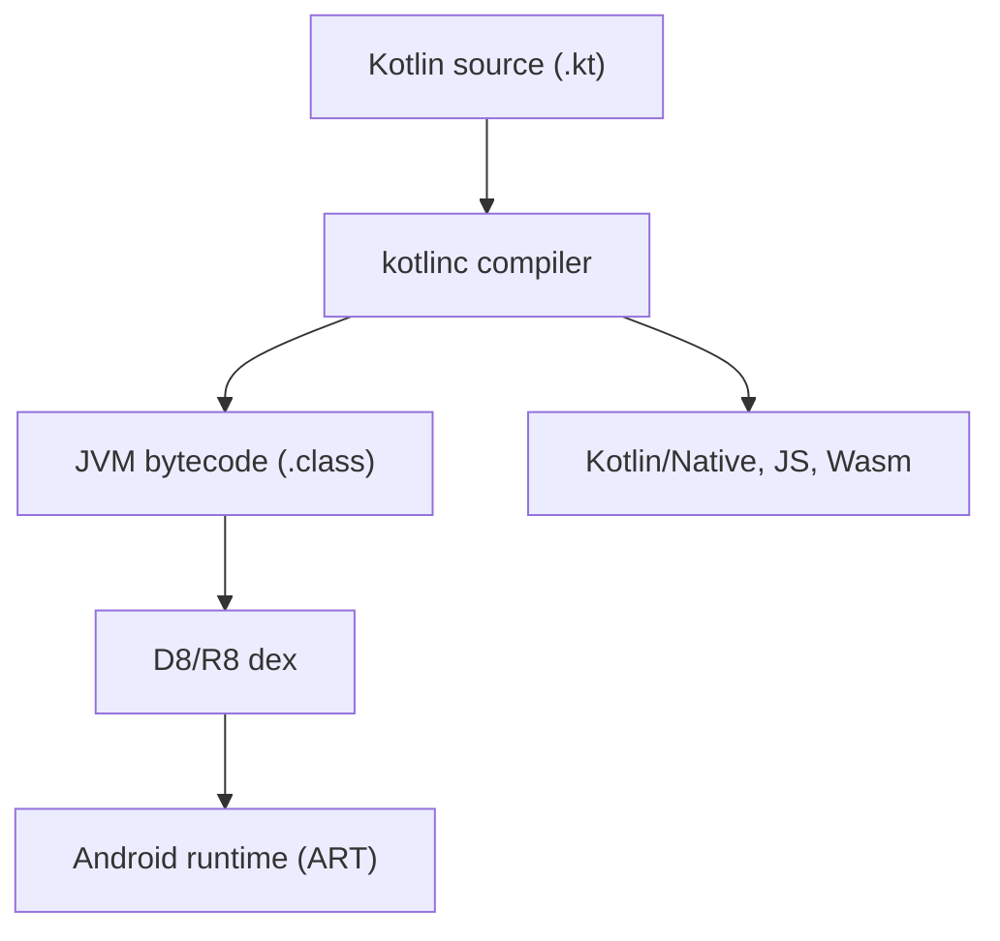
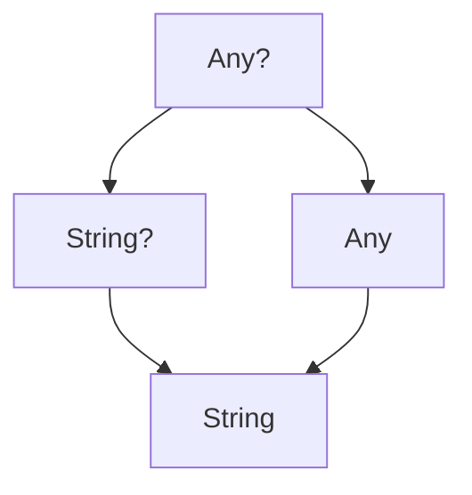
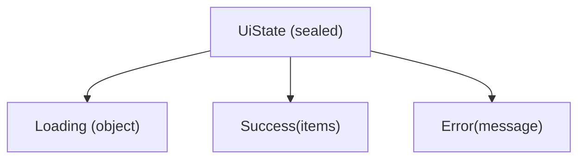
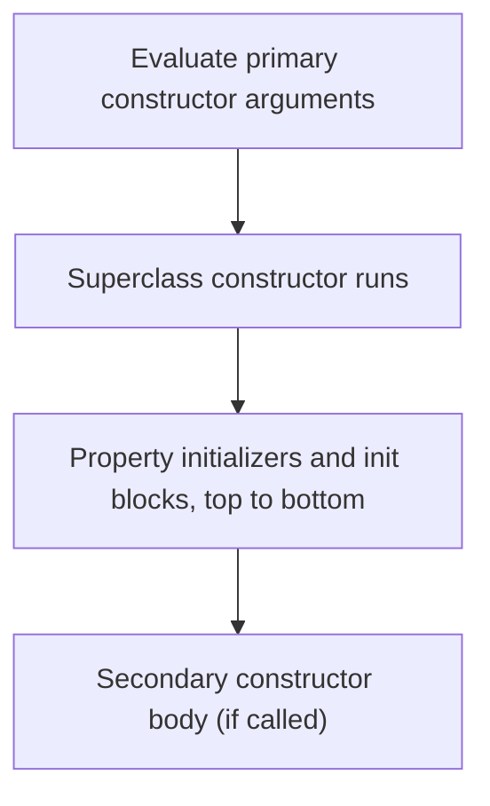
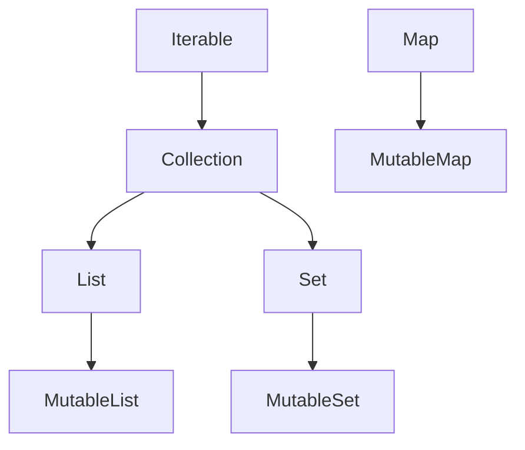
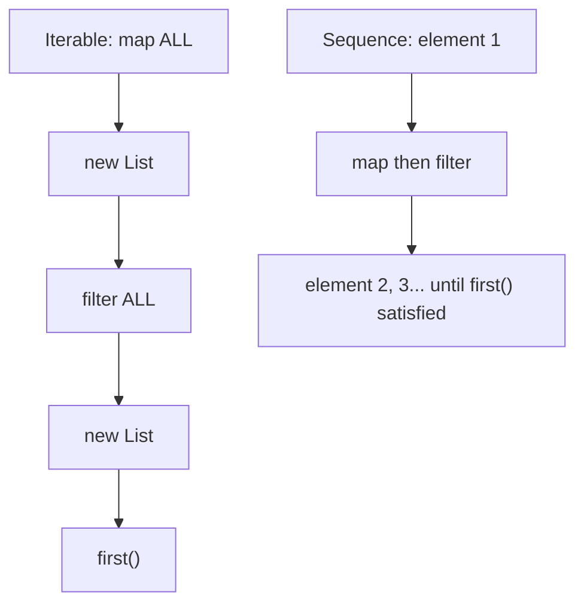
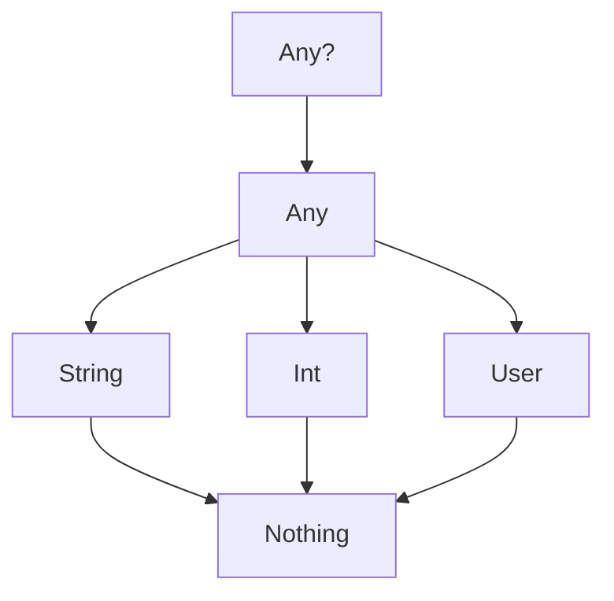
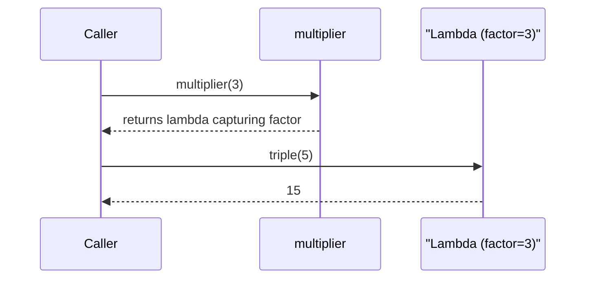

# Kotlin – Fundamentals

[⬅ Back to index](../README.md)

Covers: language basics, null safety, classes & objects, collections, functions and lambdas.

---

## Language Basics

### 1. What is Kotlin?

<details>
<summary>Answer</summary>

**In short:** Kotlin is a modern, statically typed language from JetBrains that runs on the JVM (and also compiles to JS, Native and Wasm via Kotlin Multiplatform). It is 100% interoperable with Java, and Google has made it the **preferred language for Android** (Kotlin-first since 2019).

#### Why it exists

JetBrains built Kotlin because Java, while stable, was verbose and slow to evolve: lots of boilerplate (getters, setters, `equals`/`hashCode`), no null safety, and weak support for functional style. Kotlin keeps everything good about the JVM (libraries, tooling, performance) and fixes those pain points with a more expressive syntax.

#### How it runs



On Android, Kotlin compiles to the same JVM bytecode as Java, which then goes through D8/R8 into DEX. That's why Kotlin and Java can live in the same module and call each other freely. The only extra cost is the Kotlin standard library (shrunk by R8 in release builds).

#### Why it matters on Android

- **Jetpack Compose** is Kotlin-only (it relies on a Kotlin compiler plugin).
- **Coroutines and Flow** are the recommended way to do async work.
- Most new Jetpack APIs ship Kotlin extensions (KTX) or are Kotlin-first.
- **Kotlin Multiplatform** lets you share business logic with iOS, desktop and web.

**Likely follow-ups:**
- *Is Kotlin slower than Java?* Generally no; it produces similar bytecode. Some features (lambdas, boxing of nullable numbers) have costs that `inline` and value classes help avoid.
- *Can you mix Java and Kotlin?* Yes, in the same module, in both directions.

</details>

### 2. How is Kotlin different from Java?

<details>
<summary>Answer</summary>

**In short:** Kotlin puts nullability in the type system, removes most boilerplate (data classes, type inference, default arguments), adds extension functions, coroutines and sealed hierarchies, drops checked exceptions and `static`, and makes classes `final` by default.

| Kotlin | Java |
|---|---|
| Null safety in the type system (`String` vs `String?`) | Any reference can be `null` → NPE |
| Concise: data classes, type inference, default/named args | More boilerplate (getters/setters, overloads) |
| Extension functions, higher-order functions, lambdas built-in | Lambdas since Java 8, no extensions |
| Coroutines for async | Threads / Executors / CompletableFuture |
| No checked exceptions | Checked exceptions |
| `object`, `companion object` instead of `static` | `static` keyword |
| Smart casts, `when` expression, sealed classes | `instanceof` + explicit casts (pattern matching only in new Java) |
| Classes are `final` by default | Classes are open by default |
| Properties (`val`/`var`) with generated accessors | Fields + hand-written getters/setters |
| `if`, `when`, `try` are expressions | Mostly statements |

#### The same model class in both

```java
// Java: ~30 lines once you add equals/hashCode/toString
public final class User {
    private final String name;
    private final int age;
    public User(String name, int age) { this.name = name; this.age = age; }
    public String getName() { return name; }
    public int getAge() { return age; }
    // equals(), hashCode(), toString() ...
}
```

```kotlin
// Kotlin: one line, with equals/hashCode/toString/copy generated
data class User(val name: String, val age: Int)
```

#### What stays the same

Both compile to JVM bytecode, use the same garbage collector, the same threading model and the same libraries. Kotlin is not a different runtime; it's a different language on the same platform. Newer Java versions have narrowed the gap (records, `switch` pattern matching, virtual threads), but Android's Java support lags behind desktop Java, so Kotlin's advantages are larger on Android.

**Likely follow-ups:**
- *How does Kotlin handle Java's checked exceptions?* It treats all exceptions as unchecked; use `@Throws` so Java callers see a `throws` clause.
- *What replaces `static`?* Top-level functions, `object`, and `companion object` (with `@JvmStatic` for Java callers).

</details>

### 3. What are the advantages of using Kotlin?

<details>
<summary>Answer</summary>

**In short:** Kotlin is more concise and safer than Java (null safety catches most NPEs at compile time), is fully interoperable with existing Java code, has coroutines for readable async code, and is the language Jetpack Compose and modern Android APIs are built around.

#### The main advantages, with what they buy you

- **Concise**: data classes, properties, type inference and default arguments cut boilerplate. Less code means fewer places for bugs and faster code review.
- **Null safety**: nullability is part of the type (`String` vs `String?`), so the compiler forces you to handle `null`. Google has reported that apps written in Kotlin are less likely to crash, largely for this reason.
- **Interoperability**: use any Java library and mix Java and Kotlin in one module, so teams can migrate file by file instead of rewriting.
- **Coroutines**: async code reads top-to-bottom like synchronous code, with structured cancellation tied to lifecycles (`viewModelScope`, `lifecycleScope`).
- **Functional features**: higher-order functions, lambdas and a rich collection API (`map`, `filter`, `groupBy`) replace hand-written loops.
- **Expressive type system**: sealed classes + exhaustive `when` model UI state and results safely.
- **Multiplatform**: share business logic across Android, iOS, desktop and web with KMP.
- **Tooling**: first-class support in Android Studio; Compose is Kotlin-only.

#### Example: null safety + conciseness together

```kotlin
// Display the city of a user's address, or a fallback
val city = user?.address?.city ?: "Unknown"
```

The Java version needs three nested null checks.

#### Trade-offs worth mentioning

An honest answer also notes the costs: slightly slower clean builds than Java (much improved with the K2 compiler), the standard library adds some size (mostly removed by R8), and some features (lambdas, `lazy`, boxing) have hidden allocations if you're careless.

**Likely follow-ups:**
- *How would you migrate a Java codebase?* Incrementally: new code in Kotlin, convert files when you touch them, add nullability annotations to Java code first.

</details>

### 4. What are the basic data types in Kotlin?

<details>
<summary>Answer</summary>

**In short:** Numbers (`Byte`, `Short`, `Int`, `Long`, `Float`, `Double`, plus unsigned `UByte`, `UShort`, `UInt`, `ULong`), `Boolean`, `Char`, `String` and `Array`. In code they all look like objects, but the compiler uses JVM primitives where it can; nullable ones like `Int?` are boxed.

| Type | Size | Example | JVM representation |
|---|---|---|---|
| `Byte` | 8 bit | `val b: Byte = 1` | `byte` |
| `Short` | 16 bit | `val s: Short = 1` | `short` |
| `Int` | 32 bit | `val i = 42` | `int` |
| `Long` | 64 bit | `val l = 42L` | `long` |
| `Float` | 32 bit | `val f = 3.14f` | `float` |
| `Double` | 64 bit | `val d = 3.14` | `double` |
| `Boolean` | — | `true` | `boolean` |
| `Char` | 16 bit | `'A'` | `char` |
| `String` | — | `"hi"` | `java.lang.String` |

#### Everything is an object... at the language level

You can call methods on any value (`42.toString()`, `3.7.roundToInt()`), but the compiler maps `Int` to a primitive `int` in bytecode whenever possible. It has to **box** (use `java.lang.Integer`) when:

- the type is nullable (`Int?`), because a primitive can't hold `null`;
- it's used as a generic type argument (`List<Int>` holds `Integer` objects).

```kotlin
val a: Int = 1000        // primitive int
val b: Int? = a          // boxed Integer
val c: Int? = a          // another boxed Integer
println(b == c)          // true  (equals)
println(b === c)         // false (different boxes; values outside -128..127 aren't cached)
```

#### No implicit widening

Unlike Java, Kotlin doesn't silently convert `Int` to `Long`. You must call `toLong()`, `toDouble()` and so on. This avoids subtle precision bugs.

```kotlin
val i: Int = 5
val l: Long = i          // compile error
val l2: Long = i.toLong() // OK
```

**Gotchas:**
- `Char` is not a number in Kotlin; use `c.code` to get its integer value.
- For large arrays of numbers, use `IntArray`/`DoubleArray` (primitive arrays) instead of `Array<Int>` (boxed).

</details>

### 5. What is the difference between `val` and `var`?

<details>
<summary>Answer</summary>

**In short:** `val` is a read-only reference that can be assigned only once (like Java `final`); `var` is mutable and can be reassigned. `val` makes the *reference* read-only, not the object it points to.

```kotlin
val name = "Kotlin"
name = "Java"            // compile error: val cannot be reassigned

var count = 0
count += 1               // fine
```

#### Read-only reference, not immutable object

```kotlin
val list = mutableListOf(1)
list.add(2)              // allowed: the object is mutable
list = mutableListOf()   // compile error: the reference is not
```

To get real immutability, combine `val` with an immutable type: `val list: List<Int> = listOf(1)`.

#### `val` doesn't always mean "same value every time"

A `val` property can have a custom getter that computes a new value on each access:

```kotlin
val now: Long get() = System.currentTimeMillis()   // different every read
```

So `val` means "no setter", not "constant". For true compile-time constants, use `const val` (see the next question).

#### Which to prefer

Default to `val`. Code with fewer mutable variables is easier to reason about, is safer across threads, and enables **smart casts** (the compiler can't smart-cast a `var` property because it might change). Use `var` only when the value really needs to change, such as a counter or loop accumulator.

**Gotchas:**
- A `val` property with a backing field is compiled to a `final` field plus a getter; a `var` gets a getter and a setter.
- In a data class, using `var` makes instances mutable, which breaks if they are used as keys in a `HashMap` or items in a `HashSet` after a change.

</details>

### 6. What is the difference between `val` and `const val`?

<details>
<summary>Answer</summary>

**In short:** `val` is a read-only value assigned at runtime; `const val` is a compile-time constant (primitives or `String` only, declared at top level or in an `object`/`companion object`) whose value is inlined at every place it's used.

| `val` | `const val` |
|---|---|
| Value assigned at **runtime** | Value must be known at **compile time** |
| Any type | Only primitives and `String` |
| Can be local, member, top-level | Only top-level, inside `object` or `companion object` |
| Accessed via a getter | Value is **inlined** at every usage site (no getter call) |
| Can't be used in annotations | Can be used as annotation arguments |

```kotlin
const val BASE_URL = "https://api.example.com"   // compile-time constant
val startTime = System.currentTimeMillis()        // runtime value

class Prefs {
    companion object {
        const val KEY_TOKEN = "token"             // OK inside companion
    }
}
```

#### What "inlined" means

When you write `println(BASE_URL)`, the compiler replaces it with `println("https://api.example.com")` in the bytecode. No field read, no getter. For Java callers, `const val` becomes a `public static final` field, so Java sees it as a real constant too.

#### Where you need `const`

Annotation arguments must be compile-time constants:

```kotlin
const val TIMEOUT = 30
@Deprecated("Use v2") // literal is fine
fun old() {}

@Query("SELECT * FROM user LIMIT $TIMEOUT")   // Room query: needs const
fun load(): List<User>
```

A plain `val` here would not compile.

**Gotchas:**
- Because the value is copied into callers, changing a `const` in a library requires callers to recompile to pick up the new value.
- `const val` can't hold the result of a function call, even a pure one like `listOf()`.

**Likely follow-up:** *What about `@JvmField`?* It exposes a non-const `val` as a public field to Java (no getter), but it isn't inlined.

</details>

### 7. Explain type inference in Kotlin.

<details>
<summary>Answer</summary>

**In short:** The compiler works out a variable's or expression's type from its initializer, so you don't have to write it. Kotlin is still statically typed: the type is fixed at compile time and can't change later.

```kotlin
val name = "Kotlin"     // inferred as String
val count = 10          // Int
val big = 10L           // Long
val items = listOf(1,2) // List<Int>
val map = mapOf("a" to 1) // Map<String, Int>
```

#### Where inference works

- **Variables**: from the initializer.
- **Function return types**: for single-expression functions, `fun square(x: Int) = x * x` returns `Int`.
- **Lambda parameters**: from the expected function type, `list.map { it * 2 }` knows `it` is `Int`.
- **Generic type arguments**: `listOf(1, 2)` infers `T = Int`; `val list: List<String> = emptyList()` infers from the expected type.

#### Static, not dynamic

```kotlin
var x = 10
x = "hello"     // compile error: x is Int forever
```

This is the key difference from JavaScript or Python, where a variable can hold any type. Inference only saves typing; it doesn't loosen type checking.

#### When to write types explicitly

- **Public API** (function return types, public properties): an explicit type documents the contract and prevents accidental API changes when the implementation changes. Library authors can enforce this with explicit API mode.
- When the inferred type is too specific, e.g. `val list: List<Int> = mutableListOf()` to expose a read-only view.
- When inference would pick something you didn't mean, e.g. `val ratio: Double = 1` fails, but `val ratio = 1` is an `Int`.

**Gotchas:**
- Functions with a block body (`{ }`) don't infer a return type; without one it's `Unit`.
- Mixed types infer a common supertype: `listOf(1, "a")` is `List<Any>`, which may hide a bug.

</details>

### 8. What is the difference between `==` and `===`?

<details>
<summary>Answer</summary>

**In short:** `==` is **structural equality**: it calls `equals()` and is null-safe. `===` is **referential equality**: it checks whether both references point to the same object in memory.

```kotlin
val a = String(charArrayOf('h','i'))
val b = "hi"
a == b   // true  (same content)
a === b  // false (different objects)
```

#### How `==` is compiled

`a == b` becomes roughly `a?.equals(b) ?: (b === null)`. So you can safely compare nullable values without an NPE, unlike Java's `a.equals(b)`. The opposites are `!=` and `!==`.

#### Comparison with Java

| Meaning | Kotlin | Java |
|---|---|---|
| Same content | `a == b` | `a.equals(b)` |
| Same object | `a === b` | `a == b` |

This trips up developers switching between languages: Java's `==` on objects is Kotlin's `===`.

#### With data classes

```kotlin
data class Point(val x: Int, val y: Int)
val p1 = Point(1, 2)
val p2 = Point(1, 2)
p1 == p2    // true: generated equals() compares properties
p1 === p2   // false: two separate instances
```

For a regular (non-data) class without an overridden `equals()`, `==` falls back to `Any.equals`, which is identity, so `==` and `===` behave the same.

**Gotchas:**
- For primitive types like `Int`, `===` is deprecated/meaningless; use `==`.
- On boxed numbers (`Int?`), `===` can surprise you: small values (-128..127) may be cached and identical, larger ones not.
- Floating point: `==` on `Double` follows IEEE 754 when the static type is `Double` (`-0.0 == 0.0` is true, `NaN == NaN` is false), but when typed as `Any` it uses `equals()`, where `NaN` equals itself.

</details>

### 9. What is `when` in Kotlin and how is it better than `switch`?

<details>
<summary>Answer</summary>

**In short:** `when` is Kotlin's replacement for `switch`, but it's an **expression** that returns a value, can match on values, ranges, types or arbitrary conditions, has no fall-through, and is **exhaustive** when used as an expression over sealed types, enums or booleans.

#### What it can match

```kotlin
fun describe(x: Any): String = when (x) {
    0, 1 -> "zero or one"                // multiple values
    in 2..10 -> "small number"           // range
    is String -> "string of ${x.length}" // type check + smart cast
    !is Number -> "not a number"
    else -> "something else"
}

// Without an argument: replaces if/else-if chains
val grade = when {
    score >= 90 -> "A"
    score >= 75 -> "B"
    else -> "C"
}
```

#### Why it beats `switch`

| `when` | Java `switch` (classic) |
|---|---|
| Expression: returns a value | Statement |
| No fall-through, no `break` | Falls through without `break` |
| Values, ranges, types, conditions | Constants only |
| Smart casts in `is` branches | Manual cast needed |
| Compiler-checked exhaustiveness | No check (unless modern switch expressions) |

#### Exhaustiveness: the big win for Android

```kotlin
sealed interface UiState {
    data object Loading : UiState
    data class Success(val data: String) : UiState
    data class Error(val message: String) : UiState
}

val label = when (state) {
    is UiState.Loading -> "Loading"
    is UiState.Success -> state.data      // smart-cast to Success
    is UiState.Error -> state.message
}
```

No `else` needed. If someone later adds `UiState.Empty`, every `when` that uses it as an expression fails to compile until it's handled. That turns a runtime bug into a compile error.

**Gotchas:**
- Adding `else` to a `when` over a sealed type silences that safety net; avoid it.
- Since Kotlin 1.7, `when` *statements* over sealed/enum/Boolean subjects must also be exhaustive.
- Branches are checked top to bottom; the first match wins.

</details>

### 10. What are string templates?

<details>
<summary>Answer</summary>

**In short:** String templates let you embed values and expressions directly in strings: `"Hello $name, you have ${items.size} items"`. Raw strings (`"""..."""`) support multi-line text without escaping, usually combined with `trimIndent()` or `trimMargin()`.

#### Syntax

```kotlin
val name = "Ana"
val items = listOf("a", "b")

"Hello $name"                       // simple variable
"You have ${items.size} items"      // any expression needs braces
"Total: ${price * qty}"
"Status: ${if (ok) "OK" else "FAIL"}"
"Price: \$5"                        // escape a literal $
```

#### Raw strings

```kotlin
val json = """
    {
      "name": "$name",
      "path": "C:\temp"
    }
""".trimIndent()   // removes common leading indentation
```

Inside a raw string, backslashes aren't escape characters, which makes them good for regexes, JSON and SQL. To write a literal `$` in a raw string you'd traditionally use `${'$'}`. Kotlin 2.x adds **multi-dollar interpolation**: prefix the string with `$$` and only `$$name` interpolates, so single `$` stays literal:

```kotlin
val schema = $$"""{ "$schema": "...", "title": "$$title" }"""
```

#### Under the hood

The compiler turns a template into `StringBuilder` appends (or `invokedynamic` string concatenation on newer JVM targets), calling `toString()` on each value. It's equivalent to manual concatenation, not slower.

**Gotchas:**
- On Android, don't use templates for user-visible text; use string resources with placeholders (`getString(R.string.greeting, name)`) so it can be translated.
- `"$user.name"` interpolates only `user`, then appends the literal `.name`. Use `"${user.name}"`.
- Don't build SQL from templates with user input; use bound parameters.

</details>

---

## Null Safety

### 11. What are nullable types in Kotlin?

<details>
<summary>Answer</summary>

**In short:** In Kotlin, types are **non-nullable** by default: a `String` can never hold `null`. Adding `?` makes the type nullable (`String?`), and the compiler forces you to handle `null` before using the value. This moves most `NullPointerException`s from runtime to compile time.

#### The problem it solves

In Java, every reference can secretly be `null`, and nothing in the type tells you. Tony Hoare called null references his "billion-dollar mistake". Kotlin makes nullability part of the type, so the compiler knows which values might be missing.

```kotlin
var a: String = "abc"
a = null                 // compile error

var b: String? = "abc"
b = null                 // OK

a.length                 // fine, a can't be null
b.length                 // compile error: b might be null
b?.length                // OK, returns Int?
```

#### Type hierarchy

`String` is a subtype of `String?`. So you can always pass a `String` where `String?` is expected, but not the other way round without a check.



#### At runtime

There's no wrapper object (unlike Java's `Optional`). `String?` and `String` are both `java.lang.String` in bytecode; the difference exists only at compile time, plus `@Nullable`/`@NotNull` annotations and null checks the compiler inserts on public function parameters. So null safety is essentially free.

#### Designing with nullability

Use `null` to mean "absent" only when absence is a valid state (an optional middle name, a not-yet-loaded user). If something should always exist, make it non-null and fail early. Avoid making everything nullable "just in case"; that pushes null checks everywhere.

**Likely follow-ups:**
- *Is `String?` like `Optional<String>`?* Similar meaning, but no allocation and better syntax (`?.`, `?:`).
- *Can generics be nullable?* Yes: a type parameter `T` has an implicit upper bound of `Any?`, so `T` can be nullable; use `T : Any` to forbid it.

</details>

### 12. How do you handle nullability in Kotlin?

<details>
<summary>Answer</summary>

**In short:** Use the safe-call operator `?.`, the Elvis operator `?:` for defaults or early exits, safe casts `as?`, scope functions like `?.let { }`, and smart casts after `if (x != null)` checks. Avoid `!!`, which throws an NPE if the value is null.

#### The toolbox

| Tool | Example | Result when null |
|---|---|---|
| Safe call `?.` | `user?.name` | `null` (chain short-circuits) |
| Elvis `?:` | `name ?: "Guest"` | right-hand side |
| Elvis + exit | `user ?: return` | leaves the function |
| Safe cast `as?` | `obj as? String` | `null` if cast fails |
| `let` | `user?.let { show(it) }` | block skipped |
| Smart cast | `if (user != null) user.name` | branch skipped |
| `!!` | `user!!.name` | throws NPE |

#### Putting them together

```kotlin
fun greeting(userId: String?): String {
    val id = userId ?: return "Hello, guest"       // early exit
    val user = repo.find(id) ?: return "Unknown user"
    val city = user.address?.city ?: "somewhere"   // safe chain + default
    return "Hello ${user.name} from $city"         // user smart-cast to non-null
}
```

This "guard clause" style keeps the happy path flat instead of nesting `if (x != null)` blocks.

#### Collections and nulls

```kotlin
val ids: List<String?> = listOf("1", null, "3")
ids.filterNotNull()          // List<String>
ids.mapNotNull { it?.toIntOrNull() }
```

Many standard functions have `OrNull` variants that return `null` instead of throwing: `firstOrNull()`, `toIntOrNull()`, `getOrNull(i)`.

#### When is `!!` acceptable?

Rarely: when you know something the compiler can't, and a crash would indicate a real bug. Even then, `requireNotNull(x) { "reason" }` or `checkNotNull` gives a clearer error message.

**Gotchas:**
- `?.let { } ?: run { }` is not a true if/else: if the `let` block itself returns `null`, the `run` block also executes.
- Overusing `?.` everywhere can hide bugs by silently doing nothing; sometimes failing loudly is better.

</details>

### 13. What is the Elvis operator?

<details>
<summary>Answer</summary>

**In short:** `?:` returns the left-hand side if it is non-null, otherwise it evaluates and returns the right-hand side. It's used for default values and, because `return` and `throw` are expressions, for early exits.

```kotlin
val length = text?.length ?: 0
val user = repository.getUser() ?: return            // early exit
val token = prefs.token ?: throw IllegalStateException("Not logged in")
```

The name comes from `?:` looking like Elvis Presley's hairstyle turned sideways.

#### How it works

`a ?: b` is equivalent to:

```kotlin
val tmp = a
if (tmp != null) tmp else b
```

Two details matter:
- The left side is evaluated **once**.
- The right side is evaluated **lazily**, only if the left is null. So `cache[key] ?: loadFromNetwork(key)` only hits the network on a cache miss.

#### Why `?: return` compiles

`return` and `throw` have type `Nothing`, which is a subtype of every type. So `getUser() ?: return` has type `User` (non-null), and the rest of the function can use it without checks. This is the idiomatic Kotlin guard clause.

```kotlin
fun onItemClick(position: Int) {
    val item = adapter.getItemOrNull(position) ?: return
    val id = item.id ?: run {
        log("item without id")
        return
    }
    open(id)
}
```

#### Chaining

```kotlin
val displayName = user.nickname ?: user.fullName ?: user.email ?: "Anonymous"
```

**Gotchas:**
- Elvis checks only for `null`, not for empty strings. For "null or blank", use `name.takeUnless { it.isNullOrBlank() } ?: "Guest"` or `ifBlank { }`.
- Precedence: `?:` binds looser than arithmetic, so `a ?: 0 + 1` means `a ?: (0 + 1)`. Use parentheses when mixing.

</details>

### 14. Explain smart casts.

<details>
<summary>Answer</summary>

**In short:** After you check a variable's type (`is`) or nullability (`!= null`), the compiler automatically treats it as the narrower type in that scope, so no explicit cast is needed. It only does this when it can prove the value can't change between the check and the use.

```kotlin
fun print(x: Any) {
    if (x is String) println(x.length) // x is smart-cast to String
}

fun len(s: String?): Int {
    if (s == null) return 0
    return s.length                    // s is smart-cast to String
}
```

#### Where smart casts apply

- `if` / `when` branches after `is` or `!= null`.
- After `&&` and `||`: `if (x is String && x.length > 3)`.
- After an early return: `if (x !is String) return` then `x` is `String` below.
- `when (x) { is Foo -> x.fooMethod() }`.

#### When they don't work

The compiler must guarantee the value is stable. Smart casts work for:
- `val` local variables (always);
- `var` local variables, if not modified between check and use and not captured in a lambda that modifies them;
- `val` properties that are `private` or `internal`, or declared in the same module, with no custom getter and not `open`.

They **don't** work on `var` class properties, because another thread (or a called method) could change the value after the check:

```kotlin
class Screen {
    var user: User? = null

    fun render() {
        if (user != null) {
            println(user.name)        // compile error: smart cast impossible
        }
        // Fix 1: copy to a local val
        val u = user
        if (u != null) println(u.name)
        // Fix 2: safe call / let
        user?.let { println(it.name) }
    }
}
```

**Gotchas:**
- Properties from another module or with custom getters can't be smart-cast either, because their getter might return different values.
- The K2 compiler (Kotlin 2.0) made smart casts smarter, e.g. they now survive being stored in a local `val` boolean (`val isCat = animal is Cat; if (isCat) animal.purr()`) and work better with `||` and inline lambdas.

</details>

### 15. Can NPE still happen in Kotlin? When?

<details>
<summary>Answer</summary>

**In short:** Yes. You can get an NPE from an explicit `!!` on a null value, from Java interop (platform types), from a `lateinit` property read too early (`UninitializedPropertyAccessException`), from leaking `this` during construction, or from an explicit `throw NullPointerException()`.

#### 1. The `!!` operator

```kotlin
val name: String? = null
name!!.length              // NullPointerException
```

#### 2. Java interop (the most common real-world cause)

```kotlin
// Java: public String getName() { return null; }
val n = javaUser.name      // platform type String!
n.length                   // NPE at runtime, no compiler warning
```

Kotlin can't know whether unannotated Java returns null (see platform types, next question). If you assign it to a non-null type (`val n: String = javaUser.name`), Kotlin inserts a check and throws immediately with a clearer message.

#### 3. `lateinit` read before assignment

```kotlin
lateinit var adapter: UserAdapter
adapter.submitList(list)   // UninitializedPropertyAccessException
```

Not technically an NPE, but the same class of bug. Classic Android case: accessing a view-binding or adapter after `onDestroyView` or before `onCreateView`.

#### 4. Initialization order / leaking `this`

```kotlin
open class Base {
    init { describe() }            // calls overridden method too early
    open fun describe() {}
}
class Child : Base() {
    val name: String = "child"
    override fun describe() = println(name.length)  // name is still null here -> NPE
}
```

The base constructor runs before the subclass's properties are initialized, so a "non-null" property can be null at that moment. Avoid calling open methods from constructors.

#### 5. Other sources

- Libraries using reflection (Gson is the classic example) can create objects that bypass constructors, leaving non-null properties as `null`.
- Explicit `throw NullPointerException()`.
- Generic code with unchecked casts.

**Likely follow-ups:**
- *How do you avoid Gson nulls?* Use a Kotlin-aware serializer (kotlinx.serialization or Moshi with codegen) that respects nullability and defaults.

</details>

### 16. What are platform types?

<details>
<summary>Answer</summary>

**In short:** Platform types (shown as `T!`, e.g. `String!`) are types that come from Java code without nullability annotations. Kotlin doesn't know whether they can be null, so it lets you treat them as either nullable or non-null, and null safety becomes your responsibility.

#### Why they exist

Kotlin could have treated every Java type as nullable, but then every Java call would need `?.` or `!!`, which would make interop painful (e.g. every element of a `List<String>` from Java would be `String?`). Platform types are a pragmatic compromise: Kotlin trusts you.

```java
// Java
public class JavaUser {
    public String getName() { return null; }
}
```

```kotlin
val user = JavaUser()
val a = user.name          // type is String! (platform type)
a.length                   // compiles, NPE at runtime

val b: String? = user.name // you decided: nullable, compiler enforces checks
val c: String = user.name  // you decided: non-null, Kotlin inserts a check here
                           // and throws immediately if null
```

You can't write `String!` in your own code; it only appears in IDE hints and error messages.

#### Making interop safe

1. **Annotate the Java side**: `@Nullable` / `@NonNull` (from AndroidX, JetBrains, JSpecify and others) turn platform types into real Kotlin types. Android SDK APIs are increasingly annotated, which is why many framework methods now show proper `?` types.
2. **Declare the type explicitly** at the boundary in Kotlin, so a null fails fast instead of spreading.
3. Wrap Java APIs in a small Kotlin layer that exposes clean, correctly typed signatures.

```java
// Java with annotations
public @Nullable String getNickname() { ... }
public @NonNull String getId() { ... }
```

```kotlin
user.nickname   // String?  (enforced)
user.id         // String
```

**Gotchas:**
- Overriding a Java method in Kotlin: you choose parameter nullability. Choosing non-null when Java can pass `null` crashes (classic case: `Bundle?` in some framework callbacks).
- Collections from Java are also platform types (`(Mutable)List<String!>!`).

</details>

---

## Classes & Objects

### 17. What is a data class?

<details>
<summary>Answer</summary>

**In short:** A data class is a class meant to hold data. From the properties in its **primary constructor**, the compiler generates `equals()`, `hashCode()`, `toString()`, `copy()` and `componentN()` functions (for destructuring).

```kotlin
data class User(val id: Int, val name: String)

val user = User(1, "Ana")
println(user)                         // User(id=1, name=Ana)
user == User(1, "Ana")                // true (structural equality)
val u2 = user.copy(name = "New")      // shallow copy with change
val (id, name) = user                 // destructuring
```

#### What it replaces

In Java you'd hand-write (or generate) a constructor, getters, `equals`, `hashCode` and `toString`, and must remember to update them when adding a field. A data class keeps them in sync automatically. Java records are the closest equivalent.

#### Rules

- The primary constructor needs at least one `val`/`var` parameter.
- A data class can't be `abstract`, `open`, `sealed` or `inner`.
- It can implement interfaces and extend other classes.
- If you write `equals`, `hashCode` or `toString` yourself, the compiler uses yours.

#### Only constructor properties count

```kotlin
data class Item(val id: Int) {
    var selected: Boolean = false     // NOT in equals/hashCode/toString/copy
}
Item(1).apply { selected = true } == Item(1)   // true!
```

This can be useful (excluding a transient field) or a surprising bug.

#### `copy()` is shallow

```kotlin
data class Cart(val items: MutableList<String>)
val a = Cart(mutableListOf("apple"))
val b = a.copy()
b.items.add("pear")
println(a.items)   // [apple, pear] - same list shared
```

Use immutable property types (`List`, not `MutableList`) so shallow copies are safe.

#### Why they matter on Android

- **UI state**: `_state.update { it.copy(isLoading = false) }` produces a new state object, and `StateFlow` uses `equals()` to skip duplicate emissions.
- **DiffUtil / Compose**: structural equality lets `DiffUtil.ItemCallback.areContentsTheSame` and Compose skipping compare items by value.

**Gotchas:**
- Using `var` properties and mutating an object stored in a `HashSet`/`HashMap` key changes its hash and "loses" it.
- `toString()` prints every field, so be careful logging data classes with tokens or personal data.
- Adding a constructor property changes `componentN()` order and `copy()` signature, a binary-compatibility concern for libraries.

</details>

### 18. What is the difference between `object`, `companion object` and a class?

<details>
<summary>Answer</summary>

**In short:** A `class` is a blueprint you instantiate many times. An `object` declaration is a lazily initialized, thread-safe **singleton**. A `companion object` is a singleton tied to a class, whose members you access through the class name, like Java `static`. An **object expression** (`object : Listener { }`) creates an anonymous class instance.

| | Instances | Typical use |
|---|---|---|
| `class` | Many | Normal types |
| `object Foo` | Exactly one | Singletons, stateless helpers |
| `companion object` | One per class | Factories, constants, "static" members |
| `object : Type { }` | New one each time it runs | Anonymous listeners/callbacks |

#### `object` declaration

```kotlin
object Analytics {
    fun track(event: String) { /* ... */ }
}
Analytics.track("login")
```

It compiles to a class with a private constructor and a static `INSTANCE` field initialized in the static initializer. The JVM guarantees class initialization happens once and is thread-safe, and only when the class is first used, so it's lazy without any locking code.

#### `companion object`

```kotlin
class DetailFragment : Fragment() {
    companion object {
        private const val ARG_ID = "id"
        fun newInstance(id: String) = DetailFragment().apply {
            arguments = bundleOf(ARG_ID to id)
        }
    }
}
DetailFragment.newInstance("42")
```

Members look static from Kotlin, but they're actually instance members of a nested `Companion` object. From Java you'd call `DetailFragment.Companion.newInstance(...)` unless you add `@JvmStatic` (generates a real static method) or `@JvmField`/`const` for fields. A companion can implement interfaces and have extension functions, which static members can't.

#### Object expression

```kotlin
recyclerView.addOnScrollListener(object : RecyclerView.OnScrollListener() {
    override fun onScrolled(rv: RecyclerView, dx: Int, dy: Int) { /* ... */ }
})
```

Unlike Java anonymous classes, it can capture and modify local `var`s, and it can implement several interfaces.

**Gotchas:**
- Singletons that hold a `Context`, `Activity` or `View` leak memory; hold the application context only, or better, use DI-scoped singletons (Hilt `@Singleton`) which are easier to test and replace.
- `object` state lives for the whole process, which makes unit tests order-dependent.

</details>

### 19. What is a sealed class / sealed interface?

<details>
<summary>Answer</summary>

**In short:** A sealed class or interface defines a **restricted hierarchy**: all direct subtypes must be declared in the same package and module, so the compiler knows the complete list. That enables **exhaustive `when`** without an `else` branch, which is ideal for UI state, results and events.

```kotlin
sealed interface UiState {
    data object Loading : UiState
    data class Success(val items: List<Item>) : UiState
    data class Error(val message: String) : UiState
}

@Composable
fun Screen(state: UiState) = when (state) {
    UiState.Loading -> Spinner()
    is UiState.Success -> ItemList(state.items)
    is UiState.Error -> ErrorView(state.message)
}   // no else: compiler checks all cases
```

#### Why it exists

Many domain concepts are "one of a fixed set of shapes": a network result is success *or* error; a screen is loading *or* content *or* error. With an open hierarchy or plain flags (`isLoading`, `data`, `error` all nullable on one class), impossible combinations can occur and the compiler can't help. A sealed type makes illegal states unrepresentable.



#### Sealed class vs sealed interface

- A **sealed class** can hold common state and constructor parameters; subclasses extend it (a class can only extend one).
- A **sealed interface** has no state but a class can implement several, so one type can belong to multiple sealed hierarchies. Prefer sealed interfaces unless you need shared state.

A sealed class is abstract and its constructors are `protected` or `private`.

#### Sealed vs enum

Each enum constant is a single instance with a fixed shape. Sealed subtypes can be **classes with different properties and many instances** (`Error("timeout")`, `Error("404")`), or `object`s when no data is needed.

**Gotchas:**
- Use `data object` (Kotlin 1.9+) for stateless cases so `toString()` prints `Loading` instead of `UiState$Loading@1a2b`.
- An `else` branch defeats exhaustiveness checking; leave it out.
- Subclasses can be in different files, but must stay in the same package and module.

**Likely follow-up:** *How do you model a network result?* `sealed interface Result<out T> { data class Success<T>(val value: T) : Result<T>; data class Failure(val error: Throwable) : Result<Nothing> }`.

</details>

### 20. What is the difference between an enum class and a sealed class?

<details>
<summary>Answer</summary>

**In short:** An enum defines a fixed set of **instances** that all share the same shape. A sealed class defines a fixed set of **types**, and each subtype can carry different data and have many instances.

| Enum | Sealed |
|---|---|
| Fixed set of **instances** | Fixed set of **types** |
| All constants share the same properties | Each subclass can carry different data |
| Has `values()`/`entries`, `ordinal`, `name`, `valueOf()` | No built-in listing |
| Singleton constants | Subclasses can be `object` or regular classes with many instances |
| Easy to serialize/store (by name) | Needs a serializer (e.g. polymorphic serialization) |
| Can't extend other classes (can implement interfaces) | Subclasses can extend/implement freely |

#### Same idea, both ways

```kotlin
// Enum: every value has the same fields
enum class Priority(val weight: Int) { LOW(1), MEDIUM(5), HIGH(10) }

// Sealed: each case has its own data
sealed interface PaymentMethod {
    data class Card(val last4: String, val expiry: String) : PaymentMethod
    data class Upi(val vpa: String) : PaymentMethod
    data object Cash : PaymentMethod
}
```

`Priority.HIGH` is always the same object. `PaymentMethod.Card("1234", "12/27")` and `Card("9999", "01/28")` are two different instances of the same case.

#### How to choose

- **Enum** when the cases are pure constants: days of the week, sort orders, a setting stored in preferences. You get iteration (`Priority.entries`), ordering and simple persistence for free.
- **Sealed** when cases need different payloads: UI state, API results, navigation events, user actions in MVI.

Both give exhaustive `when` checks.

**Gotchas:**
- Persisting `ordinal` breaks when someone reorders constants; persist `name` or an explicit code.
- `entries` (Kotlin 1.9+) is preferred over `values()`, which allocates a new array every call.

</details>

### 21. Why are Kotlin classes `final` by default? What are `open`, `abstract` and `override`?

<details>
<summary>Answer</summary>

**In short:** Classes and members are `final` by default, following *Effective Java*'s advice "design and document for inheritance or else prohibit it", to avoid the fragile base class problem. `open` allows subclassing or overriding, `abstract` declares something that must be implemented and can't be instantiated, and `override` is required to override a member.

#### The fragile base class problem

If any class can be subclassed, the base class author can't safely change internals: a subclass might rely on which methods call which. A harmless refactor in the base can break subclasses you've never seen. Making inheritance opt-in means the author has to consciously design for it.

```kotlin
class Repo                        // final: can't subclass
open class BaseViewModel {        // can subclass
    open fun onRefresh() {}       // can override
    fun log() {}                  // final: can't override
}

class HomeViewModel : BaseViewModel() {
    override fun onRefresh() {}   // 'override' is mandatory
}
```

#### The modifiers

| Modifier | On a class | On a member |
|---|---|---|
| (none) = `final` | Can't be subclassed | Can't be overridden |
| `open` | Can be subclassed | Can be overridden |
| `abstract` | Can't be instantiated; implicitly open | No body; subclass must implement |
| `override` | — | Overrides a parent member; is itself open |
| `final override` | — | Overrides, but stops further overriding |

```kotlin
abstract class Shape {
    abstract fun area(): Double          // must implement
    open fun name() = "shape"            // may override
}
open class Rect(val w: Double, val h: Double) : Shape() {
    final override fun area() = w * h    // subclasses of Rect can't change this
}
```

Interface members are open by default, and interfaces can have default implementations.

#### The testing objection

Final-by-default makes mocking classes harder (classic Mockito can't mock final classes). Solutions: depend on interfaces, use fakes, or use Mockito's inline mock maker (default in Mockito 5) or MockK. Some frameworks (Spring, JPA) need open classes, so the `kotlin-allopen` compiler plugin exists for them.

**Likely follow-up:** *Composition or inheritance?* Prefer composition and interfaces; Kotlin's class delegation (`class A(b: B) : B by b`) makes composition easy.

</details>

### 22. What are the visibility modifiers in Kotlin?

<details>
<summary>Answer</summary>

**In short:** `public` (the default, visible everywhere), `private` (inside the class, or inside the file for top-level declarations), `protected` (the class and its subclasses) and `internal` (anywhere in the same **module**). Kotlin has no package-private.

| Modifier | Class member | Top-level declaration |
|---|---|---|
| `public` (default) | Everyone | Everyone |
| `internal` | Same module | Same module |
| `protected` | Class + subclasses | Not allowed |
| `private` | Inside the class | Inside the same file |

#### Compared with Java

- Java's default is package-private; Kotlin's default is `public`.
- Java's `protected` also includes the same package; Kotlin's `protected` is subclasses only.
- Kotlin's `internal` has no Java equivalent.
- In Kotlin, an outer class can't see `private` members of its nested/inner classes.

#### `internal` and modularization

A module is a set of files compiled together: a Gradle module, for Android. In a multi-module app, `internal` lets a feature module expose a small public API while hiding implementation:

```kotlin
// :feature:profile module
class ProfileNavigator { /* public API */ }

internal class ProfileRepositoryImpl(...) : ProfileRepository   // hidden
internal fun formatHandle(raw: String): String = "@$raw"         // hidden
```

Other modules can't reference those, which keeps boundaries clean and speeds up builds (fewer ABI changes trigger recompiles).

#### Private top-level and constructor visibility

```kotlin
private const val TAG = "Profile"           // file-private

class Token private constructor(val raw: String) {
    companion object {
        fun parse(s: String): Token? = if (s.isNotBlank()) Token(s) else null
    }
}
```

A private constructor forces callers through a factory that can validate input.

**Gotchas:**
- `internal` is compiled to `public` in bytecode (members get a mangled name), so Java code can technically still call it.
- A `public` function can't expose an `internal` or `private` type in its signature ("exposes its internal type").
- Overrides keep the parent's visibility unless you specify otherwise.

</details>

### 23. What are primary and secondary constructors and `init` blocks?

<details>
<summary>Answer</summary>

**In short:** The **primary constructor** is declared in the class header and can declare properties directly (`class User(val name: String)`). `init` blocks run as part of the primary constructor. **Secondary constructors** (`constructor(...)`) are extra constructors in the body and must delegate to the primary one if it exists.

```kotlin
class User(val name: String, val age: Int = 18) {   // primary constructor
    init { require(age >= 0) }                       // runs as part of the primary constructor
    constructor(name: String, dob: LocalDate) :      // secondary constructor must delegate
        this(name, Period.between(dob, LocalDate.now()).years)
}
```

#### Primary constructor

- `val`/`var` in the parameters declares and initializes a property in one go.
- Parameters without `val`/`var` are just constructor parameters, usable in `init` blocks and property initializers.
- Default values often remove the need for secondary constructors at all.
- To add annotations or visibility, use the `constructor` keyword: `class Foo @Inject constructor(private val repo: Repo)` (common with Hilt/Dagger).

#### Initialization order



```kotlin
class Demo(name: String) {
    val first = "First: $name".also(::println)
    init { println("Init 1") }
    val second = "Second: ${name.length}".also(::println)
    init { println("Init 2") }
}
// Demo("x") prints: First: x, Init 1, Second: 1, Init 2
```

Property initializers and `init` blocks run interleaved, in source order. An `init` block can't use a property declared below it.

#### Secondary constructors

Use them mainly for Java interop or framework requirements, e.g. custom Views:

```kotlin
class BadgeView : View {
    constructor(context: Context) : super(context)
    constructor(context: Context, attrs: AttributeSet?) : super(context, attrs)
}
```

(`@JvmOverloads constructor(...)` with default values can replace this, but be careful: if you default `defStyleAttr` to `0` when extending a widget like `Button`, you lose that widget's default style.)

**Gotchas:**
- Don't call `open` methods from `init`; subclass properties aren't initialized yet.
- `require()` in `init` is a clean way to validate invariants (throws `IllegalArgumentException`).

</details>

### 24. What is the difference between a nested class and an inner class?

<details>
<summary>Answer</summary>

**In short:** A **nested** class (the default in Kotlin) is like a Java `static` nested class: it has **no reference** to the outer instance. An **`inner`** class holds a reference to the outer instance (`this@Outer`), which lets it access outer members but can cause **memory leaks** on Android if it outlives an Activity or Fragment.

```kotlin
class Outer {
    private val secret = 42

    class Nested {
        fun read() = secret           // compile error: no outer instance
    }

    inner class Inner {
        fun read() = secret           // OK: uses this@Outer.secret
    }
}

val n = Outer.Nested()                // no Outer needed
val i = Outer().Inner()               // needs an Outer instance
```

#### Kotlin vs Java defaults

| | Kotlin | Java |
|---|---|---|
| No outer reference | `class Nested` (default) | `static class Nested` |
| Has outer reference | `inner class Inner` | `class Inner` (default) |

Kotlin flipped the default because the hidden outer reference is a common leak source and is rarely needed.

#### The Android leak

```kotlin
class MainActivity : AppCompatActivity() {
    // BAD: inner class holds MainActivity
    inner class Updater : Runnable {
        override fun run() { title = "Done" }
    }
    override fun onCreate(savedInstanceState: Bundle?) {
        super.onCreate(savedInstanceState)
        Handler(Looper.getMainLooper()).postDelayed(Updater(), 60_000)
        // If the user rotates, the old Activity can't be garbage-collected
        // for 60 s, because the queued Runnable references it.
    }
}
```

The same applies to anonymous objects and lambdas that capture the Activity, and to long-running background tasks (the classic `AsyncTask` problem). Fixes: use a nested class plus a `WeakReference`, cancel callbacks in `onDestroy`, or (best) use lifecycle-aware coroutines (`lifecycleScope`, `viewModelScope`) that are cancelled automatically.

**Gotchas:**
- Lambdas and object expressions capture the outer `this` only if they use outer members.
- `this` inside an inner class refers to the inner instance; use `this@Outer` for the outer one.

</details>

### 25. What are `lateinit` and `by lazy`? What's the difference?

<details>
<summary>Answer</summary>

**In short:** Both delay initialization of a non-null property. `lateinit var` is a promise that *you* will assign it before use (e.g. in `onCreate` or by DI). `val x by lazy { }` computes the value on **first access** and caches it, thread-safely by default.

| `lateinit var` | `val x by lazy { }` |
|---|---|
| `var` only | `val` only |
| Non-null, non-primitive types | Any type |
| You assign it later (e.g. in `onCreate`, DI injection) | Computed on **first access**, then cached |
| Throws `UninitializedPropertyAccessException` if read early | Thread-safe by default (`SYNCHRONIZED`) |
| Check with `::x.isInitialized` | Check with the `Lazy` object's `isInitialized()` |
| No extra object; a plain field | Allocates a `Lazy` holder + lambda |

#### `lateinit`

```kotlin
@AndroidEntryPoint
class MainActivity : AppCompatActivity() {
    @Inject lateinit var analytics: Analytics      // set by Hilt
    private lateinit var binding: ActivityMainBinding

    override fun onCreate(savedInstanceState: Bundle?) {
        super.onCreate(savedInstanceState)
        binding = ActivityMainBinding.inflate(layoutInflater)
        setContentView(binding.root)
    }
}
```

It exists because some frameworks create your object first and fill in fields later, so you can't initialize in the constructor, yet you don't want `?` everywhere. It doesn't work with primitive types (`Int`, `Boolean`) because the "not yet set" state is represented by `null` in the field.

#### `by lazy`

```kotlin
private val dateFormatter by lazy { DateTimeFormatter.ofPattern("dd MMM yyyy") }
private val viewModel by lazy { ViewModelProvider(this)[MainViewModel::class.java] }
```

`lazy` is a property delegate. Thread-safety modes:
- `SYNCHRONIZED` (default): locks so the initializer runs once.
- `PUBLICATION`: may run several times concurrently; the first result wins.
- `NONE`: no locking; fastest, for single-thread use (e.g. main-thread UI code).

#### Choosing

- Value comes from outside (DI, lifecycle callback, test `@Before`) → `lateinit`.
- Value can be computed by the class itself but is expensive or not always needed → `lazy`.

**Gotchas:**
- In Fragments, a `lazy` that references views keeps the old view after `onDestroyView`; it never re-initializes. Use a nullable binding cleared in `onDestroyView`.
- If the `lazy` initializer throws, it runs again on the next access.

</details>

### 26. What are getters/setters and backing fields?

<details>
<summary>Answer</summary>

**In short:** Kotlin properties come with generated getters (and setters for `var`). You can write custom accessors, and inside them the keyword `field` refers to the **backing field** that stores the value. A property with a custom getter that doesn't use `field` has no backing field at all; it's computed on each access.

```kotlin
class Profile {
    var name: String = ""
        set(value) { field = value.trim() }    // custom setter using the backing field

    var age: Int = 0
        private set                            // public read, private write

    val isAdult: Boolean
        get() = age >= 18                      // computed: no backing field
}
```

#### Why properties instead of fields

In Java, you write a private field plus `getX()`/`setX()` so you can later add logic without breaking callers. Kotlin bakes that in: `profile.name` always calls the accessor, so you can add validation later without changing call sites. From Java, these appear as `getName()`/`setName()`.

#### The `field` keyword

Inside an accessor, using the property name itself would call the accessor again:

```kotlin
var name: String = ""
    set(value) { name = value.trim() }   // BAD: infinite recursion -> StackOverflowError
    set(value) { field = value.trim() }  // GOOD
```

The compiler generates a backing field only if at least one accessor is default or uses `field`.

#### Backing property pattern

Expose a read-only view while keeping a mutable one private. This is the standard ViewModel pattern:

```kotlin
class HomeViewModel : ViewModel() {
    private val _state = MutableStateFlow(HomeState())
    val state: StateFlow<HomeState> = _state.asStateFlow()

    fun onRefresh() = _state.update { it.copy(isLoading = true) }
}
```

The UI can only collect `state`; only the ViewModel can change it.

**Gotchas:**
- A computed `val` runs its getter on each access; don't put expensive work there without caching.
- Smart casts don't work on properties with custom getters.

</details>

### 27. What is a value (inline) class?

<details>
<summary>Answer</summary>

**In short:** `@JvmInline value class UserId(val value: String)` wraps exactly one value to give you **type safety** (you can't pass an `Email` where a `UserId` is expected), while the wrapper is **erased at runtime** in most cases, so there's no allocation overhead.

#### The problem

```kotlin
fun transfer(fromAccount: String, toAccount: String, amountCents: Long)
transfer(toId, fromId, 500)      // compiles, silently wrong
```

When everything is `String` or `Long`, the compiler can't catch swapped arguments. Wrapping in normal classes fixes that but allocates an object per value.

#### The fix

```kotlin
@JvmInline value class AccountId(val raw: String)
@JvmInline value class Cents(val amount: Long) {
    init { require(amount >= 0) }
    operator fun plus(o: Cents) = Cents(amount + o.amount)
}

fun transfer(from: AccountId, to: AccountId, amount: Cents)
transfer(AccountId("a"), AccountId("b"), Cents(500))
```

At runtime, `transfer` takes plain `String, String, long`. The compiler mangles the function name (adds a hash suffix) so overloads that differ only by value class don't clash, which also means Java callers can't easily call these functions.

#### When it gets boxed

The wrapper object is actually allocated when the value is used:
- as a generic type argument (`List<UserId>`, `T`);
- through an interface it implements;
- when it's nullable and wraps a primitive (e.g. `UInt?`, `Cents?`).

A nullable value class over a non-null reference type such as `String` is still represented by the underlying reference, so it isn't boxed.

#### Rules

- Exactly one property in the primary constructor (must be `val`).
- Can have `init` blocks, functions and computed properties, and implement interfaces.
- No backing fields beyond the wrapped value; can't be extended (always final).
- `===` is not allowed on value classes.

#### Android examples

Compose uses value classes heavily: `Dp`, `Color`, `TextUnit`, `Offset` are value classes wrapping a single primitive, which is why `16.dp` costs nothing extra. Unsigned types (`UInt`, `ULong`) are value classes too.

**Likely follow-up:** *Value class vs `typealias`?* A typealias is just another name with no type safety; a value class is a distinct type.

</details>

### 28. What is destructuring?

<details>
<summary>Answer</summary>

**In short:** Destructuring unpacks an object into several variables in one statement, `val (id, name) = user`. It works with any type that has `component1()`, `component2()`... operator functions, which are generated for data classes and exist for `Pair`, `Triple`, map entries and lists.

```kotlin
val (id, name) = user
for ((key, value) in map) { }
val (_, second) = pair                       // skip with _
val (first, rest) = "a,b,c".split(",", limit = 2)
```

#### How it's compiled

```kotlin
val (id, name) = user
// becomes
val id = user.component1()
val name = user.component2()
```

Destructuring is **positional**: it depends on the order of properties in the primary constructor, not their names. Variable names don't have to match.

#### Common uses

```kotlin
// Return two values from a function
fun minMax(nums: List<Int>): Pair<Int, Int> = nums.min() to nums.max()
val (lo, hi) = minMax(listOf(3, 9, 1))

// Lambdas
map.forEach { (key, value) -> println("$key=$value") }
users.mapIndexed { index, (id, name) -> "$index:$id:$name" }

// partition returns a Pair
val (adults, minors) = users.partition { it.age >= 18 }

// Compose state
val (text, setText) = remember { mutableStateOf("") }
```

#### Your own types

```kotlin
class Range(val start: Int, val end: Int) {
    operator fun component1() = start
    operator fun component2() = end
}
val (s, e) = Range(1, 5)
```

**Gotchas:**
- Positional matching is fragile: if someone reorders `data class User(val name: String, val id: Int)`, `val (id, name) = user` still compiles (if types match) but swaps the values. For classes with many fields, use explicit property access.
- Note the parentheses in lambdas: `{ a, b -> }` is two parameters; `{ (a, b) -> }` is one destructured parameter.
- Prefer a small data class over `Pair`/`Triple` for public APIs; `first`/`second` say nothing about meaning.

</details>

---

## Collections

### 29. What are Kotlin collections? Mutable vs immutable?

<details>
<summary>Answer</summary>

**In short:** Kotlin has `List`, `Set` and `Map`, each split into a **read-only** interface (`List`, created with `listOf`) and a **mutable** one (`MutableList`, created with `mutableListOf`). Read-only is not the same as truly immutable: it only means *your* reference has no mutation methods.

#### The hierarchy



| Kind | Read-only | Mutable | Typical implementation |
|---|---|---|---|
| Ordered, duplicates allowed | `List<T>` / `listOf()` | `MutableList<T>` / `mutableListOf()`, `arrayListOf()` | `ArrayList` |
| Unique elements | `Set<T>` / `setOf()` | `MutableSet<T>` / `mutableSetOf()` | `LinkedHashSet` (keeps insertion order) |
| Key-value | `Map<K,V>` / `mapOf()` | `MutableMap<K,V>` / `mutableMapOf()` | `LinkedHashMap` (keeps insertion order) |

`hashSetOf()`/`hashMapOf()` give unordered hash versions; `sortedSetOf()`/`sortedMapOf()` give sorted ones.

#### Read-only ≠ immutable

```kotlin
val mutable = mutableListOf(1, 2)
val readOnly: List<Int> = mutable    // same object, read-only view
mutable.add(3)
println(readOnly)                    // [1, 2, 3]: it changed underneath you
```

On the JVM, `List` and `MutableList` both map to `java.util.List`, so Java code (or a cast) can still mutate a "read-only" list. Read-only interfaces are a compile-time contract, not a runtime guarantee.

For real immutability, use `kotlinx.collections.immutable` (`persistentListOf()`, `toImmutableList()`). This matters for **Compose stability**: the compiler can treat `ImmutableList` as stable, while a plain `List` parameter may be considered unstable and prevent skipping recomposition (newer Compose compiler versions with strong skipping and stability configuration files reduce this problem).

#### Good practice

- Expose read-only types from APIs (`val items: List<Item>`), keep mutable ones private.
- Prefer creating new collections (`list + item`, `map - key`) for state objects, so `StateFlow`/Compose detect changes.

**Gotchas:**
- Mutating a list held in UI state in place doesn't trigger a recomposition or `StateFlow` emission, because the reference and `equals` don't change in a detectable way.
- Default `Set`/`Map` preserve insertion order, unlike Java's `HashSet`/`HashMap`.

</details>

### 30. What is the difference between a List and an Array?

<details>
<summary>Answer</summary>

**In short:** An `Array` has a **fixed size** with mutable elements and maps directly to a Java array; a `List` is an interface, read-only (`listOf`) or growable (`MutableList`), with a much richer API. Prefer `List` in most code; use arrays for performance-sensitive primitive data or APIs that require them.

| | `Array<T>` | `List<T>` / `MutableList<T>` |
|---|---|---|
| Size | Fixed at creation | `MutableList` grows/shrinks |
| Element mutation | Always allowed (`arr[0] = x`) | Only through `MutableList` |
| JVM type | `T[]` | `java.util.List` (usually `ArrayList`) |
| Variance | Invariant (`Array<String>` is not `Array<Any>`) | `List<out T>` is covariant |
| `equals()` | Identity (use `contentEquals`) | Structural |
| `toString()` | `[Ljava.lang.String;@1b6d` | `[a, b, c]` |
| Primitive versions | `IntArray`, `ByteArray`... (no boxing) | No; `List<Int>` holds boxed `Integer`s |

```kotlin
val arr = arrayOf(1, 2, 3)        // Array<Int> -> Integer[] (boxed)
val ints = intArrayOf(1, 2, 3)    // IntArray -> int[] (primitive, compact)
val list = listOf(1, 2, 3)        // read-only List<Int>
val ml = mutableListOf(1, 2)
ml.add(3)                         // growable

arr == arrayOf(1, 2, 3)           // false: identity comparison
arr contentEquals arrayOf(1, 2, 3) // true
list == listOf(1, 2, 3)           // true
```

#### When to use arrays

- Large numeric data (image pixels, audio buffers, sensor samples): `IntArray`/`FloatArray` avoid one object per element.
- APIs that require them: `vararg` parameters, `ByteArray` for I/O and crypto, some Android APIs.
- Hot loops where the boxing overhead of `List<Int>` matters.

Otherwise use `List`: it has structural equality, a nicer `toString`, covariance and works with read-only/mutable contracts.

**Gotchas:**
- Data classes with array properties get identity-based `equals`, so two "equal" objects aren't equal. Use `List` or override `equals` with `contentEquals`.
- Both are homogeneous with respect to their generic type, but `Array<Any>` / `List<Any>` can hold mixed types.

</details>

### 31. How do you create an empty list?

<details>
<summary>Answer</summary>

**In short:** `emptyList<String>()` or `listOf<String>()` for a read-only empty list, and `mutableListOf<String>()` or `ArrayList<String>()` for a mutable one. `emptyList()` returns a shared singleton, so it costs nothing.

```kotlin
val a = emptyList<String>()              // read-only, singleton
val b: List<String> = listOf()           // same thing, type from declaration
val c = mutableListOf<String>()          // mutable, ArrayList
val d = ArrayList<String>(100)           // mutable with initial capacity
val e = buildList { if (flag) add("x") } // build then freeze as read-only
```

#### Type argument is required

An empty list gives the compiler nothing to infer from, so you must state the type either in angle brackets or on the variable:

```kotlin
val x = emptyList()                // compile error: cannot infer type
val y: List<User> = emptyList()    // OK
```

#### Which to pick

| Need | Use |
|---|---|
| Default value / "no results" | `emptyList()` |
| Add items later | `mutableListOf()` |
| Known approximate size, hot path | `ArrayList(capacity)` |
| Conditional construction | `buildList { }` |

`emptyList()` is ideal for default parameters and initial UI state (`data class State(val items: List<Item> = emptyList())`), since every call returns the same object.

The same pattern exists for other collections: `emptySet()`, `emptyMap()`, `mutableSetOf()`, `mutableMapOf()`, `emptyArray()`.

**Gotchas:**
- Casting `emptyList()` to `MutableList` and calling `add` throws `UnsupportedOperationException`.
- Prefer returning an empty list over `null` for "no results"; callers don't need null checks and can iterate directly.

</details>

### 32. What is the difference between `Sequence` and `Iterable` (collection) operations?

<details>
<summary>Answer</summary>

**In short:** Collection (`Iterable`) operations are **eager**: each step processes the whole collection and builds a new intermediate list. `Sequence` operations are **lazy**: each element flows through the whole chain one at a time, with no intermediate collections, and short-circuiting operations like `first()` can stop early.

#### Order of processing

```kotlin
val list = listOf(1, 2, 3, 4)

list.map { println("map $it"); it * 2 }
    .filter { println("filter $it"); it > 4 }
    .first()
// map 1, map 2, map 3, map 4, filter 2, filter 4, filter 6  -> 6
// two intermediate lists created

list.asSequence()
    .map { println("map $it"); it * 2 }
    .filter { println("filter $it"); it > 4 }
    .first()
// map 1, filter 2, map 2, filter 4, map 3, filter 6  -> 6
// stops at element 3; element 4 is never touched
```



#### Intermediate vs terminal operations

On a sequence, `map`, `filter`, `take` etc. are **intermediate**: they return a new `Sequence` and do nothing yet. Work happens only when a **terminal** operation runs (`toList()`, `first()`, `sum()`, `forEach`). Without a terminal operation, nothing executes.

#### When to use which

| Use collections | Use sequences |
|---|---|
| Small/medium collections | Large collections |
| One or two operations | Long chains of operations |
| Need indexing, sorting, multiple passes | Short-circuiting (`first`, `take`, `any`) |
| Most everyday code | Infinite or generated data (`generateSequence`) |

For small data, collections are often **faster**: they're simple loops over arrays with no per-element lambda-object overhead, and collection operations are `inline`, while sequence operations are not.

```kotlin
val powersOfTwo = generateSequence(1) { it * 2 }   // infinite
powersOfTwo.take(10).toList()                      // [1, 2, 4, ... 512]
```

**Gotchas:**
- Some operations (`sorted`, `distinct`, `groupBy`-like terminal ops) need to see all elements, which reduces the benefit.
- A sequence may be re-evaluated each time it's iterated; call `toList()` once if you need the result multiple times.
- Sequences are synchronous; for async streams, use `Flow`.

</details>

### 33. Name commonly used collection functions.

<details>
<summary>Answer</summary>

**In short:** The everyday ones are `map`, `filter`, `forEach`, `flatMap`, `fold`/`reduce`, `groupBy`, `associateBy`, `partition`, `sortedBy`, `distinctBy`, `any`/`all`/`none`, `first`/`firstOrNull`, `sumOf`, `take`/`drop`, `mapNotNull`, `zip`, `chunked` and `windowed`. Key distinction: `fold` takes an initial value and is safe on empty collections; `reduce` starts from the first element and throws on an empty collection.

#### By category

| Category | Functions | Example |
|---|---|---|
| Transform | `map`, `mapIndexed`, `mapNotNull`, `flatMap`, `flatten` | `users.map { it.name }` |
| Filter | `filter`, `filterNot`, `filterIsInstance`, `take`, `drop`, `takeWhile` | `items.filter { it.inStock }` |
| Find | `first`, `firstOrNull`, `last`, `find`, `single` | `users.find { it.id == id }` |
| Check | `any`, `all`, `none`, `contains`, `count` | `cart.any { it.price > 100 }` |
| Aggregate | `sumOf`, `maxOf`, `minByOrNull`, `fold`, `reduce` | `cart.sumOf { it.price }` |
| Group | `groupBy`, `associateBy`, `associate`, `partition` | `orders.groupBy { it.status }` |
| Order | `sorted`, `sortedBy`, `sortedWith(compareBy(...))`, `reversed` | `sortedByDescending { it.date }` |
| Dedupe | `distinct`, `distinctBy` | `distinctBy { it.email }` |
| Combine/split | `zip`, `chunked`, `windowed`, `plus`, `minus` | `ids.chunked(50)` |

#### A realistic chain

```kotlin
// Total revenue per category for paid orders, highest first
val revenue: List<Pair<String, Long>> = orders
    .filter { it.status == Status.PAID }
    .flatMap { it.lines }
    .groupBy { it.category }
    .mapValues { (_, lines) -> lines.sumOf { it.priceCents * it.qty } }
    .toList()
    .sortedByDescending { it.second }
```

#### `fold` vs `reduce`

```kotlin
listOf(1, 2, 3).fold(10) { acc, x -> acc + x }   // 16 (starts at 10)
listOf(1, 2, 3).reduce { acc, x -> acc + x }     // 6  (starts at 1)
emptyList<Int>().fold(0) { a, x -> a + x }       // 0
emptyList<Int>().reduce { a, x -> a + x }        // UnsupportedOperationException
```

`fold` can also change the result type (`fold(StringBuilder()) { sb, x -> sb.append(x) }`); `reduce` can't.

**Gotchas:**
- `first()` throws `NoSuchElementException` on no match; use `firstOrNull()` when absence is valid.
- `chunked(50)` is handy for batching API calls or database inserts.
- Long chains on big lists create many intermediate lists; consider `asSequence()`.

</details>

---

## Functions & Lambdas

### 34. What is a lambda expression?

<details>
<summary>Answer</summary>

**In short:** A lambda is an anonymous function literal, `{ a, b -> a + b }`, that can be stored in a variable or passed as an argument. The last expression in its body is the return value, and a single parameter can be referred to as `it`.

```kotlin
val sum: (Int, Int) -> Int = { a, b -> a + b }
sum(2, 3)                       // 5

list.filter { it > 10 }         // single parameter is `it`; trailing-lambda syntax
button.setOnClickListener { view -> view.isEnabled = false }
```

#### Syntax rules

- Parameters go before `->`; types can be inferred from the expected function type.
- **Trailing lambda**: if the last parameter is a function, the lambda can go outside the parentheses, and the parentheses can be dropped if it's the only argument. That's why `list.filter { }` and Compose's `Column { }` look like language constructs.
- **Last expression = return value**; no `return` keyword needed.
- Unused parameters can be named `_`: `map.forEach { (_, value) -> ... }`.

#### Function types

`(Int, Int) -> Int`, `() -> Unit`, `(String) -> Boolean`, nullable `(() -> Unit)?`, and with receiver `String.() -> Int` (used by `apply`, `buildString` and DSLs).

#### Closures

A lambda can read and modify variables from the surrounding scope:

```kotlin
var clicks = 0
button.setOnClickListener { clicks++ }   // captures and mutates `clicks`
```

Under the hood, a captured `var` is wrapped in a `Ref` object so both scopes share it.

#### `return` inside lambdas

A plain `return` inside a lambda returns from the **enclosing function**, and is only allowed when the lambda is passed to an `inline` function (like `forEach`). Use a labeled `return@filter` to return from the lambda itself:

```kotlin
fun hasAdmin(users: List<User>): Boolean {
    users.forEach { if (it.isAdmin) return true }   // returns from hasAdmin
    return false
}
list.filter { if (it < 0) return@filter false; it % 2 == 0 }
```

#### Lambda vs anonymous function vs function reference

```kotlin
val a = { x: Int -> x * 2 }          // lambda
val b = fun(x: Int): Int = x * 2     // anonymous function: `return` returns from itself
val c = ::double                     // function reference
```

**Gotchas:**
- Non-inline lambdas that capture variables allocate an object each time they're created.
- Lambdas capturing an Activity/Fragment and stored long-term (listeners, singletons) leak it.

</details>

### 35. What are higher-order functions?

<details>
<summary>Answer</summary>

**In short:** A higher-order function **takes a function as a parameter or returns a function**. `map`, `filter`, `let`, `apply` and `setOnClickListener { }` are all examples. They let you pass behaviour around, removing duplication and enabling DSLs.

```kotlin
fun <T> retry(times: Int, block: () -> T): T {
    var lastError: Throwable? = null
    repeat(times) { attempt ->
        try {
            return block()
        } catch (e: Exception) {
            lastError = e
            Thread.sleep(100L * (attempt + 1))   // simple backoff
        }
    }
    throw lastError ?: IllegalStateException("times must be > 0")
}

val profile = retry(3) { api.fetchProfile() }
```

The retry logic is written once; *what* to retry is passed in.

#### Common patterns

```kotlin
// Callback
fun loadUser(id: String, onResult: (Result<User>) -> Unit)

// Strategy
fun List<Item>.sortedWith(key: (Item) -> Comparable<*>) = ...

// Wrap behaviour around code (timing, transactions, locks)
inline fun <T> measure(tag: String, block: () -> T): T {
    val start = System.nanoTime()
    return block().also { Log.d(tag, "took ${(System.nanoTime() - start) / 1_000_000} ms") }
}
```

Compose is built on this: `@Composable` functions take `content: @Composable () -> Unit` and `onClick: () -> Unit` parameters.

#### The cost, and why `inline` exists

Each lambda passed to a **non-inline** higher-order function becomes an object implementing a `FunctionN` interface. If it captures variables, a new object is allocated on each call; non-capturing lambdas are reused as singletons. In a hot loop this adds up.

Marking the function `inline` copies its body and the lambda's body into the call site, so no object is created. It also allows non-local `return` from the lambda. The standard library's collection functions (`map`, `filter`, `forEach`) and scope functions are all `inline`.

```kotlin
inline fun <T> List<T>.myFilter(predicate: (T) -> Boolean): List<T> {
    val out = ArrayList<T>()
    for (x in this) if (predicate(x)) out.add(x)
    return out
}
```

**Gotchas:**
- Don't inline large functions; every call site gets a copy, growing the bytecode.
- An inline function can't store its lambda parameter or pass it to a non-inline function unless the parameter is marked `noinline` (or `crossinline` for use inside another lambda).

**Likely follow-up:** *What's a function reference?* `::isValid` or `String::length` passes an existing function where a lambda is expected.

</details>

### 36. What are default and named arguments?

<details>
<summary>Answer</summary>

**In short:** **Default arguments** let parameters have a fallback value, so callers can omit them. **Named arguments** let callers specify parameters by name, in any order. Together they remove the need for multiple overloads and most builder classes. For Java callers, add `@JvmOverloads` to generate the overloads.

```kotlin
fun connect(host: String, port: Int = 443, secure: Boolean = true, timeoutMs: Long = 10_000)

connect("api.com")                         // all defaults
connect("api.com", secure = false)         // skip port, set secure
connect(host = "api.com", timeoutMs = 2_000)
```

#### What they replace

In Java you'd write telescoping overloads or a builder:

```java
connect(host); connect(host, port); connect(host, port, secure); ...
new Connection.Builder().host("api.com").secure(false).build();
```

In Kotlin one function covers all cases, and named arguments make calls self-documenting: `setVisible(true, false)` is unclear; `setVisible(visible = true, animate = false)` isn't.

#### How defaults work under the hood

The compiler generates a synthetic `connect$default(...)` method with a bitmask saying which arguments were omitted; it fills in defaults then calls the real function. Defaults are evaluated at call time and can reference earlier parameters:

```kotlin
fun page(items: List<Item>, size: Int = items.size.coerceAtMost(20)) { }
```

#### Java interop

Java doesn't support default arguments, so from Java you'd have to pass all of them. `@JvmOverloads` generates overloads that drop trailing default parameters:

```kotlin
class ChipView @JvmOverloads constructor(
    context: Context,
    attrs: AttributeSet? = null,
    defStyleAttr: Int = 0
) : View(context, attrs, defStyleAttr)
```

#### On Android

Compose relies heavily on this: `Text(text = "Hi", fontSize = 18.sp, maxLines = 1)` with dozens of optional parameters and a `modifier: Modifier = Modifier` convention. Data class constructors with defaults also make test fixtures easy: `User(name = "Test")`.

**Gotchas:**
- Adding a parameter with a default is source-compatible but changes the JVM signature (binary incompatible for libraries).
- Once you use a named argument, later positional ones are allowed only if they're in their natural position.
- Overriding functions inherit defaults from the base declaration and can't redeclare them.

</details>

### 37. What are extension functions? How do they work internally?

<details>
<summary>Answer</summary>

**In short:** Extension functions let you add functions to an existing class without inheriting from it or modifying it, e.g. `fun String.countVowels()`. Internally each one compiles to a **static function** that takes the receiver as its first parameter, so it's resolved statically, can't access private members, and loses to a member function with the same signature.

```kotlin
fun String.countVowels(): Int = count { it in "aeiouAEIOU" }
"Hello, Kotlin!".countVowels()  // 4
```

#### Why they exist

You often want helpers on types you don't own (`String`, `View`, `Context`). In Java you'd write `StringUtils.countVowels(s)`. Extensions give the same thing with natural call syntax and IDE autocomplete. Android KTX libraries are mostly extensions: `view.isVisible = true`, `bundleOf(...)`, `context.getSystemService<T>()`.

#### What the compiler generates

```kotlin
// File: StringExt.kt
fun String.countVowels(): Int = ...
```

```java
// Equivalent Java
public final class StringExtKt {
    public static int countVowels(String $this) { ... }
}
```

From Java you call `StringExtKt.countVowels("hi")`.

#### Consequences

**1. Resolved statically**, based on the declared type, not the runtime type (no polymorphism):

```kotlin
open class Animal
class Dog : Animal()
fun Animal.sound() = "..."
fun Dog.sound() = "Woof"

val a: Animal = Dog()
a.sound()            // "..." - picked by declared type Animal
```

**2. No access to `private`/`protected` members**, since it's just an outside static function.

**3. Members always win**: if the class has a member with the same signature, the extension is ignored (the IDE warns "extension is shadowed by a member").

**4. Nullable receivers** are possible: `fun String?.orEmpty() = this ?: ""` can be called on `null`.

#### Extension properties

```kotlin
val String.lastChar: Char get() = this[length - 1]
```

They can't have a backing field (there's nowhere to store it), so they must be computed.

#### Scope

Extensions must be imported where used. Declaring them inside a class (member extensions) limits their scope to that class, useful for DSLs.

**Gotchas:**
- Don't overuse them on very general types (`Any`, `String`); autocomplete gets polluted. Use `private` or `internal` for local helpers.
- Since they're static, they're easy to call but hard to mock in tests.

</details>

### 38. What is an infix function?

<details>
<summary>Answer</summary>

**In short:** An infix function is called without a dot or parentheses: `a combineWith b` instead of `a.combineWith(b)`. It must be marked `infix`, be a member or extension function, and take **exactly one** parameter that isn't `vararg` and has no default value.

```kotlin
infix fun String.combineWith(other: String) = "$this $other"
val r = "Hello" combineWith "World"   // "Hello World"
```

#### Standard library examples

| Infix call | Meaning |
|---|---|
| `1 to "one"` | creates `Pair(1, "one")` |
| `0 until 10` | range 0..9 |
| `10 downTo 1` | descending progression |
| `0..100 step 5` | progression with step |
| `a and b`, `a or b`, `a xor b` | bitwise ops on `Int` |
| `x shl 2`, `x shr 1` | bit shifts |
| `list zip other` | pair elements |

The most common one by far is `to`, used to build maps: `mapOf("id" to 1, "name" to "Ana")`, `bundleOf(ARG_ID to id)`.

#### Why use it

Infix makes certain code read like prose, mostly in DSLs and test libraries:

```kotlin
// Kotest / test-style assertion
infix fun <T> T.shouldBe(expected: T) {
    if (this != expected) throw AssertionError("Expected $expected but was $this")
}
result shouldBe 42
```

#### Precedence

Infix calls have lower precedence than arithmetic, type casts and range (`..`) operators, but higher than comparisons, `&&`, `||` and the Elvis operator:

```kotlin
1 + 2 to 3        // (1 + 2) to 3  ->  Pair(3, 3)
```

When unsure, add parentheses.

**Gotchas:**
- Only use infix when it truly improves readability; `a process b` for a general operation is more confusing than `a.process(b)`.
- Inside a class, calling an infix member on `this` requires explicit `this`: `this combineWith "x"`.

</details>

### 39. What is a single-expression function and the `Unit` / `Nothing` types?

<details>
<summary>Answer</summary>

**In short:** A **single-expression function** uses `=` instead of a block body: `fun square(x: Int) = x * x`. **`Unit`** is Kotlin's `void`, but it's a real singleton object, and it's the return type when none is declared. **`Nothing`** is a type with no values that marks code that never completes normally (`throw`, `TODO()`, infinite loops); it's a subtype of every type.

#### Single-expression functions

```kotlin
fun square(x: Int) = x * x                           // return type Int inferred
fun isAdult(age: Int): Boolean = age >= 18
fun label(state: UiState) = when (state) { ... }      // works with any expression
```

Since `if`, `when` and `try` are expressions, many functions fit this form. Write the return type explicitly for public APIs.

#### `Unit`

```kotlin
fun log(msg: String) { println(msg) }      // returns Unit implicitly
fun log2(msg: String): Unit = println(msg) // same
```

Unlike Java's `void`, `Unit` is a type with exactly one value (the `Unit` object). That makes generics uniform: a `() -> Unit` lambda is a normal function type, and `Result<Unit>` or `suspend fun save(): Unit` work without a special case (Java needs `Void` and `return null`). In bytecode, functions returning `Unit` compile to `void` methods.

#### `Nothing`

`Nothing` has **no instances**, so a function returning `Nothing` can never return; it can only throw or loop forever.

```kotlin
fun fail(message: String): Nothing = throw IllegalStateException(message)

val user = repo.find(id) ?: fail("User $id not found")  // user is User, not User?
```

Because `Nothing` is a **subtype of every type**, `throw` (whose type is `Nothing`) fits anywhere a value is expected. That's why `val x = y ?: throw Exception()` compiles, and why the compiler knows code after `fail(...)` is unreachable.



Other uses:
- `TODO()` returns `Nothing`, so unfinished functions still compile.
- `emptyList()` returns a shared `EmptyList` object that is a `List<Nothing>`; because `List` is covariant, it's a valid `List<String>`, `List<User>` etc.
- `Nothing?` is the type of `null` itself: `val x = null` infers `Nothing?`.
- In sealed results: `data class Failure(val e: Throwable) : Result<Nothing>` fits any `Result<T>`.

</details>

### 40. What is `typealias`?

<details>
<summary>Answer</summary>

**In short:** A `typealias` gives an existing type an alternative name, such as `typealias OnItemClick = (Item) -> Unit`. It creates no new type and has no runtime cost; the compiler simply substitutes the original type. It improves readability; for real type safety, use a value class instead.

```kotlin
typealias OnItemClick = (Item) -> Unit
typealias UserCache = MutableMap<String, MutableList<User>>
typealias Inflate<T> = (LayoutInflater, ViewGroup?, Boolean) -> T   // generic alias

class ItemAdapter(private val onClick: OnItemClick)
abstract class BaseFragment<VB : ViewBinding>(private val inflate: Inflate<VB>) : Fragment()
```

#### Where it helps

- **Long function types**: callbacks with several parameters become one readable name.
- **Verbose generics**: `Map<String, List<Pair<Int, String>>>` becomes a meaningful name.
- **Name clashes**: `typealias AndroidLog = android.util.Log` (an import alias, `import ... as`, is often simpler for this).
- **Shortening nested class names**: `typealias Holder = MyAdapter.ViewHolder`.

#### Not a new type

```kotlin
typealias UserId = String
typealias Email = String

fun sendWelcome(id: UserId, email: Email) { }
sendWelcome(email, id)   // compiles! both are just String
```

Compare with a value class:

| | `typealias` | `value class` |
|---|---|---|
| New distinct type | No | Yes |
| Catches swapped arguments | No | Yes |
| Runtime cost | None | Usually none (boxed in some cases) |
| Can add validation/methods | No | Yes |
| Works for any type incl. function types | Yes | Wraps one property |

#### Rules

- Must be declared at top level (not inside classes or functions).
- Visible to Kotlin only; Java sees the underlying type.

**Gotchas:**
- Overusing aliases hides what a type really is; readers have to jump to the definition. Use them for genuinely long or repeated types.

</details>


---

## More Kotlin Essentials

### 41. What are labels in Kotlin?

<details>
<summary>Answer</summary>

**In short:** A label (`name@`) marks a loop or lambda so that `break`, `continue` and `return` can target it explicitly. Lambdas get an **implicit label** with the name of the function they're passed to, so `return@forEach` returns from just that lambda instead of the enclosing function.

#### Labels on loops

```kotlin
outer@ for (i in 1..3) {
    for (j in 1..3) {
        if (j == 2) continue@outer    // skip to next i
        if (i == 3) break@outer       // exit both loops
        println("$i,$j")
    }
}
// prints 1,1 and 2,1
```

Without a label, `break`/`continue` only affect the innermost loop. Labels avoid "found" flags in nested searches.

#### Labels on lambdas

```kotlin
listOf(1, 2, 3).forEach { if (it == 2) return@forEach; print(it) }   // prints 13
```

Here `return@forEach` acts like `continue`: it ends the current lambda call and `forEach` moves to the next element.

#### Non-local return vs labeled return

```kotlin
fun findFirstNegative(nums: List<Int>): Int? {
    nums.forEach {
        if (it < 0) return it          // non-local: returns from findFirstNegative
    }
    return null
}

fun printPositives(nums: List<Int>) {
    nums.forEach {
        if (it < 0) return@forEach     // local: skips this element only
        println(it)
    }
    println("done")                    // still runs
}
```

Plain `return` in a lambda is only allowed when the lambda is passed to an `inline` function (like `forEach`); otherwise you must use a label.

#### Custom labels

```kotlin
items.forEach item@{ if (!it.visible) return@item; render(it) }

// Return a value from a lambda
val valid = list.filter check@{
    if (it.isBlank()) return@check false
    it.length > 3
}
```

Labels also qualify `this`: inside nested scopes or inner classes, `this@MainActivity` refers to the outer instance.

**Gotchas:**
- There's no `break@forEach`. To stop iteration early, use a regular `for` loop, or `first { }`/`any { }`/`takeWhile`.
- In coroutine builders like `launch { }`, use `return@launch` to exit the block.

</details>

### 42. What is `vararg` and the spread operator?

<details>
<summary>Answer</summary>

**In short:** `vararg` lets a function accept a variable number of arguments, which it receives as an array. The **spread operator `*`** passes an existing array's elements as individual vararg arguments.

```kotlin
fun log(vararg messages: String) = messages.forEach(::println)

log()                         // zero args
log("a", "b", "c")
val arr = arrayOf("a", "b")
log("start", *arr, "end")     // spread, mixed with normal args
```

#### What the parameter looks like inside

`vararg messages: String` is an `Array<out String>` inside the function. For primitives, `vararg nums: Int` becomes an `IntArray` (no boxing).

```kotlin
fun sum(vararg nums: Int): Int = nums.sum()
sum(1, 2, 3)
val values = intArrayOf(4, 5)
sum(*values)

val list = listOf(1, 2, 3)
sum(*list.toIntArray())       // a List must be converted to an array first
```

#### Rules

- Only one parameter can be `vararg`.
- If it isn't the last parameter, the parameters after it must be passed by name:

```kotlin
fun format(vararg parts: String, separator: String) = parts.joinToString(separator)
format("a", "b", separator = "-")
```

- When forwarding varargs from one function to another, you need the spread: `fun wrapper(vararg xs: String) = log(*xs)`.

#### Where you see it

- `listOf(...)`, `setOf(...)`, `mapOf(...)`, `arrayOf(...)` are all vararg functions.
- `bundleOf(vararg pairs: Pair<String, Any?>)`.
- `String.format(fmt, *args)` and `getString(R.string.x, *args)`.

**Gotchas:**
- The spread operator **copies** the array into a new one, so it isn't free in hot code.
- When calling a Java `Object...` method, passing an array without `*` sends the whole array as a single element.

</details>

### 43. How do you remove duplicates, or convert a list to a map, in Kotlin? (`distinct`, `associateBy`, `groupBy`, `partition`)

<details>
<summary>Answer</summary>

**In short:** Remove duplicates with `distinct()`, `toSet()` or `distinctBy { key }`. Convert a list to a map with `associateBy { key }` (one value per key, last wins), `associate { k to v }`, or `groupBy { key }` (a list of values per key). `partition { }` splits a list into two by a predicate.

```kotlin
val nums = listOf(1, 2, 2, 3, 3, 3)
nums.distinct()                         // [1, 2, 3]
nums.toSet()                            // {1, 2, 3}
users.distinctBy { it.email }           // unique by key

users.associateBy { it.id }             // Map<Id, User> (last wins on duplicate keys)
users.associate { it.id to it.name }    // Map<Id, String>
users.groupBy { it.city }               // Map<City, List<User>>
val (adults, minors) = users.partition { it.age >= 18 }   // Pair<List, List>
```

#### Choosing the right one

| Function | Result | Duplicate keys |
|---|---|---|
| `distinct()` | `List<T>` | Keeps first occurrence, preserves order |
| `distinctBy { }` | `List<T>` | Keeps first per key |
| `toSet()` | `Set<T>` | Set semantics (insertion order kept) |
| `associateBy { k }` | `Map<K, T>` | **Last** wins |
| `associateWith { v }` | `Map<T, V>` | Elements become keys |
| `associate { k to v }` | `Map<K, V>` | Last wins |
| `groupBy { k }` | `Map<K, List<T>>` | All kept |
| `partition { }` | `Pair<List<T>, List<T>>` | — |

All of these rely on `equals()`/`hashCode()`, so they work well with data classes.

#### Real-world uses

```kotlin
// Fast lookup instead of O(n) find() inside a loop
val usersById = users.associateBy { it.id }
orders.map { order -> order to usersById[order.userId] }

// Section headers in a list
val sections = contacts.groupBy { it.name.first().uppercaseChar() }

// Counting
val countByStatus = orders.groupingBy { it.status }.eachCount()
```

#### Without library functions (common coding question)

```kotlin
fun <T> removeDuplicates(input: List<T>): List<T> {
    val seen = HashSet<T>()
    val result = ArrayList<T>()
    for (item in input) {
        if (seen.add(item)) result.add(item)   // add() returns false if already present
    }
    return result
}
```

This is O(n) time and O(n) space and keeps the original order. Without a set, you'd need nested loops (O(n²)) or sorting first (O(n log n), loses order).

**Gotchas:**
- `associateBy` silently drops earlier items with duplicate keys; use `groupBy` if duplicates are possible.
- `distinct()` on objects without a proper `equals` (non-data classes) compares by identity.

</details>

### 44. Write a higher-order function that returns a function.

<details>
<summary>Answer</summary>

**In short:** Declare a function type as the return type and return a lambda: `fun multiplier(factor: Int): (Int) -> Int = { number -> number * factor }`. The returned lambda **captures** `factor` (a closure), so each call creates a specialized function.

```kotlin
fun multiplier(factor: Int): (Int) -> Int = { number -> number * factor }

val triple = multiplier(3)
val double = multiplier(2)
println(triple(5))   // 15
println(double(5))   // 10
```

#### How the closure works

When `multiplier(3)` runs, it creates a function object that stores `factor = 3` as a field. After `multiplier` returns, its stack frame is gone, but the lambda keeps its own copy, so `triple` still remembers 3. Each call to `multiplier` creates a new, independent function object.



#### More useful examples

```kotlin
// Validator factory
fun minLength(n: Int): (String) -> Boolean = { it.length >= n }
val isValidPassword = minLength(8)
isValidPassword("secret")      // false

// Function composition
fun <A, B, C> compose(f: (B) -> C, g: (A) -> B): (A) -> C = { f(g(it)) }
val trimThenUpper = compose<String, String, String>({ it.uppercase() }, { it.trim() })
trimThenUpper("  hi ")         // "HI"

// Debounce for click handlers (stateful closure)
fun debounce(intervalMs: Long, action: () -> Unit): () -> Unit {
    var last = 0L
    return {
        val now = SystemClock.elapsedRealtime()
        if (now - last >= intervalMs) {
            last = now
            action()
        }
    }
}
val debouncedSave = debounce(500) { save() }
button.setOnClickListener { debouncedSave() }
```

The debounce example shows that a closure can hold **mutable state** (`last`) that persists across calls.

#### Currying

Returning functions also enables currying, turning a multi-parameter function into a chain of single-parameter ones:

```kotlin
fun add(a: Int): (Int) -> Int = { b -> a + b }
add(2)(3)   // 5
```

**Gotchas:**
- A returned lambda that captures a `Context` or View keeps it alive as long as the lambda lives.
- The returned function type can be named with a `typealias` for readability: `typealias Validator = (String) -> Boolean`.

**Likely follow-up:** *Can it return different functions based on input?* Yes: `fun sorter(asc: Boolean): (List<Int>) -> List<Int> = if (asc) { l -> l.sorted() } else { l -> l.sortedDescending() }`.

</details>

---

[⬅ Back to index](../README.md) · [Next: Kotlin Advanced ➡](02-kotlin-advanced.md)
