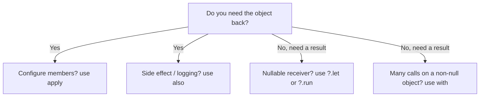
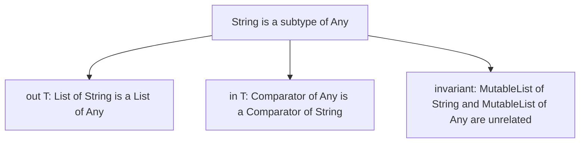
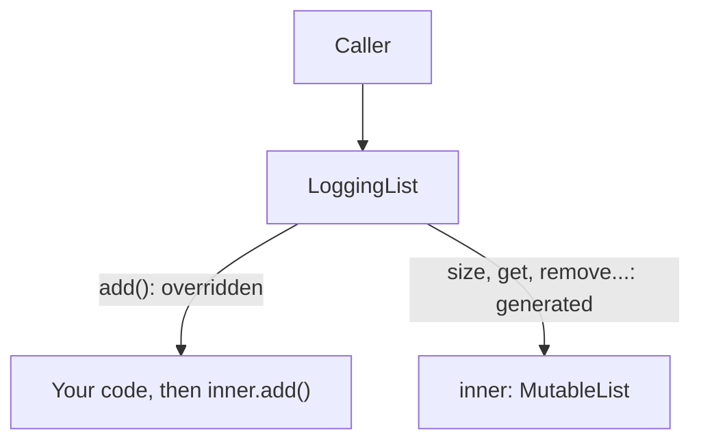
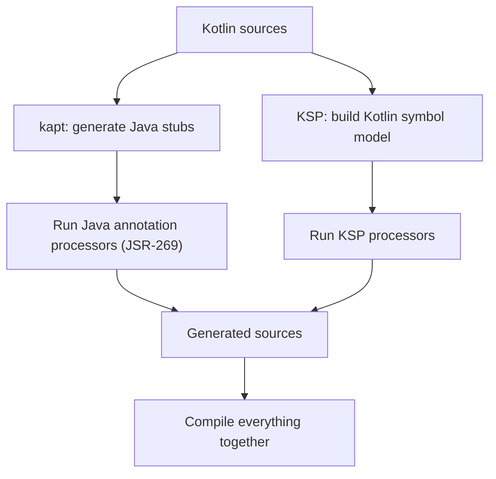
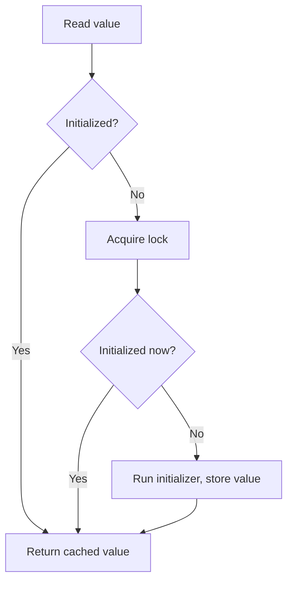

# Kotlin – Advanced

[⬅ Back to index](../README.md)

Covers: scope functions, inline/reified, generics & variance, delegation, annotations & Java interop, DSLs, Kotlin 2.x / K2.

---

## Scope Functions

### 1. What are scope functions? Explain `let`, `run`, `with`, `apply`, `also`.

<details>
<summary>Answer</summary>

**In short:** Scope functions run a block of code in the context of an object. The five of them differ in only two ways: **how you refer to the object inside the block** (`this` or `it`) and **what the call returns** (the object itself or the lambda's result). `apply`/`also` give the object back; `let`/`run`/`with` give the lambda result back.

#### Why they exist

They don't add new capabilities. Anything you write with them you could write with a local variable. What they give you is **scoping and readability**: you can configure an object in one expression, run code only when a value is non-null, or attach a side effect without breaking a call chain.

#### The comparison

| Function | Object ref | Returns | Is an extension? | Typical use |
|---|---|---|---|---|
| `let` | `it` | lambda result | yes | null checks (`x?.let {}`), transforming a value |
| `run` | `this` | lambda result | yes (also a non-extension form) | configure and compute a result |
| `with(obj)` | `this` | lambda result | no, takes the object as an argument | call many methods on a non-null object |
| `apply` | `this` | **the object** | yes | object configuration / builder style |
| `also` | `it` | **the object** | yes | side effects: logging, validation |

```kotlin
// let: run only when non-null, and map to something else
val length = name?.let { it.length } ?: 0

// apply: configure an object and get the same object back
val intent = Intent(ctx, DetailActivity::class.java).apply {
    putExtra("id", 1)          // 'this' is the Intent
    flags = Intent.FLAG_ACTIVITY_SINGLE_TOP
}

// also: side effect in the middle of a chain, object passes through unchanged
val user = createUser().also { log("created $it") }

// with: several calls on one object, result is the last expression
val text = with(person) { "Name: $name, Age: $age" }

// run: like with, but as an extension, so it works with ?.
val ok = service?.run { connect(); isConnected } ?: false
```

`this` vs `it` matters for readability. With `this` (`apply`, `run`, `with`) you call members directly, which is nice for configuration. With `it` (`let`, `also`) the object is a normal parameter, which is clearer when you also use the outer class's members or want to rename it (`let { user -> ... }`).

#### Choosing one



Memory trick: **apply/also return the object** ("A" for "and give it back"), while **let/run/with return the lambda result**.

#### Common pitfalls

- **`x?.let { ... } ?: fallback` is not an if/else.** If the lambda itself returns `null`, the fallback runs too. Use a real `if (x != null)` when the block's result can be null.
- **Nesting** scope functions makes `it` and `this` ambiguous. Name the parameter (`let { user -> }`) or use a local `val`.
- **Overuse.** A plain `val` and two lines is often clearer than a chain of `let`/`also`/`run`.
- `apply` inside a class shadows `this`: `this@MyActivity` is needed to reach the outer instance.

#### Likely follow-ups

- *Difference between `run` and `with`?* Same semantics, but `run` is an extension, so it can be chained and used with `?.`; `with` takes the object as a parameter.
- *Which ones are inline?* All of them, so there's no lambda allocation cost.
- *Why `also` over `apply` for logging?* `it` keeps the outer `this` available and makes it obvious the block doesn't configure the object.

</details>

### 2. What are `takeIf` and `takeUnless`?

<details>
<summary>Answer</summary>

**In short:** `takeIf { predicate }` returns the object if the predicate is true, otherwise `null`. `takeUnless` is the opposite: it returns the object if the predicate is **false**. They turn a condition into a nullable value so you can chain it with `?.`, `?:` and `let`.

```kotlin
// Without takeIf
val validEmail = if (email.contains("@")) email else return

// With takeIf
val validEmail = email.takeIf { it.contains("@") } ?: return
```

They are inline extension functions defined roughly like this:

```kotlin
inline fun <T> T.takeIf(predicate: (T) -> Boolean): T? =
    if (predicate(this)) this else null
```

#### Where they shine

```kotlin
// Only use the cached file if it is fresh
val cached = cacheFile.takeIf { it.exists() && !it.isStale() }
    ?.readText()
    ?: api.download()

// Ignore blank search queries
searchQuery.takeUnless { it.isBlank() }?.let { viewModel.search(it) }

// Pick an index only if it is in range
val item = index.takeIf { it in items.indices }?.let { items[it] }
```

#### Pitfalls

- **The predicate always runs**, even if you never use the result. Don't put expensive or side-effecting work in it.
- On a nullable receiver, call it with `?.`: `name?.takeIf { it.isNotBlank() }`.
- Long chains with `takeIf` + `let` + `?:` can be harder to read than an `if`. Use them for short, linear expressions.

#### Likely follow-ups

- *Why is it called on the object rather than taking a condition?* So it reads as a pipeline step and returns the receiver type `T?`, which keeps chaining natural.
- *Is there an allocation for the lambda?* No, both are `inline`.

</details>

---

## Inline, noinline, crossinline, reified

### 3. What is an inline function and why use it?

<details>
<summary>Answer</summary>

**In short:** `inline` tells the compiler to **copy the function's body, and the bodies of the lambdas passed to it, into every call site**. For higher-order functions this removes the lambda object allocation and the virtual `invoke()` call. It also enables **non-local returns** and **`reified`** type parameters. The cost is larger bytecode.

#### The problem it solves

On the JVM a lambda is compiled to an object implementing a function interface (`Function0`, `Function1`, ...). Calling a higher-order function normally means:
- allocating that object (unless it captures nothing and can be cached as a singleton), and
- calling `invoke()` through an interface, which may also box primitive arguments.

In hot paths such as collection operators (`map`, `filter`, `forEach`) or wrappers called in loops, that overhead adds up. Inlining removes it.

#### What the compiler does

```kotlin
inline fun <T> measure(block: () -> T): T {
    val start = System.nanoTime()
    return block().also { println(System.nanoTime() - start) }
}

// Call site
val users = measure { repository.loadUsers() }
```

After inlining, the call site effectively becomes:

```kotlin
val start = System.nanoTime()
val result = repository.loadUsers()          // lambda body pasted in place
println(System.nanoTime() - start)
val users = result
```

No `Function0` object, no `invoke()`. The standard library marks `let`, `apply`, `map`, `filter`, `forEach`, `synchronized`, `use` and many others as `inline` for this reason.

#### Benefits

- **Performance** for functions that take lambdas.
- **Non-local returns**: a bare `return` inside the lambda returns from the enclosing function (see question 6).
- **`reified` type parameters**: the real type is known at the call site (see question 5).

#### Drawbacks and rules

- **Bigger bytecode** if the body is large and called from many places. Keep inline functions small.
- Inlining a function **without lambda parameters** gives almost no benefit; the IDE warns ("expected performance impact is insignificant"). The exception is when you need `reified`.
- A **public inline function can't use private or internal members** of its class, because its body gets copied into other modules. Mark the helpers `@PublishedApi internal` if you must.
- Inline functions can't be recursive.
- Changing a public inline function in a library requires callers to recompile, because the old body is baked into their code.

#### Likely follow-ups

- *Does Kotlin inline automatically?* No, only functions marked `inline` (the JIT may inline at runtime, but that's a separate thing).
- *What if I need to store a lambda passed to an inline function?* Mark that parameter `noinline` (question 4).
- *Are `inline` and `value class` related?* Only by name. A `value class` (formerly "inline class") wraps a single value without allocation; it's a different feature.

</details>

### 4. What are `noinline` and `crossinline`?

<details>
<summary>Answer</summary>

**In short:** Both modify lambda parameters of an `inline` function. **`noinline`** means "don't inline this lambda": it stays a real object you can store or pass to a non-inline function. **`crossinline`** means "inline it, but **forbid non-local returns**", which you need when the lambda is invoked from a different execution context, such as inside another lambda or a `Runnable`.

#### `noinline`

By default every lambda parameter of an inline function is inlined, which means it isn't an object, so you can't assign it to a variable or pass it on. `noinline` opts one parameter out.

```kotlin
inline fun doWork(
    work: () -> Unit,
    noinline onDone: () -> Unit,     // will be stored, so it must be a real object
) {
    work()                           // inlined
    callbacks.add(onDone)            // OK only because onDone is noinline
}
```

Without `noinline`, `callbacks.add(onDone)` fails with "Illegal usage of inline-parameter".

#### `crossinline`

The body of an inline lambda may contain a `return` that exits the *caller's* function (a non-local return). That only makes sense if the lambda runs directly inside the inline function. If you invoke it from a nested lambda, an anonymous object or another thread, a `return` there couldn't possibly return from the caller. So the compiler requires you to promise there are no non-local returns:

```kotlin
// Wrong: compile error "Can't inline 'block' here: it may contain non-local returns"
inline fun runOnUi(block: () -> Unit) {
    handler.post { block() }
}

// Right
inline fun runOnUi(crossinline block: () -> Unit) {
    handler.post { block() }          // called inside another lambda → needs crossinline
}

fun onLoaded() {
    runOnUi {
        textView.text = "Done"
        // return          // not allowed now
        return@runOnUi     // a labelled local return is still fine
    }
}
```

The lambda's code is still inlined into the `post { }` lambda, so you keep most of the performance benefit.

#### Comparison

| Modifier | Lambda inlined? | Can be stored / passed on? | Non-local `return` allowed? |
|---|---|---|---|
| (default) | yes | no | yes |
| `noinline` | no | yes | no |
| `crossinline` | yes | only inside another inlined context | no |

#### Likely follow-ups

- *If all lambda parameters are `noinline`, why mark the function `inline`?* There's no point unless you need `reified`; the IDE warns.
- *Where do you see `crossinline` in practice?* In helpers that wrap a callback-based API, e.g. building a `TextWatcher` or `Runnable` from a lambda, and in `flow { }`-style builders written as inline functions.

</details>

### 5. What is `reified` and why does it only work with inline functions?

<details>
<summary>Answer</summary>

**In short:** On the JVM, generic type arguments are **erased** at runtime, so inside a normal generic function `T::class` or `is T` is impossible. Marking a type parameter `reified` in an `inline` function makes the compiler **substitute the actual type at each call site**, so the type is available. It only works with `inline` because the substitution happens when the body is copied into the caller; a normal function has one compiled body that must work for every `T`.

#### The problem

```kotlin
// Doesn't compile: Cannot use 'T' as reified type parameter
fun <T> Gson.parse(json: String): T = fromJson(json, T::class.java)

// Classic workaround: pass the class explicitly
fun <T> Gson.parse(json: String, clazz: Class<T>): T = fromJson(json, clazz)
val user = gson.parse(json, User::class.java)
```

#### The solution

```kotlin
inline fun <reified T : Activity> Context.start() =
    startActivity(Intent(this, T::class.java))

context.start<DetailActivity>()   // compiled as Intent(this, DetailActivity::class.java)

inline fun <reified T> Gson.fromJson(json: String): T = fromJson(json, T::class.java)
val user: User = gson.fromJson(json)
```

When the compiler inlines `start<DetailActivity>()`, it pastes the body and replaces `T` with `DetailActivity`, so `T::class.java` becomes a constant class literal. There's no reflection or magic at runtime.

#### What reified enables

- `T::class` / `T::class.java`
- type checks and casts: `x is T`, `x as T`
- `typeOf<T>()` to get a full `KType` including nested generics
- standard library helpers built on it: `filterIsInstance<T>()`, `emptyArray<T>()`, `by viewModels<MyViewModel>()`

#### Pitfalls

- `T::class.java` loses nested type arguments: for `T = List<User>` you get just `List`. For Gson, use a `TypeToken` (`object : TypeToken<T>() {}.type`) or `typeOf<T>()` with a library that supports it.
- Reified inline functions **can't be called from Java**, since Java has no way to supply the type at compile time.
- A reified function can only be called with a type that's known at that call site. Calling it from another generic function with a non-reified `T` doesn't compile.

#### Likely follow-ups

- *Why not just make all generics reified?* It requires inlining, which duplicates code, and it doesn't work for classes or virtual functions.
- *Is `reified` slower?* No, it's resolved at compile time.

</details>

### 6. What are non-local returns?

<details>
<summary>Answer</summary>

**In short:** Inside a lambda passed to an **inline** function, a bare `return` exits the **enclosing function**, not just the lambda. That's a non-local return. It's allowed only because the lambda's code is pasted into the enclosing function. To return from the lambda only, use a labelled return such as `return@forEach`.

```kotlin
fun findFirstAdult(users: List<User>): User? {
    users.forEach { if (it.age >= 18) return it }  // returns from findFirstAdult
    return null
}
```

Because `forEach` is inline, the loop body is copied into `findFirstAdult`, so `return it` is just an ordinary return from that function. It behaves exactly like a `for` loop.

#### Local returns

```kotlin
users.forEach {
    if (it.isBanned) return@forEach      // skips this element only, like 'continue'
    show(it)
}

// Custom label
users.forEach userLoop@{
    if (it.isBanned) return@userLoop
}

// Anonymous function: a plain 'return' returns from the anonymous function itself
users.forEach(fun(user) {
    if (user.isBanned) return
    show(user)
})
```

#### Why it only works for inline lambdas

A non-inline lambda is a separate object whose `invoke()` might run later or on another thread, after the enclosing function has already returned. A `return` from there has no meaningful target, so the compiler forbids it (and `crossinline` explicitly forbids it for inline lambdas called from another context).

#### Pitfalls

- `return@forEach` is a **continue**, not a **break**. To stop early, use a `for` loop, `first { }`/`firstOrNull { }`, or wrap in `run loop@{ ... return@loop }`.
- Accidentally writing `return` instead of `return@let` inside a long `let` block exits the whole function, which can skip important code below.

#### Likely follow-ups

- *Can you use `break`/`continue` inside `forEach`?* Historically no. Newer Kotlin 2.x versions add non-local `break`/`continue` inside inline lambdas, but a plain `for` loop is still the clearest choice.
- *How do you return a value from a lambda?* The last expression is the value; or use `return@label value`.

</details>

---

## Generics & Variance

### 7. What are generics? What is type erasure?

<details>
<summary>Answer</summary>

**In short:** Generics let you write classes and functions that work with many types while staying type-safe (`List<T>`, `Result<T>`, `fun <T> firstOrNull()`). On the JVM, type arguments are **erased at runtime**: `List<String>` and `List<Int>` are both just `List` to the VM. That's why `x is List<String>` doesn't compile (use `is List<*>`) and why `reified` exists.

#### Why generics

Without generics you'd either write a separate class per type or use `Any` and cast everywhere, losing compile-time checks:

```kotlin
// Without generics: casting, runtime crashes possible
class Box(val value: Any)
val n = Box("hi").value as Int          // ClassCastException at runtime

// With generics: the compiler checks it
class Box<T>(val value: T)
val s: String = Box("hi").value         // no cast needed
```

#### What type erasure means

Java added generics in Java 5 and, to stay compatible with older bytecode, implemented them **only in the compiler**. The compiler checks the types and inserts casts, then removes the type arguments from the generated code. Kotlin on the JVM follows the same model.

So at runtime:

```kotlin
val a = listOf("a")
val b = listOf(1)
println(a.javaClass == b.javaClass)       // true

fun check(x: Any) {
    // if (x is List<String>) { }          // error: cannot check for erased type
    if (x is List<*>) { }                  // OK: "a list of something"
}

fun <T> create(): T = T()                  // error: no T at runtime
fun <T> isType(x: Any) = x is T            // error
```

Unchecked casts compile with a warning, and fail later, somewhere else:

```kotlin
val strings = listOf(1, 2) as List<String>   // warning: unchecked cast, no crash yet
val s: String = strings[0]                   // ClassCastException here
```

#### What isn't erased

Generic information in **declarations** (field types, method signatures, superclass type arguments) is kept in class-file metadata and readable through reflection. Gson's `TypeToken` exploits this: `object : TypeToken<List<User>>() {}` creates a subclass whose superclass signature records `List<User>`.

#### Workarounds

- Pass a `KClass<T>` / `Class<T>` explicitly.
- Use `inline` + `reified` (question 5).
- Use `typeOf<T>()` with a reified `T` to capture full nested types.

#### Likely follow-ups

- *Are arrays erased too?* No. `Array<String>` compiles to `String[]`, which keeps its element type at runtime.
- *Does Kotlin/Native or JS erase generics?* Kotlin's type system is the same everywhere; the "can't check `is List<String>`" rule applies on all platforms.

</details>

### 8. Explain variance: `in`, `out`, invariance (covariance/contravariance).

<details>
<summary>Answer</summary>

**In short:** Variance says whether `Box<Child>` can be used where `Box<Parent>` is expected. **Invariant** (default): no relationship. **Covariant `out T`**: the type only *produces* `T`, so `Box<String>` is a `Box<Any>`. **Contravariant `in T`**: the type only *consumes* `T`, so `Box<Any>` is a `Box<String>`. Mnemonic: producer = `out`, consumer = `in` (Java's PECS: "Producer Extends, Consumer Super").

#### Why the default is invariant

`String` is a subtype of `Any`, but should `MutableList<String>` be a subtype of `MutableList<Any>`? If it were:

```kotlin
val strings: MutableList<String> = mutableListOf("a")
val anys: MutableList<Any> = strings      // imagine this compiled
anys.add(42)                              // now a String list contains an Int
val s: String = strings[1]                // crash
```

Java arrays are covariant and have exactly this bug (`ArrayStoreException`). Kotlin's `Array<T>` and `MutableList<T>` are invariant to prevent it.

#### Covariance: `out T` (producer)

If a type only ever **returns** `T`, the problem above can't happen, because nobody can put a wrong value in. Read-only `List<out E>` is declared this way:

```kotlin
val strings: List<String> = listOf("a")
val anys: List<Any> = strings             // OK: List is covariant

interface Source<out T> {
    fun next(): T                         // T in "out" position: OK
    // fun put(item: T)                   // error: T in "in" position
}
```

#### Contravariance: `in T` (consumer)

If a type only ever **takes** `T` as input, the relationship flips. Something that can compare any two `Any`s can certainly compare two `String`s:

```kotlin
interface Comparator<in T> { fun compare(a: T, b: T): Int }

val anyComparator: Comparator<Any> = Comparator { a, b -> a.hashCode() - b.hashCode() }
val stringComparator: Comparator<String> = anyComparator   // OK: contravariant
```



#### Declaration-site vs use-site variance

| Kind | Where | Example | Java equivalent |
|---|---|---|---|
| Declaration-site | on the class/interface | `interface Source<out T>` | (none, Java only has use-site) |
| Use-site (type projection) | on a specific usage | `fun copy(from: Array<out Any>, to: Array<Any>)` | `? extends Object` |
| Use-site `in` | on a specific usage | `fun fill(dest: Array<in String>)` | `? super String` |

Use-site variance is useful when the class itself is invariant (like `Array` or `MutableList`) but a particular function only reads (`out`) or only writes (`in`).

#### Pitfalls

- Marking a class `out T` and then needing `T` as a parameter gives a compile error. The standard library uses `@UnsafeVariance` in a few safe places (e.g. `List.contains(element: @UnsafeVariance E)`); avoid it unless you're sure.
- Kotlin generates Java wildcards (`List<? extends Foo>`) for `out` types in parameters, which can confuse Java-based tools like Dagger (see `@JvmSuppressWildcards`, question 13).

#### Likely follow-ups

- *Why is `List` covariant but `MutableList` invariant?* `List` is read-only, so it only produces elements; `MutableList` also consumes them via `add`.
- *Is `Flow<T>` covariant?* Yes, `Flow<out T>`, since it only emits values.

</details>

### 9. What is star projection `*`?

<details>
<summary>Answer</summary>

**In short:** `Foo<*>` means "a `Foo` of some specific type that I don't know". You can safely **read** values out (as the upper bound, usually `Any?`), but you **can't write** anything in, because the compiler can't prove what type is allowed. It's Kotlin's equivalent of Java's `Foo<?>`.

#### When you need it

You use `*` when you don't know or don't care about the type argument:

```kotlin
fun printAll(list: List<*>) {
    for (item in list) println(item)      // item is Any?
}

if (value is Map<*, *>) { /* type erasure means you can't check Map<String, Int> */ }

val clazz: KClass<*> = obj::class
```

#### What it means precisely

The compiler turns `*` into a safe projection based on the declaration:

| Declaration | `Foo<*>` means | Read as | Write |
|---|---|---|---|
| `Foo<out T : Upper>` | `Foo<out Upper>` | `Upper` | n/a |
| `Foo<in T>` | `Foo<in Nothing>` | n/a | nothing can be written |
| `Foo<T : Upper>` (invariant) | `out Upper` for reading, `in Nothing` for writing | `Upper` | nothing can be written |

#### `MutableList<*>` vs `MutableList<Any?>`

These look similar but aren't:

```kotlin
val a: MutableList<Any?> = mutableListOf()
a.add("x"); a.add(1)                      // OK: it really holds anything

val b: MutableList<*> = mutableListOf<String>()
// b.add("x")                             // error: it might be a list of Int
val first: Any? = b.firstOrNull()         // reading is fine
```

A `MutableList<String>` can be assigned to `MutableList<*>` but **not** to `MutableList<Any?>` (invariance).

#### Likely follow-ups

- *When do you use `*` vs a type parameter `<T>`?* Use `<T>` when the function needs to relate types (e.g. return the same `T`); use `*` when it genuinely doesn't care.
- *Why can't you write into `List<*>`?* The real element type is unknown, so any write could break type safety.

</details>

### 10. What are generic constraints?

<details>
<summary>Answer</summary>

**In short:** Constraints (upper bounds) restrict which types can be used as a type argument, so the function body can rely on that type's members. `fun <T : Comparable<T>> max(a: T, b: T)` accepts only comparable types. For several bounds, use a `where` clause.

#### Single upper bound

```kotlin
fun <T : Comparable<T>> max(a: T, b: T): T = if (a > b) a else b

max(3, 7)            // OK: Int is Comparable<Int>
max("a", "b")        // OK
// max(Any(), Any()) // error: Any is not Comparable
```

Without the bound, `a > b` wouldn't compile, because an arbitrary `T` has no `compareTo`.

#### Multiple bounds with `where`

```kotlin
fun <T> save(item: T) where T : Serializable, T : Comparable<T> {
    // can use both Serializable and Comparable members of item
}
```

The argument must satisfy **all** bounds. At most one bound can be a class; the rest must be interfaces.

#### Nullability and the default bound

The default upper bound is `Any?`, so `T` can be nullable. To forbid nulls:

```kotlin
fun <T : Any> requireValue(value: T?): T = value ?: error("missing")

// Kotlin 1.7+: "definitely non-nullable" type, useful when T itself may be nullable
fun <T> orThrow(x: T): T & Any = x ?: throw IllegalStateException()
```

#### Android examples

```kotlin
// Only ViewModels are allowed
inline fun <reified VM : ViewModel> Fragment.vm() = ViewModelProvider(this)[VM::class.java]

// A generic adapter for anything that has a stable ID
interface HasId { val id: Long }
class DiffAdapter<T : HasId> : ListAdapter<T, VH>(object : DiffUtil.ItemCallback<T>() {
    override fun areItemsTheSame(a: T, b: T) = a.id == b.id
    override fun areContentsTheSame(a: T, b: T) = a == b
}) { /* ... */ }
```

#### Likely follow-ups

- *Java equivalent?* `<T extends Comparable<T>>` and `<T extends A & B>`.
- *Is a constraint the same as variance?* No. Constraints limit *which* types can be `T`; variance controls subtyping *between* `Foo<A>` and `Foo<B>`.

</details>

---

## Delegation

### 11. What is class delegation (`by`)?

<details>
<summary>Answer</summary>

**In short:** `class A(impl: I) : I by impl` makes `A` implement interface `I` by **forwarding every call to `impl`**. The compiler generates the forwarding methods, and you override only the ones you want to change. It's the Delegation pattern built into the language, and a way to favour **composition over inheritance**.

#### The problem it solves

Say you want a list that logs every addition. Inheriting from `ArrayList` ties you to one implementation and to its internal behaviour. Writing a wrapper by hand means implementing ~30 `MutableList` methods just to forward them. Kotlin generates those for you:

```kotlin
class LoggingList<T>(private val inner: MutableList<T>) : MutableList<T> by inner {
    override fun add(element: T): Boolean {
        println("add $element")
        return inner.add(element)
    }
}

val list = LoggingList(mutableListOf<String>())
list.add("a")        // prints "add a"
list.size            // forwarded to inner.size
```

The compiler generates forwarding methods for every interface member you don't override.



#### Real-world Android uses

- Splitting a big ViewModel or Activity into small reusable behaviours: `class MyViewModel(analytics: Analytics) : ViewModel(), Analytics by analytics`.
- Decorators: adding caching or logging around a repository interface.
- Combining several interfaces, each backed by a different implementation, without a deep class hierarchy.

#### Pitfalls

- **No "callback" into your overrides.** The delegate is a separate object. If `inner.addAll()` internally calls `add()`, it calls *its own* `add`, not your override. In the example above, `list.addAll(listOf("x", "y"))` logs nothing. This is the key difference from inheritance.
- Only **interfaces** can be delegated, not classes.
- The delegate is fixed at construction. Changing a `var` property later doesn't change the target of the generated forwarding methods; they captured the original instance.

#### Likely follow-ups

- *Delegation vs inheritance?* Delegation works with any implementation of the interface, can't break due to a superclass's internal changes (fragile base class problem), and allows multiple behaviours; inheritance gives you virtual dispatch into your overrides.
- *How is this different from delegated properties?* Same `by` keyword, but property delegation forwards a property's get/set (question 12), while class delegation forwards interface methods.

</details>

### 12. What are delegated properties? Examples?

<details>
<summary>Answer</summary>

**In short:** With `val x by delegate`, the property's getter (and setter for `var`) is handed to another object that implements `getValue` (and `setValue`). This lets you reuse property logic such as lazy initialisation, change observation or storage in `SharedPreferences`. Common ones: `by lazy`, `Delegates.observable`, `by viewModels()`, Compose's `by remember { mutableStateOf() }`.

#### How it works under the hood

```kotlin
class Screen {
    val title: String by lazy { loadTitle() }
}
```

The compiler generates roughly:

```kotlin
class Screen {
    private val title$delegate = lazy { loadTitle() }
    val title: String
        get() = title$delegate.getValue(this, ::title)
}
```

So any object with the right `operator fun getValue(thisRef, property)` (and `setValue` for `var`) can be a delegate.

#### Standard delegates

- `by lazy { }` – compute on first access, then cache (question 28 covers thread-safety modes).
- `by Delegates.observable(initial) { prop, old, new -> }` – get notified after the value changes.
- `by Delegates.vetoable(initial) { prop, old, new -> new >= 0 }` – reject changes by returning `false`.
- `by map` – read properties from a `Map` by name (useful for parsing loose config).
- `by this::otherProperty` – forward to another property (handy when renaming a property while keeping the old name deprecated).
- Android: `by viewModels()`, `by activityViewModels()`, `by navArgs()`, and Compose `var x by remember { mutableStateOf(0) }`.

```kotlin
var query: String by Delegates.observable("") { _, old, new ->
    if (old != new) search(new)
}

class Config(map: Map<String, Any?>) {
    val host: String by map
    val port: Int by map
}
val cfg = Config(mapOf("host" to "api.example.com", "port" to 443))
```

#### Custom delegate

Implement `ReadWriteProperty<Any?, T>` (or `ReadOnlyProperty` for `val`). A SharedPreferences delegate is the classic example:

```kotlin
class IntPref(
    private val prefs: SharedPreferences,
    private val key: String,
    private val default: Int = 0,
) : ReadWriteProperty<Any?, Int> {
    override fun getValue(thisRef: Any?, property: KProperty<*>): Int =
        prefs.getInt(key, default)

    override fun setValue(thisRef: Any?, property: KProperty<*>, value: Int) {
        prefs.edit().putInt(key, value).apply()
    }
}

class Settings(prefs: SharedPreferences) {
    var launchCount by IntPref(prefs, "launch_count")
}

settings.launchCount++    // reads and writes SharedPreferences
```

`property.name` is available too, so a delegate can use the property name as the key.

#### Pitfalls

- `by viewModels()` is lazy: accessing it before the Fragment is attached crashes.
- Compose's `by` needs the `getValue`/`setValue` imports (`androidx.compose.runtime.getValue`/`setValue`); a missing import is a common compile error.
- Each delegated property creates a delegate object, which is fine in normal code but worth knowing in hot, allocation-sensitive paths.

#### Likely follow-ups

- *What is `provideDelegate`?* An optional operator that runs when the property is created, letting the delegate validate or set up based on the property (e.g. check the name).
- *Can local variables be delegated?* Yes: `val data by lazy { ... }` inside a function works.

</details>

---

## Java Interop & Annotations

### 13. Explain `@JvmStatic`, `@JvmField`, `@JvmOverloads`, `@JvmName`.

<details>
<summary>Answer</summary>

**In short:** These annotations control **what bytecode Kotlin generates**, so the code is pleasant to call from Java. `@JvmStatic` creates a real static method, `@JvmField` exposes a plain field instead of a getter/setter, `@JvmOverloads` generates overloads for default arguments, and `@JvmName` changes the JVM name of a function or file class.

#### `@JvmStatic`

Members of an `object` or `companion object` aren't static by default; Java has to go through the singleton instance.

```kotlin
class Analytics {
    companion object {
        fun track(e: String) { }
        @JvmStatic fun log(e: String) { }
    }
}
```

```java
Analytics.Companion.track("a");   // without @JvmStatic
Analytics.log("a");               // with @JvmStatic
```

#### `@JvmField`

A Kotlin property compiles to a private field plus `getX()`/`setX()`. `@JvmField` exposes the field directly with the property's visibility and no accessors:

```kotlin
class Point { @JvmField val x: Int = 0 }
// Java: point.x   instead of   point.getX()
```

It can't be used on `private`, `open`, `override` or `const` properties, or ones with custom getters. For compile-time constants, prefer `const val`.

#### `@JvmOverloads`

Java has no default arguments, so a Kotlin function with defaults appears as one method requiring every argument. `@JvmOverloads` generates an overload per trailing default parameter. The classic use is custom Views:

```kotlin
class ProfileView @JvmOverloads constructor(
    context: Context,
    attrs: AttributeSet? = null,
    defStyleAttr: Int = 0,
) : FrameLayout(context, attrs, defStyleAttr)
// generates (Context), (Context, AttributeSet), (Context, AttributeSet, int)
```

Pitfall: when extending a widget that has its own default style (like `Button` or `TextInputEditText`), passing `defStyleAttr = 0` replaces that default style and the view loses its theme styling. In that case pass the widget's own default style attribute, or write the constructors by hand.

#### `@JvmName`

Renames the JVM method or the file class. Two common reasons:

```kotlin
// 1) Signatures that clash after type erasure
fun List<String>.joined(): String = joinToString()
@JvmName("joinedInts")
fun List<Int>.joined(): String = joinToString()   // both would be joined(List) otherwise

// 2) A nicer class name for top-level functions in StringUtils.kt
@file:JvmName("StringUtils")
// Java: StringUtils.isEmail(s) instead of StringUtilsKt.isEmail(s)
```

#### Related annotations

- `@Throws(IOException::class)` – declares checked exceptions so Java callers can catch them (question 14).
- `@JvmSuppressWildcards` – Kotlin compiles a parameter of type `List<Foo>` (where `Foo` is open) to `List<? extends Foo>`. Dagger matches types exactly, so multibound `Set<Foo>` injections fail to resolve; this annotation removes the wildcard.
- `@JvmWildcard` – the opposite: forces a wildcard.

#### Likely follow-ups

- *Why does a companion `val` need `@JvmField` or `const` to look like a Java static field?* Otherwise Java sees a private static field and a `getX()` on `Companion`.
- *Do these matter in a pure-Kotlin codebase?* Mostly not; they matter for Java callers and Java-based frameworks.

</details>

### 14. How does Kotlin handle checked exceptions?

<details>
<summary>Answer</summary>

**In short:** Kotlin has **no checked exceptions**. You're never forced to catch or declare them, even when calling Java methods that declare `throws IOException`. When Java code needs to know a Kotlin function can throw a checked exception, annotate it with `@Throws(IOException::class)`. For expected failures, prefer modelling them in the return type (`Result<T>`, sealed classes) and keep exceptions for exceptional cases.

#### Why Kotlin dropped them

Java's checked exceptions were meant to force error handling, but in practice they often produce:
- empty `catch` blocks that swallow errors,
- `throws Exception` declarations bubbling up through every layer,
- awkward lambdas, since functional interfaces can't throw checked exceptions.

Kotlin's designers concluded the boilerplate outweighed the safety, following C#, Scala and others.

```kotlin
// Kotlin: calling a Java method declared 'throws IOException' needs no try/catch
val text = File("config.json").readText()
```

#### The Java interop problem

Kotlin functions don't declare exceptions in bytecode. A Java caller then can't catch the checked exception, because `javac` complains it's "never thrown in body of corresponding try statement":

```kotlin
// Wrong for Java callers
fun loadConfig(): String = File("config.json").readText()

// Right
@Throws(IOException::class)
fun loadConfig(): String = File("config.json").readText()
```

```java
try { ConfigKt.loadConfig(); }
catch (IOException e) { /* compiles only with @Throws */ }
```

It also matters for Java dynamic proxies: if a checked exception escapes a proxied Kotlin interface method that doesn't declare it with `@Throws`, the proxy wraps it in `UndeclaredThrowableException`.

#### Modelling expected failures

```kotlin
sealed interface LoginResult {
    data class Success(val user: User) : LoginResult
    data object WrongPassword : LoginResult
    data class NetworkError(val cause: IOException) : LoginResult
}
```

A sealed result forces callers (via an exhaustive `when`) to handle each case, which gives you the benefit checked exceptions promised, in a type-safe way.

#### Likely follow-ups

- *Does `@Throws` change Kotlin behaviour?* No, only the generated method signature for Java.
- *How should errors be handled in coroutines?* Use `try/catch` or sealed results, and never swallow `CancellationException` (question 15).

</details>

### 15. What is `Result<T>` and `runCatching`?

<details>
<summary>Answer</summary>

**In short:** `Result<T>` is a standard-library type that holds either a **success value** or a **`Throwable`**. `runCatching { }` runs a block and wraps whatever happens into a `Result`, so you can handle failure with functions (`onSuccess`, `onFailure`, `getOrElse`, `map`) instead of `try/catch`. The big gotcha: `runCatching` catches **everything**, including `CancellationException`, which breaks coroutine cancellation.

#### Basic use

```kotlin
val result: Result<User> = runCatching { api.getUser() }

result
    .onSuccess { show(it) }
    .onFailure { showError(it) }

val user = result.getOrElse { User.EMPTY }
```

`runCatching` is essentially:

```kotlin
inline fun <R> runCatching(block: () -> R): Result<R> =
    try { Result.success(block()) } catch (e: Throwable) { Result.failure(e) }
```

#### Useful operations

| Function | What it does |
|---|---|
| `isSuccess` / `isFailure` | check the state |
| `getOrNull()` / `exceptionOrNull()` | extract one side or `null` |
| `getOrElse { e -> }` / `getOrDefault(x)` | value or fallback |
| `getOrThrow()` | value, or rethrow the exception |
| `map { }` / `mapCatching { }` | transform the success value (`mapCatching` also catches errors thrown by the transform) |
| `recover { }` / `recoverCatching { }` | turn a failure into a success |
| `fold(onSuccess, onFailure)` | collapse both cases into one value |

```kotlin
val name: String = runCatching { repo.loadProfile() }
    .map { it.displayName }
    .recover { "Guest" }
    .getOrThrow()
```

#### The coroutine pitfall

Coroutine cancellation works by throwing `CancellationException` from suspension points. If you catch it and carry on, the coroutine keeps running after it was cancelled (for example, after the user left the screen and `viewModelScope` was cancelled).

```kotlin
// Wrong: swallows cancellation
viewModelScope.launch {
    val r = runCatching { api.getUser() }       // CancellationException becomes a failure
    _state.value = r.fold(::Loaded, ::Error)    // runs even though we were cancelled
}

// Right: rethrow cancellation
inline fun <T> runCatchingCancellable(block: () -> T): Result<T> =
    try {
        Result.success(block())
    } catch (e: CancellationException) {
        throw e
    } catch (e: Throwable) {
        Result.failure(e)
    }
```

Because the helper is `inline`, the block can still call suspend functions when used inside a coroutine.

#### Other pitfalls

- It catches `Throwable`, so `OutOfMemoryError` and programming bugs (`NullPointerException`) become "failures" too. Catch narrower types when you can.
- The error type is just `Throwable`. For domain errors the UI must handle differently (no network vs wrong password), a **sealed class** result is more expressive.

#### Likely follow-ups

- *Can `Result` be a function's return type?* Yes, since Kotlin 1.5. Earlier versions restricted it.
- *Result vs sealed class?* `Result` is quick and generic; a sealed hierarchy gives typed, exhaustive error cases.

</details>

---

## Other Advanced Topics

### 16. What is operator overloading?

<details>
<summary>Answer</summary>

**In short:** You can give your own types support for operators like `+`, `[]`, `in` or `()` by declaring an `operator fun` with a specific predefined name: `plus` for `+`, `get`/`set` for `[]`, `contains` for `in`, `invoke` for `()`, and so on. The compiler translates the operator into that function call, so there's no runtime magic.

```kotlin
data class Point(val x: Int, val y: Int) {
    operator fun plus(o: Point) = Point(x + o.x, y + o.y)
    operator fun unaryMinus() = Point(-x, -y)
}

val p = Point(1, 2) + Point(3, 4)     // compiled as Point(1, 2).plus(Point(3, 4))
val q = -p
```

#### The conventions

| Expression | Function |
|---|---|
| `a + b`, `a - b`, `a * b`, `a / b`, `a % b` | `plus`, `minus`, `times`, `div`, `rem` |
| `a += b` | `plusAssign` (or `a = a + b` via `plus`) |
| `-a`, `!a`, `a++` | `unaryMinus`, `not`, `inc` |
| `a[i]`, `a[i] = v` | `get`, `set` |
| `a(args)` | `invoke` |
| `x in a` | `a.contains(x)` |
| `a < b`, `a >= b` | `a.compareTo(b)` (must return `Int`) |
| `a..b`, `a..<b` | `rangeTo`, `rangeUntil` |
| `val (x, y) = a` | `component1()`, `component2()` |
| `a == b` | `equals` (overridden, not declared with `operator`) |

Operators can also be extension functions, so you can add them to types you don't own:

```kotlin
data class Money(val cents: Long)
operator fun Money.times(n: Int) = Money(cents * n)
operator fun Money.compareTo(other: Money) = cents.compareTo(other.cents)

val total = Money(250) * 3                // Money(750)
val tooMuch = total > Money(500)          // uses compareTo
```

Note that an extension never wins over a member with the same signature, so you can't "override" an existing member operator this way.

#### Real Android uses

- **`invoke` on use cases** in Clean Architecture: `class GetUserUseCase { operator fun invoke(id: String): User }`, called as `getUser(id)`.
- `Rect`, `Offset`, `Dp` and similar types in Compose/AndroidX define `plus`, `minus`, `times`.
- `core-ktx` adds operator extensions such as `get`/`contains` for `ViewGroup` (`viewGroup[0]`, `view in viewGroup`).

#### Pitfalls

- Only use operators where the meaning is obvious. `user + order` is confusing.
- With a `var` holding a **mutable** collection, `list += item` is ambiguous (both `plus` + reassignment and `plusAssign` apply) and doesn't compile. Use `val` for mutable collections, or `var` for read-only ones.
- `compareTo` and `equals` should be consistent, or sorted collections behave oddly.

#### Likely follow-ups

- *Can you define new operators like `**`?* No, only the fixed set. For custom words, use `infix` functions (`a to b`, `x shl 2`).
- *How do data classes support destructuring?* They generate `componentN()` operators automatically.

</details>

### 17. What is a Kotlin DSL? How is it built?

<details>
<summary>Answer</summary>

**In short:** A Kotlin DSL is an API designed to read like a small configuration language, while still being ordinary, type-checked Kotlin. It's built mainly from **lambdas with receivers** (`T.() -> Unit`), plus extension functions, `infix` functions, operator overloading and `@DslMarker` to keep scopes from leaking. Examples: Gradle Kotlin DSL, Compose, Ktor routing, `buildString {}`, `buildList {}`.

#### The building blocks

| Feature | What it gives you |
|---|---|
| Lambda with receiver `T.() -> Unit` | inside the block, `this` is a builder, so you call `p("text")` instead of `builder.p("text")` |
| Trailing lambda syntax | `html { }` instead of `html({ })` |
| Extension functions | add DSL words to existing types |
| `infix` functions | `"id" eq 5` reads like prose |
| `@DslMarker` | stops calls from silently resolving to an outer builder |

#### A small HTML builder

```kotlin
@DslMarker
annotation class HtmlDsl

@HtmlDsl
class HTML {
    private val bodies = mutableListOf<Body>()
    fun body(block: Body.() -> Unit) { bodies += Body().apply(block) }
    override fun toString() = bodies.joinToString("", "<html>", "</html>")
}

@HtmlDsl
class Body {
    private val parts = mutableListOf<String>()
    fun p(text: String) { parts += "<p>$text</p>" }
    override fun toString() = parts.joinToString("", "<body>", "</body>")
}

fun html(block: HTML.() -> Unit): HTML = HTML().apply(block)

// Usage
val page = html {
    body {
        p("Hello")
        p("World")
        // body { }   // compile error thanks to @DslMarker: body() belongs to the outer HTML scope
    }
}
```

Without `@DslMarker`, the inner `body { }` call would compile, because the outer `HTML` receiver is still implicitly in scope. The marker forbids using an outer receiver implicitly when an inner one of the same DSL is present.

#### Where you meet DSLs on Android

- **Gradle Kotlin DSL** (`build.gradle.kts`): `android { defaultConfig { minSdk = 24 } }` is nested lambdas with receivers.
- **Compose**: `Column { Text("Hi") }` is the same trailing-lambda style (content lambdas are `@Composable` and some have receivers like `ColumnScope`).
- **Ktor**: `routing { get("/users") { call.respond(users) } }`.
- Standard library: `buildString { append("a") }`, `buildList { add(1) }`, `buildMap { }`.

#### Pitfalls

- A DSL hides control flow; keep builders simple and validate required fields when building.
- Forgetting `@DslMarker` leads to subtle bugs where a call applies to the wrong level.

#### Likely follow-ups

- *Why are DSLs type-safe compared with XML or Groovy?* The compiler checks every call, and the IDE autocompletes it.
- *What's the key language feature?* Lambdas with receivers (question 18).

</details>

### 18. What is a lambda with receiver?

<details>
<summary>Answer</summary>

**In short:** A function type like `StringBuilder.() -> Unit` describes a lambda that is called **on** a `StringBuilder`. Inside the lambda, `this` is that receiver, so you call its members directly (`append("x")` instead of `sb.append("x")`). `apply`, `with`, `run`, `buildString` and practically every Kotlin DSL are built on it.

#### Regular lambda vs lambda with receiver

```kotlin
// Regular: the object is a parameter
fun buildA(block: (StringBuilder) -> Unit): String {
    val sb = StringBuilder(); block(sb); return sb.toString()
}
buildA { sb -> sb.append("Hi") }

// With receiver: the object is 'this'
fun buildB(block: StringBuilder.() -> Unit): String {
    val sb = StringBuilder(); sb.block(); return sb.toString()
}
buildB { append("Hi") }       // 'this' is the StringBuilder
```

That second function is essentially how `buildString` is implemented.

#### How it works

At the bytecode level the two types are the same: the receiver is just passed as the first argument. The difference is purely in how the compiler resolves names inside the lambda: unqualified calls are looked up on the receiver first. That's why both call styles work for a value of type `A.() -> Unit`:

```kotlin
val greet: StringBuilder.() -> Unit = { append("Hello") }
val sb = StringBuilder()
sb.greet()      // extension-style call
greet(sb)       // also allowed
```

#### Where you see it

- `apply { }` and `run { }` have the signature `T.() -> R`, which is why `this` works inside them, while `let`/`also` take `(T) -> R`.
- Compose: `Row { }` takes `@Composable RowScope.() -> Unit`, which is why `Modifier.weight(1f)` is available only inside a `Row` or `Column`. The scope controls what's allowed.
- Gradle `android { }` blocks, Ktor routes, `buildList { }`.

#### Pitfalls

- When lambdas with receivers nest, `this` refers to the innermost receiver. Use labels like `this@apply` or `@DslMarker` to avoid confusion.

#### Likely follow-ups

- *How is it different from an extension function?* It's the function-*type* version of an extension function; an extension function is a declared function, a lambda with receiver is a value you pass around.

</details>

### 19. What is a SAM / functional (`fun`) interface?

<details>
<summary>Answer</summary>

**In short:** A SAM (Single Abstract Method) interface has exactly one abstract method, like Java's `Runnable` or `View.OnClickListener`. Kotlin lets you pass a lambda where a **Java** SAM interface is expected (`view.setOnClickListener { }`). For a **Kotlin** interface, you get this "SAM conversion" only if you declare it as a `fun interface`.

#### SAM conversion for Java interfaces

```kotlin
// Without SAM conversion
view.setOnClickListener(object : View.OnClickListener {
    override fun onClick(v: View) { submit() }
})

// With SAM conversion
view.setOnClickListener { submit() }
executor.execute { doWork() }    // Runnable
```

#### `fun interface` for Kotlin interfaces

A normal Kotlin interface doesn't get SAM conversion. Since Kotlin 1.4 you can opt in:

```kotlin
fun interface Validator {
    fun validate(s: String): Boolean
}

val notBlank = Validator { it.isNotBlank() }        // lambda converted
fun check(input: String, v: Validator) = v.validate(input)
check("abc") { it.length > 2 }
```

A `fun interface` can still have non-abstract members (default methods, properties with getters), but only one abstract method.

#### `fun interface` vs a function type

You could just use `(String) -> Boolean`. A `fun interface` is better when:
- you want a **named type** that documents intent and can't be confused with any other `(String) -> Boolean`,
- you need **extra default methods** on it,
- **Java callers** should see a proper interface,
- you may later need more members (an interface can evolve).

A plain function type is simpler for one-off callbacks.

#### Pitfalls

- A SAM-converted lambda creates a new instance each time it's evaluated (unless it captures nothing), so `removeListener { ... }` with a fresh lambda won't remove the one you added. Store the listener in a `val` if you need to remove it.
- SAM conversion doesn't apply to abstract classes, only interfaces.

#### Likely follow-ups

- *Why did Kotlin not enable SAM conversion for all Kotlin interfaces?* Kotlin has real function types, so the language prefers them; `fun interface` makes the conversion an explicit choice.

</details>

### 20. What is the difference between `Any`, `Unit`, `Nothing` and `Any?`?

<details>
<summary>Answer</summary>

**In short:** `Any` is the root of all **non-null** types (like Java's `Object`). `Any?` is the true top type, which also includes `null`. `Unit` is a type with exactly one value, meaning "no meaningful result" (like `void`, but a real object). `Nothing` has **no values at all**: it's the bottom type, used for expressions that never complete, like `throw` or `TODO()`. `Nothing?` has exactly one value: `null`.

| Type | Values | Position in hierarchy | Typical use |
|---|---|---|---|
| `Any?` | everything, including `null` | top | default upper bound of generics |
| `Any` | every non-null object | top of non-null types | `equals(other: Any?)`, heterogeneous lists |
| `Unit` | exactly one: `Unit` | ordinary type | functions with no useful return value |
| `Nothing` | none | bottom, subtype of every type | `throw`, `TODO()`, `error()`, infinite loops |
| `Nothing?` | only `null` | subtype of every nullable type | type of the literal `null` |

#### `Unit` vs Java `void`

`Unit` is a real singleton object, so it works as a generic type argument: `() -> Unit`, `Result<Unit>`, `suspend fun save(): Unit`. Java can't write `Callable<void>` (it uses `Void` and returns `null`). Kotlin functions returning `Unit` still compile to `void` methods on the JVM.

#### Why `Nothing` is useful

Because `Nothing` is a subtype of everything, an expression of type `Nothing` fits anywhere, and the compiler knows code after it is unreachable:

```kotlin
fun fail(msg: String): Nothing = throw IllegalStateException(msg)

val user: User = repo.find(id) ?: fail("no user")   // types check: Nothing fits User
val name = input ?: return                            // 'return' is also of type Nothing

val empty: List<String> = emptyList<Nothing>()        // OK: List is covariant, Nothing <: String
```

It also lets smart casts work: after `x ?: fail()`, `x` is known to be non-null.

#### Likely follow-ups

- *What does `TODO()` return?* `Nothing`; it throws `NotImplementedError`, so the stub compiles for any return type.
- *What is the inferred type of `val x = null`?* `Nothing?`.
- *Is `Unit` the same as `Nothing`?* No: a `Unit` function returns normally (with the value `Unit`); a `Nothing` function never returns.

</details>

### 21. What are tail-recursive functions (`tailrec`)?

<details>
<summary>Answer</summary>

**In short:** `tailrec fun` asks the compiler to turn a **tail-recursive** function (where the recursive call is the very last thing it does) into a plain loop. That removes the call-stack growth, so deep recursion can't cause a `StackOverflowError`, and it's slightly faster. If the call isn't actually in tail position, the compiler warns and doesn't optimise it.

#### Tail position

```kotlin
// NOT tail recursive: after the recursive call returns, we still multiply by n
fun factorial(n: Long): Long = if (n <= 1) 1 else n * factorial(n - 1)

// Tail recursive: the recursive call is the last operation; state moves into an accumulator
tailrec fun factorial(n: Long, acc: Long = 1): Long =
    if (n <= 1) acc else factorial(n - 1, acc * n)
```

The compiler rewrites the second version to something like:

```kotlin
fun factorial(n: Long, acc: Long = 1): Long {
    var n = n; var acc = acc
    while (true) {
        if (n <= 1) return acc
        acc *= n; n -= 1
    }
}
```

The JVM itself doesn't do tail-call elimination, so without `tailrec` each call adds a stack frame (Android threads have limited stack size, so a few thousand levels can crash).

#### Rules

- The recursive call must be the **last operation** (no `n * f(...)`, no `1 + f(...)`).
- It can't be inside `try`/`catch`/`finally`.
- It works for direct self-recursion only, not mutual recursion between two functions.
- The function can't be `open` (it might be overridden).

#### Likely follow-ups

- *When would you use it on Android?* Walking a parent chain (`view.parent` up to the root), traversing linked structures or deep trees, or recursive algorithms in interview coding rounds.
- *Why not just write a loop?* You can; `tailrec` lets you keep the recursive style while getting loop performance.

</details>

### 22. What is the K2 compiler and what changed in Kotlin 2.x?

<details>
<summary>Answer</summary>

**In short:** **Kotlin 2.0 (2024)** made the new **K2 compiler** stable. It has a single, unified frontend for all platforms (JVM, Android, Native, JS, Wasm), much faster compilation, and smarter smart casts. Alongside it, the **Compose compiler moved into the Kotlin repository** (so its version now matches Kotlin), and later 2.x versions added language features like guard conditions in `when`, non-local `break`/`continue`, multi-dollar string interpolation and **context parameters** (preview). **KSP2** replaces kapt for annotation processing.

#### What "frontend" means and why K2 matters

A compiler's frontend parses code, resolves names and checks types; the backend generates bytecode or machine code. The old frontend (K1) had grown over a decade and differed between platforms. K2 rewrote it on a new architecture (FIR, Frontend Intermediate Representation), which brought:

- **Faster builds**: JetBrains reported large compilation-speed gains in its own benchmarks; the exact gain varies by project.
- **One frontend for all targets**, so multiplatform code behaves consistently.
- **Better smart casts**, for example after `||` checks and inside lambdas:

```kotlin
sealed interface Status { fun signal() }
class Postponed : Status { override fun signal() {} }
class Declined : Status { override fun signal() {} }

fun handle(status: Any) {
    if (status is Postponed || status is Declined) {
        status.signal()       // K2 smart-casts to the common supertype Status; K1 didn't
    }
}
```

- A foundation for IDE performance and new language features.

#### The Compose compiler change

Previously the Compose compiler was a separate artifact whose version had to match a specific Kotlin version, which was a common upgrade headache. Now it lives in the Kotlin repo and is applied with a Gradle plugin:

```kotlin
// build.gradle.kts
plugins {
    id("org.jetbrains.kotlin.plugin.compose") version "<your Kotlin version>"
}
```

It's versioned together with Kotlin, so you no longer set `kotlinCompilerExtensionVersion`.

#### Newer 2.x language features

```kotlin
// Guard conditions in when
when (state) {
    is UiState.Error if state.retryable -> showRetry()
    is UiState.Error -> showError()
    is UiState.Success -> show(state.data)
}

// Non-local break/continue inside inline lambdas
for (file in files) {
    file.readLines().forEach { line ->
        if (line.isBlank()) continue      // continues the outer for loop
    }
}

// Multi-dollar interpolation: handy for JSON or templates with literal $
val json = $$"""{ "price": "$amount", "user": "$$name" }"""   // only $$name is interpolated
```

- **Context parameters** (preview, replacing context receivers) – see question 23.

#### KSP2 instead of kapt

kapt has to generate Java stubs, which is slow and doesn't fit the K2 design. **KSP2** gives processors a Kotlin-aware API; Room, Hilt and Moshi all support KSP. See question 27.

#### Migration notes

- Most projects upgrade by bumping the Kotlin version; K2 can report some new errors where K1 was too lenient.
- Compiler plugins must support K2 (major ones like Compose, serialization, Parcelize do).

#### Likely follow-ups

- *Does K2 change runtime performance?* Not directly; it's mainly about compilation speed, correctness and language evolution.
- *Do I have to rewrite code for K2?* Generally no; it's source-compatible with rare edge-case differences.

</details>

### 23. What are context receivers / context parameters?

<details>
<summary>Answer</summary>

**In short:** They let a function declare that it needs certain "context" values (a logger, a transaction, a coroutine scope) which callers provide **implicitly from their scope** instead of passing them as arguments every time: `context(logger: Logger) fun process() { logger.log(...) }`. Context receivers were an experimental first design; they're being replaced by **context parameters** (preview in Kotlin 2.2+). Good to mention when asked "what's new in Kotlin", but they're not production-standard yet.

#### The problem

Some dependencies are needed by many functions down a call chain, and threading them through every signature is noisy:

```kotlin
fun checkout(cart: Cart, logger: Logger, tx: Transaction) {
    validate(cart, logger)
    charge(cart, logger, tx)
}
```

Extension functions only allow **one** receiver, and making everything a member of some "context" class couples unrelated code.

#### Context parameters (current design)

```kotlin
interface Logger { fun log(msg: String) }

context(logger: Logger)
fun process(order: Order) {
    logger.log("processing ${order.id}")     // context parameter used by name
    validate(order)                          // passes the same logger implicitly
}

context(logger: Logger)
fun validate(order: Order) { logger.log("validating") }

// Caller: provide the context once
with(ConsoleLogger()) {
    process(order)
}
```

Inside a function that already has `Logger` in context, calls to other `context(Logger)` functions get it automatically.

#### How it differs from context receivers

| | Context receivers (old, experimental) | Context parameters (new, preview) |
|---|---|---|
| Syntax | `context(Logger) fun f()` | `context(logger: Logger) fun f()` |
| Access | members called directly, like `this` | through the named parameter |
| Status | deprecated in favour of context parameters | preview, enabled with a compiler flag (`-Xcontext-parameters`) |

Naming the parameter avoids the ambiguity problems of having many implicit `this` receivers.

#### Pitfalls

- Overuse hides dependencies, much like a service locator. Keep it for genuinely cross-cutting concerns.
- Preview features can change before becoming stable; don't build a public library API on them.

#### Likely follow-ups

- *How is this different from dependency injection?* DI wires objects at construction; context parameters pass values through function calls statically checked by the compiler.
- *How is it different from an extension receiver?* A function can have only one extension receiver, but several context parameters, and they don't change how the function is called (`process(order)`, not `logger.process(order)`).

</details>

### 24. What is reflection in Kotlin and why avoid it on Android?

<details>
<summary>Answer</summary>

**In short:** Reflection means inspecting and calling code at runtime: classes, properties, functions and annotations (`::class`, `KClass`, `KProperty`, `KFunction`). Full Kotlin reflection needs the separate `kotlin-reflect` library. On Android it's best avoided because that library is **large**, reflection is **slow** (especially at startup), and it **breaks with R8** shrinking/obfuscation unless you add keep rules. Prefer **compile-time code generation** (KSP, kotlinx.serialization, Moshi codegen).

#### What you can do with and without `kotlin-reflect`

```kotlin
// Works with just the standard library
val k: KClass<User> = User::class
val j: Class<User> = User::class.java
val ref = ::onClick                         // function reference, used as a value
listOf("a").map(String::length)

// Needs kotlin-reflect
User::class.memberProperties.forEach { println(it.name) }
User::class.primaryConstructor?.call("Ann", 30)
User::class.findAnnotation<TrackEvent>()
```

Java reflection (`Class.getDeclaredFields()` etc.) is available on Android without extra libraries, but it doesn't understand Kotlin concepts like nullability, default arguments or `val` vs `var`.

#### Why it hurts on Android

| Problem | Detail |
|---|---|
| APK size | `kotlin-reflect` adds a lot of code and metadata to the app |
| Speed | reflective lookups and calls are much slower than direct calls, and the first use loads and parses Kotlin metadata, which hurts cold start |
| R8 / ProGuard | R8 renames or removes classes and members it thinks are unused; reflection looks them up by name at runtime and fails, often only in release builds |
| Safety | errors move from compile time to runtime |

Typical keep rules needed for reflection-based models:

```text
-keep class com.example.model.** { *; }
-keep class kotlin.Metadata { *; }
```

Keep rules prevent shrinking, which also costs size.

#### The alternative: generate code at compile time

| Need | Reflection-based | Codegen alternative |
|---|---|---|
| JSON | Gson, Moshi `KotlinJsonAdapterFactory` | kotlinx.serialization, Moshi codegen |
| DI | Guice-style runtime injection | Dagger / Hilt (KSP/kapt) |
| Database | runtime ORM mapping | Room (KSP) |

#### Likely follow-ups

- *Is `::class.java` reflection?* It only gets a class reference; it's cheap and safe. Calling members reflectively is the expensive part.
- *When is reflection acceptable?* Tests, debug tools, or one-off code outside hot paths, with correct keep rules.

</details>

### 25. What is `kotlinx.serialization` and how is it different from Gson?

<details>
<summary>Answer</summary>

**In short:** `kotlinx.serialization` is JetBrains' serialization library based on **compile-time code generation**: a compiler plugin generates a serializer for every `@Serializable` class. It's reflection-free, multiplatform, respects Kotlin **default values and nullability**, and works well with R8. **Gson** is reflection-based and Java-oriented: it can put `null` into non-null Kotlin properties and **ignores default values**, and it's in maintenance mode. **Moshi** sits in between: Kotlin-aware, with an optional codegen mode. For new projects prefer kotlinx.serialization (or Moshi).

#### kotlinx.serialization in practice

```kotlin
// build.gradle.kts: plugins { id("org.jetbrains.kotlin.plugin.serialization") }

@Serializable
data class User(
    val id: Long,
    @SerialName("display_name") val name: String,
    val isPremium: Boolean = false,      // used when the field is missing in JSON
)

val json = Json { ignoreUnknownKeys = true }
val user = json.decodeFromString<User>("""{"id":1,"display_name":"Ann"}""")
val text = json.encodeToString(user)
```

Missing required fields throw a `SerializationException` at parse time, so bad data fails fast instead of becoming a hidden `null`.

#### The Gson problem with Kotlin

Gson creates objects without calling your constructor when there's no no-argument constructor (it uses `Unsafe.allocateInstance`), then sets fields reflectively. So:

```kotlin
data class User(val name: String, val isPremium: Boolean = true)

val u = Gson().fromJson("""{}""", User::class.java)
u.name          // null, even though the type is non-null String → NPE later, far from the cause
u.isPremium     // false, not the default true: the constructor never ran
```

#### Comparison

| | kotlinx.serialization | Moshi | Gson |
|---|---|---|---|
| Mechanism | compiler plugin codegen | codegen (KSP) or reflection | reflection |
| Kotlin defaults / nullability | respected | respected | ignored |
| Multiplatform | yes | JVM/Android | JVM/Android |
| R8 friendliness | good | good with codegen | needs keep rules |
| Status | actively developed | active | maintenance mode |

It also supports formats beyond JSON (e.g. Protobuf and CBOR, as experimental modules) and integrates with Retrofit via a converter and with Ktor directly.

#### Pitfalls

- By default, properties equal to their default value **aren't encoded** (`encodeDefaults = false`); set it to `true` if the server needs them.
- Unknown keys throw by default; most apps set `ignoreUnknownKeys = true`.
- Polymorphic (sealed) types need a class discriminator; plan the JSON shape with the backend.

#### Likely follow-ups

- *How do you migrate from Gson?* Model by model: add `@Serializable`, map `@SerializedName` to `@SerialName`, and swap the Retrofit converter.
- *Why is codegen better on Android?* No reflection cost at startup, no keep rules, and errors appear earlier.

</details>


---

## Annotations & Lazy Internals

### 26. What are annotations? How do you create a custom annotation?

<details>
<summary>Answer</summary>

**In short:** Annotations attach **metadata** to code without changing what it does. That metadata is read by the **compiler or lint** (`@Deprecated`, `@MainThread`), by **annotation processors at build time** (`@Entity`, `@Inject`), or by **reflection at runtime**. You create one with `annotation class`, and control where it can be used with `@Target` and how long it survives with `@Retention`.

#### Creating one

```kotlin
@Target(AnnotationTarget.FUNCTION)
@Retention(AnnotationRetention.RUNTIME)     // SOURCE | BINARY | RUNTIME
annotation class TrackEvent(val name: String)

class Checkout {
    @TrackEvent("purchase_clicked") fun buy() { }
}
```

Reading it at runtime (with plain Java reflection, no `kotlin-reflect` needed):

```kotlin
val method = Checkout::class.java.getMethod("buy")
val event = method.getAnnotation(TrackEvent::class.java)?.name   // "purchase_clicked"
```

#### The meta-annotations

- **`@Target`** – where the annotation can be applied (class, function, property, field, parameter, expression...). Without it, it's allowed on most declarations.
- **`@Retention`** – how long it's kept:

| Retention | Kept in | Visible to | Typical use |
|---|---|---|---|
| `SOURCE` | source only, discarded by the compiler | compiler, lint, KSP | `@IntDef`, lint checks |
| `BINARY` | the class file | bytecode tools, but not reflection | tools that process compiled code |
| `RUNTIME` (Kotlin's default) | the class file | reflection at runtime | runtime frameworks |

- `@Repeatable` lets it appear more than once; `@MustBeDocumented` puts it in API docs.

Annotation parameters are limited to compile-time constants: primitives, `String`, `KClass`, enums, other annotations, and arrays of these.

#### Use-site targets

A single Kotlin property becomes several Java elements (field, getter, setter, constructor parameter), so you sometimes have to say which one gets the annotation:

```kotlin
data class User(
    @field:SerializedName("user_name") val name: String,   // on the backing field (what Gson reads)
    @get:JvmName("isActive") val active: Boolean,
    @param:Named("io") val dispatcher: CoroutineDispatcher,
)
```

Other targets: `@set:`, `@property:`, `@file:`, `@receiver:`, `@setparam:`, `@delegate:`.

#### Android-specific annotations

- `@IntDef`/`@StringDef` – type-safe constants checked by lint, without the cost of enums:

```kotlin
@IntDef(MODE_LIST, MODE_GRID)
@Retention(AnnotationRetention.SOURCE)
annotation class LayoutMode
fun setMode(@LayoutMode mode: Int) { }
```

- `@MainThread`, `@WorkerThread` – lint warns on wrong-thread calls.
- `@RequiresApi(26)` – lint checks API level guards.
- `@Keep` – prevents R8 from removing or renaming the code.
- `@VisibleForTesting`, `@CallSuper`, `@StringRes`, `@ColorInt`.

#### Likely follow-ups

- *Do annotations slow the app down?* Not by themselves; only runtime reflection over them does.
- *How does Dagger use annotations?* An annotation processor reads `@Inject`/`@Module` at build time and generates code (question 27).

</details>

### 27. What is annotation processing? How do kapt and KSP generate code?

<details>
<summary>Answer</summary>

**In short:** An **annotation processor** is a compiler plugin that runs at **compile time**, finds annotated elements and **generates new source code**. Dagger/Hilt generate factories and components, Room generates DAO implementations, Moshi generates JSON adapters. **kapt** runs Java annotation processors by first generating Java stubs from your Kotlin code, which is slow. **KSP** gives processors a Kotlin-aware symbol API directly, so it's faster, incremental and multiplatform-friendly.

#### Why generate code

Frameworks need to know about your classes: which constructor to call, which SQL to run. They can do that at **runtime via reflection** (slow, R8-hostile) or at **build time via code generation**. Generated code:
- runs as fast as handwritten code,
- needs no reflection, so it's R8-friendly,
- turns mistakes into **compile-time errors** (a missing Dagger binding, invalid SQL in a Room query).

#### The two pipelines



- **kapt** (Kotlin Annotation Processing Tool): Java processors only understand Java, so kapt first runs part of the Kotlin compiler to emit **Java stubs** (declarations without bodies) for all your Kotlin classes, then runs the processors on them. The stub generation is expensive, and Kotlin details (nullability, `suspend`, default arguments) are lost or awkward in the stubs.
- **KSP** (Kotlin Symbol Processing): processors read a model of the Kotlin code directly. No stubs, Kotlin-specific information is preserved, and it supports incremental processing well. Google reported KSP being up to about twice as fast as kapt.

#### Switching in Gradle

```kotlin
plugins {
    id("com.google.devtools.ksp")
}

dependencies {
    implementation("androidx.room:room-runtime:<version>")
    ksp("androidx.room:room-compiler:<version>")      // instead of kapt(...)
}
```

Room, Hilt, Moshi and Glide all offer KSP processors. If even one library still needs kapt, the kapt cost remains, so migrate them all.

#### Pitfalls

- Generated code is in `build/generated/ksp/` (or `.../kapt/`); "unresolved reference" to a generated class usually means the build hasn't run yet or the processor isn't configured.
- Processors can't modify your existing code, only add new files.

#### Likely follow-ups

- *What does Room generate?* A `MyDao_Impl` class with the query code, and a `MyDatabase_Impl`.
- *Is a compiler plugin the same as an annotation processor?* No. Compiler plugins (Compose, kotlinx.serialization, Parcelize) can transform code; processors can only generate new files.

</details>

### 28. What are the thread-safety modes of `lazy`?

<details>
<summary>Answer</summary>

**In short:** `by lazy(mode) { }` takes a `LazyThreadSafetyMode`. **`SYNCHRONIZED`** (the default) uses a lock so the initializer runs **exactly once**, even with many threads. **`PUBLICATION`** lets several threads run the initializer concurrently but keeps only the **first value published**, without locking. **`NONE`** does no synchronization: fastest, but only safe when accessed from a single thread. Use `NONE` for main-thread-only lazies in Views and Fragments.

#### The three modes

| Mode | Initializer runs | Locking | Safe across threads? | Use when |
|---|---|---|---|---|
| `SYNCHRONIZED` (default) | exactly once | yes | yes | shared state, expensive or side-effecting initializer |
| `PUBLICATION` | possibly several times concurrently; first result wins | no (atomic compare-and-set) | yes | initializer is cheap and has no side effects |
| `NONE` | once if single-threaded; undefined otherwise | no | no | value only touched on one thread (UI) |

```kotlin
// Default: safe everywhere
val database by lazy { Room.databaseBuilder(ctx, AppDb::class.java, "app.db").build() }

// UI-only: skip the lock
private val adapter by lazy(LazyThreadSafetyMode.NONE) { UsersAdapter(::onUserClick) }

// Cheap, idempotent computation shared across threads
val regex by lazy(LazyThreadSafetyMode.PUBLICATION) { Regex("[a-z]+@[a-z]+\\.com") }
```

#### How `SYNCHRONIZED` works

It uses double-checked locking: the first read checks whether a value exists without locking; if not, it locks, checks again, runs the initializer, stores the value in a `@Volatile` field and drops the reference to the lambda (so captured objects can be garbage collected).



You can also pass your own lock object: `lazy(lock) { }`.

#### Pitfalls

- If the initializer **throws**, nothing is cached and the next access tries again.
- `NONE` used from multiple threads can run the initializer twice and return different instances, a subtle bug.
- A lazy that captures a `Context` or `View` in a long-lived object can leak until it's initialized (the lambda holds the reference).
- `by lazy` only works with `val`. For a `var` set later, use `lateinit var`.

#### Likely follow-ups

- *`lazy` vs `lateinit`?* `lazy` is a `val` computed on first access by its own initializer; `lateinit var` is assigned later by someone else and throws if read first.
- *Is the locking cost significant?* Usually tiny, but `NONE` is free, so it's a common micro-optimisation for UI fields.

</details>

---

[⬅ Previous: Kotlin Fundamentals](01-kotlin-basics.md) · [⬅ Back to index](../README.md) · [Next: Coroutines ➡](03-coroutines.md)
