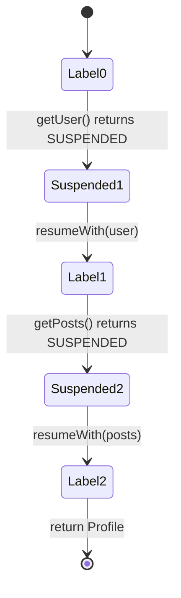
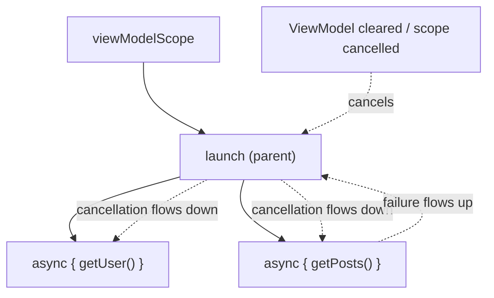
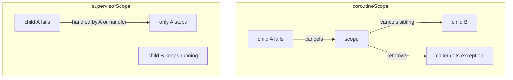
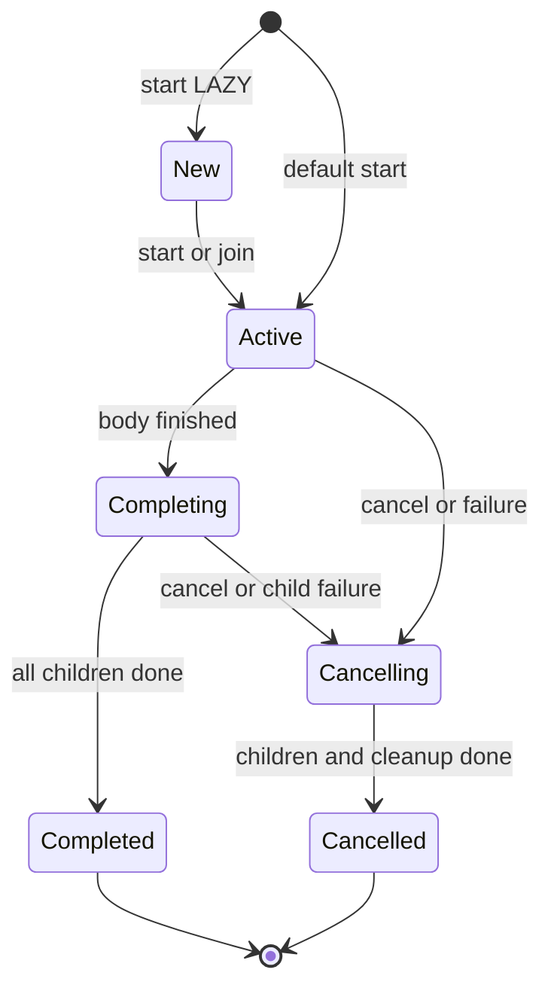
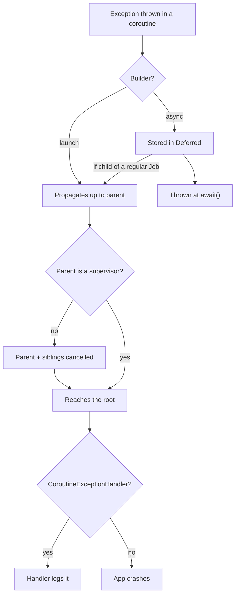
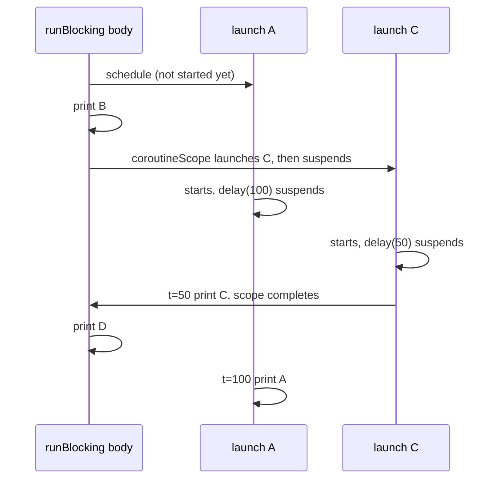

# Kotlin Coroutines

[⬅ Back to index](../README.md)

Covers: basics, builders, dispatchers, scopes & structured concurrency, Job/SupervisorJob, cancellation, exception handling, Android scopes, testing, internals.

---

## Basics

### 1. What is a coroutine?

<details>
<summary>Answer</summary>

**In short:** A coroutine is a **suspendable computation**: a lightweight unit of work that can pause (suspend) without blocking its thread and resume later, possibly on a different thread. Thousands of coroutines can share a handful of threads, and you write asynchronous code in a plain **sequential style**, without callbacks.

#### The problem it solves

On Android the main thread must never block, so anything slow (network, disk, database) has to run elsewhere and then deliver its result back to the UI. Historically that meant callbacks, `AsyncTask`, or RxJava chains. Callbacks nest quickly ("callback hell"), error handling is scattered, and cancelling in-flight work when the screen closes is easy to forget.

Coroutines let you write the same logic top to bottom:

```kotlin
// Callback style
repo.getUser(object : Callback<User> {
    override fun onSuccess(user: User) {
        repo.getPosts(user.id, object : Callback<List<Post>> {
            override fun onSuccess(posts: List<Post>) { render(user, posts) }
            override fun onError(e: Throwable) { showError(e) }
        })
    }
    override fun onError(e: Throwable) { showError(e) }
})

// Coroutine style
viewModelScope.launch {
    try {
        val user = repo.getUser()          // suspends, main thread stays free
        val posts = repo.getPosts(user.id) // runs after getUser completes
        _state.value = UiState.Success(user, posts)
    } catch (e: IOException) {
        _state.value = UiState.Error(e)
    }
}
```

#### How it works, briefly

- A coroutine is started by a **builder** (`launch`, `async`, `runBlocking`) inside a **scope**.
- When it hits a **suspension point** (calling a `suspend` function that actually has to wait), it saves its state into a heap object and gives the thread back.
- When the awaited result is ready, the coroutine is **resumed** by its dispatcher, on a thread the dispatcher chooses.

Because a suspended coroutine is just an object (not a parked thread), it costs a few hundred bytes rather than a thread's stack.

**Analogy:** a thread is a cashier; a coroutine is a customer's order. While one order waits for the kitchen, the cashier serves other customers instead of standing idle.

#### Follow-ups

- **Is a coroutine a thread?** No. It runs *on* threads, chosen by its dispatcher, and can hop between them.
- **Who invented the term?** Melvin Conway (1958). Kotlin's flavour is *stackless*: the compiler turns suspend functions into state machines.

</details>

### 2. Coroutines vs threads?

<details>
<summary>Answer</summary>

**In short:** Threads are OS-managed, expensive, and *block* while waiting. Coroutines are runtime-managed objects that *suspend* while waiting, freeing the thread for other work. Coroutines don't replace threads; they run on top of them through dispatchers and add structured lifetimes and cooperative cancellation.

| Threads | Coroutines |
|---|---|
| Managed by the OS; each has its own stack (often ~1 MB reserved on the JVM) | Managed by the Kotlin runtime; a suspended coroutine is a small object on the heap |
| Expensive to create and context-switch (kernel involvement) | Very cheap; 100k coroutines is fine |
| Blocking: a waiting thread is wasted | Suspending: the thread is freed while waiting |
| Manual cancellation is hard (`interrupt()` is unreliable) | Built-in cooperative cancellation |
| No structure; lifetimes are tracked by hand | **Structured concurrency**: parent/child lifecycle |
| Preemptive scheduling by the OS | Cooperative: switching happens only at suspension points |

#### Demonstration

```kotlin
// 100_000 threads: very likely OutOfMemoryError or extremely slow
repeat(100_000) { thread { Thread.sleep(1000) } }

// 100_000 coroutines: finishes in about 1 second on a few threads
runBlocking {
    repeat(100_000) { launch { delay(1000) } }
}
```

`delay` suspends, so all 100,000 coroutines wait concurrently on the same few threads.

#### Where the difference matters on Android

- A coroutine waiting on a Retrofit call holds no thread at all, so many requests can be in flight on a small pool.
- Coroutines started in `viewModelScope` are cancelled automatically when the ViewModel is cleared. With raw threads you'd have to track and stop them yourself.

#### Pitfalls

- Coroutines only help if the code **suspends**. A coroutine calling a blocking API (`Thread.sleep`, blocking JDBC, `File.readText`) still holds its thread; run such code on `Dispatchers.IO`.
- Cooperative scheduling means a CPU loop with no suspension points can hog its thread and ignore cancellation.

#### Follow-ups

- **Are coroutines like Java virtual threads (Loom)?** Similar goal (cheap concurrency), different mechanism: virtual threads are stackful and handled by the JVM; Kotlin coroutines are stackless and compiled into state machines, and work on Android, which doesn't ship Loom.

</details>

### 3. What is a `suspend` function? How does it work internally?

<details>
<summary>Answer</summary>

**In short:** A `suspend` function is a function that can **pause and resume** without blocking the thread. It can only be called from another suspend function or a coroutine. The compiler implements it with **Continuation Passing Style (CPS)**: it adds a hidden `Continuation` parameter and turns the body into a **state machine**, where each suspension point is a state.

#### What the compiler does

```kotlin
suspend fun getUser(): User
// compiles roughly to:
fun getUser(cont: Continuation<User>): Any?   // returns User or COROUTINE_SUSPENDED
```

1. **Hidden parameter:** every suspend function gets an extra `Continuation<T>` argument. A continuation is "the rest of the computation": an object with a `context` and a `resumeWith(result)` method.
2. **State machine:** the body is split at each call to another suspend function. A `label` field records which point to continue from, and local variables that live across suspension points are stored as fields of the continuation object.
3. **Suspending:** when a callee can't finish immediately, it returns the special marker `COROUTINE_SUSPENDED`. Every caller up the chain sees the marker and returns too, so the thread unwinds and is free.
4. **Resuming:** when the result arrives (e.g. a network callback fires), someone calls `continuation.resumeWith(result)`. The dispatcher schedules it, the function is re-entered, jumps to the saved `label`, restores locals, and continues.

A simplified picture of what this function becomes:

```kotlin
suspend fun loadProfile(): Profile {
    val user = api.getUser()          // suspension point 1
    val posts = api.getPosts(user.id) // suspension point 2
    return Profile(user, posts)
}

// Roughly (pseudocode):
fun loadProfile(cont: Continuation<Profile>): Any? {
    val sm = cont as? LoadProfileSM ?: LoadProfileSM(cont)
    when (sm.label) {
        0 -> { sm.label = 1
               val r = api.getUser(sm); if (r == COROUTINE_SUSPENDED) return r
               sm.user = r as User }
        1 -> { sm.user = sm.result as User }
    }
    // ...label 1 -> 2 similarly for getPosts...
    return Profile(sm.user, sm.posts)
}
```



If a callee returns a value directly (no real waiting), there is no suspension and no thread switch: execution just continues.

#### The key misconception

`suspend` **doesn't** move work to a background thread. It only means "this function *may* suspend". Blocking code inside a suspend function still blocks whichever thread it's on:

```kotlin
// Wrong: still blocks the main thread if called from Dispatchers.Main
suspend fun readConfig(): String = File(path).readText()

// Right: main-safe
suspend fun readConfig(): String = withContext(Dispatchers.IO) { File(path).readText() }
```

#### Follow-ups

- **Why can't a normal function call a suspend function?** It has no `Continuation` to pass. You need a coroutine builder to provide one.
- **What's the cost of `suspend`?** A small allocation for the state machine object per call that actually suspends; negligible compared to I/O.

</details>

### 4. What is the difference between `launch` and `async`?

<details>
<summary>Answer</summary>

**In short:** `launch` starts a coroutine for work that **doesn't return a result** (fire-and-forget) and returns a `Job`. `async` starts a coroutine that **computes a value** and returns a `Deferred<T>`, which you `await()`. They also differ in how exceptions surface: `launch` propagates them immediately; `async` exposes them on `await()` (and, as a child of a regular Job, also propagates to the parent).

| | `launch` | `async` |
|---|---|---|
| Purpose | Fire-and-forget side effects | Compute a result |
| Returns | `Job` | `Deferred<T>` (a `Job` with a result) |
| Get the outcome | `join()` (waits, no value) | `await()` (waits, returns `T` or throws) |
| Exceptions | Propagate immediately to the parent / handler | Thrown on `await()`; also propagate to the parent if it's a child in a regular scope |
| `CoroutineExceptionHandler` | Used at the root | Not used |

#### Typical uses

```kotlin
// launch: update state, write to DB, log an event
viewModelScope.launch {
    repo.markAsRead(messageId)
}

// async: parallel calls whose results you need
suspend fun loadScreen(): Screen = coroutineScope {
    val a = async { api.getProfile() }
    val b = async { api.getPosts() }
    Screen(a.await(), b.await())   // both run in parallel; total ≈ the slower one
}
```

#### Pitfalls

- **`async` with an immediate `await()`** is just a slower `withContext`. Use `async` only when you start several things before awaiting.
- **Sequential trap:** `async { a() }.await(); async { b() }.await()` runs one after the other.
- **Unawaited `async`:** the result is lost and, at the root or under a supervisor, so is the exception (see Q32).
- **`GlobalScope.async`** without await silently swallows failures.

#### Follow-ups

- **Can you get a result out of `launch`?** Not directly; write to shared state (e.g. a `StateFlow`) or use `async`.
- **Does `async` start lazily?** No, it starts immediately by default; pass `start = CoroutineStart.LAZY` to delay until `await()`/`start()`.

</details>

### 5. What is `runBlocking`? When to use it?

<details>
<summary>Answer</summary>

**In short:** `runBlocking` starts a coroutine and **blocks the current thread** until that coroutine and all its children finish. It bridges regular blocking code and suspending code. Use it only in `main()` functions, scripts, or some legacy tests. **Never on the Android main thread** (it freezes the UI and can cause an ANR). For tests, use `runTest`.

#### How it works

`runBlocking` creates an event loop on the calling thread and runs the coroutine (and any children that inherit its dispatcher) on that loop. The calling thread does nothing else until everything completes, then `runBlocking` returns the block's result.

```kotlin
fun main() = runBlocking {          // OK: a console program needs to wait
    val data = fetchData()          // suspend fun
    println(data)
}
```

#### Why it's dangerous on Android

```kotlin
// Wrong: blocks the UI thread for the whole network call
override fun onCreate(savedInstanceState: Bundle?) {
    super.onCreate(savedInstanceState)
    val user = runBlocking { repo.getUser() }   // ANR risk
}

// Right
lifecycleScope.launch {
    val user = repo.getUser()                   // suspends, UI stays responsive
    render(user)
}
```

It also defeats the whole point of coroutines: you get suspension inside, but the outer thread is blocked anyway.

#### Legitimate uses

| Situation | Better choice |
|---|---|
| `main()` of a JVM/CLI program | `runBlocking` is fine |
| Unit tests | `runTest` (virtual time, skips delays) |
| A Java/blocking API forces you to return a value synchronously (e.g. an OkHttp `Interceptor` or `Authenticator` needing a token from a suspend function) | `runBlocking` on a background thread is acceptable, carefully |

#### Pitfalls

- **Deadlock:** calling `runBlocking` on a thread that the inner coroutine needs (e.g. `runBlocking(Dispatchers.Main)` from the main thread) can hang forever.
- Calling `runBlocking` inside a coroutine blocks a dispatcher thread; never do it.

#### Follow-ups

- **`runBlocking` vs `coroutineScope`?** Both wait for children, but `runBlocking` *blocks* the thread, while `coroutineScope` *suspends* and can only be called from a coroutine.

</details>

### 6. What is `withContext`?

<details>
<summary>Answer</summary>

**In short:** `withContext` runs a block with a modified coroutine context (usually a different dispatcher), **suspends the caller until the block finishes**, and returns its result. It's the standard way to write **main-safe** functions: switch to IO or Default inside, return the value to whoever called you.

```kotlin
suspend fun readFile(): String = withContext(Dispatchers.IO) { file.readText() }
```

#### How it works

1. It merges the given elements into the current context (`currentContext + Dispatchers.IO`).
2. If the dispatcher changes, the block is dispatched to the new dispatcher's thread; the caller is suspended (not blocked).
3. When the block finishes, the caller is resumed on its **original** dispatcher with the result.
4. The block runs as a child of the current Job, so cancelling the caller cancels the block, and an exception in the block is rethrown to the caller.

```kotlin
viewModelScope.launch {                     // Main
    _state.value = UiState.Loading
    val bitmap = withContext(Dispatchers.Default) {
        decodeAndResize(bytes)              // CPU work off the main thread
    }
    imageView.setImageBitmap(bitmap)        // back on Main automatically
}
```

#### `withContext` vs `async { }.await()`

For a single task they produce the same result, but `withContext` is clearer and cheaper (no extra `Deferred`). Use `async` only for **parallel** work.

```kotlin
// Unnecessary
val user = async(Dispatchers.IO) { api.getUser() }.await()
// Better
val user = withContext(Dispatchers.IO) { api.getUser() }
```

#### Other uses

- `withContext(NonCancellable) { ... }` for suspending cleanup in `finally` (Q17).
- `withContext(CoroutineName("sync")) { ... }` to tag a section for debugging.

#### Pitfalls

- Wrapping already main-safe calls (Retrofit `suspend` functions, Room `suspend` DAOs) in `withContext(Dispatchers.IO)` is harmless but redundant.
- `withContext` is sequential: two `withContext` calls in a row do not run in parallel.

</details>

---

## Dispatchers & Context

### 7. What are dispatchers? Explain each.

<details>
<summary>Answer</summary>

**In short:** A dispatcher is the `CoroutineContext` element that decides **which thread or thread pool** a coroutine runs on. Use `Dispatchers.Main` for UI, `Dispatchers.IO` for blocking I/O, `Dispatchers.Default` for CPU-heavy work, and avoid `Dispatchers.Unconfined` in normal code.

| Dispatcher | Threads | Use for |
|---|---|---|
| `Dispatchers.Main` | The Android UI thread | Updating views/state, calling suspend functions that are main-safe |
| `Dispatchers.Main.immediate` | UI thread, but no re-dispatch if already on it | `viewModelScope`/`lifecycleScope` default; avoids an extra frame of delay |
| `Dispatchers.IO` | Elastic pool: up to 64 threads (or the number of cores, if higher) | Blocking I/O: files, blocking network/DB APIs, `SharedPreferences` commit |
| `Dispatchers.Default` | Pool sized to the number of CPU cores (at least 2) | CPU work: sorting, JSON parsing, diffing, image processing |
| `Dispatchers.Unconfined` | Starts on the caller's thread, resumes on whichever thread resumed it | Rare special cases; not for app code |

#### Why IO and Default are separate

CPU work gains nothing from more threads than cores; it just causes context switching. Blocking I/O, on the other hand, spends most of its time waiting, so many threads are useful. Separating them keeps a flood of slow disk reads from starving CPU work, and vice versa.

IO and Default **share the same underlying threads**, so `withContext(Dispatchers.IO)` from Default often doesn't need a real thread switch; the limits are enforced as separate "parallelism budgets".

#### `limitedParallelism`

```kotlin
// At most 4 concurrent blocking DB operations
private val dbDispatcher = Dispatchers.IO.limitedParallelism(4)

// A single-threaded "confinement" view for mutable state
private val stateDispatcher = Dispatchers.Default.limitedParallelism(1)
```

`limitedParallelism(n)` creates a view with limited concurrency without creating new threads. On `Dispatchers.IO`, such views get their own budget, separate from IO's 64.

#### Main vs Main.immediate

```kotlin
// On the main thread already:
launch(Dispatchers.Main) { ... }           // posted to the queue; runs a bit later
launch(Dispatchers.Main.immediate) { ... } // runs right now, in this call stack
```

#### Pitfalls

- Doing CPU-heavy parsing on IO works but uses a pool sized for waiting, not computing; prefer Default.
- `Dispatchers.Main` is unavailable in plain JVM unit tests; replace it with `Dispatchers.setMain(...)`.
- Hardcoding dispatchers makes code hard to test; inject them (Q9).

#### Follow-ups

- **Can you make your own dispatcher?** Yes: `Executors.newFixedThreadPool(n).asCoroutineDispatcher()` (remember to `close()` it), though `limitedParallelism` is usually better.

</details>

### 8. What is `CoroutineContext`?

<details>
<summary>Answer</summary>

**In short:** `CoroutineContext` is an **indexed set of elements** that configure a coroutine: mainly its `Job` (lifecycle/cancellation), `CoroutineDispatcher` (threading), `CoroutineName` (debugging) and `CoroutineExceptionHandler` (uncaught errors). Elements are combined with `+`, and a child inherits its parent's context but always gets its **own new `Job`**, which is a child of the parent's Job.

#### The elements

| Element | Role |
|---|---|
| `Job` | Lifecycle, cancellation, parent/child relationships |
| `CoroutineDispatcher` | Which thread(s) to run on |
| `CoroutineName` | Name shown in debug output and thread names (with debug mode on) |
| `CoroutineExceptionHandler` | Handles uncaught exceptions at the root |

Each element has a unique `Key`. The context behaves like a map from key to element, so it can hold at most one of each kind.

```kotlin
val ctx = Dispatchers.IO + SupervisorJob() + CoroutineName("sync")
ctx[Job]                 // the SupervisorJob
ctx[CoroutineDispatcher] // Dispatchers.IO

// Right side wins when keys collide:
val ctx2 = ctx + Dispatchers.Default   // dispatcher is now Default
```

#### How a child's context is computed

```text
child context = parent context + arguments passed to the builder + new Job(parent = parentJob)
```

```kotlin
val scope = CoroutineScope(SupervisorJob() + Dispatchers.Main + CoroutineName("screen"))

scope.launch(Dispatchers.IO) {
    // dispatcher: IO (argument overrides)
    // name: "screen" (inherited)
    // job: a NEW Job whose parent is the scope's SupervisorJob
}
```

You can read the current context inside any suspend function via `coroutineContext` (or `currentCoroutineContext()`).

#### Pitfalls

- Passing a `Job()` to `launch(...)` replaces the parent link and breaks structured concurrency (see Q13).
- Adding `SupervisorJob()` to a single `launch` does nothing useful for that launch's children.

#### Follow-ups

- **Is `CoroutineScope` the same as context?** A scope is just a wrapper holding a context (`scope.coroutineContext`); by convention it represents a lifetime.

</details>

### 9. Should a repository function decide the dispatcher? (Main-safety)

<details>
<summary>Answer</summary>

**In short:** Yes. Google recommends that **suspend functions be main-safe**: the class that does the blocking or CPU-heavy work (repository or data source) switches to IO/Default itself with `withContext`, so callers like the ViewModel can call it from Main without thinking about threads. **Inject the dispatchers** rather than hardcoding `Dispatchers.IO`, so tests can swap in a `TestDispatcher`.

#### Why the callee, not the caller

- The class doing the work knows whether it blocks; the caller doesn't (and shouldn't need to).
- If every caller had to remember `withContext(IO)`, someone would eventually forget and freeze the UI.
- Suspend functions become safe "black boxes": call them from anywhere.

```kotlin
class ArticleRepository @Inject constructor(
    private val dao: ArticleDao,
    private val parser: FeedParser,
    @IoDispatcher private val io: CoroutineDispatcher,
    @DefaultDispatcher private val default: CoroutineDispatcher,
) {
    suspend fun importFeed(raw: String) {
        val articles = withContext(default) { parser.parse(raw) } // CPU
        withContext(io) { dao.insertAllBlocking(articles) }       // blocking DB
    }
}

class ArticlesViewModel(private val repo: ArticleRepository) : ViewModel() {
    fun onImport(raw: String) = viewModelScope.launch {  // Main
        repo.importFeed(raw)                             // main-safe
        _events.send(Event.Imported)
    }
}
```

Hilt qualifiers for dispatchers:

```kotlin
@Qualifier @Retention(AnnotationRetention.BINARY) annotation class IoDispatcher
@Qualifier @Retention(AnnotationRetention.BINARY) annotation class DefaultDispatcher

@Module @InstallIn(SingletonComponent::class)
object DispatchersModule {
    @Provides @IoDispatcher fun io(): CoroutineDispatcher = Dispatchers.IO
    @Provides @DefaultDispatcher fun default(): CoroutineDispatcher = Dispatchers.Default
}
```

In tests: `ArticleRepository(fakeDao, parser, testDispatcher, testDispatcher)`, so everything runs under `runTest`'s virtual time.

#### When you don't need `withContext`

Libraries that are already main-safe: Retrofit `suspend` functions, Room `suspend` DAO methods and `Flow` queries, DataStore. Wrapping them is harmless but redundant.

#### Pitfalls

- Switching dispatchers in the ViewModel (`viewModelScope.launch(Dispatchers.IO)`) spreads threading decisions into the UI layer and makes state updates happen off Main.
- `Dispatchers.IO` hardcoded in a class means tests run on real threads and become flaky.

</details>

---

## Scopes & Structured Concurrency

### 10. What is `CoroutineScope`? What is structured concurrency?

<details>
<summary>Answer</summary>

**In short:** A `CoroutineScope` defines the **lifetime** of the coroutines started in it; it's a holder for a `CoroutineContext` whose `Job` is the parent of everything launched there. **Structured concurrency** is the rule that coroutines form a parent/child tree: children can't outlive their parent, parents wait for children, cancellation flows down, and failures flow up, so nothing leaks and no error is silently lost.

#### The four guarantees

1. Every coroutine is launched in a scope, so it **can't leak** beyond that scope's lifetime.
2. A parent **waits** for all its children to complete before it completes.
3. **Cancelling** the parent cancels all its children.
4. A **failing child** cancels the parent and its siblings (with a regular `Job`), and the error is propagated, not lost.



#### Why it matters

Without structure (raw threads, `GlobalScope`, RxJava without disposal), work started by a screen keeps running after the user leaves: wasted battery and data, and callbacks touching dead views. Structured concurrency makes "stop everything this screen started" a single operation: cancel its scope.

#### Creating scopes

```kotlin
// Framework-provided (preferred on Android)
viewModelScope.launch { ... }
lifecycleScope.launch { ... }

// Your own, for a class with its own lifetime
class Downloader(private val scope: CoroutineScope) { ... }
val appScope = CoroutineScope(SupervisorJob() + Dispatchers.Default)

// Suspending scope builders: create a child scope and wait for it
suspend fun loadAll() = coroutineScope {
    launch { loadA() }
    launch { loadB() }
}   // returns only when both are done
```

If you create a scope yourself, you're responsible for cancelling it (`scope.cancel()`) when its owner dies.

#### Follow-ups

- **Convention:** functions that *launch* work and return immediately are extensions on `CoroutineScope`; functions that *do* work and return when done are `suspend`.
- **Does `coroutineScope {}` block?** No, it suspends until all children finish.

</details>

### 11. What are `viewModelScope`, `lifecycleScope`, `GlobalScope`?

<details>
<summary>Answer</summary>

**In short:** `viewModelScope` lives as long as a ViewModel and is cancelled in `onCleared()`; `lifecycleScope` lives as long as an Activity/Fragment (or its view) lifecycle and is cancelled at `DESTROYED`. `GlobalScope` lives as long as the process and has no structured concurrency, so avoid it; for app-wide work, inject your own application scope.

| Scope | Cancelled when | Default context | Use for |
|---|---|---|---|
| `viewModelScope` | `ViewModel.onCleared()` | `SupervisorJob + Dispatchers.Main.immediate` | Most screen business logic; survives rotation |
| `lifecycleScope` | Lifecycle reaches `DESTROYED` | `SupervisorJob + Dispatchers.Main.immediate` | UI work tied to an Activity/Fragment |
| `viewLifecycleOwner.lifecycleScope` | Fragment's view destroyed | same | Anything touching Fragment views |
| `rememberCoroutineScope()` | Composable leaves composition | Composition's context | Launching from Compose event handlers |
| `LaunchedEffect(key)` | Leaves composition or key changes | Composition's context | Side effects driven by composition |
| `GlobalScope` | Never | Empty context, no Job (launches default to `Dispatchers.Default`) | Almost never |
| Injected app scope | Process death | Whatever you configure | Work that must outlive a screen |

#### Collecting flows safely in the UI

`lifecycleScope.launch { flow.collect { } }` keeps collecting while the app is in the background (until `DESTROYED`). Use `repeatOnLifecycle` so collection stops in the background and restarts when visible:

```kotlin
viewLifecycleOwner.lifecycleScope.launch {
    viewLifecycleOwner.repeatOnLifecycle(Lifecycle.State.STARTED) {
        viewModel.uiState.collect { render(it) }
    }
}
```

In Compose, `collectAsStateWithLifecycle()` does the same.

#### Why not `GlobalScope`

- No parent: nothing cancels it, so work leaks past the screen that started it.
- Hard to test: you can't inject a test dispatcher or wait for it.
- Marked `@DelicateCoroutinesApi`.

The recommended replacement:

```kotlin
@Provides @Singleton @ApplicationScope
fun provideAppScope(): CoroutineScope = CoroutineScope(SupervisorJob() + Dispatchers.Default)
```

`SupervisorJob` here ensures one failed task doesn't cancel the whole app scope.

#### Pitfalls

- Using the Fragment's `lifecycleScope` for view work: the Fragment can outlive its view (back stack), leading to crashes or leaks. Use `viewLifecycleOwner.lifecycleScope`.
- Launching long uploads in `viewModelScope`: they're cancelled when the user leaves (see Q30).

</details>

### 12. What is the difference between `coroutineScope` and `supervisorScope`?

<details>
<summary>Answer</summary>

**In short:** Both are suspending builders that create a child scope and **wait for all children**. In `coroutineScope`, if **any child fails**, the other children are cancelled and the exception is rethrown to the caller ("all or nothing"). In `supervisorScope`, a child's failure **doesn't cancel its siblings or the scope**; each child must handle its own errors.



#### `coroutineScope`: all must succeed

```kotlin
suspend fun loadOrder(id: String): OrderScreen = coroutineScope {
    val order = async { api.getOrder(id) }
    val items = async { api.getItems(id) }
    OrderScreen(order.await(), items.await())
}   // if getItems fails, getOrder is cancelled and the caller gets the exception
```

You can wrap the call in `try/catch` at the call site, which works because `coroutineScope` rethrows.

#### `supervisorScope`: independent tasks

```kotlin
// safeLoad = try/catch that logs errors but rethrows CancellationException
suspend fun loadDashboard() = supervisorScope {
    launch { safeLoad { weather.load() } }
    launch { safeLoad { news.load() } }
    launch { safeLoad { stocks.load() } }
}

// or with async, catching at await
supervisorScope {
    val news = async { newsApi.get() }
    val stocks = async { stocksApi.get() }
    val n = runCatching { news.await() }.getOrNull()
    val s = runCatching { stocks.await() }.getOrNull()
    render(n, s)
}
```

An uncaught exception in a `launch` child of `supervisorScope` goes to that child's `CoroutineExceptionHandler` (or the default handler, which crashes on Android). So in a supervisor, catch inside each child.

| | `coroutineScope` | `supervisorScope` |
|---|---|---|
| Child failure cancels siblings | Yes | No |
| Scope rethrows child's exception | Yes | No (only its own body's exceptions) |
| Typical use | Parallel parts of one result | Independent widgets, batch of unrelated jobs |

#### Follow-ups

- **What if the `supervisorScope` body itself throws?** The scope fails and cancels all children, like a normal scope.
- **Is `viewModelScope` a supervisor?** Yes, its Job is a `SupervisorJob`, so one failing `launch` doesn't kill the others (but an uncaught exception still crashes the app).

</details>

### 13. What is `Job` vs `SupervisorJob`?

<details>
<summary>Answer</summary>

**In short:** With a regular **`Job`**, a child's failure cancels the parent, which cancels all other children. With a **`SupervisorJob`**, children fail independently: a failure doesn't propagate up, and siblings keep running. Cancellation still flows **down** in both cases.

| | `Job` | `SupervisorJob` |
|---|---|---|
| Child fails | Parent and siblings cancelled | Only that child fails |
| Parent cancelled | Children cancelled | Children cancelled |
| Exception of a failed child goes to | The parent (up the tree) | That child's `CoroutineExceptionHandler` |
| Typical owner | A single operation | A long-lived scope (`viewModelScope`, app scope) |

```kotlin
val scope = CoroutineScope(SupervisorJob() + Dispatchers.Main)
scope.launch { throw IOException() }   // fails alone (handler needed to avoid crash)
scope.launch { delay(1000); println("still runs") }
```

If that scope used `Job()` instead, the first failure would cancel the scope, the second coroutine, and any future launch in it.

#### The classic mistake

```kotlin
// Wrong: does NOT supervise the inner launches
scope.launch(SupervisorJob()) {
    launch { throw X() }      // cancels its parent (a normal Job) and its sibling
    launch { doWork() }
}
```

Passing a Job to a builder makes it the **parent** of the new coroutine. The new coroutine still gets its own regular `Job`, and that's the parent of the inner launches, so failure propagation among them is unchanged. Worse, the coroutine is no longer a child of `scope`'s Job, so cancelling `scope` won't cancel it: structured concurrency is broken.

```kotlin
// Right
scope.launch {
    supervisorScope {
        launch { safely { a() } }
        launch { safely { b() } }
    }
}
```

#### Pitfalls

- `SupervisorJob` doesn't catch exceptions: an uncaught exception in a supervised `launch` still reaches the exception handler and crashes the app if there's none.
- Don't pass `Job()` or `SupervisorJob()` to `launch`/`withContext` unless you really mean to detach.

</details>

### 14. What are the states of a Job?

<details>
<summary>Answer</summary>

**In short:** A Job goes `New` → `Active` → `Completing` (its own body is done, waiting for children) → `Completed`. If it's cancelled or fails, it goes `Active`/`Completing` → `Cancelling` (children being cancelled, `finally` blocks running) → `Cancelled`. You observe states through `isActive`, `isCompleted` and `isCancelled`.



| State | `isActive` | `isCompleted` | `isCancelled` |
|---|---|---|---|
| New | false | false | false |
| Active | true | false | false |
| Completing | true | false | false |
| Cancelling | false | false | true |
| Cancelled | false | true | true |
| Completed | false | true | false |

Note that a **failed** job ends in "Cancelled" too (`isCancelled == true`); the cause is the exception.

#### Useful operations

```kotlin
val job = scope.launch(start = CoroutineStart.LAZY) { work() }  // New
job.start()            // -> Active
job.join()             // suspend until Completed or Cancelled
job.cancel()           // request cancellation
job.cancelAndJoin()    // cancel and wait for cleanup to finish
job.invokeOnCompletion { cause -> log("done, cause=$cause") }
```

#### Follow-ups

- **Why does `Completing` exist?** Because of structured concurrency: a parent whose body returned must still wait for its children.
- **Does `join()` throw if the job failed?** No, `join()` just waits; `await()` on a `Deferred` rethrows. (If the *caller* is cancelled while joining, `join()` throws `CancellationException`.)

</details>

---

## Cancellation

### 15. How does coroutine cancellation work? What does "cooperative" mean?

<details>
<summary>Answer</summary>

**In short:** `job.cancel()` only **marks** the job as cancelled; it doesn't kill anything. The coroutine's code has to **cooperate** by checking for cancellation. All suspending functions from `kotlinx.coroutines` (`delay`, `withContext`, `yield`, `await`, Channel and Flow operations) check it and throw **`CancellationException`**, which unwinds the coroutine. A CPU-bound loop with no suspension points **won't stop** unless it checks itself.

#### Step by step

1. `cancel()` moves the Job to `Cancelling` and cancels its children recursively.
2. The next time the coroutine reaches a cancellable suspension point, that function throws `CancellationException`.
3. The exception unwinds the code, running `finally` blocks.
4. Once all children finish, the Job becomes `Cancelled`. `CancellationException` is treated as normal termination, not a failure, so it doesn't cancel the parent.

#### Making CPU work cooperative

```kotlin
// Won't stop: no suspension points
launch(Dispatchers.Default) {
    for (i in 0 until 1_000_000) heavyStep(i)
}

// Cooperative options
launch(Dispatchers.Default) {
    for (i in 0 until 1_000_000) {
        ensureActive()       // throws CancellationException if cancelled
        heavyStep(i)
    }
}

launch(Dispatchers.Default) {
    while (isActive) { pollOnce() }   // just exits the loop, no exception
}

launch(Dispatchers.Default) {
    files.forEach { compress(it); yield() } // checks + lets others run
}
```

| Check | Behaviour |
|---|---|
| `isActive` | Boolean; you decide how to exit |
| `ensureActive()` | Throws `CancellationException`; cheapest correct choice |
| `yield()` | Checks and also gives other coroutines on the dispatcher a turn |

#### Why cooperative?

Forcibly killing a thread (like the deprecated `Thread.stop()`) can leave locks held and data half-written. Cooperative cancellation only stops code at well-defined points, so cleanup always runs.

#### Pitfalls

- Blocking calls (`Thread.sleep`, blocking I/O) don't respond to cancellation. Use `runInterruptible { }` to make a blocking call interruptible on cancellation.
- Catching `Exception` swallows `CancellationException` (Q16).
- Cancelling doesn't undo work: a request already sent to the server may still be processed.

</details>

### 16. Why must you not swallow `CancellationException`?

<details>
<summary>Answer</summary>

**In short:** `CancellationException` is the mechanism by which cancellation travels through a coroutine. If you catch it (for example with `catch (e: Exception)`) and don't rethrow, the coroutine **keeps running even though it was cancelled**: it does wasted work, may update dead UI, and breaks structured concurrency's guarantees.

#### What goes wrong

```kotlin
// Wrong
viewModelScope.launch {
    while (true) {
        try {
            sync()
            delay(5_000)              // throws CancellationException when cleared
        } catch (e: Exception) {      // swallows it
            log(e)
        }                             // loop continues forever on a dead ViewModel
    }
}
```

`delay` throws on every iteration, the catch eats it, and the loop never exits.

#### Correct patterns

```kotlin
// 1. Rethrow cancellation explicitly
try { api.call() }
catch (e: CancellationException) { throw e }
catch (e: Exception) { showError(e) }

// 2. Catch only the exceptions you expect
try { api.call() }
catch (e: IOException) { showError(e) }
catch (e: HttpException) { showError(e) }

// 3. If catching broadly, check afterwards
catch (e: Exception) {
    coroutineContext.ensureActive()  // rethrows if we were cancelled
    showError(e)
}
```

#### `runCatching` is the same trap

`runCatching { }` catches `Throwable`, including `CancellationException`. Inside coroutines either rethrow it or use a helper:

```kotlin
inline fun <T> suspendRunCatching(block: () -> T): Result<T> = try {
    Result.success(block())
} catch (e: CancellationException) {
    throw e
} catch (e: Throwable) {
    Result.failure(e)
}
```

#### Pitfalls

- `TimeoutCancellationException` (from `withTimeout`) is a subclass of `CancellationException`; if you catch it, do so deliberately (or use `withTimeoutOrNull`).
- Don't treat cancellation as an error in UI: showing "Request failed" when the user simply navigated away is a common bug.

</details>

### 17. How do you run cleanup code in a cancelled coroutine?

<details>
<summary>Answer</summary>

**In short:** Use `try { } finally { }`: cancellation throws `CancellationException`, so `finally` runs. Non-suspending cleanup (closing a stream) just works. If the cleanup itself needs to **suspend** (e.g. write to a DB, send a "cancelled" request), wrap it in `withContext(NonCancellable) { }`, because a cancelled coroutine's suspend calls would otherwise throw immediately.

```kotlin
val job = scope.launch {
    val file = openTempFile()
    try {
        downloadInto(file)               // cancellable
    } finally {
        file.close()                     // plain call: always fine
        withContext(NonCancellable) {
            dao.markDownloadAborted(id)  // suspend call that must complete
            delay(100)                   // would throw without NonCancellable
        }
    }
}
job.cancelAndJoin()  // waits until the finally block has finished
```

#### Why `NonCancellable` is needed

After cancellation the Job is in `Cancelling`. Any cancellable suspend function called from that Job checks `isActive`, sees `false`, and throws `CancellationException` at once, so your cleanup would stop at its first suspension point. `NonCancellable` is a special Job that's always active; running the block with it lets the cleanup suspend normally.

#### Other cleanup hooks

- `job.invokeOnCompletion { cause -> }`: a callback when the job finishes for any reason (keep it fast and non-suspending; it may run on any thread).
- `suspendCancellableCoroutine`'s `invokeOnCancellation { }`: cancel the underlying callback-based operation.
- `Flow.onCompletion { }` and `callbackFlow`'s `awaitClose { }` for streams.
- `use { }` on `Closeable` resources also works, since it's a `try/finally`.

#### Pitfalls

- Use `NonCancellable` **only** inside `withContext` in cleanup. `launch(NonCancellable)` detaches the coroutine from its parent.
- Keep non-cancellable sections short; they delay the completion of cancellation (and `cancelAndJoin`).

</details>

### 18. What are `withTimeout` and `withTimeoutOrNull`?

<details>
<summary>Answer</summary>

**In short:** Both run a block with a time limit and **cancel** it if the limit passes. `withTimeout(ms) { }` then throws `TimeoutCancellationException`; `withTimeoutOrNull(ms) { }` returns `null` instead, which is usually easier and safer to handle.

```kotlin
// Throws on timeout
val user = try {
    withTimeout(5_000) { api.getUser() }
} catch (e: TimeoutCancellationException) {
    null
}

// Returns null on timeout
val location = withTimeoutOrNull(3_000) { locationClient.awaitLocation() }
    ?: lastKnownLocation
```

#### How it works

The timeout schedules a cancellation of the block's coroutine after the given time. Like any cancellation, it's **cooperative**: the block must reach a suspension point (or check `isActive`) to stop. A block stuck in blocking code won't be interrupted on time.

You can also pass a `kotlin.time.Duration`: `withTimeout(5.seconds) { }`.

#### Why `TimeoutCancellationException` is subtle

It's a subclass of `CancellationException`. If you call `withTimeout` directly inside `launch` and don't catch it, it ends that coroutine quietly, as if it were cancelled, rather than crashing or reaching a handler, which can hide timeouts. Catch it close to the call or prefer `withTimeoutOrNull`.

#### Pitfalls

- A resource acquired inside the block may be returned just as the timeout fires and then lost; release resources in `finally` or acquire them outside the block.
- `withTimeoutOrNull` returning `null` is ambiguous if the block itself can return `null`.
- For network calls, also configure the HTTP client's own timeouts; `withTimeout` cancels the coroutine, and the client stops the call only if it supports cancellation (Retrofit/OkHttp suspend calls do).

</details>

---

## Exception Handling

### 19. How are exceptions handled in coroutines?

<details>
<summary>Answer</summary>

**In short:** An uncaught exception in a `launch` **propagates up** to its parent, which (unless it's a supervisor) cancels itself and all siblings; at the root it goes to a `CoroutineExceptionHandler`, or crashes the app if there's none. With `async`, the exception is stored in the `Deferred` and **thrown at `await()`**; if the `async` is a child of a regular Job it also propagates to the parent immediately. Catch errors with `try/catch` **inside** the coroutine or around `await()`/`coroutineScope`.



#### Rules

- **`launch`**: an uncaught exception propagates **up to the parent** and cancels it (unless there's a supervisor). At the root (or a direct child of a supervisor), it goes to the `CoroutineExceptionHandler`, or the thread's default handler, which crashes an Android app.
- **`async`**: the exception is stored and **thrown when you call `await()`**. If the `async` is a child of a regular Job, it **also** propagates to the parent immediately.
- **`coroutineScope { }`** rethrows a child's failure to its caller, so a normal `try/catch` around it works.
- **`CancellationException`** is not a failure: it doesn't propagate to the parent or reach the handler.

#### The `try/catch` around `launch` mistake

```kotlin
// Wrong: launch returns immediately; the exception happens later, elsewhere
try {
    viewModelScope.launch { api.load() }
} catch (e: Exception) { /* never reached */ }

// Right: catch inside the coroutine
viewModelScope.launch {
    try {
        _state.value = Success(api.load())
    } catch (e: IOException) {
        _state.value = Error(e)
    }
}

// Also right: catch a structured block
viewModelScope.launch {
    try {
        coroutineScope {
            val a = async { api.a() }
            val b = async { api.b() }
            show(a.await(), b.await())
        }
    } catch (e: IOException) { showError(e) }
}
```

#### Pitfalls

- Catching around `await()` in a regular scope stops the exception from crashing *that* line, but the failed `async` has still cancelled the parent. Wrap the group in `coroutineScope` or `supervisorScope` as shown.
- Don't rely on `CoroutineExceptionHandler` for normal errors; use it as a last-resort logger.

#### Follow-ups

- **Where do Flow exceptions go?** They're thrown from `collect`; handle them with `catch { }` upstream or `try/catch` around `collect`.

</details>

### 20. What is `CoroutineExceptionHandler`? Where does it work?

<details>
<summary>Answer</summary>

**In short:** `CoroutineExceptionHandler` is a context element that receives **uncaught** exceptions. It **only works on root coroutines** (launched directly in a scope) or on direct children of a `supervisorScope`/`SupervisorJob`. Installed on an inner child it's ignored, because that child passes its exception to the parent. It has no effect on `async`, whose exceptions surface through `await()`. Treat it as a last-resort logger, not as flow control.

```kotlin
val handler = CoroutineExceptionHandler { _, e ->
    Log.e("Sync", "Unhandled", e)
    crashReporter.record(e)
}

val scope = CoroutineScope(SupervisorJob() + Dispatchers.Default + handler)
scope.launch { syncContacts() }   // root: handler is used
```

#### Where it works and where it doesn't

| Placement | Handler used? | Why |
|---|---|---|
| `scope.launch(handler) { }` (root) | Yes | Nobody above to propagate to |
| In the scope's context, inherited by root launches | Yes | Same as above |
| Direct child `launch` of `supervisorScope`/`SupervisorJob` | Yes | Supervisor doesn't take the exception |
| Inner `launch(handler)` inside another `launch` | No | Exception goes to the parent |
| `async(handler)` / `scope.async` | No | Exception is delivered via `await()` |

```kotlin
// Ignored: the exception goes to the outer launch
scope.launch {
    launch(handler) { throw IOException() }
}
```

#### What happens when it runs

By the time the handler is called, the coroutine has already completed with the exception; you **can't recover** or resume. You can log, report, or update state (e.g. show a generic error).

#### Pitfalls

- Expecting it to prevent cancellation of siblings: it doesn't; that's controlled by `Job` vs `SupervisorJob`.
- Using it instead of `try/catch` for expected failures (network errors): handle those where they happen.

#### Follow-ups

- **What if there's no handler?** The exception goes to the global handlers and then the thread's uncaught-exception handler; on Android that crashes the app.

</details>

### 21. What happens if multiple children fail?

<details>
<summary>Answer</summary>

**In short:** The **first** exception wins and is the one propagated to the parent (and to the handler or caller). Exceptions thrown by other children while they're being cancelled are attached to it as **suppressed** exceptions (`exception.suppressed`). `CancellationException`s caused by the cancellation itself are ignored, not added.

#### How it plays out

1. Child A throws `IOException`.
2. The parent (a regular Job) starts cancelling and cancels child B.
3. B's `finally` block throws `IllegalStateException` while cleaning up.
4. The parent completes with the `IOException`; the `IllegalStateException` is in its `suppressed` array.

```kotlin
val handler = CoroutineExceptionHandler { _, e ->
    println("Caught $e, suppressed: ${e.suppressed.contentToString()}")
}

GlobalScope.launch(handler) {   // GlobalScope used only to make a root for the demo
    launch {
        try { delay(Long.MAX_VALUE) }
        finally { throw ArithmeticException() }   // fails during cancellation
    }
    launch {
        delay(100)
        throw IOException()                       // first real failure
    }
}
// Caught java.io.IOException, suppressed: [java.lang.ArithmeticException]
```

#### Why it's designed this way

Reporting only the first cause keeps the error meaningful (the root cause, not the cascade), while suppressed exceptions preserve the other failures for debugging instead of losing them.

#### Pitfalls

- In a `supervisorScope`, children don't cancel each other, so each failure is delivered separately (each to its own handler), not aggregated.
- Crash reporters usually show suppressed exceptions; check them when a crash's main exception doesn't explain everything.

</details>

---

## Android & Practical

### 22. How do you run network calls in parallel and combine results?

<details>
<summary>Answer</summary>

**In short:** Start each call with `async` inside a `coroutineScope`, then `await()` them all and combine. The calls run concurrently, the total time is roughly the slowest call, and if one fails the others are cancelled and the error is rethrown. For a list, use `map { async { } }.awaitAll()`, and cap concurrency with a `Semaphore` or `limitedParallelism`.

```kotlin
suspend fun loadDashboard(): Dashboard = coroutineScope {
    val user = async { userRepo.get() }
    val feed = async { feedRepo.get() }
    Dashboard(user.await(), feed.await())
}
```

#### Why `coroutineScope`

It gives the `async` calls a parent that's scoped to this function: the function returns only when both are done, a failure in one cancels the other, and the exception is rethrown to the caller, who can `try/catch` it. Without it (e.g. `viewModelScope.async` directly) you lose that grouping.

#### Many items

```kotlin
suspend fun loadAll(ids: List<String>): List<Item> = coroutineScope {
    ids.map { id -> async { api.getItem(id) } }.awaitAll()
}
```

`awaitAll()` fails fast: as soon as one `Deferred` fails it throws, rather than waiting for the first one in order.

#### Limiting concurrency

Firing 500 requests at once can overwhelm the server or hit rate limits.

```kotlin
private val semaphore = Semaphore(4)

suspend fun loadAll(ids: List<String>) = coroutineScope {
    ids.map { id -> async { semaphore.withPermit { api.getItem(id) } } }.awaitAll()
}
```

`Dispatchers.IO.limitedParallelism(4)` also works for **blocking** calls, but it limits threads, not in-flight suspend calls: a suspended Retrofit call doesn't hold a thread, so a semaphore is the right tool for suspending APIs.

#### Partial success

If some results are optional, use `supervisorScope` and catch per call:

```kotlin
supervisorScope {
    val ads = async { adsApi.get() }
    val feed = async { feedApi.get() }
    Screen(feed.await(), runCatching { ads.await() }.getOrDefault(emptyList()))
}
```

(Remember to rethrow `CancellationException` if you use `runCatching` broadly; see Q16.)

#### Pitfalls

- `async { a() }.await()` followed by `async { b() }.await()` is sequential (Q33).
- For flows rather than one-shot calls, use `combine` / `zip` instead of `async`.

</details>

### 23. How to convert a callback-based API to a suspend function?

<details>
<summary>Answer</summary>

**In short:** Wrap it in `suspendCancellableCoroutine`: start the callback-based operation, `resume` the continuation on success, `resumeWithException` on failure, and use `invokeOnCancellation` to cancel the underlying operation if the coroutine is cancelled. For APIs that emit **multiple** values (listeners), use `callbackFlow` with `awaitClose { unregister() }`.

#### Single result

```kotlin
suspend fun FusedLocationProviderClient.awaitLocation(): Location =
    suspendCancellableCoroutine { cont ->
        val cts = CancellationTokenSource()
        getCurrentLocation(Priority.PRIORITY_HIGH_ACCURACY, cts.token)
            .addOnSuccessListener { location -> cont.resume(location) }
            .addOnFailureListener { e -> cont.resumeWithException(e) }
        cont.invokeOnCancellation { cts.cancel() }   // stop the request
    }
```

What happens:

1. The coroutine suspends at `suspendCancellableCoroutine`, and you receive a `CancellableContinuation`.
2. You register callbacks and return; the thread is free.
3. When a callback fires, `resume(...)` schedules the coroutine to continue with that value (or exception).
4. If the coroutine is cancelled first, it resumes with `CancellationException` immediately and `invokeOnCancellation` runs.

(For Play Services `Task`s specifically, `kotlinx-coroutines-play-services` already provides `task.await()`.)

#### Multiple values: `callbackFlow`

```kotlin
fun SensorManager.accelerometerFlow(): Flow<SensorEvent> = callbackFlow {
    val listener = object : SensorEventListener {
        override fun onSensorChanged(event: SensorEvent) { trySend(event) }
        override fun onAccuracyChanged(sensor: Sensor, accuracy: Int) = Unit
    }
    registerListener(listener, getDefaultSensor(Sensor.TYPE_ACCELEROMETER),
        SensorManager.SENSOR_DELAY_UI)
    awaitClose { unregisterListener(listener) }   // runs when the collector stops
}
```

`awaitClose` is mandatory: it keeps the flow open and is where you unregister. Forgetting it throws an `IllegalStateException`.

#### Pitfalls

- **Resume exactly once.** A second `resume` on the same continuation throws `IllegalStateException`; guard APIs that may call back twice.
- Prefer `suspendCancellableCoroutine` over `suspendCoroutine` (Q34).
- Callbacks may arrive on any thread; resuming is thread-safe, and the coroutine continues on its own dispatcher.

</details>

### 24. What are `Mutex` and `Semaphore` in coroutines?

<details>
<summary>Answer</summary>

**In short:** `Mutex` is a coroutine-friendly lock: `mutex.withLock { }` lets only one coroutine into a critical section at a time, and waiting coroutines **suspend** instead of blocking a thread. `Semaphore(n)` lets up to `n` coroutines in at once, which is handy for limiting concurrency (`withPermit { }`).

#### Why not `synchronized`?

```kotlin
// Wrong: you can't suspend inside synchronized, and waiting blocks the thread
synchronized(lock) { cache = api.fetch() }   // compile error: suspension point in critical section

// Right
private val mutex = Mutex()
suspend fun refresh() = mutex.withLock {
    if (cache == null) cache = api.fetch()   // suspension inside is fine
}
```

`synchronized` locks a **thread**. A coroutine can suspend and resume on a different thread, so a thread-owned lock doesn't fit. `Mutex` is owned by the coroutine and waiting is a suspension.

#### Semaphore

```kotlin
private val downloads = Semaphore(permits = 3)

suspend fun download(url: String) = downloads.withPermit {
    httpClient.get(url)   // at most 3 downloads at the same time
}
```

| | `Mutex` | `Semaphore(n)` | `synchronized` / `ReentrantLock` |
|---|---|---|---|
| Concurrent holders | 1 | n | 1 |
| Waiting | Suspends | Suspends | Blocks the thread |
| Can suspend inside | Yes | Yes | No (`synchronized`); risky (`Lock`) |
| Reentrant | **No** | No | Yes |

#### Alternatives for shared mutable state

- **Atomics** (`AtomicInteger`, `MutableStateFlow.update { }`) for simple values.
- **Thread confinement**: run all access on `Dispatchers.Default.limitedParallelism(1)`.
- **Actors/Channels**: one coroutine owns the state and processes messages sequentially.

#### Pitfalls

- `Mutex` is **not reentrant**: calling `withLock` again from inside the same lock deadlocks.
- Holding a lock across a slow network call serializes all callers; keep critical sections short.
- Plain `var counter++` from many coroutines on `Dispatchers.Default` is a data race just like with threads.

</details>

### 25. What are Channels? Channel vs Flow?

<details>
<summary>Answer</summary>

**In short:** A **Channel** is a **hot**, coroutine-safe queue for passing values between coroutines with `send`/`receive`; each value is received by exactly **one** consumer, and `send` suspends when the buffer is full. A **Flow** is a **cold** stream: it runs its producer code only when collected, separately for each collector, and offers a rich operator set. Channels are the low-level primitive; Flows are what you usually expose.

#### Channel basics

```kotlin
val channel = Channel<Int>()                  // RENDEZVOUS by default
launch { for (i in 1..3) channel.send(i); channel.close() }
launch { for (value in channel) println(value) }  // 1, 2, 3
```

| Capacity | Behaviour |
|---|---|
| `RENDEZVOUS` (default) | No buffer; `send` suspends until a receiver takes the value |
| `BUFFERED` | Fixed default buffer (64 by default); `send` suspends when full |
| `CONFLATED` | Keeps only the latest value; `send` never suspends |
| `UNLIMITED` | Unbounded buffer; `send` never suspends (memory risk) |
| `Channel(n)` | Buffer of size n |

Channels must be closed (or their producer cancelled) to end `for` loops; `produce { }` creates a channel tied to a coroutine and closes it automatically.

#### Channel vs Flow

| | Channel | Flow |
|---|---|---|
| Hot/cold | Hot: exists and accepts values independently of consumers | Cold: code runs per collector on `collect` |
| Delivery | Each value to **one** receiver (fan-out splits values) | Each collector gets **all** values |
| Operators | Few | Many (`map`, `filter`, `combine`, `debounce`...) |
| Typical use | Coroutine-to-coroutine communication, one-time events, work queues | Data streams, UI state, DB/network observations |

#### One-time UI events

```kotlin
class LoginViewModel : ViewModel() {
    private val _events = Channel<LoginEvent>(Channel.BUFFERED)
    val events = _events.receiveAsFlow()   // exposed as a Flow

    fun onLoginSuccess() = viewModelScope.launch { _events.send(LoginEvent.GoHome) }
}
```

Each event is delivered once and buffered if nobody is collecting yet (e.g. during rotation). Note that Google's current guidance often prefers modelling events as state, but this pattern is still common and interview-relevant.

#### Pitfalls

- With several collectors on `receiveAsFlow()`, values are split between them, not broadcast; use `SharedFlow` for broadcast.
- `UNLIMITED` buffers can grow without bound if the consumer is slow.

</details>

### 26. What is `yield()` and `delay()` vs `Thread.sleep()`?

<details>
<summary>Answer</summary>

**In short:** `delay()` **suspends** the coroutine for a time: the thread is freed for other work, and the wait is cancellable. `Thread.sleep()` **blocks** the thread: nothing else can run on it, and cancellation is ignored. `yield()` doesn't wait for time at all; it checks for cancellation and gives other coroutines on the same dispatcher a chance to run.

| | `delay(ms)` | `Thread.sleep(ms)` | `yield()` |
|---|---|---|---|
| Thread during wait | Free | Blocked | Briefly released |
| Cancellable | Yes | No | Yes (checks cancellation) |
| Where callable | Suspend functions / coroutines | Anywhere | Suspend functions / coroutines |
| In `runTest` | Skipped by virtual time | Really sleeps | Lets queued tasks run |

```kotlin
// On Dispatchers.Main
launch { Thread.sleep(2000); show() }  // freezes the UI for 2 s
launch { delay(2000); show() }         // UI stays responsive
```

#### How `delay` works

It registers a timed resume with the dispatcher (on Main, effectively a `Handler.postDelayed`) and returns `COROUTINE_SUSPENDED`. When the time passes, the coroutine is resumed. No thread sits waiting.

#### When to use `yield()`

In long CPU loops on a shared dispatcher, so other coroutines aren't starved and cancellation is noticed:

```kotlin
withContext(Dispatchers.Default) {
    images.forEach { img ->
        process(img)
        yield()
    }
}
```

If you only need the cancellation check, `ensureActive()` is cheaper.

#### Pitfalls

- `Thread.sleep` in a coroutine on `Dispatchers.Default` blocks one of very few threads (one per core).
- `delay` in a loop is fine for polling, but prefer a Flow-based solution or WorkManager for long-running periodic work.

</details>

### 27. How do you test coroutines?

<details>
<summary>Answer</summary>

**In short:** Use `runTest { }` from `kotlinx-coroutines-test`, which runs on **virtual time** so `delay` is skipped instantly. Replace `Dispatchers.Main` with `Dispatchers.setMain(testDispatcher)` (usually in a JUnit rule) and reset it after. Inject dispatchers into your classes so tests can pass a `TestDispatcher`. Test Flows with **Turbine**.

#### Main dispatcher rule

```kotlin
class MainDispatcherRule(
    val dispatcher: TestDispatcher = UnconfinedTestDispatcher(),
) : TestWatcher() {
    override fun starting(description: Description) = Dispatchers.setMain(dispatcher)
    override fun finished(description: Description) = Dispatchers.resetMain()
}
```

`viewModelScope` uses `Dispatchers.Main`, which doesn't exist in local JVM tests, so this is essential.

#### A ViewModel test

```kotlin
class SearchViewModelTest {
    @get:Rule val mainRule = MainDispatcherRule(StandardTestDispatcher())

    @Test fun `debounced search loads results`() = runTest {
        val vm = SearchViewModel(FakeRepo())
        vm.onQueryChanged("kotlin")

        advanceTimeBy(301)   // skip the 300 ms debounce in virtual time
        runCurrent()

        assertEquals(listOf("kotlin coroutines"), vm.results.value)
    }
}
```

`runTest` uses the dispatcher set by `setMain` if there is one, so the ViewModel's coroutines and the test share one scheduler and virtual clock.

#### The two test dispatchers

| | `StandardTestDispatcher` | `UnconfinedTestDispatcher` |
|---|---|---|
| New coroutines | Queued; run when you advance or the test suspends | Start eagerly, right away |
| Control | `advanceUntilIdle()`, `advanceTimeBy()`, `runCurrent()` | Less control, simpler tests |
| Good for | Verifying intermediate states and ordering | Simple "call and assert" tests, collecting flows |

#### Flows with Turbine

```kotlin
@Test fun `emits loading then success`() = runTest {
    vm.state.test {
        assertEquals(UiState.Loading, awaitItem())
        assertEquals(UiState.Success(data), awaitItem())
        cancelAndIgnoreRemainingEvents()
    }
}
```

#### Pitfalls

- Hardcoded `Dispatchers.IO` in the class under test runs on real threads, outside virtual time: tests become slow or flaky. Inject dispatchers.
- Creating several schedulers: all `TestDispatcher`s in a test should share one `TestCoroutineScheduler`.
- `runBlocking` in tests doesn't skip delays.
- `runTest` fails if coroutines are still running at the end (after a timeout); cancel long-running collectors (`backgroundScope` is meant for those).

</details>

### 28. Coroutines vs RxJava?

<details>
<summary>Answer</summary>

**In short:** Coroutines (with Flow) are built into Kotlin, let you write async code sequentially, and give you structured concurrency and automatic cancellation through scopes. RxJava is mature with a huge operator set, but it has a steeper learning curve, relies on manually disposing subscriptions, and produces hard-to-read stack traces. Modern Android (Jetpack, Room, Retrofit, Compose) is coroutines/Flow-first, and interop libraries let both coexist during migration.

| | Coroutines + Flow | RxJava |
|---|---|---|
| Style | Sequential code with `suspend` | Chains of operators |
| One-shot async | `suspend fun` | `Single` / `Maybe` / `Completable` |
| Streams | `Flow`, `StateFlow`, `SharedFlow` | `Observable` / `Flowable`, `Subject`s |
| Threading | `withContext`, `flowOn` | `subscribeOn`, `observeOn` |
| Lifecycle / cancellation | Structured: cancel the scope | Manual: `Disposable` / `CompositeDisposable` |
| Backpressure | Built in (suspending `emit`), `buffer`, `conflate` | `Flowable` with strategies |
| Operators | Fewer but enough; easy to write custom ones | Very large set |
| Learning curve | Gentler | Steep |
| Jetpack support | First-class | Via extension artifacts |

#### The same task both ways

```kotlin
// RxJava
disposables += api.getUser()
    .flatMap { user -> api.getPosts(user.id).map { user to it } }
    .subscribeOn(Schedulers.io())
    .observeOn(AndroidSchedulers.mainThread())
    .subscribe({ (u, p) -> render(u, p) }, { showError(it) })
// must remember disposables.clear() in onDestroy

// Coroutines
viewModelScope.launch {
    try {
        val user = api.getUser()
        render(user, api.getPosts(user.id))
    } catch (e: IOException) { showError(e) }
}   // cancelled automatically in onCleared()
```

#### Migration

`kotlinx-coroutines-rx3` provides bridges: `observable.asFlow()`, `single.await()`, `flow.asObservable()`, `rxSingle { }`. Teams usually migrate layer by layer, starting with new code and the data layer.

#### When Rx still makes sense

A large existing Rx codebase with a team fluent in it, or a Java-only codebase (suspend functions are awkward to call from Java).

</details>

### 29. What is the output? (Classic ordering question)

<details>
<summary>Answer</summary>

**In short:** The output is **B, C, D, A**. `launch` doesn't wait, so "B" prints first; `coroutineScope` suspends until its child prints "C" (at 50 ms); then "D" prints; "A" prints last at 100 ms.

```kotlin
fun main() = runBlocking {
    launch { delay(100); println("A") }
    println("B")
    coroutineScope { launch { delay(50); println("C") } }
    println("D")
}
// B, C, D, A
```

#### Step by step

`runBlocking` uses a single-threaded event loop, so everything runs on one thread, interleaving only at suspension points.



1. `launch { A }` is queued; the body keeps running.
2. `println("B")`.
3. `coroutineScope` launches C and suspends the body until C completes. Now the event loop runs the queued coroutines: A starts and suspends on `delay(100)`, C starts and suspends on `delay(50)`.
4. At 50 ms C prints "C" and finishes, so `coroutineScope` returns.
5. `println("D")` at ~50 ms.
6. At 100 ms A prints "A". `runBlocking` then returns, since it waits for all children.

#### Variations interviewers use

- Replace `coroutineScope` with `launch`: output becomes **B, D, C, A** (D no longer waits).
- Replace `delay(50)` with `delay(150)`: **B, A, C, D** (A finishes during the `coroutineScope` wait).
- Replace `delay(100)` with `Thread.sleep(100)` in A: it blocks the only thread, so C can't run until A finishes: **B, A, C, D**.
- `launch(start = CoroutineStart.UNDISPATCHED)` runs the launch's body immediately up to its first suspension.

</details>

### 30. Can you start a coroutine from a non-suspending context in an Activity? What scope do you use for work that must outlive the screen?

<details>
<summary>Answer</summary>

**In short:** Yes. From an Activity, use `lifecycleScope.launch { }` (or better, trigger work in the ViewModel's `viewModelScope`). For work that must **outlive the screen**, choose by how strong the guarantee needs to be: an injected **application scope** if it just shouldn't be cancelled when the user leaves, or **WorkManager** (`CoroutineWorker`) if it must complete even if the process is killed.

#### Choosing a scope

| Need | Use | Survives |
|---|---|---|
| UI work for this Activity/Fragment | `lifecycleScope` / `viewLifecycleOwner.lifecycleScope` | Until destroyed (not rotation) |
| Screen logic, survive rotation | `viewModelScope` | Until the ViewModel is cleared |
| Finish even if the user leaves the screen (e.g. save a draft, send analytics) | Injected `@ApplicationScope CoroutineScope` | Until the process dies |
| Must complete eventually, even after process death or reboot (uploads, sync) | WorkManager `CoroutineWorker` | Process death, reboots |
| User-visible ongoing work (music, navigation) | Foreground service with its own scope | While the service runs |

#### Application scope

```kotlin
class DraftRepository @Inject constructor(
    @ApplicationScope private val appScope: CoroutineScope,
    private val dao: DraftDao,
) {
    // Called from the ViewModel; survives the ViewModel being cleared
    fun saveDraft(draft: Draft) {
        appScope.launch { dao.upsert(draft) }
    }
}
```

The scope is created once (`SupervisorJob() + Dispatchers.Default`) and provided by DI, so it's testable, unlike `GlobalScope`.

#### WorkManager

```kotlin
class UploadWorker(ctx: Context, params: WorkerParameters) : CoroutineWorker(ctx, params) {
    override suspend fun doWork(): Result = try {
        uploader.upload(inputData.getString("uri")!!)
        Result.success()
    } catch (e: IOException) {
        Result.retry()
    }
}

WorkManager.getInstance(context).enqueue(
    OneTimeWorkRequestBuilder<UploadWorker>()
        .setConstraints(Constraints(requiredNetworkType = NetworkType.CONNECTED))
        .build()
)
```

#### Pitfalls

- An application scope dies with the process; the system can kill a backgrounded app at any time, so don't use it for work that must be guaranteed.
- Don't capture an Activity/View in long-lived scopes; it leaks.

</details>


---

## More Coroutine Questions

### 31. `job.cancel()` vs `scope.cancel()` vs `cancelChildren()`?

<details>
<summary>Answer</summary>

**In short:** `job.cancel()` cancels **one coroutine** (and its children), leaving the scope usable. `scope.cancel()` cancels the scope's Job and **everything in it**, and the scope is dead afterwards. `scope.coroutineContext.cancelChildren()` cancels all running children but **keeps the scope alive** for new work.

| Call | What's cancelled | Scope usable afterwards? | Typical use |
|---|---|---|---|
| `job.cancel()` | That coroutine and its children | Yes | Cancel one specific task (e.g. the previous search) |
| `scope.cancel()` | Every coroutine in the scope | **No**: new launches are cancelled immediately | Owner is destroyed (`viewModelScope` in `onCleared()`) |
| `scope.coroutineContext.cancelChildren()` | All current children | Yes | "Reset" all work, e.g. on logout or refresh |

#### Examples

```kotlin
// Cancel the previous search when a new query arrives
private var searchJob: Job? = null
fun onQuery(q: String) {
    searchJob?.cancel()
    searchJob = viewModelScope.launch {
        delay(300)
        _results.value = repo.search(q)
    }
}

// A custom component owning a scope
class Player {
    private val scope = CoroutineScope(SupervisorJob() + Dispatchers.Main)
    fun stopAll() = scope.coroutineContext.cancelChildren()  // can start again later
    fun release() = scope.cancel()                           // finished for good
}
```

#### Why a cancelled scope is dead

Cancelling a scope cancels its Job, and a cancelled Job can't become active again. Any child launched later is born into a cancelled parent and is cancelled before it does anything, which looks like "nothing happens" and is a common bug.

#### Pitfalls

- Calling `scope.cancel()` when you meant "stop current work" (use `cancelChildren()`).
- `cancel()` only requests cancellation; use `cancelAndJoin()` if you must wait for cleanup before continuing.
- In Flow-based search, `flatMapLatest`/`collectLatest` do the "cancel previous" pattern for you.

</details>

### 32. What happens if a coroutine started with `async` throws but `await()` is never called?

<details>
<summary>Answer</summary>

**In short:** It depends on the parent. As a child of a regular `Job`, the exception **still propagates to the parent immediately**, cancelling it and its siblings, and can crash the app even without `await()`. As a **root** `async` or a child of a `SupervisorJob`/`supervisorScope`, the exception is just **stored in the `Deferred`**; if nobody calls `await()`, it's **silently lost**.

#### Case 1: child of a regular Job, so it propagates

```kotlin
viewModelScope.launch {          // regular Job for this coroutine
    async { throw IOException() } // never awaited
    delay(1000)
    println("never printed")      // parent cancelled by the child's failure
}
// The launch fails; viewModelScope has no handler -> app crashes
```

The same happens inside `coroutineScope { }`: the scope fails and rethrows to its caller.

#### Case 2: root or supervised, so it's lost

```kotlin
viewModelScope.async { throw IOException() }   // direct child of a SupervisorJob
// No await -> no crash, no log, nothing. The error disappears.

supervisorScope {
    async { throw IOException() }              // also lost if never awaited
}
```

`CoroutineExceptionHandler` doesn't help here: it isn't used for `async`.

#### Summary

| Where the `async` is | Without `await()` | With `await()` |
|---|---|---|
| Child of a regular Job (`launch { async {} }`, `coroutineScope`) | Parent fails; may crash | Parent fails; `await()` also throws |
| Root (`scope.async`) or under a supervisor | Exception silently lost | `await()` throws; catch it there |

#### Takeaways

- Always `await()` `async` results; if you don't need a result, use `launch`.
- Catch exceptions where you await (inside a `supervisorScope` when you want siblings to survive).
- Code review red flag: an `async` whose `Deferred` is never used.

</details>

### 33. How do you run coroutines in series vs in parallel?

<details>
<summary>Answer</summary>

**In short:** Calls inside one coroutine run **in series** by default: each suspend call finishes before the next line runs. To run **in parallel**, start each piece with `async` (if you need results) or `launch` (if you don't) first, then `await()`/`join()` them together. Series takes about t1 + t2; parallel takes about max(t1, t2).

```kotlin
// Series: second starts after first finishes (total ≈ t1 + t2)
viewModelScope.launch {
    val user = repo.getUser()
    val posts = repo.getPosts(user.id)     // depends on user
}

// Parallel: both start immediately (total ≈ max(t1, t2))
viewModelScope.launch {
    val profile = async { repo.getProfile() }
    val feed = async { repo.getFeed() }
    render(profile.await(), feed.await())
}

// Parallel fire-and-forget, wait for all
coroutineScope {
    val jobs = listOf(launch { syncA() }, launch { syncB() })
    jobs.joinAll()
}
```

#### Choosing

- **Series** when one call depends on another's result, or order matters (e.g. "save, then upload").
- **Parallel** when calls are independent: loading several sections of a screen, fetching many items.

#### The common mistake

```kotlin
// Looks parallel, is sequential: each await suspends before the next async starts
val a = async { api.a() }.await()
val b = async { api.b() }.await()

// Actually parallel: start everything, then await
val aDeferred = async { api.a() }
val bDeferred = async { api.b() }
val a = aDeferred.await()
val b = bDeferred.await()
```

(Inside `coroutineScope` the closing brace also waits for every child, so `joinAll()` there is optional; it's shown for clarity.)

#### Does "parallel" need multiple threads?

Not for I/O. Two suspended network calls wait concurrently on a single thread, since neither holds the thread. For **CPU-bound** parallelism you need a multi-threaded dispatcher: `async(Dispatchers.Default) { }`.

#### Pitfalls

- Parallel `async` in a regular scope: one failure cancels the rest; use `supervisorScope` for independent results.
- Unbounded parallelism over a big list; limit with a `Semaphore` (Q22).

</details>

### 34. `suspendCoroutine` vs `suspendCancellableCoroutine`?

<details>
<summary>Answer</summary>

**In short:** Both suspend the coroutine and hand you a continuation to `resume` later from a callback, which is how you turn callback APIs into suspend functions. **`suspendCoroutine`** (from the Kotlin standard library) is **not cancellable**: if the coroutine is cancelled, it keeps waiting until the callback fires. **`suspendCancellableCoroutine`** (from `kotlinx.coroutines`) responds to cancellation immediately and lets you clean up with `invokeOnCancellation`. **Always prefer the cancellable one.**

| | `suspendCoroutine` | `suspendCancellableCoroutine` |
|---|---|---|
| Library | Kotlin stdlib | `kotlinx.coroutines` |
| Continuation type | `Continuation<T>` | `CancellableContinuation<T>` |
| On cancellation | Ignored until the callback resumes it | Resumes with `CancellationException` right away |
| Cleanup hook | None | `invokeOnCancellation { }` |
| Extra checks | None | `isActive`, `isCancelled` |

```kotlin
suspend fun Call.await(): Response = suspendCancellableCoroutine { cont ->
    enqueue(object : Callback {
        override fun onResponse(call: Call, response: Response) = cont.resume(response)
        override fun onFailure(call: Call, e: IOException) = cont.resumeWithException(e)
    })
    cont.invokeOnCancellation { cancel() }   // cancel the OkHttp call
}
```

With `suspendCoroutine`, leaving the screen wouldn't stop the HTTP call, and the coroutine (and anything it references) would stay alive until the response arrives, which may be never.

#### Rules for either one

- **Resume exactly once.** Resuming twice throws `IllegalStateException`. If an API might call back more than once, use `callbackFlow` or guard the resume.
- Always resume on **every** path (success, error), or the coroutine hangs forever.
- With the cancellable version, a callback that fires after cancellation is harmless: the late resume is ignored.

#### Follow-ups

- **Is `suspendCoroutine` ever useful?** In code that doesn't depend on `kotlinx.coroutines` (pure stdlib), or for instantaneous operations where cancellation doesn't matter.

</details>

---

[⬅ Previous: Kotlin Advanced](02-kotlin-advanced.md) · [⬅ Back to index](../README.md) · [Next: Kotlin Flow ➡](04-flow.md)
