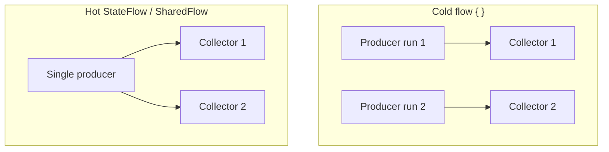
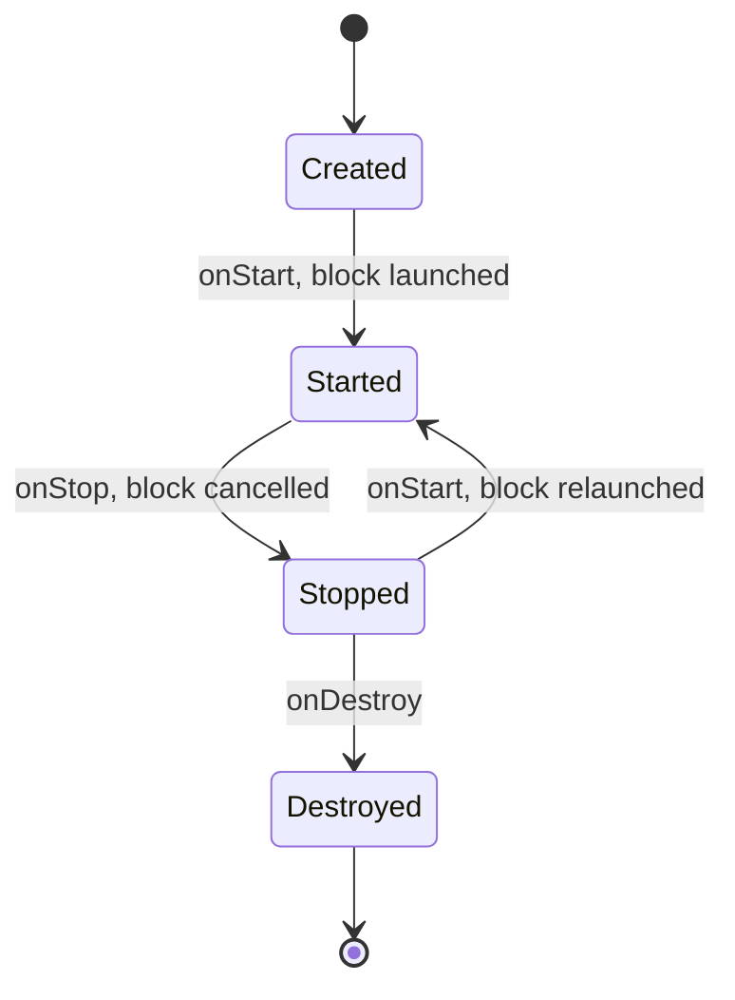
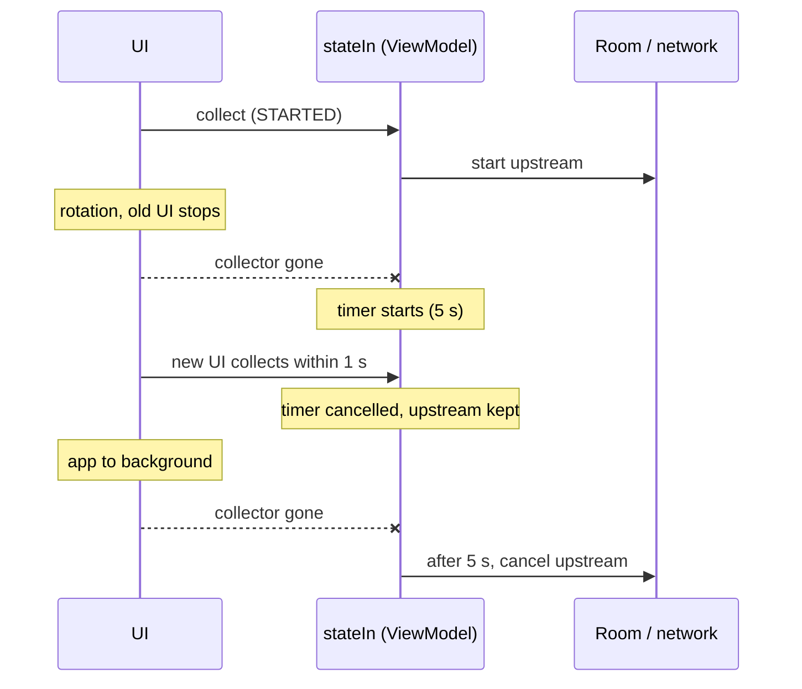
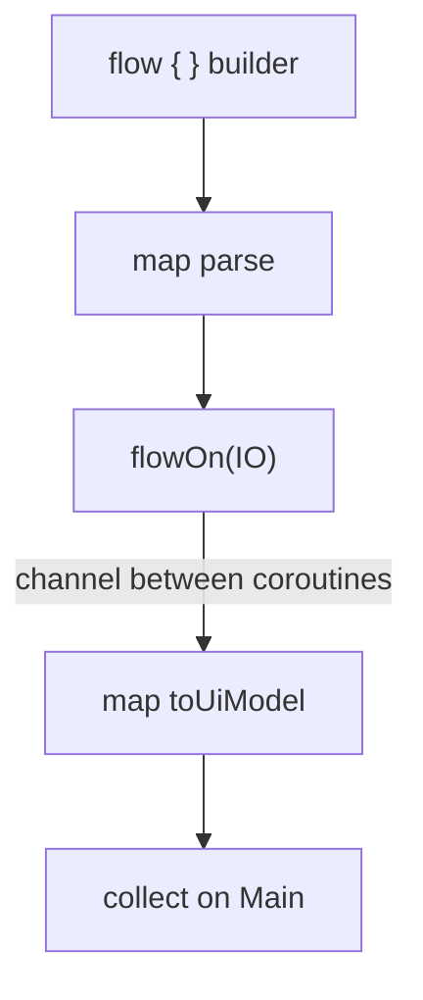
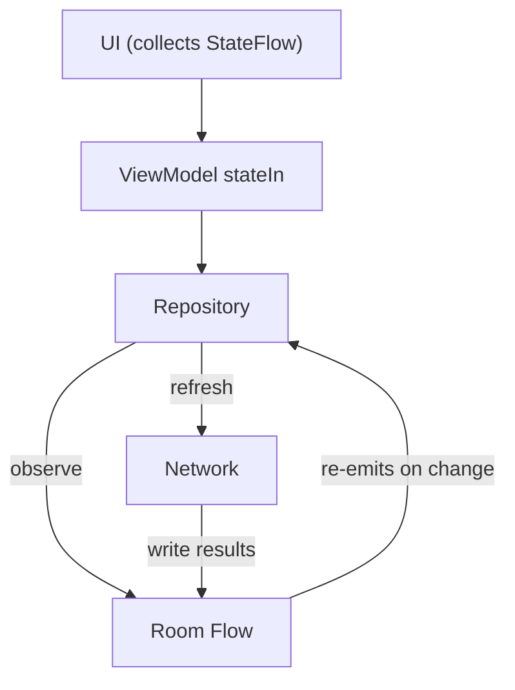
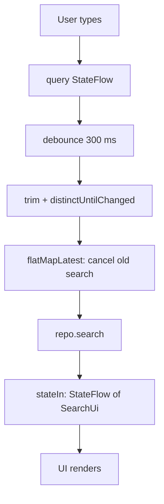

# Kotlin Flow

[⬅ Back to index](../README.md)

Covers: cold vs hot streams, StateFlow, SharedFlow, operators, lifecycle-aware collection, one-time events, backpressure, testing.

---

### 1. What is Flow?

<details>
<summary>Answer</summary>

**In short:** `Flow<T>` is Kotlin's coroutine-based **asynchronous stream**: it emits many values over time, one after another. A `suspend fun` returns **one** value; a `Flow` emits **zero, one or many** values and can be transformed with operators before a collector consumes them.

#### Why it exists

Before Flow, Android apps used callbacks, LiveData or RxJava for streams. Callbacks don't compose, LiveData is Android-only with few operators, and RxJava is powerful but large and has its own threading model. Flow gives you Rx-style streams built directly on coroutines, so it gets **structured concurrency**, cancellation and suspending functions for free.

#### The three roles

| Role | What it does | Examples |
|---|---|---|
| **Producer** | Emits values | `flow { }`, Room DAO `Flow<List<T>>`, DataStore `data`, `callbackFlow` |
| **Intermediaries** (optional) | Transform the stream | `map`, `filter`, `debounce`, `flatMapLatest` |
| **Consumer** | Collects values | `collect`, `first`, `collectAsStateWithLifecycle()` |

```kotlin
// Producer: emits a number every second, forever
fun ticker(): Flow<Int> = flow {
    var i = 0
    while (true) {
        emit(i++)      // suspends until the collector has handled the value
        delay(1000)
    }
}

// Intermediary + consumer
viewModelScope.launch {
    ticker()
        .filter { it % 2 == 0 }
        .map { "Tick $it" }
        .collect { label -> println(label) }   // nothing runs until collect is called
}
```

#### How it works under the hood

`Flow` is a tiny interface with one function: `suspend fun collect(collector: FlowCollector<T>)`. Calling `collect` runs the `flow { }` block, and each `emit` directly calls the collector's lambda. So by default a flow is **sequential** and runs in the collector's coroutine: there is no hidden thread or queue. Cancelling that coroutine stops the flow.

**Pitfalls**
- Building a flow does nothing on its own; it's lazy until a terminal operator runs.
- Don't do blocking work in `flow { }` without `flowOn(Dispatchers.IO)`.

**Likely follow-ups**
- *Flow vs `suspend fun`?* Use `suspend` for one-shot results (a single API call), Flow for values that change over time.
- *Flow vs RxJava?* Similar concepts; Flow is lighter, coroutine-native, and multiplatform.

</details>

### 2. Cold flow vs hot flow?

<details>
<summary>Answer</summary>

**In short:** a **cold** flow (`flow { }`) starts producing only when someone collects it, and **each collector gets its own fresh run**. A **hot** flow (`StateFlow`, `SharedFlow`) exists independently of collectors: one producer, and all collectors **share** the same emissions.



| | Cold (`flow {}`) | Hot (`StateFlow`, `SharedFlow`, `Channel`-backed) |
|---|---|---|
| Starts | **Only when collected** | Independently of collectors |
| Multiple collectors | Each gets its **own independent execution** | **Share** the same emissions |
| Stops | When the collector is cancelled or the block ends | Lives as long as its scope (or until sharing stops) |
| Late collector | Sees everything from the start (a new run) | Sees only new values (plus replay/current value) |
| Analogy | A video on demand: each viewer starts from the beginning | A live TV broadcast: you see what's on now |

#### Why it matters in practice

```kotlin
// Cold: the network call runs once PER collector
val profile: Flow<Profile> = flow { emit(api.getProfile()) }

launch { profile.collect { } }  // request #1
launch { profile.collect { } }  // request #2  (duplicate work!)

// Hot: one upstream shared by everyone
val profileState: StateFlow<Profile?> = profile
    .stateIn(viewModelScope, SharingStarted.WhileSubscribed(5_000), null)
```

A Retrofit call wrapped in `flow { }` runs again for every collector. If the Fragment and a Compose screen both collect it, you hit the network twice. A `StateFlow` in the ViewModel holds one shared state that every collector reads.

**Pitfalls**
- Exposing a cold flow from a ViewModel and collecting it in the UI restarts the work on every rotation. Convert with `stateIn`/`shareIn`.
- Hot flows don't stop on their own; launching one in `GlobalScope` leaks.

**Likely follow-ups**
- *How do you turn cold into hot?* `stateIn` or `shareIn` (see Q7).
- *Is a `Channel` hot?* Yes; values are sent whether or not anyone is receiving, but each value is delivered to only **one** receiver.

</details>

### 3. What is StateFlow?

<details>
<summary>Answer</summary>

**In short:** `StateFlow` is a **hot** flow that always holds exactly **one current value** (`.value`). It needs an initial value, gives new collectors the latest value immediately, skips values equal to the current one, and is **conflated**. That makes it the standard holder for **UI state** in a ViewModel.

#### Key properties

- **Initial value is required**: `MutableStateFlow(UiState())`. There is never a "no value yet" state.
- **New collectors get the latest value immediately**, just like LiveData's sticky behaviour.
- **Conflated**: if the value changes A → B → C faster than the collector runs, a slow collector may only see C. For state, only the latest matters.
- **Equality-based**: setting a value that is `==` to the current one does nothing (`distinctUntilChanged` semantics).
- **Thread-safe**: `value` can be read and written from any thread.

#### Typical ViewModel pattern

```kotlin
data class UiState(
    val name: String = "",
    val isLoading: Boolean = false,
    val error: String? = null
)

class ProfileViewModel : ViewModel() {
    // Private mutable, public read-only (backing property pattern)
    private val _uiState = MutableStateFlow(UiState())
    val uiState: StateFlow<UiState> = _uiState.asStateFlow()

    fun onNameChanged(n: String) {
        _uiState.update { it.copy(name = n) }   // atomic read-modify-write
    }
}
```

#### Why `update { }` instead of `value = value.copy()`

```kotlin
// WRONG: two coroutines can both read the old value, and one write is lost
_uiState.value = _uiState.value.copy(isLoading = true)

// RIGHT: update retries with compareAndSet until it succeeds
_uiState.update { it.copy(isLoading = true) }
```

`update` loops: read the current value, compute the new one, `compareAndSet`. If another thread changed it in between, it retries, so no update is lost.

**Pitfalls**
- Mutating a mutable object inside the state (e.g. a `MutableList`) and re-setting it: it's the same reference and equal, so nothing emits. Always use immutable data classes and `copy`.
- Using StateFlow for one-time events (toasts, navigation): conflation and equality checks can drop them.

**Likely follow-ups**
- *StateFlow vs LiveData?* See Q5: StateFlow needs an initial value, isn't lifecycle-aware by itself, and has the full operator set.
- *How do you build a StateFlow from a cold flow?* `stateIn(scope, started, initialValue)`.

</details>

### 4. What is SharedFlow?

<details>
<summary>Answer</summary>

**In short:** `SharedFlow` is a configurable **hot** flow that broadcasts every emitted value to **all** current collectors. Unlike StateFlow it has no required initial value, doesn't skip duplicates, and lets you choose how many past values to **replay** and how to handle a full buffer. It's used for **events and broadcasts**.

#### Configuration

```kotlin
private val _events = MutableSharedFlow<Event>(
    replay = 0,                 // how many past values a NEW collector receives
    extraBufferCapacity = 1,    // extra slots so emit() doesn't suspend for slow collectors
    onBufferOverflow = BufferOverflow.DROP_OLDEST  // what to do when the buffer is full
)
val events: SharedFlow<Event> = _events.asSharedFlow()

fun onSaveClicked() {
    viewModelScope.launch { _events.emit(Event.ShowSaved) }  // suspends if the buffer is full (SUSPEND)
    // or: _events.tryEmit(Event.ShowSaved)  // non-suspending; returns false if it would need to suspend
}
```

| Parameter | Meaning |
|---|---|
| `replay` | Number of most recent values cached and replayed to new subscribers |
| `extraBufferCapacity` | Buffer on top of `replay` for values not yet consumed by slow collectors |
| `onBufferOverflow` | `SUSPEND` (default: emitter waits), `DROP_OLDEST`, `DROP_LATEST`. The drop options need some buffer (`replay` or `extraBufferCapacity` > 0) |

#### Relationship to StateFlow

StateFlow is essentially a specialised SharedFlow:

```kotlin
// Roughly what a StateFlow behaves like:
val shared = MutableSharedFlow<State>(
    replay = 1,
    onBufferOverflow = BufferOverflow.DROP_OLDEST
)
shared.tryEmit(initialValue)          // StateFlow requires an initial value
val state = shared.distinctUntilChanged()  // StateFlow skips equal values
```

Plus StateFlow offers a synchronous `.value`.

**Pitfalls**
- With `replay = 0`, values emitted while nobody is collecting (e.g. during rotation) are **lost**.
- With `replay = 1` for events, every new collector (e.g. after rotation) re-receives the last event: the "snackbar shows twice" bug.
- `tryEmit` on a SharedFlow with no buffer and active subscribers returns `false` and the value is dropped.

**Likely follow-ups**
- *When to use SharedFlow over StateFlow?* When there's no meaningful "current value", or every emission matters, even duplicates.
- *SharedFlow vs Channel?* SharedFlow broadcasts to all collectors; a Channel delivers each value to exactly one receiver and buffers when nobody listens.

</details>

### 5. StateFlow vs SharedFlow vs LiveData?

<details>
<summary>Answer</summary>

**In short:** use **StateFlow** for UI state (it's the modern replacement for LiveData), **SharedFlow** for broadcasting events or streams without a current value, and **LiveData** only in legacy View-based code. LiveData is lifecycle-aware out of the box; Flows need `repeatOnLifecycle` or `collectAsStateWithLifecycle` to be.

| | LiveData | StateFlow | SharedFlow |
|---|---|---|---|
| Initial value | Optional | **Required** | None |
| Current value accessor | `value` (nullable) | `value` (non-null type possible) | None (only `replayCache`) |
| Lifecycle-aware | **Yes** (built-in) | No: use `repeatOnLifecycle` / `collectAsStateWithLifecycle` | No |
| Operators | Few (`map`, `switchMap`, `distinctUntilChanged`) | Full Flow operators | Full |
| Threading | `setValue` main only, `postValue` from any thread | Thread-safe, any thread | Thread-safe |
| Equality check | No (emits same value again) | Yes (`distinctUntilChanged`) | No |
| Replay to new observers | Latest value | Latest value | Configurable (`replay`) |
| Platform | Android only | Pure Kotlin (testable, KMP) | Pure Kotlin |
| Use for | Legacy UI state | **UI state** | **Events / broadcasts** |

#### Why the industry moved from LiveData to StateFlow

- **Operators**: combining several sources with LiveData needs `MediatorLiveData` boilerplate; with Flow it's one `combine`.
- **Layering**: repositories and use cases shouldn't depend on Android classes. Flow is pure Kotlin, so the same type flows from Room through the repository to the ViewModel.
- **Testing**: no need for `InstantTaskExecutorRule`; you can test with `runTest` and Turbine.
- **Compose**: `collectAsStateWithLifecycle()` integrates directly.

```kotlin
// LiveData
val user: LiveData<User> = repo.userFlow.asLiveData()

// StateFlow
val user: StateFlow<User?> = repo.userFlow
    .stateIn(viewModelScope, SharingStarted.WhileSubscribed(5_000), null)
```

**Pitfalls**
- `postValue` called several times quickly only delivers the last value, similar to StateFlow conflation.
- Moving from LiveData to StateFlow but collecting with a bare `lifecycleScope.launch` loses the lifecycle safety you used to have.

**Likely follow-ups**
- *Is LiveData deprecated?* No, but new code generally uses StateFlow.
- *Can you convert between them?* `flow.asLiveData()` and `liveData.asFlow()` from lifecycle-livedata-ktx.

</details>

### 6. How should you collect flows in the UI safely?

<details>
<summary>Answer</summary>

**In short:** collect only while the UI is visible. In Views, use `repeatOnLifecycle(Lifecycle.State.STARTED)` inside `lifecycleScope` (or `viewLifecycleOwner.lifecycleScope` in Fragments). In Compose, use `collectAsStateWithLifecycle()`. Never use a bare `lifecycleScope.launch { flow.collect {} }`.

#### What goes wrong with a bare launch

`lifecycleScope` is cancelled only in `onDestroy`. So a bare collect keeps running while the app is in the background: location updates keep flowing, a Room query keeps re-running, and if it touches views of a Fragment whose view was destroyed, it can crash.

```kotlin
// WRONG: collects in the background until onDestroy
lifecycleScope.launch {
    viewModel.uiState.collect { render(it) }
}
```

#### Views

```kotlin
override fun onViewCreated(view: View, savedInstanceState: Bundle?) {
    viewLifecycleOwner.lifecycleScope.launch {
        viewLifecycleOwner.repeatOnLifecycle(Lifecycle.State.STARTED) {
            // Several flows: launch each one in parallel
            launch { viewModel.uiState.collect { render(it) } }
            launch { viewModel.events.collect { handle(it) } }
        }
    }
}
```

`repeatOnLifecycle` starts the block when the lifecycle reaches `STARTED`, **cancels it on `STOPPED`**, and runs it again from scratch on the next `STARTED`.



For a single flow there's also `flow.flowWithLifecycle(lifecycle, Lifecycle.State.STARTED)`.

#### Compose

```kotlin
@Composable
fun ProfileRoute(viewModel: ProfileViewModel = hiltViewModel()) {
    val state by viewModel.uiState.collectAsStateWithLifecycle()
    ProfileScreen(state)
}
```

`collectAsStateWithLifecycle()` (lifecycle-runtime-compose) stops collecting below `STARTED`. Plain `collectAsState()` keeps collecting as long as the composable is in composition, even in the background.

#### Why `launchWhenStarted` is deprecated

`launchWhenStarted` only **paused** the coroutine while stopped; the upstream kept producing and holding resources (e.g. a `callbackFlow` kept GPS on). `repeatOnLifecycle` **cancels** the collection, so upstream `WhileSubscribed` flows can actually stop.

**Pitfalls**
- In Fragments, use `viewLifecycleOwner`, not the Fragment's own lifecycle, or you'll get duplicate collectors after the view is recreated.
- Calling `collect` twice in a row inside one `repeatOnLifecycle` block: the second never runs, because the first `collect` on a hot flow never completes. Wrap each in `launch`.

**Likely follow-ups**
- *Why `STARTED` and not `RESUMED`?* The UI is visible from `STARTED` (e.g. in multi-window or behind a dialog); `RESUMED` would stop updates unnecessarily.
- *What does this mean for the upstream?* Combined with `WhileSubscribed(5000)`, the upstream stops 5 s after the app goes to the background.

</details>

### 7. What are `stateIn` and `shareIn`? What is `WhileSubscribed(5000)`?

<details>
<summary>Answer</summary>

**In short:** `stateIn` and `shareIn` turn a **cold** flow into a **hot** `StateFlow` / `SharedFlow` running in a given scope, so many collectors share **one** upstream. `SharingStarted.WhileSubscribed(5000)` keeps that upstream alive for 5 seconds after the last collector leaves: long enough to survive a rotation, short enough to stop work when the app goes to the background.

```kotlin
val uiState: StateFlow<UiState> = repo.observeItems()   // cold Room flow
    .map { UiState.Success(it) }
    .stateIn(
        scope = viewModelScope,
        started = SharingStarted.WhileSubscribed(5_000),
        initialValue = UiState.Loading
    )

val notifications: SharedFlow<Notification> = socket.messages()
    .shareIn(viewModelScope, SharingStarted.WhileSubscribed(), replay = 0)
```

| | `stateIn` | `shareIn` |
|---|---|---|
| Result | `StateFlow<T>` | `SharedFlow<T>` |
| Needs | `initialValue` | `replay` count |
| Use for | UI state | Streams/events shared by several collectors |

#### `SharingStarted` strategies

| Strategy | Starts upstream | Stops upstream |
|---|---|---|
| `Eagerly` | Immediately | Never (until the scope ends) |
| `Lazily` | On the first collector | Never (until the scope ends) |
| `WhileSubscribed(stopTimeoutMillis)` | On the first collector | `stopTimeoutMillis` after the last collector leaves |

#### Why 5000 ms



A configuration change typically takes well under 5 seconds, so the upstream isn't cancelled and restarted (no repeated network call or flicker). When the user truly leaves the app, the collector is gone for longer than 5 s, and the upstream is cancelled to save battery and data. The `StateFlow` still keeps its last value for when the user comes back.

**Pitfalls**
- Calling `stateIn` inside a function (`fun state() = flow.stateIn(...)`) creates a **new** hot flow each call. Expose it as a property.
- `Eagerly` in a ViewModel keeps work running in the background for as long as the ViewModel lives.
- There's also a suspending `stateIn(scope)` with no initial value; it waits for the first emission.

**Likely follow-ups**
- *What is `replayExpirationMillis`?* A second `WhileSubscribed` parameter; after the upstream stops, it resets the cached value to the initial value after that delay.
- *Why not `Lazily`?* It never stops, so a location flow would keep running in the background.

</details>

### 8. How do you handle one-time events (navigation, snackbar) from a ViewModel?

<details>
<summary>Answer</summary>

**In short:** the common options are a `Channel` exposed with `receiveAsFlow()` (buffered, delivered once), or a `SharedFlow` (lost if nobody is collecting). Google's current guidance is to **model events as state**: put e.g. `userMessage: String?` in the UI state, let the UI show it and then call `viewModel.messageShown()` to clear it.

#### The problem

An event like "show snackbar" or "navigate to details" must be handled **exactly once**. StateFlow is wrong for this: it replays the last value to new collectors (shows twice after rotation) and drops equal or quickly replaced values. LiveData had the same problem, which led to the `SingleLiveEvent` hack.

#### Option 1: `Channel` + `receiveAsFlow()`

```kotlin
private val _events = Channel<UiEvent>(Channel.BUFFERED)
val events: Flow<UiEvent> = _events.receiveAsFlow()

fun onSaved() {
    viewModelScope.launch { _events.send(UiEvent.NavigateBack) }
}
```

Events are buffered while no one is collecting (e.g. during rotation) and each event goes to **one** collector. Remaining risk: an event can be lost if it is delivered just as the UI stops, between receiving it and handling it.

#### Option 2: `SharedFlow(replay = 0)`

Broadcasts to all collectors, but events emitted while nobody collects are **dropped**. Acceptable for "nice to have" signals, risky for navigation.

#### Option 3 (recommended): events as state

```kotlin
data class UiState(
    val items: List<Item> = emptyList(),
    val userMessage: String? = null,
    val navigateToDetails: Long? = null
)

fun onDeleteFailed() = _uiState.update { it.copy(userMessage = "Delete failed") }
fun messageShown() = _uiState.update { it.copy(userMessage = null) }

// Compose
state.userMessage?.let { msg ->
    LaunchedEffect(msg) {
        snackbarHostState.showSnackbar(msg)
        viewModel.messageShown()        // consume
    }
}
```

The event lives in state until the UI confirms it was handled, so it can't be lost across rotation, and it can survive process death if the state is saved.

| Approach | Lost if UI not collecting? | Delivered twice? | Notes |
|---|---|---|---|
| `Channel` + `receiveAsFlow` | No (buffered) | No | Single consumer |
| `SharedFlow(replay = 0)` | **Yes** | No | Broadcast |
| `SharedFlow(replay = 1)` | No | **Yes** after rotation | Avoid for events |
| Events as state | No | No (cleared after handling) | Google's guidance |

**Pitfalls**
- Collecting the Channel with `receiveAsFlow` from two places splits events between them.
- Avoid `SingleLiveEvent`; it's a hack that breaks with multiple observers.

**Likely follow-ups**
- *`receiveAsFlow` vs `consumeAsFlow`?* `consumeAsFlow` can be collected only once and cancels the channel when collection ends; `receiveAsFlow` allows re-collection (needed after rotation).

</details>

### 9. Explain common Flow operators.

<details>
<summary>Answer</summary>

**In short:** **intermediate** operators (`map`, `filter`, `debounce`, `flatMapLatest`, `catch`, `flowOn`...) return a new lazy Flow; **terminal** operators (`collect`, `first`, `toList`, `launchIn`) start collection. Know them by category: transform, side effects, combine, flatten, rate-limit, error handling and context.

| Category | Operators | What they do |
|---|---|---|
| **Transform** | `map`, `filter`, `mapNotNull`, `filterIsInstance`, `transform`, `scan`, `take`, `drop` | Change, filter or accumulate values. `transform` can emit 0..n values per input; `scan` emits each running accumulation |
| **Side effects** | `onEach`, `onStart`, `onCompletion`, `onEmpty` | Run code without changing values; `onStart` can emit a first value like `Loading` |
| **Combine** | `combine`, `zip`, `merge` | `combine`: latest of each flow whenever any emits; `zip`: pairs 1-to-1; `merge`: interleaves emissions |
| **Flatten** | `flatMapConcat`, `flatMapMerge`, `flatMapLatest` | Map each value to a Flow and flatten: sequential, concurrent, or cancel-previous |
| **Rate limiting** | `debounce`, `sample`, `distinctUntilChanged` | Wait for a quiet period, take periodic snapshots, drop consecutive duplicates |
| **Terminal** | `collect`, `collectLatest`, `first`, `single`, `toList`, `reduce`, `fold`, `launchIn(scope)` | Start the flow and consume it |
| **Errors** | `catch`, `retry`, `retryWhen` | Handle upstream exceptions, re-subscribe |
| **Context / buffering** | `flowOn`, `buffer`, `conflate` | Change upstream dispatcher, decouple producer and consumer |

#### A realistic chain

```kotlin
val uiState: StateFlow<UiState> = repo.observeArticles()          // Flow<List<Article>>
    .map { list -> list.filter { !it.isHidden } }                   // transform
    .distinctUntilChanged()                                         // skip identical lists
    .map<List<Article>, UiState> { UiState.Success(it) }
    .onStart { emit(UiState.Loading) }                              // first value
    .catch { e -> emit(UiState.Error(e.message)) }                  // upstream errors
    .flowOn(Dispatchers.Default)                                    // run the above off main
    .stateIn(viewModelScope, SharingStarted.WhileSubscribed(5_000), UiState.Loading)
```

`scan` example (running total): `flowOf(1, 2, 3).scan(0) { acc, v -> acc + v }` emits `0, 1, 3, 6`.

**Pitfalls**
- Operator **order matters**: `catch` only covers what's above it; `flowOn` only affects what's above it.
- Some operators (e.g. `debounce`, `flatMapLatest`) are marked experimental/preview and need an opt-in annotation.

**Likely follow-ups**
- *`map` vs `transform`?* `map` emits exactly one value per input; `transform` can emit none, one or many.
- *What does `onCompletion` receive?* The cause: `null` on normal completion, otherwise the exception (including cancellation).

</details>

### 10. `combine` vs `zip`?

<details>
<summary>Answer</summary>

**In short:** `zip` pairs values **one-to-one** (1st with 1st, 2nd with 2nd) and stops when either flow completes. `combine` emits **whenever any** flow emits, using the **latest** value of each (once every flow has emitted at least once). Use `combine` to merge several state sources into one UI state; use `zip` when items truly correspond pairwise.

```kotlin
val numbers = flowOf(1, 2, 3).onEach { delay(100) }
val letters = flowOf("A", "B", "C", "D").onEach { delay(150) }

numbers.zip(letters) { n, l -> "$n$l" }      // 1A, 2B, 3C  (D dropped: numbers completed)
numbers.combine(letters) { n, l -> "$n$l" }  // e.g. 1A, 2A, 2B, 3B, 3C, 3D (depends on timing)
```

| | `zip` | `combine` |
|---|---|---|
| Emits when | Both flows have produced their next value | **Any** flow emits |
| Values used | The N-th of each | The **latest** of each |
| Before first emission of all | Waits | Waits until every flow emitted once |
| Completes | When **either** completes | When **all** complete |
| Typical use | Pairing results of two parallel requests | Building UI state from several streams |

#### Real-world `combine`

```kotlin
val uiState: StateFlow<HomeUiState> = combine(
    userRepo.currentUser,        // Flow<User>
    settingsRepo.settings,       // Flow<Settings>
    cartRepo.cart                // Flow<Cart>
) { user, settings, cart ->
    HomeUiState(user.name, settings.darkMode, cart.items.size)
}.stateIn(viewModelScope, SharingStarted.WhileSubscribed(5_000), HomeUiState())
```

Whenever the cart changes, the state is rebuilt with the latest user and settings too.

**Pitfalls**
- If one source never emits, `combine` never emits. Give such flows a starting value with `onStart { emit(default) }`.
- Both operators collect their sources **concurrently**, so neither waits for the other to complete before starting.

**Likely follow-ups**
- *How many flows can `combine` take?* Typed overloads go up to five; beyond that use the overload taking a list/array, which gives you an `Array<T>`.
- *`combine` vs `merge`?* `merge` doesn't combine values; it just forwards every emission of every flow into one stream.

</details>

### 11. `flatMapLatest` vs `flatMapConcat` vs `flatMapMerge`?

<details>
<summary>Answer</summary>

**In short:** all three map each upstream value to an **inner Flow** and flatten the results. `flatMapLatest` **cancels** the previous inner flow when a new value arrives (ideal for search). `flatMapConcat` runs inner flows **one after another**, in order. `flatMapMerge` runs them **concurrently** (up to a concurrency limit), interleaving results.

| Operator | Inner flows run | Order of output | Use for |
|---|---|---|---|
| `flatMapLatest` | Only the latest; previous is cancelled | Only results of the latest | Search, "observe the item for the selected ID" |
| `flatMapConcat` | Sequentially | Strictly in input order | Ordered uploads, steps that must not overlap |
| `flatMapMerge(concurrency)` | In parallel (default limit 16) | Interleaved as they arrive | Download many files in parallel |

#### Examples

```kotlin
// flatMapLatest: typing "k", "ko", "kot" only completes the "kot" search
queryFlow
    .debounce(300)
    .distinctUntilChanged()
    .flatMapLatest { q -> repo.search(q) }   // previous search cancelled

// flatMapLatest: switch the observed DB row when the selection changes
selectedIdFlow.flatMapLatest { id -> dao.observeNote(id) }

// flatMapConcat: upload photos one by one, in order
photosFlow.flatMapConcat { photo -> uploader.upload(photo) }   // upload returns Flow<Progress>

// flatMapMerge: at most 4 downloads at a time
urlsFlow.flatMapMerge(concurrency = 4) { url -> flow { emit(download(url)) } }
```

#### Timeline intuition

Inputs `A` then `B` arrive while `A`'s inner flow is still running:
- `flatMapLatest`: A's inner flow is cancelled, only B's results appear.
- `flatMapConcat`: B waits; all of A's results, then all of B's.
- `flatMapMerge`: A's and B's results are mixed as they arrive.

**Pitfalls**
- Using `flatMapMerge` for search shows stale results that arrive late and overwrite newer ones.
- `flatMapConcat` with an inner flow that never completes (e.g. a Room flow) blocks everything after it forever.

**Likely follow-ups**
- *RxJava equivalents?* `switchMap` = `flatMapLatest`, `concatMap` = `flatMapConcat`, `flatMap` = `flatMapMerge`.
- *What's `mapLatest`?* Like `map`, but cancels the previous transformation when a new value comes; handy when the mapping is a suspend call returning one value.

</details>

### 12. What does `flowOn` do? What is context preservation?

<details>
<summary>Answer</summary>

**In short:** `flowOn(dispatcher)` changes the coroutine context of everything **upstream** of it (the operators and builder above it); the collector and downstream keep running in the collector's context. **Context preservation** is Flow's rule that a flow emits in the same context it is collected in, so you can't `emit` from inside `withContext`; use `flowOn` instead, or `channelFlow` to emit from other coroutines.

#### How `flowOn` works

```kotlin
repo.readLargeFile()                 // runs on IO
    .map { parse(it) }               // runs on IO
    .flowOn(Dispatchers.IO)          // <- affects only what is above
    .map { it.toUiModel() }          // runs on the collector's dispatcher
    .collect { render(it) }          // runs on Main (e.g. lifecycleScope)
```



When the dispatcher changes, `flowOn` runs the upstream in a **separate coroutine** and passes values through a channel (a buffer) to the downstream. So it also introduces buffering between the two parts. Multiple `flowOn` calls are fine; each affects the section above it up to the previous `flowOn`.

#### Context preservation

```kotlin
// WRONG: throws IllegalStateException ("Flow invariant is violated")
fun users(): Flow<User> = flow {
    withContext(Dispatchers.IO) {
        emit(db.loadUser())
    }
}

// RIGHT
fun users(): Flow<User> = flow {
    emit(db.loadUser())
}.flowOn(Dispatchers.IO)

// RIGHT: need to emit from several coroutines? use channelFlow
fun both(): Flow<Data> = channelFlow {
    launch { send(api.a()) }
    launch { send(api.b()) }
}
```

**Why the rule exists:** the collector must be able to assume its lambda runs in its own context (e.g. Main, so it can touch views). If the producer could secretly emit from IO, every collector would need to defend against that. Keeping the context switch explicit and in one operator makes flows predictable.

**Pitfalls**
- Placing `flowOn` too high: operators **below** it (e.g. a heavy `map`) still run on the collector's dispatcher, often Main.
- Room and Retrofit suspend/Flow APIs are already main-safe; you don't need `flowOn(IO)` just for them.

**Likely follow-ups**
- *Does `flowOn` affect `catch`?* Only if `catch` is above it.
- *Is there `subscribeOn`/`observeOn` like Rx?* No: `flowOn` replaces `subscribeOn`, and the collector's scope replaces `observeOn`.

</details>

### 13. How do you handle errors in a Flow?

<details>
<summary>Answer</summary>

**In short:** use the **`catch { }`** operator to handle exceptions from **upstream** (it can emit a fallback value), **`retry` / `retryWhen`** to re-subscribe after a failure, and a `try/catch` (or `onEach` + `catch` + `launchIn`) for errors thrown in the collector. Remember a flow that throws **completes**; it does not continue emitting.

#### `catch` handles upstream only

```kotlin
repo.observeFeed()                                 // may throw IOException
    .map { UiState.Success(it) as UiState }
    .catch { e -> emit(UiState.Error(e.message)) } // catches errors from above
    .collect { render(it) }                        // an exception HERE is NOT caught
```

#### Retrying

```kotlin
// Simple: up to 3 retries, only for IO errors
flow.retry(3) { e -> e is IOException }

// With exponential backoff
flow.retryWhen { cause, attempt ->
    if (cause is IOException && attempt < 3) {
        delay(1_000L * (1 shl attempt.toInt()))   // 1 s, 2 s, 4 s
        true
    } else false
}
```

#### Errors in the collector

```kotlin
// Option A: try/catch around collect
try {
    flow.collect { value -> process(value) }   // process may throw
} catch (e: Exception) { showError(e) }

// Option B: move the work upstream so catch sees it
flow
    .onEach { value -> process(value) }
    .catch { e -> showError(e) }
    .launchIn(viewModelScope)
```

#### Keeping a long-lived stream alive

If one item fails, the whole flow completes. For a stream of events, handle errors **per item** instead:

```kotlin
events.map { event ->
    runCatching { handle(event) }      // a failure becomes a value, the stream continues
}.collect { result -> result.onFailure { log(it) } }
```

**Pitfalls**
- Wrapping `emit` in `try/catch` breaks exception transparency (see Q24).
- `runCatching` also catches `CancellationException`; inside long-running loops, rethrow it so cancellation still works.
- After `catch` emits a fallback, the original flow is finished; it won't resume automatically.

**Likely follow-ups**
- *`catch` vs `onCompletion`?* `onCompletion` sees the cause (or `null`) but doesn't handle it; the exception still propagates. Use it for cleanup or logging.

</details>

### 14. What is backpressure? How do `buffer`, `conflate`, `collectLatest` help?

<details>
<summary>Answer</summary>

**In short:** backpressure is the situation where the producer emits faster than the consumer can process. Flow handles it naturally because it's **sequential**: `emit` suspends until the collector finishes with the value. When that's too slow, you choose: `buffer()` (queue values and run producer and consumer concurrently), `conflate()` (keep only the latest), or `collectLatest { }` (cancel processing of the old value when a new one arrives).

#### Default behaviour

```kotlin
flow {
    repeat(3) { emit(it); println("emitted $it") }
}.collect { delay(1000); println("handled $it") }
// emitted only after handled: the producer waits for the consumer each time
```

No values are lost and no memory blows up, but the producer is throttled to the consumer's speed.

#### The three tools

| Tool | What happens to values | Producer waits? | Use when |
|---|---|---|---|
| (default) | All processed in order | Yes, for every value | Correctness first |
| `buffer(capacity)` | All processed in order, queued | Only when the buffer is full | Both sides are slow; overlap them for throughput |
| `conflate()` | Intermediate values **dropped**; consumer gets the latest when ready | No | Only the latest matters (progress, sensor readings) |
| `collectLatest { }` | Current processing **cancelled** when a new value arrives | No | Processing is expensive and stale results are useless |

```kotlin
sensorReadings()
    .conflate()                       // UI only needs the most recent reading
    .collect { updateGauge(it) }

downloadProgress()
    .buffer(capacity = 64)            // producer keeps going while UI renders
    .collect { showProgress(it) }

queryFlow.collectLatest { q ->
    val results = api.search(q)       // cancelled if a new query arrives
    show(results)
}
```

`buffer` also takes `onBufferOverflow` (`SUSPEND`, `DROP_OLDEST`, `DROP_LATEST`); `conflate()` is the same as `buffer(Channel.CONFLATED)`.

**Pitfalls**
- `conflate` doesn't make processing faster; it skips work. Don't use it when every value matters (payments, analytics events).
- `collectLatest` only helps if the block suspends (cancellation is cooperative).

**Likely follow-ups**
- *Is there backpressure in StateFlow?* StateFlow is always conflated, so slow collectors just see the latest value.
- *How does this compare to RxJava?* Rx needs `Flowable` and explicit strategies; in Flow suspension gives backpressure by default.

</details>

### 15. What are `callbackFlow` and `channelFlow`?

<details>
<summary>Answer</summary>

**In short:** they are flow builders backed by a **channel**, so values can be sent from **callbacks or other coroutines**, not just from the builder's own sequential code. `callbackFlow` is used to wrap callback-based APIs (location, sensors, Firebase listeners) into a Flow; it **must** end with `awaitClose { }` to unregister the callback. `channelFlow` is for emitting from multiple coroutines concurrently.

#### Why plain `flow { }` can't do this

`emit` is a suspend function that must be called from the flow's own coroutine (context preservation). A callback such as `onLocationResult` runs on some other thread, outside any coroutine, so it can't call `emit`. A channel solves it: the callback calls `trySend`, and the flow reads from the channel.

#### `callbackFlow`

```kotlin
fun FusedLocationProviderClient.locationUpdates(request: LocationRequest): Flow<Location> =
    callbackFlow {
        val cb = object : LocationCallback() {
            override fun onLocationResult(r: LocationResult) {
                r.lastLocation?.let { trySend(it) }   // non-suspending, safe from callbacks
            }
        }
        requestLocationUpdates(request, cb, Looper.getMainLooper())
            .addOnFailureListener { e -> close(e) }   // end the flow with an error

        awaitClose { removeLocationUpdates(cb) }      // mandatory cleanup
    }
```

How it runs:
1. Collection starts, the block registers the callback.
2. `awaitClose` suspends, keeping the flow alive.
3. Callbacks push values into the channel with `trySend`.
4. When the collector is cancelled (e.g. screen stops), `awaitClose` runs its lambda and the listener is removed.

If you forget `awaitClose`, the block finishes immediately and `callbackFlow` throws an `IllegalStateException`, which protects you from leaking listeners.

#### `channelFlow`

```kotlin
fun loadDashboard(): Flow<Section> = channelFlow {
    launch { send(Section.News(api.news())) }
    launch { send(Section.Weather(api.weather())) }
}   // completes when both children finish
```

| | `flow { }` | `channelFlow { }` | `callbackFlow { }` |
|---|---|---|---|
| Emit with | `emit` (same coroutine only) | `send` / `trySend` from any child coroutine | `trySend` from callbacks |
| Concurrency | Sequential | Concurrent | Callback-driven |
| `awaitClose` | n/a | Optional | **Required** |

**Pitfalls**
- `trySend` can fail when the buffer is full; by default the buffer is limited. Add `.buffer(...)` or `.conflate()` after the builder to choose a strategy.
- `trySend` returns a result; ignoring it hides dropped values.

**Likely follow-ups**
- *`send` vs `trySend`?* `send` suspends when the buffer is full; `trySend` returns immediately with success/failure, so it's the one to use from non-suspending callbacks.

</details>

### 16. Is StateFlow emission lossy? Why might the UI miss updates?

<details>
<summary>Answer</summary>

**In short:** yes. StateFlow is **conflated**: if values change A → B → C faster than the collector runs, a slow collector may only see C. It also **ignores values equal to the current one**, so setting an equal (or the same mutated) object doesn't trigger collectors. That's correct for **state**, where only the latest matters, but wrong for **events**.

#### Conflation in action

```kotlin
val state = MutableStateFlow(0)

launch {
    state.collect { delay(100); println(it) }   // slow collector
}
repeat(5) { state.value = it }  // 0,1,2,3,4 set quickly
// Likely prints only 4: the in-between values were overwritten before the collector read them
```

StateFlow stores a single slot. Each new value overwrites the slot; the collector reads whatever is in it when it's ready.

#### The equality trap

```kotlin
data class UiState(val items: MutableList<String>)

val list = mutableListOf("a")
_state.value = UiState(list)
list.add("b")
_state.value = UiState(list)   // equal to the current value: NO emission, UI shows stale data
```

Fix: use immutable state and copy it: `_state.update { it.copy(items = it.items + "b") }` with `items: List<String>`.

#### Why the UI might miss updates (checklist)

- Values replaced quickly (conflation): fine for state, wrong for events.
- New value `==` old value (mutation of a shared mutable object, or genuinely identical).
- UI not collecting at the time (stopped with `repeatOnLifecycle`): it gets the **latest** on restart, not the history.
- Using `value = value.copy()` from several coroutines, losing a write (use `update`).

**What to use instead for events:** a `Channel` or `SharedFlow`, or model the event as state that is cleared after handling (see Q8).

**Likely follow-ups**
- *Can I make StateFlow emit equal values?* No. Wrap the value with something unique (an ID or counter) or use SharedFlow.
- *Is LiveData lossy too?* `postValue` is: several quick posts deliver only the last.

</details>

### 17. How do Room/DataStore use Flow?

<details>
<summary>Answer</summary>

**In short:** Room DAO methods can return `Flow<T>`, which emits the query result immediately and **re-emits automatically whenever the queried tables change**. DataStore exposes its data as `dataStore.data: Flow<Preferences>` (or `Flow<T>` for Proto DataStore). This makes the database the **single source of truth**: the UI observes it, and network results are written to it.

#### Room

```kotlin
@Dao
interface UserDao {
    @Query("SELECT * FROM user ORDER BY name")
    fun observeUsers(): Flow<List<User>>          // not suspend: returns a stream

    @Upsert
    suspend fun upsertAll(users: List<User>)      // one-shot write
}
```

Under the hood Room's `InvalidationTracker` watches the tables a query reads. Any write to those tables (from anywhere in the app) invalidates the query, Room re-runs it on its background executor, and the Flow emits the new result. The queries are main-safe, so no `flowOn(IO)` is needed.

#### Offline-first pattern



```kotlin
class UserRepository(private val dao: UserDao, private val api: UserApi) {
    val users: Flow<List<User>> = dao.observeUsers()

    suspend fun refresh() {
        dao.upsertAll(api.fetchUsers())   // Room automatically emits the new list
    }
}
```

#### DataStore

```kotlin
val darkModeFlow: Flow<Boolean> = context.dataStore.data
    .catch { e -> if (e is IOException) emit(emptyPreferences()) else throw e }
    .map { prefs -> prefs[DARK_MODE] ?: false }

suspend fun setDarkMode(enabled: Boolean) {
    context.dataStore.edit { it[DARK_MODE] = enabled }   // flow emits the new value
}
```

**Pitfalls**
- Room may re-emit even when your rows didn't change (any write to the table invalidates it). Add `distinctUntilChanged()` if that matters.
- Don't mark Flow-returning DAO methods `suspend`.
- Reading DataStore with `first()` on the main thread in `onCreate` to block startup is a common anti-pattern.

**Likely follow-ups**
- *Why not just return `List<User>` from a suspend function?* That's a one-time snapshot; the UI wouldn't update when data changes elsewhere.

</details>

### 18. How do you test a Flow?

<details>
<summary>Answer</summary>

**In short:** inside `runTest`, take values with terminal operators (`first()`, `take(n).toList()`) for simple cases, and use **Turbine** (`flow.test { awaitItem() ... }`) for anything that emits over time. For `stateIn(WhileSubscribed)` ViewModel state, make sure something is collecting during the test (Turbine or `backgroundScope.launch { collect() }`), and replace `Dispatchers.Main` with a test dispatcher.

#### Simple cases

```kotlin
@Test
fun `repository emits mapped items`() = runTest {
    val repo = FakeRepository(items = listOf(item1, item2))
    assertEquals(listOf(item1, item2), repo.observeItems().first())
    assertEquals(3, countdown(3).take(3).toList().size)
}
```

#### Turbine

```kotlin
@Test
fun `loads data`() = runTest {
    val vm = MyViewModel(FakeRepo(data))
    vm.uiState.test {
        assertEquals(UiState.Loading, awaitItem())
        assertEquals(UiState.Success(data), awaitItem())
        cancelAndIgnoreRemainingEvents()
    }
}
```

Useful Turbine calls: `awaitItem()`, `awaitComplete()`, `awaitError()`, `expectNoEvents()`, `cancelAndIgnoreRemainingEvents()`. It fails the test if an event you didn't consume is left, which catches unexpected emissions.

#### Testing `stateIn(WhileSubscribed)`

Such a StateFlow only runs its upstream while collected. Reading `vm.uiState.value` without a collector returns the initial value forever.

```kotlin
@Test
fun `state updates`() = runTest {
    val vm = MyViewModel(fakeRepo)
    backgroundScope.launch(UnconfinedTestDispatcher(testScheduler)) {
        vm.uiState.collect()          // keeps the upstream active; cancelled at test end
    }
    fakeRepo.emit(data)
    assertEquals(UiState.Success(data), vm.uiState.value)
}
```

#### Setup you'll usually need

```kotlin
class MainDispatcherRule(
    val dispatcher: TestDispatcher = UnconfinedTestDispatcher()
) : TestWatcher() {
    override fun starting(d: Description) = Dispatchers.setMain(dispatcher)
    override fun finished(d: Description) = Dispatchers.resetMain()
}
```

`viewModelScope` uses `Dispatchers.Main`, which doesn't exist in a JVM unit test.

**Pitfalls**
- StateFlow conflation in tests: with a fast producer you may never observe `Loading`. Use a fake that lets you control emissions (e.g. backed by a `MutableSharedFlow`).
- `delay`/`debounce` in tests are skipped by virtual time in `runTest`; use `advanceTimeBy` / `advanceUntilIdle` to control it.

**Likely follow-ups**
- *Why fakes instead of mocks for repositories?* A fake backed by `MutableStateFlow` lets the test push new values and observe the reaction, which is awkward with mocks.

</details>

### 19. What is the difference between `collect` and `launchIn`?

<details>
<summary>Answer</summary>

**In short:** `collect` is a **suspending** terminal operator: it runs the flow in the current coroutine and doesn't return until the flow completes (for hot flows, never). `flow.onEach { }.launchIn(scope)` starts collection in a **new coroutine** in that scope and returns its `Job` immediately. It's shorthand for `scope.launch { flow.collect() }`.

```kotlin
// collect: sequential, suspends here
viewModelScope.launch {
    flowA.collect { handleA(it) }   // a hot flow never completes...
    flowB.collect { handleB(it) }   // ...so this line is never reached!
}

// launchIn: each collection is its own coroutine
flowA.onEach { handleA(it) }.launchIn(viewModelScope)
flowB.onEach { handleB(it) }.launchIn(viewModelScope)

// equivalent with launch
viewModelScope.launch { flowA.collect { handleA(it) } }
viewModelScope.launch { flowB.collect { handleB(it) } }
```

| | `collect` | `launchIn(scope)` |
|---|---|---|
| Suspending? | Yes | No (regular function) |
| Returns | When the flow completes | A `Job` immediately |
| Where it runs | Current coroutine | New coroutine in `scope` |
| Handling values | Lambda passed to `collect` | Put logic in `onEach` before it |
| Errors | `try/catch` around it | `catch { }` placed before `launchIn` |

**When to use which:** `launchIn` reads nicely when you set up several independent collectors, or need the `Job` to cancel one later. `collect` is clearer when you need sequential logic after the flow completes, or inside `repeatOnLifecycle`.

**Pitfalls**
- `launchIn(lifecycleScope)` in the UI has the same background-collection problem as a bare `launch` (see Q6).
- An uncaught exception inside a `launchIn` coroutine propagates to the scope; add `catch` upstream.

**Likely follow-ups**
- *How do you stop one collection?* Keep the returned `Job` and call `job.cancel()`.

</details>

### 20. Implement a search with debounce using Flow.

<details>
<summary>Answer</summary>

**In short:** keep the query in a `MutableStateFlow`, then `debounce(300)` to wait for a typing pause, `distinctUntilChanged()` to skip repeats, `flatMapLatest` to cancel the outdated search, `catch` per search so one failure doesn't end the stream, and `stateIn` to expose UI state.

```kotlin
sealed interface SearchUi {
    data object Idle : SearchUi
    data object Loading : SearchUi
    data class Results(val items: List<Item>) : SearchUi
    data class Error(val message: String?) : SearchUi
}

@OptIn(FlowPreview::class, ExperimentalCoroutinesApi::class)
class SearchViewModel(private val repo: SearchRepo) : ViewModel() {
    private val query = MutableStateFlow("")

    val results: StateFlow<SearchUi> = query
        .debounce(300)                    // wait until the user stops typing for 300 ms
        .map { it.trim() }
        .distinctUntilChanged()           // "kotlin " and "kotlin" -> one search
        .flatMapLatest { q ->             // cancel the previous search
            if (q.isBlank()) flowOf(SearchUi.Idle)
            else flow {
                emit(SearchUi.Loading)
                emit(SearchUi.Results(repo.search(q)))   // suspend network call
            }.catch { emit(SearchUi.Error(it.message)) } // inside: the outer stream survives
        }
        .stateIn(viewModelScope, SharingStarted.WhileSubscribed(5_000), SearchUi.Idle)

    fun onQueryChange(q: String) { query.value = q }
}
```

#### Why each operator

| Step | Problem it solves |
|---|---|
| `MutableStateFlow` | Holds the latest text; the UI just sets it |
| `debounce(300)` | Typing "kotlin" doesn't fire 6 requests |
| `map { trim }` + `distinctUntilChanged` | No new request for whitespace or identical queries |
| `flatMapLatest` | A slow result for "ko" can't overwrite results for "kotlin" |
| `catch` **inside** `flatMapLatest` | An error ends only that one search, not the whole query stream |
| `stateIn(WhileSubscribed)` | Survives rotation, stops when the app is backgrounded |



**Pitfalls**
- Putting `catch` **after** `flatMapLatest`: the first network error completes the whole flow and search stops working.
- Using `flatMapMerge` or `flatMapConcat`: stale or slow results.
- Debounce in the UI layer only: logic becomes untestable. Keeping it in the ViewModel lets you test it with virtual time.

**Likely follow-ups**
- *How do you test it?* `runTest` + Turbine; call `onQueryChange`, `advanceTimeBy(300)`, then `awaitItem()`.
- *Why not debounce a blank query?* You may want blank to reset instantly; you can special-case it before `debounce`.

</details>


---

## More Flow Questions

### 21. `collect` vs `collectLatest`?

<details>
<summary>Answer</summary>

**In short:** `collect { }` processes **every** value **sequentially**; while it handles value N, the producer is suspended and nothing is skipped. `collectLatest { }` **cancels** the block still running for the previous value when a new value arrives, and restarts with the new one. Use `collectLatest` when only the latest value matters, `collect` when every value must be handled.

```kotlin
val values = flow { emit(1); delay(50); emit(2); delay(50); emit(3) }

values.collect { v ->
    delay(100)              // slow handler
    println("done $v")      // prints: done 1, done 2, done 3 (takes ~300 ms+)
}

values.collectLatest { v ->
    delay(100)              // cancelled if a new value arrives in the meantime
    println("done $v")      // prints: done 3
}
```

| | `collect` | `collectLatest` |
|---|---|---|
| Every value processed? | Yes | No, unfinished work for old values is cancelled |
| Producer slowed down? | Yes (waits for the handler) | No |
| Good for | Saving to DB, analytics, ordered processing | Search results, rendering expensive previews, latest-wins UI work |

#### How it works

`collectLatest` is built on `mapLatest` plus a buffer: each new value cancels the child coroutine running the previous block. Because cancellation is **cooperative**, the old block stops only at a suspension point (`delay`, a network call, `ensureActive()`).

```kotlin
queryFlow.collectLatest { q ->
    val results = api.search(q)   // a new query cancels this call
    showResults(results)
}
```

**Pitfalls**
- If the block is CPU-bound without suspension points, it won't be cancelled in time.
- Side effects started in the cancelled block (e.g. a half-written file) aren't rolled back; use `collect` for those.

**Likely follow-ups**
- *`collectLatest` vs `flatMapLatest`?* Same idea; `flatMapLatest` is an intermediate operator returning a Flow, so you can keep chaining (e.g. into `stateIn`).

</details>

### 22. What are flow builders, intermediate operators and terminal operators?

<details>
<summary>Answer</summary>

**In short:** **builders** create flows (`flow { }`, `flowOf`, `asFlow`, `callbackFlow`...). **Intermediate operators** (`map`, `filter`, `debounce`...) wrap a flow and return a new, still **lazy** flow. **Terminal operators** (`collect`, `first`, `toList`, `launchIn`...) are suspend functions (except `launchIn`) that actually **start** collection. A cold flow without a terminal operator does nothing.

#### Builders

| Builder | Use |
|---|---|
| `flow { emit(x) }` | General-purpose sequential producer |
| `flowOf(1, 2, 3)` | Fixed values |
| `list.asFlow()` | From a collection/sequence/range |
| `channelFlow { }` | Emit from multiple coroutines |
| `callbackFlow { }` | Wrap callback-based APIs |
| `MutableStateFlow(x)` / `MutableSharedFlow()` | Hot flows you push values into |

#### Intermediate vs terminal

```kotlin
val pipeline = (1..5).asFlow()        // builder
    .onEach { println("produce $it") }
    .filter { it % 2 == 1 }           // intermediate: just builds a chain
    .map { it * 10 }                  // intermediate
// Nothing printed yet: the pipeline is only a description

val result = pipeline.toList()        // terminal: runs it -> [10, 30, 50]
```

Terminal operators: `collect`, `collectLatest`, `first`, `firstOrNull`, `single`, `toList`, `toSet`, `reduce`, `fold`, `count`, and `launchIn(scope)`.

#### How it works

Each intermediate operator returns a new `Flow` whose `collect` calls the upstream's `collect` with a wrapped collector. Calling a terminal operator triggers this chain from the bottom up, and values then flow top-down through each wrapper. This is why each collection of a cold flow re-runs the whole pipeline.

**Pitfalls**
- Calling `repo.observe().map { }` in a ViewModel and never collecting it: no work happens and no error is shown.
- `first()` cancels the flow after the first value; `single()` throws if there isn't exactly one value.

**Likely follow-ups**
- *Is `stateIn` intermediate or terminal?* Neither in the usual sense: it starts collection in a scope (like `launchIn`) and returns a hot `StateFlow`.

</details>

### 23. How do you make parallel network calls and combine the results with Flow?

<details>
<summary>Answer</summary>

**In short:** `zip` and `combine` collect their source flows **concurrently**, so `flowA.zip(flowB) { a, b -> ... }` runs both calls in parallel and combines the results. For many independent sources use `merge` (handle results as they arrive) or `flatMapMerge(concurrency)` over a list. For plain one-shot calls, `coroutineScope { async/await }` is simpler; use Flow when the sources are streams.

#### Two calls with `zip`

```kotlin
val usersFlow = flow { emit(api.getUsers()) }.flowOn(Dispatchers.IO)
val moreUsersFlow = flow { emit(api.getMoreUsers()) }.flowOn(Dispatchers.IO)

usersFlow.zip(moreUsersFlow) { a, b -> a + b }   // both requests in flight at once
    .catch { emit(emptyList()) }
    .collect { render(it) }
```

Total time is roughly the slower of the two calls, not their sum.

#### Many calls

```kotlin
// Results as they arrive, any order
merge(
    flow { emit(Section.News(api.news())) },
    flow { emit(Section.Weather(api.weather())) }
).collect { section -> show(section) }

// N calls with bounded parallelism
ids.asFlow()
    .flatMapMerge(concurrency = 4) { id -> flow { emit(api.getDetails(id)) } }
    .toList()
```

#### The simpler alternative for one-shot calls

```kotlin
suspend fun loadAll(): List<User> = coroutineScope {
    val a = async { api.getUsers() }
    val b = async { api.getMoreUsers() }
    a.await() + b.await()    // if one fails, the other is cancelled
}
```

| Approach | Best for |
|---|---|
| `async` / `await` | A fixed number of one-shot requests |
| `zip` | Pairing exactly two sources item-by-item |
| `combine` | Streams that keep emitting (e.g. Room + settings) |
| `merge` | Show partial results as each source finishes |
| `flatMapMerge(n)` | A list of requests with limited concurrency |

**Pitfalls**
- Wrapping each one-shot call in `flow { }` just to `zip` them adds noise without benefit.
- `flatMapMerge` doesn't preserve input order.

**Likely follow-ups**
- *How do you make one failure not cancel everything?* Use `catch` on each source flow (or `supervisorScope` with `async`), emitting a fallback per source.

</details>

### 24. How does cancellation work in Flow? What is the exception transparency rule?

<details>
<summary>Answer</summary>

**In short:** a flow is collected inside a coroutine, so **cancelling that coroutine (or its scope) cancels the flow**. The `flow { }` builder checks for cancellation on each `emit`, but flows from `asFlow()`/`flowOf` and tight loops may not, so use `.cancellable()` or `ensureActive()`. **Exception transparency** means a flow must never catch exceptions thrown downstream and keep emitting; use the `catch` operator, which only sees upstream exceptions.

#### Cancellation

```kotlin
val job = viewModelScope.launch {
    numbers().collect { println(it) }
}
job.cancel()   // collection stops at the next suspension point / emit
```

- `flow { }` calls `ensureActive()` on every `emit`, so it stops promptly.
- `(1..1_000_000).asFlow()` and `flowOf(...)` skip that check for performance. Add `.cancellable()`:

```kotlin
(1..1_000_000).asFlow()
    .cancellable()
    .collect { if (it == 3) cancel(); println(it) }   // stops after 3
```

- In long loops without suspension inside `flow { }`, call `currentCoroutineContext().ensureActive()`.
- Operators like `take(n)`, `first()` cancel the upstream once they have enough values (internally using a special exception that's not reported as an error).

#### Exception transparency

```kotlin
// WRONG: swallows exceptions thrown by the collector, then keeps emitting
val bad = flow {
    for (i in 1..3) {
        try {
            emit(i)            // the collector's code runs inside emit!
        } catch (e: Exception) {
            println("ignored")
        }
    }
}
bad.collect { check(it < 2) }  // Flow detects the violation -> IllegalStateException

// RIGHT: handle producer errors with catch; let collector errors propagate
val good = flow { for (i in 1..3) emit(i) }
    .catch { e -> emit(-1) }            // only upstream exceptions
    .onCompletion { cause -> cleanup() } // runs for success, error or cancellation
```

**Why the rule exists:** since `emit` directly calls the collector's code, an exception from the collector surfaces inside `emit`. If the producer swallowed it, the collector would think it failed while the producer kept sending values, which makes failures invisible and operators like `take` (which use exceptions internally) break. So a flow must let downstream exceptions pass through untouched; the `catch` operator respects this automatically.

**Pitfalls**
- `runCatching { emit(x) }` inside `flow { }` is the same violation.
- Catching `CancellationException` generically and not rethrowing prevents cancellation.

**Likely follow-ups**
- *Where do I put cleanup?* `onCompletion { }`, or `awaitClose { }` in `callbackFlow`, or `try/finally` around the emitting code without swallowing exceptions.

</details>

---

[⬅ Previous: Coroutines](03-coroutines.md) · [⬅ Back to index](../README.md) · [Next: Java for Android ➡](05-java.md)
