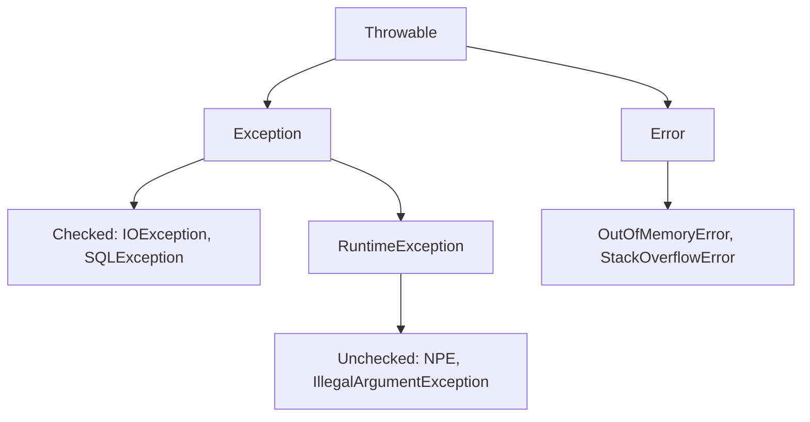
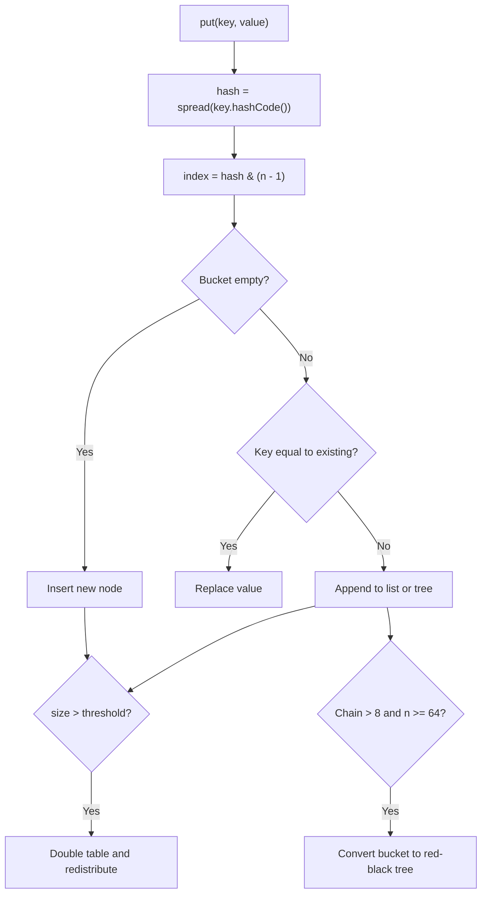
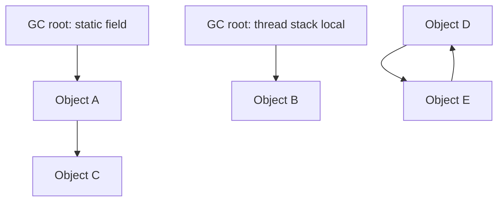
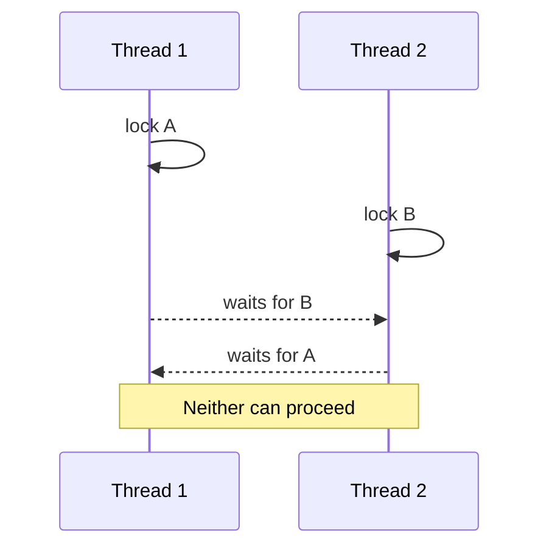
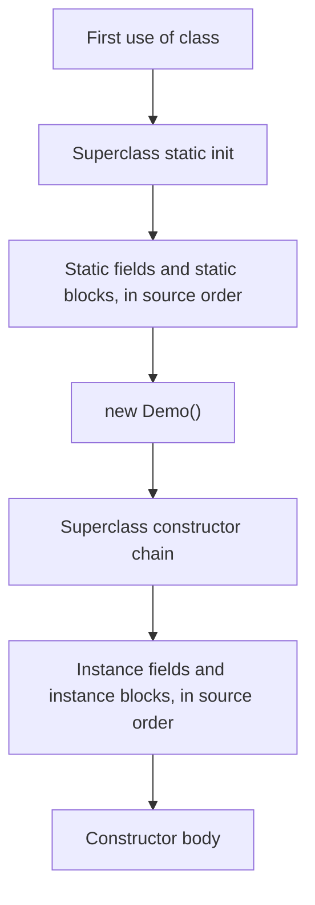
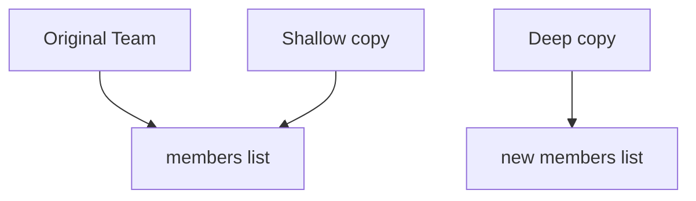
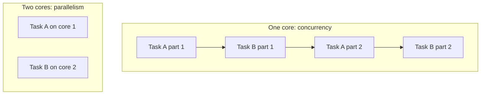
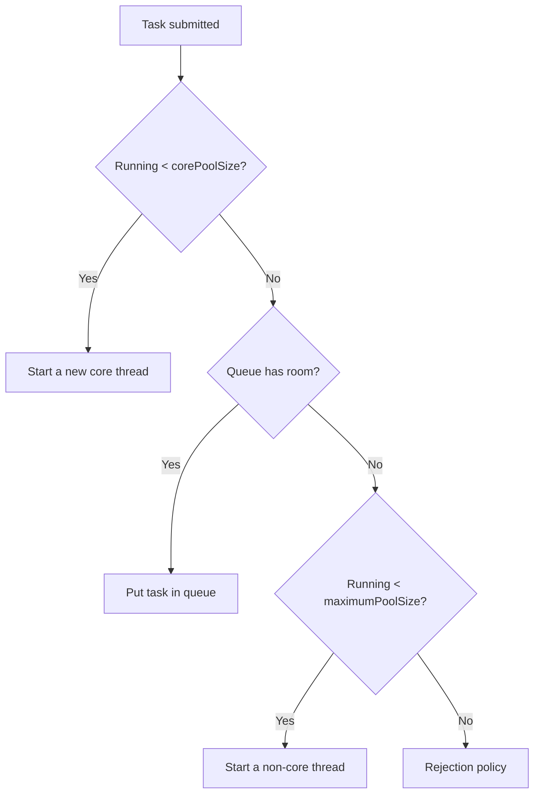

# Java for Android Developers

[⬅ Back to index](../README.md)

Covers: core Java, OOP in Java, Strings, collections internals, JVM memory, multithreading, exceptions. These questions still come up often, especially for Java-heavy codebases.

---

## Core Java

### 1. Is Java pass-by-value or pass-by-reference?

<details>
<summary>Answer</summary>

**In short:** Java is **always pass-by-value**. For objects, the value that gets copied is the *reference*. So a method can change the object's fields through its parameter, but reassigning the parameter doesn't change the caller's variable.

#### What actually gets copied

A variable of an object type doesn't hold the object. It holds a reference (think of it as an address) to an object on the heap. When you call a method, Java copies the contents of each argument variable into the parameter:

- For a primitive (`int`, `boolean`...), the number itself is copied.
- For an object, the reference is copied. Caller and callee now have **two separate variables pointing to the same object**.

```java
class User { String name; }

static void rename(User u) {
    u.name = "Bob";        // follows the copied reference: changes the shared object
}

static void replace(User u) {
    u = new User();        // only the local copy now points elsewhere
    u.name = "Carol";      // caller never sees this object
}

User user = new User();
user.name = "Alice";
rename(user);   // user.name == "Bob"
replace(user);  // user.name is still "Bob"
```

The classic test is a `swap(a, b)` method. In a true pass-by-reference language (C++ with `&`) it would swap the caller's variables. In Java it can't, because the method only has copies of the references.

#### Why the confusion

People say "objects are passed by reference" because mutation through the parameter is visible to the caller. But "pass-by-reference" means the parameter is an alias for the caller's *variable*, which Java never does. A clearer phrase is "references are passed by value".

Kotlin works the same way (it compiles to the same bytecode), and function parameters in Kotlin are additionally read-only (`val`), so the `replace` example wouldn't even compile.

**Common pitfalls**
- Expecting `list = new ArrayList<>()` inside a method to clear the caller's list. Use `list.clear()` instead.
- Passing a mutable object to a method and being surprised it changed. Pass a copy or an immutable type if that matters.

**Likely follow-ups**
- *What about `String`?* Same rule, but since `String` is immutable you can't change it through the parameter at all, so it behaves like a primitive.
- *How do you "return" two values?* Return a small object/record, or (in Kotlin) a `Pair` or data class.

</details>

### 2. Why is `String` immutable? What is the String pool?

<details>
<summary>Answer</summary>

**In short:** The String pool is a JVM-managed table of shared `String` instances: identical literals point to the same object. That sharing is only safe because `String` is immutable. Immutability also makes strings thread-safe, lets them cache their `hashCode` (great for map keys), and makes them safe to use for security-sensitive values like file paths and class names.

#### The String pool

Strings are everywhere, and many are duplicates. To save memory, the JVM keeps a pool (the "intern table") of string instances. Since Java 7 the pool lives on the regular heap.

```java
String a = "hello";             // literal: taken from the pool
String b = "hello";             // same pooled object
String c = new String("hello"); // forces a new, separate heap object
String d = c.intern();          // returns the pooled instance

a == b;       // true  (same object)
a == c;       // false (different objects)
a.equals(c);  // true  (same characters)
a == d;       // true
```

Compile-time constant expressions such as `"hel" + "lo"` are folded by the compiler into one literal, so they are pooled too. Strings built at runtime (concatenation of variables, `StringBuilder.toString()`, reading a file) are not pooled unless you call `intern()`.

#### Why immutability matters

| Reason | Explanation |
|---|---|
| Pooling | If one holder of `"hello"` could change it, every other holder would see the change. Sharing requires immutability. |
| Thread safety | An immutable object can be shared across threads with no locking. |
| Cached `hashCode` | The hash is computed once and stored in a field. `HashMap<String, ...>` lookups stay fast, and a key can't change after insertion (which would "lose" it in the map). |
| Security | A method can validate a path, URL or class name and then use it, knowing nobody can change it between the check and the use. |

`String` is also `final`, so no subclass can add mutable behaviour.

**Common pitfalls**
- Comparing strings with `==`. It may "work" for literals because of pooling, then fail for runtime strings. Always use `equals()` (Kotlin's `==` already calls `equals`).
- Storing passwords in a `String`: it can't be wiped and may linger in memory. A `char[]` can be overwritten after use.

**Likely follow-ups**
- *How many objects does `new String("a")` create?* Up to two: the pooled literal `"a"` (if not already there) and the new heap object.
- *Is `intern()` a good optimisation?* Rarely; it can help when you hold millions of duplicate strings, but usually it's unnecessary.

</details>

### 3. `String` vs `StringBuilder` vs `StringBuffer`?

<details>
<summary>Answer</summary>

**In short:** `String` is immutable, so every modification creates a new object. `StringBuilder` is a mutable, unsynchronized buffer and is the default choice for building strings. `StringBuffer` is the older, synchronized (thread-safe) version and is rarely needed.

| | `String` | `StringBuilder` | `StringBuffer` |
|---|---|---|---|
| Mutable | No | Yes | Yes |
| Thread-safe | Yes (immutable) | No | Yes (synchronized methods) |
| Speed for repeated edits | Slow | Fastest | Slightly slower (lock overhead) |
| Added in | Java 1.0 | Java 5 | Java 1.0 |

#### Why concatenation in a loop is slow

```java
// Bad: each += creates a new String and copies all previous characters
String s = "";
for (int i = 0; i < 10_000; i++) {
    s += i;              // O(n) copy every iteration -> O(n^2) total
}

// Good: one growing buffer, amortised O(1) append
StringBuilder sb = new StringBuilder();
for (int i = 0; i < 10_000; i++) {
    sb.append(i);
}
String result = sb.toString();
```

A `StringBuilder` holds an internal character array with spare capacity. When it fills up, it grows (roughly doubles), so most appends just write into existing space. You can pass an initial capacity (`new StringBuilder(256)`) if you know the approximate size.

#### What the compiler does for you

A single expression like `"Hello " + name + "!"` is fine. The compiler turns it into an efficient builder call (or, on newer JDKs, `invokedynamic` string concatenation). The problem is only concatenation spread across loop iterations, where the compiler can't reuse one buffer.

#### When would `StringBuffer` be used?

Only when several threads append to the **same** buffer, which is unusual. Even then, each call is atomic but a sequence of calls is not, so you'd often need external synchronization anyway. In Kotlin, `buildString { append(...) }` uses a `StringBuilder` under the hood.

**Likely follow-ups**
- *Is `StringBuilder` thread-safe?* No. Keep it local to one method/thread.
- *Does `toString()` copy?* Yes, it creates a new immutable `String` from the buffer contents.

</details>

### 4. `==` vs `equals()`? What is the `equals`/`hashCode` contract?

<details>
<summary>Answer</summary>

**In short:** `==` compares references for objects (are these the same instance?) and values for primitives. `equals()` compares logical equality as defined by the class. The contract: if `a.equals(b)`, then `a.hashCode() == b.hashCode()`. If you override `equals` without `hashCode`, hash-based collections like `HashMap` and `HashSet` stop working correctly.

#### `==` vs `equals()`

```java
Point p1 = new Point(1, 2);
Point p2 = new Point(1, 2);

p1 == p2;        // false: two different objects
p1.equals(p2);   // true only if Point overrides equals()
```

`Object.equals()` by default is just `==`. Classes like `String`, `Integer` and `List` override it to compare contents. In Kotlin, `==` calls `equals()` and `===` is reference equality.

#### The full `equals` contract

`equals` must be:
- **Reflexive**: `a.equals(a)` is true.
- **Symmetric**: `a.equals(b)` iff `b.equals(a)`.
- **Transitive**: if `a.equals(b)` and `b.equals(c)` then `a.equals(c)`.
- **Consistent**: repeated calls give the same result if nothing changed.
- `a.equals(null)` is false.

And `hashCode` must return equal values for equal objects. Unequal objects *may* share a hash (a collision); that's allowed, just slower.

#### Why breaking it breaks `HashMap`

A `HashMap` first uses `hashCode()` to pick a bucket, then `equals()` to find the key in that bucket. If two equal objects have different hash codes, they go to different buckets and the map never compares them.

```java
class Point {
    final int x, y;
    Point(int x, int y) { this.x = x; this.y = y; }

    @Override public boolean equals(Object o) {
        if (this == o) return true;
        if (!(o instanceof Point)) return false;
        Point p = (Point) o;
        return x == p.x && y == p.y;
    }
    // Missing hashCode(): falls back to Object's identity hash
}

Set<Point> set = new HashSet<>();
set.add(new Point(1, 2));
set.contains(new Point(1, 2)); // almost certainly false!

// Fix: add this inside Point
@Override public int hashCode() { return Objects.hash(x, y); }
```

Kotlin `data class` generates a consistent `equals`, `hashCode` and `toString` from the primary-constructor properties, which is why it's the usual choice for value types.

**Common pitfalls**
- Using mutable fields in `hashCode`, then mutating an object already in a `HashSet`. It ends up in the wrong bucket and can't be found or removed.
- Writing `equals(Point other)` instead of `equals(Object o)`. That overloads rather than overrides, and collections ignore it. Use `@Override`.

**Likely follow-ups**
- *Can two unequal objects have the same hashCode?* Yes; that's a collision and is legal.
- *What does the default `hashCode` return?* An identity-based value, unrelated to field contents.

</details>

### 5. `final`, `finally`, `finalize`?

<details>
<summary>Answer</summary>

**In short:** Three unrelated things with similar names. `final` is a modifier meaning "can't be changed" (variable can't be reassigned, method can't be overridden, class can't be extended). `finally` is a block that runs after `try`/`catch` no matter how it exits. `finalize()` is an old, deprecated GC callback that you should not use.

#### `final`

```java
final int max = 10;          // can't reassign max
final List<String> names = new ArrayList<>();
names.add("a");              // allowed: the reference is final, not the object

class Base {
    final void log() { }     // subclasses can't override
}
final class Money { }        // nobody can extend (String is final too)
```

A `final` field must be assigned exactly once, in its declaration or constructor. `final` fields also get a memory-model guarantee: once the constructor finishes, other threads see their correct values without extra synchronization (as long as `this` didn't escape during construction). Kotlin's defaults mirror this: `val` is like a final variable, and classes and methods are final unless marked `open`.

#### `finally`

```java
InputStream in = open();
try {
    process(in);
} catch (IOException e) {
    log(e);
} finally {
    in.close();              // runs on normal exit, after catch, or on an uncaught exception
}
```

It also runs when the `try` block `return`s. It does *not* run if the JVM stops: `System.exit()`, the process is killed (on Android, the system can kill your process at any time), or the thread is stuck forever.

#### `finalize()`

`Object.finalize()` was called by the GC before reclaiming an object. It's deprecated (since Java 9, and marked for removal later) because:
- there's no guarantee *when* or even *if* it runs;
- it slows down GC and can resurrect objects;
- exceptions in it are silently ignored.

Use `try-with-resources` (or Kotlin `use {}`) for deterministic cleanup, and `java.lang.ref.Cleaner` only as a safety net.

**Common pitfalls**
- Returning a value from `finally`: it overrides the `try`'s return and swallows any exception. Don't do it.
- Believing `final` makes an object immutable. It only freezes the reference.

**Likely follow-ups**
- *Does `finally` run if `catch` throws?* Yes, then the new exception propagates.
- *Why make a class final?* To protect invariants (immutability, security) and make the design explicit.

</details>

### 6. What is `static`? Static vs instance?

<details>
<summary>Answer</summary>

**In short:** `static` members belong to the **class**, not to any one object. There's a single copy shared by all instances, and you can use it without creating an object. Static methods have no `this`, so they can't touch instance fields directly. On Android, static references to Activities, Views or Contexts are a classic memory leak, because statics live as long as the process.

#### Static vs instance

| | Static | Instance |
|---|---|---|
| Belongs to | The class | Each object |
| Copies | One per class (per class loader) | One per object |
| Access | `ClassName.member` | `obj.member` |
| Can use `this` / instance fields | No | Yes |
| Lifetime | Until the class is unloaded (on Android: effectively the process) | Until the object is unreachable |

```java
class Counter {
    static int created = 0;   // shared by all Counters
    int id;                   // one per Counter

    Counter() {
        created++;
        id = created;
    }

    static int total() {
        return created;       // OK
        // return id;         // compile error: no instance here
    }
}
```

Typical uses: constants (`static final`), factory methods (`User.from(json)`), utility functions (`Math.max`), and singletons.

#### Why static is a leak risk on Android

A static field is a **GC root**: everything reachable from it stays in memory. An `Activity` holds its whole view hierarchy, bitmaps and resources. If a static field keeps a reference to it, rotating the screen creates a new Activity while the old one can never be collected.

```java
// Bad
class Analytics {
    static Context context;          // someone sets this to an Activity -> leak
}

// Better
class Analytics {
    static Context appContext;       // set to context.getApplicationContext()
}
```

The Application context lives for the whole process anyway, so holding it statically is fine.

#### Kotlin note

Kotlin has no `static` keyword. Use top-level functions/properties, an `object`, or a `companion object`. Add `@JvmStatic` / `@JvmField` / `const` when Java callers need true static members.

**Likely follow-ups**
- *Can a static method be overridden?* No, it's hidden, not overridden (see question 30).
- *Is static state safe across threads?* No; shared mutable static state needs synchronization like any other shared state.

</details>

### 7. Abstract class vs interface?

<details>
<summary>Answer</summary>

**In short:** An abstract class is a partially implemented base class: it can hold state and constructors, and a class can extend only one. An interface is a contract of capabilities: no instance state, and a class can implement many. Since Java 8 interfaces can also have `default` and `static` methods, so the main remaining differences are **state** and **single vs multiple inheritance**.

| Abstract class | Interface |
|---|---|
| Can have instance fields (state) and constructors | No instance state (only `public static final` constants) |
| A class extends **one** | A class implements **many** |
| Any access modifiers on members | Methods are public (Java 9+ allows `private` helper methods) |
| "is-a" with shared code | "can-do" capability / contract |
| Can have `final`, `protected`, non-public methods | `default` methods can't be `final` and can't override `Object` methods like `equals` |

#### Example

```java
interface Clickable {                  // a capability
    void onClick();
    default void onLongClick() { onClick(); }   // Java 8 default method
}

abstract class BaseScreen {            // shared state and behaviour
    protected final String name;
    protected BaseScreen(String name) { this.name = name; }

    void show() {                      // template method
        log("show " + name);
        render();
    }
    protected abstract void render();  // subclasses fill in the details
}

class HomeScreen extends BaseScreen implements Clickable {
    HomeScreen() { super("home"); }
    @Override protected void render() { /* ... */ }
    @Override public void onClick() { /* ... */ }
}
```

#### How to choose

- Use an **interface** to define what something can do, especially when unrelated classes need the capability, or for dependency inversion (a `UserRepository` interface with a fake for tests).
- Use an **abstract class** when several closely related classes share state and code, and you want to enforce a structure (template method pattern).
- Prefer interfaces plus composition by default; deep abstract-class hierarchies get rigid.

If a class implements two interfaces with the same `default` method, it must override it and can pick one with `A.super.method()`.

**Likely follow-ups**
- *Can an abstract class have no abstract methods?* Yes; it just can't be instantiated.
- *Kotlin difference?* Kotlin interfaces can declare abstract properties and have default implementations, but still no backing fields (no stored state).

</details>

### 8. Overloading vs overriding?

<details>
<summary>Answer</summary>

**In short:** **Overloading** means several methods with the same name but different parameter lists, chosen by the compiler from the argument types (compile-time / static polymorphism). **Overriding** means a subclass replaces a superclass method with the same signature, chosen at runtime from the object's actual type (dynamic dispatch).

| | Overloading | Overriding |
|---|---|---|
| Where | Same class (or inherited) | Subclass of the declaring type |
| Signature | Same name, **different parameters** | Same name **and** parameters |
| Return type | Can differ (but can't be the only difference) | Same or **covariant** (a subtype) |
| Resolved | Compile time, by **static (declared) types** | Runtime, by **actual object type** |
| Access modifier | Any | Can't be more restrictive |
| Exceptions | Any | Can't throw broader checked exceptions |

#### Code

```java
class Printer {
    void print(int x)    { System.out.println("int"); }
    void print(Object o) { System.out.println("object"); }   // overload
}

class Animal {
    Animal create() { return new Animal(); }
    String sound()  { return "..."; }
}
class Dog extends Animal {
    @Override Dog create() { return new Dog(); }   // covariant return
    @Override String sound() { return "Woof"; }
}

Animal a = new Dog();
a.sound();             // "Woof": runtime type decides (overriding)

Object o = 42;
new Printer().print(o); // "object": declared type Object decides (overloading)
```

The last line is the classic trick question: even though `o` holds an `Integer`, overload resolution uses the declared type `Object`.

#### What can't be overridden

`static` methods (they're hidden), `private` methods (not visible to subclasses), `final` methods, and constructors.

**Common pitfalls**
- Accidentally overloading when you meant to override (e.g. `equals(MyType)` instead of `equals(Object)`). Always use `@Override` so the compiler catches it; Kotlin requires the `override` keyword.

**Likely follow-ups**
- *Can you overload by return type only?* No, the call would be ambiguous.
- *Can you override a method and narrow its visibility?* No, you can only keep or widen it.

</details>

### 9. What are checked vs unchecked exceptions?

<details>
<summary>Answer</summary>

**In short:** **Checked** exceptions extend `Exception` (but not `RuntimeException`) and the compiler forces you to catch or declare them, e.g. `IOException`. **Unchecked** exceptions extend `RuntimeException` and usually signal programming bugs, e.g. `NullPointerException`; the compiler doesn't enforce handling. **`Error`s** like `OutOfMemoryError` are serious JVM problems you normally don't catch.

#### Hierarchy



| Kind | Examples | Compiler enforced | Typical meaning |
|---|---|---|---|
| Checked | `IOException`, `SQLException`, `InterruptedException` | Yes | Expected, recoverable conditions outside your control (network, files) |
| Unchecked | `NullPointerException`, `IllegalArgumentException`, `IllegalStateException`, `IndexOutOfBoundsException` | No | Bugs or broken preconditions |
| Error | `OutOfMemoryError`, `StackOverflowError` | No | The JVM itself is in trouble |

#### In code

```java
// Checked: must be handled or declared
String readConfig(File f) throws IOException {
    return new String(Files.readAllBytes(f.toPath()));
}

// Unchecked: validate arguments and fail fast
void setAge(int age) {
    if (age < 0) throw new IllegalArgumentException("age < 0: " + age);
}
```

#### Kotlin and Android

Kotlin has **no checked exceptions**: you can call `readConfig` without try/catch. That's convenient but means you must remember which calls can fail. If Java code needs to see the declaration, add `@Throws(IOException::class)`. Many Kotlin codebases model expected failures with `Result` or sealed classes instead of exceptions.

**Common pitfalls**
- `catch (Exception e) {}` that silently swallows everything, including bugs.
- Catching `Throwable`/`Error`: you usually can't recover from an `OutOfMemoryError` safely.
- In coroutines, a broad `catch (e: Exception)` also catches `CancellationException` (it is unchecked). Not rethrowing it breaks cancellation.

**Likely follow-ups**
- *Why did Kotlin drop checked exceptions?* They led to boilerplate and empty catch blocks, and don't compose well with lambdas.
- *How do you make a custom exception?* Extend `Exception` (checked) or `RuntimeException` (unchecked), and pass a message and cause.

</details>

### 10. What is try-with-resources?

<details>
<summary>Answer</summary>

**In short:** Try-with-resources (Java 7) declares resources in the `try (...)` header and closes them automatically when the block exits, whether normally or by an exception. It works with anything implementing `AutoCloseable`. Kotlin's equivalent is the `use {}` extension.

#### Before and after

```java
// Old style: verbose and easy to get wrong
BufferedReader reader = null;
try {
    reader = new BufferedReader(new FileReader(file));
    return reader.readLine();
} finally {
    if (reader != null) reader.close();   // close() can itself throw and hide the original error
}

// Try-with-resources
try (BufferedReader reader = new BufferedReader(new FileReader(file))) {
    return reader.readLine();
}   // reader.close() is called automatically
```

#### How it works

- You can declare several resources separated by `;`. They are closed in **reverse order** of declaration.
- If the body throws and `close()` also throws, the body's exception is the one propagated, and the close exception is attached as a **suppressed exception** (`e.getSuppressed()`). The old `finally` approach loses the original exception in that case.
- Since Java 9 you can use an existing effectively final variable: `try (reader) { ... }`.

#### Kotlin

```kotlin
val firstLine = File(path).bufferedReader().use { it.readLine() }

context.contentResolver.query(uri, null, null, null, null)?.use { cursor ->
    while (cursor.moveToNext()) { /* ... */ }
}   // cursor closed automatically
```

On Android this matters for `Cursor`, streams, `ParcelFileDescriptor`, database transactions and similar resources. Leaking them triggers StrictMode warnings and can exhaust file descriptors.

**Likely follow-ups**
- *`Closeable` vs `AutoCloseable`?* `Closeable` (from `java.io`) extends `AutoCloseable`, throws only `IOException`, and its `close()` should be idempotent.
- *Can you have a `catch`/`finally` too?* Yes; they run after the resources are closed.

</details>

### 11. What are generics wildcards `? extends` and `? super`?

<details>
<summary>Answer</summary>

**In short:** `? extends T` means "some subtype of T": you can safely **read** `T` values but can't add (except `null`). `? super T` means "some supertype of T": you can safely **add** `T` values, but reads only give you `Object`. Rule of thumb: **PECS, Producer Extends, Consumer Super**. Kotlin's equivalents are `out` and `in`.

#### The underlying problem: generics are invariant

Even though `Integer` is a `Number`, a `List<Integer>` is **not** a `List<Number>`. If it were, this would compile and corrupt the list:

```java
List<Integer> ints = new ArrayList<>();
List<Number> nums = ints;      // not allowed, and for good reason
nums.add(3.14);                // a Double in a list of Integers!
```

Wildcards let you relax that rule in a safe direction.

#### `? extends` (producer)

```java
double sum(List<? extends Number> list) {
    double total = 0;
    for (Number n : list) total += n.doubleValue();   // reading is safe
    // list.add(1);   // compile error: the list might be a List<Double>
    return total;
}

sum(List.of(1, 2, 3));        // List<Integer> works
sum(List.of(1.5, 2.5));       // List<Double> works
```

#### `? super` (consumer)

```java
void fill(List<? super Integer> list) {
    list.add(1);                 // safe: the list holds Integer or a supertype
    list.add(2);
    Object first = list.get(0);  // reads are only typed as Object
}

fill(new ArrayList<Integer>());
fill(new ArrayList<Number>());
fill(new ArrayList<Object>());
```

`Collections.copy(List<? super T> dest, List<? extends T> src)` uses both: it reads from the producer and writes into the consumer.

| | Read as T | Write T | Kotlin |
|---|---|---|---|
| `List<T>` | Yes | Yes | `List<T>` / `MutableList<T>` |
| `List<? extends T>` | Yes | No | `MutableList<out T>` |
| `List<? super T>` | No (only `Object`) | Yes | `MutableList<in T>` |

#### Kotlin

Kotlin adds **declaration-site variance**: `interface List<out E>` declares once that a read-only `List` only produces `E`, so `List<Int>` is usable as `List<Number>` everywhere. Use-site `out`/`in` (type projections) work like Java wildcards.

**Likely follow-ups**
- *What's type erasure?* Generic types are removed at compile time, so at runtime a `List<String>` is just a `List`; you can't do `new T()` or `instanceof List<String>`. Kotlin's `reified` type parameters on inline functions work around this.
- *What's `List<?>`?* A list of unknown type: read as `Object`, can't add.

</details>

---

## Collections

### 12. How does `HashMap` work internally?

<details>
<summary>Answer</summary>

**In short:** A `HashMap` is an array of buckets. `put` hashes the key, picks a bucket with `hash & (n - 1)`, and stores the entry there; collisions are chained in a linked list, which (Java 8+) turns into a red-black tree when it gets long. Lookups use `hashCode` to find the bucket and `equals` to find the key. When the map passes `capacity × loadFactor` entries it doubles and redistributes. Average `get`/`put` is O(1).

#### Step by step: `put(key, value)`

1. **Hash the key.** `HashMap` calls `key.hashCode()` and mixes the high bits into the low bits (`h ^ (h >>> 16)`), because only the low bits are used for the index.
2. **Pick a bucket.** `index = hash & (table.length - 1)`. The table length is always a power of two, so this is a cheap equivalent of `hash % length`.
3. **Empty bucket:** store a new node `(hash, key, value, next)`.
4. **Occupied bucket (collision):** walk the nodes. If a node has the same hash and `equals` the key, replace its value. Otherwise append a new node.
5. **Treeify:** if a bucket's chain grows beyond 8 nodes and the table has at least 64 buckets, the chain becomes a red-black tree, so worst-case lookup in that bucket is O(log n) instead of O(n). (If the table is smaller than 64, it resizes instead.)
6. **Resize:** if `size > capacity × loadFactor` (defaults: 16 × 0.75 = 12), the table doubles and every entry is moved. Thanks to power-of-two sizes, each entry either stays at its index or moves to `index + oldCapacity`.



#### `get(key)`

Same hash and index computation, then compare nodes in that bucket: first by hash, then by `==` or `equals`. That's why a correct `equals`/`hashCode` pair is essential (see question 4).

#### Key facts

| Property | Value |
|---|---|
| Default capacity / load factor | 16 / 0.75 |
| Average `get`/`put` | O(1) |
| Worst case per bucket | O(log n) with treeified bins (O(n) before Java 8) |
| `null` key | One allowed (stored in bucket 0) |
| Thread-safe | No |
| Order | Not preserved |

**Common pitfalls**
- Mutable keys: changing a field used in `hashCode` after insertion "loses" the entry.
- Concurrent writes from several threads can corrupt the map. Use `ConcurrentHashMap`.
- Not presizing: if you know you'll insert ~1000 entries, `new HashMap<>(expected / 0.75 + 1)` avoids repeated resizes.

**Likely follow-ups**
- *Why is capacity a power of two?* So `hash & (n - 1)` replaces a slow modulo, and resizing splits buckets cleanly.
- *Why 0.75?* A trade-off between memory use and collision rate.

</details>

### 13. `HashMap` vs `LinkedHashMap` vs `TreeMap` vs `ConcurrentHashMap` vs `Hashtable`?

<details>
<summary>Answer</summary>

**In short:** `HashMap` is the fast unordered default. `LinkedHashMap` adds predictable order (insertion or access order, the basis of an LRU cache). `TreeMap` keeps keys sorted with O(log n) operations. `ConcurrentHashMap` is the thread-safe, scalable choice. `Hashtable` is a legacy fully synchronized map you shouldn't use in new code. On Android, `ArrayMap` and `SparseArray` save memory for small maps.

| Map | Ordering | get/put | Thread-safe | Nulls | Use when |
|---|---|---|---|---|---|
| `HashMap` | None | O(1) avg | No | 1 null key, null values | Default choice |
| `LinkedHashMap` | Insertion or access order | O(1) avg | No | Same as HashMap | Need stable iteration order, LRU caches |
| `TreeMap` | Sorted by key (natural or `Comparator`) | O(log n) | No | No null key (with natural ordering) | Range queries, sorted output |
| `ConcurrentHashMap` | None | O(1) avg | Yes, fine-grained | No nulls at all | Shared between threads |
| `Hashtable` | None | O(1) avg | Yes, one lock for everything | No nulls | Legacy code only |

#### `LinkedHashMap` as an LRU cache

`LinkedHashMap` keeps a doubly linked list through its entries. With `accessOrder = true`, every `get` moves the entry to the end, so the head is the least recently used.

```java
class LruCache<K, V> extends LinkedHashMap<K, V> {
    private final int max;
    LruCache(int max) {
        super(16, 0.75f, true);   // true = access order
        this.max = max;
    }
    @Override
    protected boolean removeEldestEntry(Map.Entry<K, V> eldest) {
        return size() > max;      // evict the least recently used
    }
}
```

Android's `android.util.LruCache` is built on this idea and adds thread safety and size-by-bytes.

#### `TreeMap`

A red-black tree. Besides sorted iteration it offers navigation: `firstKey()`, `floorKey(k)`, `headMap(k)`, `subMap(a, b)`. Handy for things like "find the price tier for this amount".

#### `ConcurrentHashMap` vs `Hashtable`

`Hashtable` (and `Collections.synchronizedMap`) put one lock around every method, so only one thread works at a time. `ConcurrentHashMap` (Java 8+) uses CAS for empty buckets and locks only the individual bucket being changed, and reads are mostly lock-free. It also offers atomic compound operations like `computeIfAbsent` and `merge`. It forbids `null` because `get` returning `null` must unambiguously mean "absent" when other threads can change the map.

#### Android-specific maps

- **`ArrayMap<K, V>`**: two compact arrays and binary search on hashes. Uses less memory than `HashMap` (no node object per entry), slower for large maps. Good for up to a few hundred entries.
- **`SparseArray<V>`** (and `SparseIntArray`, `LongSparseArray`...): `int` keys with no boxing. Good for maps keyed by IDs.

**Likely follow-ups**
- *Is `ConcurrentHashMap.size()` exact?* It's an estimate while other threads are writing.
- *Is iterating `HashMap` in insertion order guaranteed?* No; use `LinkedHashMap` (Kotlin's `mutableMapOf()` already returns one).

</details>

### 14. `ArrayList` vs `LinkedList`?

<details>
<summary>Answer</summary>

**In short:** `ArrayList` is a resizable array: O(1) index access, O(n) inserts/removes in the middle, and very cache-friendly. `LinkedList` is a doubly linked list: O(1) insert/remove at the ends or at an iterator's position, but O(n) access by index and much more memory per element. In practice `ArrayList` is almost always the right choice; for a queue or stack, use `ArrayDeque`.

| Operation | `ArrayList` | `LinkedList` |
|---|---|---|
| `get(i)` | O(1) | O(n) (walks from the nearer end) |
| `add(e)` at end | Amortised O(1) | O(1) |
| `add(0, e)` / remove first | O(n) (shifts elements) | O(1) |
| Insert/remove in middle | O(n) shift | O(n) to find + O(1) to link |
| Memory per element | One reference in an array | Node object with item + 2 links |
| CPU cache behaviour | Contiguous, prefetch-friendly | Scattered nodes, cache misses |

#### How `ArrayList` grows

It holds an `Object[]`. When full, it allocates a bigger array (about 1.5×) and copies the elements over. Because growth is geometric, the average cost of `add` stays O(1). If you know the size, pass it in: `new ArrayList<>(1000)`.

#### Why `LinkedList` rarely wins

The theoretical O(1) insert only helps if you're already at the position (via a `ListIterator`). Finding the position is O(n), and following pointers through scattered memory is slow on real CPUs. Meanwhile `System.arraycopy` shifting in `ArrayList` is a fast block copy. Benchmarks usually favour `ArrayList` even for many middle insertions.

```java
// Need a queue/stack? Prefer ArrayDeque over LinkedList
Deque<Task> queue = new ArrayDeque<>();
queue.offer(task);      // add to tail
Task next = queue.poll(); // remove from head
```

`LinkedList` also implements `Deque` and allows `null` elements, but `ArrayDeque` is generally faster.

**Common pitfalls**
- Looping `for (int i...) list.get(i)` over a `LinkedList`: O(n²).
- Removing items by index in a forward loop over an `ArrayList` skips elements; use `removeIf` or an iterator.

**Likely follow-ups**
- *What does `RandomAccess` mean?* A marker interface on `ArrayList` that tells algorithms indexed access is fast.

</details>

### 15. What is `ConcurrentModificationException`?

<details>
<summary>Answer</summary>

**In short:** It's thrown when a collection is structurally modified (added to or removed from) while you're iterating over it with a fail-fast iterator, for example calling `list.remove()` inside a for-each loop. Fix it by removing through `iterator.remove()`, using `removeIf`, iterating over a copy, or using a concurrent collection such as `CopyOnWriteArrayList`.

#### Why it happens

Collections like `ArrayList` and `HashMap` keep a `modCount` that increases on every structural change. Their iterator remembers the value when it was created and checks it on every `next()`. If they differ, it throws, rather than silently skipping or repeating elements.

```java
List<String> names = new ArrayList<>(List.of("a", "b", "c"));

// Bad: for-each uses an iterator under the hood
for (String n : names) {
    if (n.equals("a")) names.remove(n);   // ConcurrentModificationException on next()
}

// Good: remove through the iterator
Iterator<String> it = names.iterator();
while (it.hasNext()) {
    if (it.next().equals("a")) it.remove();
}

// Good: Java 8+
names.removeIf(n -> n.equals("a"));
```

Kotlin equivalents: `list.removeAll { it == "a" }`, or build a new list with `filter`.

#### It's not only about threads

Despite the name, most CMEs happen on a **single thread**. A common Android case: notifying listeners while one of them unregisters itself.

```java
for (Listener l : listeners) {
    l.onEvent();          // a listener calls listeners.remove(this) -> CME
}
```

Fixes: iterate over a snapshot (`new ArrayList<>(listeners)`), or store listeners in a `CopyOnWriteArrayList`, whose iterators work on a snapshot.

If the modification really comes from another thread, a fail-fast iterator only detects it on a **best-effort** basis. The real fix is thread-safe collections or synchronization.

**Common pitfalls**
- Thinking the "detection" makes unsynchronized code safe. You can still get corrupted state without any exception.
- An odd case: removing the second-to-last element in a for-each loop may *not* throw, because `hasNext()` returns false before the check. The bug is still there.

**Likely follow-ups**
- *What's a fail-safe iterator?* See question 36.

</details>

### 16. `Comparable` vs `Comparator`?

<details>
<summary>Answer</summary>

**In short:** `Comparable` defines a class's **natural ordering** through its own `compareTo()` method; there's only one. `Comparator` is a separate object that defines an **external, custom ordering**; you can have as many as you like and use them for classes you don't own.

| | `Comparable<T>` | `Comparator<T>` |
|---|---|---|
| Package | `java.lang` | `java.util` |
| Method | `int compareTo(T other)` | `int compare(T a, T b)` |
| Where | Implemented by the class itself | Separate class or lambda |
| How many orderings | One (natural) | Any number |
| Used by | `Collections.sort(list)`, `TreeMap` with no comparator | `list.sort(cmp)`, `new TreeMap<>(cmp)` |

Both return a negative number, zero, or positive number for "less than", "equal", "greater than".

#### Code

```java
class User implements Comparable<User> {
    String name; int age;

    @Override public int compareTo(User other) {
        return Integer.compare(age, other.age);   // natural order: by age
    }
}

Collections.sort(users);                          // uses compareTo

// External orderings, built with Java 8 combinators
users.sort(Comparator.comparing((User u) -> u.name));
users.sort(Comparator.comparingInt((User u) -> u.age)
                     .reversed()
                     .thenComparing(u -> u.name));
```

Kotlin:

```kotlin
users.sortedWith(compareBy<User> { it.age }.thenBy { it.name })
users.sortedByDescending { it.age }
```

**Common pitfalls**
- Writing `return this.age - other.age`. It can overflow for large or negative values; use `Integer.compare`.
- `compareTo` inconsistent with `equals`: a `TreeSet` treats elements that compare as 0 as duplicates, even if `equals` says they differ.

**Likely follow-ups**
- *Which to use for a library class like `String` in a custom order?* A `Comparator`, since you can't change the class (e.g. `String.CASE_INSENSITIVE_ORDER`).

</details>

---

## JVM & Memory

### 17. Explain JVM memory areas: stack vs heap.

<details>
<summary>Answer</summary>

**In short:** Each thread has its own **stack**, holding a frame per method call with local primitives and object references; it's freed automatically when methods return, and too-deep recursion gives `StackOverflowError`. The **heap** is shared by all threads and holds every object and array; it's managed by the garbage collector, and running out gives `OutOfMemoryError`. There are also other areas such as the method area/metaspace for class metadata.

#### The two main areas

```java
void onClick() {
    int count = 3;                     // primitive: lives in the stack frame
    User user = new User("Ann");       // reference on stack, User object on heap
    process(user);                     // new frame pushed for process()
}                                       // frame popped: count and user ref gone;
                                        // the User object is GC-eligible if nothing else refers to it
```

| | Stack | Heap |
|---|---|---|
| Scope | One per thread | Shared by all threads |
| Contents | Frames: local primitives, references, return addresses | Objects, arrays (including their fields) |
| Lifetime | Until the method returns | Until unreachable and collected |
| Management | Automatic push/pop | Garbage collector |
| Thread-safety | Inherently private | Needs synchronization when shared |
| Failure | `StackOverflowError` | `OutOfMemoryError` |

Note that an object's fields, including primitive fields, live inside the object on the heap. Only *local* variables are on the stack.

#### Other runtime areas (JVM spec)

- **Method area** (HotSpot calls its implementation **metaspace**, in native memory since Java 8): class metadata, method bytecode, the runtime constant pool. Static *fields* in HotSpot are stored with the class's `Class` object on the heap.
- **PC register**: per thread, the current instruction.
- **Native method stack**: for JNI/native code.

#### Android (ART)

Android uses ART, not HotSpot, but the model is the same: per-thread stacks and a GC-managed heap. Each app gets a heap limit (check `ActivityManager.getMemoryClass()`; `android:largeHeap` raises it but is discouraged). Bitmap pixel data has been stored in native memory since Android 8.0, which is why large images no longer fill the Java heap as quickly, but they still count toward your process's memory.

**Likely follow-ups**
- *Why are local variables thread-safe?* Each thread has its own stack, so locals aren't shared (the objects they point to might be).
- *What causes OOM on Android most often?* Large bitmaps, leaks (Activities held by statics or long-lived callbacks), and unbounded caches.

</details>

### 18. What are strong, soft, weak and phantom references?

<details>
<summary>Answer</summary>

**In short:** They tell the GC how hard to hold on to an object. **Strong** (normal) references are never cleared while reachable. **Soft** references are cleared only under memory pressure. **Weak** references are cleared at the next GC once no strong references remain. **Phantom** references never return the object and are used only to learn that it was collected, for cleanup.

| Type | Class | Cleared when | `get()` returns | Typical use |
|---|---|---|---|---|
| Strong | (plain variable) | Never while reachable | n/a | Everything by default |
| Soft | `SoftReference<T>` | GC needs memory | Object until cleared | Memory-sensitive caches (on JVM) |
| Weak | `WeakReference<T>` | Next GC if only weakly reachable | Object until cleared | Avoid leaks, `WeakHashMap`, leak detection |
| Phantom | `PhantomReference<T>` | Once the object is otherwise unreachable; enqueued for cleanup | Always `null` | Post-mortem cleanup (`Cleaner`) |

#### Weak references on Android

The classic use is a callback or Handler that must not keep an Activity alive:

```java
static class SafeHandler extends Handler {
    private final WeakReference<MainActivity> ref;

    SafeHandler(MainActivity activity) {
        super(Looper.getMainLooper());
        ref = new WeakReference<>(activity);
    }

    @Override public void handleMessage(Message msg) {
        MainActivity activity = ref.get();
        if (activity == null || activity.isFinishing()) return;   // already gone
        activity.updateUi();
    }
}
```

Using a **static** nested class matters: a non-static inner Handler would hold a strong reference to the Activity anyway. LeakCanary works on the same principle: it keeps a `WeakReference` to destroyed Activities/Fragments and checks whether they get cleared after a GC.

Weak references are a band-aid, though. The cleaner fix is lifecycle-aware code: cancel work in `onDestroy`, or use `lifecycleScope`/`viewModelScope` so coroutines are cancelled automatically.

#### Why not soft references for caches on Android

Android's docs advise against `SoftReference` caches: the runtime has little information about whether to clear them, so they tend to be cleared too eagerly or retained too long. `LruCache` with an explicit size limit is predictable.

#### `ReferenceQueue`

You can register soft, weak and phantom references with a `ReferenceQueue`. When the GC clears them, it enqueues the reference object so you can react (remove a map entry, free native memory).

**Likely follow-ups**
- *How does `WeakHashMap` work?* Keys are weakly held; entries disappear once the key is no longer strongly reachable.
- *What replaced `finalize()`?* `java.lang.ref.Cleaner`, built on phantom references.

</details>

### 19. How does garbage collection decide an object is garbage?

<details>
<summary>Answer</summary>

**In short:** By **reachability**, not reference counting. The GC starts from a set of **GC roots** (local variables on live thread stacks, static fields, JNI references, and so on) and marks everything it can reach by following references. Anything not marked is garbage, even if those objects reference each other in a cycle, so circular references don't cause leaks in Java.

#### Mark and sweep, simplified



Here A, B and C are reachable. D and E point to each other but nothing reachable points to them, so both are collected.

1. **Mark:** traverse from roots, marking reachable objects.
2. **Sweep/compact:** reclaim unmarked memory. Many collectors also move live objects together (compaction) to avoid fragmentation.

#### Common GC roots

- Local variables and parameters in the frames of running threads.
- Static fields of loaded classes.
- JNI global references from native code.
- Live threads themselves, and objects used as monitors (`synchronized`).
- On Android, effectively also everything reachable from the main thread's `Looper` and its `MessageQueue`, which is why a pending delayed `Message` that references an Activity keeps it alive.

#### Why not reference counting?

Reference counting can't collect cycles (D and E above would keep each other's count at 1) and costs a counter update on every assignment. Tracing collectors avoid both problems.

#### Generations

Most objects die young. Generational collectors (HotSpot, and ART's concurrent copying collector) collect the young generation often and cheaply, and older objects less often. ART does most of its work concurrently with app threads, so pauses are short, but allocating heavily (e.g. in `onDraw`) still causes GC work and jank.

#### What a leak means in Java

A "memory leak" is an object that's still **reachable** but no longer **needed**: an Activity held by a static field, a listener never unregistered, an inner class callback outliving its screen. The GC is doing its job; your code is still holding the reference.

**Likely follow-ups**
- *Can you force GC?* `System.gc()` is only a hint; don't rely on it.
- *How do you find leaks on Android?* LeakCanary, or heap dumps in the Android Studio Memory Profiler.

</details>

---

## Multithreading

### 20. What is the difference between a process and a thread?

<details>
<summary>Answer</summary>

**In short:** A **process** is a running program with its own isolated memory space; each Android app normally runs in its own Linux process. **Threads** run inside a process and **share** its memory (the heap). Threads are cheaper to create and communicate through shared memory, but that sharing is exactly why they need synchronization.

| | Process | Thread |
|---|---|---|
| Memory | Own address space | Shares the process's heap; own stack |
| Isolation | Crash or corruption stays inside it | A crash in one thread (uncaught exception) kills the whole app process on Android |
| Creation cost | High | Lower |
| Communication | IPC (Binder, sockets, files) | Shared objects, queues |
| Android example | Your app, `system_server`, another app | Main (UI) thread, `Dispatchers.IO` workers, RenderThread |

#### On Android specifically

- Zygote forks a new process for your app, with its own ART instance. Each app also gets its own Linux user ID, which is how the OS sandboxes apps from each other.
- Inside that process, the **main thread** runs the `Looper` that handles lifecycle callbacks, input and drawing. Blocking it for too long causes jank and eventually an ANR.
- You can run components in a separate process with `android:process=":remote"` in the manifest. That process gets its own memory, its own `Application` instance and its own singletons, and talking to it requires IPC (AIDL/Messenger over Binder). Developers sometimes add this by accident and then wonder why a singleton is "reset".

#### Analogy

A process is a house; threads are people living in it. They share the kitchen (heap), which is efficient, but two people reaching for the same pan at once need rules (locks).

**Likely follow-ups**
- *Do threads share the stack?* No, each thread has its own stack; they share the heap.
- *Can one app read another app's memory?* No, processes are isolated; data is shared via ContentProviders, Intents or Binder services.

</details>

### 21. How do you create a thread in Java?

<details>
<summary>Answer</summary>

**In short:** Extend `Thread`, pass a `Runnable` (or lambda) to a `Thread`, or, preferably, submit `Runnable`/`Callable` tasks to an **`ExecutorService`** thread pool. A `Callable` returns a result through a `Future`. On modern Android you'd typically use coroutines instead, which run on thread pools under the hood.

#### The options

```java
// 1. Subclass Thread (least flexible)
class Worker extends Thread {
    @Override public void run() { doWork(); }
}
new Worker().start();

// 2. Runnable / lambda passed to a Thread
Thread t = new Thread(() -> doWork(), "worker-1");
t.start();               // start(), NOT run(): run() executes on the current thread

// 3. Thread pool (preferred)
ExecutorService pool = Executors.newFixedThreadPool(4);
pool.execute(() -> doWork());                         // fire and forget

Future<String> future = pool.submit(() -> fetchName()); // Callable<String>
String name = future.get();   // blocks until done; never call on the main thread

pool.shutdown();              // stop accepting tasks when you're done
```

#### Why pools are preferred

Creating a thread costs memory (its stack) and time. A pool reuses a fixed set of threads, limits how many run at once, and queues the rest. It also separates *what* to run (the task) from *how* it runs (the executor), which makes code testable. See question 39 for configuration.

#### On Android

- Never block the main thread with network or disk work; it causes jank and ANRs. Never touch Views from a background thread; post back with `Handler(Looper.getMainLooper())` or `runOnUiThread`.
- `AsyncTask` is deprecated (since API 30). Modern code uses **coroutines** (`viewModelScope.launch(Dispatchers.IO) { ... }`), and **WorkManager** for deferrable work that must survive process death.
- `HandlerThread` gives you a background thread with its own `Looper` if you need a serial message queue.

**Common pitfalls**
- Calling `thread.run()` instead of `start()`: no new thread is created.
- Forgetting `shutdown()` on a pool you created, leaking threads.
- An uncaught exception in a raw thread crashes the app.

**Likely follow-ups**
- *Difference between `execute` and `submit`?* `submit` returns a `Future` and captures exceptions inside it; `execute` lets exceptions reach the thread's uncaught handler.

</details>

### 22. What is `synchronized`? What is `volatile`?

<details>
<summary>Answer</summary>

**In short:** `synchronized` gives **mutual exclusion** (only one thread at a time holds a given lock and runs the guarded code) and **visibility** (changes made under the lock are seen by the next thread that takes it). `volatile` gives only **visibility and ordering** for a single variable: every read sees the latest write. It does **not** make compound operations like `count++` atomic. For atomic counters use `AtomicInteger`.

#### The problems they solve

1. **Atomicity**: `count++` is really read, add, write. Two threads can interleave and lose an update.
2. **Visibility**: without a happens-before relationship, one thread may never see another thread's write (CPU caches, compiler reordering, values held in registers).

#### `synchronized`

```java
class Counter {
    private int count = 0;

    public synchronized void increment() {   // lock = this
        count++;                             // atomic with respect to other synchronized methods on this object
    }

    public void reset() {
        synchronized (this) {                // block form, any object can be the lock
            count = 0;
        }
    }
}
```

The lock is **reentrant**: a thread holding it can enter other `synchronized` code on the same lock. Releasing a lock "publishes" all writes made before it to the next thread that acquires the same lock.

#### `volatile`

```java
class Worker implements Runnable {
    private volatile boolean running = true;   // without volatile, the loop might never stop

    public void stop() { running = false; }    // called from another thread

    @Override public void run() {
        while (running) { doChunk(); }
    }
}
```

A write to a volatile field happens-before every later read of it, and the compiler/CPU can't reorder ordinary accesses across it in ways that break this. Good for flags, and for publishing an immutable object safely (see the singleton in question 25).

#### Comparison

| | `synchronized` | `volatile` | `AtomicInteger` |
|---|---|---|---|
| Mutual exclusion | Yes | No | No (lock-free CAS) |
| Visibility | Yes | Yes | Yes |
| Atomic `x++` | Yes | **No** | Yes (`incrementAndGet`) |
| Can block threads | Yes | No | No |
| Scope | Block / method | One field | One value |

```java
private volatile int hits = 0;
void hit() { hits++; }                    // still a race!

private final AtomicInteger hits2 = new AtomicInteger();
void hit2() { hits2.incrementAndGet(); }  // correct
```

Kotlin uses annotations: `@Volatile var running = true`, `@Synchronized fun increment()`, or `synchronized(lock) { ... }`. In coroutine code, prefer `Mutex` (suspends instead of blocking) or confine state to one dispatcher.

**Common pitfalls**
- Synchronizing on different objects in different methods, so they don't actually exclude each other.
- Locking on a public object or a `String` literal that other code might also lock.
- Doing slow I/O while holding a lock.

**Likely follow-ups**
- *What is happens-before?* The Java Memory Model's rule for when one thread's write is guaranteed visible to another: unlock/lock of the same monitor, volatile write/read, `Thread.start()`/`join()`, and so on.

</details>

### 23. What is a deadlock? How do you avoid it?

<details>
<summary>Answer</summary>

**In short:** A deadlock is when two or more threads each hold a lock and wait for a lock another one holds, so none can ever continue. Avoid it by **acquiring locks in one consistent global order**, using timed `tryLock`, keeping critical sections small, and avoiding calls to unknown code while holding a lock. Related issues are **livelock** (threads keep reacting but make no progress) and **starvation** (a thread never gets the resource).

#### Classic example

```java
final Object accountA = new Object();
final Object accountB = new Object();

// Thread 1
synchronized (accountA) {
    synchronized (accountB) { transfer(); }
}

// Thread 2: opposite order
synchronized (accountB) {
    synchronized (accountA) { transfer(); }
}
```

If thread 1 takes A and thread 2 takes B at the same time, each waits forever for the other.



#### The four conditions (Coffman)

A deadlock needs all four; break any one to prevent it:
1. **Mutual exclusion**: resources can't be shared.
2. **Hold and wait**: a thread holds one lock while waiting for another.
3. **No preemption**: locks can't be taken away.
4. **Circular wait**: a cycle of threads each waiting on the next.

#### Prevention techniques

- **Lock ordering**: always lock A before B everywhere (e.g. order by account ID). This removes circular wait.
- **Timeouts**: `ReentrantLock.tryLock(100, MILLISECONDS)`; if it fails, release what you hold and retry later.
- **Fewer, coarser locks** or no shared mutable state at all (immutability, message passing, a single-threaded actor).
- **Don't call callbacks/listeners while holding a lock**: you don't know what locks they take.

#### On Android

The worst case is a deadlock involving the main thread: the UI freezes and the system shows an **ANR**. The ANR trace (in a bug report or the Play Console) shows each thread's state and which lock it's waiting on, often marked `waiting to lock <0x...> held by thread N`. Another classic is `runBlocking` on the main thread waiting for a coroutine that itself needs the main thread.

**Livelock vs starvation**
- *Livelock*: two threads both back off and retry in lockstep forever, like two people stepping aside in a corridor.
- *Starvation*: a low-priority or unlucky thread never gets the lock; fair locks (`new ReentrantLock(true)`) help.

</details>

### 24. What is a race condition?

<details>
<summary>Answer</summary>

**In short:** A race condition is a bug where the result depends on the unpredictable timing of threads accessing **shared mutable state**, such as two threads both doing `count++`. Fix it by synchronizing access (locks), using atomic classes, making the data immutable, or confining the state to a single thread.

#### Why `count++` races

`count++` is three steps: read, add one, write. Two threads can interleave like this:

| Step | Thread A | Thread B | `count` |
|---|---|---|---|
| 1 | reads 5 | | 5 |
| 2 | | reads 5 | 5 |
| 3 | writes 6 | | 6 |
| 4 | | writes 6 | 6 (one increment lost) |

```java
class Stats {
    private int count = 0;
    void hit() { count++; }   // race when called from several threads
}

// Run 1000 hits on each of 4 threads -> often prints less than 4000
```

#### Check-then-act races

Another common form: checking a condition and acting on it without holding a lock in between.

```java
if (!cache.containsKey(key)) {        // two threads both see "missing"
    cache.put(key, expensiveLoad());  // both load, one overwrites the other
}

// Fix with an atomic operation on a ConcurrentHashMap
cache.computeIfAbsent(key, k -> expensiveLoad());
```

Lazy initialization (`if (instance == null) instance = new X();`) is the same pattern; see question 25.

#### Fixes

| Approach | Example |
|---|---|
| Lock | `synchronized`, `ReentrantLock`, Kotlin `Mutex` |
| Atomic variable | `AtomicInteger.incrementAndGet()` |
| Atomic collection ops | `ConcurrentHashMap.merge`, `computeIfAbsent` |
| Immutability | Replace the whole immutable state object instead of mutating it |
| Thread confinement | Only touch the state on one thread (e.g. the main thread, or a single-threaded dispatcher) |

In Kotlin, `MutableStateFlow.update { it.copy(count = it.count + 1) }` does an atomic compare-and-set loop, which avoids the lost-update problem that `state.value = state.value.copy(...)` has.

**Likely follow-ups**
- *Race condition vs data race?* A data race is unsynchronized concurrent access where at least one is a write; a race condition is the broader logic bug that can happen even with individually synchronized operations (check-then-act).
- *How do you find races?* They're timing-dependent and hard to reproduce; stress tests, code review of shared state, and thread sanitizers help.

</details>

### 25. Write a thread-safe singleton (double-checked locking).

<details>
<summary>Answer</summary>

**In short:** Check the instance without a lock, then lock and check again before creating it, and mark the field **`volatile`** so no thread can see a partially constructed object. In Kotlin just use `object`, or `by lazy` (synchronized by default). In Java the initialization-on-demand holder idiom or an `enum` is simpler.

#### Double-checked locking

```java
public class Db {
    private static volatile Db instance;   // volatile is essential
    private Db() {}

    public static Db get() {
        Db local = instance;               // one volatile read on the fast path
        if (local == null) {               // 1st check: no lock once initialized
            synchronized (Db.class) {
                local = instance;
                if (local == null) {       // 2nd check: another thread may have won
                    instance = local = new Db();
                }
            }
        }
        return local;
    }
}
```

The simpler form, `if (instance == null) instance = new Db();` inside the double check, is also correct with `volatile`; the local variable is just a small optimisation.

#### Why each piece is needed

- **No lock at all**: two threads both see `null` and create two instances (check-then-act race).
- **`synchronized` on the whole method**: correct, but every call pays for the lock, even after initialization.
- **First check**: makes the common case (already created) lock-free.
- **Second check**: two threads may both pass the first check; only the first to get the lock should create.
- **`volatile`**: `instance = new Db()` is roughly "allocate, run constructor, assign reference". Without `volatile`, the assignment can become visible before the constructor's writes, so another thread could see a non-null `instance` with unset fields.

#### Simpler alternatives

```java
// Holder idiom: lazy and thread-safe, guaranteed by class initialization rules
public class Db {
    private Db() {}
    private static class Holder { static final Db INSTANCE = new Db(); }
    public static Db get() { return Holder.INSTANCE; }
}

// Enum singleton: also safe against reflection and serialization tricks
public enum Registry { INSTANCE; }
```

```kotlin
object Db { fun query() { /* ... */ } }           // created on first access, thread-safe

class Repo private constructor(context: Context) {
    companion object {
        @Volatile private var instance: Repo? = null
        fun get(context: Context): Repo =
            instance ?: synchronized(this) {
                instance ?: Repo(context.applicationContext).also { instance = it }
            }
    }
}
```

The Kotlin `companion` version is the pattern you'll see in many Room examples, for singletons that need a `Context` argument. `val x by lazy { ... }` uses the same double-checked approach internally (`LazyThreadSafetyMode.SYNCHRONIZED`).

**Common pitfalls**
- Holding an Activity `Context` in the singleton: a leak. Use `applicationContext`.
- Singletons make testing hard; in real apps let a DI framework (Hilt) provide a `@Singleton` scoped instance instead.

</details>

### 26. `wait()` / `notify()` vs `sleep()`?

<details>
<summary>Answer</summary>

**In short:** `Thread.sleep()` pauses the current thread for a time and **keeps any locks it holds**. `Object.wait()` must be called while holding that object's monitor; it **releases the monitor** and suspends until another thread calls `notify()`/`notifyAll()` on the same object (or a timeout/interrupt). `wait`/`notify` are for coordinating threads; `sleep` is just a delay.

| | `sleep(ms)` | `wait()` |
|---|---|---|
| Declared in | `Thread` (static) | `Object` |
| Needs to hold a lock | No | Yes, else `IllegalMonitorStateException` |
| Releases locks | **No** | **Yes**, the monitor of the object it's called on |
| Wakes up when | Time elapses or interrupted | `notify`/`notifyAll`, timeout, interrupt, or spuriously |
| Purpose | Delay | Wait for a condition |

#### Producer-consumer with `wait`/`notify`

```java
class Mailbox {
    private String message;

    public synchronized void put(String m) throws InterruptedException {
        while (message != null) wait();    // wait until empty
        message = m;
        notifyAll();                       // wake consumers
    }

    public synchronized String take() throws InterruptedException {
        while (message == null) wait();    // always loop, never "if"
        String m = message;
        message = null;
        notifyAll();                       // wake producers
        return m;
    }
}
```

Always call `wait()` in a **`while` loop** that re-checks the condition: threads can wake spuriously, or another thread may have consumed the item first.

#### `notify` vs `notifyAll`

`notify()` wakes one arbitrary waiting thread; `notifyAll()` wakes all of them and they compete for the lock. `notifyAll()` is safer when different threads wait for different conditions on the same object.

#### In practice

Low-level `wait`/`notify` is error-prone. Use higher-level tools: `BlockingQueue` (`put`/`take`), `CountDownLatch`, `Semaphore`, `ReentrantLock` with `Condition`, or in Kotlin, `Channel` and `Flow`. On Android, never `sleep()` or `wait()` on the main thread; use `Handler.postDelayed` or a coroutine `delay()`, which suspends without blocking a thread.

**Likely follow-ups**
- *What does `InterruptedException` mean?* Another thread asked this one to stop; either propagate it or restore the flag with `Thread.currentThread().interrupt()`.
- *`sleep` vs `delay`?* `sleep` blocks the thread; `delay` suspends the coroutine and frees the thread for other work.

</details>

### 27. What is a `ThreadLocal`?

<details>
<summary>Answer</summary>

**In short:** A `ThreadLocal<T>` is a variable where **each thread sees its own independent value**. One thread's `set()` doesn't affect what another thread's `get()` returns. Android's `Looper.myLooper()` is implemented with a `ThreadLocal<Looper>`: each thread can have its own Looper.

#### How it works

Each `Thread` object has an internal map (`ThreadLocalMap`) keyed by `ThreadLocal` instances. `threadLocal.get()` looks up the current thread's map, so the value is effectively stored on the thread, not in the `ThreadLocal`.

```java
private static final ThreadLocal<SimpleDateFormat> FORMAT =
        ThreadLocal.withInitial(() -> new SimpleDateFormat("yyyy-MM-dd"));

String format(Date d) {
    return FORMAT.get().format(d);   // each thread gets its own formatter
}
```

`SimpleDateFormat` isn't thread-safe; giving each thread its own instance avoids both locking and corruption. (Today you'd use the immutable, thread-safe `java.time.DateTimeFormatter` instead.)

#### Android's Looper

```java
// Simplified from android.os.Looper
static final ThreadLocal<Looper> sThreadLocal = new ThreadLocal<>();

public static void prepare() {
    if (sThreadLocal.get() != null) throw new RuntimeException("Only one Looper per thread");
    sThreadLocal.set(new Looper());
}

public static Looper myLooper() { return sThreadLocal.get(); }
```

That's why `new Handler()` with no arguments (now deprecated) used the current thread's Looper, and failed on a thread that never called `Looper.prepare()`.

#### Use cases

- Per-thread non-thread-safe helpers (formatters, `Random`, buffers).
- Per-thread context like a transaction or request ID.

**Common pitfalls**
- **Leaks in thread pools**: pool threads live a long time, so a value set and never `remove()`d stays reachable. Call `remove()` in a `finally` block.
- **Coroutines**: a coroutine can resume on a different thread, so a plain `ThreadLocal` may "lose" its value across a suspension. Use `threadLocal.asContextElement(value)` from kotlinx.coroutines to carry it along.

**Likely follow-ups**
- *`InheritableThreadLocal`?* Child threads get a copy of the parent's value when they are created.

</details>

### 28. What are Java 8 features commonly used on Android?

<details>
<summary>Answer</summary>

**In short:** Lambdas, method references, the Stream API, `Optional`, default and static interface methods, and the `java.time` API. Language features (lambdas, method references, default methods) are handled by the build's desugaring for any `minSdk`; newer library APIs like `java.time` and streams are available on older Android versions through **core library desugaring**.

#### The features

```java
// Lambdas and method references
button.setOnClickListener(v -> viewModel.onSave());
names.forEach(System.out::println);

// Streams
List<String> adults = users.stream()
        .filter(u -> u.age >= 18)
        .map(User::getName)
        .sorted()
        .collect(Collectors.toList());

// Optional
String city = Optional.ofNullable(user.getAddress())
        .map(Address::getCity)
        .orElse("Unknown");

// Default interface methods
interface Listener {
    void onSuccess();
    default void onError(Throwable t) { }   // implementers may skip it
}

// java.time
LocalDate due = LocalDate.now().plusDays(7);
Duration timeout = Duration.ofSeconds(30);
```

#### How Android supports them

Android doesn't run a standard JVM; Java bytecode is converted to DEX by D8, and R8 for release builds.

| Feature | How it works on older devices |
|---|---|
| Lambdas, method references, default/static interface methods | **Desugared** by D8/R8 at build time into regular classes and methods. Works on any `minSdk`. |
| `java.time`, `java.util.stream`, `Optional`, some `java.util.concurrent` APIs | Built into the platform from API 26 (some from API 24). For lower `minSdk`, enable **core library desugaring**, which bundles a backport library. |

```kotlin
// build.gradle.kts (app)
android {
    compileOptions {
        isCoreLibraryDesugaringEnabled = true
    }
}
dependencies {
    coreLibraryDesugaring("com.android.tools:desugar_jdk_libs:<version>")
}
```

#### The Kotlin angle

In Kotlin-first codebases most of these are replaced by language features: lambdas are native, collection operators (`filter`, `map`) replace streams for most cases, nullable types replace `Optional`, and interfaces have default methods by default. `java.time` is still the go-to date/time API (or `kotlinx-datetime` for multiplatform).

**Common pitfalls**
- Using `java.time` with a low `minSdk` and no desugaring: crashes with `NoClassDefFoundError` on old devices. Lint usually warns (`NewApi`).
- Streams on Android for simple lists add overhead compared to a plain loop or Kotlin's collection functions.

**Likely follow-ups**
- *Are lambdas anonymous classes?* Not in Java semantics (no new `this`), though desugaring may generate synthetic classes under the hood.

</details>


---

## More Core Java

### 29. What are the 8 primitive types? `int` vs `Integer`?

<details>
<summary>Answer</summary>

**In short:** The eight primitives are `byte`, `short`, `int`, `long`, `float`, `double`, `char` and `boolean`. `int` is a raw value that can't be null; `Integer` is an object wrapper that can be null and is required for generics and collections. Java converts between them automatically (autoboxing/unboxing), which costs allocations and can throw a `NullPointerException` when unboxing `null`.

#### The primitives

| Type | Size | Default | Range / notes |
|---|---|---|---|
| `byte` | 8 bit | 0 | -128 to 127 |
| `short` | 16 bit | 0 | -32,768 to 32,767 |
| `int` | 32 bit | 0 | about ±2.1 billion |
| `long` | 64 bit | 0L | about ±9.2 × 10^18 |
| `float` | 32 bit | 0.0f | ~7 decimal digits precision |
| `double` | 64 bit | 0.0 | ~15–16 decimal digits precision |
| `char` | 16 bit | '\u0000' | A UTF-16 code unit |
| `boolean` | JVM-dependent | false | true / false |

(Defaults apply to fields and array elements; local variables must be assigned before use.)

#### `int` vs `Integer`

| `int` | `Integer` |
|---|---|
| Primitive value, stored directly | Object wrapper on the heap |
| Can't be `null` | Can be `null` (unboxing a null throws an NPE) |
| Default value `0` | Default `null` |
| Usable in arrays and math directly | Needed for generics/collections (`List<Integer>`) |
| Compare with `==` | Compare with `equals()` |

#### Autoboxing and its traps

```java
List<Integer> list = new ArrayList<>();
list.add(5);                    // autoboxing: Integer.valueOf(5)
int x = list.get(0);            // unboxing: list.get(0).intValue()

Integer missing = map.get("key");
int y = missing;                // NullPointerException if the key is absent

Long sum = 0L;
for (long i = 0; i < 1_000_000; i++) {
    sum += i;                   // unbox, add, box a new Long every iteration
}
```

#### The Integer cache

`Integer.valueOf()` (which autoboxing uses) caches instances from **-128 to 127**:

```java
Integer a = 127, b = 127;
a == b;        // true  (same cached object)

Integer c = 128, d = 128;
c == d;        // false (two different objects)
c.equals(d);   // true
```

Always compare wrappers with `equals()`.

#### Kotlin

Kotlin has one `Int` type. The compiler uses a primitive `int` where possible and a boxed `Integer` when the type is nullable (`Int?`) or used as a generic argument (`List<Int>`). The same cache trap appears with `===` on boxed values. On Android, `SparseArray`/`SparseIntArray` and `IntArray` avoid boxing in hot code.

**Likely follow-ups**
- *Why is `0.1 + 0.2 != 0.3`?* Binary floating point can't represent those values exactly; use `BigDecimal` for money.
- *Is `String` a primitive?* No, it's a class with special literal and `+` support.

</details>

### 30. Can static methods be overridden? When does a static block run?

<details>
<summary>Answer</summary>

**In short:** No. Static methods are bound at **compile time** using the reference's declared type, so a subclass static method with the same signature **hides** the parent's method; there's no polymorphism. A **static initializer block** runs **once**, when the class is initialized (on first active use), before any instance is created. Instance initializer blocks run on every `new`, before the constructor body.

#### Method hiding vs overriding

```java
class Parent {
    static String type()  { return "parent-static"; }
    String name()         { return "parent"; }
}
class Child extends Parent {
    static String type()  { return "child-static"; }   // hides, does not override
    @Override String name() { return "child"; }
}

Parent p = new Child();
p.name();   // "child": runtime type decides
p.type();   // "parent-static": declared type decides (and IDEs warn about calling statics on instances)
```

Adding `@Override` to `Child.type()` is a compile error, which proves it's not overriding.

#### Initialization order

```java
class Demo {
    static int count;
    int id;

    static {                 // 1. once, when the class is initialized
        count = 100;
        System.out.println("static block");
    }

    {                        // 2. every time an object is created
        id = ++count;
        System.out.println("instance block");
    }

    Demo() {                 // 3. after instance initializers
        System.out.println("constructor");
    }
}

new Demo();   // static block, instance block, constructor
new Demo();   // instance block, constructor
```



#### What triggers class initialization

Creating an instance, calling a static method, reading or writing a non-constant static field, `Class.forName()`, or initializing a subclass. Reading a compile-time constant (`static final int MAX = 10`) does **not**, because the compiler inlines it.

Class initialization is thread-safe: the JVM guarantees the static initializer runs once, even under contention. That's what makes the holder singleton idiom (question 25) work.

**Kotlin note:** Kotlin `init {}` blocks are instance initializers. The equivalent of a static block is an `init` inside a `companion object` or `object`.

**Likely follow-ups**
- *Can static methods be overloaded?* Yes, overloading is compile-time anyway.
- *What happens if a static block throws?* The class fails with `ExceptionInInitializerError`, and later uses throw `NoClassDefFoundError`.

</details>

### 31. Shallow copy vs deep copy?

<details>
<summary>Answer</summary>

**In short:** A **shallow copy** creates a new top-level object but copies only references to nested objects, so the original and the copy **share** them. A **deep copy** recursively copies the nested objects too, so the copy is fully independent. Immutable data makes this mostly a non-issue, because sharing immutable objects is safe.

#### Visualising it



#### Example

```java
class Team implements Cloneable {
    String name;
    List<String> members = new ArrayList<>();

    @Override protected Team clone() throws CloneNotSupportedException {
        return (Team) super.clone();          // shallow: members list is shared
    }

    Team deepCopy() {
        Team t = new Team();
        t.name = name;                         // String is immutable, sharing is fine
        t.members = new ArrayList<>(members);  // new list (elements are immutable Strings)
        return t;
    }
}

Team a = new Team();
a.members.add("Ann");
Team shallow = a.clone();
shallow.members.add("Bob");    // a.members now contains Bob too!

Team deep = a.deepCopy();
deep.members.add("Cy");        // a is unaffected
```

Kotlin `data class` `copy()` is also shallow:

```kotlin
data class Team(val name: String, val members: MutableList<String>)

val a = Team("core", mutableListOf("Ann"))
val b = a.copy(name = "ui")
b.members.add("Bob")          // a.members also has Bob
```

#### Ways to deep copy

- **Copy constructors / factory methods** that copy each mutable field (most explicit and safest).
- **Serialization round-trip** (to JSON or bytes and back): easy but slow.
- **Immutability**: if all nested objects are immutable, a shallow copy behaves like a deep copy.

#### Why immutability is the real answer

With `val` properties and read-only `List`s (as in typical UI state classes), you never mutate nested objects; you build new ones with `copy()`. Then sharing is safe, `copy()` is cheap, and change detection (Compose, `StateFlow`, `DiffUtil`) works correctly because a change always means a new object.

**Common pitfalls**
- `Object.clone()` is awkward: it requires `Cloneable`, throws a checked exception, and bypasses constructors. Most style guides (e.g. *Effective Java*) recommend copy constructors instead.
- Mutating a shared list in a copied state object, then wondering why the UI didn't update (old and new state are now "equal").

</details>

### 32. What is serialization? What do `transient` and `serialVersionUID` do?

<details>
<summary>Answer</summary>

**In short:** Serialization turns an object into a byte stream so it can be stored or sent, and deserialization rebuilds it. In Java you implement the `Serializable` marker interface. `transient` marks a field to skip (it comes back with its default value). `serialVersionUID` is a version number checked on deserialization; a mismatch throws `InvalidClassException`. On Android, use `Parcelable` for Bundles/IPC and JSON or Protobuf for storage and networking.

#### Java serialization

```java
public class Session implements Serializable {
    private static final long serialVersionUID = 1L;   // declare explicitly

    private String userId;
    private transient String authToken;    // not written; null after deserialization
    private transient Cache cache;         // not serializable, so skip it

    // ...
}

// Write
try (ObjectOutputStream out = new ObjectOutputStream(new FileOutputStream(file))) {
    out.writeObject(session);
}

// Read
try (ObjectInputStream in = new ObjectInputStream(new FileInputStream(file))) {
    Session s = (Session) in.readObject();
}
```

#### `transient`

Use it for fields that are secret (tokens, passwords), derived (can be recomputed), or not serializable (threads, Views, Context). Without `transient`, a non-serializable field causes `NotSerializableException`. `static` fields are never serialized, since they belong to the class.

#### `serialVersionUID`

When deserializing, Java compares the UID stored in the bytes with the class's current UID. If you don't declare one, the compiler computes it from the class's structure, so harmless changes (adding a method, different compiler) can change it and break reading old data. Declaring it explicitly lets you control compatibility: keep it the same for compatible changes, bump it when old data must be rejected.

#### Why Android prefers other formats

| | `Serializable` | `Parcelable` | JSON / Protobuf |
|---|---|---|---|
| Use for | Legacy, simple cases | Intents, Bundles, `SavedStateHandle`, Binder IPC | Disk, network, DataStore |
| Speed | Slow (reflection, lots of temp objects) | Fast (explicit write/read) | Fast with codegen |
| Boilerplate | None | None with Kotlin `@Parcelize` | Small (`@Serializable`, `.proto`) |
| Stable across versions | Fragile | Not meant for persistence | Yes, designed for it |

```kotlin
@Parcelize
data class Product(val id: String, val price: Long) : Parcelable

@Serializable    // kotlinx.serialization
data class ProductDto(val id: String, val price: Long)
```

**Common pitfalls**
- Putting large objects in a Bundle: the saved-state Binder transaction is limited (around 1 MB shared), causing `TransactionTooLargeException`.
- Java deserialization of untrusted data is a known security risk; avoid it for anything from outside the app.

</details>

### 33. What is reflection? Why is it discouraged on Android?

<details>
<summary>Answer</summary>

**In short:** Reflection lets code **inspect and use classes, methods and fields at runtime** by name, including private ones (`Class.forName`, `getDeclaredMethod`, `setAccessible(true)`). It's discouraged on Android because it's slower, loses compile-time safety, breaks with R8 shrinking/obfuscation unless you add keep rules, and reaching into hidden platform APIs is restricted since Android 9. Prefer compile-time **code generation** (KSP, annotation processors).

#### What it looks like

```java
Class<?> cls = Class.forName("com.example.User");
Object user = cls.getDeclaredConstructor().newInstance();

Field name = cls.getDeclaredField("name");
name.setAccessible(true);              // bypass private
name.set(user, "Ann");

Method greet = cls.getMethod("greet", String.class);
Object result = greet.invoke(user, "hi");
```

Typical users: older JSON libraries (Gson reflects over fields), older DI frameworks, test tools (mocking libraries), and frameworks that instantiate classes by name (Android itself instantiates your `Activity` class from the manifest).

#### Why it's a problem on Android

| Issue | Explanation |
|---|---|
| Performance | Lookups and `invoke` are much slower than direct calls, which matters on startup paths and low-end devices. |
| No compile-time checks | Renaming a field or method compiles fine and fails at runtime. |
| R8 shrinking/obfuscation | R8 renames and removes code it thinks is unused. `Class.forName("com.example.User")` or a field looked up by name may no longer exist, unless you add `-keep` rules. |
| Non-SDK interface restrictions | Since Android 9 (API 28), reflection into hidden/internal platform APIs is restricted; on blocklisted APIs it throws or returns nothing. |
| Kotlin specifics | Gson reflection bypasses Kotlin constructors, so non-null properties can end up `null` and default values are ignored. |

#### The alternative: code generation

Generate the code at build time instead of discovering it at runtime:
- **Hilt/Dagger** generate the DI graph.
- **Room** generates DAO implementations.
- **Moshi codegen** and **kotlinx.serialization** generate (de)serializers.

The result is fast, checked by the compiler, and R8-friendly.

**Likely follow-ups**
- *How do you keep a class for reflection?* A `-keep class com.example.User { *; }` rule in `proguard-rules.pro`, or `@Keep`.
- *Kotlin reflection?* `kotlin-reflect` adds a large library; avoid it in apps unless necessary.

</details>

### 34. What are anonymous classes, inner classes and lambdas in Java?

<details>
<summary>Answer</summary>

**In short:** A **static nested class** is just a class inside another, with no link to an outer instance. An **inner (non-static) class** holds a hidden reference to the outer instance. An **anonymous class** is an unnamed inline implementation and, in an instance context, also holds the outer instance. A **lambda** is concise syntax for a functional interface and captures `this` only if it uses outer instance members. The hidden outer reference is a common Android memory leak.

| | Outer instance reference | Can have state | Captured locals |
|---|---|---|---|
| Static nested class | No | Yes | n/a |
| Inner class | **Always** | Yes | n/a |
| Anonymous class | Yes, if declared in an instance method | Yes | Effectively final only |
| Lambda | Only if it uses `this`/instance members | No (no fields) | Effectively final only |

#### Code

```java
public class MainActivity extends Activity {

    static class Parser { }                 // static nested: no Activity reference

    class Loader { }                        // inner: holds MainActivity.this

    void setup() {
        Runnable anon = new Runnable() {    // anonymous: holds MainActivity.this
            @Override public void run() { }
        };

        int retries = 3;                    // effectively final
        Runnable lambda = () -> log(retries);   // uses log(), so captures this
        // retries++;                       // would make the lambda illegal
    }
}
```

#### The Android leak

```java
// Bad: anonymous Runnable holds the Activity for 60 seconds
handler.postDelayed(new Runnable() {
    @Override public void run() { textView.setText("done"); }
}, 60_000);
```

If the user leaves, the `Message` in the main thread's queue holds the Runnable, which holds the Activity and its whole view tree. Fixes: remove callbacks in `onDestroy` (`handler.removeCallbacksAndMessages(null)`), use a static nested class plus `WeakReference`, or use lifecycle-aware tools like `lifecycleScope`.

#### Lambdas vs anonymous classes

- Inside a lambda, `this` means the enclosing instance; inside an anonymous class, `this` means the anonymous object.
- Lambdas can't have fields or implement interfaces with more than one abstract method.
- Lambdas are compiled differently (Java uses `invokedynamic`; Android's D8 desugars them), and non-capturing lambdas can be reused as a single instance.

#### Kotlin mapping

Kotlin's `class Inner` nested inside another class is **static by default**; you must write `inner class` to capture the outer instance. Kotlin `object : Runnable { }` is the anonymous class equivalent, and Kotlin lambdas can modify captured `var`s (they are wrapped in a `Ref` object).

**Likely follow-ups**
- *Why must captured locals be effectively final?* The lambda gets a copy of the value; allowing changes would make the two copies disagree.

</details>

### 35. `throw` vs `throws`?

<details>
<summary>Answer</summary>

**In short:** `throw` is a **statement** that actually throws an exception object right now: `throw new IllegalArgumentException("bad id");`. `throws` is part of a **method signature** that declares which checked exceptions the method might throw, so callers must handle or redeclare them: `void read() throws IOException`.

| | `throw` | `throws` |
|---|---|---|
| Kind | Statement inside a method body | Clause in a method/constructor declaration |
| Followed by | One exception **instance** | One or more exception **types** |
| Effect | Immediately transfers control to the nearest matching `catch` | Informs the compiler and callers |
| Required for | Raising any exception | Checked exceptions that escape the method |

#### Example

```java
public User loadUser(String id) throws IOException {      // declares
    if (id == null || id.isEmpty()) {
        throw new IllegalArgumentException("id is empty"); // throws (unchecked, no declaration needed)
    }
    String json = readFile(id + ".json");                  // may throw IOException
    return parse(json);
}

// Caller must deal with the checked IOException
try {
    User u = loadUser("42");
} catch (IOException e) {
    showError(e);
}
```

#### Rules worth knowing

- You only *must* declare checked exceptions; listing unchecked ones in `throws` is allowed and sometimes used for documentation.
- An overriding method can't declare broader checked exceptions than the method it overrides.
- When wrapping, keep the cause: `throw new RepositoryException("load failed", e);` so the original stack trace isn't lost.

#### Kotlin

Kotlin has `throw` (and it's an expression, so `val x = y ?: throw IllegalStateException()` works) but no `throws` clause, because it has no checked exceptions. Use `@Throws(IOException::class)` when Java callers need to see the declaration, for example to be able to catch it.

</details>

### 36. Fail-fast vs fail-safe iterators?

<details>
<summary>Answer</summary>

**In short:** **Fail-fast** iterators (`ArrayList`, `HashMap`) detect that the collection was structurally modified during iteration and throw `ConcurrentModificationException`. **Fail-safe** (more precisely, *snapshot* or *weakly consistent*) iterators from concurrent collections (`CopyOnWriteArrayList`, `ConcurrentHashMap`) don't throw; they iterate over a snapshot or tolerate concurrent changes, so they may not show the latest updates.

| | Fail-fast | Fail-safe / weakly consistent |
|---|---|---|
| Examples | `ArrayList`, `HashMap`, `HashSet`, `LinkedList` | `CopyOnWriteArrayList`, `ConcurrentHashMap`, `ConcurrentLinkedQueue` |
| Modified during iteration | Throws `ConcurrentModificationException` | Doesn't throw |
| How | Checks `modCount` on each `next()` | Snapshot copy, or traversal designed for concurrent change |
| Sees latest changes | n/a (it stops) | Snapshot: no. Weakly consistent: maybe |
| Cost | None extra | Copy-on-write: every write copies the array |

#### How each works

```java
// Fail-fast
List<String> list = new ArrayList<>(List.of("a", "b"));
for (String s : list) list.add("c");         // ConcurrentModificationException

// Snapshot (copy-on-write)
List<String> cow = new CopyOnWriteArrayList<>(List.of("a", "b"));
for (String s : cow) cow.add("c");           // fine: iterates the old array, loop runs twice
// cow is now [a, b, c, c]

// Weakly consistent
Map<String, Integer> map = new ConcurrentHashMap<>(Map.of("a", 1));
for (String k : map.keySet()) map.put("z", 2);   // no exception; "z" may or may not be visited
```

- **Fail-fast**: every structural change increments `modCount`; the iterator compares it with the value it saw at creation. This is **best-effort** bug detection, not a thread-safety guarantee.
- **`CopyOnWriteArrayList`**: each write creates a new internal array; iterators keep a reference to the old one. Great for rarely changed, often iterated lists, like **listener lists**. Bad for frequently modified lists.
- **`ConcurrentHashMap`**: iterators walk the live table and reflect some changes made during iteration, never throw, and never return an element twice.

**Likely follow-ups**
- *Does a fail-safe iterator support `remove()`?* `CopyOnWriteArrayList`'s iterator doesn't (throws `UnsupportedOperationException`); `ConcurrentHashMap`'s does.
- *Is "fail-safe" an official term?* No, the Javadoc says "snapshot" and "weakly consistent", but interviewers use "fail-safe".

</details>

### 37. Object-level lock vs class-level lock? What is a monitor?

<details>
<summary>Answer</summary>

**In short:** Every Java object has an intrinsic lock called a **monitor**, and `synchronized` acquires it. An **object-level lock** (`synchronized` instance methods or `synchronized(this)`) is per instance, so threads using different instances don't block each other. A **class-level lock** (`static synchronized` or `synchronized(MyClass.class)`) locks the single `Class` object, so it's shared by everyone and protects static state.

#### What a monitor gives you

- **Mutual exclusion**: only one thread owns the monitor at a time; others block on entry.
- **Reentrancy**: the owning thread can enter again (a counter tracks depth).
- **Waiting**: `wait()`, `notify()` and `notifyAll()` on the same object, for thread coordination (question 26).

#### Object vs class lock

```java
class Account {
    private static int totalAccounts;   // shared by all instances
    private int balance;                // per instance

    synchronized void deposit(int amount) {          // locks this Account
        balance += amount;
    }

    static synchronized void register() {            // locks Account.class
        totalAccounts++;
    }

    void withdraw(int amount) {
        synchronized (this) { balance -= amount; }   // same as deposit's lock
    }
}
```

| | Object-level lock | Class-level lock |
|---|---|---|
| Syntax | `synchronized` instance method, `synchronized(this)` | `static synchronized`, `synchronized(Account.class)` |
| Lock object | The instance | The `Class` object |
| Number of locks | One per instance | One per class |
| Protects | Instance state | Static state |
| Blocks | Only threads using the same instance | All threads using that lock |

**Important:** the two are **independent**. A thread inside `deposit()` on an object doesn't block another thread inside `register()`, because they hold different monitors. If an instance method changes a static field, it needs the class lock, not `this`.

#### Private lock objects

Locking on `this` or on the `Class` exposes your lock: outside code can `synchronized(account)` and interfere. Many codebases use a private lock object instead:

```java
private final Object lock = new Object();

void deposit(int amount) {
    synchronized (lock) { balance += amount; }
}
```

In Kotlin, `@Synchronized` on a method in an `object` or companion locks that singleton instance; `synchronized(lock) { }` works as in Java.

**Likely follow-ups**
- *What about `ReentrantLock`?* An explicit lock with extra features: `tryLock` with timeout, fairness, interruptible waiting, multiple `Condition`s. You must `unlock()` in a `finally`.

</details>

### 38. Concurrency vs parallelism?

<details>
<summary>Answer</summary>

**In short:** **Concurrency** is about *structure*: dealing with several tasks whose lifetimes overlap, which can make progress by interleaving even on a single core. **Parallelism** is about *execution*: tasks literally running at the same instant on multiple cores. You can have concurrency without parallelism, and parallelism is one way to run a concurrent program.

#### Picture it



Analogy: one barista taking an order, starting the espresso, taking the next order while it brews is **concurrency**. Two baristas each making a drink at the same moment is **parallelism**.

| | Concurrency | Parallelism |
|---|---|---|
| Goal | Responsiveness, handling many things (often waiting on I/O) | Speed, doing more computation per unit time |
| Needs multiple cores | No | Yes |
| Typical work | Network calls, DB, UI events | CPU-heavy work: image processing, parsing, sorting large data |
| Android tools | Coroutines, `Looper`/`Handler`, async APIs | `Dispatchers.Default` (threads ≈ CPU cores), a fixed thread pool, parallel streams |

#### In Android/Kotlin terms

```kotlin
// Concurrency: two network calls overlap while waiting; even one thread could do this
viewModelScope.launch {
    val user = async { api.getUser() }
    val feed = async { api.getFeed() }
    show(user.await(), feed.await())
}

// Parallelism: split CPU work across cores
val results = withContext(Dispatchers.Default) {
    chunks.map { chunk -> async { process(chunk) } }.awaitAll()
}
```

The main thread is a good example of concurrency without parallelism: one thread interleaves input, lifecycle callbacks, animations and drawing via its message queue.

**Likely follow-ups**
- *Does more threads always mean faster?* No; for CPU work, more threads than cores just adds context switching. That's why `Dispatchers.Default` is sized to the CPU count and `Dispatchers.IO` is larger (threads mostly wait).

</details>

### 39. What is `ThreadPoolExecutor`? Why use thread pools?

<details>
<summary>Answer</summary>

**In short:** `ThreadPoolExecutor` is the configurable thread pool behind the `Executors.*` factory methods. You set a core and maximum thread count, a work queue, an idle keep-alive time and a rejection policy. Pools reuse threads instead of creating one per task, cap how much runs at once so you don't exhaust memory or CPU, and give you queuing and lifecycle control (`shutdown()`).

#### The parameters

```java
ThreadPoolExecutor pool = new ThreadPoolExecutor(
        2,                                  // corePoolSize: threads kept alive
        4,                                  // maximumPoolSize: upper bound
        30, TimeUnit.SECONDS,               // keepAliveTime for extra (non-core) threads
        new ArrayBlockingQueue<>(100),      // workQueue: bounded queue of waiting tasks
        new ThreadPoolExecutor.CallerRunsPolicy() // when queue and pool are full
);
```

#### How a submitted task is handled



Note the order: the pool grows beyond the core size **only when the queue is full**. With an unbounded queue (`LinkedBlockingQueue` with no limit, used by `newFixedThreadPool`), `maximumPoolSize` never matters.

#### Rejection policies

| Policy | Behaviour |
|---|---|
| `AbortPolicy` (default) | Throws `RejectedExecutionException` |
| `CallerRunsPolicy` | Runs the task on the submitting thread (natural back-pressure; dangerous if that's the main thread) |
| `DiscardPolicy` | Silently drops the task |
| `DiscardOldestPolicy` | Drops the oldest queued task and retries |

#### `Executors` shortcuts

| Factory | Configuration |
|---|---|
| `newFixedThreadPool(n)` | n core = n max, unbounded queue |
| `newCachedThreadPool()` | 0 core, unlimited max, `SynchronousQueue`, 60 s keep-alive |
| `newSingleThreadExecutor()` | One thread, unbounded queue: tasks run in order |
| `newScheduledThreadPool(n)` | Delayed and periodic tasks |

The unbounded variants can grow memory (queue) or thread count without limit under load, which is why some teams build `ThreadPoolExecutor` explicitly.

#### Sizing rules of thumb

- CPU-bound work: about the number of cores.
- I/O-bound work: more threads, since most of them are waiting.

Coroutine dispatchers follow the same idea: `Dispatchers.Default` is CPU-sized, `Dispatchers.IO` allows many more threads (64 by default, or the core count if higher). You can also turn any executor into a dispatcher with `executor.asCoroutineDispatcher()`.

**Common pitfalls**
- Never calling `shutdown()`, leaking threads.
- Exceptions inside `submit()` tasks are captured in the `Future` and silently lost if you never call `get()`.

</details>

### 40. What are atomic classes and CAS?

<details>
<summary>Answer</summary>

**In short:** `AtomicInteger`, `AtomicLong`, `AtomicBoolean` and `AtomicReference` provide thread-safe operations on a single variable **without locks**, using the CPU's **Compare-And-Swap (CAS)** instruction: "set the value to *new* only if it is still *expected*", done atomically. Operations like `incrementAndGet()` are CAS retry loops. They're faster than locks for single variables under low to moderate contention.

#### How CAS works

CAS takes three things: a memory location, the value you expect there, and the new value. The hardware atomically checks and swaps, and reports success or failure. If another thread changed the value first, you read the new value and try again.

```java
// What incrementAndGet() does conceptually
int incrementAndGet(AtomicInteger a) {
    while (true) {
        int current = a.get();
        int next = current + 1;
        if (a.compareAndSet(current, next)) return next;   // succeeded
        // someone else won; loop and retry with the fresh value
    }
}
```

No thread ever blocks: a thread that loses a race just retries.

#### The API

| Method | Meaning |
|---|---|
| `get()` / `set(v)` | Volatile read / write |
| `compareAndSet(expected, new)` | Atomically set only if current == expected; returns success |
| `incrementAndGet()`, `addAndGet(d)`, `getAndIncrement()` | Atomic read-modify-write |
| `updateAndGet(fn)`, `getAndUpdate(fn)`, `accumulateAndGet(x, fn)` | CAS loop with your function (keep it side-effect free, it may run more than once) |
| `lazySet(v)` | Write with weaker ordering; cheaper, other threads may see it slightly later |
| `weakCompareAndSet...` | May fail spuriously even when the value matches; meant for retry loops |

#### Example

```java
class RequestIdGenerator {
    private final AtomicLong next = new AtomicLong();
    long newId() { return next.incrementAndGet(); }   // unique across threads
}

AtomicReference<UiState> state = new AtomicReference<>(UiState.INITIAL);
state.updateAndGet(s -> s.withLoading(true));          // atomic immutable-state update
```

Kotlin's `MutableStateFlow.update {}` uses the same compare-and-set loop idea.

#### Limits and pitfalls

- **Only one variable is atomic.** Updating two atomics together isn't atomic; use a lock, or put both values in one immutable object inside an `AtomicReference`.
- **High contention**: many threads repeatedly failing CAS waste CPU. `LongAdder` spreads updates across cells and is better for hot counters (statistics).
- **ABA problem**: a value changes A → B → A, and CAS can't tell it changed. Usually harmless for counters; for lock-free data structures use `AtomicStampedReference` (a version stamp).

**Likely follow-ups**
- *Atomic vs volatile?* Volatile gives visibility only; atomics add atomic read-modify-write.

</details>

### 41. `Runnable` vs `Thread` vs `Callable`? Daemon vs user threads?

<details>
<summary>Answer</summary>

**In short:** `Runnable` is a task with no result that can't throw checked exceptions. `Callable<V>` is a task that returns a value and can throw; submitted to an executor, you get a `Future<V>`. `Thread` is the execution mechanism that runs a task. **User threads** keep the JVM alive until they finish; **daemon threads** don't, so the JVM exits when only daemons remain.

#### Task vs mechanism

| | `Runnable` | `Callable<V>` | `Thread` |
|---|---|---|---|
| What it is | Task | Task with result | Execution context |
| Method | `void run()` | `V call() throws Exception` | `start()`, `join()`, `interrupt()` |
| Returns a value | No | Yes, via `Future<V>` | No |
| Checked exceptions | Can't throw | Can throw | n/a |
| Run by | `Thread` or executor | Executor (`submit`) | The OS scheduler |

```java
Runnable log = () -> System.out.println("tick");
Callable<Integer> count = () -> db.countUsers();      // may throw SQLException

ExecutorService pool = Executors.newFixedThreadPool(2);
pool.execute(log);
Future<Integer> f = pool.submit(count);
try {
    Integer n = f.get(2, TimeUnit.SECONDS);          // exception from call() arrives wrapped in ExecutionException
} catch (ExecutionException | TimeoutException | InterruptedException e) {
    // handle
}
```

Prefer passing a `Runnable` to a `Thread` or executor over **subclassing `Thread`**: it separates *what* to do from *how* it runs, lets you swap a single thread for a pool, and leaves your class free to extend something else.

#### Daemon vs user threads

```java
Thread cleaner = new Thread(() -> purgeCacheForever());
cleaner.setDaemon(true);    // must be set before start()
cleaner.start();
```

| | User thread | Daemon thread |
|---|---|---|
| Keeps the JVM alive | Yes | No |
| Default | Yes (inherits from the creating thread) | Must opt in |
| On JVM exit | JVM waits for it | Killed abruptly, `finally` blocks may not run |
| Use for | Real work | Background housekeeping (GC helpers, timers) |

On Android, the distinction matters much less: the process lifetime is controlled by the system, which can kill your app process at any time based on its importance, regardless of which threads are running. Work that must complete, even if the app is closed, belongs in **WorkManager** (or a foreground service for user-visible ongoing work), not a long-lived thread.

**Likely follow-ups**
- *What's a `FutureTask`?* A class that is both a `Runnable` and a `Future`, wrapping a `Callable`; it's what executors use for `submit`.
- *How do you stop a thread?* You can't safely force it (`stop()` is deprecated). Call `interrupt()` and have the task check `isInterrupted()` or handle `InterruptedException`.

</details>

---

[⬅ Previous: Kotlin Flow](04-flow.md) · [⬅ Back to index](../README.md) · [Next: OOP & SOLID ➡](06-oop-solid.md)
