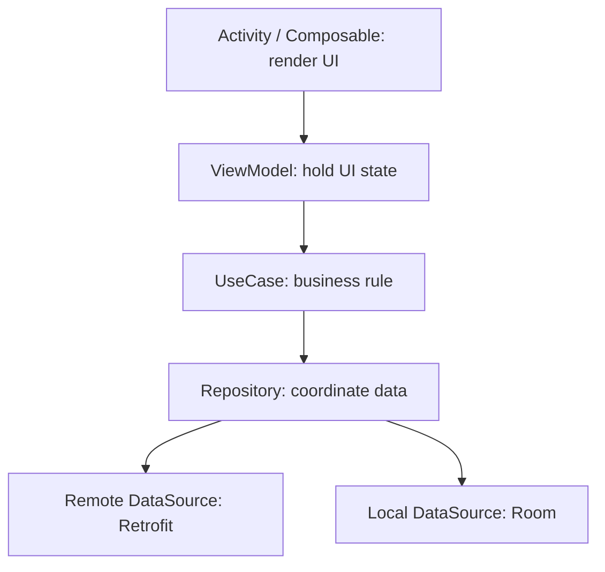
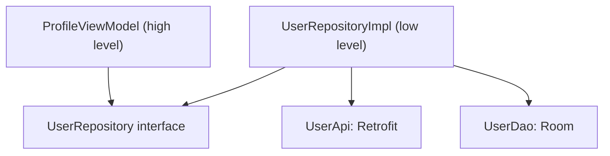
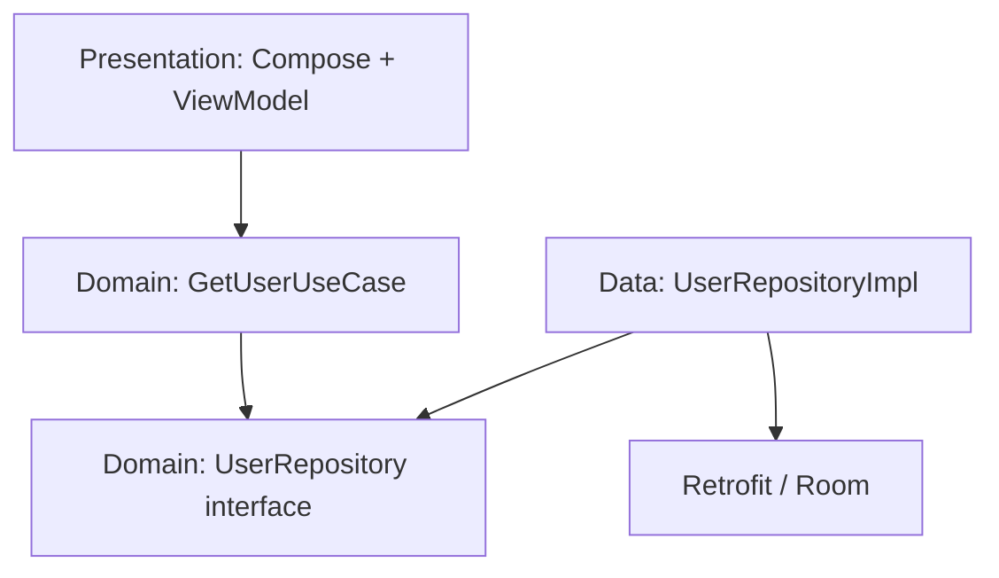

# OOP & SOLID Principles

[⬅ Back to index](../README.md)

Covers: the four OOP pillars, composition vs inheritance, SOLID with Android examples, DRY/KISS/YAGNI, coupling & cohesion.

---

## OOP

### 1. What are the four pillars of OOP?

<details>
<summary>Answer</summary>

**In short:** Encapsulation (hide internal state behind methods), Abstraction (expose *what* something does, not *how*), Inheritance (reuse and extend behaviour through "is-a" relationships) and Polymorphism (one interface, many implementations, chosen at runtime or compile time).

Object-oriented programming organises code around objects that combine data and behaviour. The four pillars are the tools OOP gives you to keep that code manageable as it grows.

| Pillar | Idea | Android / Kotlin example |
|---|---|---|
| **Encapsulation** | Keep state private; change it only through controlled methods | `private val _state = MutableStateFlow(...)` exposed as read-only `val state: StateFlow` |
| **Abstraction** | Callers see a simple contract, not the implementation details | `interface UserRepository { suspend fun getUser(id: String): User }` |
| **Inheritance** | A subclass reuses and specialises a parent ("is-a") | `class MainActivity : AppCompatActivity()` |
| **Polymorphism** | Same call, different behaviour depending on the actual type | `adapter.onBindViewHolder()` behaves differently per adapter subclass |

**Encapsulation** in practice:

```kotlin
class CounterViewModel : ViewModel() {
    private val _count = MutableStateFlow(0)       // only this class can write
    val count: StateFlow<Int> = _count.asStateFlow() // UI can only read

    fun increment() { _count.update { it + 1 } }   // the single, controlled way to change it
}
```

The UI cannot set `count` to `-5`; every change goes through `increment()`, so the invariants live in one place.

**Polymorphism** comes in two forms:

- **Runtime (dynamic dispatch / overriding)**: the method that runs is chosen by the object's real type at runtime.
- **Compile-time (overloading)**: several functions share a name but have different parameter lists; the compiler picks one based on the argument types.

```kotlin
open class Shape { open fun area(): Double = 0.0 }
class Circle(val r: Double) : Shape() { override fun area() = Math.PI * r * r }
class Square(val s: Double) : Shape() { override fun area() = s * s }

val shapes: List<Shape> = listOf(Circle(1.0), Square(2.0))
shapes.forEach { println(it.area()) }  // runtime polymorphism: each type's own area()

fun log(msg: String) {}                 // compile-time polymorphism (overloading)
fun log(msg: String, t: Throwable) {}
```

**Kotlin specifics worth mentioning:** classes and members are `final` by default, so you must mark them `open` to inherit or override. This nudges you toward composition and makes inheritance a deliberate choice.

**Likely follow-ups:**
- *Is Kotlin purely OOP?* No. It mixes OOP with functional features (top-level functions, lambdas, higher-order functions, immutable data).
- *Why are Kotlin classes final by default?* To avoid the fragile base class problem: a class must be designed for inheritance before others can extend it.
- *Overloading vs overriding?* Overloading is same name, different parameters, resolved at compile time; overriding is a subclass replacing a parent method, resolved at runtime.

</details>

### 2. Encapsulation vs abstraction?

<details>
<summary>Answer</summary>

**In short:** Abstraction is a design-level idea: show only the essential operations and hide complexity (usually via an interface). Encapsulation is an implementation-level idea: bundle data with the methods that use it and restrict direct access (via access modifiers). Abstraction is "what to show"; encapsulation is "how to hide".

They are often confused because both "hide" things, but they hide different things for different reasons.

| | Abstraction | Encapsulation |
|---|---|---|
| Level | Design | Implementation |
| Hides | Complexity / *how* it works | Internal state / data |
| Question it answers | What can this thing do? | Who is allowed to touch this data? |
| Tools | Interfaces, abstract classes, function signatures | `private`, `protected`, `internal`, read-only properties |
| Goal | Let callers ignore details; swap implementations | Protect invariants; prevent invalid state |

```kotlin
// Abstraction: the ViewModel only knows "I can fetch a user"
interface UserRepository {
    suspend fun getUser(id: String): User
}

// Encapsulation: the cache and its rules are private to the implementation
class UserRepositoryImpl(
    private val api: UserApi,
    private val dao: UserDao,
) : UserRepository {
    private val memoryCache = mutableMapOf<String, User>()   // nobody outside can corrupt this

    override suspend fun getUser(id: String): User =
        memoryCache[id] ?: dao.find(id) ?: api.fetch(id).also { dao.insert(it); memoryCache[id] = it }
}
```

The interface is the abstraction (callers don't care that there is a cache, a DB and a network). The `private` cache is encapsulation (nobody can put a wrong value in it from the outside).

**Analogy:** a car's steering wheel and pedals are the abstraction (you drive without knowing about fuel injection). The sealed engine bay is encapsulation (you can't directly fiddle with the injection timing).

**Likely follow-ups:**
- *Can you have one without the other?* Yes. A class with all-public fields can still implement an abstract interface; a class with private fields may have no separate abstraction. Good design uses both.
- *Abstract class vs interface for abstraction?* Interfaces define a contract with no state (Kotlin interfaces may have default methods but no backing fields); abstract classes can hold state and constructors but you can only extend one.

</details>

### 3. Composition vs inheritance? Why "favour composition"?

<details>
<summary>Answer</summary>

**In short:** Inheritance ("is-a") ties a subclass tightly to its parent's implementation, so deep hierarchies become rigid and fragile. Composition ("has-a") builds behaviour from small objects that can be swapped, injected and tested independently. On Android, prefer composition: inject helpers, use Kotlin delegation (`by`), lifecycle observers and Compose composables instead of base classes.

#### Why inheritance hurts at scale

- **Tight coupling:** a subclass depends on the parent's internal behaviour, not just its public contract. A change in the parent can silently break children (the *fragile base class* problem).
- **Single inheritance:** a class can extend only one parent. If you need "analytics" and "permissions" and "toolbar setup", you end up with `BaseActivity` → `BaseAnalyticsActivity` → `BaseLoginActivity` → ..., each layer dragging in things not every screen needs.
- **Fixed at compile time:** you can't change a parent at runtime or substitute a fake in a test.

#### Composition in practice

```kotlin
// ❌ Inheritance: every screen inherits everything, whether it needs it or not
open class BaseActivity : AppCompatActivity() {
    override fun onResume() { super.onResume(); Analytics.trackScreen(javaClass.simpleName) }
    fun showLoading() { /* ... */ }
    fun checkPermissions() { /* ... */ }
}

// ✅ Composition: small, focused pieces, plugged in where needed
class ScreenTracker(private val analytics: Analytics, private val name: String) :
    DefaultLifecycleObserver {
    override fun onResume(owner: LifecycleOwner) = analytics.trackScreen(name)
}

class ProfileActivity : AppCompatActivity() {
    @Inject lateinit var analytics: Analytics
    override fun onCreate(savedInstanceState: Bundle?) {
        super.onCreate(savedInstanceState)
        lifecycle.addObserver(ScreenTracker(analytics, "Profile"))
    }
}
```

Kotlin's **class delegation** makes composition as convenient as inheritance:

```kotlin
interface Logger { fun log(msg: String) }
class ConsoleLogger : Logger { override fun log(msg: String) = println(msg) }

// Repository "is" a Logger by delegating to a composed object, no base class needed
class UserRepository(logger: Logger) : Logger by logger {
    fun load() { log("loading users") }
}
```

| | Inheritance | Composition |
|---|---|---|
| Relationship | is-a | has-a |
| Bound | Compile time | Runtime (can swap) |
| Coupling | To parent's implementation | To a collaborator's interface |
| Testing | Hard to fake the parent | Inject a fake |
| Multiple behaviours | One parent only | Combine as many as needed |

**When inheritance is fine:** a genuine, stable "is-a" relationship, or when a framework requires it (`Activity`, `ViewModel`, `Worker`). Sealed class hierarchies for modelling state are also a good fit.

**Likely follow-ups:**
- *How does Compose reflect this?* UI is built by nesting composable functions rather than subclassing `View`s.
- *What's the fragile base class problem?* Changes to a base class's internals break subclasses that relied on them, even though the public API didn't change.

</details>

### 4. What is the difference between association, aggregation and composition?

<details>
<summary>Answer</summary>

**In short:** All three describe relationships between objects. Association is any general "uses/knows" relationship. Aggregation is a weak "has-a" where the part can exist on its own (a Team has Players). Composition is a strong "has-a" where the part's lifecycle is owned by the whole (a House has Rooms; destroy the house, the rooms go too).

The key differentiator is **ownership and lifecycle**:

| | Association | Aggregation | Composition |
|---|---|---|---|
| Meaning | Knows / uses | Has-a (weak) | Owns (strong) |
| Lifecycle | Independent | Independent | Part dies with the whole |
| Part shared? | Yes | Can be | No, belongs to one whole |
| Example | Teacher ↔ Student | Team → Players | House → Rooms |

```kotlin
// Association: Teacher just uses a Student passed in; neither owns the other
class Teacher { fun grade(student: Student) { /* ... */ } }

// Aggregation: the Team holds players created elsewhere; they outlive the team
class Team(val players: List<Player>)

// Composition: the House creates and owns its rooms; nobody else holds them
class House {
    private val rooms = listOf(Room("Kitchen"), Room("Bedroom"))
}
```

**Android angle:** a `ViewModel` that creates its own private `MutableStateFlow` *composes* it (it lives and dies with the ViewModel). A `ViewModel` that receives a `UserRepository` singleton via Hilt *aggregates* it (the repository is shared and outlives any one ViewModel).

**Note:** "composition" here is the UML relationship. It overlaps with, but is not exactly the same as, "favour composition over inheritance", which simply means building behaviour from contained objects rather than parent classes.

</details>

### 5. What is coupling and cohesion?

<details>
<summary>Answer</summary>

**In short:** Coupling is how much one module depends on the internals of another; aim for **low coupling** (depend on interfaces, use DI). Cohesion is how closely related the responsibilities inside one module are; aim for **high cohesion** (each class does one focused job). Low coupling plus high cohesion makes code easy to change, test and reuse.

**Coupling** asks: if I change class A, how many other classes must change? Tight coupling shows up as:
- Creating dependencies directly (`val api = Retrofit.Builder()...` inside a ViewModel).
- Reaching into other objects' internals (`order.customer.address.city`).
- Depending on concrete classes instead of interfaces.

**Cohesion** asks: do the things in this class belong together? Low cohesion shows up as a `Utils` class holding date formatting, network checks and string helpers, or an Activity that does UI, networking and database work.

```kotlin
// ❌ Tightly coupled, low cohesion
class ProfileViewModel : ViewModel() {
    private val api = Retrofit.Builder().baseUrl("https://api.example.com").build()
        .create(UserApi::class.java)                 // knows how to build Retrofit
    fun formatDate(ts: Long): String = /* ... */ ""  // unrelated responsibility
}

// ✅ Loosely coupled, highly cohesive
class ProfileViewModel(
    private val repo: UserRepository,   // depends on an abstraction, injected
) : ViewModel() {
    // only presentation logic for the profile screen lives here
}
```

| | Goal | Benefit |
|---|---|---|
| Coupling | Low | Changes stay local; easy to swap and mock |
| Cohesion | High | Classes are easy to understand, name and reuse |

**Pitfall:** zero coupling is impossible; classes must collaborate. The aim is to couple to stable abstractions, not volatile details.

**Likely follow-up:** *How do SOLID principles relate?* SRP raises cohesion; DIP and ISP lower coupling.

</details>

---

## SOLID

### 6. What are the SOLID principles?

<details>
<summary>Answer</summary>

**In short:** SOLID is five object-oriented design principles popularised by Robert C. Martin: **S**ingle Responsibility, **O**pen/Closed, **L**iskov Substitution, **I**nterface Segregation, **D**ependency Inversion. Together they make code easier to maintain, test and extend.

| Letter | Principle | One-liner | Android example |
|---|---|---|---|
| **S** | Single Responsibility | A class has one reason to change | ViewModel holds UI state; Repository handles data |
| **O** | Open/Closed | Extend behaviour by adding code, not editing it | New OkHttp `Interceptor` without touching the client |
| **L** | Liskov Substitution | Subtypes must work wherever the base type is expected | Any `UserRepository` implementation behaves correctly in the ViewModel |
| **I** | Interface Segregation | Many small interfaces beat one fat one | `OnClickListener` and `OnLongClickListener` are separate |
| **D** | Dependency Inversion | Depend on abstractions, not concrete classes | ViewModel takes `UserRepository` interface, injected by Hilt |

**Why interviewers ask:** these principles underpin modern Android architecture (MVVM, Clean Architecture, DI). Being able to tie each one to a concrete Android example shows you apply them rather than just memorise them.

**Pitfall:** applying SOLID dogmatically creates over-engineering, such as an interface for every class that only ever has one implementation. Use them as guides for code that is likely to change.

**Likely follow-ups:**
- *Which one matters most for testability?* DIP, because it lets you inject fakes.
- *Which one does Clean Architecture rely on?* DIP (see question 12).

</details>

### 7. Single Responsibility Principle (SRP) – with Android example.

<details>
<summary>Answer</summary>

**In short:** "A class should have **only one reason to change**." Each class should serve one actor or concern. On Android, instead of an Activity that fetches, parses, stores and renders, split the work into UI → ViewModel → UseCase → Repository → DataSource.

"Reason to change" is the key phrase. A class that both renders UI and talks to the database changes when designers change the layout *and* when the backend team changes the schema. Two unrelated teams editing the same file means merge conflicts, accidental breakage and hard-to-test code.

**❌ Violation: the god Activity**

```kotlin
class ProfileActivity : AppCompatActivity() {
    override fun onCreate(savedInstanceState: Bundle?) {
        super.onCreate(savedInstanceState)
        val json = URL("https://api.example.com/user/1").readText()   // networking
        val user = JSONObject(json).let { User(it.getString("name")) } // parsing
        db.userDao().insert(user)                                      // persistence
        findViewById<TextView>(R.id.name).text = user.name             // rendering
    }
}
```

**✅ Split by responsibility**



```kotlin
class ProfileViewModel(private val getUser: GetUserUseCase) : ViewModel() {
    val state = getUser("1").map { ProfileUiState(it.name) }
        .stateIn(viewModelScope, SharingStarted.WhileSubscribed(5_000), ProfileUiState())
}

class GetUserUseCase(private val repo: UserRepository) {
    operator fun invoke(id: String) = repo.observeUser(id)
}
```

Now each class changes for one reason: layout changes touch the Composable, API changes touch the remote data source, caching rules touch the repository.

**Other Android examples:**
- A RecyclerView `Adapter` should only bind data to views. Date and price formatting belongs in a formatter or in the UI model mapping.
- A `Worker` should orchestrate a background job, delegating the actual upload to a repository.

**Pitfalls:**
- SRP is not "a class should do one thing" taken to the extreme (one method per class). It's about cohesion around one concern.
- Splitting too early creates many tiny classes that obscure the flow. Split when concerns actually diverge.

**Likely follow-up:** *Is a ViewModel that calls three repositories an SRP violation?* Not necessarily; its single responsibility is preparing state for one screen. If business rules pile up, extract use cases.

</details>

### 8. Open/Closed Principle (OCP) – with example.

<details>
<summary>Answer</summary>

**In short:** "Software entities should be open for **extension** but closed for **modification**." You add new behaviour by adding new code (a new class implementing an interface), not by editing existing, tested code.

The problem OCP solves: every time a growing `when`/`if-else` chain gets another branch, you risk breaking the cases that already worked and must retest them all. With OCP, the existing code depends on an abstraction, and new behaviour is a new implementation.

**❌ Violation: edit the same function for every new payment type**

```kotlin
class Checkout {
    fun pay(type: String, amount: Double) = when (type) {
        "card" -> chargeCard(amount)
        "upi" -> chargeUpi(amount)
        // adding "wallet" means editing (and retesting) this class
        else -> error("Unknown type")
    }
}
```

**✅ Following OCP**

```kotlin
interface PaymentMethod { fun pay(amount: Double) }

class CardPayment : PaymentMethod { override fun pay(amount: Double) { /* card SDK */ } }
class UpiPayment : PaymentMethod { override fun pay(amount: Double) { /* UPI intent */ } }
class WalletPayment : PaymentMethod { override fun pay(amount: Double) { /* new: no edits elsewhere */ } }

class Checkout(private val method: PaymentMethod) {
    fun pay(amount: Double) = method.pay(amount)   // never changes when new methods are added
}
```

With Hilt you can even register implementations into a multibinding `Set<PaymentMethod>` so the list of options grows without touching consumers.

**Android examples:**
- **OkHttp `Interceptor`s:** add logging, auth headers or caching by adding an interceptor; the client code is unchanged.
- **Delegate adapters** for RecyclerView: each view type is a separate delegate, so adding a new row type doesn't edit a giant `onCreateViewHolder` `when`.
- **Retrofit `Converter.Factory` / `CallAdapter.Factory`:** plug in new serialisation formats without modifying Retrofit.

**Pitfalls:**
- A `when` over a **sealed class** is not automatically an OCP violation. The compiler forces you to handle new cases, which is often exactly what you want for closed sets like UI state.
- Don't build extension points for variation that will never happen (YAGNI).

**Likely follow-up:** *Which pattern implements OCP?* Strategy (as above), Decorator and Chain of Responsibility (interceptors) are the common ones.

</details>

### 9. Liskov Substitution Principle (LSP) – with example.

<details>
<summary>Answer</summary>

**In short:** "Subtypes must be **substitutable** for their base types without breaking correctness." Any code that works with a base type must keep working when given a subclass, without knowing which subclass it is. If a subclass throws where the parent didn't, ignores calls, or weakens guarantees, it violates LSP.

LSP is about **behavioural** compatibility, not just matching method signatures. A subclass must:
- Not demand more from callers (no stronger preconditions).
- Not promise less (no weaker postconditions).
- Keep the parent's invariants.
- Not throw new, unexpected exceptions.

**Classic violation: `Square extends Rectangle`**

```kotlin
open class Rectangle {
    open var width = 0
    open var height = 0
    fun area() = width * height
}

class Square : Rectangle() {
    override var width: Int
        get() = super.width
        set(v) { super.width = v; super.height = v }   // also changes height
    override var height: Int
        get() = super.height
        set(v) { super.width = v; super.height = v }
}

fun resize(r: Rectangle) {
    r.width = 5
    r.height = 4
    check(r.area() == 20)   // fails for Square: area is 16
}
```

Mathematically a square is a rectangle, but behaviourally a *mutable* square is not a substitutable mutable rectangle. Fix: make them separate implementations of a `Shape` interface, or make them immutable.

**Android example**

```kotlin
interface FileRepository {
    fun read(name: String): String
    fun save(name: String, content: String)
}

// ❌ Violates LSP: callers expecting a FileRepository will crash
class ReadOnlyFileRepository : FileRepository {
    override fun read(name: String) = /* ... */ ""
    override fun save(name: String, content: String) = throw UnsupportedOperationException()
}

// ✅ Model the capabilities separately (this also follows ISP)
interface FileReader { fun read(name: String): String }
interface FileWriter { fun save(name: String, content: String) }
class ReadOnlyFileRepository : FileReader { override fun read(name: String) = "" }
```

**Why it matters for testing:** fakes in tests are substitutes too. A `FakeUserRepository` that behaves differently from the real contract (for example, never emitting errors) can hide bugs.

**Likely follow-ups:**
- *How do you spot LSP violations?* `is`/`instanceof` checks on the subtype, overrides that throw `UnsupportedOperationException`, or overrides that do nothing.
- *Java's example?* `Collections.unmodifiableList()` returns a `List` whose `add()` throws, a well-known LSP compromise in the JDK.

</details>

### 10. Interface Segregation Principle (ISP) – with example.

<details>
<summary>Answer</summary>

**In short:** "Clients shouldn't be forced to depend on methods they don't use." Prefer several small, focused interfaces over one fat interface, so each client sees only what it needs.

A fat interface causes three problems:
1. Implementers write empty or throwing stubs for methods they don't support (which often also breaks LSP).
2. Clients are coupled to methods they never call, so changes to those methods force recompiles and retests.
3. Fakes in tests become large and noisy.

**Android examples:**

- **`TextWatcher`** forces you to implement `beforeTextChanged`, `onTextChanged` and `afterTextChanged` even if you need only one. That's why AndroidX core-ktx added `doAfterTextChanged {}` and friends.
- **Click listeners** are already segregated: `View.OnClickListener` and `View.OnLongClickListener` are separate single-method interfaces, so you implement only what you need.

```kotlin
// ❌ Fat interface
interface UserRepository {
    suspend fun getUser(id: String): User
    suspend fun searchUsers(query: String): List<User>
    suspend fun updateUser(user: User)
    suspend fun deleteUser(id: String)
}

// ✅ Segregated by client needs
interface UserReader {
    suspend fun getUser(id: String): User
    suspend fun searchUsers(query: String): List<User>
}
interface UserWriter {
    suspend fun updateUser(user: User)
    suspend fun deleteUser(id: String)
}

// One class can still implement both
class UserRepositoryImpl(/* ... */) : UserReader, UserWriter { /* ... */ }

// The profile screen only reads, so its fake is tiny
class ProfileViewModel(private val users: UserReader) : ViewModel()
```

**Kotlin tip:** single-method interfaces can be declared as `fun interface`, which allows SAM-conversion lambdas: `fun interface OnRetry { fun retry() }` then `OnRetry { reload() }`.

**Pitfall:** don't split everything into one-method interfaces by default. Split along the lines of how clients actually use the API.

**Likely follow-up:** *How does ISP relate to SRP?* SRP is about why a class changes; ISP is about what a client is exposed to. They often lead to the same split.

</details>

### 11. Dependency Inversion Principle (DIP) – with example.

<details>
<summary>Answer</summary>

**In short:** "High-level modules shouldn't depend on low-level modules; **both should depend on abstractions**." The ViewModel depends on a `UserRepository` interface, not on Retrofit or Room, so implementations can be swapped (for example, a fake in tests). DIP is the **principle**; Dependency Injection (Hilt/Koin) is a **technique** for applying it.

**Without DIP**, the source-code dependency follows the call direction: the ViewModel (high-level policy) imports and constructs the Retrofit service (low-level detail). Any change to networking ripples up, and tests hit the real network.

**With DIP**, the high-level side owns an interface, and the low-level side implements it. The *source-code* dependency of the data layer now points up toward the abstraction, which is the "inversion".



```kotlin
interface UserRepository { suspend fun getUser(id: String): User }

class UserRepositoryImpl @Inject constructor(
    private val api: UserApi,
    private val dao: UserDao,
) : UserRepository {
    override suspend fun getUser(id: String): User =
        dao.find(id) ?: api.fetch(id).also { dao.insert(it) }
}

@HiltViewModel
class ProfileViewModel @Inject constructor(
    private val repo: UserRepository,      // depends on the interface only
) : ViewModel()

@Module @InstallIn(SingletonComponent::class)
abstract class DataModule {
    @Binds abstract fun bindUserRepo(impl: UserRepositoryImpl): UserRepository
}
```

In a unit test:

```kotlin
class FakeUserRepository : UserRepository {
    override suspend fun getUser(id: String) = User(id, "Test")
}
val vm = ProfileViewModel(FakeUserRepository())   // no network, no database
```

| | Dependency Inversion | Dependency Injection |
|---|---|---|
| What | Design principle | Technique / pattern |
| Says | Depend on abstractions | Pass dependencies in from outside instead of creating them |
| Tools | Interfaces, abstract classes | Constructor params, Hilt, Dagger, Koin |

You can do DI without DIP (injecting a concrete class) and DIP without a DI framework (manual constructor injection).

**Pitfall:** an interface with exactly one implementation that is never faked adds ceremony. Introduce the abstraction at real boundaries (data sources, platform APIs, third-party SDKs).

**Likely follow-up:** *Who should own the interface?* The high-level (consumer) side, e.g. the domain layer, so the dependency points inward.

</details>

### 12. Which SOLID principle does Clean Architecture rely on most?

<details>
<summary>Answer</summary>

**In short:** **Dependency Inversion (DIP).** The domain layer defines interfaces (such as repositories), and the data layer implements them, so source-code dependencies point inward toward the domain. SRP and ISP also show up in small, single-purpose UseCases.

Clean Architecture's central rule is the **Dependency Rule**: source-code dependencies may only point inward, toward higher-level policy. But at runtime, the domain needs data from the outer data layer. DIP resolves that contradiction:

1. The domain layer declares `interface UserRepository`.
2. Use cases depend on that interface.
3. The data layer implements it with Retrofit/Room and depends on the domain module.
4. DI (Hilt) wires the implementation in at runtime.



The control flow goes UI → domain → data, but the data module's dependency arrow points *into* the domain. The domain has no Android or library imports, so it can be tested on the plain JVM and survive a swap of networking or database libraries.

**Where the other principles appear:**
- **SRP:** each UseCase does one business action (`GetUserUseCase`, `UpdateProfileUseCase`).
- **ISP:** UseCases depend on narrow repository interfaces.
- **OCP:** new features add new use cases rather than editing existing ones.

**Note:** Google's official Android architecture guide treats the domain layer as optional. Many apps apply DIP at the repository boundary without a full Clean Architecture setup.

</details>

---

## Other Principles

### 13. What are DRY, KISS, YAGNI?

<details>
<summary>Answer</summary>

**In short:** **DRY** (Don't Repeat Yourself): each piece of knowledge should have a single source of truth. **KISS** (Keep It Simple, Stupid): prefer the simplest solution that works. **YAGNI** (You Aren't Gonna Need It): don't build features or abstractions "for later". Don't over-apply DRY, though: duplication is better than the wrong abstraction.

#### DRY

DRY is about **knowledge**, not identical-looking lines. If the rule "a password needs at least 8 characters" lives in the sign-up screen, the change-password screen and the backend validator, changing it means hunting down every copy, and one will be missed.

```kotlin
// ✅ One source of truth for the rule
object PasswordRules { const val MIN_LENGTH = 8; fun isValid(p: String) = p.length >= MIN_LENGTH }
```

**Pitfall:** two pieces of code that look the same today but represent different concepts (for example, a "Profile header" and a "Settings header" that will diverge) should *not* be merged. Forcing them into one abstraction leads to flags and special cases. A common rule of thumb is the "rule of three": abstract after the third real duplication.

#### KISS

Choose the plainest design that meets the requirements. A `StateFlow` in a ViewModel is often enough; you may not need a full MVI framework, a custom event bus or five modules for a two-screen app. Simple code is easier to read, review and debug.

#### YAGNI

Don't write code for hypothetical future needs: a plugin system for one payment provider, a generic `BaseRepository<T, K, E>` when you have two repositories, or configuration flags nobody asked for. Speculative code costs maintenance now and is often wrong when the real need arrives.

| Principle | Guards against | Overdone looks like |
|---|---|---|
| DRY | Inconsistent copies of the same rule | Premature, leaky shared abstractions |
| KISS | Over-engineering | Naive code that ignores real requirements |
| YAGNI | Speculative features | Refusing to plan for known, near-term needs |

**Likely follow-up:** *Do these conflict with SOLID?* They balance it. SOLID adds structure; KISS and YAGNI stop you adding structure you don't need.

</details>

### 14. What is the Law of Demeter?

<details>
<summary>Answer</summary>

**In short:** "Only talk to your immediate friends." A method should call methods only on itself, its parameters, objects it creates and its own fields, not on objects returned by those. Avoid chains like `order.customer.address.city.name`; ask the object to do the work instead (`order.shippingCity()`).

Also called the *principle of least knowledge*. Long chains couple your code to the internal structure of every class in the chain. If `Customer` later stores multiple addresses, every caller that wrote `order.customer.address.city` breaks.

```kotlin
// ❌ The ViewModel knows the full object graph
val city = order.customer.address.city.name

// ✅ Order exposes what callers actually need
class Order(private val customer: Customer) {
    fun shippingCity(): String = customer.shippingCity()
}
class Customer(private val address: Address) {
    fun shippingCity(): String = address.city.name
}
val city = order.shippingCity()
```

This is also known as **"Tell, don't ask"**: tell an object to do something rather than pulling its data out and deciding for it.

**Android example:** instead of a Fragment doing `(requireActivity() as MainActivity).viewModel.repository.refresh()`, expose a `refresh()` on the shared ViewModel, or better, have the Fragment observe and call its own ViewModel.

**Pitfalls / nuance:**
- It's about **object structure**, not dots. Fluent builders and stream chains (`list.filter { }.map { }.first()`) and Kotlin scope functions are fine because each call returns a value the chain owns, not a peek into someone's internals.
- Plain data classes / DTOs are data, not behaviour; reading nested fields while mapping a network response is normal.
- Over-applying it produces many trivial forwarding methods. Use judgement.

</details>

### 15. What is separation of concerns?

<details>
<summary>Answer</summary>

**In short:** Divide a program into distinct sections that each handle one concern: UI, presentation logic, business rules, data access. Each part can then change, be tested and be understood independently. It's the foundation of MVVM/MVI and Clean Architecture.

A *concern* is a distinct area of responsibility. When concerns are mixed (an Activity doing UI, HTTP and SQL), a change in one area risks breaking another, and you can't test business logic without launching the UI.

**How it maps to an Android app:**

| Concern | Where it lives | Should not know about |
|---|---|---|
| Rendering | Composables / Views | Network, database |
| UI state and events | ViewModel | `Context`, Views, Retrofit |
| Business rules | UseCases / domain models | Android framework |
| Data access | Repository, DataSources | UI |
| Cross-cutting (logging, auth headers) | Interceptors, observers | Business screens |

**Benefits:**
- **Testability:** business rules run as plain JVM unit tests.
- **Parallel work:** UI and data developers touch different files.
- **Replaceability:** swap XML Views for Compose without touching the repository.
- **Lifecycle safety:** state in a ViewModel survives configuration changes; it doesn't when it lives in the Activity.

**Relation to SRP:** separation of concerns is the broader, architecture-level idea (split the system into layers). SRP applies the same thinking at the class level.

**Pitfall:** separation by *technical layer only* can scatter one feature across many packages. Many teams combine layering with feature modules (`:feature:profile`, `:feature:checkout`) so each feature is self-contained.

</details>

### 16. What is cyclomatic complexity / code smells you look for in code review?

<details>
<summary>Answer</summary>

**In short:** Cyclomatic complexity is the number of independent paths through a piece of code, roughly 1 + the number of decision points (`if`, `when` branches, loops, `&&`/`||`, `catch`). High complexity means more test cases are needed and the code is harder to follow. In reviews I look for god classes, long methods, deep nesting, magic numbers, duplication, long parameter lists, feature envy, primitive obsession and `!!` everywhere.

#### Cyclomatic complexity

```kotlin
fun shippingFee(order: Order): Int {          // base path: 1
    if (order.total > 100) return 0            // +1
    return when (order.region) {
        Region.LOCAL -> 5                      // +1
        Region.NATIONAL -> 10                  // +1
        Region.INTERNATIONAL -> if (order.express) 40 else 25 // +1 (branch) +1 (if)
    }
}
```

Each extra branch adds a path that needs its own test. As a commonly cited guideline, functions above roughly 10 deserve a look. Tools such as **detekt** (`CyclomaticComplexMethod` rule) and Android Lint flag these automatically. Reduce complexity with early returns, extracting functions, polymorphism or lookup maps instead of large `when` blocks.

#### Code smells and their fixes

| Smell | What it looks like | Typical fix |
|---|---|---|
| God class | 2,000-line Activity or ViewModel | Split by responsibility (SRP) |
| Long method | Function that scrolls off the screen | Extract smaller functions |
| Deep nesting | `if` inside `if` inside `for` | Guard clauses / early return |
| Magic numbers | `if (code == 3)` | Named constants or enums |
| Duplicated code | Same rule copied in 3 places | Extract the shared knowledge (DRY) |
| Long parameter list | `fun create(a, b, c, d, e, f, g)` | Parameter object / data class |
| Feature envy | Method uses another class's data more than its own | Move the method to that class |
| Primitive obsession | `userId: String`, `email: String` mixed up | `@JvmInline value class UserId(val v: String)` |
| `!!` everywhere | Forced unwraps hiding nullability bugs | `?.`, `?:`, `requireNotNull` with a message, better types |

**Android-specific things to flag in review:**
- Holding a `Context`, `View` or `Activity` in a ViewModel or singleton (memory leak).
- Blocking I/O on the main thread; `GlobalScope` usage.
- Collecting flows without lifecycle awareness (`repeatOnLifecycle` / `collectAsStateWithLifecycle`).
- Business logic inside Composables or Adapters.

**Likely follow-up:** *Is high cyclomatic complexity always bad?* No. A flat `when` mapping 15 enum values is easy to read despite a high number. Use the metric as a prompt to look, not as an absolute rule.

</details>

---

[⬅ Previous: Java](05-java.md) · [⬅ Back to index](../README.md) · [Next: Design Patterns ➡](07-design-patterns.md)
