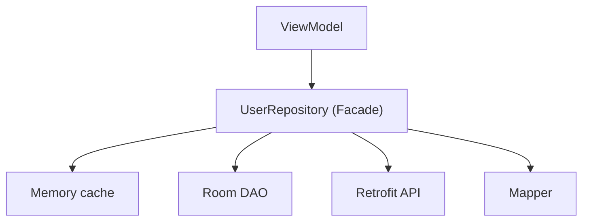
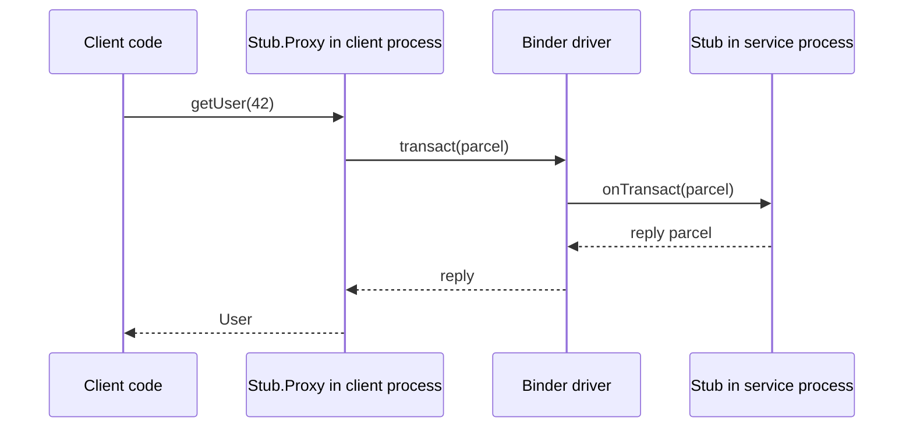
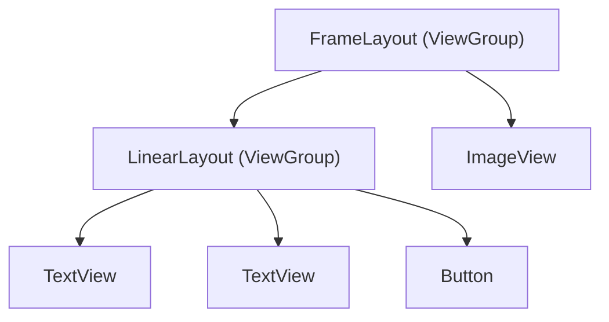
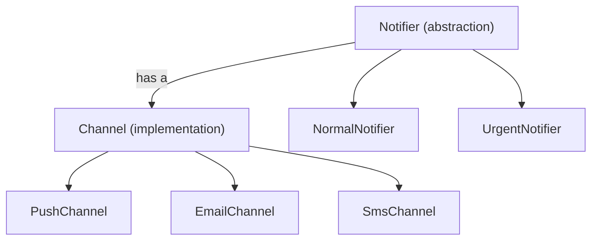
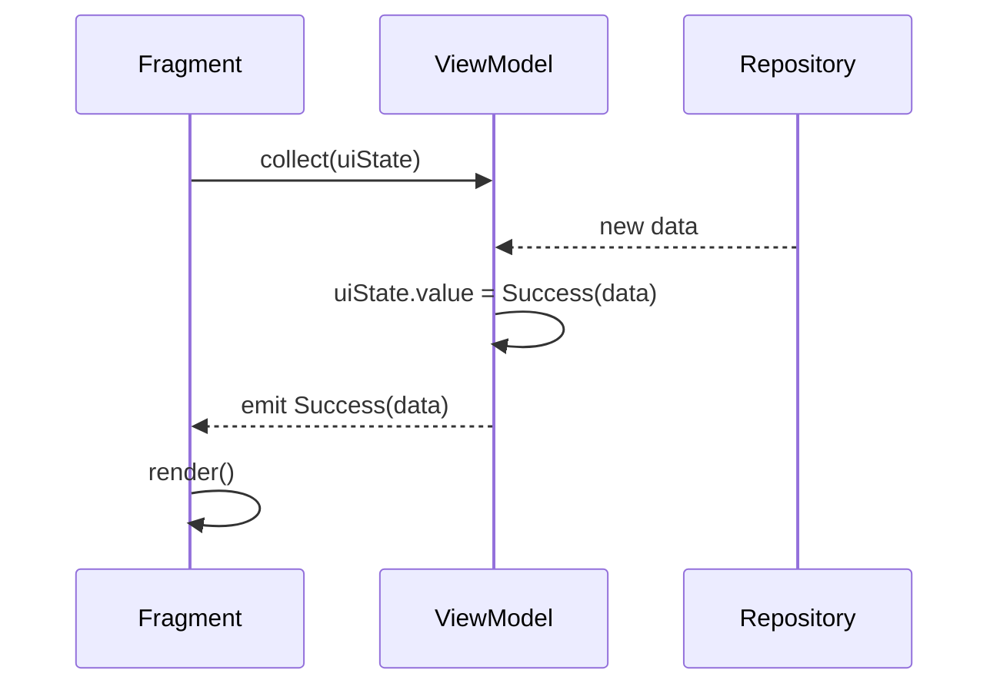
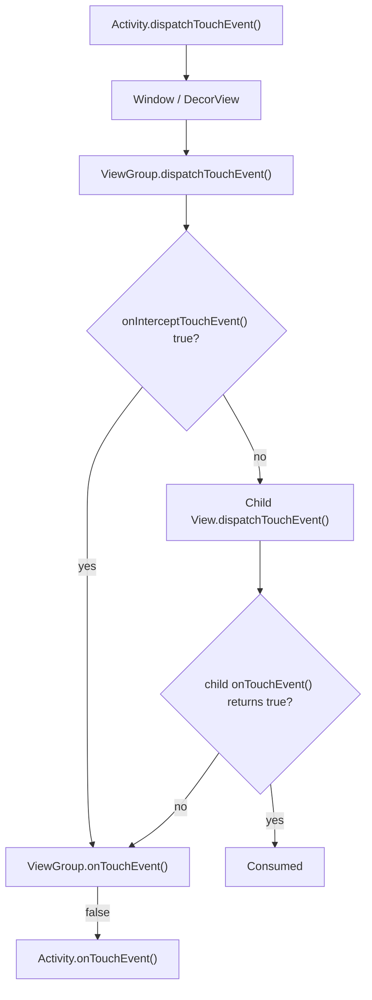
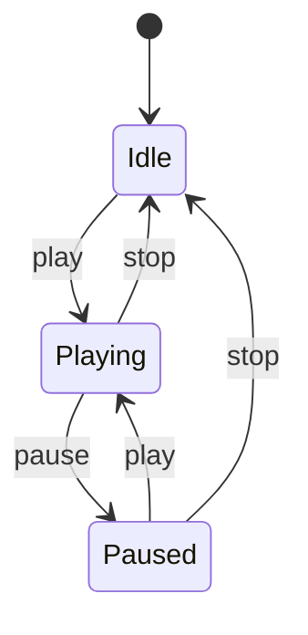
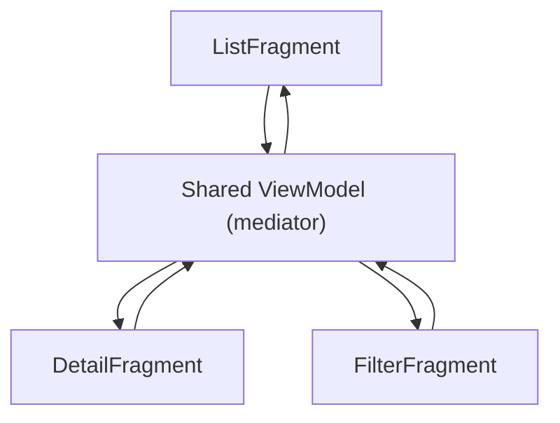

# Design Patterns

[⬅ Back to index](../README.md)

Covers: pattern categories, creational/structural/behavioral patterns, each with where it's used in Android.

---

## Overview

### 1. What are software design patterns?

<details>
<summary>Answer</summary>

**In short:** Design patterns are general, reusable solutions to problems that keep coming up in software design. They aren't finished code you paste in; they're proven templates for structuring classes and objects, and they give developers a shared vocabulary ("let's put an Observer here").

#### Where they come from

The term was popularised by the 1994 book *Design Patterns: Elements of Reusable Object-Oriented Software* by Gamma, Helm, Johnson and Vlissides, the "Gang of Four" (GoF). They catalogued 23 patterns they kept seeing in well-designed object-oriented systems. Each pattern is described by:

- **Name**: a short handle you can use in conversation and code review.
- **Problem**: the situation where it applies.
- **Solution**: the arrangement of classes/objects and their responsibilities.
- **Consequences**: the trade-offs you accept by using it.

#### Why they matter in practice

- **Communication.** Saying "the Repository is a Facade over Retrofit and Room" tells a reviewer a lot in one sentence.
- **Proven trade-offs.** Someone has already found the pitfalls (for example, that Singletons make testing hard).
- **Readability.** When you see `Retrofit.Builder()` or `RecyclerView.Adapter`, you already know how the API will behave.
- **Design principles in action.** Most patterns are concrete applications of SOLID ideas: program to an interface, favour composition over inheritance, keep things open for extension and closed for modification.

#### A pattern is not a goal

Patterns solve problems; they don't add value by themselves. Wrapping a two-line function in a Factory, a Strategy and a Builder makes code harder to read. A good answer in an interview shows you know **when not** to use a pattern too.

Note that Kotlin and modern Android make several patterns nearly invisible: `object` gives you a Singleton, `copy()` gives you Prototype, default/named arguments replace many Builders, and lambdas replace single-method Strategy or Command classes.

**Likely follow-ups:**
- *Are patterns language-specific?* No, the ideas are general, but how much code they need depends on the language's features.
- *Pattern vs architecture?* Patterns solve local design problems (a few classes); architectural patterns like MVVM or Clean Architecture organise a whole app.

</details>

### 2. What are the main categories of design patterns?

<details>
<summary>Answer</summary>

**In short:** The GoF patterns fall into three groups: **Creational** (how objects are created), **Structural** (how objects are composed into bigger structures) and **Behavioral** (how objects communicate and divide responsibilities).

| Category | Question it answers | Patterns | Android examples |
|---|---|---|---|
| **Creational** | How do I create objects without hard-coding concrete classes or messy constructors? | Singleton, Factory Method, Abstract Factory, Builder, Prototype | `Room.databaseBuilder`, `ViewModelProvider.Factory`, `data class copy()` |
| **Structural** | How do I combine classes and objects into larger structures? | Adapter, Facade, Decorator, Proxy, Composite, Bridge, Flyweight | `RecyclerView.Adapter`, Repository as Facade, `View`/`ViewGroup`, Retrofit's dynamic proxy |
| **Behavioral** | How do objects talk to each other and share work? | Observer, Strategy, Command, State, Chain of Responsibility, Iterator, Mediator, Memento, Template Method, Visitor | `StateFlow`/`LiveData`, OkHttp interceptors, touch dispatch, `onSaveInstanceState` |

#### A quick way to remember them

- **Creational** hides the `new`/constructor call. The client asks for "a thing" and gets a correctly configured object.
- **Structural** is about **wrapping and composing**: one object holds a reference to another and changes its interface (Adapter), simplifies it (Facade), adds to it (Decorator) or guards it (Proxy).
- **Behavioral** is about **flow of control and responsibility**: who notifies whom, who handles a request, which algorithm runs.

#### Beyond the GoF list

In Android interviews you'll also hear patterns that aren't in the original 23: **Repository**, **Dependency Injection**, **Service Locator**, **Object Pool**, and architectural patterns like **MVC/MVP/MVVM/MVI**. Mention that they exist, but keep them separate from the three GoF categories when asked this question.

**Likely follow-ups:**
- *Which category is Dependency Injection?* It's not a GoF pattern; it's usually discussed as a creational technique (who creates and supplies dependencies).
- *Can a class use patterns from several categories?* Yes. Retrofit uses Builder, Factory, Proxy, Adapter and Strategy at once.

</details>

### 3. Importance, when to use, pros & cons of Creational patterns?

<details>
<summary>Answer</summary>

**In short:** Creational patterns decouple client code from the concrete classes it instantiates and from the details of building them. Use them when creation is complex, when the caller shouldn't know the concrete type, or when you need to control how many instances exist. The cost is more classes and indirection.

#### Why they matter

If every class calls constructors directly (`val api = RetrofitApi(OkHttpClient(...), GsonConverter(), ...)`), then:

- every caller depends on concrete classes, so swapping an implementation means editing many files;
- construction logic (configuration, validation, defaults) gets duplicated;
- tests can't easily substitute fakes.

As systems rely more on **composition** than inheritance, an object is often a graph of collaborators that must be wired together correctly. Creational patterns put that wiring in one place.

#### When to use which

| Situation | Pattern | Android example |
|---|---|---|
| Many optional parameters or multi-step setup | **Builder** | `NotificationCompat.Builder`, `OkHttpClient.Builder` |
| Exactly one shared instance | **Singleton** | Room database, OkHttp client (ideally scoped by DI) |
| Caller shouldn't know which concrete class it gets | **Factory Method** | `ViewModelProvider.Factory`, view type → ViewHolder |
| A family of related objects that must match | **Abstract Factory** | Light/Dark themed widget sets |
| Copying is cheaper or simpler than building | **Prototype** | `data class copy()`, `Intent(intent)` |

#### Advantages

- **Flexibility:** add a new type without changing clients (Open/Closed principle).
- **Centralised control:** one place for configuration, validation, caching or pooling.
- **Lower coupling and better testability:** clients depend on an interface; tests can inject a fake.
- **Readability:** `Retrofit.Builder().baseUrl(...).build()` reads better than a 7-argument constructor.

#### Disadvantages

- More classes and interfaces to read and maintain.
- Indirection: "where is this object actually created?" can be harder to answer.
- Risk of over-engineering: a factory for a class that has one implementation adds nothing.
- Singleton specifically introduces global state and hidden dependencies.

**Pitfalls:**
- In Kotlin, reach for **default/named arguments** before writing a Builder by hand.
- Prefer letting a **DI framework** (Hilt/Koin) own creation and scope rather than hand-rolling factories and singletons everywhere.

</details>

### 4. Importance, when to use, pros & cons of Structural patterns?

<details>
<summary>Answer</summary>

**In short:** Structural patterns compose classes and objects into larger structures, and let independently written code (your app, third-party libraries, legacy modules) work together. Because they rely on object composition, the structure can be changed at runtime, which static inheritance can't do.

#### Why they matter

Real apps glue together many pieces that weren't designed for each other: a REST API that returns DTOs, a Room database, a UI toolkit, analytics SDKs. Structural patterns answer "how do I connect these without making everything depend on everything?"

Almost all of them work the same way: **one object holds a reference to another and exposes some interface over it**. What differs is the *intent*:

| Pattern | Intent | Android example |
|---|---|---|
| **Adapter** | Make an incompatible interface fit the one the client expects | `RecyclerView.Adapter`, DTO → domain mapper |
| **Facade** | Give a simple front to a complex subsystem | Repository over API + DB + cache; `Glide.with().load().into()` |
| **Decorator** | Add behaviour while keeping the same interface | `ContextWrapper`, `BufferedInputStream`, Compose `Modifier` chain |
| **Proxy** | Control access (lazy, remote, cached, guarded) with the same interface | Binder/AIDL proxies, Retrofit's dynamic proxy, Dagger `Lazy<T>` |
| **Composite** | Treat single objects and groups the same in a tree | `View`/`ViewGroup`, Compose UI tree |
| **Bridge** | Let an abstraction and its implementation vary independently | Notification type × delivery channel |
| **Flyweight** | Share common state among many objects to save memory | RecyclerView recycling, `Message.obtain()` |

#### Advantages

- **Flexibility:** wrap, swap or combine objects at runtime.
- **Reuse:** use third-party or legacy code without modifying it.
- **Modularity:** each layer has a small, focused job; callers depend on a narrow interface.
- **Favours composition over inheritance**, avoiding deep class hierarchies and "class explosion".

#### Disadvantages

- Extra layers of abstraction; stack traces and debugging go through more wrappers.
- Harder to follow: Adapter, Decorator and Proxy look almost identical in code, so intent must be clear from naming.
- Used in the wrong context (a Facade over one class, a Decorator nobody stacks) they only add complexity.

**Likely follow-ups:**
- *Decorator vs Proxy?* Both wrap with the same interface; Decorator **adds** behaviour, Proxy **controls access** to the real object.
- *Adapter vs Facade?* Adapter converts one interface; Facade simplifies many.

</details>

### 5. Importance, when to use, pros & cons of Behavioral patterns?

<details>
<summary>Answer</summary>

**In short:** Behavioral patterns describe how objects interact and divide responsibilities. They turn tangled control flow (long `if/when` chains, objects calling each other directly) into clear relationships: who notifies whom, who handles a request, which algorithm runs.

#### Why they matter

Most of the logic in an app is about **reacting**: data changes, the user taps, the network fails, the lifecycle moves on. Without structure, that turns into big classes full of flags and direct references. Behavioral patterns pull each concern into its own object so it can change independently.

#### When to use which

| Need | Pattern | Android example |
|---|---|---|
| Notify many dependents when something changes | **Observer** | `StateFlow`, `LiveData`, listeners |
| Swap algorithms at runtime | **Strategy** | `LayoutManager`, `Interpolator`, `Comparator` |
| Behaviour depends on internal state | **State** | sealed `UiState`, media player states |
| Queue, log, retry or undo actions | **Command** | `Runnable` on a `Handler`, `WorkRequest`, MVI intents |
| Pass a request along handlers until one takes it | **Chain of Responsibility** | Touch dispatch, OkHttp interceptors |
| Fixed algorithm skeleton with overridable steps | **Template Method** | Activity/Fragment lifecycle callbacks |
| Centralise communication between peers | **Mediator** | Shared ViewModel between Fragments |
| Save/restore state without exposing internals | **Memento** | `onSaveInstanceState`, `SavedStateHandle` |

#### Advantages

- **Loose coupling:** senders don't need to know receivers (Observer, Chain, Mediator).
- **Separation of concerns:** each behaviour lives in its own class or lambda.
- **Open/Closed:** add a new strategy, state or handler without editing existing code.
- **Easier testing:** a strategy or command can be tested in isolation.

#### Disadvantages

- Over-engineering when a simple `when` would do.
- **Indirect flow is harder to trace**: with Observer or Chain of Responsibility, "who reacts to this?" isn't visible at the call site.
- Performance or memory concerns, e.g. many observers, or observers that are never removed (a classic leak with listeners holding an Activity).

**Pitfalls:**
- Always tie observers to a lifecycle (`repeatOnLifecycle`, `LiveData` with a `LifecycleOwner`) or unregister them.
- In Kotlin, prefer lambdas and sealed classes over one-method interfaces and class-per-state boilerplate when the case is simple.

</details>

---

## Creational Patterns

### 6. What is the Singleton pattern? How is it used in Android? What are its problems?

<details>
<summary>Answer</summary>

**In short:** Singleton ensures a class has only one instance and provides a global access point to it. In Android it's used for expensive shared objects like the Room database, the OkHttp/Retrofit client or an analytics manager. Its problems are global mutable state, hidden dependencies, poor testability and Context leaks, so today you usually let Hilt/Dagger scope the object as `@Singleton` instead of hand-writing one.

#### Why it exists

Some objects are expensive to create or must be shared: a database connection pool, an HTTP client with its connection pool and cache, a config store. Creating several would waste memory, break caching, or (for Room) cause inconsistent access to the same file.

#### Implementations

In Kotlin, `object` is the idiomatic Singleton. It's initialised lazily on first access and the JVM guarantees that initialisation is thread-safe.

```kotlin
object Analytics {
    fun log(event: String) { /* send event */ }
}
```

When the instance needs a parameter (usually a `Context`), you can't use `object`. The classic pattern is **double-checked locking**:

```kotlin
class AppDatabase private constructor(context: Context) {
    companion object {
        @Volatile private var INSTANCE: AppDatabase? = null

        fun get(context: Context): AppDatabase =
            INSTANCE ?: synchronized(this) {
                INSTANCE ?: AppDatabase(context.applicationContext) // never store an Activity
                    .also { INSTANCE = it }
            }
    }
}
```

`@Volatile` makes the write visible to other threads; the second null check inside `synchronized` prevents two threads from both creating an instance. For a simple case, `by lazy { }` (which is synchronized by default) also works.

#### Android examples

- The Retrofit/OkHttp client (sharing one OkHttp client shares its connection pool and cache).
- The Room database instance.
- The `Application` object: the system creates exactly one per process.
- System services from `getSystemService()`.
- Analytics and logging managers.

#### Problems

- **Global mutable state:** any code can change it, so bugs become order-dependent.
- **Hidden dependencies:** a class calling `Analytics.log()` doesn't declare it in its constructor, so you can't see what it needs.
- **Hard to test:** you can't swap in a fake, and state leaks between tests.
- **Context leaks:** a singleton that holds an `Activity` keeps it (and its whole view tree) alive forever. Only store `applicationContext`.
- **Process death:** a singleton's in-memory state is lost when the process is killed; don't treat it as persistent storage.
- **Not one per app if you have several processes:** each process gets its own instance.

#### The modern approach

Let DI own the lifetime:

```kotlin
@Module
@InstallIn(SingletonComponent::class)
object DataModule {
    @Provides @Singleton
    fun provideDb(@ApplicationContext ctx: Context): AppDatabase =
        Room.databaseBuilder(ctx, AppDatabase::class.java, "app.db").build()
}

class UserRepository @Inject constructor(private val db: AppDatabase) // dependency is explicit
```

You still get one instance, but classes receive it through their constructor, so tests can pass a fake or an in-memory database.

**Likely follow-ups:**
- *Is `object` thread-safe?* Yes, its initialisation is; but mutable properties inside it still need synchronization.
- *Singleton vs `@Singleton` in Hilt?* Hilt's version is one instance per `SingletonComponent` (the application), created and injected by the framework, not reached through a global static.

</details>

### 7. How does the Factory Method pattern work? Factory vs Abstract Factory?

<details>
<summary>Answer</summary>

**In short:** Factory Method defines a method for creating an object but lets a subclass or the method's logic decide **which concrete class** to create, so clients depend only on the abstraction. Abstract Factory goes one step further: it's an interface for creating **families of related objects** that must be used together (e.g. matching Light or Dark widgets).

#### The problem

If a client writes `ItemViewHolder(view)` directly, it's tied to that class. When a new type appears, every place that creates objects must change. A factory moves the "which class?" decision into one place.

#### Factory Method

A simple (and very common) form is a method that picks the type:

```kotlin
sealed class BaseViewHolder(view: View) : RecyclerView.ViewHolder(view)

fun createViewHolder(parent: ViewGroup, type: Int): BaseViewHolder {
    val inflater = LayoutInflater.from(parent.context)
    return when (type) {
        TYPE_HEADER -> HeaderViewHolder(inflater.inflate(R.layout.item_header, parent, false))
        else -> ItemViewHolder(inflater.inflate(R.layout.item_row, parent, false))
    }
}
```

The textbook GoF form uses inheritance: a base class calls an abstract `create()` method and subclasses override it. `RecyclerView.Adapter.onCreateViewHolder()` is exactly that: RecyclerView calls it, and your subclass decides which ViewHolder to create.

#### `ViewModelProvider.Factory`

The best-known Android factory. The framework needs to create your ViewModel (and keep it across configuration changes), but it can't know your constructor parameters, so you give it a factory:

```kotlin
class DetailViewModelFactory(private val repo: Repo) : ViewModelProvider.Factory {
    @Suppress("UNCHECKED_CAST")
    override fun <T : ViewModel> create(modelClass: Class<T>): T =
        DetailViewModel(repo) as T
}
```

Hilt generates these factories for you with `@HiltViewModel`.

#### Abstract Factory

```kotlin
interface WidgetFactory {
    fun button(): AppButton
    fun dialog(): AppDialog
}
class LightWidgets : WidgetFactory { /* light button + light dialog */ }
class DarkWidgets  : WidgetFactory { /* dark button + dark dialog */ }

// Client works with any family and can never mix a dark button with a light dialog
class Screen(private val widgets: WidgetFactory)
```

| | Factory Method | Abstract Factory |
|---|---|---|
| Creates | One product | A family of related products |
| Shape | One method (often overridden by a subclass) | An interface with several creation methods |
| Varies by | Subclass or a parameter | Which factory object you inject |
| Example | `onCreateViewHolder`, `BitmapFactory.decodeX` | Retrofit `Converter.Factory` (creates request and response converters), themed widget sets |

#### Android examples

`ViewModelProvider.Factory`, `FragmentFactory` (replaced the deprecated `Fragment.instantiate`), `LayoutInflater.Factory2`, `Intent.createChooser`, `BitmapFactory`, Retrofit's `CallAdapter.Factory` and `Converter.Factory`.

**Pitfalls:**
- Static factory methods (`BitmapFactory.decodeFile`) are sometimes called "simple factory"; they aren't strictly the GoF Factory Method, but interviewers usually accept them as the same idea.
- Don't add a factory when there's only one implementation and no construction logic.

</details>

### 8. How does the Builder pattern help in Android development?

<details>
<summary>Answer</summary>

**In short:** Builder separates the construction of a complex object from its representation: you set options step by step and call `build()` at the end. It avoids huge constructors with many optional parameters, makes calls readable, and lets the builder validate everything before creating an (often immutable) object.

#### The problem it solves

A class with many optional settings leads to the "telescoping constructor" problem:

```kotlin
// Hard to read: which argument is which?
Notification(ctx, "ch1", R.drawable.ic, "Title", "Text", null, true, PRIORITY_HIGH, null)
```

#### How a Builder works

```kotlin
val notification = NotificationCompat.Builder(context, CHANNEL_ID)
    .setSmallIcon(R.drawable.ic_notify)
    .setContentTitle("Upload complete")
    .setContentText("3 photos uploaded")
    .setPriority(NotificationCompat.PRIORITY_DEFAULT)
    .setAutoCancel(true)
    .build()
```

1. The builder holds mutable fields with sensible defaults.
2. Each `setX()` stores a value and returns `this`, which enables chaining (a "fluent interface").
3. `build()` validates the combination and creates the final object, which can then be immutable and therefore safe to share between threads.

#### Android examples

`AlertDialog.Builder`, `NotificationCompat.Builder`, `Retrofit.Builder`, `OkHttpClient.Builder`, `Request.Builder`, `Room.databaseBuilder`, `OneTimeWorkRequestBuilder` / `WorkRequest.Builder`, `Uri.Builder`, `Constraints.Builder`.

```kotlin
val client = OkHttpClient.Builder()
    .connectTimeout(15, TimeUnit.SECONDS)
    .addInterceptor(authInterceptor)
    .build()

// newBuilder() starts from an existing client and shares its connection pool
val debugClient = client.newBuilder().addInterceptor(loggingInterceptor).build()
```

#### Kotlin often makes it unnecessary

For your own classes, named and default arguments give the same readability with no extra class:

```kotlin
data class UploadConfig(
    val url: String,
    val retries: Int = 3,
    val timeoutSec: Long = 30,
    val wifiOnly: Boolean = false,
)
val config = UploadConfig(url = "https://...", wifiOnly = true)
```

`apply { }` covers the case of configuring a mutable object, and type-safe DSLs (like Gradle Kotlin DSL or Compose builders) are a Kotlin-flavoured Builder.

Builders are still worth it when construction has several steps, needs validation across fields, or the API must be callable from Java.

**Likely follow-ups:**
- *Why does Builder help immutability?* All mutation happens in the builder; the built object can have only `val` fields.
- *Builder vs Factory?* Factory picks *which* class to create in one call; Builder controls *how* one complex object is assembled step by step.

</details>

### 9. Prototype vs Builder?

<details>
<summary>Answer</summary>

**In short:** Prototype creates a new object by **copying an existing one** and tweaking it, which is useful when building from scratch is expensive or when you want "the same as that, but with X changed". Builder constructs a complex object **step by step** from nothing. In Kotlin, `data class copy()` is the everyday Prototype.

#### Prototype

```kotlin
data class UiState(val loading: Boolean, val items: List<Item>, val error: String?)

val next = current.copy(loading = false, items = newItems) // everything else copied
```

This is how almost every MVVM/MVI ViewModel updates immutable state: `_state.update { it.copy(...) }`.

Android examples:
- `Intent(otherIntent)`: a copy constructor.
- `Bundle.deepCopy()` (API 26+) and `Bundle(otherBundle)`.
- `OkHttpClient.newBuilder()` and `Request.newBuilder()`: they start from an existing object's configuration (a Prototype feeding a Builder).
- Java's `Cloneable`/`clone()`, which is the classic but error-prone version.

#### Shallow vs deep copy (the main gotcha)

`copy()` is **shallow**: it copies references, not the objects they point to.

```kotlin
data class Cart(val items: MutableList<Item>)
val a = Cart(mutableListOf(item1))
val b = a.copy()
b.items.add(item2)   // also changes a.items: both share one list
```

Use immutable collections (`List`, not `MutableList`) in state classes, or copy nested objects explicitly.

#### Comparison

| | Prototype | Builder |
|---|---|---|
| Starting point | An existing, configured object | Nothing (defaults) |
| Best when | Many similar objects; creation is costly; "same but different" | Many optional parameters; multi-step setup; validation |
| Kotlin idiom | `data class copy()` | Default/named arguments, DSLs |
| Android example | `Intent(intent)`, `state.copy()` | `NotificationCompat.Builder`, `Retrofit.Builder` |
| Risk | Shallow copies sharing mutable state | Extra class; partially built objects if `build()` doesn't validate |

They can combine: `client.newBuilder()` copies an existing client's settings into a builder so you can change a few and build a new one.

</details>

---

## Structural Patterns

### 10. How does the Adapter pattern work in Android?

<details>
<summary>Answer</summary>

**In short:** Adapter converts one interface into another that a client expects, so two pieces that weren't designed for each other can work together without changing either one's source. In Android, `RecyclerView.Adapter` adapts your data list into the `ViewHolder` API that RecyclerView understands; DTO-to-domain mappers and Retrofit `CallAdapter`s are adapters too.

#### The idea

Think of a travel plug adapter: the wall socket and your charger both stay unchanged; the adapter in the middle translates. In code, the adapter **implements the interface the client expects** and **delegates to the object it wraps**, translating calls and data on the way.

```kotlin
// What our app expects
interface Logger { fun log(message: String) }

// Third-party SDK with a different API we can't change
class VendorTracker { fun track(eventName: String, props: Map<String, Any>) { } }

// Adapter
class VendorLoggerAdapter(private val vendor: VendorTracker) : Logger {
    override fun log(message: String) = vendor.track("log", mapOf("msg" to message))
}
```

#### `RecyclerView.Adapter`

RecyclerView knows how to scroll, recycle and lay out views, but nothing about your data. It asks an adapter three questions:

```kotlin
class UserAdapter : ListAdapter<User, UserViewHolder>(UserDiff) {
    override fun onCreateViewHolder(parent: ViewGroup, viewType: Int) =
        UserViewHolder(ItemUserBinding.inflate(LayoutInflater.from(parent.context), parent, false))

    override fun onBindViewHolder(holder: UserViewHolder, position: Int) =
        holder.bind(getItem(position))   // data -> views
    // getItemCount() is provided by ListAdapter
}
```

The adapter translates "a list of `User`" into "views at positions", which is the interface RecyclerView expects.

#### Other Android examples

- `ArrayAdapter` / `BaseAdapter` for `ListView` and `Spinner`.
- **Retrofit `CallAdapter`**: adapts the internal `Call<T>` into another return type such as RxJava's `Observable`/`Single`. (Since Retrofit 2.6, `suspend` functions are supported directly.)
- **Mappers** from API DTOs or Room entities to domain models, so the rest of the app doesn't depend on the backend's JSON shape.
- `PagerAdapter` / `FragmentStateAdapter` for `ViewPager`/`ViewPager2`.

#### Class vs object adapter

- **Object adapter** (above): holds a reference to the wrapped object. Preferred, works with final classes.
- **Class adapter**: inherits from the adaptee and implements the target. Rare in Kotlin because classes are final by default.

**Likely follow-ups:**
- *Adapter vs Decorator?* Adapter changes the interface; Decorator keeps the same interface and adds behaviour.
- *Is a DTO mapper really an Adapter?* It adapts data rather than calls, but it serves the same purpose: isolate a foreign shape from your code.

</details>

### 11. What is the Facade pattern? Adapter vs Facade?

<details>
<summary>Answer</summary>

**In short:** Facade gives a simplified, unified interface to a complex subsystem. In Android, a **Repository** is a facade: the ViewModel calls `repo.getUser(id)` without knowing about Retrofit, Room or caching. Adapter makes **one** interface **compatible** with another; Facade **simplifies** a **set** of interfaces.

#### The problem

Loading a user might involve checking an in-memory cache, querying Room, calling an API, mapping DTOs, writing back to the database and handling errors. If every ViewModel did that itself, logic would be duplicated and the UI layer would depend on every data library.

#### Repository as a Facade

```kotlin
class UserRepository @Inject constructor(
    private val api: UserApi,        // Retrofit
    private val dao: UserDao,        // Room
    private val mapper: UserMapper,
) {
    // One simple call hides the whole subsystem
    fun observeUser(id: String): Flow<User> =
        dao.observe(id).map(mapper::toDomain)

    suspend fun refresh(id: String) {
        val dto = api.getUser(id)
        dao.upsert(mapper.toEntity(dto))
    }
}
```



The ViewModel sees two methods; behind them are four collaborators. The subsystem classes are still public, so the facade doesn't *forbid* direct access; it just makes the common path easy.

#### Libraries as facades

`Glide.with(fragment).load(url).into(imageView)` (and Coil's `imageView.load(url)`) hides HTTP download, decoding, downsampling, memory and disk caching, bitmap pooling and lifecycle handling behind one line. `WorkManager.enqueue()` hides JobScheduler/AlarmManager details.

#### Adapter vs Facade

| | Adapter | Facade |
|---|---|---|
| Purpose | **Conversion**: make an existing interface fit an expected one | **Simplification**: make a complicated subsystem easy to use |
| Wraps | Usually one object | Many objects / a whole subsystem |
| Interface | Dictated by the client (must match a target interface) | Designed fresh, as simple as possible |
| Example | `RecyclerView.Adapter`, DTO mapper | Repository, Glide's API |

**Pitfalls:**
- A facade that grows to 50 methods becomes a "god object". Split by feature (`UserRepository`, `OrderRepository`).
- A facade that only forwards to one class adds a layer with no value.

</details>

### 12. How does the Decorator pattern work in Android?

<details>
<summary>Answer</summary>

**In short:** Decorator adds behaviour to an object dynamically by wrapping it in another object that has **the same interface** and delegates to it. Because decorators share the interface, you can stack them in any order at runtime. It's a flexible alternative to subclassing. Android examples: `ContextWrapper`/`ContextThemeWrapper`, Java I/O streams, OkHttp interceptors and Compose `Modifier` chains.

#### The problem with subclassing

Suppose a data source can be cached, logged and retried. With inheritance you'd need `CachedSource`, `LoggedSource`, `CachedLoggedSource`, `RetryingCachedLoggedSource`... one class per combination. Decorators let you compose them instead.

```kotlin
interface DataSource { suspend fun load(key: String): String }

class NetworkSource(private val api: Api) : DataSource {
    override suspend fun load(key: String) = api.fetch(key)
}

class LoggingSource(private val inner: DataSource) : DataSource {
    override suspend fun load(key: String): String {
        Log.d("DS", "load $key")
        return inner.load(key)                    // delegate
    }
}

class CachingSource(private val inner: DataSource) : DataSource {
    private val cache = mutableMapOf<String, String>()
    override suspend fun load(key: String) = cache.getOrPut(key) { inner.load(key) }
}

// Stack at runtime, in whatever order you need
val source: DataSource = CachingSource(LoggingSource(NetworkSource(api)))
```

Kotlin's **class delegation** (`class LoggingSource(inner: DataSource) : DataSource by inner`) makes decorators short when the interface has many methods and you only override one.

#### Android/Java examples

- **`ContextWrapper`**: `Activity`, `Service` and `Application` all extend it and delegate to a base `Context`. `ContextThemeWrapper` adds a theme on top of an existing Context; this is also how you apply a locale or theme override to a Context.
- **Java I/O**: `BufferedInputStream(FileInputStream(file))` adds buffering; `GZIPInputStream` adds decompression; all are still `InputStream`s.
- **OkHttp interceptors**: each one can add headers, log or modify the request/response around the next step (they are implemented as a chain, see Chain of Responsibility, but each interceptor acts as a decorator around the rest of the call).
- **`InputFilter`** on `EditText` layers rules on top of the text input.
- **Compose `Modifier`**: `Modifier.padding(8.dp).background(Color.Red).clickable { }` wraps the element in layers, and **order matters** (padding before background gives a different result than after).

**Pitfalls:**
- Order of wrapping changes behaviour (cache outside logging logs only misses; logging outside cache logs every call).
- Deep stacks make debugging and stack traces longer.
- Identity checks break: the decorated object is not `==` the original.

**Likely follow-up:** *Decorator vs Proxy?* Same structure; a Decorator adds responsibilities and is usually composed by the client, while a Proxy controls access to the real object and often manages its lifecycle.

</details>

### 13. Explain the Proxy pattern with an Android example.

<details>
<summary>Answer</summary>

**In short:** A Proxy is a stand-in object with the same interface as the real one that **controls access** to it: creating it lazily, checking permissions, caching results, or forwarding calls to another process or server. In Android, **Binder/AIDL** proxies forward method calls to a service in another process, and **Retrofit** generates a dynamic proxy that turns your interface methods into HTTP calls.

#### Kinds of proxy

| Kind | What it controls | Android example |
|---|---|---|
| **Remote proxy** | Calls go to another process/machine | Binder/AIDL `Stub.Proxy`, system services |
| **Virtual (lazy) proxy** | Delays creating an expensive object | Dagger/Hilt `Lazy<T>`, `Provider<T>` |
| **Protection proxy** | Checks permissions before forwarding | `ContentProvider` enforcing read/write permissions |
| **Caching proxy** | Returns cached results | A caching wrapper around an API interface |

#### Binder/AIDL (remote proxy)

When you call a method on an AIDL interface you got from `bindService`, you're calling a **proxy** in your process. It marshals the arguments into a `Parcel`, sends them through the Binder kernel driver, and the **Stub** in the service's process unmarshals them and calls the real implementation.



Everything you get from `getSystemService()` (e.g. `LocationManager`) talks to system services this way.

#### Retrofit (dynamic proxy)

```kotlin
interface GitHubApi {
    @GET("users/{name}") suspend fun user(@Path("name") name: String): UserDto
}
val api: GitHubApi = retrofit.create(GitHubApi::class.java)
```

There is no class implementing `GitHubApi`. `create()` uses `java.lang.reflect.Proxy` to generate one at runtime; every call goes to an `InvocationHandler` that reads the annotations, builds an OkHttp request, and converts the response.

#### Lazy proxy with DI

```kotlin
class Checkout @Inject constructor(private val payments: dagger.Lazy<PaymentSdk>) {
    fun pay() = payments.get().start()   // SDK created only on first use
}
```

**Pitfalls:**
- A remote proxy hides that a call crosses processes: it can be slow and can throw `RemoteException`/`DeadObjectException`, so don't call it on the main thread in a tight loop.
- Proxy vs Decorator: same shape, different intent (access control vs adding behaviour).

</details>

### 14. What is the Composite pattern?

<details>
<summary>Answer</summary>

**In short:** Composite lets you treat individual objects and groups of objects **uniformly** in a tree. Android's View hierarchy is the classic example: a `ViewGroup` *is a* `View` that *contains* other `View`s, so `measure`, `layout` and `draw` can be called on any node and recurse through the tree. Compose's UI tree works the same way.

#### Structure

- **Component**: the common interface (`View`).
- **Leaf**: a node with no children (`TextView`, `ImageView`).
- **Composite**: a node that holds children and implements the same interface by delegating to them (`ViewGroup`, `LinearLayout`, `ConstraintLayout`).



The parent doesn't care whether a child is a single `Button` or a whole nested layout: it just calls `child.measure(...)`, `child.layout(...)` and `child.draw(...)`.

#### A tiny example

```kotlin
interface MenuNode { fun render(indent: Int = 0) }

class MenuItem(private val title: String) : MenuNode {
    override fun render(indent: Int) = println(" ".repeat(indent) + title)
}

class SubMenu(private val title: String, private val children: List<MenuNode>) : MenuNode {
    override fun render(indent: Int) {
        println(" ".repeat(indent) + title)
        children.forEach { it.render(indent + 2) }   // recursion, same call for leaf or group
    }
}
```

#### Where else it shows up

- Jetpack Compose: composables emit a tree of layout nodes; measuring and drawing recurse through it.
- Nested settings screens (`PreferenceScreen` containing `PreferenceCategory` containing `Preference`s).
- File/folder trees, comment threads, org charts.

**Pitfalls:**
- Deep view hierarchies are slow: each level adds measure/layout passes. This is one reason `ConstraintLayout` and Compose encourage flatter trees.
- A uniform interface can be too general: leaves may have to implement child-management methods that make no sense for them (Android avoids this by putting `addView` only on `ViewGroup`).

</details>

### 15. What is the Flyweight pattern and how can it be used in Android?

<details>
<summary>Answer</summary>

**In short:** Flyweight saves memory by **sharing** the common (intrinsic) state between many similar objects and passing the per-object (extrinsic) state in from outside. In Android, RecyclerView's view recycling follows the same idea: a handful of ViewHolders display thousands of items, with each item's data bound in at display time.

#### Intrinsic vs extrinsic state

- **Intrinsic**: identical for many uses, so stored once and shared (a glyph's shape, a tree sprite's bitmap, a row's view layout).
- **Extrinsic**: differs per use, so supplied by the caller (the character's position, the tree's coordinates, the row's data).

Classic example: a text editor doesn't create a full object with font data for every character on screen. It shares one flyweight per glyph and supplies the position when drawing.

```kotlin
// Shared, immutable intrinsic state
class TreeType(val name: String, val bitmap: Bitmap)

object TreeTypeFactory {
    private val cache = mutableMapOf<String, TreeType>()
    fun get(name: String, load: () -> Bitmap) = cache.getOrPut(name) { TreeType(name, load()) }
}

// Lightweight objects with extrinsic state only
data class Tree(val x: Float, val y: Float, val type: TreeType)
// 10,000 trees, but only a few Bitmaps in memory
```

#### Android examples

- **RecyclerView recycling**: off-screen ViewHolders go into a `RecycledViewPool` and are rebound with new data instead of being inflated again.
- **Shared `RecycledViewPool`** between nested RecyclerViews (e.g. horizontal carousels inside a vertical list) so they reuse each other's ViewHolders.
- **`Message.obtain()`**: reuses `Message` objects from a global pool instead of allocating new ones.
- **String interning**: identical string literals share one instance in the JVM string pool.
- **Drawables loaded from resources** share their underlying constant state; that's why you call `mutate()` before changing one so you don't change every user of it.
- **Bitmap pools** in Glide, and shared textures/sprites in games.

Strictly, recycling and pooling are closer to the **Object Pool** pattern (reusing objects over time), while Flyweight is about sharing one object between many users at the same time. Interviewers commonly accept RecyclerView as the Android example; mentioning the distinction shows depth.

**Pitfalls:**
- Flyweights must be **immutable**, or changing one affects every user (the `Drawable.mutate()` problem).
- Forgetting to reset extrinsic state when rebinding a recycled ViewHolder causes "wrong image/checkbox in a row" bugs.

</details>

### 16. What is the Bridge pattern?

<details>
<summary>Answer</summary>

**In short:** Bridge separates an **abstraction** from its **implementation** so the two can vary independently. Instead of one class per combination (UrgentPushNotifier, UrgentEmailNotifier, NormalSmsNotifier...), the abstraction holds a reference to an implementation interface and you combine them at runtime.

#### The problem: class explosion

You have two dimensions of variation: notification **type** (Normal, Urgent) and delivery **channel** (Push, Email, SMS). Inheritance gives 2 × 3 = 6 classes, and each new channel or type multiplies them.

#### The bridge

```kotlin
// Implementation side: how to deliver
interface Channel { fun send(title: String, body: String) }
class PushChannel : Channel { override fun send(title: String, body: String) { /* FCM */ } }
class EmailChannel : Channel { override fun send(title: String, body: String) { /* SMTP */ } }
class SmsChannel : Channel { override fun send(title: String, body: String) { /* SMS API */ } }

// Abstraction side: what to send; holds the bridge to a Channel
abstract class Notifier(protected val channel: Channel) {
    abstract fun notify(message: String)
}
class NormalNotifier(channel: Channel) : Notifier(channel) {
    override fun notify(message: String) = channel.send("Info", message)
}
class UrgentNotifier(channel: Channel) : Notifier(channel) {
    override fun notify(message: String) {
        repeat(3) { channel.send("URGENT", message) }   // urgent logic, any channel
    }
}

val alert = UrgentNotifier(SmsChannel())
```

Now there are 2 + 3 = 5 classes, and adding a channel means adding one class.



#### Where you see it

- A cross-platform UI or graphics API whose drawing calls (the abstraction) run on interchangeable rendering backends (the implementation).
- JDBC: your code uses the same API, while the driver implements it for a specific database.
- A `Player` abstraction over interchangeable playback engines.

**Bridge vs Strategy vs Adapter:**
- **Strategy** swaps one algorithm; **Bridge** splits a whole class hierarchy into two hierarchies.
- **Adapter** is applied after the fact to make existing classes fit; **Bridge** is designed up front so both sides can evolve.

</details>

---

## Behavioral Patterns

### 17. What is the Observer pattern and how is it used in Android?

<details>
<summary>Answer</summary>

**In short:** Observer defines a one-to-many dependency: when a **subject** changes state, all registered **observers** are notified automatically, without the subject knowing who they are. In Android it's the foundation of reactive UI in MVVM: the ViewModel exposes `StateFlow`/`LiveData`, and the UI observes it and re-renders. Example from life: when a news article is published, every subscriber is notified.

#### How it works

1. Observers **register** with the subject (`subscribe`, `observe`, `collect`, `addListener`).
2. The subject keeps a list of them.
3. On a change, the subject **iterates the list and notifies** each observer.
4. Observers **unregister** when no longer interested (or are removed automatically with a lifecycle).



#### Minimal version

```kotlin
class Subject<T> {
    private val observers = mutableListOf<(T) -> Unit>()
    fun subscribe(o: (T) -> Unit) { observers += o }
    fun unsubscribe(o: (T) -> Unit) { observers -= o }
    fun publish(value: T) = observers.forEach { it(value) }
}
```

#### The Android way

```kotlin
// ViewModel (subject)
private val _uiState = MutableStateFlow<UiState>(UiState.Loading)
val uiState: StateFlow<UiState> = _uiState.asStateFlow()

// Fragment (observer), lifecycle-aware
viewLifecycleOwner.lifecycleScope.launch {
    viewLifecycleOwner.repeatOnLifecycle(Lifecycle.State.STARTED) {
        viewModel.uiState.collect { render(it) }
    }
}

// Compose: reading state subscribes automatically
val state by viewModel.uiState.collectAsStateWithLifecycle()
```

#### Android examples

- `LiveData` observers (lifecycle-aware: only active in STARTED/RESUMED, auto-removed on DESTROYED).
- `StateFlow`/`SharedFlow`/`Flow` collectors; RxJava `Observable`.
- Click and text listeners (`setOnClickListener`, `addTextChangedListener`).
- `BroadcastReceiver` (observing system or app broadcasts).
- `LifecycleObserver` / `DefaultLifecycleObserver` watching an Activity's lifecycle.
- `ContentObserver` for content provider changes.
- **Compose snapshot state**: reading a `State` during composition registers that composable as an observer; changing it triggers recomposition.

**Pitfalls:**
- **Leaks**: an observer that's never removed keeps its owner (often an Activity) alive. Use lifecycle-aware APIs or unregister in the matching callback.
- Collecting a Flow in `lifecycleScope.launch` without `repeatOnLifecycle` keeps collecting while the app is in the background.
- In Fragments, observe with `viewLifecycleOwner`, not `this`, or you get duplicate observers after the view is recreated.

**Likely follow-ups:**
- *LiveData vs StateFlow?* Both are observable state holders; StateFlow is Kotlin-first, needs an initial value and has Flow operators; LiveData is lifecycle-aware on its own.
- *Observer vs Pub/Sub?* In Pub/Sub, a broker/event bus sits between publishers and subscribers so they don't know each other at all.

</details>

### 18. What is the Strategy pattern?

<details>
<summary>Answer</summary>

**In short:** Strategy defines a family of interchangeable algorithms, puts each one behind a common interface, and lets the client choose one at runtime. It replaces big `if/when` blocks with pluggable objects. Android examples: RecyclerView `LayoutManager`s, animation `Interpolator`s, `Comparator`s and Retrofit converters. In Kotlin, a simple strategy can just be a lambda.

#### Without Strategy

```kotlin
fun sort(items: List<Item>, mode: String) = when (mode) {
    "price" -> items.sortedBy { it.price }
    "rating" -> items.sortedByDescending { it.rating }
    // every new mode means editing this function (violates Open/Closed)
    else -> items
}
```

#### With Strategy

```kotlin
interface SortStrategy { fun sort(items: List<Item>): List<Item> }

class ByPrice : SortStrategy {
    override fun sort(items: List<Item>) = items.sortedBy { it.price }
}
class ByRating : SortStrategy {
    override fun sort(items: List<Item>) = items.sortedByDescending { it.rating }
}

class ProductListViewModel(private var strategy: SortStrategy = ByPrice()) : ViewModel() {
    fun setSort(s: SortStrategy) { strategy = s }      // switch at runtime
    fun display(items: List<Item>) = strategy.sort(items)
}
```

The ViewModel (the "context") doesn't know how sorting works; it just calls `sort()`. A new sort means a new class, and existing code stays untouched.

**Kotlin shortcut:** for one-method strategies, a function type is enough:

```kotlin
val byPrice: (List<Item>) -> List<Item> = { it.sortedBy(Item::price) }
```

#### Android examples

| Context | Strategy interface | Implementations |
|---|---|---|
| `RecyclerView` | `LayoutManager` | `LinearLayoutManager`, `GridLayoutManager`, `StaggeredGridLayoutManager` |
| `ValueAnimator` | `TimeInterpolator` | `LinearInterpolator`, `AccelerateDecelerateInterpolator`, `OvershootInterpolator` |
| Sorting | `Comparator` | `compareBy { }`, custom comparators |
| Retrofit | `Converter.Factory` | Gson, Moshi, kotlinx.serialization converters |
| Glide | `DiskCacheStrategy` | `ALL`, `NONE`, `DATA`, `RESOURCE`, `AUTOMATIC` |
| Your app | e.g. `PaymentProcessor` | Card, UPI, Google Pay; chosen by user or config |

With DI, strategies are often injected (e.g. a Hilt `@IntoMap` multibinding keyed by payment type).

**Pitfalls:**
- Don't create a strategy hierarchy for two branches that will never grow; a `when` is clearer.
- The client must know which strategy to pick, so that choice moves somewhere (often a factory or config).

**Likely follow-up:** *Strategy vs State?* Same structure; in Strategy the **client** picks the algorithm, in State the **object switches its own** behaviour as its state changes.

</details>

### 19. What is the Command pattern, and where is it used in Android?

<details>
<summary>Answer</summary>

**In short:** Command wraps a request (an action plus its parameters) in an object. Once an action is an object, you can pass it around, queue it, delay it, log it, retry it, and **undo/redo** it. In Android, `Runnable`s posted to a `Handler`, WorkManager `WorkRequest`s and MVI user intents are all commands.

#### Parts

- **Command**: an object with `execute()` (and optionally `undo()`).
- **Receiver**: the object that does the real work.
- **Invoker**: triggers commands without knowing what they do (a button, a queue, a scheduler).
- **Client**: creates commands and hands them to the invoker.

#### Undo/redo in an editor

```kotlin
interface Command { fun execute(); fun undo() }

class InsertText(private val doc: Document, private val pos: Int, private val text: String) : Command {
    override fun execute() = doc.insert(pos, text)
    override fun undo() = doc.delete(pos, text.length)
}

class Editor {
    private val undoStack = ArrayDeque<Command>()
    private val redoStack = ArrayDeque<Command>()

    fun run(c: Command) { c.execute(); undoStack.addLast(c); redoStack.clear() }
    fun undo() = undoStack.removeLastOrNull()?.also { it.undo(); redoStack.addLast(it) }
    fun redo() = redoStack.removeLastOrNull()?.also { it.execute(); undoStack.addLast(it) }
}
```

Each edit knows how to reverse itself, so the editor needs no special knowledge about what each action does.

#### Android examples

- **`Handler.post(Runnable)`** / `Message`: the work is packaged as an object, queued in the `MessageQueue`, and executed later by the `Looper`.
- **`ExecutorService.submit()`** and coroutines `launch { }`: blocks of work handed to an executor.
- **WorkManager**: a `WorkRequest` describes a task with constraints; WorkManager persists it, queues it, and retries it with backoff.
- **MVI intents/actions**: `sealed interface UserAction { object Refresh; data class Delete(val id: String) }`. The UI sends action objects to the ViewModel, which can log them, debounce them or replay them.
- **`PendingIntent`**: a token describing an action that another app or the system (notifications, alarms) can execute later on your behalf.

**Pitfalls:**
- A command that captures an `Activity` or `View` and is queued for later can leak it or run after the screen is gone.
- Undo only works if every command stores enough state to reverse itself.

</details>

### 20. What is the Chain of Responsibility pattern and how is it used in Android?

<details>
<summary>Answer</summary>

**In short:** A request is passed **along a chain of handlers**; each handler either handles it or passes it to the next one. The sender doesn't know which handler will deal with it. Android examples: touch event dispatch through the View tree, OkHttp's interceptor chain, and `OnBackPressedDispatcher` callbacks.

#### Touch event dispatch

A touch goes **down** the tree, giving parents a chance to intercept, then bubbles back **up** if nobody consumes it.



- `onInterceptTouchEvent()` lets a parent (e.g. a `ScrollView` detecting a scroll) steal the gesture from its children.
- If a view returns `true` from `onTouchEvent` for `ACTION_DOWN`, it receives the rest of that gesture.
- If no one consumes it, the event bubbles back up, ending at `Activity.onTouchEvent()`.

#### OkHttp interceptors

```kotlin
class AuthInterceptor(private val tokens: TokenStore) : Interceptor {
    override fun intercept(chain: Interceptor.Chain): Response {
        val request = chain.request().newBuilder()
            .header("Authorization", "Bearer ${tokens.current()}")
            .build()
        return chain.proceed(request)   // pass to the next handler in the chain
    }
}
```

Each interceptor gets the request, may change it, calls `chain.proceed()` to pass it on, and may change the response on the way back. An interceptor can also **short-circuit** by returning a response without calling `proceed()` (e.g. a cache or a mock). OkHttp's own retry, bridge, cache, connect and network-call steps are interceptors in the same chain.

#### Back handling

`OnBackPressedDispatcher` checks registered callbacks from the most recently added; the first **enabled** one handles the back press. If none is enabled, the default behaviour (finishing the Activity or popping the back stack) runs.

#### A generic version

```kotlin
abstract class Handler(private val next: Handler? = null) {
    open fun handle(req: Request): Boolean = next?.handle(req) ?: false
}
class CacheHandler(next: Handler?) : Handler(next) {
    override fun handle(req: Request) = if (inCache(req)) true else super.handle(req)
}
```

**Pitfalls:**
- A request may reach the end unhandled; decide what happens then.
- Order matters (an auth interceptor added after a logging one means logs don't show the auth header).
- Long chains are hard to debug because the handler isn't visible at the call site.

</details>

### 21. What is the State pattern?

<details>
<summary>Answer</summary>

**In short:** The State pattern lets an object change its behaviour when its internal state changes, as if it had changed its class. Each state is its own class implementing a common interface, and the object delegates to its current state instead of using big `if (state == ...)` blocks. Android examples: a media player (Idle/Playing/Paused) and a screen driven by a sealed `UiState` (`Loading`/`Success`/`Error`).

#### The problem

```kotlin
// Every method checks a flag, and every new state touches every method
fun onPlayPressed() {
    if (state == IDLE) { ... } else if (state == PLAYING) { ... } else if (state == PAUSED) { ... }
}
```

#### Classic State pattern

```kotlin
interface PlayerState {
    fun play(p: Player)
    fun pause(p: Player)
}

object Idle : PlayerState {
    override fun play(p: Player) { p.engine.start(); p.state = Playing }
    override fun pause(p: Player) = Unit              // nothing to pause
}
object Playing : PlayerState {
    override fun play(p: Player) = Unit
    override fun pause(p: Player) { p.engine.pause(); p.state = Paused }
}
object Paused : PlayerState {
    override fun play(p: Player) { p.engine.resume(); p.state = Playing }
    override fun pause(p: Player) = Unit
}

class Player(val engine: Engine) {
    var state: PlayerState = Idle
    fun play() = state.play(this)     // behaviour depends on current state object
    fun pause() = state.pause(this)
}
```



#### The Android/Kotlin flavour: sealed UI state

In MVVM/MVI, the screen state is a sealed hierarchy and the UI renders differently for each one:

```kotlin
sealed interface UiState {
    data object Loading : UiState
    data class Success(val items: List<Item>) : UiState
    data class Error(val message: String) : UiState
}

when (val s = state) {           // exhaustive: compiler forces you to handle every state
    UiState.Loading -> ProgressIndicator()
    is UiState.Success -> ItemList(s.items)
    is UiState.Error -> ErrorView(s.message)
}
```

This is a lighter variant: the states hold data and the `when` holds the behaviour. It makes impossible combinations (loading *and* error at the same time) unrepresentable.

Other examples: `Lifecycle.State`, `MediaPlayer`'s documented state machine, a download (Queued/Downloading/Paused/Done/Failed), a checkout flow.

**Likely follow-ups:**
- *State vs Strategy?* Same structure; in State the transitions happen inside the object, in Strategy the client picks.
- *Why sealed classes?* Exhaustive `when` means adding a new state produces compile errors wherever it isn't handled.

</details>

### 22. What is the Template Method pattern?

<details>
<summary>Answer</summary>

**In short:** A base class defines the **skeleton of an algorithm** in one method and leaves certain steps to subclasses to override. The order of steps is fixed by the base class; subclasses only fill in the details. Android lifecycle callbacks work like this: the framework controls the flow, and you override `onCreate`, `onStart`, and so on.

#### Structure

```kotlin
abstract class DataSyncer {
    // The template method: final, so the order can't be changed
    fun sync() {
        val data = fetch()
        if (!validate(data)) return
        save(data)
        onComplete()                  // hook with a default
    }

    protected abstract fun fetch(): List<Record>
    protected abstract fun save(data: List<Record>)
    protected open fun validate(data: List<Record>) = data.isNotEmpty()
    protected open fun onComplete() {}
}

class ContactsSyncer : DataSyncer() {
    override fun fetch() = api.contacts()
    override fun save(data: List<Record>) = dao.insertAll(data)
}
```

- **Abstract steps** must be implemented.
- **Hooks** (`onComplete`) have a default and can optionally be overridden.

This is the "Hollywood principle": *don't call us, we'll call you*. The base class calls your code, not the other way round.

#### Android examples

- **Activity/Fragment lifecycle**: the framework runs the fixed sequence (`onCreate` → `onStart` → `onResume` ...) and you override the steps you need. Calling `super.onCreate()` is required because the base class does its own part of the step.
- **`RecyclerView.Adapter`**: RecyclerView decides *when* to create and bind; you implement `onCreateViewHolder` and `onBindViewHolder`.
- **Custom `View`**: the framework runs measure → layout → draw; you override `onMeasure`, `onLayout`, `onDraw`.
- **`CoroutineWorker.doWork()`** / `Worker.doWork()`: WorkManager handles scheduling and retries; you implement the work.
- **`AsyncTask`** (deprecated in API 30): `onPreExecute` → `doInBackground` → `onPostExecute` was a textbook template method.

**Pitfalls:**
- It relies on inheritance, so you get a rigid hierarchy and the "fragile base class" problem. Kotlin code often prefers passing lambdas or a Strategy instead.
- Forgetting `super.onX()` in lifecycle methods causes `SuperNotCalledException` or subtle bugs.

**Likely follow-up:** *Template Method vs Strategy?* Template Method varies steps through **inheritance** (compile time); Strategy swaps the whole algorithm through **composition** (runtime).

</details>

### 23. What is the Mediator pattern?

<details>
<summary>Answer</summary>

**In short:** Mediator centralises communication between objects so they don't refer to each other directly; each one talks only to the mediator. In Android, an Activity or a **shared ViewModel** coordinating several Fragments is a mediator, instead of the Fragments holding references to each other.

#### The problem

With N components that all talk to each other directly, you get up to N×(N−1) connections. Every component knows about the others, so you can't reuse or change one without touching the rest.

#### With a mediator



```kotlin
class SharedViewModel : ViewModel() {
    private val _selected = MutableStateFlow<Item?>(null)
    val selected: StateFlow<Item?> = _selected.asStateFlow()
    fun select(item: Item) { _selected.value = item }
}

// ListFragment
private val shared: SharedViewModel by activityViewModels()
adapter.onClick = { shared.select(it) }

// DetailFragment: never references ListFragment
private val shared: SharedViewModel by activityViewModels()
// collect shared.selected and show the item
```

Neither Fragment knows the other exists. You can replace the list with a search screen and the detail screen won't change. The shared ViewModel also survives configuration changes, which a direct Fragment reference wouldn't.

#### Other examples

- An Activity coordinating its Fragments (the older "callback interface to the host Activity" approach).
- The Fragment Result API (`setFragmentResult` / `setFragmentResultListener`): `FragmentManager` mediates.
- A chat-room server that relays messages between users.
- An air-traffic control tower: planes talk to the tower, not to each other.

**Pitfalls:**
- The mediator can become a **god object** that knows too much. Keep shared ViewModels small and focused on what's actually shared.
- Mediator vs Observer: they're often combined. The mediator coordinates; observers (Flows) are how components hear about changes.

</details>

### 24. What is the Iterator and Memento pattern?

<details>
<summary>Answer</summary>

**In short:** **Iterator** lets you go through the elements of a collection one by one without knowing how it's stored (`Iterator`, Kotlin `Sequence`, Android's `Cursor`). **Memento** captures an object's state so it can be restored later, without exposing its internals; in Android that's `onSaveInstanceState`/`Bundle`, `SavedStateHandle` and a View's saved `Parcelable` state.

#### Iterator

The collection exposes an iterator with `hasNext()`/`next()`; the client's loop is the same whether the data is an array, a linked list, a tree or a database result.

```kotlin
class Playlist(private val songs: List<Song>) : Iterable<Song> {
    override fun iterator(): Iterator<Song> = songs.iterator()
}
for (song in playlist) play(song)    // the for loop uses iterator()

// Lazy iterator: elements are produced on demand
val firstTen = generateSequence(1) { it + 1 }.filter { it % 3 == 0 }.take(10).toList()
```

**Android:** a `Cursor` from Room/SQLite or a `ContentResolver` query is an iterator over rows: `while (cursor.moveToNext()) { ... }`, without loading all rows into memory. Kotlin `Sequence` and `Flow` are lazy iterators (pull-based and push-based).

Pitfall: modifying a collection while iterating it throws `ConcurrentModificationException`; use `iterator.remove()` or `removeAll { }`.

#### Memento

Three roles:
- **Originator**: the object whose state is saved (an Activity, a View, an editor).
- **Memento**: an opaque snapshot of that state (a `Bundle`, a `Parcelable`).
- **Caretaker**: stores the memento and gives it back later without looking inside (the Android system).

```kotlin
// Custom View saving its own state
override fun onSaveInstanceState(): Parcelable =
    Bundle().apply {
        putParcelable("super", super.onSaveInstanceState())
        putInt("progress", progress)
    }

override fun onRestoreInstanceState(state: Parcelable?) {
    val b = state as Bundle
    super.onRestoreInstanceState(b.getParcelable("super"))
    progress = b.getInt("progress")
}
```

**Android examples:**
- `Activity.onSaveInstanceState(Bundle)`: the system keeps the Bundle across configuration changes and process death and gives it back in `onCreate`.
- `SavedStateHandle` in ViewModels; `rememberSaveable` in Compose.
- `View.onSaveInstanceState()` returning a `Parcelable` (views need an ID for this to work).
- Undo history storing snapshots of a document.

**Pitfalls:**
- Saved-state Bundles are size-limited (keep them small; large data causes `TransactionTooLargeException`). Store IDs and reload the rest.
- Memento vs Command for undo: Memento stores **snapshots**; Command stores **reversible actions**. Snapshots are simpler but use more memory.

</details>

### 25. Which design patterns have you used in your Android project? (How to answer)

<details>
<summary>Answer</summary>

**In short:** Pick 3–4 patterns you really used, and for each one say **where** (a concrete class or feature), **why** (the problem it solved: testability, decoupling, reuse) and **what trade-off** you accepted. Interviewers are checking that you understand patterns as tools, not that you can recite a list.

#### A structure for each example

1. **Context:** "In our checkout feature..."
2. **Pattern and where:** "...we used Strategy for payment providers..."
3. **Why:** "...so adding a new provider meant one new class, with no changes to the ViewModel."
4. **Trade-off or result:** "It added an interface and a DI map, but we added two providers later without touching existing code."

#### Good candidates from a typical modern Android app

| Pattern | Where | Why |
|---|---|---|
| **Repository / Facade** | `UserRepository` over Retrofit + Room | Single source of truth, offline-first, UI doesn't know data sources |
| **Observer** | `StateFlow` from ViewModel to UI | Reactive UI that survives configuration changes and is lifecycle-aware |
| **Builder** | `Retrofit`, `OkHttpClient`, notifications | Readable configuration of complex objects |
| **Singleton (through DI)** | Database and network clients scoped `@Singleton` in Hilt | One shared instance, but still injectable and replaceable in tests |
| **Adapter** | RecyclerView adapters, DTO → domain mappers | Isolate UI and domain from backend JSON shape |
| **Strategy** | Payment or analytics providers | Swap implementations by config without `when` blocks |
| **State** | Sealed `UiState` | Exhaustive rendering, no impossible state combinations |
| **Dependency Injection** | Hilt modules | Decoupling and testability across the whole app |
| **Chain of Responsibility** | OkHttp interceptors for auth and logging | Cross-cutting concerns without touching each API call |

#### Example answer

> "In our app the ViewModels expose `StateFlow<UiState>`, which is Observer plus a sealed State. Data comes from repositories that act as a Facade over Retrofit and Room; the screen observes Room and the repository refreshes from the network, which gave us offline support. Network and database clients are singletons, but scoped by Hilt instead of hand-written, so in tests we swap in fakes and an in-memory database. For payments we used Strategy: each provider implements a `PaymentProcessor` interface and Hilt provides them as a map keyed by type."

**Pitfalls:**
- Listing patterns without examples ("we used MVVM, Singleton, Factory...") sounds memorised.
- Claiming patterns you can't explain in follow-ups. Expect "why not X?" or "what would you change?".
- Saying "Singleton" without mentioning its testing and leak issues; mention that you scoped it via DI.

</details>


### 26. Which design patterns are used in Retrofit, OkHttp, Glide and the Android framework?

<details>
<summary>Answer</summary>

**In short:** Popular libraries combine several patterns. Retrofit is a **Proxy** + **Builder** + **Factory** + **Adapter**; OkHttp is built around a **Chain of Responsibility** of interceptors plus **Builders**; Glide is a **Facade** with a fluent **Builder**, **object pools** and **Strategies**; the Android framework uses **Observer**, **Composite**, **Template Method**, **Proxy** (Binder) and more.

#### Retrofit

| Pattern | Where |
|---|---|
| **Proxy** | `retrofit.create(Api::class.java)` returns a dynamic `java.lang.reflect.Proxy`; each method call is turned into an HTTP request |
| **Builder** | `Retrofit.Builder().baseUrl().addConverterFactory().build()` |
| **Factory / Abstract Factory** | `Converter.Factory` (creates request and response converters), `CallAdapter.Factory` |
| **Adapter** | `CallAdapter` adapts `Call<T>` to other return types (e.g. RxJava) |
| **Facade** | A simple annotated interface over OkHttp plus serialization |
| **Strategy** | Pluggable converters (Gson, Moshi, kotlinx.serialization) |

#### OkHttp

- **Chain of Responsibility**: the interceptor chain; each interceptor calls `chain.proceed(request)`. Your application interceptors, OkHttp's internal retry/bridge/cache/connect interceptors, and network interceptors form one chain.
- **Builder**: `OkHttpClient.Builder`, `Request.Builder`; `newBuilder()` to derive from an existing one (Prototype-like).
- **Object pool**: `ConnectionPool` reuses TCP/TLS connections.

#### Glide

- **Builder / fluent interface**: `Glide.with(ctx).load(url).placeholder(..).into(view)`.
- **Facade**: hides fetching, decoding, transformations and caching.
- **Flyweight / Object pool**: `BitmapPool` reuses bitmap memory to reduce allocations and GC.
- **Strategy**: `DiskCacheStrategy`, `Transformation`s (`CenterCrop`, `CircleCrop`).
- **Observer**: requests follow the lifecycle through `RequestManager` (historically via a headless fragment), pausing and cancelling automatically.
- **Singleton**: the `Glide` instance.

#### Android framework (AOSP)

| Pattern | Example |
|---|---|
| Observer | Listeners, `LiveData`, `LifecycleObserver`, `ContentObserver` |
| Adapter | `RecyclerView.Adapter`, `ArrayAdapter` |
| Composite | `View` / `ViewGroup` hierarchy |
| Builder | `AlertDialog.Builder`, `Notification.Builder` |
| Chain of Responsibility | Touch event dispatch, `OnBackPressedDispatcher` |
| Template Method | Activity/Fragment lifecycle callbacks, `View.onDraw` |
| Proxy | Binder/AIDL proxies to system services |
| Singleton | System services, the `Application` object |
| Factory | `LayoutInflater.Factory2`, `ViewModelProvider.Factory`, `FragmentFactory` |
| Command | `Runnable`/`Message` posted to a `Handler`, `PendingIntent` |
| Memento | `onSaveInstanceState`, `SavedStateHandle` |
| Decorator | `ContextWrapper` / `ContextThemeWrapper` |

**Likely follow-ups:**
- *How does Retrofit implement your interface?* With a JDK dynamic proxy; the `InvocationHandler` parses annotations into a cached `ServiceMethod` and executes it through OkHttp.
- *Application vs network interceptors in OkHttp?* Application interceptors run once per call (before retries/redirects); network interceptors run for each actual network request and see the final headers.

</details>

---

[⬅ Previous: OOP & SOLID](06-oop-solid.md) · [⬅ Back to index](../README.md) · [Next: Android Fundamentals ➡](08-android-fundamentals.md)
