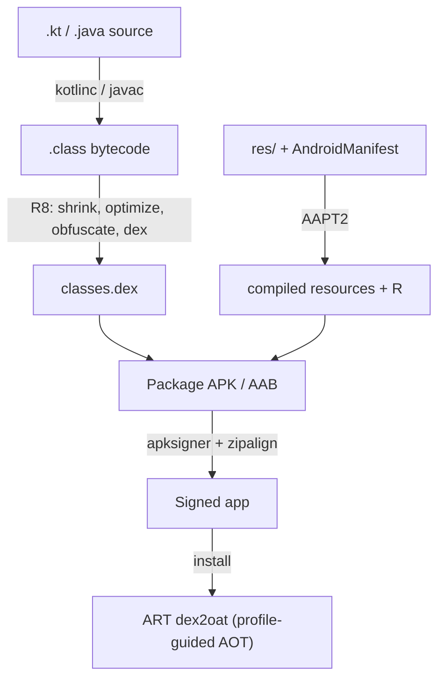
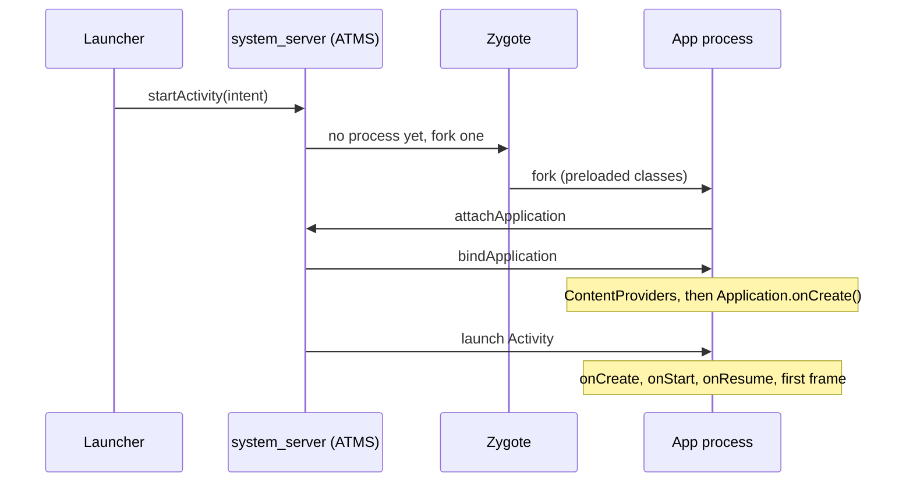

# Android Fundamentals

[⬅ Back to index](../README.md)

Covers: Android platform & runtime, app components, Context, Manifest, Intents, Broadcasts, Content Providers, Parcelable, processes & IPC.

---

## Platform & Runtime

### 1. What is Android? Explain the Android platform architecture.

<details>
<summary>Answer</summary>

Android is an open-source, **Linux-based** OS for mobile devices (phones, tablets, TVs, watches, cars). Each app runs in its **own Linux process** with its **own runtime instance (ART)**, sandboxed under a unique Linux user ID.

Platform stack (bottom → top):
1. **Linux Kernel** – drivers, memory and process management, security, power.
2. **Hardware Abstraction Layer (HAL)** – standard interfaces to camera, Bluetooth, sensors.
3. **Android Runtime (ART)** + native C/C++ libraries (OpenGL, SQLite, WebKit, libc).
4. **Java API Framework** – Activity Manager, Window Manager, Package Manager, Notification Manager, Content Providers, the View system.
5. **System & user apps**.

</details>

### 2. What is Android Runtime (ART)?

<details>
<summary>Answer</summary>

ART is the managed runtime that runs app code (DEX bytecode). It **replaced Dalvik in Android 5.0**. Its features:
- **AOT + JIT + profile-guided compilation**: since Android 7, apps are JIT-compiled at first, and hot methods are recorded in a profile. A background job compiles them **AOT while the device is idle and charging**. **Baseline/Cloud profiles** precompile critical paths at install time.
- A better **garbage collector** (concurrent, with short pauses).
- Better debugging and profiling support.
- ART is updatable through Google Play system updates (Android 12+).

</details>

### 3. What was Dalvik? Dalvik vs ART?

<details>
<summary>Answer</summary>

Dalvik was Android's runtime before Lollipop (5.0). It used **JIT** compilation (from Android 2.2): bytecode was compiled to native code at runtime, every time the app ran.

| Dalvik | ART |
|---|---|
| JIT only | AOT + JIT + profile-guided |
| Faster install, slower runtime | Faster runtime, better battery |
| Less storage | More storage for compiled code (reduced by profiles) |
| Slower, stop-the-world GC | Concurrent GC, fewer pauses |

</details>

### 4. Just-in-Time (JIT) vs Ahead-of-Time (AOT) compilation?

<details>
<summary>Answer</summary>

- **JIT** compiles bytecode to machine code **at runtime**, when code runs. It can optimize using runtime information, but it adds warm-up overhead (slower startup, CPU and battery cost).
- **AOT** compiles **before execution** (at install time or in the background). Code is ready immediately, so **startup is faster**, but it uses more storage and install time and lacks some runtime-specific optimizations.
- **Modern ART is hybrid:** JIT plus profiling, then AOT-compile the hot code. **Baseline Profiles** let you ship that profile with the app, so the critical paths are AOT-compiled from the first launch.

</details>

### 5. How does the Garbage Collector work in Android?

<details>
<summary>Answer</summary>

The GC automatically frees memory used by objects that are **no longer reachable**.
1. **Mark** – starting from **GC roots** (thread stacks, static fields, JNI references), mark every reachable object.
2. **Sweep/Compact** – reclaim unreachable objects, and compact the heap to reduce fragmentation.

ART's collector is **concurrent** (it mostly runs alongside app threads with very short pauses). It's **generational**: young objects are collected more often, since most objects die young. Android 8–13 use the **Concurrent Copying (CC)** collector. Newer devices (Android 14+, delivered through ART mainline updates) are moving to **Concurrent Mark-Compact (CMC)**, which compacts the heap concurrently using userfaultfd and has lower memory overhead.

> Note: Android does **not** use the JVM's CMS/G1 collectors. ART has its own GC.

**Developer takeaways:** avoid allocating in hot paths like `onDraw` or `onBindViewHolder` (frequent GCs cause jank), and avoid leaks (leaked objects stay reachable, so the GC can't free them).

</details>

### 6. What is DEX? What is the Android build process?

<details>
<summary>Answer</summary>

**DEX (Dalvik Executable)** is the bytecode format ART runs. It's register-based and compact, and multiple classes share constant pools.



**Build process:**
1. Kotlin/Java source → `kotlinc`/`javac` → `.class` (JVM bytecode).
2. **R8** – shrinks, optimizes, obfuscates, and **dexes** (`.class` → `.dex`, through D8).
3. **AAPT2** – compiles resources and generates `R` and `resources.arsc`.
4. Packaging → **APK** or **AAB**, then **signing** (`apksigner`) and **zipalign**.
5. On the device: install → ART (dex2oat) compiles to `.oat`/`.odex` (based on profiles).

</details>

### 7. What is multidex?

<details>
<summary>Answer</summary>

A single DEX file can reference at most **65,536 methods** (the "64K limit"). Large apps exceed it, so the build splits code into multiple DEX files (`classes.dex`, `classes2.dex`…).
- With **minSdk 21+** (ART), multidex is **natively supported and on by default**. Nothing to do.
- Below API 21 (Dalvik), you needed the `multidex` support library and `multiDexEnabled true`.
- Also reduce method count with **R8 shrinking**.

</details>

### 8. How is memory managed for apps in Android? What is the Low Memory Killer?

<details>
<summary>Answer</summary>

- Each app gets a **limited heap** (check `ActivityManager.getMemoryClass()`). Going over it throws `OutOfMemoryError`.
- Android uses **paging and memory-mapping** but **no swap to disk**. It uses **zRAM** (compressed RAM) instead.
- When RAM runs low, the **Low Memory Killer (lmkd)** kills processes in priority order: **cached/empty → service → visible → foreground**.
- Apps are notified through `onTrimMemory(level)` and should release caches.
- So your app **can be killed in the background at any time**, which is why state saving and process-death handling matter.

</details>

### 9. What are process priorities/states in Android?

<details>
<summary>Answer</summary>

From most important to least (most likely to be killed):
1. **Foreground** – visible Activity in `onResume`, a foreground Service, or a receiver executing `onReceive`.
2. **Visible** – visible but not in focus (e.g. behind a dialog).
3. **Service** – started service running.
4. **Cached** – in the background with no active components. Killed first.

</details>

---

## Application Components

### 10. What are the Android application components?

<details>
<summary>Answer</summary>

Four components, all declared in the manifest. Each one is an entry point into the app:
1. **Activity** – a single screen with a UI; the entry point for user interaction.
2. **Service** – runs work **without a UI** (music playback, sync). It can be started, bound, or foreground.
3. **Broadcast Receiver** – responds to system-wide or app broadcasts (boot completed, battery low, connectivity).
4. **Content Provider** – manages and **shares structured data** across apps through a `content://` URI (Contacts, MediaStore).

Supporting pieces: **Intents** (messaging between components), Fragments, Views, the Manifest and resources.

</details>

### 11. What is the `Application` class?

<details>
<summary>Answer</summary>

The base class that holds global app state. **A single instance per process**, created **before any Activity, Service or Receiver** (`Application.onCreate()`). It's used to:
- initialize libraries (crash reporting, DI with `@HiltAndroidApp`, WorkManager config, logging),
- provide the `applicationContext`.

Keep `onCreate()` **light**, because it directly affects **cold start time**. Use lazy init or App Startup.
Note: `ContentProvider.onCreate()` runs **before** `Application.onCreate()` (which is why some libraries auto-initialize through providers).

</details>

### 12. What is Context? What are its types and how is it used?

<details>
<summary>Answer</summary>

`Context` is an abstract class that gives access to the **app environment**: resources, system services, starting components, file and database storage, and the theme.

Uses: `getString()`, `getSystemService()`, `startActivity()`, `sendBroadcast()`, `getFilesDir()`, `LayoutInflater.from(context)`.

**Types:**
- **Application Context** (`applicationContext`) – lives as long as the app. Use it for singletons, Room, Retrofit, WorkManager. It has **no theme**, so don't use it to inflate UI or show dialogs.
- **Activity Context** – tied to the Activity lifecycle and has the theme. Use it for UI (dialogs, inflating views, starting activities).
- Also Service and receiver contexts (the `onReceive` parameter), and `ContextWrapper`/`ContextThemeWrapper`.

**Rule:** never keep an **Activity context** in a long-lived object (singleton, static, ViewModel). That's a **memory leak**.

</details>

### 13. What is AndroidManifest.xml?

<details>
<summary>Answer</summary>

The app's configuration file, read by the system (and Play Store) at install time. It declares:
- **Package/namespace** and app metadata (icon, label, theme, `android:name` for the Application class).
- All **components** (activity, service, receiver, provider) with **intent filters** (deep links, launcher).
- **Permissions** the app requests (`<uses-permission>`) and permissions it defines.
- **Hardware/software features** (`<uses-feature>`), `<queries>` for package visibility (Android 11+).
- `android:exported` (required on components with intent filters since Android 12).

The final manifest is **merged** from all modules and libraries (manifest merger).

</details>

### 14. What are the important `<activity>` attributes in the manifest?

<details>
<summary>Answer</summary>

The ones that come up in interviews:
- `android:name`, `label`, `icon`, `theme`
- `android:exported` – can other apps start it? (Must be declared explicitly when there's an intent filter, API 31+.)
- `android:launchMode` – `standard` / `singleTop` / `singleTask` / `singleInstance` / `singleInstancePerTask`
- `android:taskAffinity`, `android:allowTaskReparenting`, `android:clearTaskOnLaunch`, `android:alwaysRetainTaskState`, `android:finishOnTaskLaunch`
- `android:noHistory` – removed from the back stack once the user leaves it.
- `android:configChanges` – handle config changes yourself (e.g. `orientation|screenSize`) instead of being recreated.
- `android:screenOrientation` – note: ignored on large screens for apps targeting Android 16+.
- `android:windowSoftInputMode` – `adjustResize` / `adjustPan` for the keyboard.
- `android:parentActivityName` – Up navigation.
- `android:excludeFromRecents`, `android:resizeableActivity`, `android:supportsPictureInPicture`, `android:showWhenLocked`, `android:hardwareAccelerated`, `android:process`.
- `<intent-filter>` children – actions, categories, data (deep links).

</details>

---

## Intents

### 15. What is an Intent? Explicit vs implicit intent?

<details>
<summary>Answer</summary>

An **Intent** is a messaging object used to request an action from another component: start an Activity or Service, or deliver a broadcast.

- **Explicit** – names the target component directly: `Intent(this, DetailActivity::class.java)`. Used inside your own app.
- **Implicit** – declares an **action** (and data/category), and the system finds matching apps through **intent filters**: `Intent(Intent.ACTION_VIEW, Uri.parse("https://..."))`, `ACTION_SEND` for sharing. Use `Intent.createChooser()` to show an app picker.

</details>

### 16. What is an Intent Filter? How are implicit intents resolved?

<details>
<summary>Answer</summary>

An `<intent-filter>` declares which implicit intents a component can handle, using three tests:
- **Action** – must match one of the filter's actions.
- **Category** – every category in the intent must be in the filter. Activities must include `DEFAULT` to receive implicit intents.
- **Data** – URI scheme, host, path and MIME type.

If several apps match, the user sees a chooser. On Android 11+, **package visibility** rules mean you may need `<queries>` in the manifest to see other apps.

</details>

### 17. What is a PendingIntent? What are mutability flags?

<details>
<summary>Answer</summary>

A **PendingIntent** is a token that lets **another app** (NotificationManager, AlarmManager, a widget) perform an Intent **on your app's behalf, with your app's identity and permissions**, at a later time.

Created with `PendingIntent.getActivity/getService/getBroadcast(...)`. Since **Android 12** you **must** specify `FLAG_IMMUTABLE` (recommended) or `FLAG_MUTABLE` (only when the other app needs to fill in extras, e.g. inline reply). Other flags: `FLAG_UPDATE_CURRENT`, `FLAG_CANCEL_CURRENT`, `FLAG_ONE_SHOT`.

</details>

### 18. What are deep links vs App Links?

<details>
<summary>Answer</summary>

- **Deep link** – any URI (custom scheme `myapp://product/1`, or `https`) that opens a specific screen through an intent filter. With multiple handlers, the user may see a disambiguation dialog.
- **Android App Links** – **verified `https` links** (`android:autoVerify="true"` + a `/.well-known/assetlinks.json` file on your domain). They open your app **directly**, with no chooser. On Android 12+, unverified web links open in the browser by default.
- Handle them in `onCreate` / `onNewIntent`, or with Navigation's `deepLinks`.

</details>

### 19. How do you pass data between Activities and Fragments?

<details>
<summary>Answer</summary>

- **Activity → Activity:** Intent extras (`putExtra`), receive with `intent.getXxxExtra`. For results, use the **Activity Result API** (`registerForActivityResult`). `startActivityForResult` is deprecated.
- **Fragment ↔ Fragment:** a **shared ViewModel** (`activityViewModels()`), the **Fragment Result API** (`setFragmentResult` / `setFragmentResultListener`), or Navigation **Safe Args**.
- **Fragment arguments:** `Bundle` via `arguments`, never constructor parameters (the system recreates fragments with the no-arg constructor).
- Keep it small: a Binder transaction is limited to **~1 MB**, shared across the whole process, so large extras cause a `TransactionTooLargeException`. Pass IDs, not big objects.

</details>

### 20. Parcelable vs Serializable?

<details>
<summary>Answer</summary>

| Serializable | Parcelable |
|---|---|
| Java standard marker interface | Android-specific |
| Uses **reflection** → slow, creates many temp objects | Explicit write/read → **much faster** |
| No boilerplate | Boilerplate, but `@Parcelize` (kotlin-parcelize plugin) generates it |

On Android, use **Parcelable with `@Parcelize`** for Intents and Bundles.

```kotlin
@Parcelize data class User(val id: Int, val name: String) : Parcelable
```

</details>

### 21. What is a Bundle?

<details>
<summary>Answer</summary>

A key-value map for **Parcelable** data. It's used for Intent extras, fragment arguments and `onSaveInstanceState`. It's limited by the Binder transaction size (~1 MB shared), so store small data only.

</details>

---

## Broadcasts & Content Providers

### 22. What is a BroadcastReceiver? Static vs dynamic registration?

<details>
<summary>Answer</summary>

It receives broadcast Intents from the system or other apps (`BOOT_COMPLETED`, `AIRPLANE_MODE_CHANGED`, `LOCALE_CHANGED`, SMS…).

- **Static (manifest)** – works even when the app isn't running. Since **Android 8.0 (Oreo)**, most **implicit** broadcasts **can't** be registered in the manifest (with exceptions like `BOOT_COMPLETED` and `LOCALE_CHANGED`).
- **Dynamic (`registerReceiver` in code)** – active only while registered. Unregister in the matching lifecycle callback to avoid leaks. On **Android 14+** you must pass `RECEIVER_EXPORTED` or `RECEIVER_NOT_EXPORTED`.

`onReceive()` runs on the **main thread** and should finish in **under ~10 s**. For longer work, use `goAsync()` or enqueue WorkManager.

</details>

### 23. What are normal, ordered, sticky and local broadcasts?

<details>
<summary>Answer</summary>

- **Normal** (`sendBroadcast`) – asynchronous, delivered to all receivers in undefined order.
- **Ordered** (`sendOrderedBroadcast`) – delivered one receiver at a time by priority; a receiver can modify the result or abort it.
- **Sticky** – deprecated (security issues).
- **LocalBroadcastManager** – deprecated. Use Flow, LiveData or a shared ViewModel for in-app events.

</details>

### 24. What is a Content Provider? When do you need one?

<details>
<summary>Answer</summary>

A Content Provider exposes structured data through a **standard CRUD interface** (`query`, `insert`, `update`, `delete`, `getType`) addressed by a **content URI** (`content://authority/path/id`). Clients access it through **`ContentResolver`**.

You need one to:
- **share data with other apps** (with permission control), or
- integrate with system features: search suggestions, widgets, **`FileProvider`** for sharing files securely with `content://` URIs (`file://` URIs throw `FileUriExposedException` on 7.0+), sync adapters.

You **don't** need one for private app data. Use Room directly.

</details>

### 25. What is a ContentResolver and ContentObserver?

<details>
<summary>Answer</summary>

- **ContentResolver** – the client-side API that routes calls to the right provider based on the URI authority.
- **ContentObserver** – registers for change notifications on a URI (e.g. a new photo added to MediaStore).

</details>

---

## IPC & Misc

### 26. What is Binder / IPC in Android? What is AIDL?

<details>
<summary>Answer</summary>

- **Binder** is Android's core **inter-process communication** mechanism, a kernel driver plus a framework. Almost every system call from an app (starting an Activity, `getSystemService`) is a Binder transaction to `system_server`.
- **AIDL** (Android Interface Definition Language) defines interfaces for **bound services across processes**. It generates Stub (server) and Proxy (client) classes.
- Simpler alternatives: a **Messenger** (Handler-based, single-threaded queue), or Intents/broadcasts for one-way messages.

</details>

### 27. What happens when you tap an app icon (app launch flow)?

<details>
<summary>Answer</summary>



1. The Launcher sends an Intent to **ActivityManagerService / ActivityTaskManager** (in `system_server`) through Binder.
2. If the app process doesn't exist, AMS asks **Zygote** to **fork** a new process. Zygote has core classes and resources preloaded, which makes startup fast.
3. The new process runs `ActivityThread.main()` → creates the main **Looper** → attaches to AMS.
4. The Application is created (`ContentProvider`s → `Application.onCreate()`).
5. The Activity is created: `onCreate` → `onStart` → `onResume`, and the first frame is drawn through Choreographer and RenderThread.

</details>

### 28. What is Zygote?

<details>
<summary>Answer</summary>

Zygote is a system process started at boot that **preloads common framework classes and resources**. Each new app process is **forked** from it, and memory pages are shared through copy-on-write. This makes app startup much faster and saves RAM.

</details>

### 29. What are resources and qualifiers? How does Android pick the right resource?

<details>
<summary>Answer</summary>

Resources (`res/`) are kept separate from code: layouts, strings, drawables, dimens, colors, themes. **Qualifiers** provide alternatives for different configurations: `values-hi` (language), `layout-land`, `drawable-xxhdpi`, `values-night` (dark mode), `values-sw600dp` (tablets), `values-v31`. At runtime the system picks the **best match** for the current configuration.

</details>

### 30. What is the difference between dp, sp, px?

<details>
<summary>Answer</summary>

- **px** – actual screen pixels.
- **dp** – density-independent pixels. 1 dp = 1 px on a 160 dpi (mdpi) screen. Use it for sizes and margins.
- **sp** – scale-independent pixels: like dp, but it also scales with the user's **font size** setting. Use it for text. (Android 14+ scales fonts non-linearly.)

</details>


---

## More Platform Questions

### 31. What is the project structure of an Android app?

<details>
<summary>Answer</summary>

```
MyApp/
├── settings.gradle.kts          // modules + repositories
├── build.gradle.kts             // root build config
├── gradle/libs.versions.toml    // version catalog
├── gradle.properties
└── app/
    ├── build.gradle.kts         // android {}, dependencies
    ├── proguard-rules.pro
    └── src/
        ├── main/
        │   ├── AndroidManifest.xml
        │   ├── java/ (or kotlin/) com/example/app/...   // source code
        │   └── res/                                     // resources
        │       ├── layout/  drawable/  mipmap-*/ (launcher icons)
        │       ├── values/ (strings, colors, themes, dimens)
        │       ├── xml/ (network_security_config, backup rules)
        │       └── raw/  font/  navigation/  menu/
        │   └── assets/                                  // raw files, accessed via AssetManager
        ├── test/                // local JVM unit tests
        └── androidTest/         // instrumented tests
```

Additional source sets exist per build type or flavor (`src/debug/`, `src/prod/`). In multi-module apps, the same structure repeats in each module.

</details>

### 32. What is AndroidX / the Support Library / Jetpack?

<details>
<summary>Answer</summary>

- The **Support Library** (`com.android.support:*`) backported new APIs to old Android versions. It's **deprecated**; its last version was 28.
- **AndroidX** (`androidx.*`) replaced it in 2018. It has a consistent namespace, **independent semantic versioning per library**, and it's updated separately from the OS.
- **Jetpack** is the umbrella name for the libraries, tools and guidance built on AndroidX: Architecture Components (ViewModel, LiveData, Room, Lifecycle, Paging, WorkManager, Navigation, DataStore), Compose, CameraX, Media3, and so on.

The goal is to help developers follow best practices, write less boilerplate, and work consistently across Android versions.

</details>

### 33. Why use a `Bundle` instead of a plain `Map` to pass data?

<details>
<summary>Answer</summary>

Data passed between components often **crosses process boundaries** (through Binder to `system_server`, and it's saved for process death). A `Bundle` is a type-safe key-value container **optimized for Parcel serialization** (it's `Parcelable`), restricted to types that can be marshalled (primitives, Strings, Parcelables, Serializables, arrays and lists of these). A general `Map<String, Any>` can hold arbitrary objects that **can't be parcelled**, and `HashMap` serialization is slow. Bundles are also backed by the memory-efficient `ArrayMap` and unparcel lazily.

</details>

### 34. Can an app run in multiple processes? How can two different apps communicate?

<details>
<summary>Answer</summary>

**Multiple processes:** set `android:process=":remote"` (private to the app) or `"com.example.shared"` on a component in the manifest. Each process has its **own memory, its own `Application` instance** and its own singletons (static state isn't shared!), and they communicate through IPC. It's used for isolation (a crash-prone WebView or media), to get more memory, or for a long-running service.

**App-to-app communication:**
- **Intents** (explicit with a package, or implicit) and `startActivityForResult`-style result contracts.
- **Bound services with AIDL or a Messenger** (Binder IPC).
- **Content Providers** (with permissions or `grantUriPermissions`).
- **Broadcasts** (with signature permissions).
- `FileProvider` URIs for files, shared accounts (AccountManager).

Protect exported entry points with **signature-level permissions** when both apps are yours.

</details>

### 35. What is the NDK / JNI? When would you use native code?

<details>
<summary>Answer</summary>

- The **NDK (Native Development Kit)** lets you write parts of the app in **C/C++**, built into `.so` libraries per ABI (arm64-v8a, armeabi-v7a, x86_64) with CMake.
- **JNI (Java Native Interface)** is the bridge: `external fun nativeProcess(...)` in Kotlin + `System.loadLibrary("mylib")`, and a matching `Java_com_example_..._nativeProcess` C function.

**When:** performance-critical computation (audio/video/image processing, games, physics), **reusing existing C/C++ libraries** (OpenCV, FFmpeg, SQLite extensions, crypto), and low-latency audio (Oboe).
**Costs:** more complexity, harder debugging, JNI call overhead, per-ABI builds (larger APKs), manual memory management, and **16 KB page-size alignment** requirements.
*RenderScript* (for GPU compute) is **deprecated**. Use Vulkan, OpenGL compute shaders or the RenderScript Intrinsics Replacement Toolkit.

</details>

### 36. Can you force garbage collection in Android?

<details>
<summary>Answer</summary>

You can **request** it with `System.gc()` / `Runtime.getRuntime().gc()`, but it's only a **hint**: the runtime may ignore it. Calling it is almost always a bad idea, because it can cause pauses and jank, and the GC already knows better when to run. Fix the **leak or allocation pattern** instead. The Memory Profiler's "Force GC" button is only for diagnostics (to see what's really retained before taking a heap dump).

</details>

### 37. What is ADB? Which commands are useful?

<details>
<summary>Answer</summary>

**Android Debug Bridge** is a CLI to communicate with devices and emulators (client → adb server → adbd daemon on the device).

```bash
adb devices                                    # list connected devices
adb install -r app.apk / adb uninstall com.app
adb logcat -s MyTag                            # filtered logs
adb shell am start -n com.app/.MainActivity     # start activity
adb shell am start -a android.intent.action.VIEW -d "myapp://product/1"   # test deep links
adb shell am kill com.app                       # simulate process death (app in background)
adb shell pm clear com.app                      # clear app data
adb shell pm grant com.app android.permission.CAMERA
adb shell dumpsys meminfo com.app / dumpsys activity activities / dumpsys battery
adb shell cmd jobscheduler run -f com.app 1     # force-run a job
adb shell screencap / screenrecord
adb push / pull, adb reverse tcp:8080 tcp:8080, adb pair (wireless debugging)
```

</details>

---

[⬅ Previous: Design Patterns](07-design-patterns.md) · [⬅ Back to index](../README.md) · [Next: Activity & Fragment ➡](09-activity-fragment.md)
