# Android Fundamentals

[⬅ Back to index](../README.md)

Covers: Android platform & runtime, app components, Context, Manifest, Intents, Broadcasts, Content Providers, Parcelable, processes & IPC.

---

## Platform & Runtime

### 1. What is Android? Explain the Android platform architecture.

<details>
<summary>Answer</summary>

**In short:** Android is an open-source, **Linux-based** operating system for phones, tablets, TVs, watches and cars. It is a layered stack: Linux kernel → Hardware Abstraction Layer → Android Runtime (ART) and native libraries → Java/Kotlin API framework → apps. Every app runs in its **own Linux process**, with its **own ART instance**, sandboxed under a **unique Linux user ID**.

#### The layers, bottom to top

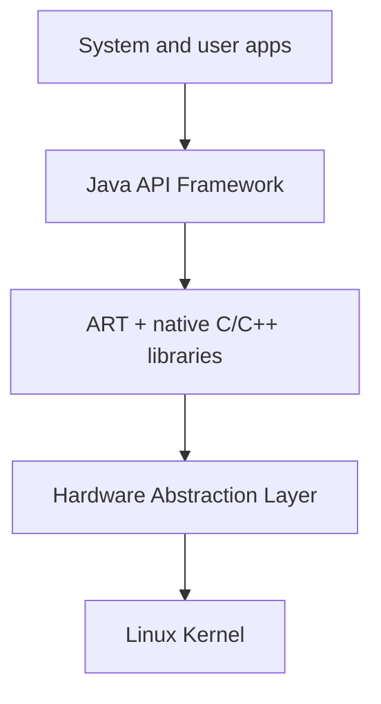

| Layer | What lives there | Why it matters to you |
|---|---|---|
| **Linux Kernel** | Drivers, process and memory management, scheduling, power management, security (SELinux, user IDs), the Binder IPC driver | App sandboxing and process killing happen here |
| **HAL** | Standard interfaces (camera, Bluetooth, audio, sensors) that device makers implement | Lets the same framework run on very different hardware |
| **ART + native libraries** | The runtime that executes your DEX code; libraries such as OpenGL ES/Vulkan, SQLite, libc (Bionic), media codecs | Your Kotlin code runs on ART; Room sits on SQLite |
| **Java API Framework** | ActivityManager, WindowManager, PackageManager, NotificationManager, the View system, Content Providers, Location, Telephony | The public SDK APIs you call every day |
| **Apps** | System apps (Phone, Settings, Launcher) and your app | System apps have no special API — you can replace most of them |

#### How an app is isolated

- At install time the system gives each app a **Linux UID**. Its private files (`/data/data/<package>`) are owned by that UID, so other apps cannot read them.
- Each app runs in its own process, forked from **Zygote**, with its own ART heap. A crash in one app does not take down another.
- Apps talk to the system and to each other only through well-defined channels (**Binder IPC**: Intents, bound services, content providers), and the system checks **permissions** on those calls.

Most framework "managers" you call (`getSystemService(...)`) are thin client proxies; the real service runs in the **`system_server`** process, and the call crosses processes through Binder.

**Likely follow-ups:**
- *Is Android just Linux?* — It uses the Linux kernel (with Android-specific additions such as Binder), but not a typical GNU userland; the C library is Bionic and apps run on ART, not as native Linux programs.
- *Where does the security sandbox come from?* — Linux user IDs and file permissions, plus SELinux policies and the permission checks in system services.

</details>

### 2. What is Android Runtime (ART)?

<details>
<summary>Answer</summary>

**In short:** ART is the managed runtime that executes app code compiled to **DEX bytecode**. It **replaced Dalvik in Android 5.0**. It combines **JIT, AOT and profile-guided compilation**, has a **concurrent, low-pause garbage collector**, and since Android 12 is **updatable through Google Play system updates**.

#### Why it exists

Your Kotlin/Java code is not compiled straight to ARM machine code; it is compiled to DEX bytecode so a single APK can run on any CPU architecture. Something on the device must turn that bytecode into running code and manage memory. That is ART's job: class loading, compilation, garbage collection, threads, JNI, and debugging/profiling hooks.

#### How compilation works (Android 7.0+)

1. **First runs:** code is interpreted and **JIT-compiled** as it runs. The JIT records which methods are "hot" in a **profile** file.
2. **Idle and charging:** a background job (dex2oat) **AOT-compiles the hot methods** from that profile into native code (`.oat`/`.odex`/`.art` files).
3. **Next launches:** the hot code is already native, so startup is faster and uses less CPU.
4. **Baseline Profiles** (shipped in your app) and **Cloud Profiles** (aggregated by Play from other users) let ART AOT-compile the critical paths **at install time**, so even the first launch benefits.

This hybrid avoids Lollipop-era problems where full AOT at install made installs and OS updates slow and used a lot of storage.

#### Other features

| Feature | What it gives you |
|---|---|
| Concurrent, generational GC | Short pauses, less jank than Dalvik's stop-the-world GC |
| Better debugging and profiling | Detailed exceptions, sampling profilers, heap dumps, method tracing |
| Mainline module (Android 12+) | ART fixes and GC improvements arrive via Play system updates, not only full OS updates |

**Pitfalls:**
- Startup benchmarks on a freshly installed debug build are misleading: debug builds are not optimized, and without a profile the code runs interpreted or JIT-compiled.

**Likely follow-ups:**
- *What is a Baseline Profile?* — A list of classes and methods your app ships so ART pre-compiles them at install, improving cold start and early-scroll jank.
- *Does ART run Java bytecode?* — No, it runs DEX; `.class` files are converted by D8/R8 at build time.

</details>

### 3. What was Dalvik? Dalvik vs ART?

<details>
<summary>Answer</summary>

**In short:** Dalvik was Android's runtime before **Lollipop (5.0)**. It ran DEX bytecode with an interpreter plus a **JIT** compiler (added in Android 2.2), so code was compiled on every run. ART replaced it with **AOT + JIT + profile-guided compilation** and a much better garbage collector, giving faster apps and better battery life.

#### Why Dalvik was replaced

Dalvik was designed for very constrained devices (little RAM and storage). Compiling only at runtime saved storage and kept installs fast, but it meant:
- the same code was re-compiled every time the app started (CPU and battery cost),
- startup and steady-state performance were limited,
- its GC often paused all threads ("GC_FOR_ALLOC" pauses), causing visible jank.

ART first shipped as an option in Android 4.4 and became the only runtime in 5.0. Both run the same DEX format, so apps did not need to be rebuilt.

| | Dalvik | ART |
|---|---|---|
| Compilation | Interpreter + JIT only | AOT + JIT + profile-guided (since 7.0) |
| Install time | Fast | Slower in 5.0–6.0 (full AOT); fast again with profile-guided compilation |
| Runtime speed | Slower, recompiled each run | Faster; hot code stays compiled |
| Storage | Less | More for compiled code (reduced by profiles) |
| Garbage collection | Mostly stop-the-world, noticeable pauses | Concurrent, generational, short pauses |
| Battery | Higher CPU use from repeated JIT | Lower |
| Multidex | Needed the support library | Native support |

**Likely follow-ups:**
- *Do apps behave differently on ART?* — Mostly not, but ART is stricter about JNI misuse and some reflection hacks that "worked" on Dalvik.
- *Why did ART go back to using a JIT?* — Full AOT in 5.0 made installs and OS updates slow; the 7.0 hybrid compiles only what profiling shows is hot.

</details>

### 4. Just-in-Time (JIT) vs Ahead-of-Time (AOT) compilation?

<details>
<summary>Answer</summary>

**In short:** **JIT** compiles bytecode to machine code **while the app runs**, so it can use runtime information but adds warm-up cost. **AOT** compiles **before the code runs** (at install or in the background), so startup is fast but it costs storage and compile time. Modern ART is **hybrid**: it JITs and profiles, then AOT-compiles only the hot code — and **Baseline Profiles** let you ship that hot list so it is compiled from the first launch.

#### Side by side

| | JIT | AOT |
|---|---|---|
| When it compiles | During execution | Before execution |
| Startup | Slower (interpretation + warm-up) | Faster |
| Runtime info | Can optimize based on actual behavior | Only what is known statically (or from a profile) |
| CPU/battery | Repeated cost on every run | Paid once |
| Storage | Small | Larger (compiled code on disk) |
| Install / update time | Fast | Slower if everything is compiled |

#### How ART combines them

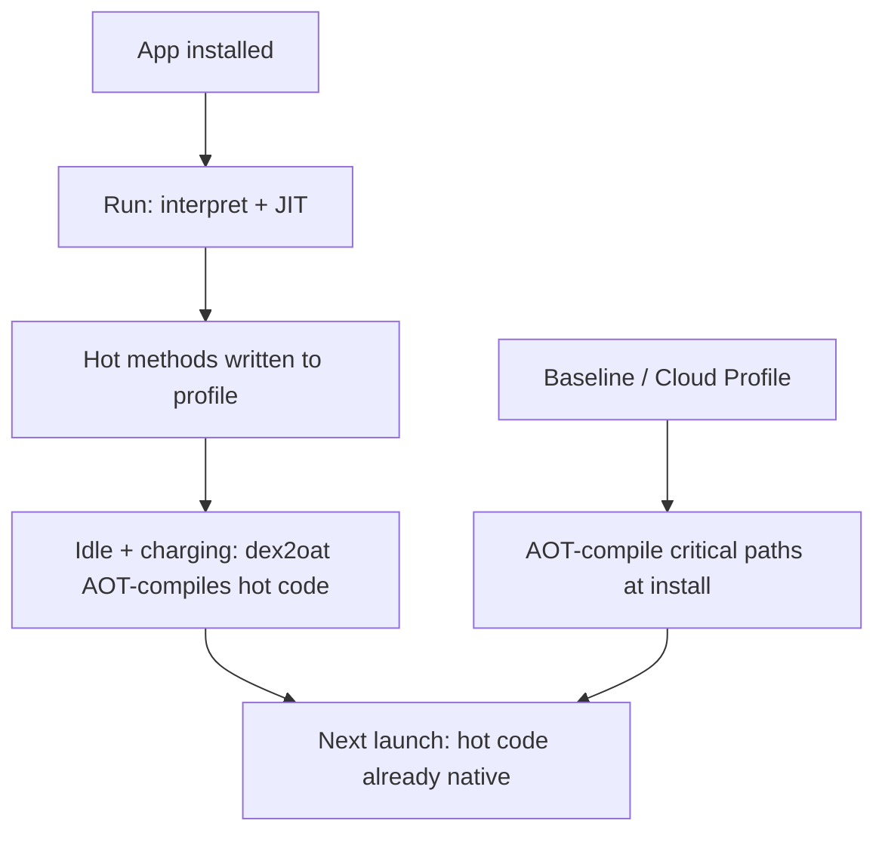

The key insight is that most of an app's code is rarely executed. Compiling everything ahead of time wastes storage and install time; compiling nothing makes startup slow. Profile-guided AOT compiles the 10–20% that matters.

#### What you do as an app developer

- Add a **Baseline Profile** (generated with the Macrobenchmark / Baseline Profile Gradle plugin) covering startup and key user journeys.
- Measure startup with **Macrobenchmark** using compilation modes (`CompilationMode.None`, `Partial`, `Full`) to see the difference.

**Likely follow-ups:**
- *Why not AOT-compile everything?* — Storage, install time, and slow OS updates (every app recompiled), with little benefit for code that rarely runs.
- *What happens on first launch without a profile?* — Code runs interpreted/JIT-compiled, so startup and early interactions are slower until the background compile happens.

</details>

### 5. How does the Garbage Collector work in Android?

<details>
<summary>Answer</summary>

**In short:** ART's GC automatically frees objects that are **no longer reachable** from **GC roots** (thread stacks, static fields, JNI references). It **marks** everything reachable, then reclaims the rest and **compacts** the heap. It is **concurrent** (runs mostly alongside your threads with very short pauses) and **generational** (young objects are collected more often). For you, the practical rules are: don't allocate in hot paths, and don't leak.

#### The algorithm, step by step

1. **Find roots** — local variables on every thread's stack, static fields, active JNI global references, and some runtime-internal references.
2. **Mark** — walk the object graph from the roots and mark every object you can reach.
3. **Reclaim** — anything not marked is garbage; its memory is freed.
4. **Compact / copy** — move live objects together so free memory is contiguous (reduces fragmentation, so large allocations still fit).

Because reachability is what matters, a reference cycle with nothing pointing into it from a root is still collected; but **one** stray reference from a root (a static field, a singleton, a running thread) keeps an entire object graph alive. That is a memory leak.

#### ART's collectors

| Collector | Where | Notes |
|---|---|---|
| **Concurrent Copying (CC)** | Default from Android 8 through 13 | Copies live objects concurrently using read barriers; generational support added in Android 10 |
| **Concurrent Mark-Compact (CMC)** | Newer devices (Android 14+, delivered through ART mainline updates) | Compacts the heap concurrently using `userfaultfd`, with lower memory overhead |

> Note: Android does **not** use the JVM's CMS/G1 collectors. ART has its own GC.

**Generational hypothesis:** most objects die young (temporary strings, iterators, lambdas). Collecting the young space frequently is cheap because few objects survive; long-lived objects are scanned less often.

#### Wrong vs right: allocating in a hot path

```kotlin
// Wrong: allocates a Paint and Rect on every frame (60–120 times a second)
override fun onDraw(canvas: Canvas) {
    val paint = Paint().apply { color = Color.RED }
    val rect = Rect(0, 0, width, height)
    canvas.drawRect(rect, paint)
}

// Right: allocate once, reuse
private val paint = Paint().apply { color = Color.RED }
private val rect = Rect()
override fun onDraw(canvas: Canvas) {
    rect.set(0, 0, width, height)
    canvas.drawRect(rect, paint)
}
```

**Pitfalls:**
- Frequent allocations in `onDraw`, `onBindViewHolder` or tight loops cause frequent GCs, and even short pauses can drop frames.
- Leaks (Activity held by a static, a singleton, an unregistered listener) keep objects reachable, so the heap grows until `OutOfMemoryError`. Detect them with **LeakCanary** or the Memory Profiler.

**Likely follow-ups:**
- *Can a cycle of objects leak?* — Not by itself; GC is reachability-based, not reference-counting.
- *What is a GC root in an Android leak?* — Typically a static field, a running thread, or a system-held callback that still references your Activity.

</details>

### 6. What is DEX? What is the Android build process?

<details>
<summary>Answer</summary>

**In short:** **DEX (Dalvik Executable)** is the compact, **register-based** bytecode format ART runs. The build compiles Kotlin/Java to `.class` files, **R8/D8** converts (and shrinks/obfuscates) them into `.dex`, **AAPT2** compiles resources, and everything is packaged into an **APK or AAB**, signed and aligned. On the device, ART compiles hot DEX code to native code based on profiles.

#### Why DEX and not JVM `.class` files?

- A JVM `.class` file has its own constant pool per class; a DEX file **merges many classes** and shares string/type/method tables, so it is much smaller.
- DEX is **register-based** (instructions name virtual registers) rather than stack-based like JVM bytecode, which means fewer instructions and was better suited to mobile CPUs.

#### The pipeline

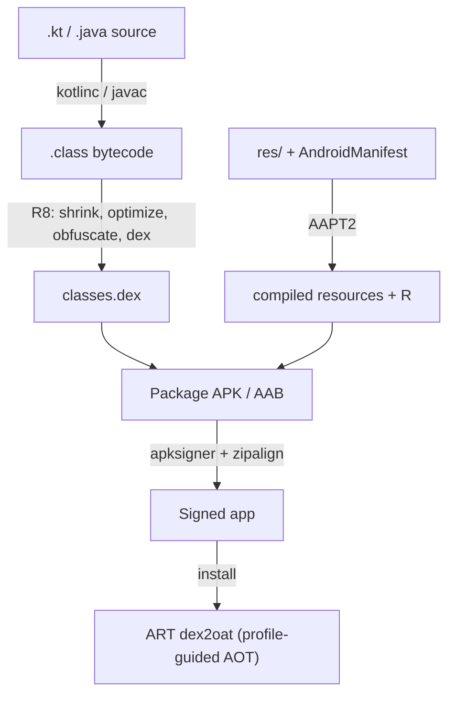

**Build process:**
1. **Compile source** — `kotlinc`/`javac` turn source (plus generated code from KSP/kapt, e.g. Room, Hilt) into `.class` JVM bytecode.
2. **R8** (release builds with `isMinifyEnabled = true`) — **shrinks** unused code, **optimizes** (inlining, class merging), **obfuscates** names, and **dexes** (`.class` → `.dex`). In debug builds, **D8** just dexes. Library `.class` files are dexed too.
3. **AAPT2** — compiles resources (`res/`), merges manifests, generates the `R` class and `resources.arsc` (the resource table).
4. **Packaging** — DEX files, compiled resources, assets, native `.so` libraries and the manifest go into an **APK** (installable) or **AAB** (uploaded to Play, which generates optimized split APKs per device).
5. **Signing and alignment** — `zipalign` aligns uncompressed data (so it can be memory-mapped), and `apksigner` signs it. (For APK Signature Scheme v2+, align **before** signing.)
6. **On the device** — install → ART's `dex2oat` compiles to `.oat`/`.odex` according to profiles (Baseline / Cloud), and the JIT handles the rest at runtime.

**Pitfalls:**
- R8 removes code it thinks is unused; anything accessed only by **reflection** (some serializers, JNI entry points) needs `-keep` rules or it crashes only in release builds.

**Likely follow-ups:**
- *APK vs AAB?* — AAB is a publishing format; Play splits it into per-device APKs (by ABI, density, language), so users download less.
- *What's in `resources.arsc`?* — The compiled table mapping resource IDs to values per configuration.

</details>

### 7. What is multidex?

<details>
<summary>Answer</summary>

**In short:** A single DEX file can reference at most **65,536 methods** (the "64K limit"), because method references use a 16-bit index. Larger apps are split into multiple DEX files (`classes.dex`, `classes2.dex`, …). With **minSdk 21+** (ART) this is **supported natively and enabled automatically**; only pre-21 Dalvik apps needed the `multidex` library.

#### Why the limit exists

DEX instructions refer to methods by an index into the file's method table, and that index is **16 bits wide** → max 65,536 method references. The count includes every method your code **references**, including library methods (AndroidX, Kotlin stdlib, Guava…), so a mid-size app with a few big libraries hits it quickly.

#### How it is handled

| minSdk | Behavior |
|---|---|
| **21+** (ART) | ART loads all `classesN.dex` files at install; multidex is automatic. Nothing to configure. |
| **< 21** (Dalvik) | Dalvik only loads `classes.dex` natively. You needed `multiDexEnabled true` + the `androidx.multidex` library, which loads secondary DEX files at startup (slow, and classes needed at startup had to be in the primary DEX). |

Since modern apps practically all have minSdk 21 or higher, multidex is mostly a historical interview topic now.

#### Keeping method count down anyway

- Enable **R8** (`isMinifyEnabled = true`) to remove unused code from your app and its libraries.
- Avoid pulling in huge libraries for one function.

**Likely follow-ups:**
- *Is it 64K methods or 64K fields too?* — Both method and field references have 16-bit indexes, so each table is limited to 65,536 per DEX file.
- *Does multidex slow down startup?* — On ART, not meaningfully; on Dalvik the legacy library added noticeable startup cost.

</details>

### 8. How is memory managed for apps in Android? What is the Low Memory Killer?

<details>
<summary>Answer</summary>

**In short:** Each app gets a **limited Java heap**; exceeding it throws `OutOfMemoryError`. Android uses paging and memory-mapping but **no swap to disk** — it uses **zRAM** (compressed RAM) instead. When RAM runs low, the **Low Memory Killer daemon (lmkd)** kills processes, starting with the least important (cached apps). So your app **can be killed in the background at any time**, which is why saving state and handling process death matter.

#### Per-app limits

- The heap size limit depends on the device: `ActivityManager.getMemoryClass()` returns it in MB; `getLargeMemoryClass()` applies if you set `android:largeHeap="true"` (rarely a good idea — it hides problems).
- Native memory (bitmaps since Android 8.0 are allocated in native memory, C/C++ allocations) does not count toward the Java heap limit but does count toward the system's total memory pressure.

#### Why no swap?

Flash storage has limited write endurance and is slower than RAM, so writing memory pages to it would wear it out and hurt performance. Instead:
- **Clean pages** (code, memory-mapped files, resources) can simply be dropped and re-read from disk.
- **Dirty pages** (your heap) are compressed into **zRAM**, a compressed area in RAM.
- When that isn't enough, **whole processes are killed**.

#### Low Memory Killer

`lmkd` watches memory pressure and kills processes based on their **`oom_adj` score**, which the system updates according to what each process is doing:

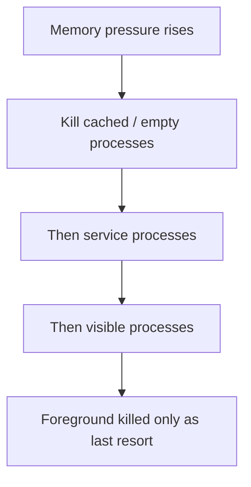

#### What your app should do

- Implement **`onTrimMemory(level)`** (via `ComponentCallbacks2`) and release caches, e.g. when `level >= TRIM_MEMORY_UI_HIDDEN` (your UI is no longer visible).
- **Assume background death:** save UI state with `onSaveInstanceState` / `SavedStateHandle`, persist important data, and test with "Don't keep activities" or `adb shell am kill <package>`.
- Use memory-aware caches (`LruCache`, image libraries like Coil/Glide that handle bitmaps).

**Pitfalls:**
- Process death is **silent**: no `onDestroy` is guaranteed. Anything held only in memory (singletons, ViewModels) is gone when the user returns.

**Likely follow-ups:**
- *Is `onDestroy()` called when the process is killed?* — No. Only `onSaveInstanceState` (called earlier when the app went to background) helps you restore.
- *How do you check memory usage?* — Android Studio Memory Profiler, `adb shell dumpsys meminfo <package>`.

</details>

### 9. What are process priorities/states in Android?

<details>
<summary>Answer</summary>

**In short:** The system ranks every process by what its components are doing, and kills the lowest-ranked first when memory is short. From most to least important: **Foreground** → **Visible** → **Service** → **Cached**. A process's rank is the highest of all its components, and the rank changes constantly as the user moves between apps.

#### The hierarchy

| Rank | When a process is in it | Kill risk |
|---|---|---|
| **1. Foreground** | Has the Activity the user is interacting with (`onResume`), a **BroadcastReceiver running `onReceive()`**, a Service executing a lifecycle callback, or a **foreground Service** in some cases | Only killed as a last resort |
| **2. Visible** | Has an Activity visible but not focused (paused, e.g. behind a dialog or in multi-window), or a foreground Service the user is aware of (music, navigation) | Very unlikely |
| **3. Service** | Has a **started Service** running (e.g. background upload). Long-running services (many hours) can be demoted | Killed when foreground/visible need memory |
| **4. Cached** | No active components (the user left the app; Activities stopped). Kept around to make switching back fast, in an LRU list | **Killed first** |

A process can also be raised by **dependencies**: if a foreground app is bound to your Service or using your ContentProvider, your process is ranked at least as high as that client.

#### Why this matters for design

- Work started from a **cached** process can be killed at any moment. That's why you use **WorkManager** for deferrable guaranteed work and a **foreground Service** (with a notification) for ongoing user-visible work, instead of a plain thread.
- A BroadcastReceiver's process is foreground only **while `onReceive()` runs**; starting a thread there and returning lets the process drop to cached and be killed mid-work. Use `goAsync()` or enqueue WorkManager.

**Likely follow-ups:**
- *Why not just start a background thread from a receiver?* — Once `onReceive()` returns, the process may be killed; the thread dies with it.
- *What does a foreground service change?* — It raises the process priority so it's very unlikely to be killed, at the cost of a visible notification and type-specific restrictions.

</details>

---

## Application Components

### 10. What are the Android application components?

<details>
<summary>Answer</summary>

**In short:** There are four components, each declared in the manifest and each a separate **entry point** the system can use to start your app: **Activity** (a screen with UI), **Service** (work without UI), **BroadcastReceiver** (reacts to broadcast events) and **ContentProvider** (shares structured data via `content://` URIs). Intents connect Activities, Services and Receivers.

#### Why "entry points" matters

A desktop program has one `main()`. An Android app can be started in several ways: the user taps the launcher icon (Activity), the system delivers `BOOT_COMPLETED` (Receiver), another app queries your contacts-like data (Provider), or a client binds to your music service (Service). The system creates your process on demand for whichever component is needed. That's why every component must be declared in the manifest — the system needs to know about them without running your code.

| Component | Purpose | Started by | Examples |
|---|---|---|---|
| **Activity** | One screen with a UI; handles user interaction | `startActivity(intent)` | Launcher screen, checkout screen |
| **Service** | Work **without UI**: started, bound, or foreground | `startService`, `startForegroundService`, `bindService` | Music playback, file upload, a bound API for other apps |
| **BroadcastReceiver** | Reacts to system or app-wide events | `sendBroadcast(intent)` from the system or apps | Boot completed, locale changed, a custom event |
| **ContentProvider** | Exposes structured data through a CRUD interface | `ContentResolver` calls on a `content://` URI | Contacts, MediaStore, `FileProvider` |

#### How they relate

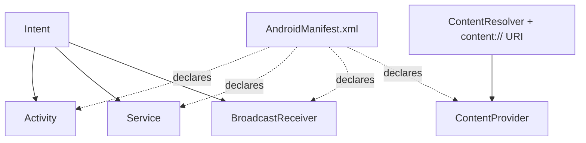

Supporting (non-component) pieces: **Intents** (messages between components), **Fragments** and **Views/Compose** (UI inside an Activity), the **Manifest**, and **resources**.

**Pitfalls:**
- A Fragment is **not** a component — the system can't start a Fragment directly; it always lives inside an Activity.
- Components exported to other apps (`android:exported="true"`) are part of your attack surface; protect them with permissions.

**Likely follow-ups:**
- *Which component can run without being declared?* — A BroadcastReceiver registered dynamically with `registerReceiver()`; the other three must be in the manifest.
- *Which component's `onCreate` runs first at startup?* — ContentProviders, before `Application.onCreate()`.

</details>

### 11. What is the `Application` class?

<details>
<summary>Answer</summary>

**In short:** `Application` is the base class for global app state. There is **one instance per process**, created **before any Activity, Service or Receiver**, and `Application.onCreate()` is where you initialize app-wide things (DI, crash reporting, logging, WorkManager configuration). Keep it **light**, because everything in it adds to **cold start time**.

#### How to use it

```kotlin
@HiltAndroidApp                       // Hilt generates the DI container here
class MyApp : Application(), Configuration.Provider {

    override fun onCreate() {
        super.onCreate()
        if (BuildConfig.DEBUG) Timber.plant(Timber.DebugTree())
        // Initialize only what's needed for the first frame; defer the rest
    }

    // Custom WorkManager configuration (on-demand initialization)
    override val workManagerConfiguration: Configuration
        get() = Configuration.Builder().setMinimumLoggingLevel(Log.INFO).build()
}
```

```xml
<application android:name=".MyApp" ... >
```

#### Startup order

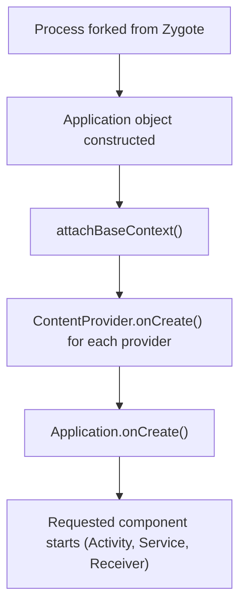

Because **`ContentProvider.onCreate()` runs before `Application.onCreate()`**, many libraries historically auto-initialized themselves through an empty provider (e.g. Firebase, WorkManager). Each provider costs startup time, which is why Jetpack **App Startup** merges them into one provider and lets you declare dependencies or initialize lazily.

#### Good uses vs bad uses

| Good | Bad |
|---|---|
| DI setup (`@HiltAndroidApp`), crash reporter, logging | Network calls, disk-heavy work, large JSON parsing on the main thread |
| Registering `ActivityLifecycleCallbacks` | Storing screen/UI state in fields (lost on process death, and not lifecycle-aware) |
| Providing `applicationContext` to singletons | Holding Activity references |

**Pitfalls:**
- **One per process:** if you use `android:process`, `Application.onCreate()` runs again in each process — guard expensive init by process name.
- Don't treat `Application` fields as durable storage; the process (and the object) can be killed at any time.
- `onTerminate()` is only called on emulators; never rely on it.

**Likely follow-ups:**
- *How do you speed up a slow `Application.onCreate()`?* — Lazy initialization, App Startup, moving work off the main thread, and Baseline Profiles.
- *Is `Application` a singleton?* — Per process, yes; the system creates exactly one.

</details>

### 12. What is Context? What are its types and how is it used?

<details>
<summary>Answer</summary>

**In short:** `Context` is an abstract class that gives your code access to the **app environment**: resources, system services, starting components, files and databases, and the current theme. The two you use most are the **Application context** (lives as long as the process, no UI theme) and the **Activity context** (tied to one screen, has the theme). Never store an Activity context in something that outlives the Activity — that's the classic memory leak.

#### What Context lets you do

```kotlin
context.getString(R.string.app_name)                       // resources
context.getSystemService<NotificationManager>()           // system services
context.startActivity(Intent(context, DetailActivity::class.java))
context.sendBroadcast(intent)
context.filesDir / context.getDatabasePath("app.db")      // storage
LayoutInflater.from(context).inflate(R.layout.row, parent, false)  // uses the theme
```

#### The class hierarchy

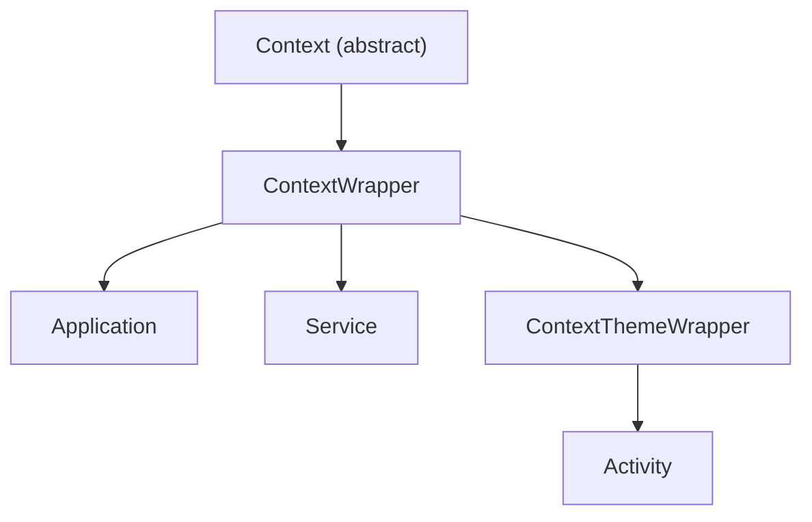

`ContextWrapper` delegates every call to a "base" `ContextImpl` created by the system. Activity extends `ContextThemeWrapper`, which is why it carries a theme and Application doesn't.

#### Which one to use

| Task | Application context | Activity context |
|---|---|---|
| Singletons, Room, Retrofit, WorkManager, DataStore | Yes | No (leak) |
| Inflating views, showing dialogs, themed attributes | No (no theme, wrong styling; dialogs crash) | Yes |
| Starting an Activity | Works only with `FLAG_ACTIVITY_NEW_TASK` | Yes (normal back stack) |
| Getting strings/resources | Yes (but not updated for per-Activity config like locale overrides) | Yes |
| Registering a dynamic receiver for the app's lifetime | Yes | Must unregister before Activity dies |

Other contexts: **Service** context, the `Context` passed to `BroadcastReceiver.onReceive()` (short-lived; don't keep it), and `ContextThemeWrapper` for applying a different theme to part of the UI. In Compose, use `LocalContext.current`.

#### Wrong vs right

```kotlin
// Wrong: a singleton holds the Activity → the whole screen (views, bitmaps) leaks
object ImageCache { lateinit var context: Context }
ImageCache.context = this   // inside an Activity

// Right: store the application context
object ImageCache { lateinit var context: Context }
ImageCache.context = activity.applicationContext
```

**Pitfalls:**
- Passing an Activity context into a `ViewModel` — use `AndroidViewModel` (application context) or, better, inject what you need.
- `view.context` inside a Fragment or Compose may be a `ContextThemeWrapper`, not the Activity; use `requireActivity()` or unwrap the `ContextWrapper` chain if you really need the Activity.

**Likely follow-ups:**
- *Why can't you show a Dialog with the Application context?* — A dialog needs a window token from an Activity window; you get `BadTokenException`.
- *`getApplicationContext()` vs `getApplication()`?* — Usually the same object; `getApplication()` exists only on Activity/Service and returns your `Application` subclass.

</details>

### 13. What is AndroidManifest.xml?

<details>
<summary>Answer</summary>

**In short:** The manifest is the app's declaration file that the system (and Google Play) reads **without running your code**. It declares the app's components and their **intent filters**, the **permissions** it requests and defines, required **hardware/software features**, **package visibility** (`<queries>`), and app-level settings like the `Application` class, theme and icon. The final manifest is **merged** from your module and all libraries.

#### Why it exists

The system must know about your app before any of it runs: which Activity shows in the launcher, which component handles `https://example.com/product/*`, which permissions to ask for, whether the device is compatible. The manifest is that contract.

```xml
<manifest xmlns:android="http://schemas.android.com/apk/res/android">

    <uses-permission android:name="android.permission.INTERNET" />
    <uses-permission android:name="android.permission.POST_NOTIFICATIONS" />
    <uses-feature android:name="android.hardware.camera" android:required="false" />

    <queries>   <!-- Android 11+ package visibility -->
        <intent>
            <action android:name="android.intent.action.VIEW" />
            <data android:scheme="geo" />
        </intent>
    </queries>

    <application
        android:name=".MyApp"
        android:icon="@mipmap/ic_launcher"
        android:label="@string/app_name"
        android:theme="@style/Theme.MyApp">

        <activity android:name=".MainActivity" android:exported="true">
            <intent-filter>
                <action android:name="android.intent.action.MAIN" />
                <category android:name="android.intent.category.LAUNCHER" />
            </intent-filter>
        </activity>

        <service android:name=".PlayerService"
            android:foregroundServiceType="mediaPlayback"
            android:exported="false" />
        <receiver android:name=".BootReceiver" android:exported="false" />
        <provider android:name=".DataProvider"
            android:authorities="com.example.app.data"
            android:exported="false" />
    </application>
</manifest>
```

#### What each part does

| Element | Purpose |
|---|---|
| `<uses-permission>` | Permissions you request (install-time or runtime) |
| `<permission>` | Custom permissions you define to protect your components |
| `<uses-feature>` | Hardware/software requirements; Play filters incompatible devices |
| `<queries>` | Which other apps you need to see/interact with (Android 11+) |
| `<application>` | App-wide attributes: Application class, theme, icon, backup rules, network security config |
| `<activity>`, `<service>`, `<receiver>`, `<provider>` | Component declarations |
| `<intent-filter>` | Which implicit intents a component handles (launcher, deep links, share targets) |
| `android:exported` | Whether other apps can start the component; **must be explicit for components with intent filters (Android 12+)** |

The **package name / application ID** is now set in Gradle (`namespace` and `applicationId`) rather than in the `package` attribute.

**Pitfalls:**
- Libraries can add permissions, providers and receivers you never wrote — review the **Merged Manifest**.
- Forgetting to declare a component gives `ActivityNotFoundException` (or a silent failure for services/receivers).

**Likely follow-ups:**
- *What happens if you don't set `exported` on an Activity with an intent filter when targeting API 31+?* — The build/install fails.
- *Where do minSdk/targetSdk live?* — In Gradle; they are written into the merged manifest at build time.

</details>

### 14. What are the important `<activity>` attributes in the manifest?

<details>
<summary>Answer</summary>

**In short:** The attributes interviewers ask about are `exported` (can other apps start it), `launchMode` and `taskAffinity` (how it behaves in tasks and the back stack), `configChanges` (handle config changes yourself instead of recreation), `windowSoftInputMode` (keyboard behavior), `screenOrientation`, `parentActivityName`, and its `<intent-filter>`s.

#### The ones to know well

| Attribute | What it does | Notes |
|---|---|---|
| `android:name`, `label`, `icon`, `theme` | Class, title, icon, theme for this Activity | Theme can differ per Activity (e.g. a splash or dialog theme) |
| `android:exported` | Can components of other apps start it? | Must be explicit if there's an intent filter (API 31+). Set `false` unless it's a launcher/deep-link/share entry point |
| `android:launchMode` | `standard` / `singleTop` / `singleTask` / `singleInstance` / `singleInstancePerTask` | Controls new instance vs reuse (`onNewIntent`) |
| `android:taskAffinity` | Which task the Activity prefers to belong to | Used with `singleTask` / `FLAG_ACTIVITY_NEW_TASK` |
| `allowTaskReparenting`, `clearTaskOnLaunch`, `alwaysRetainTaskState`, `finishOnTaskLaunch` | Fine-grained task behavior | Rarely needed, but appear in launch-mode questions |
| `android:noHistory` | Activity is removed from the back stack once the user leaves it | Useful for a splash or one-time screen |
| `android:configChanges` | List of changes you handle in `onConfigurationChanged()` instead of being recreated, e.g. `orientation\|screenSize\|keyboardHidden` | Common for video players/games; not a substitute for proper state saving |
| `android:screenOrientation` | Lock to portrait/landscape | **Ignored on large screens for apps targeting Android 16+** |
| `android:windowSoftInputMode` | `adjustResize` (layout shrinks) / `adjustPan` (window pans) / `stateHidden` etc. | With edge-to-edge, handle IME insets instead |
| `android:parentActivityName` | Logical parent for **Up** navigation | |
| `android:excludeFromRecents` | Hide from the Recents screen | |
| `android:resizeableActivity`, `supportsPictureInPicture` | Multi-window and PiP support | |
| `android:showWhenLocked`, `turnScreenOn` | Show over the lock screen (alarm, call UI) | |
| `android:hardwareAccelerated`, `android:process` | Rendering and which process the Activity runs in | |
| `<intent-filter>` children | `action`, `category`, `data` | Launcher entry, deep links, share targets |

#### Example

```xml
<activity
    android:name=".PlayerActivity"
    android:exported="false"
    android:launchMode="singleTop"
    android:configChanges="orientation|screenSize|screenLayout|smallestScreenSize"
    android:supportsPictureInPicture="true"
    android:windowSoftInputMode="adjustResize"
    android:parentActivityName=".MainActivity" />
```

**Pitfalls:**
- `configChanges` only stops recreation for the listed changes; locale, dark mode or process death still recreate the Activity, so you still need `ViewModel` + saved state.
- `singleInstance`/`singleTask` from a notification or deep link often surprise people — the Intent arrives in `onNewIntent()`, not `onCreate()`.

**Likely follow-ups:**
- *`singleTop` vs `singleTask`?* — `singleTop` reuses only if the Activity is already at the **top** of the current task; `singleTask` reuses the single instance in its task and clears the Activities above it.
- *Why is `screenOrientation` ignored on large screens now?* — For apps targeting Android 16+, the system ignores orientation/resizability restrictions on large screens (smallest width ≥ 600dp) so apps adapt to tablets and foldables.

</details>

---

## Intents

### 15. What is an Intent? Explicit vs implicit intent?

<details>
<summary>Answer</summary>

**In short:** An **Intent** is a messaging object that asks the system to do something with another component: start an Activity, start/bind a Service, or deliver a broadcast. An **explicit** Intent names the exact target class (used inside your app). An **implicit** Intent describes an **action** (plus data/category), and the system finds a component whose **intent filter** matches — possibly in another app.

#### What an Intent carries

| Field | Example | Used for |
|---|---|---|
| Component | `DetailActivity::class.java` | Explicit targeting |
| Action | `Intent.ACTION_VIEW`, `ACTION_SEND` | What to do |
| Data (URI + MIME type) | `https://example.com`, `image/png` | What to act on |
| Category | `CATEGORY_BROWSABLE`, `CATEGORY_LAUNCHER` | Extra info for resolution |
| Extras (`Bundle`) | `putExtra("id", 42)` | Payload |
| Flags | `FLAG_ACTIVITY_NEW_TASK`, `FLAG_GRANT_READ_URI_PERMISSION` | Task behavior, URI permissions |

#### Explicit

```kotlin
val intent = Intent(this, DetailActivity::class.java).apply {
    putExtra("product_id", 42L)
}
startActivity(intent)
```

Use it for your own components. It always goes to that component (if it exists and is allowed), and it's required for starting **Services** — implicit service intents throw an exception since Android 5.0.

#### Implicit

```kotlin
// Open a URL in whatever browser the user prefers
startActivity(Intent(Intent.ACTION_VIEW, Uri.parse("https://developer.android.com")))

// Share text, always showing a picker
val send = Intent(Intent.ACTION_SEND).apply {
    type = "text/plain"
    putExtra(Intent.EXTRA_TEXT, "Check this out")
}
startActivity(Intent.createChooser(send, "Share via"))
```

The system compares the Intent against all registered intent filters. One match → it opens directly; several → the user picks (or a default is used); none → `ActivityNotFoundException`.

```kotlin
// Safe launch: there might be no app that can handle it
try {
    startActivity(intent)
} catch (e: ActivityNotFoundException) {
    showToast("No app can open this")
}
```

**Pitfalls:**
- `resolveActivity()` returns `null` on Android 11+ unless you declare `<queries>`; catching `ActivityNotFoundException` is simpler.
- Implicit Intents to your **own** components are a security risk — another app could register a matching filter and intercept them. Use explicit Intents internally.
- Since Android 14, implicit Intents can only be delivered to **exported** components; internal targets should use explicit Intents.

**Likely follow-ups:**
- *Can you start a Service with an implicit Intent?* — No; since Android 5.0 `startService`/`bindService` require an explicit Intent.
- *What does `createChooser` add?* — It always shows the picker, even if the user set a default app.

</details>

### 16. What is an Intent Filter? How are implicit intents resolved?

<details>
<summary>Answer</summary>

**In short:** An `<intent-filter>` declares which implicit Intents a component can handle. The system resolves an implicit Intent by running three tests against each filter: **action** (must match one listed action), **category** (every category in the Intent must be in the filter — and Activities need `CATEGORY_DEFAULT`), and **data** (URI scheme/host/path and MIME type). Components that pass all three are candidates; with several, the user chooses.

#### Example filter

```xml
<activity android:name=".ProductActivity" android:exported="true">
    <intent-filter>
        <action android:name="android.intent.action.VIEW" />
        <category android:name="android.intent.category.DEFAULT" />
        <category android:name="android.intent.category.BROWSABLE" />
        <data android:scheme="https"
              android:host="shop.example.com"
              android:pathPrefix="/product" />
    </intent-filter>
</activity>
```

#### The three tests

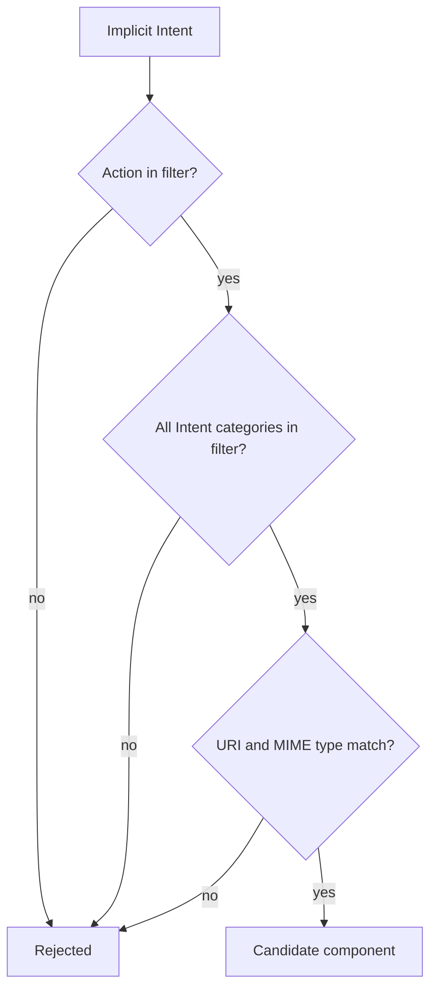

| Test | Rule | Gotcha |
|---|---|---|
| **Action** | The Intent's action must be one of the filter's actions | A filter with no actions matches nothing |
| **Category** | **Every** category on the Intent must appear in the filter (the filter may have extra ones) | `startActivity()` adds `CATEGORY_DEFAULT` automatically, so Activities must declare it to receive implicit Intents |
| **Data** | Scheme, host, port, path (`path`, `pathPrefix`, `pathPattern`) and MIME type must match what the filter specifies | Multiple `<data>` tags in one filter are **combined**, which can match more URIs than you intended — use separate filters |

#### Resolution outcome

- **No match:** `ActivityNotFoundException`.
- **One match:** started directly.
- **Several matches:** a disambiguation dialog (unless the user set a default, or the link is a verified **App Link**).

#### Package visibility (Android 11+)

Apps targeting 30+ can't see most other installed apps by default. To **query** (`queryIntentActivities`, `resolveActivity`) or interact with specific apps, declare them in `<queries>`. Simply calling `startActivity()` with an implicit Intent still works without it.

**Likely follow-ups:**
- *Why does my deep link open the browser instead of my app?* — Missing `BROWSABLE`/`DEFAULT`, a data mismatch, or (Android 12+) an unverified `https` link.
- *How do you test a filter?* — `adb shell am start -a android.intent.action.VIEW -d "https://shop.example.com/product/1"`.

</details>

### 17. What is a PendingIntent? What are mutability flags?

<details>
<summary>Answer</summary>

**In short:** A **PendingIntent** wraps an Intent in a token you hand to **another app or system service** (NotificationManager, AlarmManager, a widget host), so it can execute that Intent **later, with your app's identity and permissions** — even if your process is dead. Since **Android 12** you must declare **`FLAG_IMMUTABLE`** (recommended) or **`FLAG_MUTABLE`** (only when the other side must fill in data, e.g. inline reply).

#### Why it exists

When the user taps a notification, it's the **System UI** process that handles the tap, not your app. It needs a way to say "start *that* app's DetailActivity, as if that app did it" without being able to launch arbitrary components itself. The PendingIntent is that pre-authorized capability, held by the system.

```kotlin
val intent = Intent(context, DetailActivity::class.java).apply {
    putExtra("message_id", messageId)
}
val pending = PendingIntent.getActivity(
    context,
    messageId,                                   // requestCode: makes it distinct
    intent,
    PendingIntent.FLAG_IMMUTABLE or PendingIntent.FLAG_UPDATE_CURRENT
)

val notification = NotificationCompat.Builder(context, CHANNEL_ID)
    .setSmallIcon(R.drawable.ic_message)
    .setContentTitle("New message")
    .setContentIntent(pending)
    .setAutoCancel(true)
    .build()
```

Factory methods: `getActivity`, `getActivities`, `getService`, `getForegroundService`, `getBroadcast`.

#### Flags

| Flag | Meaning |
|---|---|
| `FLAG_IMMUTABLE` | The receiving app can't modify the wrapped Intent. **Default choice.** |
| `FLAG_MUTABLE` | The receiving app may fill in unspecified fields — needed for **inline reply** (`RemoteInput`), bubbles, some `AlarmManager`/location APIs |
| `FLAG_UPDATE_CURRENT` | If a matching PendingIntent exists, keep it but replace its extras |
| `FLAG_CANCEL_CURRENT` | Cancel the existing one and create a new one |
| `FLAG_NO_CREATE` | Return `null` instead of creating (to check if one exists) |
| `FLAG_ONE_SHOT` | Can be used only once |

#### How "matching" works (common bug)

The system identifies a PendingIntent by **request code + Intent's action, data, type, component and categories**. **Extras are not compared.** So two notifications created with the same request code and same target Intent but different extras share **one** PendingIntent — tapping either opens the same item. Fix it by using a unique request code (or unique data URI).

**Pitfalls:**
- Mutable PendingIntents wrapping **implicit** Intents are a security hole (another app could redirect them); Android 14 blocks creating mutable PendingIntents with implicit Intents for apps targeting it.
- Forgetting the mutability flag on Android 12+ throws `IllegalArgumentException`.

**Likely follow-ups:**
- *Why do all my notifications open the same item?* — Same request code and same Intent identity; extras don't make them distinct.
- *Does a PendingIntent survive process death?* — Yes; it's held by the system and recreates your process when fired.

</details>

### 18. What are deep links vs App Links?

<details>
<summary>Answer</summary>

**In short:** A **deep link** is any URI (custom scheme like `myapp://product/1`, or `https`) that opens a specific screen through an intent filter; if several apps can handle it, the user may see a chooser. An **Android App Link** is a **verified `https` link**: you add `android:autoVerify="true"` and host a `/.well-known/assetlinks.json` file on your domain, and the system opens your app **directly**, with no chooser. Since Android 12, unverified web links open in the browser by default.

#### Comparison

| | Custom-scheme deep link | Web link (unverified `https`) | App Link (verified `https`) |
|---|---|---|---|
| Example | `myapp://product/1` | `https://shop.example.com/product/1` | same, verified |
| Ownership proved? | No — any app can claim the scheme | No | Yes, via `assetlinks.json` |
| User experience | Opens app (chooser if multiple) | Android 12+: opens in browser by default | Opens your app directly |
| Works if app not installed | No (link is dead) | Yes (website) | Yes (falls back to website) |

#### Setting up an App Link

```xml
<activity android:name=".ProductActivity" android:exported="true">
    <intent-filter android:autoVerify="true">
        <action android:name="android.intent.action.VIEW" />
        <category android:name="android.intent.category.DEFAULT" />
        <category android:name="android.intent.category.BROWSABLE" />
        <data android:scheme="https" android:host="shop.example.com"
              android:pathPrefix="/product" />
    </intent-filter>
</activity>
```

Host this at `https://shop.example.com/.well-known/assetlinks.json`:

```json
[{
  "relation": ["delegate_permission/common.handle_all_urls"],
  "target": {
    "namespace": "android_app",
    "package_name": "com.example.shop",
    "sha256_cert_fingerprints": ["AB:CD:..."]
  }
}]
```

At install (and periodically), the system fetches the file and checks the package name and signing certificate fingerprint. If it matches, your app becomes the verified handler for that domain.

#### Handling the link

```kotlin
override fun onCreate(savedInstanceState: Bundle?) {
    super.onCreate(savedInstanceState)
    handleLink(intent)
}

override fun onNewIntent(intent: Intent) {   // when Activity already exists (singleTop etc.)
    super.onNewIntent(intent)
    handleLink(intent)
}

private fun handleLink(intent: Intent) {
    val id = intent.data?.lastPathSegment ?: return
    viewModel.loadProduct(id)
}
```

Navigation (Views or Compose) can map URIs to destinations with `deepLinks`/`navDeepLink`.

**Pitfalls:**
- Use the **release** (or Play App Signing) certificate fingerprint in `assetlinks.json`; using the debug one makes verification fail in production.
- Treat link parameters as **untrusted input** — validate IDs and never perform sensitive actions just because a link was opened.

**Likely follow-ups:**
- *How do you check verification status?* — `adb shell pm get-app-links <package>`, and Settings → "Open by default".
- *What about users without the app?* — App Links fall back to the website; for install-then-open flows you need deferred deep linking (e.g. Play Install Referrer).

</details>

### 19. How do you pass data between Activities and Fragments?

<details>
<summary>Answer</summary>

**In short:** **Activity → Activity:** Intent extras; get results back with the **Activity Result API** (`registerForActivityResult`), since `startActivityForResult` is deprecated. **Fragment ↔ Fragment:** a **shared ViewModel**, the **Fragment Result API**, or Navigation **Safe Args**. **Arguments to a Fragment:** a `Bundle` in `arguments`, never constructor parameters. Keep payloads small — pass **IDs, not big objects** — because Binder transactions are limited to about **1 MB**.

#### Activity → Activity

```kotlin
// Sender
startActivity(Intent(this, DetailActivity::class.java).putExtra("product_id", 42L))

// Receiver
val productId = intent.getLongExtra("product_id", -1L)
```

#### Getting a result back (Activity Result API)

```kotlin
private val pickImage = registerForActivityResult(ActivityResultContracts.GetContent()) { uri: Uri? ->
    uri?.let { viewModel.onImagePicked(it) }
}

fun onPickClicked() = pickImage.launch("image/*")
```

Register at initialization (as a property), not inside a click handler — it must be registered before the Activity/Fragment is `STARTED` so results can be delivered after recreation.

#### Fragment arguments

```kotlin
class DetailFragment : Fragment() {
    companion object {
        fun newInstance(id: Long) = DetailFragment().apply {
            arguments = bundleOf("product_id" to id)
        }
    }
    private val productId by lazy { requireArguments().getLong("product_id") }
}
```

Why not a constructor? After a configuration change or process death, the `FragmentManager` re-creates fragments with the **no-arg constructor** and restores `arguments` — constructor parameters would be lost.

#### Fragment ↔ Fragment

| Approach | Best for | Example |
|---|---|---|
| **Shared ViewModel** (`activityViewModels()` or nav-graph scoped) | Ongoing shared state | List + detail panes, multi-step form |
| **Fragment Result API** | One-shot results | A picker dialog returning a choice |
| **Navigation Safe Args / type-safe routes** | Arguments to a destination | Navigating to a detail screen with an ID |

```kotlin
// Child: send result
setFragmentResult("color_request", bundleOf("color" to "red"))

// Parent: listen
setFragmentResultListener("color_request") { _, bundle ->
    val color = bundle.getString("color")
}
```

#### Size limit

The Binder transaction buffer is about **1 MB, shared by all transactions in progress in the process**. Large extras (a list of thousands of items, a bitmap) cause `TransactionTooLargeException`, sometimes later when `onSaveInstanceState` is written. Pass an ID and load the data from a repository/database on the other side.

**Pitfalls:**
- Fragments talking to each other directly via `parentFragmentManager.findFragmentById()` and casting — tight coupling; use one of the patterns above.
- Interfaces implemented by the host Activity ("callback interface") still work but are boilerplate-heavy; the patterns above replace them.

**Likely follow-ups:**
- *Why was `startActivityForResult` deprecated?* — Results were delivered to a single `onActivityResult` with request-code juggling, and broke with process death in fragments; the new API is type-safe and lifecycle-aware.
- *How do you share data across processes?* — Not with a ViewModel; use a ContentProvider, a bound service, or persistent storage.

</details>

### 20. Parcelable vs Serializable?

<details>
<summary>Answer</summary>

**In short:** Both let you put objects into Intents and Bundles. **Serializable** is the Java standard marker interface; it uses **reflection** and creates many temporary objects, so it's slow. **Parcelable** is Android-specific and writes/reads fields explicitly into a `Parcel`, so it's **much faster**. Its boilerplate is generated by **`@Parcelize`** (kotlin-parcelize plugin), so on Android use **Parcelable with `@Parcelize`**.

#### Comparison

| | Serializable | Parcelable |
|---|---|---|
| Origin | Java standard (`java.io.Serializable`) | Android (`android.os.Parcelable`) |
| How it works | Reflection walks the object graph and writes class metadata | You (or generated code) write each field to a `Parcel` in order |
| Speed | Slow, many temporary objects → more GC | Fast, minimal allocation |
| Boilerplate | None | Manual is verbose; `@Parcelize` removes it |
| Use on disk / network | Possible (but fragile) | **No** — `Parcel` format isn't stable across versions; it's for IPC only |
| Versioning | `serialVersionUID` | None |

#### Code

```kotlin
// build.gradle.kts: plugins { id("kotlin-parcelize") }
@Parcelize
data class User(val id: Int, val name: String) : Parcelable

// Sending
intent.putExtra("user", user)

// Receiving (API 33+ type-safe overload; IntentCompat for older)
val user = IntentCompat.getParcelableExtra(intent, "user", User::class.java)
```

What `@Parcelize` generates for you, roughly:

```kotlin
override fun writeToParcel(dest: Parcel, flags: Int) {
    dest.writeInt(id)
    dest.writeString(name)
}
companion object CREATOR : Parcelable.Creator<User> {
    override fun createFromParcel(src: Parcel) = User(src.readInt(), src.readString()!!)
    override fun newArray(size: Int) = arrayOfNulls<User>(size)
}
```

Fields must be read in **exactly the same order** they were written — a common bug in hand-written Parcelables.

**Pitfalls:**
- Don't persist Parcels to disk or send them over the network; use JSON/Protobuf (kotlinx.serialization) for that.
- Even Parcelable objects shouldn't be large — the ~1 MB Binder limit still applies.
- The old `getParcelableExtra(key)` is deprecated on API 33+; use the class-typed overload or `IntentCompat`/`BundleCompat`.

**Likely follow-ups:**
- *Is Serializable always slower?* — With custom `writeObject`/`readObject` it can be faster than the default, but Parcelable with generated code is the standard Android answer.
- *What about kotlinx.serialization?* — It's for converting to JSON/Protobuf (network, disk), not a replacement for Parcelable in Bundles; Navigation type-safe routes use it to encode arguments.

</details>

### 21. What is a Bundle?

<details>
<summary>Answer</summary>

**In short:** A `Bundle` is a **key-value map** (`String` keys) of values that can be **parcelled**: primitives, Strings, arrays, Parcelables, Serializables. It's used for **Intent extras, Fragment arguments, `onSaveInstanceState`** and `SavedStateHandle`. Because it often crosses processes through Binder, it's limited by the **~1 MB transaction buffer**, so keep it small.

#### Where you meet it

```kotlin
// Fragment arguments
val fragment = DetailFragment().apply { arguments = bundleOf("id" to 42L) }

// Saving UI state across process death
override fun onSaveInstanceState(outState: Bundle) {
    super.onSaveInstanceState(outState)
    outState.putString("query", searchQuery)
}

override fun onCreate(savedInstanceState: Bundle?) {
    super.onCreate(savedInstanceState)
    searchQuery = savedInstanceState?.getString("query").orEmpty()
}
```

In a ViewModel, `SavedStateHandle` is backed by the same saved-state Bundle.

#### How it works

- Internally it's backed by an `ArrayMap` (memory-efficient for small maps).
- When it crosses a process boundary (e.g. `startActivity`, or the system saving your state), it's written into a `Parcel`. On the other side it is **unparcelled lazily**, when you first read a value.
- The saved-state Bundle is held by `system_server`, which is how your state survives **process death**.

**Pitfalls:**
- `TransactionTooLargeException` from putting big lists or bitmaps in a Bundle (often in `onSaveInstanceState`). Save IDs/small state; persist the rest (Room, files).
- Keys are untyped strings — define them as constants to avoid typos.

**Likely follow-ups:**
- *Why use a Bundle and not a Map?* — See question 33: it's Parcelable and restricted to marshallable types.
- *Does a Bundle survive process death?* — The one passed to `onSaveInstanceState` does (held by the system); Intent extras of the launching Intent are also restored.

</details>

---

## Broadcasts & Content Providers

### 22. What is a BroadcastReceiver? Static vs dynamic registration?

<details>
<summary>Answer</summary>

**In short:** A BroadcastReceiver receives broadcast Intents from the system or other apps (`BOOT_COMPLETED`, `AIRPLANE_MODE_CHANGED`, `LOCALE_CHANGED`…). **Static** receivers are declared in the manifest and can wake your app even when it isn't running, but since **Android 8.0** most **implicit** broadcasts can't be received this way. **Dynamic** receivers are registered in code with `registerReceiver()` and only work while registered; on **Android 14+** you must pass `RECEIVER_EXPORTED` or `RECEIVER_NOT_EXPORTED`. `onReceive()` runs on the **main thread** and must finish quickly (~10 s).

#### Static (manifest) registration

```xml
<receiver android:name=".BootReceiver" android:exported="false">
    <intent-filter>
        <action android:name="android.intent.action.BOOT_COMPLETED" />
    </intent-filter>
</receiver>
```

```kotlin
class BootReceiver : BroadcastReceiver() {
    override fun onReceive(context: Context, intent: Intent) {
        if (intent.action == Intent.ACTION_BOOT_COMPLETED) {
            // Don't do work here — schedule it
            WorkManager.getInstance(context).enqueue(OneTimeWorkRequestBuilder<SyncWorker>().build())
        }
    }
}
```

**Why Android 8.0 restricted it:** a broadcast like `CONNECTIVITY_ACTION` used to wake up dozens of apps at once, each starting a process, which drained battery and RAM. Now manifest receivers only get **explicit** broadcasts (targeted at your package) and a short **exemption list** of implicit ones (e.g. `BOOT_COMPLETED`, `LOCALE_CHANGED`, `ACTION_TIMEZONE_CHANGED`).

#### Dynamic (context) registration

```kotlin
class MainActivity : ComponentActivity() {
    private val batteryReceiver = object : BroadcastReceiver() {
        override fun onReceive(context: Context, intent: Intent) {
            val level = intent.getIntExtra(BatteryManager.EXTRA_LEVEL, -1)
            updateBatteryUi(level)
        }
    }

    override fun onStart() {
        super.onStart()
        ContextCompat.registerReceiver(
            this, batteryReceiver,
            IntentFilter(Intent.ACTION_BATTERY_CHANGED),
            ContextCompat.RECEIVER_NOT_EXPORTED      // not receiving from other apps
        )
    }

    override fun onStop() {
        unregisterReceiver(batteryReceiver)           // matching callback, avoids leaks
        super.onStop()
    }
}
```

| | Static (manifest) | Dynamic (code) |
|---|---|---|
| Works when app not running | Yes | No |
| Implicit broadcasts (API 26+) | Only exempt ones | Yes |
| Lifetime | Always (while installed and enabled) | Between `register` and `unregister` |
| Export flag | `android:exported` | `RECEIVER_EXPORTED` / `RECEIVER_NOT_EXPORTED` (required for API 34+) |

#### Threading and time limits

`onReceive()` runs on the main thread; the receiver object is only valid during the call, and the process is considered foreground only while it runs. If it takes ~10 s, you get an ANR. For longer work:
- `goAsync()` → returns a `PendingResult`, lets you finish on a background thread (still short, total ~10 s), then call `finish()`.
- Enqueue **WorkManager** for anything longer or that must be guaranteed.

**Pitfalls:**
- Forgetting to unregister → leaked Activity and `IntentReceiverLeaked` warnings.
- Exporting receivers unnecessarily lets any app send them spoofed Intents.

**Likely follow-ups:**
- *How do you protect a receiver from other apps?* — `exported="false"` / `RECEIVER_NOT_EXPORTED`, or require a `signature`-level permission on the sender.
- *Why not start a thread in `onReceive()`?* — The process may be killed as soon as `onReceive()` returns.

</details>

### 23. What are normal, ordered, sticky and local broadcasts?

<details>
<summary>Answer</summary>

**In short:** **Normal** broadcasts (`sendBroadcast`) are asynchronous and delivered to all receivers in no defined order. **Ordered** broadcasts (`sendOrderedBroadcast`) go to one receiver at a time by **priority**, and each can modify the result or **abort** it. **Sticky** broadcasts (kept after sending) are **deprecated** for security reasons. **`LocalBroadcastManager`** (in-app only) is **deprecated** — use Flow, LiveData or a shared ViewModel for in-app events.

| Type | API | Delivery | Status |
|---|---|---|---|
| **Normal** | `sendBroadcast(intent)` | All matching receivers, effectively in parallel, no order | Current |
| **Ordered** | `sendOrderedBroadcast(intent, permission)` | One at a time by `android:priority`; can `setResultData()` / `abortBroadcast()` | Current, rarely needed |
| **Sticky** | `sendStickyBroadcast()` | Last Intent kept; new receivers get it immediately on register | **Deprecated** (no security; anyone can send/modify) |
| **Local** | `LocalBroadcastManager` | In-process only | **Deprecated** |

#### Ordered broadcast flow

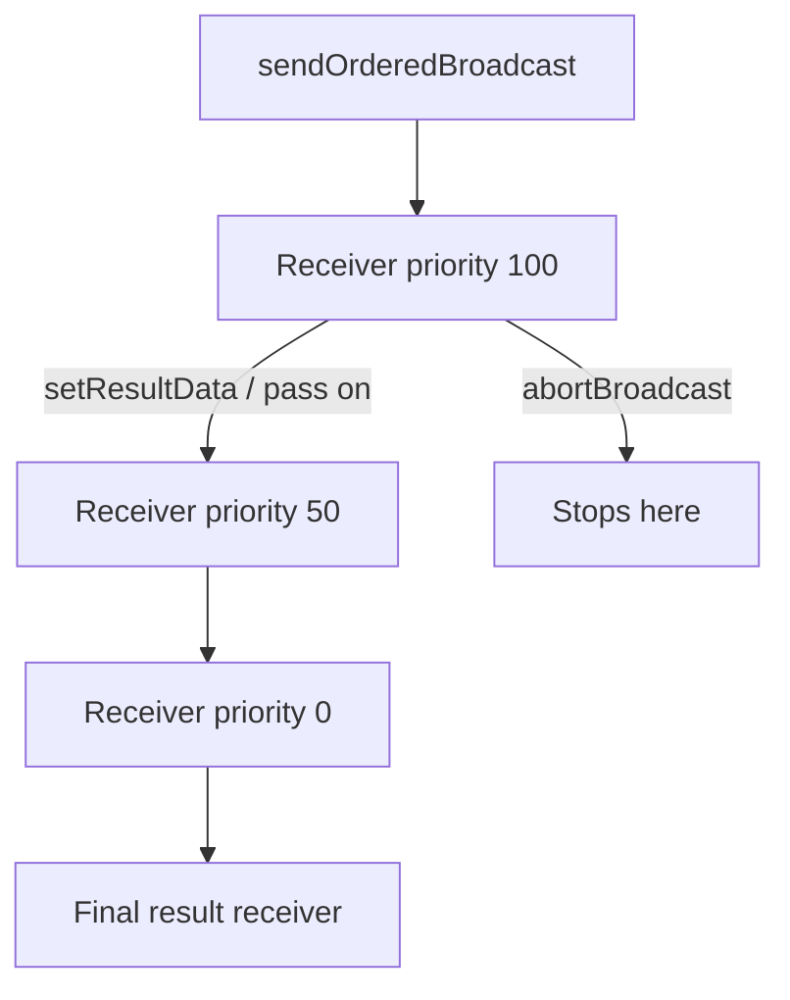

#### Sticky broadcasts you still see

The system still sends a few sticky broadcasts, the classic one being `ACTION_BATTERY_CHANGED`. You can read its last value without a receiver:

```kotlin
val status: Intent? = context.registerReceiver(null, IntentFilter(Intent.ACTION_BATTERY_CHANGED))
val level = status?.getIntExtra(BatteryManager.EXTRA_LEVEL, -1)
```

#### Why LocalBroadcastManager was deprecated

It was an app-wide event bus: it didn't respect lifecycles, allowed any layer to talk to any other, and duplicated what observable types already do. Replace it with:

```kotlin
// A repository/singleton exposes events
class SessionRepository {
    private val _loggedOut = MutableSharedFlow<Unit>()
    val loggedOut: SharedFlow<Unit> = _loggedOut
    suspend fun logout() = _loggedOut.emit(Unit)
}

// Collected in a lifecycle-aware way in the UI
lifecycleScope.launch {
    repeatOnLifecycle(Lifecycle.State.STARTED) {
        sessionRepository.loggedOut.collect { navigateToLogin() }
    }
}
```

**Pitfalls:**
- Sending app-internal broadcasts without `setPackage()` or a permission leaks data to other apps.

**Likely follow-ups:**
- *Where are ordered broadcasts used?* — Historically SMS interception; today mostly when a sender needs a collected result from receivers.
- *How do you limit who receives your broadcast?* — `intent.setPackage(...)` or a receiver permission in `sendBroadcast(intent, permission)`.

</details>

### 24. What is a Content Provider? When do you need one?

<details>
<summary>Answer</summary>

**In short:** A Content Provider exposes structured data through a **standard CRUD interface** (`query`, `insert`, `update`, `delete`, `getType`) addressed by **content URIs** (`content://authority/path/id`). Other code accesses it through **`ContentResolver`**, and the system handles cross-process calls and permission checks. You need one to **share data with other apps** or plug into system features (**`FileProvider`**, search suggestions, widgets, sync adapters). For private app data, just use **Room**.

#### Why it exists

Apps are sandboxed — another app can't open your database file. A Content Provider is the controlled door: the system routes requests to your process via Binder, enforces read/write permissions, and lets you grant **temporary per-URI access**. Contacts, Calendar, MediaStore and the user dictionary are all exposed this way.

#### Anatomy of a content URI

```
content://com.example.notes.provider/notes/42
  scheme   authority (unique, in manifest)  path   id
```

#### Implementing one (minimal)

```kotlin
class NotesProvider : ContentProvider() {
    private lateinit var db: NotesDatabase

    private val matcher = UriMatcher(UriMatcher.NO_MATCH).apply {
        addURI(AUTHORITY, "notes", NOTES)
        addURI(AUTHORITY, "notes/#", NOTE_ID)
    }

    override fun onCreate(): Boolean {          // runs before Application.onCreate(); keep cheap
        db = NotesDatabase.get(context!!)
        return true
    }

    override fun query(uri: Uri, projection: Array<String>?, selection: String?,
                       args: Array<String>?, sortOrder: String?): Cursor? =
        when (matcher.match(uri)) {
            NOTES -> db.noteDao().allCursor()
            NOTE_ID -> db.noteDao().byIdCursor(ContentUris.parseId(uri))
            else -> throw IllegalArgumentException("Unknown URI $uri")
        }.also { it.setNotificationUri(context!!.contentResolver, uri) }

    // insert / update / delete call context.contentResolver.notifyChange(uri, null)
    override fun insert(uri: Uri, values: ContentValues?): Uri? = TODO()
    override fun update(uri: Uri, values: ContentValues?, s: String?, a: Array<String>?) = 0
    override fun delete(uri: Uri, s: String?, a: Array<String>?) = 0
    override fun getType(uri: Uri): String? = null

    companion object {
        const val AUTHORITY = "com.example.notes.provider"
        private const val NOTES = 1
        private const val NOTE_ID = 2
    }
}
```

```xml
<provider
    android:name=".NotesProvider"
    android:authorities="com.example.notes.provider"
    android:exported="true"
    android:readPermission="com.example.notes.READ" />
```

#### When you need one vs not

| Need a provider | Don't need one |
|---|---|
| Sharing data with **other apps** | Data private to your app → Room / DataStore |
| Sharing **files** via `content://` → `FileProvider` (`file://` URIs throw `FileUriExposedException` on 7.0+) | Passing data between your own screens |
| Search suggestions, app widgets backed by a collection, sync adapters | "Because it's a best practice" — it isn't for private data |
| Reading system data: Contacts, MediaStore, Calendar (as a client) | |

**Pitfalls:**
- SQL injection via `selection` strings — always use `selectionArgs` placeholders.
- Provider methods (except `onCreate`) can be called on **Binder threads** concurrently; make them thread-safe.
- Heavy `onCreate()` slows every cold start, because providers are created before `Application.onCreate()`.

**Likely follow-ups:**
- *How do you grant temporary access to one record?* — `grantUriPermissions="true"` on the provider and `FLAG_GRANT_READ_URI_PERMISSION` on the Intent.
- *Which thread does `query()` run on?* — The caller's thread in the same process, or a Binder thread for cross-process calls.

</details>

### 25. What is a ContentResolver and ContentObserver?

<details>
<summary>Answer</summary>

**In short:** **`ContentResolver`** is the client-side API for content providers: you call `query/insert/update/delete` with a `content://` URI, and it routes the call to the right provider (in your process or another one) based on the URI's **authority**. **`ContentObserver`** lets you register for **change notifications** on a URI — for example, to react when a new photo is added to MediaStore.

#### ContentResolver: the client

```kotlin
val projection = arrayOf(MediaStore.Images.Media._ID, MediaStore.Images.Media.DISPLAY_NAME)
val sortOrder = "${MediaStore.Images.Media.DATE_ADDED} DESC"

context.contentResolver.query(
    MediaStore.Images.Media.EXTERNAL_CONTENT_URI, projection, null, null, sortOrder
)?.use { cursor ->
    val idCol = cursor.getColumnIndexOrThrow(MediaStore.Images.Media._ID)
    while (cursor.moveToNext()) {
        val uri = ContentUris.withAppendedId(
            MediaStore.Images.Media.EXTERNAL_CONTENT_URI, cursor.getLong(idCol))
        // load uri with Coil/Glide
    }
}
```

It also opens streams: `contentResolver.openInputStream(uri)` — the standard way to read a file a user picked or another app shared.

#### How the pieces connect

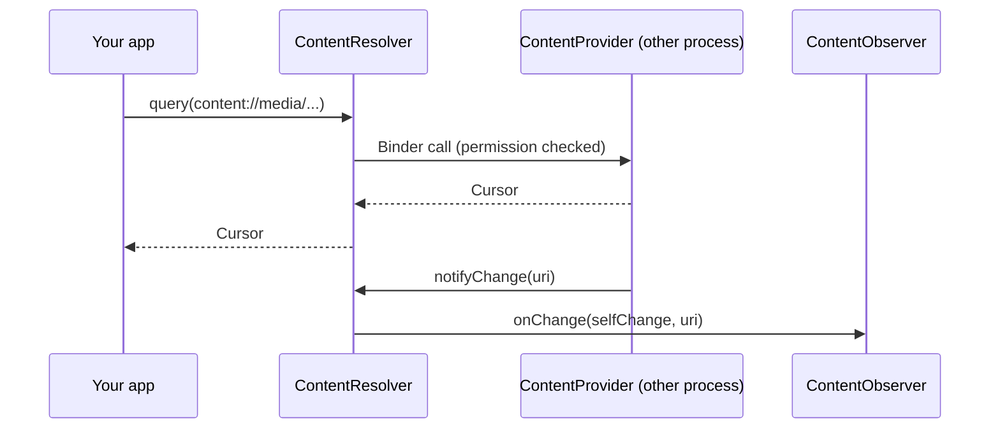

#### ContentObserver: change notifications

```kotlin
private val observer = object : ContentObserver(Handler(Looper.getMainLooper())) {
    override fun onChange(selfChange: Boolean, uri: Uri?) {
        viewModel.reloadImages()
    }
}

override fun onStart() {
    super.onStart()
    contentResolver.registerContentObserver(
        MediaStore.Images.Media.EXTERNAL_CONTENT_URI,
        true,          // notifyForDescendants: also changes to child URIs
        observer
    )
}

override fun onStop() {
    contentResolver.unregisterContentObserver(observer)
    super.onStop()
}
```

The provider side triggers it by calling `contentResolver.notifyChange(uri, null)` after writes. Wrapping an observer in `callbackFlow` gives you a Flow of changes.

**Pitfalls:**
- Forgetting to close the `Cursor` (use `.use {}`) leaks resources.
- Forgetting to unregister observers leaks the Activity.
- `onChange` can fire many times in quick succession; debounce before re-querying.

**Likely follow-ups:**
- *How does Room's Flow know a table changed?* — Room uses its own `InvalidationTracker` (SQLite triggers), not `ContentObserver`.
- *Do you need permissions to query MediaStore?* — On Android 13+, `READ_MEDIA_IMAGES`/`VIDEO`/`AUDIO` (or the photo picker, which needs none).

</details>

---

## IPC & Misc

### 26. What is Binder / IPC in Android? What is AIDL?

<details>
<summary>Answer</summary>

**In short:** **Binder** is Android's core **inter-process communication (IPC)** mechanism: a kernel driver plus a framework that lets one process call methods on an object in another process as if it were local. Almost every system call from an app (starting an Activity, `getSystemService`, querying a provider) is a Binder transaction to `system_server`. **AIDL** (Android Interface Definition Language) defines interfaces for **bound services across processes** and generates the **Stub** (server) and **Proxy** (client) classes. Simpler options are a **Messenger** or one-way Intents/broadcasts.

#### Why Binder (and not sockets or pipes)?

- **One copy:** data is copied once from the sender into memory mapped by the receiver, which is faster than socket/pipe IPC (two copies).
- **Identity:** the kernel attaches the caller's **UID/PID** to every transaction, so services can check permissions reliably (`Binder.getCallingUid()`).
- **Object model:** you get references to remote objects, death notifications (`linkToDeath`), and a thread pool on the receiving side.

#### How a call flows

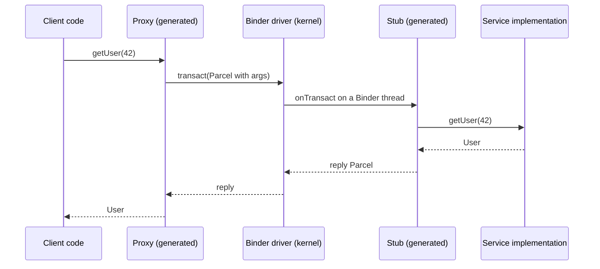

#### AIDL example

```java
// IUserService.aidl
package com.example.users;
import com.example.users.User;   // User must be Parcelable and have its own .aidl declaration

interface IUserService {
    User getUser(int id);
    oneway void logEvent(String name);   // oneway = async, caller doesn't wait
}
```

```kotlin
// Service side
class UserService : Service() {
    private val binder = object : IUserService.Stub() {
        override fun getUser(id: Int): User {
            // Runs on a Binder thread pool, NOT the main thread — must be thread-safe
            return repository.find(id)
        }
        override fun logEvent(name: String) { /* ... */ }
    }
    override fun onBind(intent: Intent): IBinder = binder
}

// Client side
private val connection = object : ServiceConnection {
    override fun onServiceConnected(name: ComponentName, service: IBinder) {
        userService = IUserService.Stub.asInterface(service)   // returns a Proxy if remote
    }
    override fun onServiceDisconnected(name: ComponentName) { userService = null }
}
```

#### Choosing an IPC option

| Option | Threading | Use when |
|---|---|---|
| **AIDL** | Concurrent calls on Binder thread pool | Multiple clients, rich API, cross-app SDK |
| **Messenger** | Single Handler queue, one message at a time | Simple command/response, no thread-safety work |
| **Local Binder** (extend `Binder`, return the service) | Same process only | Bound service inside your own app |
| **Intents / broadcasts** | One-way | Fire-and-forget messages |
| **ContentProvider** | Binder threads | Sharing tabular data/files |

**Pitfalls:**
- Synchronous Binder calls block the caller; calling a slow remote method on the main thread causes ANRs.
- The ~1 MB transaction buffer applies to all Binder calls, including AIDL arguments.
- Handle `DeadObjectException`/`RemoteException` — the other process can die anytime.

**Likely follow-ups:**
- *What thread does an AIDL method run on in the service?* — A Binder thread from the service process's pool (or the caller's thread if same process).
- *What does `oneway` do?* — Makes the call asynchronous; the client doesn't wait for a reply.

</details>

### 27. What happens when you tap an app icon (app launch flow)?

<details>
<summary>Answer</summary>

**In short:** The Launcher sends a `startActivity` Intent through Binder to **`system_server`** (ActivityTaskManager/ActivityManager). If the app has no process, the system asks **Zygote** to **fork** one. The new process runs `ActivityThread.main()`, starts the main **Looper**, and attaches to the system. The system tells it to create the `Application` (ContentProviders first, then `Application.onCreate()`), then launch the Activity (`onCreate → onStart → onResume`), and the first frame is drawn.

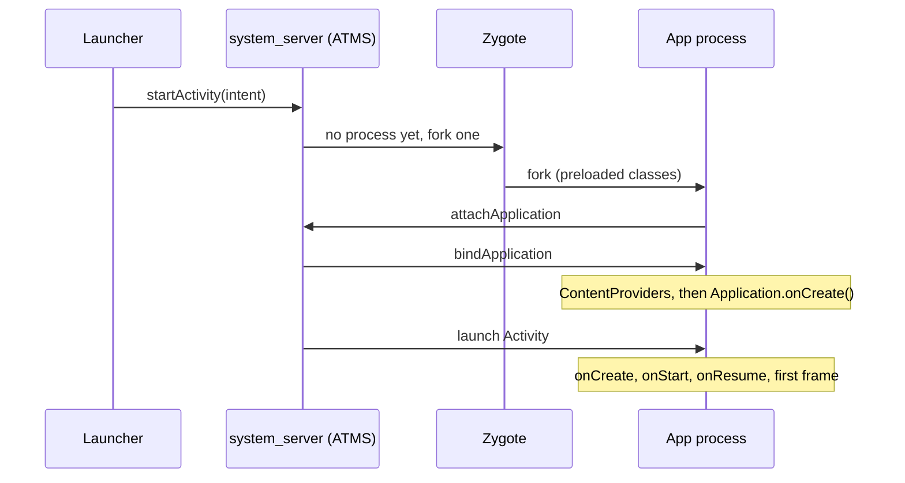

#### Step by step

1. **Tap.** The Launcher (just another app) calls `startActivity()` with the `MAIN`/`LAUNCHER` Intent. This is a Binder call to **ActivityTaskManagerService / ActivityManagerService** in `system_server`.
2. **Resolve and check.** The system resolves the target Activity, checks permissions, and decides the task (new or existing). It may show a **starting window / splash screen** immediately so the user sees feedback.
3. **Process exists?** If yes (warm/hot start), skip to step 6. If not (**cold start**), the system asks **Zygote** (via a socket) to fork a new process.
4. **Fork.** Zygote forks itself. The child already has core framework classes and resources preloaded and shares them copy-on-write, so it starts fast. It's given the app's UID.
5. **Bootstrap.** The new process runs `ActivityThread.main()`: it creates the **main Looper** (main thread), then calls `attachApplication()` to the system. The system replies with `bindApplication`: the app loads its APK/classes, creates the `Application`, initializes **ContentProviders**, then calls **`Application.onCreate()`**.
6. **Launch the Activity.** The system sends a launch transaction: the Activity is instantiated and runs `onCreate()` → `onStart()` → `onResume()`.
7. **First frame.** The view hierarchy (or Compose) is measured, laid out and drawn on the next **Choreographer** vsync; the **RenderThread** sends it to the GPU, and SurfaceFlinger composites it. The starting window is removed.

#### Cold vs warm vs hot start

| Type | What exists already | What runs |
|---|---|---|
| **Cold** | Nothing | Steps 3–7 (slowest) |
| **Warm** | Process alive, Activity destroyed | Activity creation (steps 6–7) |
| **Hot** | Process and Activity alive (in background) | Just `onStart`/`onResume` and drawing |

**Where startup time goes (what you can optimize):** ContentProviders and `Application.onCreate()` (move/defer init, App Startup), Activity `onCreate` (inflate less, avoid sync I/O), first-frame work, and code being JIT-compiled (**Baseline Profiles**). Measure with **Macrobenchmark** and the `Displayed` time in logcat.

**Likely follow-ups:**
- *Why fork from Zygote instead of starting a fresh VM?* — Starting a runtime and loading framework classes takes seconds; forking a pre-warmed process takes milliseconds and shares memory.
- *What is `reportFullyDrawn()`?* — Lets you tell the system when the screen is actually usable (content loaded), measured as "Time to Full Display".

</details>

### 28. What is Zygote?

<details>
<summary>Answer</summary>

**In short:** Zygote is a system process started at boot that **preloads the common framework classes and resources** and initializes the runtime. Every app process is **forked** from it, and the preloaded memory is **shared copy-on-write**. This makes app startup much faster and saves RAM, because all apps share one copy of the framework instead of loading it themselves.

#### How it works

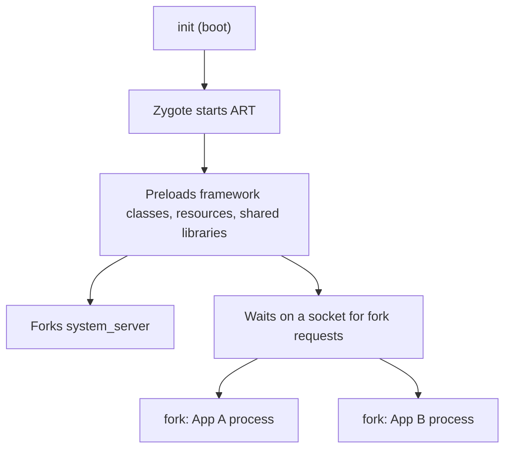

1. At boot, `init` starts Zygote (`app_process`). It starts an ART instance and **preloads** thousands of commonly used classes (`android.view.View`, `TextView`, …), resources and drawables, and shared native libraries.
2. Zygote forks **`system_server`**, which hosts the system services (ActivityManager, PackageManager, WindowManager…).
3. Zygote then waits on a socket. When the system needs a new app process, it sends a request; Zygote calls `fork()`.
4. The child process sets its **UID/GID**, SELinux context and other settings for that app, then runs `ActivityThread.main()`.

#### Why copy-on-write matters

After `fork()`, parent and child share the same physical memory pages. A page is copied only when one of them **writes** to it. Since preloaded framework classes are mostly read-only, all apps share them — a big RAM saving on a device running dozens of processes.

Devices that support both 32-bit and 64-bit apps run two Zygotes (`zygote` and `zygote64`). Newer Android versions also have specialized variants (e.g. a WebView zygote, and an "unspecialized app process" pool to speed up forking).

**Likely follow-ups:**
- *Why does Zygote start `system_server`?* — So system services also benefit from the preloaded classes and runtime.
- *Is Zygote related to the app's `Application` object?* — No; Zygote creates the process, and the app creates its own `Application` after attaching to `system_server`.

</details>

### 29. What are resources and qualifiers? How does Android pick the right resource?

<details>
<summary>Answer</summary>

**In short:** Resources (`res/`) keep non-code content — layouts, strings, drawables, dimens, colors, themes — separate from code, and each gets an ID in the generated `R` class. **Qualifiers** on folder names provide alternatives for different configurations: `values-hi` (Hindi), `layout-land`, `drawable-xxhdpi`, `values-night` (dark mode), `values-sw600dp` (tablets), `values-v31` (API level). At runtime the system picks the **best match** for the current configuration, falling back to the default (unqualified) folder.

#### Example

```
res/
├── values/strings.xml           // default (must exist)
├── values-hi/strings.xml        // Hindi
├── values-night/colors.xml      // dark theme colors
├── values-sw600dp/dimens.xml    // smallest width >= 600dp (tablets)
├── layout/activity_main.xml
├── layout-land/activity_main.xml
└── drawable-xxhdpi/logo.png
```

Qualifiers must be written in a **fixed order** (e.g. `values-en-rUS-night-v31`, not `values-night-en`).

#### How the best match is chosen (simplified)

1. Discard folders whose qualifiers **contradict** the current configuration (e.g. `-fr` on an English device). Density is the exception — it is never eliminated, only ranked.
2. Go through qualifier types in **precedence order** (locale/MCC first, then layout direction, smallest width, available width/height, screen size, orientation, UI mode, night mode, density, …, API version last).
3. For the first qualifier type where any remaining folder has a match, keep only the folders with that qualifier.
4. Repeat until one folder remains. If nothing matches, the **default** folder is used.

For **density**, Android picks the closest density and **scales** the bitmap if there's no exact match (prefer vector drawables to avoid this).

#### What triggers re-selection

When the configuration changes (rotation, locale, dark mode, window resize), the Activity is recreated by default so new resources are loaded. That's why you see "configuration change" questions alongside resources.

**Pitfalls:**
- Missing a default `values/strings.xml` entry crashes on devices whose locale has no match (`Resources.NotFoundException`). Lint warns about it.
- Hard-coded strings and sizes in code bypass this system — no localization, no dark mode.

**Likely follow-ups:**
- *`sw600dp` vs `w600dp`?* — `sw` is the smallest width and doesn't change with rotation; `w` is the current available width.
- *Per-app language?* — `AppCompatDelegate.setApplicationLocales()` (or the Android 13 per-app language setting) changes the locale used for resource lookup.

</details>

### 30. What is the difference between dp, sp, px?

<details>
<summary>Answer</summary>

**In short:** **px** is a physical screen pixel. **dp** (density-independent pixel) is a virtual unit where **1 dp = 1 px on a 160 dpi (mdpi) screen**, so sizes look physically the same on any density — use it for sizes and margins. **sp** (scale-independent pixel) is like dp but also scales with the user's **font size** setting — use it for text. (Android 14+ scales fonts **non-linearly**, so large text doesn't grow as much as small text.)

#### The math

`px = dp × (dpi / 160)`

| Density bucket | dpi | Scale factor | 48 dp = |
|---|---|---|---|
| mdpi | 160 | 1.0× | 48 px |
| hdpi | 240 | 1.5× | 72 px |
| xhdpi | 320 | 2.0× | 96 px |
| xxhdpi | 480 | 3.0× | 144 px |
| xxxhdpi | 640 | 4.0× | 192 px |

So a 48 dp touch target is about the same physical size (~9 mm) on every phone.

#### Why sp exists

Users with low vision raise the font size in Settings. Text in `sp` respects that; text in `dp` ignores it, which is an accessibility failure. With **non-linear font scaling** (Android 14+), the conversion from sp to px isn't a simple multiplication anymore, so convert with the platform APIs rather than doing the math yourself:

```kotlin
// Views
val px = TypedValue.applyDimension(TypedValue.COMPLEX_UNIT_SP, 16f, resources.displayMetrics)

// Compose
val px = with(LocalDensity.current) { 16.sp.toPx() }
```

#### Rules of thumb

| Use | Unit |
|---|---|
| Layout sizes, margins, padding, icon sizes | `dp` |
| Text size | `sp` |
| Drawing on a Canvas, hairline borders | `px` (converted from dp) |

**Pitfalls:**
- Fixed-height containers holding `sp` text will clip at large font sizes — use `wrap_content`/min heights and test at 200% font scale.
- Using `sp` for non-text sizes makes layouts grow unexpectedly with font scale.

**Likely follow-ups:**
- *What's the minimum touch target?* — 48 × 48 dp per Material/accessibility guidelines.
- *What is `dpi` vs density bucket?* — The device's real dpi is mapped to the nearest bucket for resource selection; `displayMetrics.density` gives the exact scale factor.

</details>


---

## More Platform Questions

### 31. What is the project structure of an Android app?

<details>
<summary>Answer</summary>

**In short:** An Android project is a **Gradle build** with a root (`settings.gradle.kts`, root `build.gradle.kts`, the `gradle/libs.versions.toml` version catalog) and one or more **modules**. Each module has its own `build.gradle.kts` and a `src/` folder split into **source sets**: `main/` (manifest, code, `res/`, `assets/`), `test/` (local JVM unit tests) and `androidTest/` (instrumented tests on a device), plus optional per-build-type/flavor folders.

```
MyApp/
├── settings.gradle.kts          // modules + repositories
├── build.gradle.kts             // root build config
├── gradle/libs.versions.toml    // version catalog
├── gradle.properties
└── app/
    ├── build.gradle.kts         // android {}, dependencies
    ├── proguard-rules.pro
    └── src/
        ├── main/
        │   ├── AndroidManifest.xml
        │   ├── java/ (or kotlin/) com/example/app/...   // source code
        │   └── res/                                     // resources
        │       ├── layout/  drawable/  mipmap-*/ (launcher icons)
        │       ├── values/ (strings, colors, themes, dimens)
        │       ├── xml/ (network_security_config, backup rules)
        │       └── raw/  font/  navigation/  menu/
        │   └── assets/                                  // raw files, accessed via AssetManager
        ├── test/                // local JVM unit tests
        └── androidTest/         // instrumented tests
```

#### What each file is for

| File / folder | Purpose |
|---|---|
| `settings.gradle.kts` | Lists modules (`include(":app", ":core:data")`) and plugin/dependency repositories |
| Root `build.gradle.kts` | Declares plugins (with `apply false`) shared by modules |
| `libs.versions.toml` | Central place for dependency and plugin versions (`libs.androidx.core.ktx`) |
| `gradle.properties` | Build flags (`org.gradle.jvmargs`, `android.useAndroidX`, configuration cache) |
| Module `build.gradle.kts` | `android { namespace, compileSdk, defaultConfig { applicationId, minSdk, targetSdk }, buildTypes, flavors }` and dependencies |
| `proguard-rules.pro` | R8 keep rules for release builds |
| `res/` | Compiled resources with IDs in `R` (qualifiers allowed) |
| `assets/` | Raw files kept as-is, read by name via `AssetManager` (no `R` ID, no qualifiers) |
| `mipmap-*` | Launcher icons (kept at all densities, since launchers may use a higher one) |
| `res/raw/` | Raw files that **do** get an `R.raw.*` ID |

#### Source sets

Gradle merges source sets per variant. For a `prodRelease` build it combines `main/` + `prod/` + `release/` + `prodRelease/`. So you can have debug-only code (`src/debug/`, e.g. a debug menu) or flavor-specific resources (`src/free/res/`) without `if` statements.

In **multi-module** apps, the same structure repeats in each module (`:feature:home`, `:core:network`), and library modules use the `com.android.library` plugin.

**Likely follow-ups:**
- *`res/raw` vs `assets`?* — `raw` files get an `R` ID and support qualifiers; `assets` supports subfolders and is accessed by path.
- *`test` vs `androidTest`?* — `test` runs on the JVM (fast, Robolectric optional); `androidTest` runs on a device/emulator (Espresso, Compose UI tests).

</details>

### 32. What is AndroidX / the Support Library / Jetpack?

<details>
<summary>Answer</summary>

**In short:** The **Support Library** (`com.android.support:*`) backported new APIs to older Android versions; it's **deprecated** and its last version was 28. **AndroidX** (`androidx.*`) replaced it in 2018 with a clean namespace and **independent versioning per library**, shipped separately from the OS. **Jetpack** is the umbrella name for the libraries, tools and guidance built on AndroidX — ViewModel, Room, WorkManager, Navigation, Compose, CameraX, and so on.

#### Why they exist

Android devices run many OS versions, and new framework APIs only exist on new versions. Libraries bundled **inside your app** solve that: you get the same API (and bug fixes) on all supported versions, and they update on your schedule, not the device maker's.

| | Support Library | AndroidX | Jetpack |
|---|---|---|---|
| What it is | Original backport libraries | Their replacement and the package namespace | Brand name for the whole suite |
| Package | `android.support.*` | `androidx.*` | (uses AndroidX) |
| Versioning | All libraries locked to one version (e.g. 28.0.0) | Each library versioned independently (semantic versioning) | — |
| Status | Deprecated, no updates after 28 | Current | Current |

#### What's in Jetpack (main groups)

| Area | Libraries |
|---|---|
| Architecture | ViewModel, Lifecycle, LiveData, Room, Paging, WorkManager, Navigation, DataStore, Hilt integration |
| UI | Compose, RecyclerView, ConstraintLayout, Fragment, AppCompat, Material (separate but used alongside) |
| Behavior | Activity Result API, Core (`ContextCompat`, `NotificationCompat`), Startup, SplashScreen |
| Media/devices | CameraX, Media3 |
| Performance | Benchmark/Macrobenchmark, Baseline Profiles, Tracing |

#### Migration

Old projects migrated with Android Studio's "Migrate to AndroidX". Two flags in `gradle.properties` were used: `android.useAndroidX=true` and `android.enableJetifier=true` (Jetifier rewrote old support-library dependencies to AndroidX at build time; today it's usually not needed and slows builds, so remove it once no dependency needs it).

**Likely follow-ups:**
- *Why the `Compat` classes?* — `ContextCompat`, `NotificationCompat` etc. check the API level and call the new API or a fallback, so you write one code path.
- *Is Jetpack Compose part of AndroidX?* — Yes, it's published under `androidx.compose.*`.

</details>

### 33. Why use a `Bundle` instead of a plain `Map` to pass data?

<details>
<summary>Answer</summary>

**In short:** Data passed between components often **crosses process boundaries** — through Binder to `system_server`, and saved by the system to survive **process death**. A `Bundle` is `Parcelable` and only accepts values that **can be marshalled** (primitives, Strings, Parcelables, Serializables, and arrays/lists of them), so it's guaranteed to survive that trip. A general `Map<String, Any>` can hold arbitrary objects that **can't be parcelled**, and `HashMap` serialization is slow. Bundles are also backed by a memory-efficient `ArrayMap` and unparcel **lazily**.

#### The problem a Map would cause

```kotlin
// Imagine extras were a Map<String, Any>
val extras = mapOf("listener" to object : OnClickListener { ... }, "db" to roomDatabase)
// How would the system send a lambda or a database connection to another process,
// or write it down to restore after process death? It can't.
```

A Bundle's API forces you to choose a marshallable type up front (`putInt`, `putString`, `putParcelable`…), so invalid data is caught at compile time instead of failing in another process.

#### Why Bundle is efficient

| Property | Bundle | HashMap |
|---|---|---|
| Serialization | `Parcel` (fast, binary) | `Serializable` (reflection, slow) if you put it in an Intent |
| Backing structure | `ArrayMap` — two compact arrays, small memory footprint for few keys | Hash table with entry objects |
| Deserialization | **Lazy**: the parcel is only unpacked when a value is read | Everything read eagerly |
| Type restriction | Only marshallable types | Anything (fails later) |

The lazy unparcelling matters: `system_server` handles Bundles for apps all the time (e.g. the launching Intent's extras, saved state) but never needs to read them, so it never pays to unpack them — and it never has to load your app's custom Parcelable classes.

**Pitfalls:**
- A Bundle still has the ~1 MB Binder limit — it's type-safe, not size-safe.

**Likely follow-ups:**
- *Can you put a `HashMap` in a Bundle?* — Yes, via `putSerializable`, because `HashMap` is Serializable — but it's slower than Parcelable alternatives.
- *Where else is Bundle used?* — `onSaveInstanceState`, Fragment arguments, `SavedStateHandle`, `setFragmentResult`.

</details>

### 34. Can an app run in multiple processes? How can two different apps communicate?

<details>
<summary>Answer</summary>

**In short:** Yes. Set `android:process=":remote"` (private to the app) or a full name like `"com.example.shared"` on a component in the manifest. Each process has its **own memory, its own `Application` instance and its own singletons** — static state is **not shared** — and the processes talk through IPC. **Two different apps** communicate via **Intents**, **bound services (AIDL/Messenger)**, **ContentProviders**, **broadcasts**, and **`FileProvider` URIs**, protected with **signature-level permissions** when both apps are yours.

#### Multiple processes in one app

```xml
<service
    android:name=".PlayerService"
    android:process=":player"
    android:exported="false" />
```

| Process name | Meaning |
|---|---|
| `:player` (starts with colon) | Private process for this app, named `com.example.app:player` |
| `com.example.shared` (lowercase, no colon) | Global process; other apps **signed with the same certificate and sharing a user ID** can run components in it |

**Why use it:**
- **Isolation:** a crash-prone component (WebView-heavy screen, media decoding, third-party SDK) can crash without taking down the main UI.
- **Memory:** each process has its own heap limit.
- **Lifecycle:** a long-running player/download service survives the UI process being killed (or vice versa).

**The costs:**

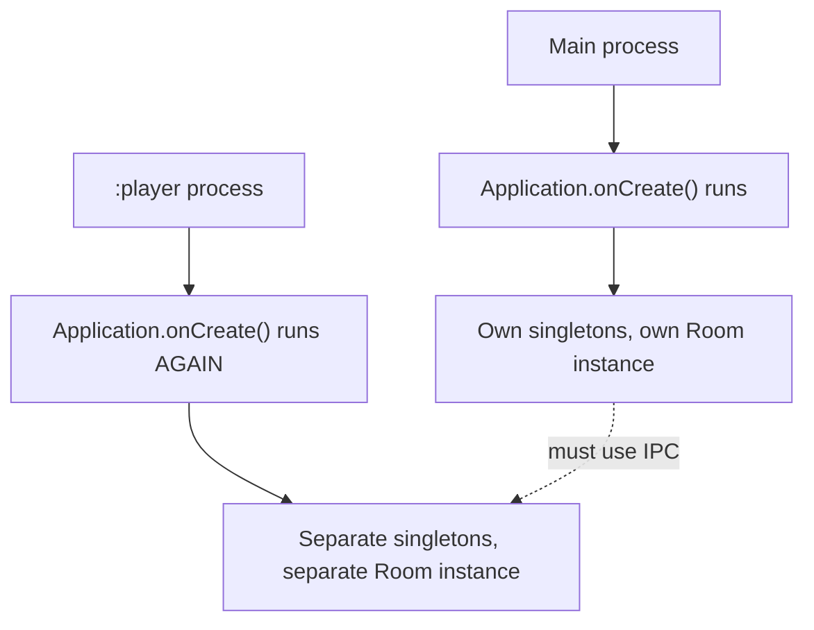

- `Application.onCreate()` runs in **every** process — guard heavy init by checking the process name (`Application.getProcessName()` on API 28+).
- In-memory caches, singletons and `SharedPreferences` aren't synchronized across processes. Room can be opened in multi-instance invalidation mode (`enableMultiInstanceInvalidation()`), and DataStore has `MultiProcessDataStoreFactory`.
- More RAM and slower startup.

#### Two different apps communicating

| Mechanism | Direction | Typical use |
|---|---|---|
| **Intents** (explicit with `setPackage`, or implicit) + Activity Result contracts | Request/response via UI | Open another app's screen, pick a contact, share |
| **Bound service with AIDL or Messenger** | Two-way, programmatic | SDK-style API between your apps (e.g. a companion app) |
| **ContentProvider** (with permissions or `grantUriPermissions`) | Query/modify data | Sharing a database, contacts-like data |
| **Broadcasts** (with a permission or `setPackage`) | One-way events | Notify a companion app something happened |
| **`FileProvider` URIs** | Files | Share an image/PDF with temporary read access |
| **AccountManager** | Shared accounts | Single sign-on between apps |

#### Securing it

```xml
<!-- Defined in app A; app B (same signing key) is automatically granted it -->
<permission android:name="com.example.permission.SYNC"
    android:protectionLevel="signature" />

<service android:name=".SyncService"
    android:exported="true"
    android:permission="com.example.permission.SYNC" />
```

Also check the caller inside the service (`Binder.getCallingUid()` + package signature) for sensitive operations.

**Likely follow-ups:**
- *Do two processes of the same app share static fields?* — No; each has its own copy of every class's statics.
- *Why is `sharedUserId` discouraged?* — It's deprecated (API 29) and can't be changed after release without breaking the app; use signature permissions and IPC instead.

</details>

### 35. What is the NDK / JNI? When would you use native code?

<details>
<summary>Answer</summary>

**In short:** The **NDK (Native Development Kit)** lets you write parts of your app in **C/C++**, compiled with CMake into `.so` libraries per **ABI** (arm64-v8a, armeabi-v7a, x86_64). **JNI (Java Native Interface)** is the bridge between Kotlin/Java and that native code. Use it for **performance-critical computation** (audio/video/image processing, games, physics), **reusing existing C/C++ libraries** (OpenCV, FFmpeg, crypto), or **low-latency audio** (Oboe). It costs complexity, harder debugging, JNI overhead and larger APKs.

#### How the bridge works

```kotlin
// Kotlin side
class ImageFilter {
    external fun blur(pixels: IntArray, width: Int, height: Int, radius: Int)

    companion object {
        init { System.loadLibrary("imagefilter") }   // loads libimagefilter.so
    }
}
```

```cpp
// C++ side (imagefilter.cpp)
#include <jni.h>

extern "C" JNIEXPORT void JNICALL
Java_com_example_app_ImageFilter_blur(JNIEnv* env, jobject thiz,
                                      jintArray pixels, jint width, jint height, jint radius) {
    jint* data = env->GetIntArrayElements(pixels, nullptr);
    // ... process data ...
    env->ReleaseIntArrayElements(pixels, data, 0);   // copy back and release
}
```

The function name follows `Java_<package>_<class>_<method>`, or you can register methods explicitly with `RegisterNatives` in `JNI_OnLoad` (faster lookup, survives obfuscation better).

```kotlin
// build.gradle.kts
android {
    externalNativeBuild { cmake { path = file("src/main/cpp/CMakeLists.txt") } }
    defaultConfig { ndk { abiFilters += listOf("arm64-v8a", "armeabi-v7a", "x86_64") } }
}
```

#### When it's worth it — and when it isn't

| Good reasons | Bad reasons |
|---|---|
| Heavy number crunching on large buffers (DSP, codecs, ML pre-processing) | "C++ is faster" for normal app logic — ART-compiled Kotlin is usually fast enough |
| An existing, well-tested C/C++ library | Hiding secrets (native code can still be reverse-engineered) |
| Game engines, physics, Vulkan/OpenGL rendering | Small functions called very often (JNI transition overhead dominates) |
| Low-latency audio with Oboe/AAudio | |

#### Costs

- **Complexity and safety:** manual memory management; a native crash (`SIGSEGV`) kills the process and is harder to symbolicate (upload debug symbols to Play/Crashlytics).
- **JNI overhead:** each call crosses the boundary; copying arrays can be expensive (use direct `ByteBuffer`s for large data).
- **Per-ABI builds** → larger downloads (App Bundles split by ABI).
- **16 KB page-size alignment:** native libraries must be built/aligned to support devices using 16 KB memory pages (recent NDK/AGP versions handle this; Google Play requires it for apps targeting newer Android versions).

*RenderScript* (for GPU compute) is **deprecated**. Use Vulkan, OpenGL compute shaders or the RenderScript Intrinsics Replacement Toolkit.

**Pitfalls:**
- Holding `JNIEnv*` across threads (it's per-thread) or keeping local references beyond the call (use `NewGlobalRef`).
- Forgetting `-keep` rules: R8 renames classes, breaking `Java_...` symbol lookup unless the native methods' classes are kept (R8 keeps `native` method names by default, but classes/fields accessed **from** C++ need rules).

**Likely follow-ups:**
- *How do you debug native crashes?* — `ndk-stack` or Android Studio's LLDB debugger with symbol files; tombstones in logcat.
- *What's the difference between the NDK and the SDK?* — The SDK is the Java/Kotlin framework API; the NDK provides toolchains and a limited set of C APIs (e.g. `AAudio`, `ANativeWindow`, `AAssetManager`).

</details>

### 36. Can you force garbage collection in Android?

<details>
<summary>Answer</summary>

**In short:** You can **request** it with `System.gc()` / `Runtime.getRuntime().gc()`, but it's only a **hint** — the runtime may ignore it or defer it. Calling it in production is almost always a mistake: it can cause pauses and jank, and the GC already knows better when to run. Fix the **leak or allocation pattern** instead. The Memory Profiler's "Force GC" button is only for diagnostics.

#### Why calling it doesn't help

- If memory is **leaked**, the leaked objects are still reachable — no GC can free them.
- If memory is **churning** (many short-lived allocations), forcing extra collections just adds more pauses; the fix is to allocate less.
- ART already triggers GC based on heap growth, allocation rate and app state (e.g. it does more work when the app goes to the background). A manual call fights those heuristics.

#### Wrong vs right

```kotlin
// Wrong: "free memory" before loading a big bitmap
System.gc()
val bitmap = BitmapFactory.decodeFile(path)   // still OOMs if the image is huge

// Right: decode at the size you actually display
val options = BitmapFactory.Options().apply {
    inJustDecodeBounds = true
    BitmapFactory.decodeFile(path, this)
    inSampleSize = calculateInSampleSize(this, reqWidth = 1080, reqHeight = 1080)
    inJustDecodeBounds = false
}
val bitmap = BitmapFactory.decodeFile(path, options)
// Or simply let Coil/Glide handle sizing, caching and pooling
```

#### Legitimate diagnostic uses

- In the **Memory Profiler**, click "Force GC" before a **heap dump** so the dump shows only what's really retained.
- **LeakCanary** triggers GC itself before deciding an object has leaked (so it doesn't report objects that were simply not collected yet).
- Some tests/benchmarks trigger GC between iterations to reduce noise.

**Likely follow-ups:**
- *How do you find out what's using memory?* — Memory Profiler heap dump / allocation tracking, `dumpsys meminfo`, LeakCanary for leaks.
- *What's `onTrimMemory` for, then?* — It's how the system tells **you** to release caches; that's the right way to react to memory pressure.

</details>

### 37. What is ADB? Which commands are useful?

<details>
<summary>Answer</summary>

**In short:** **ADB (Android Debug Bridge)** is a command-line tool to communicate with devices and emulators. It has three parts: the **client** (the `adb` command you type), the **adb server** running on your computer, and the **`adbd` daemon** on the device. You use it to install apps, read logs, run shell commands (`am`, `pm`, `dumpsys`, `cmd`), test deep links, simulate process death, and transfer files.

#### Architecture

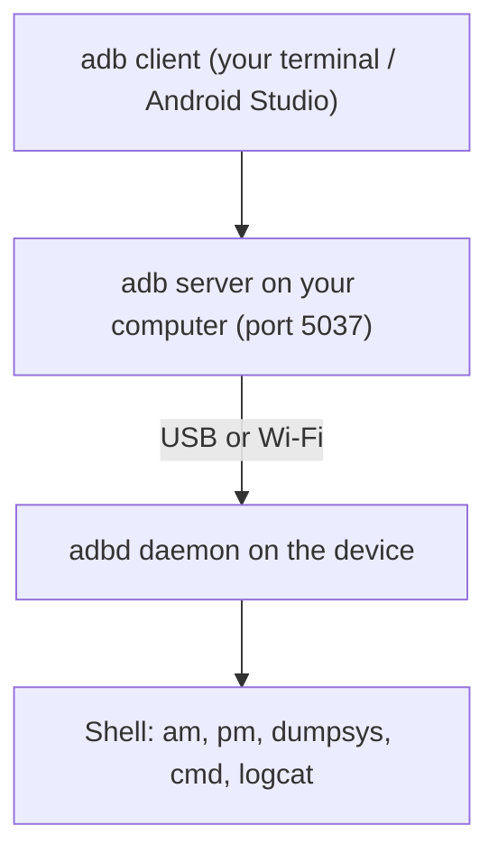

#### Commands worth knowing

```bash
adb devices                                    # list connected devices
adb install -r app.apk / adb uninstall com.app
adb logcat -s MyTag                            # filtered logs
adb shell am start -n com.app/.MainActivity     # start activity
adb shell am start -a android.intent.action.VIEW -d "myapp://product/1"   # test deep links
adb shell am kill com.app                       # simulate process death (app in background)
adb shell pm clear com.app                      # clear app data
adb shell pm grant com.app android.permission.CAMERA
adb shell dumpsys meminfo com.app / dumpsys activity activities / dumpsys battery
adb shell cmd jobscheduler run -f com.app 1     # force-run a job
adb shell screencap / screenrecord
adb push / pull, adb reverse tcp:8080 tcp:8080, adb pair (wireless debugging)
```

#### What each is good for in practice

| Task | Command | Why it matters |
|---|---|---|
| Test **process death** | Put app in background, then `adb shell am kill com.app` | Verifies `SavedStateHandle` / `onSaveInstanceState` restore |
| Test **deep links / App Links** | `am start -a VIEW -d "<uri>"`, `pm get-app-links com.app` | Debug intent filters and verification |
| Debug **memory** | `dumpsys meminfo com.app` | PSS, Java/native heap, views, activities count (leaks) |
| Inspect **back stack** | `dumpsys activity activities` | See tasks and launch-mode effects |
| Test **Doze / standby** | `dumpsys deviceidle force-idle`, `am set-standby-bucket` | Verify background work under restrictions |
| Local backend on emulator/device | `adb reverse tcp:8080 tcp:8080` | Device's `localhost:8080` reaches your computer |
| Wireless debugging | `adb pair` then `adb connect` (Android 11+) | No cable |
| Multiple devices | `adb -s <serial> <command>` | Target one device |

**Pitfalls:**
- `am kill` only kills a process that's in the background; `am force-stop` is different — it also cancels alarms and jobs and puts the app in the "stopped" state, which is **not** the same as the system killing it for memory.

**Likely follow-ups:**
- *How do you see why the app crashed on a tester's device?* — `adb logcat` (or `adb bugreport` for a full report).
- *How do you simulate low memory?* — `adb shell am send-trim-memory com.app RUNNING_LOW` to trigger `onTrimMemory`.

</details>

### 38. How do you share files with other apps securely? What is FileProvider?

<details>
<summary>Answer</summary>

**In short:** Since **Android 7.0**, sharing a `file://` URI outside your app throws `FileUriExposedException`. Instead, use **`FileProvider`**, a ContentProvider that serves your files through **`content://` URIs** and grants the receiving app **temporary, per-URI** read/write permission via Intent flags. The other app can access only that file, only while the grant lasts, and never needs storage permissions.

#### Why `file://` was banned

A `file://` URI exposes a real path and requires the receiver to have filesystem access to it. That means either making your private files world-readable (insecure) or the receiver needing broad storage permissions. `content://` URIs keep the file private and let the system enforce access per-URI.

#### Setup in four steps

**1. Declare the provider**

```xml
<provider
    android:name="androidx.core.content.FileProvider"
    android:authorities="${applicationId}.fileprovider"
    android:exported="false"
    android:grantUriPermissions="true">
    <meta-data
        android:name="android.support.FILE_PROVIDER_PATHS"
        android:resource="@xml/file_paths" />
</provider>
```

**2. List shareable directories** in `res/xml/file_paths.xml`:

```xml
<paths>
    <cache-path name="shared_images" path="images/" />   <!-- context.cacheDir/images -->
    <files-path name="exports" path="exports/" />          <!-- context.filesDir/exports -->
</paths>
```

**3. Get a content URI** and **4. share it with a grant flag:**

```kotlin
val file = File(context.cacheDir, "images/receipt.png")
val uri = FileProvider.getUriForFile(context, "${context.packageName}.fileprovider", file)
// → content://com.example.app.fileprovider/shared_images/receipt.png

val share = Intent(Intent.ACTION_SEND).apply {
    type = "image/png"
    putExtra(Intent.EXTRA_STREAM, uri)
    addFlags(Intent.FLAG_GRANT_READ_URI_PERMISSION)    // explicit grant
}
startActivity(Intent.createChooser(share, "Share receipt"))
```

#### What happens on the other side

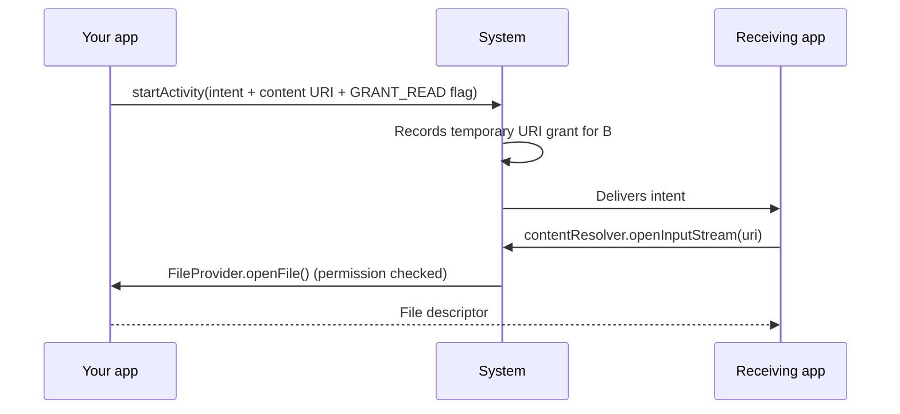

The grant lasts until the receiving Activity's task finishes (or you revoke it with `revokeUriPermission`).

**Always grant explicitly** — Android 17 notes that automatic URI grants for `ACTION_SEND`/`ACTION_IMAGE_CAPTURE` will stop in Android 18.

**Pitfalls:**
- Using `root-path` or overly broad paths (e.g. `path="."` on `files-path`) exposes more than you intended.
- Only list directories you actually share; keep databases and tokens out of them.
- Use `getUriForFile` only for files inside a configured path, otherwise it throws `IllegalArgumentException`.

**Likely follow-ups:**
- *How do you receive a shared file?* — Read it with `contentResolver.openInputStream(uri)`; don't try to turn it into a file path.
- *How does the camera write a photo into your app?* — Pass a FileProvider URI as `EXTRA_OUTPUT` to `ACTION_IMAGE_CAPTURE` (or use `ActivityResultContracts.TakePicture`) with write permission granted.

</details>

### 39. How does manifest merging work, and how do you resolve conflicts?

<details>
<summary>Answer</summary>

**In short:** An APK contains **one manifest**, merged at build time from the app module's main manifest, build-type and flavor manifests, and **every library's manifest**. Priority (highest first): **build variant / flavor manifests → main app manifest → library manifests** (in dependency order). Libraries can add permissions, components and metadata you didn't write. You resolve conflicts with **`tools:` merge rule markers** like `tools:replace`, `tools:node="remove"` and `tools:overrideLibrary`, and inspect the result in the **Merged Manifest** tab.

#### How the merge works

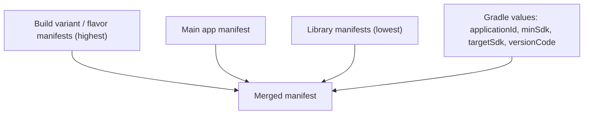

Elements are matched by **identity** (e.g. an `<activity>` by `android:name`, a `<uses-permission>` by name). Matching elements are merged attribute by attribute; new elements from lower-priority manifests are **added**. If two manifests set the **same attribute to different values**, the build fails with a merge error unless you add a rule. Gradle settings (`applicationId`, `minSdk`, `targetSdk`, `versionCode`) are injected and override any manifest values.

#### Merge rule markers

```xml
<manifest xmlns:android="http://schemas.android.com/apk/res/android"
    xmlns:tools="http://schemas.android.com/tools">

    <!-- A library requests a permission you don't want -->
    <uses-permission android:name="android.permission.READ_PHONE_STATE"
        tools:node="remove" />

    <!-- Use a library whose minSdk is higher than yours (guard calls yourself!) -->
    <uses-sdk tools:overrideLibrary="com.example.fancylib" />

    <application
        android:theme="@style/Theme.MyApp"
        android:allowBackup="false"
        tools:replace="android:theme,android:allowBackup">

        <!-- Remove a library's auto-init provider (e.g. to initialize it on demand) -->
        <provider
            android:name="androidx.startup.InitializationProvider"
            android:authorities="${applicationId}.androidx-startup"
            tools:node="remove" />
    </application>
</manifest>
```

| Marker | Effect |
|---|---|
| `tools:replace="android:theme"` | Your value replaces the lower-priority one for that attribute (no conflict error) |
| `tools:node="remove"` | Remove this element entirely from the merged result |
| `tools:node="removeAll"` | Remove all elements of this type at this level |
| `tools:node="replace"` | Replace the lower-priority element completely |
| `tools:node="merge"` | Default behavior |
| `tools:remove="android:attr"` | Remove a specific attribute |
| `tools:overrideLibrary="com.example.lib"` | Allow a library with a higher `minSdk`; you must guard its calls with API checks |

#### Reviewing the result

Open `AndroidManifest.xml` → **Merged Manifest** tab in Android Studio: it shows every element and which manifest it came from, plus merge errors. The merged file is also in `build/intermediates/merged_manifests/`. Review it before releases — it's where **surprise permissions** (e.g. a location SDK adding `ACCESS_FINE_LOCATION`) and **exported components** appear, both of which affect Play policy reviews and security.

**Likely follow-ups:**
- *Why did my app suddenly request a new permission?* — A new library version added it to its manifest; remove it with `tools:node="remove"` if you don't need it.
- *Where do placeholders like `${applicationId}` come from?* — Gradle `manifestPlaceholders` and built-in values are substituted during merging.

</details>

---

[⬅ Previous: Design Patterns](07-design-patterns.md) · [⬅ Back to index](../README.md) · [Next: Activity & Fragment ➡](09-activity-fragment.md)
