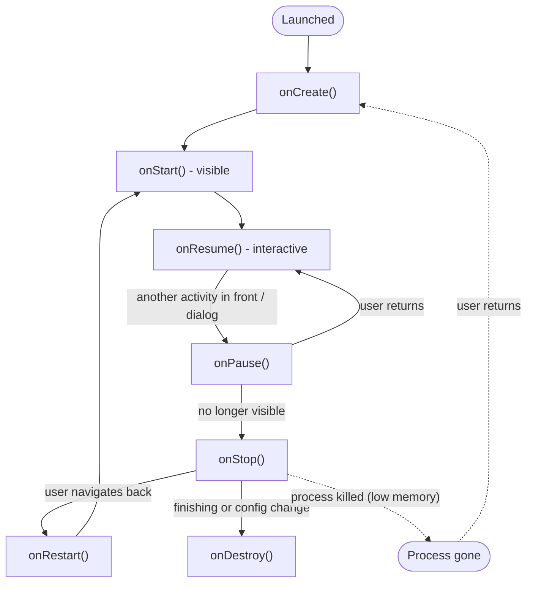
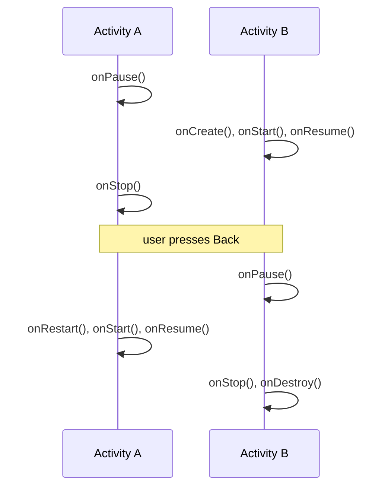
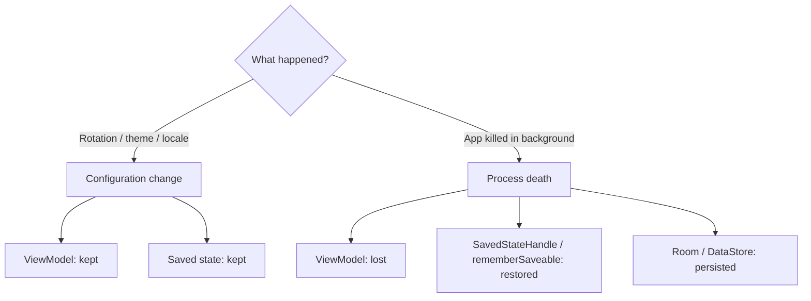
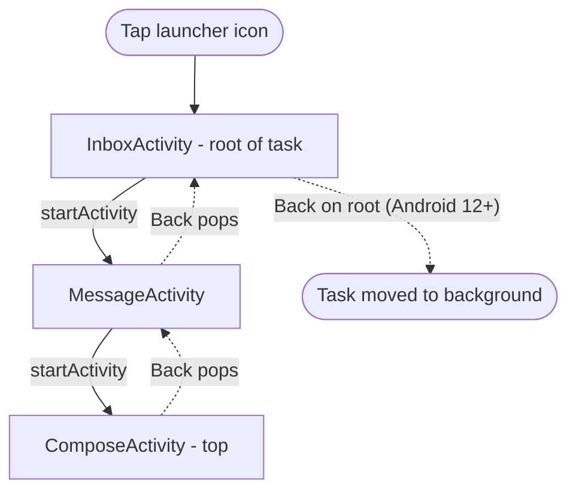
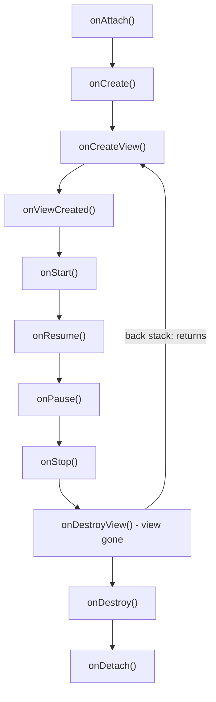
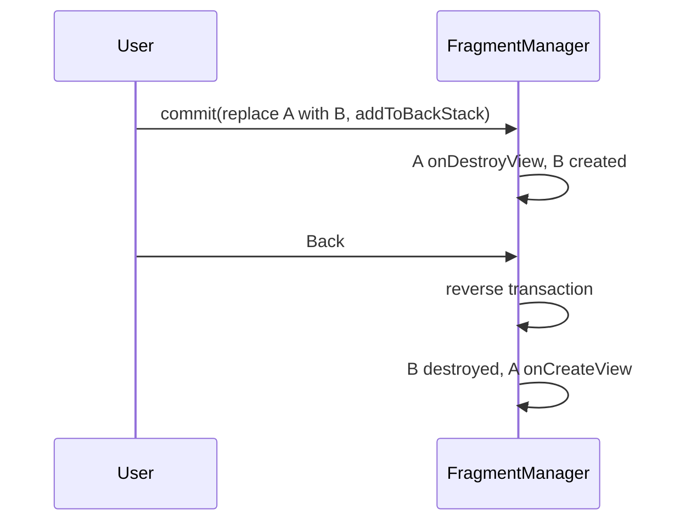
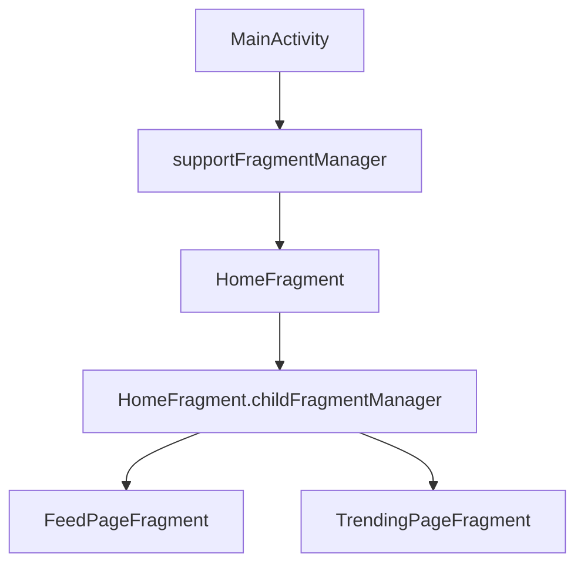
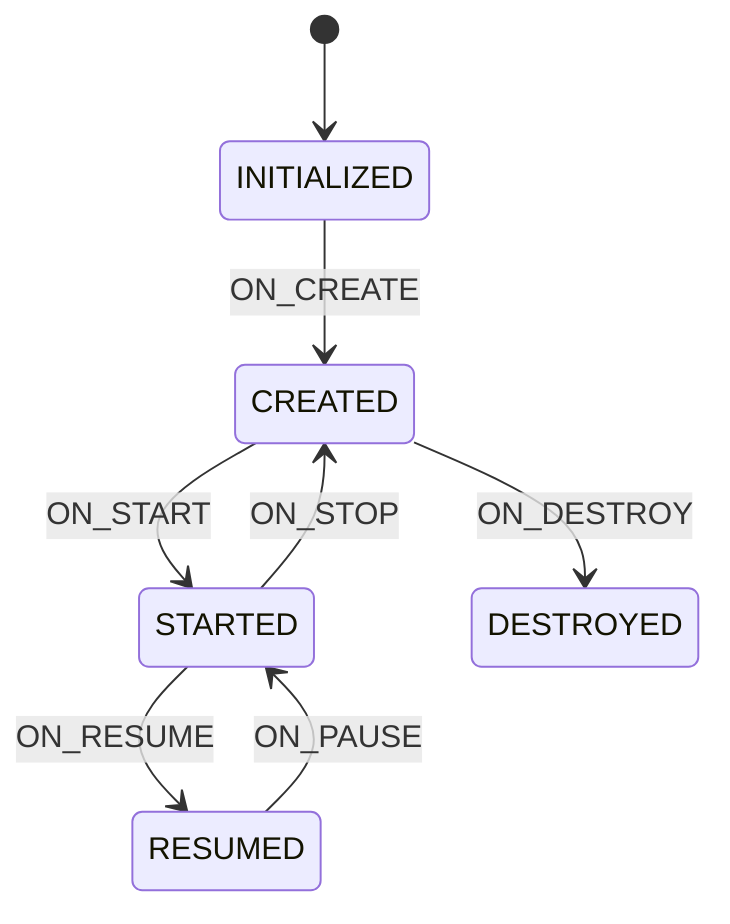
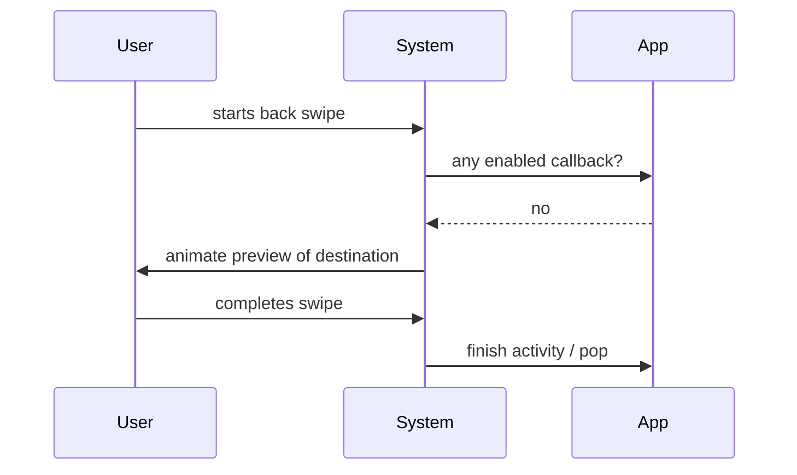
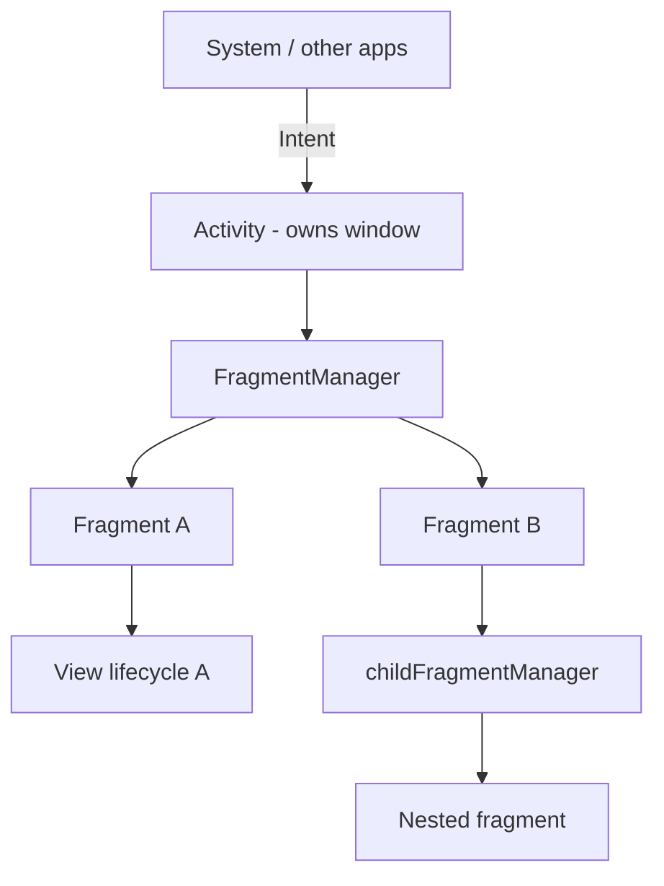

# Activity, Fragment & Lifecycle

[⬅ Back to index](../README.md)

Covers: Activity lifecycle, configuration changes, state saving, process death, tasks & launch modes, Fragment lifecycle & transactions, back navigation.

---

## Activity

### 1. What is an Activity and its lifecycle?

<details>
<summary>Answer</summary>

**In short:** An Activity is a single screen with a window and UI, and it is an app entry point declared in the manifest. The system drives it through `onCreate` → `onStart` (visible) → `onResume` (interactive), then `onPause` → `onStop` (not visible) → `onDestroy`, and you put setup and teardown in the matching pair of callbacks.

#### Why a lifecycle exists

On a phone, the user (and the system) is constantly interrupting your screen: a call comes in, another app opens, the screen rotates, memory runs low. The Activity doesn't control any of that. Instead, the system *tells* the Activity what is happening through lifecycle callbacks, and your job is to acquire resources when you need them and release them when you don't. Get this wrong and you drain the battery (GPS left on), leak memory, crash on a dead view, or lose what the user typed.



| Callback | When | What to do |
|---|---|---|
| `onCreate()` | Created (once per instance) | `setContentView`/`setContent`, init ViewModel, restore state |
| `onStart()` | Becoming **visible** | Start UI-related observers |
| `onResume()` | In **foreground**, interactive | Start camera, animations, sensors |
| `onPause()` | Losing focus (dialog, multi-window, leaving) | Pause heavy work; keep it **fast** (next activity waits) |
| `onStop()` | **No longer visible** | Release UI resources, save data |
| `onRestart()` | Coming back from stopped | — |
| `onDestroy()` | Finishing or being recreated (config change) | Final cleanup |

States: Created → Started → Resumed → Paused → Stopped → Destroyed. (In the androidx `Lifecycle` API these map to `CREATED`, `STARTED`, `RESUMED`, `DESTROYED`; "paused" is `STARTED` again and "stopped" is `CREATED` again.)

#### Pairing callbacks

Think in symmetric pairs: whatever you start in `onStart` you stop in `onStop`, whatever you start in `onResume` you stop in `onPause`. That keeps resources bounded no matter how many times the user bounces in and out.

```kotlin
class CameraActivity : AppCompatActivity() {
    override fun onCreate(savedInstanceState: Bundle?) {
        super.onCreate(savedInstanceState)
        setContentView(R.layout.activity_camera)   // one-time setup
    }

    override fun onResume() {
        super.onResume()
        camera.open()        // only while the user can interact
    }

    override fun onPause() {
        camera.release()     // fast: the next activity is waiting on us
        super.onPause()
    }

    override fun onDestroy() {
        super.onDestroy()
        if (isFinishing) analytics.log("closed")         // user/app finished it
        else if (isChangingConfigurations) { /* rotation etc. - will be recreated */ }
    }
}
```

Use `isFinishing` / `isChangingConfigurations` in `onDestroy` to tell the cases apart.

**Multi-window note:** since Android 10, every visible activity in multi-window is resumed, but only one has focus at a time (`onTopResumedActivityChanged`). Don't assume "resumed" means "the only thing on screen".

**Common pitfalls**
- Doing slow work (disk writes, network) in `onPause`: it delays the next screen.
- Relying on `onDestroy` for saving data: it's **not guaranteed** to be called if the process is killed.
- Forgetting to call `super` in lifecycle methods (throws `SuperNotCalledException`).

**Likely follow-ups**
- *Is `onDestroy` always called?* No. If the system kills the process in the background, no further callbacks run.
- *Where do you save data that must survive?* Persist it (Room/DataStore) by `onStop` at the latest; use `SavedStateHandle` for small UI state.
- *What's the difference between paused and stopped?* Paused is partially visible or not focused; stopped is fully hidden.

</details>

### 2. What is the lifecycle sequence when navigating from Activity A to B and back?

<details>
<summary>Answer</summary>

**In short:** Going A → B: `A.onPause` → `B.onCreate` → `B.onStart` → `B.onResume` → `A.onStop`. Coming back: `B.onPause` → `A.onRestart` → `A.onStart` → `A.onResume` → `B.onStop` → `B.onDestroy`. The outgoing activity pauses first, the incoming one becomes fully resumed, and only then does the old one stop.

**A → B (B is opaque):**
`A.onPause` → `B.onCreate` → `B.onStart` → `B.onResume` → `A.onStop`



**Back from B:**
`B.onPause` → `A.onRestart` → `A.onStart` → `A.onResume` → `B.onStop` → `B.onDestroy`

#### Why this order?

The system optimises for showing the new screen as fast as possible. It only needs A to give up focus (and stop using exclusive resources like the camera) before B can start, so it waits for `A.onPause()` and then immediately builds B. A's `onStop()` is deferred until B is actually drawn on screen, because only then is A truly invisible.

Two practical consequences:

1. **`onPause` must be fast.** B's `onCreate` doesn't begin until A's `onPause` returns. A slow `onPause` is a slow transition.
2. **Don't save shared data in A's `onStop` and read it in B's `onCreate`.** B's `onCreate` runs *before* A's `onStop`, so B would see stale data. Save in `onPause` (if small) or, better, keep shared state in a repository.

#### Transparent or dialog-themed B

If B is **transparent** or a dialog-themed Activity, A only gets `onPause` (it's still visible), not `onStop`. When B closes, A gets just `onResume`, with no `onRestart`/`onStart`.

| Scenario | A receives |
|---|---|
| B is opaque | `onPause`, then `onStop` |
| B is translucent/dialog theme | `onPause` only |
| A plain `AlertDialog` shown in A | Nothing (it's part of A's window) |

**Common pitfalls**
- Assuming a `Dialog` pauses the activity. Only a new *Activity* in front does; a `Dialog`/`DialogFragment` is in the same activity.
- Expecting B's `onDestroy` to run before A is resumed. It runs last.

**Likely follow-ups**
- *What if A calls `finish()` right after `startActivity(B)`?* A additionally gets `onDestroy` after `onStop`, and B becomes the top of the stack.
- *Is `onSaveInstanceState` called for A?* Yes, because A is stopped and might be killed; on API 28+ it runs after `A.onStop`.

</details>

### 3. Which lifecycle methods are called on rotation (configuration change)?

<details>
<summary>Answer</summary>

**In short:** By default the Activity is destroyed and recreated: `onPause` → `onStop` → `onSaveInstanceState` → `onDestroy` → `onCreate(savedState)` → `onStart` → `onRestoreInstanceState` → `onResume`. The ViewModel survives; the saved Bundle carries small UI state to the new instance.

#### Why recreate at all?

Resources depend on the configuration: a landscape layout in `layout-land/`, strings in a different language, dimensions for a bigger window, night colours. The simplest way for the system to guarantee that every resource is reloaded correctly is to throw the old Activity away and build a new one with the new `Configuration`.

The full sequence (API 28+):

`onPause` → `onStop` → `onSaveInstanceState` → `onDestroy` → `onCreate(savedState)` → `onStart` → `onRestoreInstanceState` → `onResume`

In the old instance, `isChangingConfigurations` is `true` during `onDestroy`.

#### What survives

| Thing | Survives rotation? | How |
|---|---|---|
| Activity instance, views | No | New objects are created |
| View state of views with an `id` | Yes | Saved into the Bundle automatically |
| `onSaveInstanceState` Bundle | Yes | Passed to the new `onCreate` |
| ViewModel | Yes | Held in the `ViewModelStore`, which is passed across via the non-configuration instance mechanism |
| `rememberSaveable` (Compose) | Yes | Backed by the saved-state Bundle |
| `remember` (Compose) | No | Lives in the composition, which is rebuilt |

The **ViewModel survives** because `ComponentActivity` hands its `ViewModelStore` to the system via `onRetainNonConfigurationInstance()`, and the new instance picks it up. That only works within the same process, which is why a ViewModel does *not* survive process death.

Other configuration changes behave the same way: locale, dark mode, font scale, screen size, keyboard, multi-window resize, folding/unfolding a foldable.

```kotlin
class ProfileActivity : AppCompatActivity() {
    private val viewModel: ProfileViewModel by viewModels() // same instance after rotation

    override fun onCreate(savedInstanceState: Bundle?) {
        super.onCreate(savedInstanceState)
        val isRecreated = savedInstanceState != null
        // Don't re-trigger a network load on every rotation:
        // let the ViewModel load once in its init block instead.
    }
}
```

**Common pitfalls**
- Starting a network request in `onCreate` without guarding it, so every rotation fires another request. Put the load in the ViewModel.
- Holding a reference to the old Activity (in a singleton, callback or static field): it leaks after recreation.
- Testing only on a phone in portrait. Resizing in multi-window and foldables trigger the same recreation.

**Likely follow-ups**
- *How do you avoid recreation?* `android:configChanges` (see question 9), but it's usually the wrong tool.
- *Does the Application object get recreated?* No, only the Activity (and its fragments).

</details>

### 4. What happens when you press Home vs Back?

<details>
<summary>Answer</summary>

**In short:** Home sends the task to the background: the Activity gets `onPause` → `onStop` (+ `onSaveInstanceState`) and stays alive in the back stack. Back normally finishes the top Activity (`onPause` → `onStop` → `onDestroy`), but since Android 12 a root launcher Activity is moved to the background instead of being finished, like Home.

#### Home

- `onPause` → `onStop` (+ `onSaveInstanceState`). The Activity stays in the back stack, and returning (from Recents or the launcher icon) gives `onRestart` → `onStart` → `onResume`.
- While in the background, the process can be killed for memory. If so, the user returns to a *recreated* Activity using the saved Bundle (process death; see question 8).

#### Back

- **Non-root Activity:** it's popped from the back stack: `onPause` → `onStop` → `onDestroy`, and `isFinishing` is `true`. No `onSaveInstanceState`, because the user explicitly left, so there is nothing to restore.
- **Root launcher Activity** (the root of a task, launched with `ACTION_MAIN`/`CATEGORY_LAUNCHER`): since **Android 12**, root launcher activities are **no longer finished** on Back. They're moved to the background like Home, so the app warm-starts next time. On older versions they were finished: `onPause` → `onStop` → `onDestroy`.
- If your app handles Back itself (an `OnBackPressedCallback`), the system doesn't do any of this; your callback runs instead.

| | Home | Back (non-root) | Back (root, Android 12+) |
|---|---|---|---|
| Callbacks | `onPause`, `onStop` | `onPause`, `onStop`, `onDestroy` | `onPause`, `onStop` |
| `onSaveInstanceState` | Yes | No | Yes |
| Instance kept | Yes | No | Yes |
| Next open | Warm start | — | Warm start |

**Common pitfalls**
- Assuming Back on the main screen always destroys the Activity and cleaning up "on exit" there. On Android 12+ that cleanup never runs.
- Treating `onDestroy` as "the user left the app". Use `ProcessLifecycleOwner` to detect app background/foreground.

**Likely follow-ups**
- *How do you detect the app going to the background?* Observe `ProcessLifecycleOwner.get().lifecycle` for `ON_STOP`.
- *What does Recents show after Back on a non-root activity?* The task with the previous activity on top.

</details>

### 5. When is only `onDestroy` called without `onPause`/`onStop`?

<details>
<summary>Answer</summary>

**In short:** When you call `finish()` inside `onCreate()`. The Activity never became visible, so the system skips `onStart`/`onResume`/`onPause`/`onStop` and goes straight to `onDestroy()`.

#### Why

Lifecycle callbacks are paired: `onPause` only undoes `onResume`, and `onStop` only undoes `onStart`. If the Activity never reached Started, there is nothing to pause or stop, so the system only needs to undo `onCreate`.

The same rule explains what happens if you call `finish()` at other points:

| `finish()` called in | Callbacks that follow |
|---|---|
| `onCreate()` | `onDestroy()` |
| `onStart()` | `onStop()`, `onDestroy()` |
| `onResume()` | `onPause()`, `onStop()`, `onDestroy()` |

A typical real use is a **routing / trampoline Activity** that decides where to go and never shows UI:

```kotlin
class LauncherActivity : ComponentActivity() {
    override fun onCreate(savedInstanceState: Bundle?) {
        super.onCreate(savedInstanceState)
        val target = if (session.isLoggedIn) HomeActivity::class.java else LoginActivity::class.java
        startActivity(Intent(this, target))
        finish() // goes straight to onDestroy(); no onStart/onResume/onPause/onStop
    }
}
```

(Today the SplashScreen API is usually used for this, but the pattern is still common.)

**Gotcha:** the opposite case, "no callback at all", happens when the process is killed in the background: neither `onDestroy` nor anything else runs. Never depend on `onDestroy` for saving data.

**Likely follow-ups**
- *Does `onSaveInstanceState` run in this case?* No, the Activity is finishing.
- *What is `isFinishing` in that `onDestroy`?* `true`.

</details>

### 6. What are `onSaveInstanceState()` and `onRestoreInstanceState()`?

<details>
<summary>Answer</summary>

**In short:** `onSaveInstanceState(outState)` lets you put small, transient UI state into a Bundle when the system might destroy the Activity (rotation, background kill), and `onRestoreInstanceState(savedState)` hands it back after `onStart()` when the Activity is recreated. It's for state the user expects to still be there, not for real data.

#### The problem it solves

Users expect the screen to look the same after rotating the phone or coming back to an app that was killed in the background: same scroll position, same tab, same half-typed text. The Activity object is gone in both cases, so the system asks you to serialise the essentials into a `Bundle`, keeps it outside your object (in `system_server` for process death), and gives it to the new instance.

#### When they are called

- **`onSaveInstanceState(outState)`** – called **after `onStop()`** on API 28+ (before `onStop` on older versions). It's called whenever the Activity is stopped and *could* be killed (Home, another activity on top, rotation). It's **not** called when the user explicitly finishes the Activity (Back / `finish()`), because there's nothing to come back to.
- **`onRestoreInstanceState(savedState)`** – called **after `onStart()`**, only when there's saved state to restore. The same Bundle is also passed to `onCreate`.

```kotlin
class SearchActivity : AppCompatActivity() {
    private var selectedTab = 0

    override fun onSaveInstanceState(outState: Bundle) {
        super.onSaveInstanceState(outState)   // saves view hierarchy state - keep this call
        outState.putInt(KEY_TAB, selectedTab)
    }

    override fun onRestoreInstanceState(savedInstanceState: Bundle) {
        super.onRestoreInstanceState(savedInstanceState) // restores view state
        selectedTab = savedInstanceState.getInt(KEY_TAB)
    }

    companion object { private const val KEY_TAB = "selected_tab" }
}
```

#### Automatic view state

Views that have an `id` save their own state automatically (EditText text, checkbox state, RecyclerView/ScrollView scroll position), as long as you call `super`. A view without an id isn't saved. In Compose, `rememberSaveable` writes into the same mechanism.

#### Limits

The Bundle crosses process boundaries through Binder, which has a limited transaction buffer (about 1 MB shared by the process). Exceeding it throws `TransactionTooLargeException` (on API 24+). Keep it to IDs and small primitives, never bitmaps or lists of models; reload those from a repository using the saved ID.

**Common pitfalls**
- Saving large lists or objects (crash or slow transitions).
- Forgetting `super.onSaveInstanceState(outState)` and losing all automatic view state.
- Using it for data that must survive the user closing the app. It's discarded on Back/`finish()`; persist real data in Room/DataStore.

**Likely follow-ups**
- *How do you do this in a ViewModel?* Use `SavedStateHandle`, which is backed by the same Bundle.
- *Why is it called after `onStop` on API 28+?* So that the saved state reflects the final state after any work done in `onStop`, and fragment transactions are safe until then.

</details>

### 7. You can restore state in `onCreate()` or `onRestoreInstanceState()`. What's the difference?

<details>
<summary>Answer</summary>

**In short:** Both receive the same Bundle. `onCreate(savedInstanceState)` runs before `onStart()` and gets `null` on a fresh launch, so you need a null check; `onRestoreInstanceState()` runs after `onStart()` and only when there is state, so no null check is needed.

| | `onCreate(savedInstanceState)` | `onRestoreInstanceState(savedInstanceState)` |
|---|---|---|
| Called | Always | Only when there's saved state |
| Bundle on first launch | `null` | Not called |
| Timing | Before `onStart()` | After `onStart()` |
| Typical use | Most restoration (it's where you set up the UI anyway) | Restoring state that depends on setup done in `onStart`, or after views are fully initialised |

```kotlin
override fun onCreate(savedInstanceState: Bundle?) {
    super.onCreate(savedInstanceState)
    setContentView(R.layout.activity_quiz)
    // Null on first launch:
    currentQuestion = savedInstanceState?.getInt(KEY_QUESTION) ?: 0
}

override fun onRestoreInstanceState(savedInstanceState: Bundle) {
    super.onRestoreInstanceState(savedInstanceState) // view hierarchy state restored here
    // Non-null; runs after onStart(), so anything initialised in onStart is ready.
    timerView.restore(savedInstanceState.getLong(KEY_ELAPSED))
}
```

#### Why the timing matters

The default implementation of `onRestoreInstanceState` is where the **view hierarchy state** (the automatic EditText/scroll state) is restored. If you set view content in `onStart`, any value you write there would overwrite the user's restored state if restoration happened earlier; restoring after `onStart` avoids that. In practice most apps restore in `onCreate`, and with ViewModel + `SavedStateHandle` you rarely override either.

**Common pitfall:** in `onRestoreInstanceState`, forgetting to call `super` means the automatic view state isn't restored.

**Likely follow-up:** *Which one do you use in practice?* Neither directly: `SavedStateHandle` in the ViewModel, or `rememberSaveable` in Compose.

</details>

### 8. Config change vs process death – how do you handle each?

<details>
<summary>Answer</summary>

**In short:** A configuration change recreates the Activity in the same process, so the ViewModel survives. Process death kills the whole process while the app is in the background, so the ViewModel and everything in memory is lost; only the saved-state Bundle (`SavedStateHandle`, `rememberSaveable`) and persisted storage come back. Handle both by keeping UI state in a ViewModel, saving small essentials in `SavedStateHandle`, and persisting real data.

#### What each event is

- **Configuration change:** rotation, theme, locale, font scale, window resize. The Activity is destroyed and recreated within seconds, same process, same memory.
- **Process death:** your app is in the background and the system needs memory, so it kills the process. The task is still in Recents. When the user returns, Android starts a new process, creates the `Application`, and recreates the top Activity with the Bundle it saved earlier. To the user it should look like nothing happened.



| | Config change (rotation) | Process death (killed in the background) |
|---|---|---|
| ViewModel | ✅ survives | ❌ lost |
| `onSaveInstanceState` Bundle | ✅ | ✅ (persisted by the system) |
| `SavedStateHandle` | ✅ | ✅ |
| Persistent storage (Room/DataStore) | ✅ | ✅ |
| Singletons / static fields | ✅ | ❌ (reset to initial values) |

**Strategy:**
- UI state and data → **ViewModel**.
- Small essential state (IDs, query, scroll position) → **`SavedStateHandle`** / `rememberSaveable`.
- Important user data → **persist** it (Room/DataStore).

```kotlin
@HiltViewModel
class SearchViewModel @Inject constructor(
    private val savedState: SavedStateHandle,
    private val repo: SearchRepository,
) : ViewModel() {
    // Survives rotation AND process death (stored in the saved-state Bundle)
    val query: StateFlow<String> = savedState.getStateFlow("query", "")

    // Survives rotation only; re-derived from the query after process death
    val results = query
        .debounce(300)
        .flatMapLatest { repo.search(it) }
        .stateIn(viewModelScope, SharingStarted.WhileSubscribed(5_000), emptyList())

    fun onQueryChanged(q: String) { savedState["query"] = q }
}
```

The idea: save the *minimum input* needed to rebuild the screen (the query, the item ID), and recompute or reload everything else.

**Testing process death:** put the app in the background, then run `adb shell am kill <package>` (or enable "Don't keep activities" in Developer Options), and return to the app. "Don't keep activities" destroys activities but keeps the process, so it's a good approximation but not identical; `am kill` is the real thing.

**Common pitfalls**
- A singleton holding "the current user" that is `null` after process death, causing a crash on return.
- Assuming the app always restarts from the launcher. After process death, it restarts at the *top* Activity of the task, so every screen must be able to rebuild itself from its arguments and saved state.
- Storing large objects in `SavedStateHandle`.

**Likely follow-ups**
- *Is `onDestroy` called on process death?* No.
- *What does the user see?* The same screen, recreated; good apps make this invisible.

</details>

### 9. What does `android:configChanges` do? Should you use it?

<details>
<summary>Answer</summary>

**In short:** It tells the system not to recreate the Activity for the listed changes (e.g. `orientation|screenSize|keyboardHidden`); `onConfigurationChanged()` is called instead and you update the UI yourself. It's discouraged as a shortcut to avoid saving state, but legitimate for video players, games, camera screens or fully Compose UIs, and it never protects you from process death.

#### How it works

```xml
<activity
    android:name=".PlayerActivity"
    android:configChanges="orientation|screenSize|screenLayout|smallestScreenSize|keyboardHidden" />
```

```kotlin
override fun onConfigurationChanged(newConfig: Configuration) {
    super.onConfigurationChanged(newConfig)
    val landscape = newConfig.orientation == Configuration.ORIENTATION_LANDSCAPE
    playerControls.setFullscreen(landscape)   // adjust manually, no recreation
}
```

For listed changes, the Activity instance stays alive and receives the new `Configuration`. For any change *not* listed, it is still recreated. Note that rotation also changes `screenSize`, so listing only `orientation` isn't enough; resizing on large screens and foldables also involves `screenLayout` and `smallestScreenSize`.

#### Why it's discouraged as a general fix

- **Resources aren't reloaded for you.** A `layout-land` layout won't be applied; strings won't switch language unless you rebind them.
- **It hides bugs.** The Activity still gets recreated after process death and for unlisted changes, so the state-loss bugs remain, just rarer and harder to reproduce.
- With ViewModel and saved state, recreation is cheap to support correctly.

#### Legitimate uses

| Use case | Why |
|---|---|
| Video player | Recreating would interrupt playback and the surface |
| Game / OpenGL | Rebuilding the GL context is expensive |
| Camera preview | Avoid reopening the camera on rotation |
| Fully Compose app | Compose recomposes with the new configuration automatically, so recreation is unnecessary |

**Likely follow-ups**
- *Does it help with process death?* No, that always recreates.
- *How do you lock orientation instead?* `android:screenOrientation`, but on large screens (Android 16+ targeting) the system can ignore orientation and resizability restrictions, so design for any shape.

</details>

---

## Tasks & Launch Modes

### 10. What are a task and the back stack?

<details>
<summary>Answer</summary>

**In short:** A task is a collection of activities the user interacts with to get a job done, kept in a back stack (last in, first out). Starting an Activity pushes it on top; Back pops it. A task moves to the background and foreground as a unit and appears as one entry in Recents.

#### How it works

When the user taps your launcher icon, the system creates a task and puts your launcher Activity at its root. Every `startActivity()` pushes a new Activity on top of the same task by default. Back finishes the top Activity and shows the one underneath. When the last Activity is popped, the task is gone (or, for a root launcher activity on Android 12+, moved to the background).



Tasks can contain activities from **different apps**. If Mail's `ComposeActivity` opens the camera app's capture Activity, by default it's pushed onto Mail's task, so Back returns to Compose: from the user's point of view, it's one flow.

#### taskAffinity

`taskAffinity` decides which task an Activity prefers to belong to. By default every Activity in an app shares the app's package name as its affinity. Affinity matters when:
- an Activity is started with `FLAG_ACTIVITY_NEW_TASK` (or `singleTask`): the system looks for an existing task with the same affinity and puts it there, otherwise it creates a new task;
- `allowTaskReparenting` is set, letting an Activity move to its affinity task when that task comes forward.

#### Managing the stack

| Tool | Effect |
|---|---|
| Launch modes (`singleTop`, `singleTask`, ...) | Declared in the manifest; control whether an instance is reused or a new task is created |
| Intent flags (`NEW_TASK`, `CLEAR_TOP`, ...) | Set per `startActivity` call; override behaviour at runtime |
| `finish()` / `finishAffinity()` | Remove the current Activity / all activities with the same affinity below it |
| `android:excludeFromRecents`, `noHistory` | Hide the task from Recents / don't keep the Activity in the stack |

**Common pitfalls**
- Deep links that open a screen inside the app's existing task, so Back takes the user to an unrelated screen. Use `TaskStackBuilder` (or Navigation's deep-link handling) to build a synthetic back stack.
- Mixing in many launch modes, which makes the back stack hard to reason about. Prefer a single Activity with in-app navigation.

**Likely follow-ups**
- *Where do fragments fit?* They have their own back stack inside the `FragmentManager`, nested within one Activity of the task.
- *What happens to background tasks under memory pressure?* Their processes can be killed; the task record stays and activities are recreated from saved state when the user returns.

</details>

### 11. Explain the launch modes with examples.

<details>
<summary>Answer</summary>

**In short:** `standard` creates a new instance every time; `singleTop` reuses the instance only if it's already on top (calling `onNewIntent()`); `singleTask` keeps one instance per task and clears everything above it; `singleInstance` keeps it alone in its own task; `singleInstancePerTask` (Android 12+) makes it the root of a task but allows instances in different tasks.

Launch modes are declared with `android:launchMode` on the `<activity>` in the manifest and answer one question: *when I start this Activity and an instance may already exist, should the system reuse it, and in which task should it live?*

1. **`standard`** (default) – a **new instance every time**, even if one already exists. Stack A → B → B → B is possible.
2. **`singleTop`** – if an instance is **already at the top**, it's reused and **`onNewIntent()`** is called. Otherwise a new one is created.
   *Example:* a search results screen or a notification-target screen. Tapping again shouldn't stack duplicates.
3. **`singleTask`** – only **one instance in the task**. If it exists, the system brings that task forward, **clears every activity above it**, and calls `onNewIntent()`. Otherwise it's created as the root of a new task (or according to its affinity).
   *Example:* a Home/Main screen. Stack A → B → C, then starting A (singleTask) gives just A.
4. **`singleInstance`** – like singleTask, but the Activity is the **only member of its task**; anything it launches goes into another task.
   *Example:* a launcher, or an incoming call screen.
5. **`singleInstancePerTask`** (Android 12+) – the root of a task, but multiple instances can exist in **different tasks** (with `FLAG_ACTIVITY_MULTIPLE_TASK`).

| Mode | Multiple instances? | Reuses existing? | Others in its task? |
|---|---|---|---|
| `standard` | Yes | No | Yes |
| `singleTop` | Yes (if not on top) | Only if on top | Yes |
| `singleTask` | One per task | Yes, clears above it | Yes |
| `singleInstance` | One | Yes | No, alone |
| `singleInstancePerTask` | One per task | Yes, within its task | Yes, as root |

#### Handling reuse: `onNewIntent`

When an instance is reused, `onCreate` is **not** called. The new Intent arrives in `onNewIntent()`, and `getIntent()` still returns the *old* one unless you update it:

```kotlin
class SearchActivity : AppCompatActivity() {   // launchMode="singleTop"
    override fun onCreate(savedInstanceState: Bundle?) {
        super.onCreate(savedInstanceState)
        handle(intent)
    }

    override fun onNewIntent(intent: Intent) {
        super.onNewIntent(intent)
        setIntent(intent)          // otherwise getIntent() returns the stale intent
        handle(intent)
    }

    private fun handle(intent: Intent) {
        intent.getStringExtra(SearchManager.QUERY)?.let(viewModel::search)
    }
}
```

Intent flags can override these at runtime (see question 12).

**Common pitfalls**
- Forgetting `onNewIntent`, so tapping a second notification shows the old content.
- Using `singleInstance`/`singleTask` for ordinary screens, which creates surprising extra tasks and Back behaviour (e.g. Back from a `singleInstance` screen jumps to a different task).
**Likely follow-ups**
- *Which lifecycle does a reused `singleTop` activity get?* `onPause` → `onNewIntent` → `onResume`.
- *How do you get `singleTop` behaviour from code?* `FLAG_ACTIVITY_SINGLE_TOP`.

</details>

### 12. What are common Intent flags?

<details>
<summary>Answer</summary>

**In short:** Intent flags change task and back-stack behaviour for a single `startActivity` call. The ones to know: `FLAG_ACTIVITY_NEW_TASK` (start in a new or affinity task; required from a non-Activity context), `FLAG_ACTIVITY_CLEAR_TOP` (pop everything above an existing instance), `FLAG_ACTIVITY_SINGLE_TOP` (reuse if on top), and `NEW_TASK | CLEAR_TASK` (wipe the task, typical after login/logout).

Launch modes are fixed in the manifest; flags let the *caller* decide per launch.

- `FLAG_ACTIVITY_NEW_TASK` – start in a new task (required when starting from a non-Activity context, such as a `Service`, `BroadcastReceiver` or `Application`, because there's no current task to push onto). If a task with the same affinity already exists, it's brought forward instead. Behaves like singleTask together with affinity.
- `FLAG_ACTIVITY_CLEAR_TOP` – if the Activity exists in the stack, pop everything above it.
- `FLAG_ACTIVITY_SINGLE_TOP` – same as the `singleTop` launch mode.
- `FLAG_ACTIVITY_CLEAR_TASK` (with `NEW_TASK`) – clear the whole task before starting. Typical **after logout/login**: `NEW_TASK | CLEAR_TASK`.
- `FLAG_ACTIVITY_NO_HISTORY` – the Activity isn't kept in the stack once the user leaves it.
- `FLAG_ACTIVITY_REORDER_TO_FRONT` – if an instance exists anywhere in the task, move it to the top without clearing the activities above it.

| Goal | Flags |
|---|---|
| Logout: start Login, remove everything else | `NEW_TASK or CLEAR_TASK` |
| Go back "home" to an existing Main screen, keep its state | `CLEAR_TOP or SINGLE_TOP` |
| Start Activity from a Service/Receiver | `NEW_TASK` |
| Bring an existing screen forward without destroying others | `REORDER_TO_FRONT` |

```kotlin
// After logout: the user can't press Back into authenticated screens
val intent = Intent(context, LoginActivity::class.java).apply {
    flags = Intent.FLAG_ACTIVITY_NEW_TASK or Intent.FLAG_ACTIVITY_CLEAR_TASK
}
context.startActivity(intent)

// Return to an existing MainActivity, reusing it (onNewIntent) instead of recreating it
startActivity(Intent(this, MainActivity::class.java).apply {
    flags = Intent.FLAG_ACTIVITY_CLEAR_TOP or Intent.FLAG_ACTIVITY_SINGLE_TOP
})
```

**Common pitfalls**
- `CLEAR_TOP` alone on a `standard` Activity **destroys and recreates** the target instance (it's finished and a new one is launched). Add `SINGLE_TOP` to reuse it and receive `onNewIntent`.
- Starting an Activity from a `Service` without `NEW_TASK` throws `AndroidRuntimeException`. (Also, since Android 10 starting activities from the background is restricted; use a notification instead.)
- `CLEAR_TASK` without `NEW_TASK` has no effect.

**Likely follow-ups**
- *Flags vs launch mode, who wins?* Flags set by the caller generally take priority over the manifest for that launch, though some combinations interact (e.g. `singleInstance` still forces its own task).
- *Alternative for logout?* `finishAffinity()` then start Login, or a single-Activity app that resets its nav graph.

</details>

---

## Fragment

### 13. What is a Fragment and its lifecycle?

<details>
<summary>Answer</summary>

**In short:** A Fragment is a reusable portion of UI with its own lifecycle, hosted by an Activity (or another Fragment) and managed by a `FragmentManager`. It has two lifecycles: the Fragment's own and its View's (`viewLifecycleOwner`), because the view can be destroyed and recreated while the Fragment instance lives on, e.g. on the back stack.

#### Why fragments exist

Fragments were introduced (Android 3.0, for tablets) so one screen could be split into modular pieces, such as a list and a detail pane side by side on a tablet that become separate screens on a phone. Today they're mainly used as navigation destinations in single-Activity apps, and for dialogs, bottom sheets and pager pages.



Order:
`onAttach` → `onCreate` → `onCreateView` → `onViewCreated` → `onViewStateRestored` → `onStart` → `onResume` → `onPause` → `onStop` → `onSaveInstanceState` → **`onDestroyView`** → `onDestroy` → `onDetach`.

| Callback | What to do there |
|---|---|
| `onAttach(context)` | Fragment is attached to its host; `requireContext()` is now valid |
| `onCreate()` | Non-view init: read `arguments`, get ViewModel |
| `onCreateView()` | Inflate and return the view (or pass the layout id to the constructor) |
| `onViewCreated()` | Bind views, set listeners, start observing with `viewLifecycleOwner` |
| `onStart()` / `onResume()` | Fragment visible / interactive (follows the host) |
| `onDestroyView()` | Release view references (e.g. set `_binding = null`) |
| `onDestroy()` / `onDetach()` | Final cleanup; detached from the host |

```kotlin
class ProfileFragment : Fragment(R.layout.fragment_profile) {  // layout via constructor
    private val viewModel: ProfileViewModel by viewModels()

    override fun onViewCreated(view: View, savedInstanceState: Bundle?) {
        super.onViewCreated(view, savedInstanceState)
        val binding = FragmentProfileBinding.bind(view)
        viewLifecycleOwner.lifecycleScope.launch {
            viewLifecycleOwner.repeatOnLifecycle(Lifecycle.State.STARTED) {
                viewModel.user.collect { binding.name.text = it.name }
            }
        }
    }
}
```

Key points:
- When a fragment is replaced and added to the back stack, only its **view** is destroyed (`onDestroyView`). The Fragment instance survives and gets `onCreateView` again when you come back.
- A fragment can never be in a higher state than its host: if the Activity is stopped, so is every fragment in it.
- `onActivityCreated()` is **deprecated**. Use `onViewCreated()`, or a `LifecycleObserver` on the activity.

**Common pitfalls**
- Touching views in `onCreate` (they don't exist yet) or after `onDestroyView` (they're gone).
- Calling `requireActivity()`/`requireContext()` from a callback that fires after the fragment was detached: it throws `IllegalStateException`.

**Likely follow-ups**
- *Why two lifecycles?* The back stack keeps the Fragment but drops its view to save memory, so view-related work must follow the view lifecycle.
- *How can you cap a fragment's state?* `FragmentTransaction.setMaxLifecycle()` (used by ViewPager2 to keep off-screen pages at `STARTED`).

</details>

### 14. Why should you use `viewLifecycleOwner` in Fragments? How do you avoid view-binding leaks?

<details>
<summary>Answer</summary>

**In short:** A Fragment can outlive its View (on the back stack), so observers tied to the Fragment (`this`) keep running after `onDestroyView` and pile up each time the view is recreated. Observe with `viewLifecycleOwner` so they stop with the view, and null out the binding in `onDestroyView` so the Fragment doesn't hold on to a dead view hierarchy.

#### The problem

Sequence: Fragment A is shown, then replaced by B with `addToBackStack`. A gets `onDestroyView` but not `onDestroy`. When the user goes back, A gets `onCreateView`/`onViewCreated` again.

If A's `onViewCreated` observes LiveData with `this` as owner, the first observer is still registered (the Fragment's lifecycle never ended), and now a second one is added. After three round trips, three observers update the UI, and the old ones reference **views that no longer exist**.

```kotlin
// ❌ Wrong: Fragment lifecycle outlives the view
viewModel.items.observe(this) { adapter.submitList(it) }
lifecycleScope.launch { viewModel.state.collect { render(it) } }

// ✅ Right: scoped to the view
viewModel.items.observe(viewLifecycleOwner) { adapter.submitList(it) }
viewLifecycleOwner.lifecycleScope.launch {
    viewLifecycleOwner.repeatOnLifecycle(Lifecycle.State.STARTED) {
        viewModel.state.collect { render(it) }
    }
}
```

✅ `viewModel.data.observe(viewLifecycleOwner) { }` and `viewLifecycleOwner.lifecycleScope`.

#### The binding leak

While A is on the back stack, its views were destroyed, but if the Fragment still holds a `binding` field, the whole old view tree (and everything it references, like adapters and bitmaps) can't be garbage-collected. LeakCanary reports this as a leak.

**ViewBinding leak fix:**
```kotlin
private var _binding: FragmentHomeBinding? = null
private val binding get() = _binding!!

override fun onCreateView(inflater: LayoutInflater, container: ViewGroup?, savedInstanceState: Bundle?): View {
    _binding = FragmentHomeBinding.inflate(inflater, container, false)
    return binding.root
}

override fun onDestroyView() { super.onDestroyView(); _binding = null }
```

Alternative: don't keep a field at all; create the binding locally in `onViewCreated` with `FragmentHomeBinding.bind(view)` and pass it to the functions that need it.

**Common pitfalls**
- Accessing `binding` from an async callback that completes after `onDestroyView`: `_binding!!` crashes. Scope the work to `viewLifecycleOwner.lifecycleScope` so it's cancelled.
- Setting a RecyclerView adapter that's held in a Fragment field: the adapter references the old RecyclerView. Set `recyclerView.adapter = null` in `onDestroyView` or create the adapter per view.
- Accessing `viewLifecycleOwner` before `onCreateView` or after `onDestroyView` throws.

**Likely follow-up:** *When is it right to use the Fragment's own lifecycle?* For work not tied to the view, e.g. in `onCreate` for one-time setup, but most observing belongs in the ViewModel or the view lifecycle.

</details>

### 15. When should you use a Fragment rather than an Activity?

<details>
<summary>Answer</summary>

**In short:** Use Fragments for parts of the UI inside one Activity: reusable UI pieces, adaptive list-detail layouts, navigation destinations in a single-Activity app, pager pages, dialogs and bottom sheets. Use a separate Activity only for a real entry point or a separate task/window. In Compose apps, composables plus Navigation mostly replace Fragments.

- **Reusable UI pieces** used across multiple screens or activities.
- **Adaptive layouts** – list and detail side by side on tablets/foldables, separate screens on phones.
- **Single-Activity architecture** with the Navigation component: one Activity, many destinations (Fragments or composables). Lighter than activities, with easy shared ViewModels and transitions.
- Swipe tabs with ViewPager2, bottom sheets, dialogs (`DialogFragment`).

#### Why fragments are often better than many activities

| | Activity per screen | Fragments in one Activity |
|---|---|---|
| Declared in manifest | Yes | No |
| Navigation | Intents, system back stack | `FragmentManager` / Navigation component |
| Sharing data between screens | Intent extras, singletons | Shared ViewModel scoped to the Activity or nav graph |
| Transitions | Activity transitions (limited) | Fine-grained fragment/shared-element transitions |
| Cost of a new screen | Window, theme, new task record | Just a view hierarchy |
| Adaptive (two panes) | Hard | Two fragments in one layout |

#### When you still want an Activity

- A separate **entry point**: launcher, share target, deep-link handler that should open in its own task, widget configuration.
- A screen that needs its own **window or task**: picture-in-picture player, a document opened in multi-window as a separate task.
- A third-party SDK that requires its own Activity (payments, auth).

In **Compose** apps, composables + Navigation mostly replace Fragments: a single Activity calls `setContent { NavHost(...) }` and each destination is a composable.

**Likely follow-ups**
- *Downsides of fragments?* Two lifecycles, transaction state-loss errors, and the empty-constructor rule; most bugs come from the view lifecycle.
- *Can you mix Compose and Fragments?* Yes: `ComposeView` inside a Fragment, or `AndroidFragment` in Compose for migration.

</details>

### 16. `add` vs `replace` fragment transaction?

<details>
<summary>Answer</summary>

**In short:** `replace` removes whatever fragments are in the container (their views are destroyed; the fragments are destroyed too unless the transaction is on the back stack) and adds the new one. `add` puts the new fragment on top while the existing one stays alive, with its view and in the resumed state.

```kotlin
// replace: the old fragment's view is destroyed
supportFragmentManager.commit {
    setReorderingAllowed(true)
    replace<DetailFragment>(R.id.container, args = bundleOf("id" to id))
    addToBackStack("detail")
}

// add: the old fragment stays alive underneath
supportFragmentManager.commit {
    setReorderingAllowed(true)
    add<DetailFragment>(R.id.container, args = bundleOf("id" to id))
    addToBackStack("detail")
}
```

- **`replace`** – removes the existing fragment(s) in the container (their view is destroyed: `onDestroyView`; if not added to the back stack, the fragment is destroyed) and adds the new one. On Back, the old fragment's `onCreateView` runs again.
- **`add`** – adds the new fragment **on top**. The existing fragment stays **alive, with its view** (it is **not** paused or stopped). On Back, `onCreateView` is **not** called for the old fragment. It costs more memory, and touches can pass through to the fragment underneath if the top one has no background.

| | `replace` | `add` |
|---|---|---|
| Old fragment's view | Destroyed (`onDestroyView`) | Kept |
| Old fragment's lifecycle | Stopped / destroyed | Stays resumed |
| On Back (with back stack) | Old fragment recreates its view | Old fragment just reappears, no callbacks |
| Memory | Lower | Higher (both view trees alive) |
| State of old screen | Restored from saved view state | Exactly as left |

#### Which one to use

`replace` is the default for screen-to-screen navigation (it's what the Navigation component does). `add` is useful for overlays where the bottom screen must stay alive, or for keeping an expensive screen fully intact, but you then also have to handle hidden screens still observing data, and clicks falling through (give the top fragment a background and `android:clickable="true"`).

**Common pitfalls**
- Calling `add` in `onCreate` without checking `savedInstanceState == null`: after rotation the FragmentManager restores the old fragment *and* you add another, so you get duplicates stacked on top of each other.
- Expecting `onResume` on the bottom fragment when the top one is popped after `add`. Nothing is called, because it never paused.

```kotlin
override fun onCreate(savedInstanceState: Bundle?) {
    super.onCreate(savedInstanceState)
    setContentView(R.layout.activity_main)
    if (savedInstanceState == null) {           // fragments are restored automatically otherwise
        supportFragmentManager.commit { add<HomeFragment>(R.id.container) }
    }
}
```

**Likely follow-up:** *What about `show`/`hide`?* They toggle visibility without touching the lifecycle; used e.g. for bottom-nav tabs to keep each tab alive.

</details>

### 17. What does `addToBackStack()` do?

<details>
<summary>Answer</summary>

**In short:** It records the transaction on the FragmentManager's back stack, so pressing Back reverses that transaction (brings the previous fragment back) instead of finishing the Activity. Without it, a replaced fragment is destroyed and Back leaves the screen.

#### How it works

The back stack stores **transactions**, not fragments. `addToBackStack(name)` saves the whole transaction (e.g. "remove A, add B"). Back, or `popBackStack()`, applies the reverse ("remove B, add A back"). Because the transaction is remembered, the replaced Fragment instance is only stopped and has its view destroyed; it isn't destroyed.



```kotlin
supportFragmentManager.commit {
    replace<CheckoutFragment>(R.id.container)
    addToBackStack("checkout")      // the name is optional
}

// Programmatic navigation back
supportFragmentManager.popBackStack()                                   // one step
supportFragmentManager.popBackStack("checkout", FragmentManager.POP_BACK_STACK_INCLUSIVE) // up to and including "checkout"
supportFragmentManager.backStackEntryCount                             // how deep we are
```

Without it, the replaced fragment is destroyed and Back goes to the previous Activity (or closes the app).

#### Multiple back stacks

For bottom navigation, each tab often needs its own history. The FragmentManager supports `saveBackStack(name)` / `restoreBackStack(name)`, which save a back stack's fragments and state and bring them back later. The Navigation component uses this to keep per-tab stacks.

**Common pitfalls**
- Adding the very first fragment to the back stack: Back then shows an empty container before the Activity closes.
- `popBackStack()` is asynchronous (like `commit()`); use `popBackStackImmediate()` if you need the result right away.
- Calling `popBackStack` after `onSaveInstanceState` triggers the state-loss exception.

**Likely follow-up:** *How do you listen for back stack changes?* `addOnBackStackChangedListener`, or observe the Navigation component's current destination.

</details>

### 18. `commit()` vs `commitNow()` vs `commitAllowingStateLoss()`?

<details>
<summary>Answer</summary>

**In short:** `commit()` is asynchronous: it schedules the transaction on the main thread's next loop. `commitNow()` runs it synchronously but can't be added to the back stack. `commitAllowingStateLoss()` is a `commit()` that won't throw when called after `onSaveInstanceState`, at the cost of losing the transaction if the process dies.

- `commit()` – **asynchronous**: scheduled on the main thread's next loop.
- `commitNow()` – **synchronous**: runs immediately. It can't be added to the back stack.
- `commitAllowingStateLoss()` – allowed **after `onSaveInstanceState`**. Calling `commit()` at that point throws `IllegalStateException: Can not perform this action after onSaveInstanceState`. Use it only if losing the transaction on process death is acceptable.
- `executePendingTransactions()` forces pending commits to run.

| | Timing | Back stack allowed? | After `onSaveInstanceState` |
|---|---|---|---|
| `commit()` | Async (next main-loop pass) | Yes | Throws |
| `commitNow()` | Immediate | No (throws) | Throws |
| `commitAllowingStateLoss()` | Async | Yes | Allowed, state may be lost |
| `commitNowAllowingStateLoss()` | Immediate | No | Allowed, state may be lost |

#### Why the state-loss exception exists

After `onSaveInstanceState`, the FragmentManager's state has already been written to the Bundle. A transaction committed now isn't in that snapshot, so if the process dies, the user returns to a UI that doesn't match what they saw. Rather than silently losing it, `commit()` throws.

#### Why `commitNow()` can't use the back stack

`commitNow()` jumps the queue. If earlier `commit()`s are still pending, putting this transaction on the back stack would make the stack order inconsistent with the order of commits, so it's disallowed.

```kotlin
// Typical crash: result of an async call arrives while the activity is stopped
api.load { result ->
    supportFragmentManager.commit { replace<ResultFragment>(R.id.container) } // may throw
}

// Better: drive navigation from state collected only while STARTED
lifecycleScope.launch {
    repeatOnLifecycle(Lifecycle.State.STARTED) {
        viewModel.navigation.collect { dest -> navigate(dest) }   // never runs after onStop
    }
}
```

**Common pitfalls**
- Reaching for `commitAllowingStateLoss()` to "fix" the crash, which hides a lifecycle bug and loses navigation after process death.
- Assuming a fragment is attached right after `commit()`: `findFragmentById` returns `null` until the transaction runs.

**Likely follow-up:** *Since API 28, when does the state-loss window start?* After `onStop`, because `onSaveInstanceState` is called after `onStop` there.

</details>

### 19. What is the difference between FragmentPagerAdapter and FragmentStatePagerAdapter? (and ViewPager2)

<details>
<summary>Answer</summary>

**In short:** `FragmentPagerAdapter` keeps every visited fragment instance in memory and only destroys their views (good for a few tabs). `FragmentStatePagerAdapter` destroys off-screen fragments and keeps only their saved state (good for many pages). Both are deprecated: use ViewPager2 with `FragmentStateAdapter`, or `HorizontalPager` in Compose.

- **FragmentPagerAdapter** – keeps **fragment instances in memory**. Only views are destroyed when off-screen. Good for a few static pages (tabs).
- **FragmentStatePagerAdapter** – **destroys fragments** that aren't visible and keeps only their **saved state**. Good for many pages.
- Both are **deprecated**. Use **ViewPager2** with **`FragmentStateAdapter`** (built on RecyclerView, supports vertical paging, RTL and `DiffUtil`). In Compose, use `HorizontalPager`.

| | FragmentPagerAdapter | FragmentStatePagerAdapter | ViewPager2 + FragmentStateAdapter |
|---|---|---|---|
| Off-screen fragment | Instance kept, view destroyed | Destroyed, `Bundle` kept | Destroyed, state kept |
| Memory | High with many pages | Low | Low |
| Best for | 3–4 fixed tabs | Many/dynamic pages | Everything (current API) |
| Status | Deprecated | Deprecated | Current |

#### ViewPager2

```kotlin
class TabsAdapter(fragment: Fragment) : FragmentStateAdapter(fragment) {   // uses childFragmentManager
    override fun getItemCount() = 3
    override fun createFragment(position: Int): Fragment = when (position) {
        0 -> FeedFragment()
        1 -> SearchFragment()
        else -> ProfileFragment()
    }
}

viewPager.adapter = TabsAdapter(this)
TabLayoutMediator(tabLayout, viewPager) { tab, pos -> tab.text = titles[pos] }.attach()
```

Because it's a RecyclerView, pages are created lazily, and `offscreenPageLimit` controls how many neighbours are kept. Only the current page is `RESUMED`; off-screen pages are capped at `STARTED`, so `onResume` reliably means "visible page".

**Common pitfalls**
- Dynamic page lists with `FragmentStateAdapter`: if items can be added/removed, override `getItemId()` and `containsItem()` with stable IDs, otherwise the wrong fragment is shown after a change.
- Keeping references to page fragments in the adapter: they're recreated by the system after config change or process death. Communicate via a shared ViewModel instead.
- Passing the Activity instead of the Fragment to the adapter when the pager lives inside a fragment (see question 23).

**Likely follow-up:** *Why did old ViewPager need `BEHAVIOR_RESUME_ONLY_CURRENT_FRAGMENT`?* Without it, all loaded pages were resumed, so `onResume` didn't mean "visible".

</details>

### 20. What is a retained Fragment?

<details>
<summary>Answer</summary>

**In short:** A Fragment with `setRetainInstance(true)` kept its instance across configuration changes (only its view was recreated). It was used to hold running tasks or expensive objects through rotation. It's deprecated: use a ViewModel, which exists for exactly this purpose.

#### How it was used

Before Architecture Components, a common pattern was a UI-less "headless" fragment that held an `AsyncTask` or a cached bitmap:

```kotlin
// ❌ Old pattern (deprecated)
class TaskHolderFragment : Fragment() {
    var task: DownloadTask? = null
    override fun onCreate(savedInstanceState: Bundle?) {
        super.onCreate(savedInstanceState)
        retainInstance = true   // survive rotation; onCreate/onDestroy are skipped on recreation
    }
}

// ✅ Today
class DownloadViewModel : ViewModel() {
    val progress = MutableStateFlow(0)
    init { viewModelScope.launch { /* download, update progress */ } } // cancelled in onCleared
}
```

During a config change, a retained fragment skipped `onDestroy`/`onCreate` but still got `onDetach`/`onAttach`, and its view was rebuilt.

#### Why it was replaced

| | Retained Fragment | ViewModel |
|---|---|---|
| Survives config change | Yes | Yes |
| Survives process death | No | No (use `SavedStateHandle`) |
| Cleanup hook | Easy to get wrong | `onCleared()`, `viewModelScope` cancels automatically |
| Leak risk | High (holding views/activity) | Lower (no view references by design) |
| Status | Deprecated | Recommended |

Under the hood, ViewModels are kept through the same non-configuration-instance mechanism, without the fragment baggage.

**Common pitfalls:** retained fragments were often used with a reference to the Activity or views, which leaked the old Activity after rotation. They also gave no protection against process death, which many developers assumed they did.

**Likely follow-up:** *Does a ViewModel survive process death?* No; that's what `SavedStateHandle` is for.

</details>

### 21. Why must Fragments have an empty constructor? How do you pass arguments?

<details>
<summary>Answer</summary>

**In short:** After a config change or process death, the FragmentManager recreates fragments itself by reflection using the no-arg constructor, so anything passed through a custom constructor would be lost (or the app crashes with `InstantiationException`). Pass data through `arguments` (a Bundle, saved and restored automatically), and use a `FragmentFactory` if you need constructor injection.

#### Why

The FragmentManager saves each fragment's class name, `arguments` Bundle and saved state. To restore, it calls `Fragment.instantiate(...)`, which creates the class with its no-arg constructor and then sets `arguments` back. It has no way to know what you passed to a custom constructor.

```kotlin
// ❌ Works until rotation / process death, then the id is gone (or the app crashes)
class DetailFragment(private val id: String) : Fragment()

// ✅ arguments are saved and restored with the fragment
class DetailFragment : Fragment(R.layout.fragment_detail) {
    private val itemId: String by lazy { requireArguments().getString(ARG_ID)!! }

    companion object {
        private const val ARG_ID = "id"
        fun newInstance(id: String) = DetailFragment().apply { arguments = bundleOf(ARG_ID to id) }
    }
}
```

With the Navigation component, use **Safe Args** (`DetailFragmentArgs`) or type-safe routes, which build the same `arguments` Bundle for you. In the ViewModel, the same arguments are available through `SavedStateHandle`.

#### Constructor injection: FragmentFactory

```kotlin
class AppFragmentFactory(private val repo: UserRepository) : FragmentFactory() {
    override fun instantiate(classLoader: ClassLoader, className: String): Fragment =
        when (loadFragmentClass(classLoader, className)) {
            UserFragment::class.java -> UserFragment(repo)
            else -> super.instantiate(classLoader, className)
        }
}

class MainActivity : AppCompatActivity() {
    override fun onCreate(savedInstanceState: Bundle?) {
        supportFragmentManager.fragmentFactory = AppFragmentFactory(repo) // before super.onCreate
        super.onCreate(savedInstanceState)
    }
}
```

For constructor injection, use a `FragmentFactory` (or Hilt's `@AndroidEntryPoint` with field injection). The factory must be set **before** `super.onCreate()`, because that's where fragments are restored.

**Common pitfalls**
- Passing large objects in `arguments` (same Binder size limits as saved state). Pass an ID and load the object.
- Setting `arguments` after the fragment has been added (throws once the state is saved).

**Likely follow-up:** *Why does Hilt use field injection in fragments?* Because the system controls construction; Hilt injects in `onAttach`.

</details>

### 22. How do Fragments communicate?

<details>
<summary>Answer</summary>

**In short:** Use a shared ViewModel scoped to the Activity (`activityViewModels()`) or nav graph (`navGraphViewModels()`) for ongoing shared state, and the Fragment Result API (`setFragmentResult` / `setFragmentResultListener`) for one-off results. Avoid direct references between fragments and casting the host Activity to a callback interface.

#### Option 1: shared ViewModel

Both fragments get the *same* ViewModel instance because they ask the same owner (the Activity or the nav graph back stack entry). Good for state both screens observe, like a selected item in list-detail.

```kotlin
class ListFragment : Fragment() {
    private val shared: SelectionViewModel by activityViewModels()
    fun onItemClick(item: Item) = shared.select(item)
}

class DetailFragment : Fragment() {
    private val shared: SelectionViewModel by activityViewModels()
    override fun onViewCreated(view: View, savedInstanceState: Bundle?) {
        viewLifecycleOwner.lifecycleScope.launch {
            viewLifecycleOwner.repeatOnLifecycle(Lifecycle.State.STARTED) {
                shared.selected.collect { show(it) }
            }
        }
    }
}
```

`navGraphViewModels(R.id.checkout_graph)` scopes it to a flow (e.g. a multi-step checkout), so it's cleared when the user leaves the flow, unlike an Activity-scoped one that lives as long as the Activity.

#### Option 2: Fragment Result API

For "pick something and return it" (a dialog, a picker). The FragmentManager stores the result and delivers it when the listener is at least `STARTED`, so it's lifecycle-safe and survives the listener being on the back stack.

```kotlin
// Receiver (e.g. the screen that opened the picker)
setFragmentResultListener("pick_color") { _, bundle ->
    applyColor(bundle.getInt("color"))
}

// Sender (the picker)
setFragmentResult("pick_color", bundleOf("color" to Color.RED))
parentFragmentManager.popBackStack()
```

The two fragments must share the same FragmentManager for the key (for a parent and child, the parent listens on `childFragmentManager`).

| Approach | Best for | Notes |
|---|---|---|
| Shared ViewModel | Ongoing shared state | Scoped to Activity or nav graph |
| Fragment Result API | One-shot results | Bundle only; delivered when STARTED |
| Navigation `SavedStateHandle` result | Results with Navigation component | `previousBackStackEntry?.savedStateHandle` |
| Interface on host Activity | Legacy | Tight coupling, avoid |

- Avoid direct references and callbacks to the host Activity (tight coupling).

**Likely follow-up:** *Why not keep a reference to the other fragment?* It can be destroyed and recreated independently, so the reference goes stale and leaks.

</details>

### 23. `childFragmentManager` vs `parentFragmentManager`?

<details>
<summary>Answer</summary>

**In short:** `parentFragmentManager` is the FragmentManager that holds *this* fragment (the Activity's `supportFragmentManager` for a top-level fragment). `childFragmentManager` belongs to this fragment and manages fragments nested inside it, such as ViewPager2 pages or a child map fragment.

- `parentFragmentManager` – the manager that holds **this** fragment (the Activity's `supportFragmentManager` for top-level fragments).
- `childFragmentManager` – manages fragments **nested inside** this fragment. Use it for nested fragments, such as a ViewPager2 inside a fragment.



For `FeedPageFragment`, `parentFragmentManager` is `HomeFragment.childFragmentManager`; for `HomeFragment`, it's the Activity's `supportFragmentManager`.

#### Why the choice matters

Child fragments follow their parent's lifecycle: when `HomeFragment` is replaced, its child fragments are removed with it, and their state is saved with it. If you added the pages to the **Activity's** manager instead, they would outlive `HomeFragment`, stay in memory, and show up stacked on whatever screen comes next.

```kotlin
// Inside HomeFragment
childFragmentManager.commit {
    replace<MapFragment>(R.id.map_container)       // nested in this fragment
}

viewPager.adapter = TabsAdapter(this)              // FragmentStateAdapter(Fragment) uses childFragmentManager
```

**Common pitfalls**
- Using `requireActivity().supportFragmentManager` or `parentFragmentManager` for nested content: leaks and "Fragment no longer exists" crashes.
- Fragment Result API keys: a child sending a result with `parentFragmentManager.setFragmentResult` reaches a parent listening on its `childFragmentManager`.
- `getFragmentManager()` / `requireFragmentManager()` are deprecated names for `parentFragmentManager`.

**Likely follow-up:** *Does back press pop child back stacks?* Yes, if the child FragmentManager is the primary navigation fragment (`setPrimaryNavigationFragment`), which Navigation's `NavHostFragment` sets.

</details>

### 24. What is the `Lifecycle` component / `LifecycleObserver`?

<details>
<summary>Answer</summary>

**In short:** `Lifecycle` (androidx.lifecycle) exposes the current state and events of a `LifecycleOwner` (Activity, Fragment, a Fragment's view, or the whole process via `ProcessLifecycleOwner`). Components implement `DefaultLifecycleObserver` to start and stop themselves, instead of the Activity calling them from every callback.

#### The problem it solves

Without it, every lifecycle-aware component needs code in the host:

```kotlin
// ❌ Every screen that uses the tracker must remember to wire it
override fun onStart() { super.onStart(); locationTracker.start() }
override fun onStop() { locationTracker.stop(); super.onStop() }
```

Forget one call and the GPS keeps running. With `Lifecycle`, the component manages itself:

```kotlin
class LocationTracker(private val client: FusedLocationProviderClient) : DefaultLifecycleObserver {
    override fun onStart(owner: LifecycleOwner) { start() }
    override fun onStop(owner: LifecycleOwner) { stop() }
}

// In the Activity or Fragment, one line:
lifecycle.addObserver(LocationTracker(client))
```

#### States and events

`Lifecycle` models **states** (nodes) and **events** (edges between them). Observers added late get the events they missed up to the current state.



You can check state directly (`lifecycle.currentState.isAtLeast(Lifecycle.State.STARTED)`), and the coroutine helpers are built on it: `lifecycleScope` (cancelled on destroy) and `repeatOnLifecycle(STARTED)` (starts a block on start, cancels it on stop). LiveData also uses it to deliver updates only to active observers.

#### ProcessLifecycleOwner

`ProcessLifecycleOwner` lets you detect when the **app** moves to the foreground or background. It dispatches `ON_START` when the first Activity starts and `ON_STOP` (with a short delay, so rotations don't count) when the last one stops.

```kotlin
ProcessLifecycleOwner.get().lifecycle.addObserver(object : DefaultLifecycleObserver {
    override fun onStart(owner: LifecycleOwner) { analytics.appForegrounded() }
    override fun onStop(owner: LifecycleOwner) { analytics.appBackgrounded() }
})
```

**Common pitfalls**
- Adding observers from a background thread: `addObserver` must be called on the main thread.
- Using the old annotation-based `@OnLifecycleEvent`; it's deprecated in favour of `DefaultLifecycleObserver`.
- In a Fragment, observing `lifecycle` when you meant `viewLifecycleOwner.lifecycle`.

**Likely follow-up:** *How do you make a custom class a LifecycleOwner?* Implement `LifecycleOwner` with a `LifecycleRegistry` and move its state yourself (common in tests).

</details>

### 25. How do you handle Back press in modern Android? What is predictive back?

<details>
<summary>Answer</summary>

**In short:** `onBackPressed()` is deprecated (API 33+); register an `OnBackPressedCallback` with `OnBackPressedDispatcher` (or `BackHandler` in Compose) and enable it only while you want to intercept Back. Predictive back shows the user a preview of where Back will go while they swipe, and it works only because the app declares in advance, through enabled callbacks, whether it will handle Back.

`onBackPressed()` is **deprecated** (API 33+). Use **`OnBackPressedDispatcher`**:

```kotlin
onBackPressedDispatcher.addCallback(viewLifecycleOwner) {
    if (hasUnsavedChanges) showDiscardDialog() else { isEnabled = false; onBackPressedDispatcher.onBackPressed() }
}
```

#### How the dispatcher works

Callbacks are kept in a stack; the most recently added **enabled** callback handles Back. If none is enabled, the system does its default (finish the Activity, pop the fragment back stack). Passing a `LifecycleOwner` means the callback is active only while that owner is `STARTED` and is removed when it's destroyed, so you don't leak it.

A better pattern for predictive back is to keep `isEnabled` in sync with state rather than deciding at the moment Back is pressed:

```kotlin
private val discardCallback = object : OnBackPressedCallback(false) {
    override fun handleOnBackPressed() = showDiscardDialog()
}

override fun onViewCreated(view: View, savedInstanceState: Bundle?) {
    requireActivity().onBackPressedDispatcher.addCallback(viewLifecycleOwner, discardCallback)
    viewLifecycleOwner.lifecycleScope.launch {
        viewModel.hasUnsavedChanges.collect { discardCallback.isEnabled = it }
    }
}
```

In Compose, use `BackHandler { }` (or `PredictiveBackHandler` for progress events).

```kotlin
BackHandler(enabled = drawerState.isOpen) { scope.launch { drawerState.close() } }
```

#### Predictive back

**Predictive back** (Android 13+, opt in with `android:enableOnBackInvokedCallback="true"`; on by default for apps targeting Android 16): the user sees a **preview** of the destination (home screen, previous Activity, or fragment) while swiping. It requires the callback-based API, because the system needs to know *in advance* whether the app will handle Back.



With the old `onBackPressed()` override, the system can't know until the gesture is finished whether you'll consume it, so it can't show a preview. That's why the old method is deprecated, and why intercepting Back "just in case" breaks the animation.

**Common pitfalls**
- Leaving a callback always enabled and deciding inside it: the user never gets the home preview.
- Overriding `onBackPressed()` in apps that opted in: it's no longer called.
- Using `addCallback(this)` in a Fragment with the Fragment lifecycle instead of `viewLifecycleOwner`.

**Likely follow-up:** *How do you animate custom back progress?* `OnBackPressedCallback.handleOnBackProgressed(BackEventCompat)` in views, or `PredictiveBackHandler`'s progress flow in Compose.

</details>

### 26. What is a DialogFragment? Why not a plain Dialog?

<details>
<summary>Answer</summary>

**In short:** `DialogFragment` wraps a `Dialog` in a Fragment, so the FragmentManager recreates it after rotation or process death and dismisses it with the right lifecycle. A plain `AlertDialog` is tied to the Activity instance: it disappears on rotation and can leak its window (`WindowLeaked`) if the Activity is destroyed while it's showing.

`BottomSheetDialogFragment` is the bottom-sheet equivalent.

#### What goes wrong with a plain Dialog

```kotlin
// ❌ Gone after rotation; WindowLeaked if the activity finishes while showing
AlertDialog.Builder(this)
    .setMessage("Delete item?")
    .setPositiveButton("Delete") { _, _ -> viewModel.delete() }
    .show()
```

The dialog's window belongs to the old Activity. When the Activity is recreated, nothing re-shows the dialog, so the user's half-done decision is silently lost.

#### The DialogFragment way

```kotlin
class ConfirmDeleteDialog : DialogFragment() {
    override fun onCreateDialog(savedInstanceState: Bundle?): Dialog =
        MaterialAlertDialogBuilder(requireContext())
            .setMessage(getString(R.string.delete_confirm, requireArguments().getString("name")))
            .setPositiveButton(R.string.delete) { _, _ ->
                setFragmentResult("confirm_delete", bundleOf("confirmed" to true))
            }
            .setNegativeButton(android.R.string.cancel, null)
            .create()

    companion object {
        fun newInstance(name: String) = ConfirmDeleteDialog().apply { arguments = bundleOf("name" to name) }
    }
}

// Show it
ConfirmDeleteDialog.newInstance(item.name).show(childFragmentManager, "confirm_delete")
```

| | Plain `Dialog` | `DialogFragment` |
|---|---|---|
| Survives rotation | No | Yes, recreated by FragmentManager |
| Survives process death | No | Yes (with its arguments) |
| Lifecycle-aware | No | Yes (own lifecycle, `viewLifecycleOwner`) |
| Window leak risk | Yes | No, dismissed with the host |
| Passing results | Lambdas (lost on recreation) | Fragment Result API / shared ViewModel |

**Common pitfalls**
- Passing click lambdas into the DialogFragment constructor: they're lost after recreation. Use the Fragment Result API or a shared ViewModel.
- Calling `show()` after `onSaveInstanceState` throws the state-loss exception (e.g. when an async result arrives while the app is in the background). Show dialogs from state collected with `repeatOnLifecycle(STARTED)`.
- `dismiss()` vs `dialog?.dismiss()`: always dismiss the fragment, otherwise the fragment remains attached and recreates the dialog later.

**Likely follow-up:** *In Compose?* Use `AlertDialog` composable driven by state (e.g. `showDialog` in the ViewModel or `rememberSaveable`), which survives recreation the same way.

</details>


---

## More Activity Questions

### 27. Why do we call `setContentView()` in `onCreate()`?

<details>
<summary>Answer</summary>

**In short:** `onCreate()` runs once per Activity instance, which is the right place for one-time, expensive setup. `setContentView()` inflates the layout into a view hierarchy, which is costly, must happen before you can bind views, and must be done before the first frame is drawn. Doing it in `onStart`/`onResume` would rebuild the UI every time the screen becomes visible.

#### What `setContentView` actually does

1. Installs the window's **decor view** (status bar area, action bar, content frame) if it isn't already set up.
2. **Inflates** the layout: parses the compiled XML, instantiates every `View` via reflection or generated code, applies attributes and styles.
3. Adds the result as a child of the content frame (`android.R.id.content`).

The first draw happens after `onResume`, so the hierarchy must exist by then. Doing it in `onCreate` is the earliest point the Activity has a window and a themed `Context`.

#### Why not `onStart` or `onResume`?

`onStart` and `onResume` run every time the user comes back to the screen (after Home, after another Activity, after a dialog Activity). Calling `setContentView` there would:

- **Waste work**: re-inflate the whole layout on every return, causing visible jank.
- **Lose view state**: a fresh hierarchy throws away scroll position, typed text and restored state.
- **Break references**: listeners and bindings set up in `onCreate` would point at detached views.

```kotlin
class MainActivity : AppCompatActivity() {
    private lateinit var binding: ActivityMainBinding

    override fun onCreate(savedInstanceState: Bundle?) {
        super.onCreate(savedInstanceState)
        binding = ActivityMainBinding.inflate(layoutInflater)
        setContentView(binding.root)        // once; views exist from here on
        binding.button.setOnClickListener { /* ... */ }
    }
}
```

Views also have to exist before you can find them or bind them in `onCreate`, and before the first frame is drawn. (In Compose, `setContent {}` plays the same role: it sets a `ComposeView` as the content and starts the composition once; recomposition then updates it efficiently.)

**Common pitfalls**
- Calling `findViewById` before `setContentView`: returns `null`.
- Calling `requestWindowFeature()` after `setContentView`: it must come before, because the decor is already installed.

**Likely follow-up:** *Can you call `setContentView` again later?* Yes, it replaces the whole content, but it's rarely right; swap fragments or change state instead.

</details>

### 28. What is the difference between `onCreate()` and `onStart()`?

<details>
<summary>Answer</summary>

**In short:** `onCreate()` runs once per Activity instance for one-time initialisation (layout, ViewModel, restoring state) and is paired with `onDestroy()`. `onStart()` runs every time the Activity becomes visible, including after returning from the background, and is paired with `onStop()`, so it's where you start things that only matter while visible.

| `onCreate()` | `onStart()` |
|---|---|
| Called **once** when the Activity is created | Called **every time** the Activity becomes **visible** (after `onCreate` and after `onRestart`) |
| One-time init: layout, ViewModel, bindings, restore the saved Bundle | Start things that only matter while visible: register receivers or listeners, start UI-related collection (`repeatOnLifecycle(STARTED)`) |
| Matched by `onDestroy()` | Matched by `onStop()` |
| Activity not yet visible | Activity visible, but not yet interactive (that's `onResume`) |

#### Example of the split

```kotlin
class ChatActivity : AppCompatActivity() {
    private val viewModel: ChatViewModel by viewModels()
    private val connectivityReceiver = ConnectivityReceiver()

    override fun onCreate(savedInstanceState: Bundle?) {
        super.onCreate(savedInstanceState)
        setContentView(R.layout.activity_chat)        // once
        lifecycleScope.launch {
            repeatOnLifecycle(Lifecycle.State.STARTED) { // collects between onStart and onStop
                viewModel.messages.collect(::render)
            }
        }
    }

    override fun onStart() {
        super.onStart()
        ContextCompat.registerReceiver(this, connectivityReceiver, filter, ContextCompat.RECEIVER_NOT_EXPORTED)
    }

    override fun onStop() {
        unregisterReceiver(connectivityReceiver)   // symmetric with onStart
        super.onStop()
    }
}
```

Note that `repeatOnLifecycle` is *called* in `onCreate` but its block runs from start to stop, every time: you get `onStart`/`onStop` semantics without overriding them.

#### Why the distinction matters

If you register a listener in `onCreate` and unregister in `onStop`, it's registered once but unregistered on every stop, so after the first return it's gone. If you register in `onStart` and unregister in `onDestroy`, you register again on every return and leak duplicates. Always pair callbacks symmetrically.

**Likely follow-ups**
- *Is the Activity visible in `onStart`?* It's becoming visible; the first frame is drawn after `onResume`.
- *Which callbacks run when returning from Home?* `onRestart` → `onStart` → `onResume`; `onCreate` doesn't run again unless the process was killed.

</details>

### 29. What is the relationship between an Activity and a Fragment?

<details>
<summary>Answer</summary>

**In short:** An Activity is a system-level entry point that owns a window; a Fragment is a modular piece of UI and behaviour that must be hosted inside an Activity (or another Fragment) and is managed by that host's `FragmentManager`. A fragment's lifecycle is bounded by its host's: it can never be in a higher state than the Activity.

- An **Activity** is an app **entry point** (it's in the manifest and can be started by the system or other apps) that owns a **window**.
- A **Fragment** is a **modular piece of UI and behaviour** that must be **hosted** by an Activity (or by another Fragment). It can't exist on its own.
- The fragment's lifecycle is **tied to its host**: it can never be in a "higher" state than the Activity. If the Activity is stopped, so are its fragments.
- One Activity can host many fragments (single-Activity architecture), and fragments can be reused across activities.
- Fragments have their own back stack (managed by the `FragmentManager`), and a separate **view lifecycle**.



#### How lifecycles line up

When the Activity moves through its lifecycle, the FragmentManager moves each fragment to the matching state. Going up, the Activity moves first, then its fragments; going down, fragments move first, then the Activity.

| Activity event | Fragments get |
|---|---|
| `onCreate` | `onAttach`, `onCreate`, `onCreateView`, `onViewCreated` (for fragments added by then) |
| `onStart` | `onStart` |
| `onResume` | `onResume` |
| `onPause` | `onPause` (first) |
| `onStop` | `onStop` (first) |
| `onDestroy` | `onDestroyView`, `onDestroy`, `onDetach` |

#### Talking to each other

- Fragment → Activity: shared ViewModel (`activityViewModels()`), the Fragment Result API, or `requireActivity()` only for framework things like the `OnBackPressedDispatcher`.
- Activity → Fragment: `arguments` when creating it, or a shared ViewModel. Avoid holding fragment references in the Activity; they're recreated after config changes.

**Common pitfalls**
- Casting `requireActivity() as MainActivity`: couples the fragment to one host and breaks reuse.
- Calling `requireActivity()` after the fragment is detached (e.g. from a late callback) throws.

**Likely follow-up:** *Can a Fragment exist without an Activity?* Not on screen. It always needs a `FragmentHostCallback`, which in practice is a `FragmentActivity`; in tests, `FragmentScenario` provides an empty host Activity.

</details>

---

[⬅ Previous: Android Fundamentals](08-android-fundamentals.md) · [⬅ Back to index](../README.md) · [Next: UI – Views & XML ➡](10-ui-views.md)
