# UI – Views, XML Layouts & RecyclerView

[⬅ Back to index](../README.md)

Covers: View vs ViewGroup, layouts, the rendering pipeline, custom views, RecyclerView, ViewBinding, touch events, themes, accessibility, edge-to-edge.

---

## Views & Layouts

### 1. What are Views and ViewGroups? How are they different?

<details>
<summary>Answer</summary>

**In short:** A `View` is a single UI element: a rectangle that measures itself, draws itself and handles input (`TextView`, `Button`, `ImageView`). A `ViewGroup` is a `View` subclass that *contains* other views and decides where they go (`LinearLayout`, `FrameLayout`, `ConstraintLayout`). Together they form a tree, an example of the Composite pattern.

#### What a View is responsible for

`android.view.View` is the base class of every widget. Each View owns a rectangular area on screen and is responsible for:

- **Measuring** its desired size (`onMeasure`).
- **Drawing** its content (`onDraw`), plus background, scrollbars and foreground.
- **Handling events**: touch (`onTouchEvent`), key presses, focus, accessibility.
- **Holding state**: visibility, enabled, padding, layout params, saved instance state.

#### What a ViewGroup adds

A `ViewGroup` extends `View`, so it can be placed anywhere a View can, but its main job is managing **children**:

- It implements `onMeasure` by measuring each child with a `MeasureSpec`, then calculates its own size.
- It implements `onLayout` by calling `child.layout(l, t, r, b)` on each child.
- It defines its own `LayoutParams` subclass (`LinearLayout.LayoutParams` has `weight`; `ConstraintLayout.LayoutParams` has constraints). That's why `layout_weight` only works inside a LinearLayout.
- It dispatches touch events to children and may intercept them (`onInterceptTouchEvent`).
- It draws its children in `dispatchDraw`. By default a ViewGroup doesn't draw itself (`setWillNotDraw(true)`), which saves work.

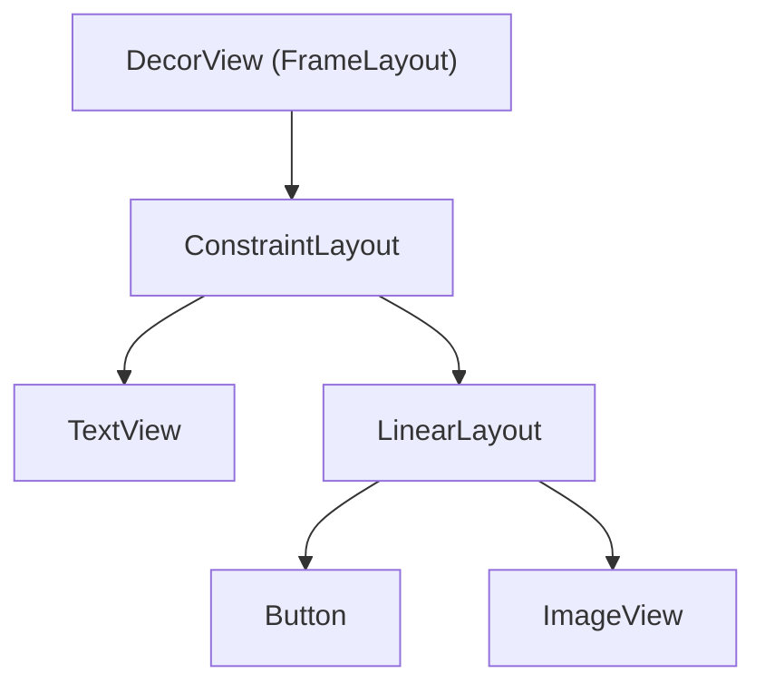

#### Comparison

| | View | ViewGroup |
|---|---|---|
| Role | Leaf: shows content | Container: arranges children |
| Has children | No | Yes (`addView`, `getChildAt`) |
| Key overrides | `onMeasure`, `onDraw`, `onTouchEvent` | `onMeasure`, `onLayout`, `onInterceptTouchEvent` |
| Examples | `TextView`, `ImageView`, `ProgressBar` | `FrameLayout`, `RecyclerView`, `ConstraintLayout` |

**Pitfalls**
- Every extra ViewGroup adds a measure/layout/draw cost; deep nesting is a classic performance problem.
- Calling `addView` with the wrong `LayoutParams` type causes a `ClassCastException` or ignored attributes.

**Likely follow-ups**
- *Is `RecyclerView` a View or a ViewGroup?* A ViewGroup: it holds and positions item views.
- *Why does ViewGroup extend View?* So containers and leaves can be treated uniformly in one tree (Composite pattern).

</details>

### 2. How does Android draw a View? (measure → layout → draw)

<details>
<summary>Answer</summary>

**In short:** On each vsync signal, `Choreographer` asks `ViewRootImpl` to run a traversal over the view tree in three passes: **measure** (each view works out its size from the parent's `MeasureSpec`), **layout** (each parent positions its children) and **draw** (views record drawing commands into display lists). The RenderThread then sends those commands to the GPU. Only views that requested work are processed.

#### Who drives the frame

- **`Choreographer`** receives the display's vsync signal and runs input, animation and traversal callbacks once per frame.
- **`ViewRootImpl`** is the bridge between the window and the view hierarchy. Its `performTraversals()` runs the three passes. It only runs when something called `requestLayout()` or `invalidate()`.

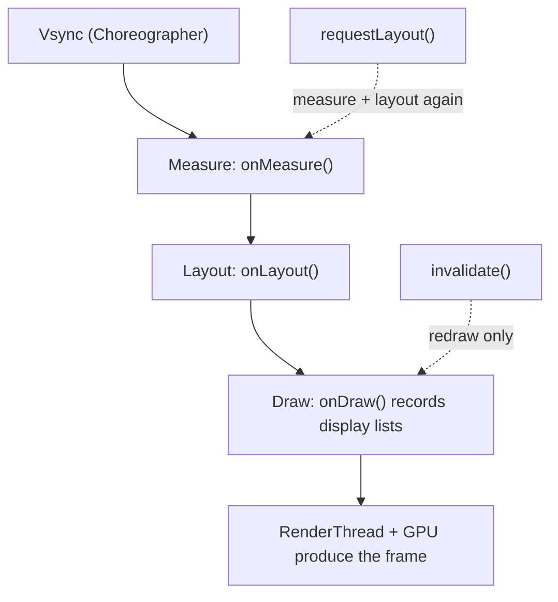

#### 1. Measure

Starting at the root, each parent calls `child.measure(widthSpec, heightSpec)`. The child's `onMeasure` decides its size within those constraints and **must** call `setMeasuredDimension(w, h)`, otherwise an `IllegalStateException` is thrown. Results are read with `measuredWidth`/`measuredHeight`. A parent may measure a child more than once (LinearLayout with weights, RelativeLayout).

#### 2. Layout

Each parent calls `child.layout(left, top, right, bottom)` with the final position. After this pass, `width`, `height`, `left`, `top` are valid. Custom ViewGroups do this in `onLayout`.

#### 3. Draw

`View.draw(canvas)` follows a fixed order:
1. Background
2. Content (`onDraw`)
3. Children (`dispatchDraw`, for ViewGroups)
4. Foreground and decorations (scrollbars)

With **hardware acceleration** (default since Android 4.0), `onDraw` doesn't paint pixels directly. The canvas records operations into a **RenderNode / display list**. A view that only changed a property such as `alpha` or `translationX` doesn't even need to re-record; only its RenderNode properties change, which is why property animations are cheap.

#### Frame budget

The **RenderThread** turns display lists into GPU commands, and SurfaceFlinger composites the window onto the screen. To hit 60 fps, the main-thread work plus render work must fit in about **16 ms** (about 8 ms at 120 Hz). Missing it is a dropped frame, i.e. jank.

**Pitfalls**
- Heavy work in `onDraw`/`onMeasure` (allocations, bitmap decoding) directly eats the frame budget.
- Calling `requestLayout()` repeatedly during animations causes the whole tree to re-measure every frame.

**Likely follow-ups**
- *What runs on the RenderThread?* Turning display lists into GPU commands, plus some animations (e.g. ripple), so they can keep going even if the main thread is briefly busy.
- *How do you find jank?* Profile GPU Rendering, Perfetto/systrace, Android Studio profilers, JankStats.

</details>

### 3. `invalidate()` vs `requestLayout()`?

<details>
<summary>Answer</summary>

**In short:** Call `invalidate()` when a view's **appearance** changes but its size doesn't; it schedules only a redraw (`onDraw`). Call `requestLayout()` when its **size or position** may change; it schedules measure and layout for the view and its ancestors, which is more expensive.

#### How each works

- **`invalidate()`** marks the view's display list dirty. On the next frame, only that view re-runs `draw()`. Must be called on the UI thread; **`postInvalidate()`** is the thread-safe variant that posts the call to the UI thread.
- **`requestLayout()`** sets a "layout requested" flag on the view and walks up to the root (`ViewRootImpl`), so the next traversal re-measures and re-lays out that branch. If the bounds change, a redraw follows.

```kotlin
class ProgressRing(context: Context, attrs: AttributeSet?) : View(context, attrs) {
    var progress = 0f
        set(value) { field = value; invalidate() }        // only drawing changes

    var label: String = ""
        set(value) { field = value; requestLayout(); invalidate() } // text width can change size
}
```

This is exactly what `TextView.setText()` does internally: if the new text might change the view's size, it requests layout; otherwise it only invalidates.

| | `invalidate()` | `requestLayout()` |
|---|---|---|
| Use when | Color, progress, drawn content changes | Size, text length, children, visibility GONE |
| Passes run | Draw | Measure + layout (+ draw if bounds change) |
| Scope | That view | That view and up the parent chain |
| Cost | Low | Higher, grows with tree depth |

**Pitfalls**
- Calling `requestLayout()` from inside `onLayout`/`onMeasure` can cause layout loops or warnings ("requestLayout() improperly called").
- Using `requestLayout()` when only a color changed wastes a full layout pass, which matters in animations and lists.
- Calling `invalidate()` alone after a size-changing change: the view gets redrawn at its old size and content gets clipped.

**Likely follow-ups**
- *What about `forceLayout()`?* It marks the view for re-layout without propagating up; it only takes effect when an ancestor's layout runs.
- *How do property animations avoid both?* `translationX`, `alpha`, `scaleX` update RenderNode properties without re-recording or re-layout.

</details>

### 4. What are MeasureSpec modes?

<details>
<summary>Answer</summary>

**In short:** A `MeasureSpec` is a constraint a parent passes to a child in `onMeasure`, packing a **mode** and a **size** into one `Int`. The modes are `EXACTLY` (be this size), `AT_MOST` (be at most this size) and `UNSPECIFIED` (any size you want).

#### The three modes

| Mode | Meaning | Typical source |
|---|---|---|
| `EXACTLY` | Child must be exactly `size` | `match_parent` (parent size known) or a fixed `dp` value |
| `AT_MOST` | Child can be anything up to `size` | `wrap_content` |
| `UNSPECIFIED` | No limit; child reports its natural size | Inside a `ScrollView` along the scroll axis, or when a parent probes a child's ideal size |

The parent builds the spec from its own spec and the child's `LayoutParams` (see `ViewGroup.getChildMeasureSpec`). For example, a child with `wrap_content` in a parent that has 400 px available gets `AT_MOST 400`.

#### Reading and honoring it

```kotlin
override fun onMeasure(widthMeasureSpec: Int, heightMeasureSpec: Int) {
    val desiredW = (paddingLeft + paddingRight + contentWidth)
    val desiredH = (paddingTop + paddingBottom + contentHeight)

    // resolveSize handles all three modes for you
    val w = resolveSize(desiredW, widthMeasureSpec)
    val h = resolveSize(desiredH, heightMeasureSpec)
    setMeasuredDimension(w, h)
}
```

What `resolveSize` does, written out:

```kotlin
val mode = MeasureSpec.getMode(spec)
val size = MeasureSpec.getSize(spec)
val result = when (mode) {
    MeasureSpec.EXACTLY -> size
    MeasureSpec.AT_MOST -> minOf(desired, size)
    else -> desired // UNSPECIFIED
}
```

**Pitfalls**
- A custom View that doesn't override `onMeasure` treats `wrap_content` like `match_parent`, because the default implementation just uses the spec size for `AT_MOST`.
- `measuredWidth` is the result of measuring; `width` is only valid after layout. They can differ.

**Likely follow-ups**
- *Why is RecyclerView with `wrap_content` inside a ScrollView bad?* It gets `UNSPECIFIED` height, so it lays out all items and recycling stops working.
- *How is a MeasureSpec stored?* The top 2 bits of the Int are the mode, the remaining 30 bits the size.

</details>

### 5. How do you create a custom View?

<details>
<summary>Answer</summary>

**In short:** Extend `View` (or an existing widget), read custom XML attributes declared in `attrs.xml`, override `onMeasure` to support `wrap_content`, draw in `onDraw` with pre-allocated `Paint`/`Path` objects, handle touch in `onTouchEvent` if interactive, and save state and add accessibility. If you only need to combine existing widgets, a **compound view** (inflate a layout into a ViewGroup) is simpler.

#### Step 1: constructors and attributes

Declare attributes so the view can be configured from XML:

```xml
<!-- res/values/attrs.xml -->
<declare-styleable name="RatingBadge">
    <attr name="badgeColor" format="color" />
    <attr name="score" format="integer" />
</declare-styleable>
```

```kotlin
class RatingBadge @JvmOverloads constructor(
    context: Context,
    attrs: AttributeSet? = null,
    defStyleAttr: Int = 0
) : View(context, attrs, defStyleAttr) {

    // Allocate once: onDraw runs every frame
    private val paint = Paint(Paint.ANTI_ALIAS_FLAG)
    private val textPaint = Paint(Paint.ANTI_ALIAS_FLAG).apply {
        color = Color.WHITE
        textAlign = Paint.Align.CENTER
        textSize = TypedValue.applyDimension(
            TypedValue.COMPLEX_UNIT_SP, 16f, resources.displayMetrics
        )
    }

    var score: Int = 0
        set(value) { field = value; contentDescription = "Score $value"; invalidate() }

    init {
        context.withStyledAttributes(attrs, R.styleable.RatingBadge, defStyleAttr, 0) {
            paint.color = getColor(R.styleable.RatingBadge_badgeColor, Color.BLUE)
            score = getInt(R.styleable.RatingBadge_score, 0)
        }
    }
```

`withStyledAttributes` (core-ktx) recycles the `TypedArray` for you. Be careful with `@JvmOverloads` when extending a widget like `Button`: passing `0` as `defStyleAttr` drops the widget's default style. Pass the widget's own default style attribute instead (e.g. `com.google.android.material.R.attr.materialButtonStyle`).

#### Step 2: measure and draw

```kotlin
    override fun onMeasure(widthMeasureSpec: Int, heightMeasureSpec: Int) {
        val desired = (48 * resources.displayMetrics.density).toInt()
        setMeasuredDimension(
            resolveSize(desired + paddingLeft + paddingRight, widthMeasureSpec),
            resolveSize(desired + paddingTop + paddingBottom, heightMeasureSpec)
        )
    }

    override fun onDraw(canvas: Canvas) {
        super.onDraw(canvas)
        val cx = width / 2f
        val cy = height / 2f
        canvas.drawCircle(cx, cy, minOf(cx, cy), paint)
        val textY = cy - (textPaint.descent() + textPaint.ascent()) / 2
        canvas.drawText(score.toString(), cx, textY, textPaint)
    }
```

#### Step 3: interaction, state, accessibility

- Override `onTouchEvent` (return `true` for `ACTION_DOWN` to receive the rest of the gesture) and call `performClick()` on tap so accessibility services work.
- Save state in `onSaveInstanceState()` / `onRestoreInstanceState()` (a `BaseSavedState` subclass or a `Bundle`). The view needs an `id` for this to be restored.
- Set `contentDescription` or override `onInitializeAccessibilityNodeInfo`; for virtual children use `ExploreByTouchHelper`.

#### Which approach

| Approach | When |
|---|---|
| Extend an existing widget | Small behavior tweak (e.g. a `TextView` with a custom font rule) |
| Compound view (`FrameLayout` + inflated XML) | Reusable group of standard widgets |
| Fully custom `View` | Charts, gauges, unusual shapes, drawing |
| Custom `ViewGroup` | Special child arrangement (flow layout) |

**Pitfalls**
- Allocating `Paint`, `Path`, `RectF` in `onDraw`: GC churn and jank (Lint warns about it).
- Forgetting padding in `onMeasure`/`onDraw`.
- Not calling `setMeasuredDimension`, which crashes.

**Likely follow-ups**
- *When is `onSizeChanged` useful?* Compute size-dependent values (radius, gradient shaders) once there instead of every frame.
- *How do you animate a custom property?* `ValueAnimator` updating a field and calling `invalidate()`.

</details>

### 6. LinearLayout vs RelativeLayout vs ConstraintLayout vs FrameLayout?

<details>
<summary>Answer</summary>

**In short:** `FrameLayout` stacks children (good for one child or overlays); `LinearLayout` arranges them in a single row or column; `RelativeLayout` positions them relative to siblings or parent (legacy, always measures twice); `ConstraintLayout` positions everything with constraints in a **flat** hierarchy and is the recommended choice for complex XML screens.

#### Each layout

- **FrameLayout**: children are drawn on top of each other, positioned with `layout_gravity`. Cheapest layout. Used as fragment containers, for overlays (a progress spinner over content), or a single child.
- **LinearLayout**: one row or column. Simple and fast **unless** you use `layout_weight`: with weights, children may be measured twice, and nesting weighted LinearLayouts multiplies the measure passes.
- **RelativeLayout**: rules like `layout_below`, `layout_toEndOf`, `layout_alignParentBottom`. It always performs two measure passes. Largely replaced by ConstraintLayout.
- **ConstraintLayout**: each view is constrained horizontally and vertically to parent, siblings or helpers. Features: **chains** (distribute views like weights), **guidelines**, **barriers** (align to the widest of several views), **ratios** (`16:9`), `Group`, `Flow`, and **MotionLayout** for animations. Lets you build a screen without nesting.

| Layout | Strength | Cost | Use for |
|---|---|---|---|
| FrameLayout | Overlays, single child | Lowest | Containers, stacking |
| LinearLayout | Simple rows/columns | Low; weights add passes | Simple forms, toolbars |
| RelativeLayout | Relative positions | Two measure passes | Legacy code |
| ConstraintLayout | Flat complex UIs | Constraint solving per pass | Complex screens |

#### Example: flat instead of nested

```xml
<androidx.constraintlayout.widget.ConstraintLayout
    android:layout_width="match_parent"
    android:layout_height="wrap_content">

    <ImageView android:id="@+id/avatar"
        android:layout_width="48dp" android:layout_height="48dp"
        app:layout_constraintStart_toStartOf="parent"
        app:layout_constraintTop_toTopOf="parent" />

    <TextView android:id="@+id/name"
        android:layout_width="0dp" android:layout_height="wrap_content"
        app:layout_constraintStart_toEndOf="@id/avatar"
        app:layout_constraintEnd_toEndOf="parent"
        app:layout_constraintTop_toTopOf="@id/avatar" />
</androidx.constraintlayout.widget.ConstraintLayout>
```

`0dp` ("match constraints") means "fill the space between my constraints".

**Pitfalls**
- ConstraintLayout isn't automatically faster: for a trivial single-row item, a LinearLayout or FrameLayout is fine and cheaper.
- Forgetting a vertical or horizontal constraint makes the view jump to the top-left at runtime.
- `match_parent` on a ConstraintLayout child is not supported; use `0dp` with constraints to both sides.

**Likely follow-ups**
- *Why is a flat hierarchy faster?* Fewer ViewGroups means fewer measure/layout passes and less nested double measuring.
- *What's the Compose equivalent?* `Box`, `Row`/`Column`, and `ConstraintLayout` for Compose; Compose forbids measuring a child twice, so nesting is cheap there.

</details>

### 7. How do you optimize layouts? What are `<include>`, `<merge>`, `ViewStub`?

<details>
<summary>Answer</summary>

**In short:** Keep the view hierarchy flat and small, avoid nested weights, inflate rarely used views lazily with `ViewStub`, reuse layouts with `<include>` and drop redundant wrapper ViewGroups with `<merge>`. Remove overdraw and verify with Layout Inspector and GPU profiling tools.

#### Why it matters

Every view costs inflation time (XML parsing plus reflective constructor calls in `LayoutInflater`), memory, and work in every measure/layout/draw pass. Nested layouts that measure twice (weights, RelativeLayout) multiply that cost exponentially with depth. In a RecyclerView item this cost is paid for every bind.

#### `<include>`: reuse

```xml
<include layout="@layout/toolbar_main" android:id="@+id/toolbar" />
```

Reuses a layout file in several screens. You can override `layout_*` attributes and the `id` on the `<include>` tag.

#### `<merge>`: remove the extra wrapper

If `toolbar_main.xml` has a `LinearLayout` root and it's included into another vertical `LinearLayout`, you get a pointless nested LinearLayout. Using `<merge>` as the root adds the children directly to the parent:

```xml
<!-- included layout -->
<merge xmlns:android="http://schemas.android.com/apk/res/android">
    <ImageView ... />
    <TextView ... />
</merge>
```

`<merge>` is also the standard root for compound custom views that extend a ViewGroup and inflate into themselves (`inflate(context, R.layout.x, this)`).

#### `ViewStub`: lazy inflation

```xml
<ViewStub android:id="@+id/errorStub"
    android:layout="@layout/error_state"
    android:inflatedId="@+id/errorView"
    android:layout_width="match_parent"
    android:layout_height="wrap_content" />
```

```kotlin
// Inflated only when an error actually happens
val errorView = binding.errorStub.inflate()
```

A ViewStub is invisible, has zero size and doesn't draw. On `inflate()` (or `setVisibility(VISIBLE)`) it replaces itself with the real layout. It can only be inflated once.

#### Other techniques

- Remove **overdraw** (duplicate opaque backgrounds); check with Debug GPU Overdraw.
- Use compound drawables (`drawableStart`) instead of an `ImageView` + `TextView` pair where suitable.
- Avoid `wrap_content` on RecyclerView inside scrolling parents.
- In lists, use `AsyncLayoutInflater` sparingly, or precompute text.
- Tools: **Layout Inspector** (hierarchy depth, attributes), **Profile GPU Rendering**, **Perfetto** traces, Lint warnings (`UselessParent`, `UselessLeaf`, `NestedWeights`).

**Pitfalls**
- Holding a reference to the ViewStub after inflating; it's no longer in the hierarchy.
- `<merge>` can't be inflated without a parent and `attachToRoot = true`.

**Likely follow-ups**
- *`INVISIBLE`/`GONE` vs ViewStub?* A GONE view is still inflated and in memory; a ViewStub isn't inflated until needed.
- *How do you measure inflation cost?* Trace sections in Perfetto, or Macrobenchmark for startup and scrolling.

</details>

### 8. What is the difference between `View.GONE`, `INVISIBLE`, `VISIBLE`?

<details>
<summary>Answer</summary>

**In short:** `VISIBLE` shows the view; `INVISIBLE` hides it but it **still takes up its space** in the layout; `GONE` hides it **and removes it from layout**, so other views move into the space.

| Value | Drawn | Takes space | Receives touches | Triggers re-layout when set |
|---|---|---|---|---|
| `VISIBLE` | Yes | Yes | Yes | From GONE: yes |
| `INVISIBLE` | No | Yes | No | No (just redraw) |
| `GONE` | No | No | No | Yes |

#### Choosing between them

- Use **`INVISIBLE`** when the layout must not shift, e.g. a loading spinner that swaps with a button of the same size, or a placeholder to keep alignment.
- Use **`GONE`** when the space should collapse, e.g. an optional subtitle or an error message that appears only on failure.

```kotlin
binding.subtitle.isVisible = item.subtitle != null     // VISIBLE or GONE (core-ktx)
binding.progress.isInvisible = !loading                // VISIBLE or INVISIBLE
```

Under the hood, changing to or from `GONE` calls `requestLayout()` because sizes change, while `VISIBLE` ↔ `INVISIBLE` only needs `invalidate()`. A view that is GONE still exists in memory and was still inflated, so it isn't free. For a rarely shown heavy section, a `ViewStub` is cheaper.

**Pitfalls**
- In RecyclerView, set visibility in both branches of `onBindViewHolder`, or recycled rows keep the previous item's visibility.
- In ConstraintLayout, views constrained to a GONE view keep their constraint, but the GONE view collapses to a point; use `layout_goneMarginStart` etc. to adjust margins.
- Toggling `GONE` frequently during animations causes repeated layouts; animate `alpha` instead.

**Likely follow-ups**
- *Is an `alpha = 0` view the same as INVISIBLE?* No: it's still drawn (cheaply) and still receives touch events.

</details>

### 9. `padding` vs `margin`?

<details>
<summary>Answer</summary>

**In short:** **Padding** is space *inside* a view, between its edges and its content; it belongs to the view, so the background and the clickable area include it. **Margin** is space *outside* a view, between it and its neighbours or parent; it's a property of the layout params, handled by the parent.

#### How they differ

| | Padding | Margin |
|---|---|---|
| Where | Inside the view's bounds | Outside the view's bounds |
| Background drawn there | Yes | No (parent's background shows) |
| Part of touch area | Yes | No |
| Who handles it | The view itself (`onMeasure`/`onDraw` must respect it) | The parent ViewGroup (via `MarginLayoutParams`) |
| XML | `android:padding`, `paddingStart` | `android:layout_margin`, `layout_marginStart` |

```text
+------------ margin ------------+
|  +------ view border -------+  |
|  |  padding                 |  |
|  |     [ content ]          |  |
|  +--------------------------+  |
+--------------------------------+
```

The `layout_` prefix is the clue: all `layout_*` attributes (including margins) are instructions to the **parent**, so a margin only works if the parent's LayoutParams support margins (all common layouts do).

#### Practical uses

- Increase a small icon's touch target to 48dp by adding **padding**, not margin.
- Space items in a list with margins or, better, an `ItemDecoration`.
- Use `Start`/`End` rather than `Left`/`Right` to support RTL languages.

```kotlin
// core-ktx helpers; values are in px (convert dp with resources.displayMetrics.density)
view.updatePadding(top = topPx)
view.updateLayoutParams<ViewGroup.MarginLayoutParams> { topMargin = marginPx }
```

**Pitfalls**
- Custom views that ignore `paddingLeft` etc. in drawing make padding look broken.
- Margins don't collapse in Android (unlike CSS); two adjacent 8dp margins give 16dp.

**Likely follow-ups**
- *What's the Compose equivalent?* Compose only has `Modifier.padding`; order matters: padding before `background` acts like margin, after it acts like padding.

</details>

### 10. What is ViewBinding vs DataBinding vs `findViewById` vs synthetics?

<details>
<summary>Answer</summary>

**In short:** `findViewById` is the manual, unsafe way to get views. Kotlin synthetics were a shortcut that is now deprecated and removed. **ViewBinding** generates a type-safe, null-safe binding class per layout and is the recommended way for View-based UIs. **DataBinding** adds expressions and two-way binding in XML, but it slows builds and puts logic in XML, so it's less used now and Compose replaces it.

#### Comparison

| | `findViewById` | Kotlin synthetics | ViewBinding | DataBinding |
|---|---|---|---|---|
| Type safety | Generic cast, can be wrong | Yes | Yes | Yes |
| Null safety | Can return null at runtime | Could reference IDs from other layouts | Yes; nullable only if absent in some configs | Yes |
| Build cost | None | Kotlin plugin | Small (Gradle generates classes) | Higher (annotation processing) |
| XML expressions | No | No | No | Yes `@{}` / `@={}` |
| Status | Works, verbose | Removed | Recommended for Views | Maintained, niche |

#### ViewBinding

```kotlin
// build.gradle.kts
android { buildFeatures { viewBinding = true } }
```

```kotlin
class ProfileFragment : Fragment(R.layout.fragment_profile) {
    private var _binding: FragmentProfileBinding? = null
    private val binding get() = _binding!!

    override fun onViewCreated(view: View, savedInstanceState: Bundle?) {
        _binding = FragmentProfileBinding.bind(view)
        binding.name.text = "Ada"
    }

    override fun onDestroyView() {
        super.onDestroyView()
        _binding = null   // Fragment outlives its view: avoid leaking the view tree
    }
}
```

For `fragment_profile.xml` the plugin generates `FragmentProfileBinding` with a property for every view that has an `id`, plus `root`. Lookups happen once, at bind time.

#### DataBinding

```xml
<layout>
    <data><variable name="vm" type="com.example.ProfileViewModel" /></data>
    <EditText android:text="@={vm.name}" />
</layout>
```

Useful features include binding adapters (`@BindingAdapter("imageUrl")`) and two-way binding. Downsides: slower incremental builds, error messages pointing to generated code, logic hidden in XML that's hard to test.

**Pitfalls**
- Not clearing the binding in `onDestroyView()` leaks the whole view hierarchy when the fragment goes on the back stack.
- Using `binding` after `onDestroyView` (e.g. from a coroutine collecting a Flow) crashes; collect with `viewLifecycleOwner.repeatOnLifecycle`.

**Likely follow-ups**
- *Why were synthetics removed?* They weren't null-safe across layouts, cached views in a hidden map and only worked in Kotlin.
- *Can ViewBinding be used in RecyclerView?* Yes: inflate `ItemUserBinding` in `onCreateViewHolder` and hold it in the ViewHolder.

</details>

---

## RecyclerView

### 11. How does RecyclerView work? Why is it better than ListView?

<details>
<summary>Answer</summary>

**In short:** RecyclerView displays large lists by creating only enough item views to fill the screen (plus a few extra) and **recycling** views that scroll off-screen: they're rebound with new data instead of being inflated again. Its responsibilities are split into pluggable parts (Adapter, ViewHolder, LayoutManager, ItemAnimator, ItemDecoration), which makes it more flexible and efficient than ListView.

#### The problem it solves

A list of 10,000 rows can't have 10,000 views: inflation is slow and memory would explode. Only about 10 rows are visible at once, so the idea is to keep around 10–15 views and reuse them as the user scrolls.

#### Components

| Component | Responsibility |
|---|---|
| **Adapter** | Bridges data to views: `getItemCount`, `onCreateViewHolder` (inflate), `onBindViewHolder` (fill data) |
| **ViewHolder** | Wraps one item view and caches references to its children |
| **LayoutManager** | Measures and positions items, decides which are visible, handles scrolling: `LinearLayoutManager`, `GridLayoutManager`, `StaggeredGridLayoutManager` |
| **Recycler** | Internal cache that stores and hands out ViewHolders (see the caching question) |
| **ItemAnimator** | Animates insert/remove/move/change (`DefaultItemAnimator`) |
| **ItemDecoration** | Draws dividers and adds offsets/spacing |
| **ItemTouchHelper** | Swipe-to-dismiss and drag-to-reorder |

#### Flow while scrolling

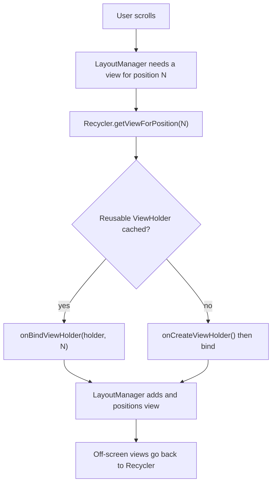

#### Minimal adapter

```kotlin
class UserAdapter(private val onClick: (User) -> Unit) :
    ListAdapter<User, UserAdapter.VH>(UserDiff) {

    class VH(val binding: ItemUserBinding) : RecyclerView.ViewHolder(binding.root)

    override fun onCreateViewHolder(parent: ViewGroup, viewType: Int): VH {
        val binding = ItemUserBinding.inflate(LayoutInflater.from(parent.context), parent, false)
        return VH(binding).also { vh ->
            binding.root.setOnClickListener {
                val pos = vh.bindingAdapterPosition
                if (pos != RecyclerView.NO_POSITION) onClick(getItem(pos))
            }
        }
    }

    override fun onBindViewHolder(holder: VH, position: Int) {
        holder.binding.name.text = getItem(position).name
    }
}
```

#### Why it's better than ListView

| | ListView | RecyclerView |
|---|---|---|
| ViewHolder pattern | Optional (manual `convertView` + tag) | Enforced |
| Layouts | Vertical list only (GridView separate) | Pluggable LayoutManagers: list, grid, staggered, horizontal, custom |
| Updates | `notifyDataSetChanged()` only | Granular `notifyItemInserted/Removed/Changed/Moved` + DiffUtil |
| Animations | None built-in | `ItemAnimator` |
| Caching | One recycler level | Multi-level: scrap, view cache, pool; prefetch on a background schedule |
| Dividers/headers | Built-in but rigid | `ItemDecoration`, `ConcatAdapter` |

ListView did have built-in click listeners, headers/footers and dividers, which RecyclerView leaves to you.

**Pitfalls**
- `onBindViewHolder` must be fast; no heavy work, decoding or allocation.
- Forgetting to set a LayoutManager means nothing is shown.

**Likely follow-ups**
- *What's prefetch?* `GapWorker` creates/binds upcoming items during idle time between frames while scrolling (enabled by default on Android 5.0+).
- *Compose equivalent?* `LazyColumn`/`LazyRow`, which compose only visible items and reuse slots.

</details>

### 12. Explain RecyclerView's caching / recycling mechanism.

<details>
<summary>Answer</summary>

**In short:** When RecyclerView needs a view for a position, it checks several caches in order: the **scrap** (views detached during the current layout, reused without rebinding), the **view cache** (`mCachedViews`, default 2 recently scrolled-off views, reused without rebinding if their position comes back), an optional **ViewCacheExtension**, then the **RecycledViewPool** (ViewHolders grouped by view type, default 5 per type, which need rebinding). Only if all miss does it call `onCreateViewHolder`.

#### The levels

1. **Scrap** (`mAttachedScrap`, `mChangedScrap`): during a layout pass, children are temporarily detached and put in scrap, then reattached. They still match their positions, so they're reused **without binding**. Changed scrap holds items being changed for change animations.
2. **View cache** (`mCachedViews`, default size 2): views that just scrolled off keep their data and position. If the user scrolls back a little, they come back **without rebinding**. Matched by **position** (or stable ID).
3. **ViewCacheExtension**: an optional developer-provided cache; rarely used.
4. **RecycledViewPool**: when a view leaves the view cache it goes into the pool, keyed by **viewType** (default max 5 per type). The ViewHolder is "dirty", so it **must be rebound** with `onBindViewHolder`.
5. **Create**: `onCreateViewHolder` inflates a new view, then it's bound.

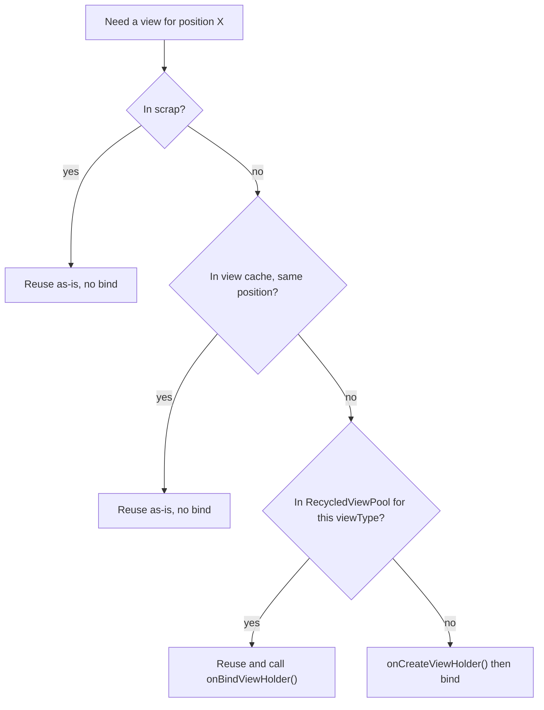

#### Analogy

The view cache is the "I might come straight back" shelf: pages you just turned are kept open. The pool is a box of blank forms sorted by type: any form can be reused, but you have to fill it in again.

#### Tuning

```kotlin
recyclerView.setItemViewCacheSize(4)          // larger view cache for back-and-forth scrolling
recyclerView.setHasFixedSize(true)            // item changes don't change RV's own size

// Nested horizontal lists share one pool, so rows reuse each other's ViewHolders
val sharedPool = RecyclerView.RecycledViewPool().apply { setMaxRecycledViews(TYPE_CARD, 20) }
innerRecyclerView.setRecycledViewPool(sharedPool)

// Prefetch items of inner horizontal lists when the row is about to appear
(innerRecyclerView.layoutManager as LinearLayoutManager).initialPrefetchItemCount = 4
```

**Pitfalls**
- Many view types with a pool of 5 each can cause frequent inflation; raise `setMaxRecycledViews` for common types.
- Views with transient state (running animation) may not be recycled; override `onFailedToRecycleView` if needed.
- Not resetting state on bind: pooled ViewHolders carry old values (wrong checkboxes, images).

**Likely follow-ups**
- *Why is `notifyDataSetChanged()` bad for caching?* It marks all ViewHolders invalid, so scrap and cache can't be reused without rebinding, and animations are lost.
- *Hooks into recycling?* `onViewRecycled` (release resources, clear image requests), `onViewAttachedToWindow`/`onViewDetachedFromWindow`.

</details>

### 13. What is DiffUtil and ListAdapter? Why not `notifyDataSetChanged()`?

<details>
<summary>Answer</summary>

**In short:** `notifyDataSetChanged()` tells RecyclerView "everything may have changed", so it rebinds every visible item, loses item animations and can't preserve state. **DiffUtil** compares the old and new lists (Eugene Myers' diff algorithm) and dispatches the minimal precise updates (`notifyItemInserted/Removed/Moved/Changed`). **ListAdapter** wraps this: you call `submitList(newList)` and it diffs on a background thread via `AsyncListDiffer`.

#### The callbacks

```kotlin
object UserDiff : DiffUtil.ItemCallback<User>() {
    // Same entity? Usually compare a stable unique ID
    override fun areItemsTheSame(old: User, new: User) = old.id == new.id

    // Same visible content? Called only if areItemsTheSame is true
    override fun areContentsTheSame(old: User, new: User) = old == new   // data class equals

    // Optional: describe what changed, for partial rebinding
    override fun getChangePayload(old: User, new: User): Any? =
        if (old.isLiked != new.isLiked) PAYLOAD_LIKE else null
}

class UserAdapter : ListAdapter<User, UserVH>(UserDiff) {
    override fun onCreateViewHolder(parent: ViewGroup, viewType: Int) = UserVH.create(parent)
    override fun onBindViewHolder(holder: UserVH, position: Int) = holder.bind(getItem(position))
}

// In the Fragment
viewModel.users.collect { adapter.submitList(it) }
```

How it maps to updates:

| `areItemsTheSame` | `areContentsTheSame` | Result |
|---|---|---|
| false | not called | Treated as remove + insert |
| true | true | No update |
| true | false | `notifyItemChanged` (with payload if provided) |

#### Why it's better

- **Animations**: inserts slide in, removes fade out, moves animate.
- **Efficiency**: only changed rows rebind; scroll position and focus are kept.
- **Off main thread**: `ListAdapter`/`AsyncListDiffer` compute the diff on a background executor and apply results on the main thread. Diffing is O(N + D²) in time where D is the number of edits, so small changes on big lists are cheap.

**Pitfalls**
- **Mutating and resubmitting the same list instance**: `submitList` sees the same reference and does nothing. Always submit a new list (`list.toList()`, or immutable state from the ViewModel).
- Mutable item objects: if you mutate an item in place, old and new are the same object, so `areContentsTheSame` returns true and nothing updates.
- Using `==` in `areItemsTheSame`: every content change becomes remove + insert, causing flicker.
- Calling `notifyItem*` manually on a `ListAdapter` desyncs it from its internal list.

**Likely follow-ups**
- *How do you scroll to top after a new list?* Use `submitList(list) { recyclerView.scrollToPosition(0) }`; the callback runs after the diff is applied.
- *DiffUtil without ListAdapter?* `DiffUtil.calculateDiff(callback).dispatchUpdatesTo(adapter)`, ideally computed off the main thread.

</details>

### 14. How do you implement multiple view types in RecyclerView?

<details>
<summary>Answer</summary>

**In short:** Override `getItemViewType(position)` to return a type for each item, create the matching ViewHolder in `onCreateViewHolder(parent, viewType)`, and bind by type in `onBindViewHolder`. Model the items as a **sealed class** so the compiler checks you handle every type. For screens made of independent sections, combine separate adapters with **`ConcatAdapter`**.

#### Sealed-class approach

```kotlin
sealed interface FeedItem {
    val id: String
    data class Header(override val id: String, val title: String) : FeedItem
    data class Post(override val id: String, val text: String, val author: String) : FeedItem
    data class Ad(override val id: String, val imageUrl: String) : FeedItem
}

class FeedAdapter : ListAdapter<FeedItem, RecyclerView.ViewHolder>(FeedDiff) {

    override fun getItemViewType(position: Int) = when (getItem(position)) {
        is FeedItem.Header -> R.layout.item_header      // layout IDs are unique Ints
        is FeedItem.Post -> R.layout.item_post
        is FeedItem.Ad -> R.layout.item_ad
    }

    override fun onCreateViewHolder(parent: ViewGroup, viewType: Int): RecyclerView.ViewHolder {
        val inflater = LayoutInflater.from(parent.context)
        return when (viewType) {
            R.layout.item_header -> HeaderVH(ItemHeaderBinding.inflate(inflater, parent, false))
            R.layout.item_post -> PostVH(ItemPostBinding.inflate(inflater, parent, false))
            R.layout.item_ad -> AdVH(ItemAdBinding.inflate(inflater, parent, false))
            else -> error("Unknown viewType $viewType")
        }
    }

    override fun onBindViewHolder(holder: RecyclerView.ViewHolder, position: Int) {
        when (val item = getItem(position)) {
            is FeedItem.Header -> (holder as HeaderVH).bind(item)
            is FeedItem.Post -> (holder as PostVH).bind(item)
            is FeedItem.Ad -> (holder as AdVH).bind(item)
        }
    }
}
```

Each view type has its own bucket in the RecycledViewPool, so a Post ViewHolder is never handed to an Ad.

#### ConcatAdapter

```kotlin
val concat = ConcatAdapter(headerAdapter, postsAdapter, loadingFooterAdapter)
recyclerView.adapter = concat
```

Each adapter stays simple and reusable. By default each sub-adapter has isolated view types; `ConcatAdapter.Config` with `isolateViewTypes = false` lets them share pools when they use the same types. In ViewHolders, use `bindingAdapterPosition` (position within its own adapter) rather than `absoluteAdapterPosition`.

#### Options

| Approach | When |
|---|---|
| `getItemViewType` + sealed class | One list, a few types |
| `ConcatAdapter` | Independent sections (header, list, footer, loading state) |
| Adapter-delegate libraries / Epoxy / Groupie | Many types, large teams |

**Pitfalls**
- Returning `position` or random values as the view type defeats recycling entirely.
- In `GridLayoutManager`, headers should span the full width: set a `SpanSizeLookup` returning `spanCount` for header types.

**Likely follow-ups**
- *How do you show a loading footer with Paging 3?* `pagingAdapter.withLoadStateFooter(LoadStateAdapter)`, which returns a ConcatAdapter.

</details>

### 15. How do you implement pagination / endless scroll?

<details>
<summary>Answer</summary>

**In short:** The recommended way is **Paging 3**: a `PagingSource` loads pages by key, a `Pager` exposes `Flow<PagingData>`, and a `PagingDataAdapter` displays it, loading more automatically as the user nears the end, with built-in load states, retry and caching. `RemoteMediator` adds an offline-first network + database setup. The manual way is a scroll listener that fetches the next page when the last visible item is near the end.

#### Paging 3

```kotlin
class ArticlePagingSource(private val api: Api) : PagingSource<Int, Article>() {
    override suspend fun load(params: LoadParams<Int>): LoadResult<Int, Article> = try {
        val page = params.key ?: 1
        val items = api.articles(page = page, size = params.loadSize)
        LoadResult.Page(
            data = items,
            prevKey = if (page == 1) null else page - 1,
            nextKey = if (items.isEmpty()) null else page + 1
        )
    } catch (e: IOException) {
        LoadResult.Error(e)
    }

    override fun getRefreshKey(state: PagingState<Int, Article>): Int? =
        state.anchorPosition?.let { state.closestPageToPosition(it)?.prevKey?.plus(1) }
}

// ViewModel
val articles: Flow<PagingData<Article>> =
    Pager(PagingConfig(pageSize = 20, prefetchDistance = 5)) { ArticlePagingSource(api) }
        .flow.cachedIn(viewModelScope)   // survives config changes

// Fragment
viewLifecycleOwner.lifecycleScope.launch {
    viewLifecycleOwner.repeatOnLifecycle(Lifecycle.State.STARTED) {
        viewModel.articles.collectLatest { adapter.submitData(it) }
    }
}
recyclerView.adapter = adapter.withLoadStateFooter(RetryFooterAdapter { adapter.retry() })
```

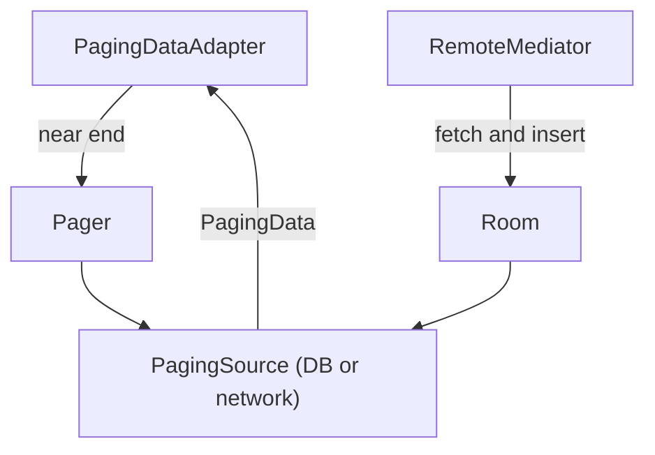

With `RemoteMediator`, Room is the single source of truth: the UI pages from the database, and the mediator fetches from the network and writes to the database when it runs out.

#### Manual approach

```kotlin
recyclerView.addOnScrollListener(object : RecyclerView.OnScrollListener() {
    override fun onScrolled(rv: RecyclerView, dx: Int, dy: Int) {
        if (dy <= 0) return                                  // only when scrolling down
        val lm = rv.layoutManager as LinearLayoutManager
        val lastVisible = lm.findLastVisibleItemPosition()
        if (!viewModel.isLoading && !viewModel.isLastPage &&
            lastVisible + THRESHOLD >= lm.itemCount) {
            viewModel.loadNextPage()
        }
    }
})
```

The ViewModel appends results to its list and the adapter gets a new list via `submitList`.

| | Paging 3 | Manual |
|---|---|---|
| Load states, retry, footer | Built-in | You build them |
| DB + network | `RemoteMediator` | Custom |
| Duplicate requests | Handled | Guard with `isLoading` flags |
| Complexity | Learning curve | Simple for small cases |

**Pitfalls**
- Missing the `isLoading` guard fires the same request many times while scrolling.
- Offset-based paging on data that changes can skip or duplicate items; cursor/key-based paging is safer.
- Forgetting `cachedIn` reloads everything after rotation.

**Likely follow-ups**
- *How do you transform paged data?* `pagingData.map { }`, `filter`, `insertSeparators` on the Flow.
- *Compose?* `collectAsLazyPagingItems()` with `LazyColumn`.

</details>

### 16. Why do images flicker or show wrong data in RecyclerView?

<details>
<summary>Answer</summary>

**In short:** Because ViewHolders are recycled. A view bound to item A gets reused for item B; if you don't reset every field, or an async load for A finishes after the view was rebound to B, B shows A's data. Fix it by setting **every** view state in `onBindViewHolder`, letting image libraries (Coil/Glide) cancel stale requests, using correct DiffUtil callbacks or stable IDs, and using payloads to avoid full rebinds that cause flicker.

#### Cause 1: incomplete binding

```kotlin
// WRONG: recycled rows keep the old badge and checkbox state
if (item.isNew) holder.badge.isVisible = true
if (item.isChecked) holder.checkbox.isChecked = true

// RIGHT: set state for both branches
holder.badge.isVisible = item.isNew
holder.checkbox.setOnCheckedChangeListener(null)   // avoid firing the old item's listener
holder.checkbox.isChecked = item.isChecked
holder.checkbox.setOnCheckedChangeListener { _, checked -> onToggle(item.id, checked) }
```

#### Cause 2: stale async work

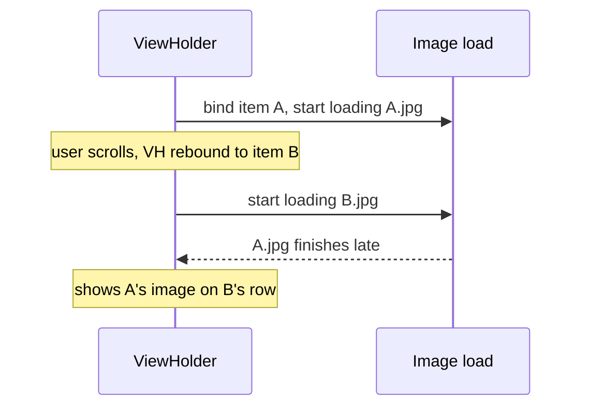

Image libraries attach the request to the `ImageView` and cancel the previous one when you load a new URL into it:

```kotlin
holder.avatar.load(item.avatarUrl) {        // Coil
    placeholder(R.drawable.avatar_placeholder)
}
```

For your own async work, cancel it in `onViewRecycled`, or check that the holder still shows the same item (compare an ID tag) before applying the result.

#### Cause 3: flicker on updates

- `notifyDataSetChanged()` or `areItemsTheSame` comparing whole objects makes rows be removed/re-added, so they flash.
- A full rebind after a small change (like a like count) reloads the image and crossfades it. Use **payloads**:

```kotlin
override fun onBindViewHolder(holder: PostVH, position: Int, payloads: MutableList<Any>) {
    if (payloads.contains(PAYLOAD_LIKE)) holder.bindLike(getItem(position))
    else super.onBindViewHolder(holder, position, payloads)   // full bind
}
```

- The default change animation crossfades the old and new view. If that looks like flicker, disable it: `(rv.itemAnimator as? SimpleItemAnimator)?.supportsChangeAnimations = false`.
- With a plain `Adapter`, `setHasStableIds(true)` + a real `getItemId()` lets RecyclerView keep identity across `notifyDataSetChanged()`.

**Pitfalls**
- Storing UI state (expanded, checked) only in the view instead of in the data model: it gets lost or duplicated on recycle.
- Image placeholders missing, so the old image shows until the new one loads.

**Likely follow-ups**
- *Where should you clear resources?* `onViewRecycled` (e.g. `holder.avatar.dispose()` in Coil, or `Glide.with(view).clear(view)`).

</details>

### 17. Where should click listeners be set in RecyclerView?

<details>
<summary>Answer</summary>

**In short:** Set them **once in `onCreateViewHolder`** (or in the ViewHolder's `init`), and when a click happens read the current item using `bindingAdapterPosition`, checking for `NO_POSITION`. Setting listeners in `onBindViewHolder` allocates new listener objects on every bind. Expose clicks from the adapter as a lambda like `(Item) -> Unit`, not by passing in a Context or Activity.

#### Why not in `onBindViewHolder`

`onBindViewHolder` runs every time a row scrolls into view, so creating a lambda there means one allocation per bind, during scrolling, when the frame budget is tight. It also tempts you to capture `position` in the closure, which becomes wrong after items are inserted or moved without a rebind.

```kotlin
// WRONG: new listener per bind, and position may be stale
override fun onBindViewHolder(holder: VH, position: Int) {
    holder.itemView.setOnClickListener { onClick(getItem(position)) }
}
```

#### Right way

```kotlin
class UserAdapter(
    private val onClick: (User) -> Unit,
    private val onLongClick: (User) -> Unit
) : ListAdapter<User, UserAdapter.VH>(UserDiff) {

    inner class VH(val binding: ItemUserBinding) : RecyclerView.ViewHolder(binding.root) {
        init {
            binding.root.setOnClickListener {
                val pos = bindingAdapterPosition
                if (pos != RecyclerView.NO_POSITION) onClick(getItem(pos))
            }
            binding.root.setOnLongClickListener {
                val pos = bindingAdapterPosition
                if (pos != RecyclerView.NO_POSITION) onLongClick(getItem(pos))
                true
            }
        }
    }

    override fun onCreateViewHolder(parent: ViewGroup, viewType: Int) =
        VH(ItemUserBinding.inflate(LayoutInflater.from(parent.context), parent, false))

    override fun onBindViewHolder(holder: VH, position: Int) {
        holder.binding.name.text = getItem(position).name
    }
}

// Fragment
val adapter = UserAdapter(
    onClick = { user -> viewModel.onUserClicked(user.id) },
    onLongClick = { user -> showMenu(user) }
)
```

`NO_POSITION` happens when the item was removed but its removal animation is still running, or the layout hasn't been calculated yet; a tap at that moment must be ignored.

| Position API | Meaning |
|---|---|
| `bindingAdapterPosition` | Position in the adapter that bound this holder (use this, including with ConcatAdapter) |
| `absoluteAdapterPosition` | Position in the whole RecyclerView's adapter (the ConcatAdapter) |
| `adapterPosition` | Deprecated, ambiguous with ConcatAdapter |
| `layoutPosition` | Position in the latest layout, may lag behind adapter changes |

**Pitfalls**
- Passing an Activity/Fragment into the adapter couples them and risks leaks if the adapter outlives the view.
- Using the `position` parameter of `onBindViewHolder` later inside callbacks.

**Likely follow-ups**
- *How do you handle clicks on a child view (e.g. a like button)?* Same pattern: set the listener on that child in the ViewHolder's `init` and use a separate lambda.

</details>

---

## Touch Events

### 18. Explain the touch event dispatch flow.

<details>
<summary>Answer</summary>

**In short:** A touch goes top-down: `Activity.dispatchTouchEvent` → `Window` (DecorView) → each `ViewGroup.dispatchTouchEvent`, which first asks its own `onInterceptTouchEvent` whether to steal the event, then passes it to the child under the finger. At the target view, `OnTouchListener.onTouch` runs first, then `onTouchEvent` (which also detects clicks and long clicks). If nobody consumes it, it bubbles back up through the parents' `onTouchEvent` to the Activity.

#### The three key methods

| Method | Exists on | Role |
|---|---|---|
| `dispatchTouchEvent` | Activity, ViewGroup, View | Routes the event; rarely overridden |
| `onInterceptTouchEvent` | ViewGroup only | Return `true` to steal the event from children |
| `onTouchEvent` | Activity, View | Handles the event; return `true` to consume |

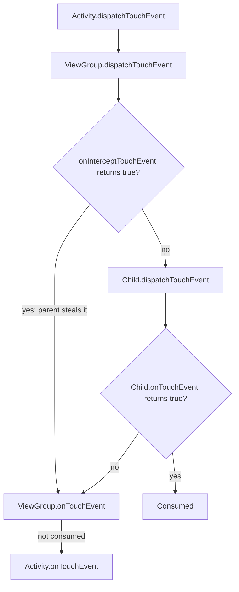

#### Gestures, not single events

A gesture is a stream: `ACTION_DOWN` → many `ACTION_MOVE` → `ACTION_UP` (or `ACTION_CANCEL`). Multi-touch adds `ACTION_POINTER_DOWN/UP`.

- **Returning `true` for `ACTION_DOWN`** makes that view the target: subsequent MOVE/UP events go straight to it. If it returns `false` for DOWN, it gets nothing else from that gesture.
- **Interception mid-gesture**: a parent like `ScrollView` lets DOWN through to a child button, but watches MOVE events in `onInterceptTouchEvent`. Once the finger moves beyond the **touch slop** (`ViewConfiguration.scaledTouchSlop`), it returns `true`: the child receives `ACTION_CANCEL` and the parent takes over scrolling. That's why pressing a button and then scrolling cancels the button press.
- **Opting out**: a child can call `parent.requestDisallowInterceptTouchEvent(true)` to stop ancestors from intercepting for the rest of the gesture (e.g. a horizontal slider inside a vertical list).
- **`OnTouchListener`** runs before `onTouchEvent`; if it returns `true`, `onTouchEvent` is skipped, and so are click listeners.
- A disabled but clickable view still consumes events, it just doesn't react.

```kotlin
class SwipeRow(context: Context, attrs: AttributeSet?) : FrameLayout(context, attrs) {
    private val slop = ViewConfiguration.get(context).scaledTouchSlop
    private var downX = 0f

    override fun onInterceptTouchEvent(ev: MotionEvent): Boolean {
        when (ev.actionMasked) {
            MotionEvent.ACTION_DOWN -> downX = ev.x
            MotionEvent.ACTION_MOVE -> if (abs(ev.x - downX) > slop) return true // steal horizontal drags
        }
        return false
    }

    override fun onTouchEvent(ev: MotionEvent): Boolean {
        // handle swipe translation here
        return true
    }
}
```

**Pitfalls**
- Overriding `onTouchEvent` and returning `true` without calling `performClick()` breaks accessibility and click listeners (Lint: `ClickableViewAccessibility`).
- Intercepting on `ACTION_DOWN` means children never get any events.

**Likely follow-ups**
- *How do you detect gestures easily?* `GestureDetector` (tap, fling, long press) and `ScaleGestureDetector`.
- *Compose?* `Modifier.pointerInput` with `detectTapGestures`/`detectDragGestures`; events pass through Initial, Main and Final passes.

</details>

### 19. How do you resolve nested scrolling conflicts?

<details>
<summary>Answer</summary>

**In short:** Prefer components that implement the **nested scrolling protocol** (`RecyclerView`, `NestedScrollView`, `CoordinatorLayout`/`AppBarLayout`), which coordinate who scrolls. For custom cases, intercept in the parent based on scroll **direction** (`onInterceptTouchEvent`) or let the child block the parent with `requestDisallowInterceptTouchEvent`. Avoid putting a RecyclerView with `wrap_content` inside a `NestedScrollView`; use one RecyclerView with multiple view types or a `ConcatAdapter` instead.

#### Typical conflicts

| Conflict | Example | Fix |
|---|---|---|
| Different directions | Horizontal carousel in a vertical list | Usually works out of the box (RecyclerView checks direction); if not, child calls `requestDisallowInterceptTouchEvent(true)` once a horizontal drag is detected |
| Same direction | Vertical list inside a vertical scroll | Nested scrolling protocol, or restructure into one list |
| Collapsing header | Toolbar collapses as list scrolls | `CoordinatorLayout` + `AppBarLayout` + `app:layout_behavior="@string/appbar_scrolling_view_behavior"` |
| ViewPager2 with horizontal child | Horizontal RecyclerView in a ViewPager2 page | Wrapper view that disallows parent interception while the child can still scroll in that direction |

#### Nested scrolling protocol

`NestedScrollingChild3`/`NestedScrollingParent3` let a child offer scroll deltas to its parent **before** and **after** consuming them:

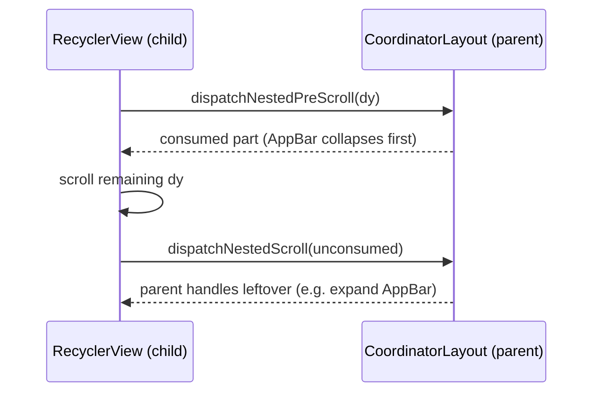

This is how a toolbar collapses before the list starts moving, and expands again when the list hits the top.

#### Direction-based child handling

```kotlin
// Inside a custom horizontal scrolling child
override fun onTouchEvent(ev: MotionEvent): Boolean {
    when (ev.actionMasked) {
        MotionEvent.ACTION_DOWN -> { startX = ev.x; startY = ev.y }
        MotionEvent.ACTION_MOVE -> {
            val dx = abs(ev.x - startX)
            val dy = abs(ev.y - startY)
            // Keep horizontal drags for ourselves, let vertical ones go to the parent
            parent.requestDisallowInterceptTouchEvent(dx > dy)
        }
    }
    return super.onTouchEvent(ev)
}
```

#### The RecyclerView-in-NestedScrollView trap

Inside a `NestedScrollView`, the RecyclerView is measured with `UNSPECIFIED` height, so it lays out **every** item to compute its full height. No recycling happens: 1,000 items mean 1,000 inflated views, slow startup and high memory. Instead:

```kotlin
recyclerView.adapter = ConcatAdapter(headerAdapter, itemsAdapter, footerAdapter)
```

**Pitfalls**
- `isNestedScrollingEnabled = false` on the inner RecyclerView "fixes" the scroll feel but keeps the no-recycling problem.
- Forgetting `layout_behavior` on the scrolling content in a CoordinatorLayout: content goes under the AppBar.

**Likely follow-ups**
- *Compose?* `Modifier.nestedScroll(connection)` with a `NestedScrollConnection` (`onPreScroll`/`onPostScroll`); nesting a same-direction `LazyColumn` in a scrollable `Column` without fixed height throws an error.

</details>

---

## Styling, Theming & Accessibility

### 20. Style vs Theme?

<details>
<summary>Answer</summary>

**In short:** A **style** is a bundle of attribute values applied to **one View** (`style="@style/PrimaryButton"`). A **theme** is a bundle of *theme attributes* applied to an **Activity, the app, or a view subtree** (`android:theme`); every view in that context resolves `?attr/...` references against it, and it also controls window properties like the status bar and window background.

#### Style

```xml
<style name="Widget.App.Button.Primary" parent="Widget.Material3.Button">
    <item name="android:textAllCaps">false</item>
    <item name="cornerRadius">12dp</item>
</style>
```

```xml
<Button style="@style/Widget.App.Button.Primary" ... />
```

Attributes in a style apply only to that view and are **not inherited** by children.

#### Theme

```xml
<style name="Theme.App" parent="Theme.Material3.DayNight.NoActionBar">
    <item name="colorPrimary">@color/brand_primary</item>
    <item name="colorOnPrimary">@color/white</item>
    <item name="materialButtonStyle">@style/Widget.App.Button.Primary</item> <!-- default style for all buttons -->
    <item name="android:windowLightStatusBar">true</item>
</style>
```

```xml
<application android:theme="@style/Theme.App" ... />
```

Views refer to theme attributes with `?attr/colorPrimary` (or `?colorPrimary`), so changing the theme changes every view without editing layouts. That's how dark mode and dynamic color work.

#### Theme overlays

`android:theme` on a view applies a **ThemeOverlay** to that view and its children only (implemented by wrapping the Context in a `ContextThemeWrapper`):

```xml
<com.google.android.material.appbar.MaterialToolbar
    android:theme="@style/ThemeOverlay.App.Toolbar" />
```

#### Attribute resolution order

When a view resolves an attribute, the first match wins:
1. Attribute set directly in the XML tag
2. The `style="..."` on the view
3. Default style from the theme (e.g. `materialButtonStyle`)
4. The widget's default style resource
5. Theme attributes

| | Style | Theme |
|---|---|---|
| Applies to | One view | Activity, app, or subtree |
| Inherited by children | No | Yes (via Context) |
| References | Concrete values | Semantic attributes (`colorPrimary`, `colorSurface`) |
| Window properties | No | Yes |

Use **Material 3** themes (`Theme.Material3.DayNight`) and **dynamic color** (Material You, Android 12+) via `DynamicColors.applyToActivitiesIfAvailable(application)`.

**Pitfalls**
- Hardcoding `@color/...` in layouts instead of `?attr/colorSurface` breaks dark mode and dynamic color.
- Using `getColor(R.color.x)` when you need a theme attribute; resolve it with `MaterialColors.getColor(view, R.attr.colorPrimary)`.

**Likely follow-ups**
- *What's a `TextAppearance`?* A style limited to text attributes, applied with `android:textAppearance`; it has lower priority than `style`.

</details>

### 21. How do you support dark mode?

<details>
<summary>Answer</summary>

**In short:** Use a `DayNight` theme (e.g. `Theme.Material3.DayNight`), put dark variants of colors in `values-night/`, and reference **theme attributes** (`?attr/colorSurface`) instead of hardcoded colors. Let users choose with `AppCompatDelegate.setDefaultNightMode()`. In Compose, pick a dark or light `ColorScheme` in `MaterialTheme` based on `isSystemInDarkTheme()`.

#### How it works

The night mode is a resource **configuration qualifier** (`-night`). When the system or app switches mode, the configuration changes, the Activity is recreated (unless it handles `uiMode` itself) and resources resolve from `values-night/` where available.

```text
res/values/colors.xml         -> brand_background = #FFFFFF
res/values-night/colors.xml   -> brand_background = #121212
res/drawable-night/           -> dark illustrations
```

#### Steps

1. App theme extends `Theme.Material3.DayNight` (or `Theme.AppCompat.DayNight`).
2. Define colors semantically and use theme attributes in layouts:
   ```xml
   <TextView android:textColor="?attr/colorOnSurface"
       android:background="?attr/colorSurface" />
   ```
3. Provide a user setting:
   ```kotlin
   AppCompatDelegate.setDefaultNightMode(
       when (pref) {
           Theme.LIGHT -> AppCompatDelegate.MODE_NIGHT_NO
           Theme.DARK -> AppCompatDelegate.MODE_NIGHT_YES
           else -> AppCompatDelegate.MODE_NIGHT_FOLLOW_SYSTEM
       }
   )
   ```
   Call it early (e.g. in `Application.onCreate`) with the persisted preference so the first screen doesn't flash.
4. Compose:
   ```kotlin
   @Composable
   fun AppTheme(dark: Boolean = isSystemInDarkTheme(), content: @Composable () -> Unit) {
       val colors = when {
           Build.VERSION.SDK_INT >= 31 -> if (dark) dynamicDarkColorScheme(LocalContext.current)
                                          else dynamicLightColorScheme(LocalContext.current)
           dark -> darkColorScheme()
           else -> lightColorScheme()
       }
       MaterialTheme(colorScheme = colors, content = content)
   }
   ```

#### Design details

- Dark surfaces aren't pure black; Material uses dark gray with elevation shown by tonal overlays.
- Desaturate brand colors in dark mode for contrast.
- Check status/navigation bar icon colors (light vs dark icons).
- **Force Dark** (`android:forceDarkAllowed`) automatically darkens a light-only app on Android 10+, but results are hard to control; a proper DayNight theme is better.

**Pitfalls**
- Hardcoded `#FFFFFF` in layouts or `Color.WHITE` in code.
- Images and icons with baked-in dark text; tint vector icons with `?attr/colorOnSurface`.
- Unexpected Activity recreation losing state: keep state in ViewModel/SavedStateHandle.

**Likely follow-ups**
- *How do you test it?* Toggle in Quick Settings, use the Compose `@Preview(uiMode = UI_MODE_NIGHT_YES)`, or screenshot tests in both modes.

</details>

### 22. How do you support multiple screen sizes / foldables?

<details>
<summary>Answer</summary>

**In short:** Build flexible layouts with `dp`/`sp` and constraints instead of fixed sizes, choose layouts by **window size class** (Compact / Medium / Expanded) rather than by device type, use alternative resources (`layout-sw600dp`, `values-w840dp`) and **canonical layouts** (list-detail, supporting pane, feed), use Jetpack **WindowManager** for fold/hinge information, and don't lock orientation. Android 16 ignores orientation and resizability restrictions on large screens for apps targeting API 36.

#### Units and flexible layouts

- **dp** (density-independent pixels) for sizes, **sp** for text (respects font scale).
- Use `0dp` with constraints, weights, `match_parent`, max widths (`app:layout_constraintWidth_max`) so content adapts instead of stretching awkwardly.

#### Window size classes

Size classes describe the **window**, not the device, so they work in split-screen, freeform windows and foldables:

| Width class | Width | Typical layout |
|---|---|---|
| Compact | < 600dp | Single pane, bottom navigation |
| Medium | 600–840dp | Navigation rail, maybe two panes |
| Expanded | ≥ 840dp | Two panes (list-detail), navigation rail/drawer |

```kotlin
// Compose, material3-adaptive
val sizeClass = currentWindowAdaptiveInfo().windowSizeClass
val showTwoPanes = sizeClass.isWidthAtLeastBreakpoint(WindowSizeClass.WIDTH_DP_EXPANDED_LOWER_BOUND)
```

The exact helper API differs between versions of the `material3-window-size-class` and `material3-adaptive` libraries, but the idea is the same: compute a class from the current window and branch on it. Ready-made scaffolds like `ListDetailPaneScaffold` and `NavigationSuiteScaffold` implement canonical layouts.

#### Alternative resources (Views)

```text
res/layout/activity_main.xml            -> phone, single pane
res/layout-sw600dp/activity_main.xml    -> smallest width ≥ 600dp: tablets
res/values-w840dp/dimens.xml            -> wide windows: bigger margins
```

`sw` (smallest width) doesn't change with rotation; `w` (available width) does.

#### Foldables

Jetpack **WindowManager** exposes `WindowLayoutInfo` with `FoldingFeature` (position, orientation, `isSeparating`, state `FLAT`/`HALF_OPENED`). Use it to avoid putting content across a hinge, or to build tabletop mode (video on top half, controls on bottom).

```kotlin
lifecycleScope.launch {
    repeatOnLifecycle(Lifecycle.State.STARTED) {
        WindowInfoTracker.getOrCreate(this@MainActivity)
            .windowLayoutInfo(this@MainActivity)
            .collect { info ->
                val fold = info.displayFeatures.filterIsInstance<FoldingFeature>().firstOrNull()
                updateLayoutForFold(fold)
            }
    }
}
```

#### Configuration changes and orientation

Folding/unfolding and resizing are configuration changes. Keep state in ViewModels and `SavedStateHandle` so recreation is seamless. Don't lock orientation or set `resizeableActivity="false"`: Android 16 ignores those restrictions on large screens (smallest width ≥ 600dp) for apps targeting API 36, so the app must work in any shape.

**Pitfalls**
- Branching on "is tablet" (device type) instead of window size: breaks in split screen.
- Stretching a phone layout across a 10" screen: lines of text that are too long, huge buttons.
- Using `Display.getSize()` / screen size instead of window metrics (`WindowMetricsCalculator`).

**Likely follow-ups**
- *How do you test?* Resizable emulator, foldable emulators, Compose previews with device specs, and split-screen on a real device.

</details>

### 23. What is edge-to-edge and how do you handle window insets?

<details>
<summary>Answer</summary>

**In short:** Edge-to-edge means the app draws **behind the system bars** (status bar and navigation bar), using the whole screen. It's **enforced for apps targeting Android 15 (API 35)**, and the opt-out was removed for API 36 targets. You call `enableEdgeToEdge()` and then apply **window insets** as padding so important content isn't hidden behind the bars, cutouts or the keyboard.

#### Why it exists

Modern devices have gesture navigation, transparent bars and display cutouts. Drawing behind them looks more immersive, but the app must know where the "unsafe" areas are. **Insets** are the sizes of those areas on each edge.

#### Kinds of insets

| Type | What it covers |
|---|---|
| `systemBars()` | Status bar + navigation bar |
| `displayCutout()` | Camera notch/hole |
| `ime()` | Software keyboard |
| `systemGestures()` | Areas where system back/home gestures take priority |
| `safeDrawing` (Compose) | Union of bars, cutout and IME |

#### Views

```kotlin
override fun onCreate(savedInstanceState: Bundle?) {
    enableEdgeToEdge()                 // androidx.activity; transparent bars, correct icon colors
    super.onCreate(savedInstanceState)
    setContentView(binding.root)

    ViewCompat.setOnApplyWindowInsetsListener(binding.root) { v, insets ->
        val bars = insets.getInsets(
            WindowInsetsCompat.Type.systemBars() or WindowInsetsCompat.Type.displayCutout()
        )
        v.updatePadding(left = bars.left, top = bars.top, right = bars.right, bottom = bars.bottom)
        insets   // return insets so children can still use them
    }
}
```

For scrolling lists, apply the bottom inset as **padding** on the RecyclerView and set `android:clipToPadding="false"`, so items scroll behind the transparent nav bar but the last item can still scroll fully into view.

#### Compose

```kotlin
Scaffold { innerPadding ->
    LazyColumn(contentPadding = innerPadding) { /* ... */ }
}

// Without Scaffold
Column(Modifier.fillMaxSize().safeDrawingPadding()) { /* ... */ }

// Keyboard
TextField(value, onValueChange, modifier = Modifier.imePadding())
```

#### IME (keyboard)

With edge-to-edge, `adjustResize` no longer resizes your layout for you in the old way; read `WindowInsetsCompat.Type.ime()` (Views) or use `imePadding()` (Compose). `WindowInsetsAnimationCompat` lets content move in sync with the keyboard animation.

**Pitfalls**
- Applying insets in several nested views: double padding.
- Consuming insets (`WindowInsetsCompat.CONSUMED`) too early, so children such as a bottom sheet don't get them.
- Setting margins once from `ViewCompat.getRootWindowInsets` before the view is attached: they're null.
- Forgetting landscape: nav bar and cutouts move to the left/right edges.

**Likely follow-ups**
- *How do you hide the system bars for full screen?* `WindowInsetsControllerCompat.hide(WindowInsetsCompat.Type.systemBars())` with `systemBarsBehavior = BEHAVIOR_SHOW_TRANSIENT_BARS_BY_SWIPE`.

</details>

### 24. How do you make an app accessible?

<details>
<summary>Answer</summary>

**In short:** Give every meaningful image and icon button a `contentDescription` (and `null` for decorative ones; `Modifier.semantics {}` in Compose), keep touch targets at least **48dp**, ensure color contrast of at least **4.5:1** for normal text, use `sp` and support large font sizes, provide a logical focus order and labels, group related elements, and test with **TalkBack**, Switch Access and Accessibility Scanner plus automated checks.

#### Who you're building for

Users who are blind or low vision (TalkBack screen reader, magnification, large fonts), have motor impairments (Switch Access, Voice Access), are colour-blind, or are hard of hearing. Accessibility is also a legal requirement in many markets.

#### Checklist

| Area | What to do |
|---|---|
| Labels | `contentDescription` on `ImageView`/`ImageButton`; `android:hint` or `labelFor` on inputs; `contentDescription = null` / `importantForAccessibility="no"` for decorative images |
| Touch targets | At least 48×48dp (add padding, or `minWidth/minHeight`; Compose Material components enforce it) |
| Contrast | 4.5:1 for normal text, 3:1 for large text and icons; don't rely on color alone (add icons/text) |
| Text | `sp` units, no fixed heights, test at the largest font scale |
| Grouping | Group a row so TalkBack reads it once: `android:screenReaderFocusable="true"` on the parent, or `Modifier.semantics(mergeDescendants = true)` |
| Focus order | Logical reading order; `accessibilityTraversalBefore/After` or `traversalIndex` when needed |
| Custom views | Call `performClick()`, expose role/state via `AccessibilityNodeInfo`, use `ExploreByTouchHelper` for virtual elements |
| Announcements | Use live regions (`accessibilityLiveRegion="polite"`) for dynamic updates like errors |
| Actions | Provide alternatives to gestures (custom accessibility actions for swipe-to-delete) |

#### Code

```kotlin
// Views: describe an icon button and its state
binding.favorite.contentDescription =
    getString(if (item.isFavorite) R.string.remove_favorite else R.string.add_favorite)

// Custom action instead of swipe-only delete
ViewCompat.addAccessibilityAction(rowView, getString(R.string.delete)) { _, _ ->
    onDelete(item); true
}
```

```kotlin
// Compose: one TalkBack stop for the whole row, with a role and state
Row(
    Modifier
        .toggleable(value = checked, onValueChange = onToggle, role = Role.Checkbox)
        .semantics(mergeDescendants = true) {}
) {
    Checkbox(checked = checked, onCheckedChange = null)
    Text("Receive newsletter")
}
```

#### Testing

- Manual: TalkBack (swipe through every screen), Switch Access, max font and display size.
- **Accessibility Scanner** app for touch target, contrast and label issues.
- Automated: Espresso `AccessibilityChecks.enable()`, Compose UI tests with semantics matchers, Lint warnings (`ContentDescription`).

**Pitfalls**
- Content descriptions like "button" or "image": TalkBack already announces the role; describe the action ("Play video").
- Putting text inside images.
- Custom touch handling without `performClick()`.

**Likely follow-ups**
- *How does TalkBack know what to say?* It reads the `AccessibilityNodeInfo` tree: text, content description, role (class name), state, actions.

</details>

### 25. What are SurfaceView and TextureView?

<details>
<summary>Answer</summary>

**In short:** Both let you render content such as video, camera preview, games or OpenGL from a **separate thread** instead of the UI thread's `onDraw`. **SurfaceView** has its own surface composited directly by SurfaceFlinger (and often by the hardware compositor), making it the most efficient choice for battery and latency. **TextureView** renders into a GPU texture that is drawn as part of the normal view hierarchy, so it can be animated, transformed and made translucent like any View, but it costs more memory, power and a frame of latency.

#### How they differ under the hood

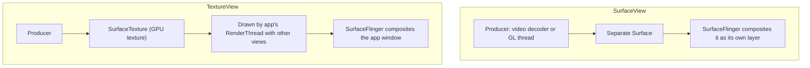

- **SurfaceView** punches a "hole" in the app window: the app draws its views in its window, and the SurfaceView's content is a separate layer underneath (or on top with `setZOrderOnTop`). SurfaceFlinger combines them. No extra copy through the app's GPU pipeline.
- **TextureView** content goes through a `SurfaceTexture`, then the app's RenderThread draws it like a bitmap into the app's window. That extra composition step adds GPU work and latency, but means it behaves exactly like a normal View.

| | SurfaceView | TextureView |
|---|---|---|
| Composition | Separate layer, SurfaceFlinger/HWC | Inside app window via GPU |
| Performance / battery | Best | Worse (extra copy/compose) |
| Latency | Lower | About one extra frame |
| Animations, alpha, transforms | Historically limited; much better since Android 7.0 (moves in sync with views) | Fully supported |
| Hardware acceleration | Not required | Required |
| Protected (DRM) video | Supported | Not supported |
| Typical use | Video playback, camera, games | Video in animated/scrolling UIs, transformations |

#### Using a SurfaceView

```kotlin
surfaceView.holder.addCallback(object : SurfaceHolder.Callback {
    override fun surfaceCreated(holder: SurfaceHolder) { player.setSurface(holder.surface) }
    override fun surfaceChanged(holder: SurfaceHolder, format: Int, w: Int, h: Int) {}
    override fun surfaceDestroyed(holder: SurfaceHolder) { player.setSurface(null) }
})
```

The surface's lifecycle is tied to visibility: it's destroyed when the window is hidden, so start/stop rendering in these callbacks.

**Pitfalls**
- Drawing to a SurfaceView after `surfaceDestroyed` crashes or does nothing.
- Using TextureView for full-screen video: wastes battery; SurfaceView is preferred (ExoPlayer/Media3 defaults to SurfaceView).

**Likely follow-ups**
- *What about Compose?* Media3 provides player composables, or wrap a SurfaceView in `AndroidView`; there are also `AndroidExternalSurface`/`AndroidEmbeddedExternalSurface` composables wrapping these two models.

</details>

### 26. What is the difference between Animation APIs in Views?

<details>
<summary>Answer</summary>

**In short:** **View animation** (legacy tween: `TranslateAnimation`, `AlphaAnimation`) only changes how a view is *drawn*, not its real properties, so a moved button stays clickable at its old position. **Property animation** (`ValueAnimator`, `ObjectAnimator`, `view.animate()`) changes real properties and is the default choice. On top of that there are **MotionLayout** for complex declarative and gesture-driven motion, the **Transitions** framework for scene changes, `AnimatedVectorDrawable` and Lottie for icons/illustrations, and **physics-based** `SpringAnimation`/`FlingAnimation`.

#### Overview

| API | What it animates | Use for |
|---|---|---|
| View animation (`android.view.animation`) | Drawing only | Legacy code, simple window/activity anim XML |
| `ValueAnimator` | Any value; you apply it | Custom view drawing, counters |
| `ObjectAnimator` | A named property via setter | Any property: `"translationY"`, custom setters |
| `ViewPropertyAnimator` (`view.animate()`) | Common View properties, optimized | Fades, slides, scales |
| `AnimatorSet` | Combines animators | Sequencing / playing together |
| Transitions (`TransitionManager`) | Layout changes between scenes | Auto-animate visibility/size/position changes, shared elements |
| MotionLayout | Constraint sets + keyframes | Collapsing headers, swipe-driven motion |
| `AnimatedVectorDrawable` / Lottie | Vector paths | Icon morphs, illustrations |
| `SpringAnimation` / `FlingAnimation` | Properties with physics | Natural, interruptible motion |

#### Property animation examples

```kotlin
// Simple and efficient: uses RenderNode properties, no layout
binding.card.animate()
    .translationY(0f)
    .alpha(1f)
    .setDuration(250)
    .setInterpolator(FastOutSlowInInterpolator())
    .start()

// Animate a custom property of a custom view
ValueAnimator.ofFloat(0f, 1f).apply {
    duration = 600
    addUpdateListener { progressRing.progress = it.animatedValue as Float } // calls invalidate()
    start()
}

// Physics: velocity-aware, can be interrupted smoothly
SpringAnimation(binding.sheet, DynamicAnimation.TRANSLATION_Y, 0f).apply {
    spring.stiffness = SpringForce.STIFFNESS_MEDIUM
    spring.dampingRatio = SpringForce.DAMPING_RATIO_MEDIUM_BOUNCY
    start()
}

// Transitions: animate whatever changes in the next layout
TransitionManager.beginDelayedTransition(binding.root, AutoTransition())
binding.details.isVisible = !binding.details.isVisible
```

#### Why the legacy API is avoided

```kotlin
// Legacy: button looks like it moved 200px, but its click area stays where it was
binding.button.startAnimation(TranslateAnimation(0f, 200f, 0f, 0f).apply { duration = 300; fillAfter = true })
```

Property animation actually updates `translationX`, so hit-testing follows.

**Pitfalls**
- Animating `width`/`height`/margins causes a `requestLayout()` every frame; prefer `translation`, `scale`, `alpha`.
- Not cancelling animators in `onDetachedFromWindow`/`onDestroyView`: leaks and crashes on dead views.
- Ignoring the system "Remove animations" setting: check `ValueAnimator.areAnimatorsEnabled()` for essential motion.

**Likely follow-ups**
- *What's an interpolator?* A function mapping time fraction to progress (linear, accelerate/decelerate, `FastOutSlowIn`, overshoot).
- *Compose?* `animate*AsState`, `AnimatedVisibility`, `updateTransition`, `Animatable`.

</details>

### 27. What is a Spannable?

<details>
<summary>Answer</summary>

**In short:** A `Spannable` is text that carries **spans**: styling or behavior objects attached to character ranges, such as bold, color, size, clickable links, or inline images, all inside a single `TextView`. You build one with `SpannableString`/`SpannableStringBuilder` or the core-ktx `buildSpannedString { }`. In Compose, the equivalent is `AnnotatedString` built with `buildAnnotatedString`.

#### Why it exists

Without spans, "**Terms** apply, see *details*" with a tappable link would need several TextViews in a layout, which wraps badly and is slow. Spans keep one text layout with mixed styles.

#### Interfaces and classes

| Type | Text mutable | Spans mutable |
|---|---|---|
| `SpannedString` | No | No |
| `SpannableString` | No | Yes |
| `SpannableStringBuilder` | Yes | Yes |

#### Example

```kotlin
val text = buildSpannedString {
    bold { append("Ada Lovelace") }
    append(" commented: ")
    color(ContextCompat.getColor(context, R.color.link)) { append("See more") }
}
textView.text = text

// Manual span with a range and a click
val s = SpannableString("By continuing you accept the Terms")
val start = s.indexOf("Terms")
s.setSpan(object : ClickableSpan() {
    override fun onClick(widget: View) = openTerms()
}, start, start + "Terms".length, Spannable.SPAN_EXCLUSIVE_EXCLUSIVE)
textView.text = s
textView.movementMethod = LinkMovementMethod.getInstance()   // required for ClickableSpan
```

The flag (`SPAN_EXCLUSIVE_EXCLUSIVE`, `SPAN_INCLUSIVE_EXCLUSIVE` etc.) controls whether text inserted at the span's edges gets the span, which matters in editable text.

#### Common spans

- **Character spans** (affect characters): `StyleSpan`, `ForegroundColorSpan`, `BackgroundColorSpan`, `RelativeSizeSpan`, `UnderlineSpan`, `ClickableSpan`, `URLSpan`, `ImageSpan`.
- **Paragraph spans** (affect whole paragraphs): `BulletSpan`, `QuoteSpan`, `LeadingMarginSpan`, `AlignmentSpan`.

#### Compose

```kotlin
val text = buildAnnotatedString {
    withStyle(SpanStyle(fontWeight = FontWeight.Bold)) { append("Ada") }
    append(" commented: ")
    withLink(LinkAnnotation.Url("https://example.com")) { append("See more") }
}
Text(text)
```

**Pitfalls**
- Forgetting `LinkMovementMethod`, so `ClickableSpan` does nothing.
- Hardcoded index ranges break when the string is translated; compute ranges from placeholders or use annotations in `strings.xml` (`<annotation>` tags).
- Reusing a single span object for multiple ranges: only the last range applies.

**Likely follow-ups**
- *How do you style part of a localized string?* Use `<annotation key="...">` in `strings.xml`, read it with `getText()` and replace annotation spans with real spans.

</details>

### 28. What is a Toast vs Snackbar vs Dialog?

<details>
<summary>Answer</summary>

**In short:** A **Toast** is a brief, non-interactive system message that can appear even outside your UI. A **Snackbar** (Material) is a brief message shown at the bottom of your app's UI that can include **one action** (e.g. Undo) and can be swiped away. A **Dialog** is **modal**: it interrupts the user and requires a decision or input before continuing.

#### Comparison

| | Toast | Snackbar | Dialog |
|---|---|---|---|
| Interaction | None | One optional action, swipe to dismiss | Buttons, input, lists |
| Blocks UI | No | No | Yes (modal) |
| Tied to | System (can show while app in background, text only) | A view in your layout, or `SnackbarHost` in Compose | Activity window |
| Duration | Short/long, fixed | Short/long/indefinite | Until dismissed |
| Use for | Simple confirmations ("Saved") | Feedback with recovery ("Message deleted, Undo") | Critical decisions ("Discard changes?"), required input |

#### Platform notes

- **Toast**: since Android 11, **custom-view toasts are blocked when the app is in the background**; only plain text toasts are shown, and `setView()` is deprecated. Text toasts are limited in length and appearance.
- **Snackbar** respects `CoordinatorLayout` (moves the FAB up), and should be anchored above bottom navigation with `setAnchorView`.

```kotlin
Snackbar.make(binding.root, R.string.message_deleted, Snackbar.LENGTH_LONG)
    .setAction(R.string.undo) { viewModel.undoDelete() }
    .setAnchorView(binding.bottomNav)
    .show()
```

```kotlin
MaterialAlertDialogBuilder(requireContext())
    .setTitle(R.string.discard_title)
    .setMessage(R.string.discard_message)
    .setNegativeButton(R.string.cancel, null)
    .setPositiveButton(R.string.discard) { _, _ -> viewModel.discard() }
    .show()
```

Use a `DialogFragment` (rather than a bare `AlertDialog`) for anything that should survive rotation, since a bare dialog is dismissed and leaks when the Activity is recreated.

```kotlin
// Compose: Snackbar via SnackbarHostState in Scaffold
val snackbarHostState = remember { SnackbarHostState() }
Scaffold(snackbarHost = { SnackbarHost(snackbarHostState) }) { /* ... */ }
LaunchedEffect(event) {
    val result = snackbarHostState.showSnackbar("Message deleted", actionLabel = "Undo")
    if (result == SnackbarResult.ActionPerformed) viewModel.undoDelete()
}
```

**Pitfalls**
- Using Toast for errors the user must act on; it disappears and isn't reliably read by accessibility services.
- Showing dialogs for non-critical info: interrupts flow.
- Showing a Dialog after the Activity is finishing: `WindowManager$BadTokenException`.

**Likely follow-ups**
- *How do you show one-time messages from a ViewModel?* Expose UI state (e.g. a message in state that the UI clears after showing) or a `Channel`-backed Flow, collected with lifecycle awareness.

</details>


---

## More UI Questions

### 29. What are Canvas and Paint?

<details>
<summary>Answer</summary>

**In short:** `Canvas` is the drawing API passed to `onDraw(canvas)`: it provides **what** to draw (`drawRect`, `drawCircle`, `drawPath`, `drawText`, `drawBitmap`) and transformations (`translate`, `rotate`, `scale`, `clipRect`, `save()`/`restore()`). `Paint` describes **how** to draw: color, fill or stroke, stroke width, anti-aliasing, text size, shaders and effects. Create `Paint` and other objects once, never inside `onDraw`.

#### Canvas

- **Drawing calls**: shapes (`drawRect`, `drawRoundRect`, `drawCircle`, `drawArc`, `drawLine`), `drawPath` for arbitrary shapes, `drawText`, `drawBitmap`.
- **Transformations** modify a matrix applied to subsequent calls. Wrap them in `save()`/`restore()` (or core-ktx `withTranslation`, `withRotation`) so they don't leak into later drawing.
- **Clipping** limits where drawing appears (`clipRect`, `clipPath`).
- With hardware acceleration, these calls are recorded into a display list and executed on the GPU later.

#### Paint

| Property | Example |
|---|---|
| `color` / `alpha` | `Color.RED` |
| `style` | `FILL`, `STROKE`, `FILL_AND_STROKE` |
| `strokeWidth`, `strokeCap`, `strokeJoin` | Rounded line ends |
| `isAntiAlias` | Smooth edges (`Paint.ANTI_ALIAS_FLAG`) |
| `textSize`, `typeface`, `textAlign` | Text drawing |
| `shader` | `LinearGradient`, `RadialGradient`, `BitmapShader` |
| `pathEffect` | `DashPathEffect` for dashed lines |
| `setShadowLayer` | Shadows behind shapes and text |

#### Example: a simple gauge

```kotlin
class Gauge(context: Context, attrs: AttributeSet?) : View(context, attrs) {
    private val trackPaint = Paint(Paint.ANTI_ALIAS_FLAG).apply {
        style = Paint.Style.STROKE; strokeWidth = 24f; color = Color.LTGRAY; strokeCap = Paint.Cap.ROUND
    }
    private val progressPaint = Paint(trackPaint).apply { color = Color.RED }
    private val bounds = RectF()     // reused every frame

    var progress = 0.6f
        set(value) { field = value; invalidate() }

    override fun onSizeChanged(w: Int, h: Int, oldw: Int, oldh: Int) {
        val inset = trackPaint.strokeWidth / 2
        bounds.set(inset, inset, w - inset, h - inset)   // compute once per size change
    }

    override fun onDraw(canvas: Canvas) {
        super.onDraw(canvas)
        canvas.drawArc(bounds, 135f, 270f, false, trackPaint)
        canvas.drawArc(bounds, 135f, 270f * progress, false, progressPaint)
    }
}
```

**Pitfalls**
- Allocating `Paint`/`Path`/`RectF` in `onDraw`: it runs every frame, causing GC and jank.
- Forgetting `save()`/`restore()` around transforms.
- Some features (certain `Xfermode`s, `setShadowLayer` on non-text shapes on older versions) behave differently or weren't supported with hardware acceleration on old API levels.

**Likely follow-ups**
- *Compose?* The `Canvas` composable or `Modifier.drawBehind { }` gives a `DrawScope` with `drawCircle`, `drawArc`, etc.; colors and styles are parameters instead of a `Paint` object.

</details>

### 30. What RecyclerView optimizations should you know? (`setHasFixedSize`, payloads, nested lists, SnapHelper)

<details>
<summary>Answer</summary>

**In short:** Use `setHasFixedSize(true)` when item changes don't affect the RecyclerView's own size, update items via DiffUtil/`submitList` instead of `notifyDataSetChanged()`, use **payloads** for partial rebinding, share a `RecycledViewPool` and set `initialPrefetchItemCount` for nested horizontal lists, and use `SnapHelper` for snapping carousels. Keep `onBindViewHolder` cheap and request correctly sized images.

#### `setHasFixedSize(true)`

When the adapter content changes, RecyclerView normally calls `requestLayout()` on itself in case its size changes (e.g. `wrap_content`). If its size is fixed by its parent (`match_parent` or constraints), this flag lets it skip that and only lay out its children. It's about the RecyclerView's size, not the items' sizes.

#### Updating items and payloads

```kotlin
// Prefer immutable data + DiffUtil
adapter.submitList(list.map { if (it.id == id) it.copy(isLiked = true) else it })

// DiffUtil callback
override fun getChangePayload(old: Post, new: Post): Any? =
    if (old.copy(isLiked = new.isLiked) == new) PAYLOAD_LIKE else null   // only "liked" changed

// Adapter: partial bind
override fun onBindViewHolder(holder: PostVH, position: Int, payloads: MutableList<Any>) {
    if (PAYLOAD_LIKE in payloads) holder.bindLikeOnly(getItem(position))   // just toggle the icon
    else onBindViewHolder(holder, position)                               // full bind
}
```

With payloads, the same ViewHolder is updated in place: no image reload, no crossfade flicker.

#### Nested RecyclerViews

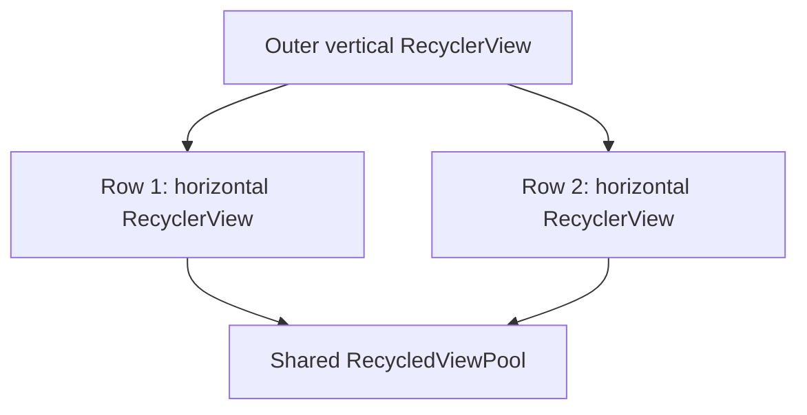

- **Share one `RecycledViewPool`** among inner lists so card ViewHolders are reused across rows instead of inflated per row.
- Set `(innerLayoutManager as LinearLayoutManager).initialPrefetchItemCount = N` (number of cards visible) so the inner list's first items are prefetched when the row is about to scroll in.
- Create the inner adapter once per outer ViewHolder; just `submitList` on bind.
- **Save and restore inner scroll positions** (`layoutManager.onSaveInstanceState()` keyed by row ID), or rows forget where they were scrolled to after recycling.

#### SnapHelper

```kotlin
PagerSnapHelper().attachToRecyclerView(carousel)   // one item per fling, like a pager
LinearSnapHelper().attachToRecyclerView(carousel)  // snaps the nearest item to the center
```

#### Other wins

| Technique | Effect |
|---|---|
| `setItemViewCacheSize(n)` | More views reused without rebinding when scrolling back and forth |
| Stable IDs (`setHasStableIds` + `getItemId`) | Better animations and reuse for plain adapters |
| Flat item layouts | Faster inflation and measure |
| Request image sizes matching the view | Less decoding and memory (Coil/Glide do this by default from view size) |
| `PrecomputedTextCompat` | Move text layout off the main thread |
| Avoid `wrap_content` RecyclerView inside a scroll parent | Keeps recycling working |
| Measure with Macrobenchmark/JankStats | Verify scrolling performance |

**Pitfalls**
- Using `setHasFixedSize(true)` when the RecyclerView is `wrap_content` and its size should change: it won't resize.
- Forgetting the full-bind fallback when payloads are empty.

**Likely follow-ups**
- *Why can `notifyItemChanged(pos)` flicker?* The default ItemAnimator crossfades old and new views for changes; use payloads or disable change animations.

</details>

### 31. What is overdraw and how do you reduce it?

<details>
<summary>Answer</summary>

**In short:** **Overdraw** is when the same pixel is painted multiple times in a single frame, for example window background, then a layout background, then a card background, then the content. Pixels hidden underneath were drawn for nothing, wasting GPU fill-rate and causing jank on low-end devices. Detect it with **Debug GPU Overdraw** and fix it mainly by removing backgrounds that are fully covered.

#### Why it costs

The GPU has a limited number of pixels it can fill per frame (fill-rate). A full-screen layer on a 1080×2400 screen is about 2.6 million pixels. Four layers of opaque backgrounds mean roughly 10 million pixel writes per frame where 2.6 million would do. Low-end GPUs struggle with that.

#### Detecting it

Developer Options → **Debug GPU Overdraw** → "Show overdraw areas" tints the screen:

| Color | Times drawn |
|---|---|
| True color (none) | 1× (no overdraw) |
| Blue | 2× (1 overdraw) |
| Green | 3× |
| Pink | 4× |
| Red | 5× or more |

Some overdraw is unavoidable (text on a background). Aim for mostly true color and blue, and avoid large red areas.

#### Fixing it

```xml
<!-- Theme: set the background once at window level -->
<item name="android:windowBackground">@color/surface</item>
```

```xml
<!-- WRONG: root and card both repeat the window background color -->
<LinearLayout android:background="@color/surface">
    <FrameLayout android:background="@color/surface"> ... </FrameLayout>
</LinearLayout>

<!-- RIGHT: no backgrounds where the window background already shows -->
<LinearLayout>
    <FrameLayout> ... </FrameLayout>
</LinearLayout>
```

- Remove backgrounds on parents/children when something opaque covers them completely.
- If a full-screen opaque view covers the window, set `windowBackground` to `@null` for that screen (or keep it for a fast starting window, and accept 1 layer).
- Flatten hierarchies: fewer layers, fewer backgrounds.
- In custom views, use `canvas.clipRect()` to skip drawing hidden regions (e.g. overlapping cards), or `quickReject` to skip off-screen shapes.
- Avoid stacked semi-transparent layers; alpha requires blending every layer.
- Don't use `alpha` on complex views without understanding costs; `View.setLayerType(LAYER_TYPE_HARDWARE)` during an alpha animation can help, then remove it.

**Pitfalls**
- Removing a background that was actually needed (e.g. for ripple bounds or for a view with transparent parents), causing visual glitches.
- Fixing overdraw blindly: verify with profiling that GPU time was the bottleneck.

**Likely follow-ups**
- *How do you know whether the GPU or CPU is the bottleneck?* Profile GPU Rendering bars and Perfetto show main-thread vs RenderThread vs GPU time per frame.

</details>

### 32. What are best practices for text in Android?

<details>
<summary>Answer</summary>

**In short:** Use `sp` for text sizes and test at large font scales (up to 200%, with Android 14's non-linear scaling), put all user-facing text in `strings.xml` with placeholders and plurals, never give text containers fixed heights, use font resources and `TextAppearance`/Material typography styles, precompute text layout for long text in lists, and use spans (or `AnnotatedString` in Compose) for styled text.

#### Sizing and scaling

- **`sp`** scales with the user's font size setting; `dp` doesn't. Using `dp` for text ignores accessibility settings.
- Android 14 allows font scaling up to **200%** and uses **non-linear scaling**: larger text grows less than smaller text so headings don't become huge. To convert sp to px correctly for custom drawing, use `TypedValue.applyDimension(COMPLEX_UNIT_SP, ...)` rather than multiplying by the deprecated `scaledDensity`.
- Avoid fixed heights on TextViews and their containers; allow wrapping, or use `maxLines` + `android:ellipsize="end"`.

#### Strings and localization

```xml
<string name="welcome">Welcome, %1$s!</string>
<plurals name="unread">
    <item quantity="one">%d unread message</item>
    <item quantity="other">%d unread messages</item>
</plurals>
```

```kotlin
getString(R.string.welcome, user.name)
resources.getQuantityString(R.plurals.unread, count, count)
```

- Never concatenate translated fragments ("You have " + n + " messages"); word order differs between languages.
- Some languages have more plural categories (`zero`, `two`, `few`, `many`), which `<plurals>` handles.
- Support RTL with `start`/`end` and `android:supportsRtl="true"`; use `BidiFormatter` for user-provided text mixed with RTL strings.
- Text length can grow 30–40% in translation (German); design for it.

#### Fonts and styles

- Put fonts in `res/font` (or use **downloadable fonts** from Google Fonts to reduce APK size) and reference them in a `TextAppearance` or theme.
- Use Material typography (`?attr/textAppearanceBodyLarge`) so text styles are consistent and themable.

#### Performance

- **`PrecomputedTextCompat`** measures and lays out text on a background thread, so long text in RecyclerView items doesn't block binding:
  ```kotlin
  val params = TextViewCompat.getTextMetricsParams(holder.body)
  holder.body.setTextFuture(PrecomputedTextCompat.getTextFuture(item.body, params, executor))
  ```
- **Autosizing** (`app:autoSizeTextType="uniform"`) runs extra measure passes; use only where text must fit a fixed box.
- Spans for mixed styles in one TextView rather than multiple TextViews.

**Pitfalls**
- Hardcoded strings in layouts or code (Lint `HardcodedText`).
- `singleLine="true"` (deprecated) instead of `maxLines="1"`.
- Text clipped at large font sizes because of fixed `layout_height` values.

**Likely follow-ups**
- *Compose?* `Text` uses `sp` via `TextStyle`; `AnnotatedString` for spans; `stringResource`/`pluralStringResource` for resources.

</details>

### 33. How do you get a View's width or height before it has been laid out?

<details>
<summary>Answer</summary>

**In short:** You can't read it immediately: in `onCreate()` (or `onViewCreated`) the view hasn't been measured, so `width` and `height` are `0`. Instead, run code after layout: `view.doOnLayout { }` (cleanest), `view.doOnPreDraw { }`, `view.post { }`, an `OnGlobalLayoutListener` (remember to remove it), or override `onSizeChanged()` in a custom view. In Compose, use `Modifier.onSizeChanged` / `onGloballyPositioned` or `BoxWithConstraints`.

#### Why it's zero

Measure and layout happen in `ViewRootImpl.performTraversals()` on a later frame, after the Activity's window is attached and the view is added. During `onCreate`, `onStart` and even `onResume`, that first traversal hasn't run yet.

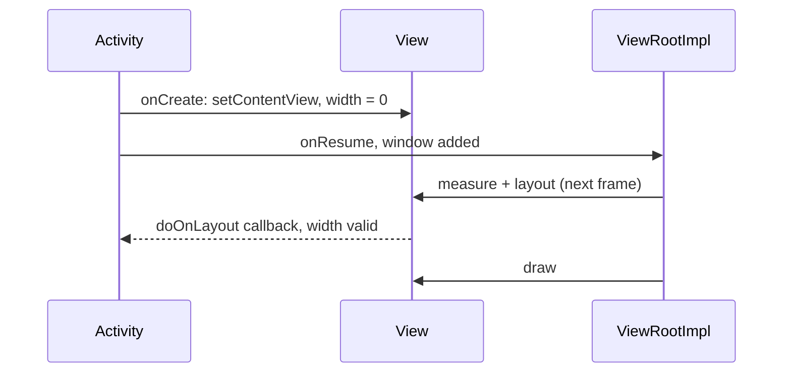

#### Options

```kotlin
// 1. doOnLayout (core-ktx): runs once after layout, immediately if already laid out
binding.chart.doOnLayout { v -> setupChart(v.width, v.height) }

// 2. doOnPreDraw: just before the next draw, after layout; good for starting animations
binding.header.doOnPreDraw { startEnterAnimation(it.height) }

// 3. post: runs after the current message queue work; usually after first layout once attached
binding.image.post { loadImage(binding.image.width) }

// 4. Global layout listener: fires after every layout pass; remove it
binding.root.viewTreeObserver.addOnGlobalLayoutListener(object : ViewTreeObserver.OnGlobalLayoutListener {
    override fun onGlobalLayout() {
        binding.root.viewTreeObserver.removeOnGlobalLayoutListener(this)
        use(binding.root.width)
    }
})
```

| Option | Fires | Note |
|---|---|---|
| `doOnLayout` | Once, after layout | Best default; handles the already-laid-out case |
| `doOnPreDraw` | Once, before next draw | Size known, can change things before the user sees the frame |
| `post` | Once, after queued work | Relies on ordering; less explicit |
| `OnGlobalLayoutListener` | Every layout | Must remove, or repeated calls and leaks |
| `onSizeChanged` (custom view) | Every size change | Right place for size-dependent drawing setup |
| `doOnNextLayout` | Next layout only | When you need the size after a change you're about to make |

You *can* also force a measure with `view.measure(spec, spec)` and read `measuredWidth`, but it may not match the real constrained size.

**Pitfalls**
- Reading the size once and caching it forever: rotation, resizing and fold changes alter it. Use `onSizeChanged` or `addOnLayoutChangeListener` if it must track changes.
- Using `post` on a view that isn't attached yet: before API 24 such runnables could be lost if the view never attached.

**Likely follow-ups**
- *In Compose, how do you size something based on available space?* `BoxWithConstraints` gives `maxWidth`/`maxHeight` during composition; `onSizeChanged` reports the measured size after layout.

</details>

### 34. How do you build home-screen widgets on Android?

<details>
<summary>Answer</summary>

**In short:** A widget is an **`AppWidgetProvider`** (a `BroadcastReceiver`) declared in the manifest with an `appwidget-provider` XML describing size, resize mode, preview and update period. Its UI runs in the **launcher's process**, so it's described with **`RemoteViews`**, a limited set of supported views sent across processes. **Glance** lets you write widgets in a Compose-style API that is translated to RemoteViews. Update widgets via WorkManager or when data changes, and keep updates small.

#### Architecture

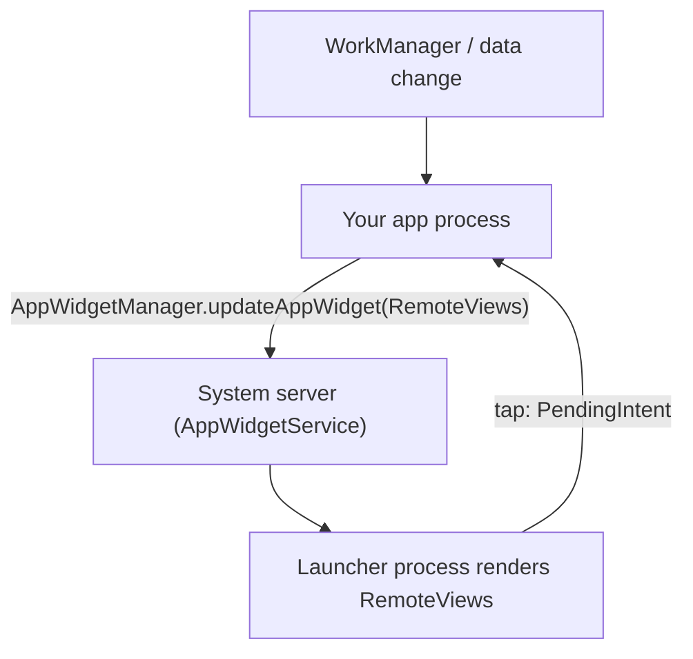

Your code never runs inside the launcher. You send a serialized description of the UI (RemoteViews), and taps come back as `PendingIntent`s.

#### Classic setup

```xml
<!-- AndroidManifest.xml -->
<receiver android:name=".WeatherWidget" android:exported="false">
    <intent-filter>
        <action android:name="android.appwidget.action.APPWIDGET_UPDATE" />
    </intent-filter>
    <meta-data android:name="android.appwidget.provider"
        android:resource="@xml/weather_widget_info" />
</receiver>
```

```xml
<!-- res/xml/weather_widget_info.xml -->
<appwidget-provider
    android:minWidth="110dp" android:minHeight="40dp"
    android:targetCellWidth="2" android:targetCellHeight="1"
    android:resizeMode="horizontal|vertical"
    android:updatePeriodMillis="1800000"
    android:initialLayout="@layout/widget_weather"
    android:previewLayout="@layout/widget_weather"
    android:widgetCategory="home_screen" />
```

```kotlin
class WeatherWidget : AppWidgetProvider() {
    override fun onUpdate(context: Context, manager: AppWidgetManager, ids: IntArray) {
        ids.forEach { id ->
            val views = RemoteViews(context.packageName, R.layout.widget_weather).apply {
                setTextViewText(R.id.temp, "21°")
                setOnClickPendingIntent(
                    R.id.root,
                    PendingIntent.getActivity(
                        context, 0, Intent(context, MainActivity::class.java),
                        PendingIntent.FLAG_IMMUTABLE
                    )
                )
            }
            manager.updateAppWidget(id, views)
        }
    }
}
```

`onUpdate` runs in a BroadcastReceiver, so it must be quick; do network or DB work in WorkManager and push the result.

#### Glance

```kotlin
class WeatherGlanceWidget : GlanceAppWidget() {
    override suspend fun provideGlance(context: Context, id: GlanceId) {
        val temp = WeatherRepository.get(context).latestTemp()   // suspend work is allowed here
        provideContent {
            Column(GlanceModifier.fillMaxSize().padding(12.dp)) {
                Text("Now: $temp°")
                Button("Refresh", onClick = actionRunCallback<RefreshAction>())
            }
        }
    }
}
class WeatherWidgetReceiver : GlanceAppWidgetReceiver() {
    override val glanceAppWidget = WeatherGlanceWidget()
}
```

Glance composables (`androidx.glance.*`, not regular Compose UI) are translated into RemoteViews; state can live in DataStore / Glance state.

#### Updates and interactivity

| Need | Approach |
|---|---|
| Periodic refresh | `updatePeriodMillis` (minimum 30 minutes) or periodic WorkManager |
| Data changed in app | Call `updateAppWidget` / `GlanceAppWidget.update()` / `updateAll()` |
| Tap | `PendingIntent` (Views) or `actionStartActivity` / `actionRunCallback` (Glance) |
| Lists | `RemoteViews` collections (`ListView`/`GridView` with a `RemoteViewsService`, or `RemoteCollectionItems` on Android 12+); `LazyColumn` in Glance |
| Toggles | Checkboxes/switches/radio buttons supported on Android 12+ |

#### Limits

- Only supported layouts and widgets (FrameLayout, LinearLayout, RelativeLayout, GridLayout, TextView, ImageView, Button, ProgressBar, etc.); no custom views or arbitrary drawing.
- Keep widget updates small: newer Android versions limit memory used by bitmaps in `RemoteViews` (Android 17 throws an exception for apps targeting it when the bitmap budget is exceeded). Scale bitmaps down or use resource/URI images.
- Provide a preview (`previewLayout` or `previewImage`) for the widget picker, and handle resizing with responsive layouts.

**Pitfalls**
- Heavy work in `onUpdate` (it's a broadcast with a short time limit).
- Expecting `updatePeriodMillis` below 30 minutes to work.
- Mutable `PendingIntent`s or reused request codes causing wrong taps across widget instances.

**Likely follow-ups**
- *Why can't you use regular Compose in widgets?* The UI is rendered by the launcher process; only RemoteViews can cross that boundary, so Glance maps its own composables to RemoteViews.

</details>

---

[⬅ Previous: Activity & Fragment](09-activity-fragment.md) · [⬅ Back to index](../README.md) · [Next: Jetpack Compose ➡](11-jetpack-compose.md)
