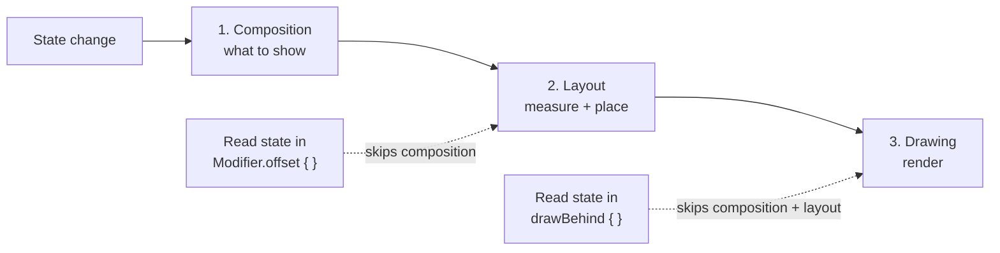
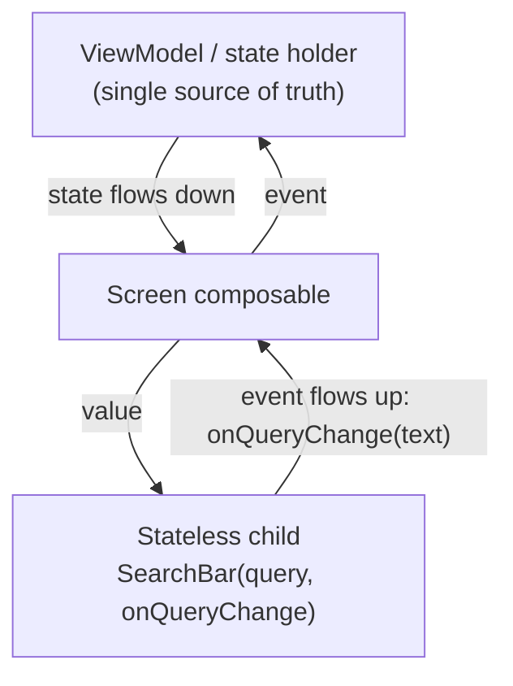
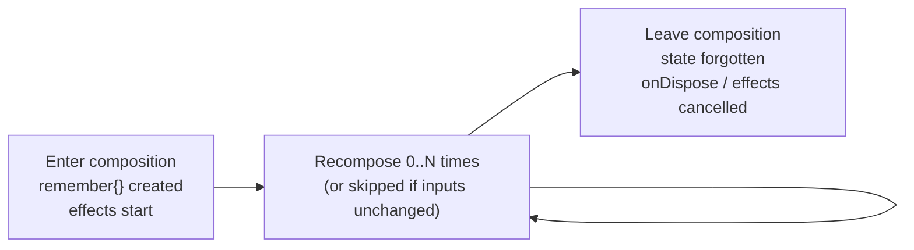

# Jetpack Compose

[⬅ Back to index](../README.md)

Covers: fundamentals, composition & recomposition, state, side effects, stability & performance, layouts & modifiers, lists, navigation, theming, interop, testing, internals.

---

## Fundamentals

### 1. What is Jetpack Compose? Why use it over Views?

<details>
<summary>Answer</summary>

Compose is Android's modern **declarative UI toolkit**, written in Kotlin. You describe **what** the UI should look like for a given state, and Compose updates the UI when the state changes.

**Benefits over Views:**
- **Less code**: no XML, adapters or ViewBinding.
- **Declarative and state-driven**: UI = f(state), so there are fewer inconsistent-UI bugs.
- **Kotlin-only**: logic and UI in one language. Easy reuse through composable functions.
- **Powerful APIs**: animations, theming (Material 3), lists without adapters.
- **Interoperable** with Views, and **multiplatform** through Compose Multiplatform.

</details>

### 2. Declarative vs imperative UI?

<details>
<summary>Answer</summary>

- **Imperative (Views):** you hold references to widgets and **mutate** them manually (`textView.text = ..`, `view.visibility = GONE`). It's easy to get out of sync with the data.
- **Declarative (Compose):** you write functions that **describe the UI for the current state**. When the state changes, the framework **re-executes** the affected functions (recomposition) and applies the differences.

</details>

### 3. What is a `@Composable` function? What does the annotation do?

<details>
<summary>Answer</summary>

A function that emits UI. The **Compose compiler plugin** transforms it:
- It adds hidden parameters: a **`Composer`** (to track the composition) and **`$changed`** bitmasks (to skip work when inputs haven't changed).
- It wraps the body in **groups** and **restart scopes**, so Compose can re-run just that function.

Rules: composables can only be called from other composables. They should be **fast, idempotent and free of side effects**. They can run **often**, **in any order**, and potentially **in parallel**. They return `Unit` (they emit nodes; they don't return views).

</details>

### 4. What are the phases of Compose rendering?

<details>
<summary>Answer</summary>



1. **Composition** – runs composable functions and builds or updates the UI tree (*what* to show).
2. **Layout** – measure and place every node (*where* to show it). Single-pass measurement.
3. **Drawing** – render to the canvas (*how* it looks).

**Optimization:** reading state in a later phase skips the earlier ones. For example, `Modifier.offset { IntOffset(x, 0) }` (a lambda) reads state in the **layout** phase, so it avoids recomposition. `Modifier.drawBehind { }` reads in the **draw** phase only.

</details>

### 5. What is recomposition? What triggers it?

<details>
<summary>Answer</summary>

Recomposition is **re-running composables when the state they read changes**. Compose tracks which composables (restart scopes) read which `State` objects through the **snapshot system**. When a state value changes, **only those scopes** are invalidated and re-executed.

Properties:
- **Smart / skippable** – composables whose parameters haven't changed (and are **stable**) are **skipped**.
- **Optimistic and cancellable** – if the state changes again mid-recomposition, Compose may cancel and restart it.
- Order isn't guaranteed. Never rely on side effects inside composables.

</details>

---

## State

### 6. What is state in Compose? `remember` vs `rememberSaveable`?

<details>
<summary>Answer</summary>

State is any value that can change over time and that the UI depends on. `mutableStateOf()` creates an **observable** `MutableState<T>`. Reading it subscribes the composable; writing it schedules recomposition.

- **`remember { }`** – stores a value **across recompositions**, but it's **lost on configuration change** and when the composable leaves the composition.
- **`rememberSaveable { }`** – also survives **configuration changes and process death** by saving to the Bundle (types must be saveable or Parcelable, or use a custom `Saver`).

```kotlin
var text by rememberSaveable { mutableStateOf("") }
```

Without `remember`, the state would be recreated (reset) on every recomposition.

</details>

### 7. What is state hoisting? Stateful vs stateless composables?

<details>
<summary>Answer</summary>

**State hoisting** moves state **up** to the caller, making a composable **stateless**. Pass down `value` and `onValueChange: (T) -> Unit`:



```kotlin
@Composable
fun SearchBar(query: String, onQueryChange: (String) -> Unit) {
    TextField(value = query, onValueChange = onQueryChange)
}
```

Benefits: a **single source of truth**, reusability, testability, previews, and **Unidirectional Data Flow** (state goes down, events go up).
Hoist state to the **lowest common ancestor** that reads or writes it. Screen-level business state belongs in the **ViewModel**.

</details>

### 8. Where should state live: composable, state holder class, or ViewModel?

<details>
<summary>Answer</summary>

- **UI element state** (scroll, expanded, animation) → `remember` inside the composable, or a **plain state holder class** (`rememberLazyListState()`, a custom `rememberMyState()`).
- **Screen UI state** that needs business logic or data → **ViewModel** (exposes a `StateFlow<UiState>`). It survives configuration changes, and can be wired to `SavedStateHandle` for process death.
- **Don't pass a ViewModel deep into child composables.** Pass state and lambdas instead. This keeps the children reusable and previewable.

</details>

### 9. How do you observe a ViewModel's Flow / LiveData in Compose?

<details>
<summary>Answer</summary>

```kotlin
val uiState by viewModel.uiState.collectAsStateWithLifecycle()   // recommended (lifecycle-aware)
val data by liveData.observeAsState()
```

`collectAsStateWithLifecycle` stops collecting when the app is in the background (below `STARTED`). Plain `collectAsState()` keeps collecting.

</details>

### 10. What is `derivedStateOf`? When to use it?

<details>
<summary>Answer</summary>

It creates state **computed from other states**. It only triggers recomposition when the **result** changes, not on every input change. Use it when the inputs change **more often** than the output:

```kotlin
val showScrollToTop by remember {
    derivedStateOf { listState.firstVisibleItemIndex > 0 }
}
```

Without it, every scroll pixel would recompose. Don't use it when the output changes as often as the input (e.g. `fullName = first + last`). Plain computation or `remember(key)` is enough there.

</details>

### 11. What is `snapshotFlow`?

<details>
<summary>Answer</summary>

It converts Compose `State` reads into a cold **Flow** that emits when the state read inside the block changes. Useful for side effects such as analytics on scroll:

```kotlin
LaunchedEffect(listState) {
    snapshotFlow { listState.firstVisibleItemIndex }
        .distinctUntilChanged()
        .collect { analytics.log(it) }
}
```

</details>

### 12. Why should you use immutable collections / avoid `mutableListOf` in state?

<details>
<summary>Answer</summary>

Mutating a `MutableList` held in `mutableStateOf` **doesn't trigger recomposition**, because the reference didn't change. Either create a new list (`list = list + item`), or use **`mutableStateListOf()`** / `mutableStateMapOf()`, which are observable. Also, `List<T>` parameters are considered **unstable** by the compiler (before strong skipping); `kotlinx.collections.immutable` (`ImmutableList`) fixes that.

</details>

---

## Side Effects

### 13. What are side effects in Compose? Explain the effect handlers.

<details>
<summary>Answer</summary>

A side effect is a change to state **outside** the composable's scope (network call, analytics, navigation, showing a snackbar). Since composables can run unpredictably, use **effect APIs**:

| API | Use |
|---|---|
| `LaunchedEffect(key)` | Run a **suspend** block when entering composition; **restarts when the key changes**; cancelled when it leaves |
| `rememberCoroutineScope()` | Get a scope to launch coroutines **from callbacks** (onClick) |
| `DisposableEffect(key)` | Effects that need **cleanup** (`onDispose {}`): register/unregister listeners, lifecycle observers |
| `SideEffect` | Run after **every successful recomposition**, to publish Compose state to non-Compose code |
| `rememberUpdatedState(value)` | Reference the **latest** value inside a long-running effect without restarting it |
| `produceState` | Convert non-Compose async sources into `State` |
| `derivedStateOf`, `snapshotFlow` | Derived state and state → Flow |

</details>

### 14. `LaunchedEffect` vs `rememberCoroutineScope`?

<details>
<summary>Answer</summary>

- **`LaunchedEffect`** – a coroutine tied to the **composition**. It starts automatically when it enters the composition or its key changes. Example: show a snackbar when `uiState.error` changes, or start an animation on load.
- **`rememberCoroutineScope`** – gives you a scope to launch coroutines **in response to user events** (you can't call `LaunchedEffect` from `onClick`, since it's not composable). Example: `scope.launch { drawerState.open() }`.

Both are cancelled when the composable leaves the composition.

</details>

### 15. What is the `key` in `LaunchedEffect(Unit)` vs `LaunchedEffect(userId)`?

<details>
<summary>Answer</summary>

- `LaunchedEffect(Unit)` / `LaunchedEffect(true)` runs **once** for as long as the composable stays in the composition.
- `LaunchedEffect(userId)` **cancels and restarts** whenever `userId` changes.

Wrong keys cause either stale effects (missing key) or too many restarts (a key that changes every recomposition, like a new lambda).

</details>

### 16. Explain `DisposableEffect` with an example.

<details>
<summary>Answer</summary>

```kotlin
@Composable
fun LifecycleLogger(owner: LifecycleOwner = LocalLifecycleOwner.current) {
    DisposableEffect(owner) {
        val observer = LifecycleEventObserver { _, event -> log(event) }
        owner.lifecycle.addObserver(observer)
        onDispose { owner.lifecycle.removeObserver(observer) }
    }
}
```

`onDispose` runs when the key changes or the composable leaves the composition.

</details>

### 17. What is `rememberUpdatedState`?

<details>
<summary>Answer</summary>

It keeps an up-to-date reference to a value that a **long-lived effect** should use, **without restarting** the effect:

```kotlin
@Composable
fun SplashScreen(onTimeout: () -> Unit) {
    val currentOnTimeout by rememberUpdatedState(onTimeout)
    LaunchedEffect(Unit) { delay(2000); currentOnTimeout() }
}
```

</details>

---

## Stability & Performance

### 18. What is stability in Compose? Stable vs unstable types?

<details>
<summary>Answer</summary>

The compiler marks parameter types as **stable** if Compose can trust that `equals` is meaningful and that changes will be **notified**. Stable parameters allow a composable to be **skipped** when they haven't changed.

- **Stable:** primitives, `String`, function types (lambdas), `State<T>`, enums, and classes whose properties are all `val` with stable types, or classes annotated with `@Immutable` / `@Stable`.
- **Unstable:** classes with `var` properties, **interfaces and collections like `List`/`Map`** (the implementation might be mutable), and classes from modules not compiled with the Compose compiler (e.g. domain models in a pure Kotlin module).

Fixes: `@Immutable`/`@Stable` annotations, immutable collections, a **stability configuration file** (`stabilityConfigurationFiles`) for external classes, or mapping to UI models.

</details>

### 19. What is Strong Skipping mode?

<details>
<summary>Answer</summary>

**Enabled by default since Kotlin 2.0.20 / Compose compiler 2.0.20.**
- Composables with **unstable parameters can also be skipped**. Unstable params are compared by **instance equality (`===`)**, stable ones by `equals`.
- **Lambdas are automatically remembered** (memoized based on what they capture).

This removes most manual stability work. Stability still matters for correctness and best performance (e.g. a new list instance with equal content still recomposes).

</details>

### 20. How do you optimize Compose performance?

<details>
<summary>Answer</summary>

1. Test performance in **release builds with R8** (debug builds are much slower). Add **Baseline Profiles**.
2. Use **`key`s** in lazy lists, and `contentType` for heterogeneous lists.
3. **Defer state reads** to later phases: lambda modifiers (`Modifier.offset { }`, `graphicsLayer { }`, `drawBehind { }`).
4. **`remember`** expensive calculations: `remember(items) { items.sortedBy { } }`.
5. **`derivedStateOf`** for rapidly changing inputs.
6. Avoid **backwards writes** (writing state that was just read in the same composition, which causes infinite recomposition).
7. Make parameters stable and pass **only what's needed** (not a whole object if one field is enough).
8. Measure with the **Layout Inspector's recomposition counts**, **Compose compiler metrics/reports**, composition tracing in Perfetto, and Macrobenchmark.

</details>

### 21. What is a "backwards write"?

<details>
<summary>Answer</summary>

Writing to a state **after it's already been read** in the same composition:

```kotlin
var count by remember { mutableStateOf(0) }
Text("$count")
count++   // ❌ backwards write → infinite recomposition loop
```

Only change state from **event callbacks or effects**, never directly in the composable body.

</details>

---

## Layouts, Modifiers & Lists

### 22. What are the basic layouts in Compose?

<details>
<summary>Answer</summary>

`Column` (vertical), `Row` (horizontal), `Box` (stacked/overlay), `LazyColumn`/`LazyRow`/`LazyVerticalGrid`/`LazyVerticalStaggeredGrid` (lazy lists), `ConstraintLayout` (compose version, rarely needed), `FlowRow`/`FlowColumn`, `Scaffold` (top bar, bottom bar, FAB, snackbar slots), `BoxWithConstraints` (layout based on available size).

</details>

### 23. What is a Modifier? Why does modifier order matter?

<details>
<summary>Answer</summary>

`Modifier` is an ordered, immutable chain of elements that **decorate or augment** a composable: size, padding, background, click handling, semantics, drawing, layout.

**Order matters** because each modifier wraps the following ones:

```kotlin
Modifier.padding(16.dp).background(Color.Red)  // padding OUTSIDE the red background
Modifier.background(Color.Red).padding(16.dp)  // red includes the padding
Modifier.clickable{}.padding(16.dp)            // whole area incl. padding is clickable
```

Best practice: every reusable composable should accept `modifier: Modifier = Modifier` as its **first optional parameter** and apply it to the root.

</details>

### 24. How does LazyColumn work? LazyColumn vs Column with verticalScroll?

<details>
<summary>Answer</summary>

`LazyColumn` **composes and lays out only the visible items** (plus prefetch), similar to RecyclerView but without adapters or ViewHolders. Items are disposed or reused as you scroll.

```kotlin
LazyColumn {
    items(users, key = { it.id }, contentType = { "user" }) { user -> UserRow(user) }
}
```

`Column(Modifier.verticalScroll(..))` composes **all** children at once. Fine for small, fixed content; very bad for long lists.

**Never nest** a LazyColumn inside a vertically scrolling Column with an unbounded height (it crashes). Use a single LazyColumn with multiple `item {}` blocks.

</details>

### 25. Why are `key`s important in LazyColumn?

<details>
<summary>Answer</summary>

Without keys, item state is tied to the **position**. Inserting or removing items then makes state (`remember`, scroll, animations) jump to the wrong item, and causes unnecessary recompositions. With **stable unique keys**, Compose tracks items across reorders, keeps their state, and enables `Modifier.animateItem()`. `contentType` improves reuse between items of the same type.

</details>

### 26. How do you create a custom layout in Compose?

<details>
<summary>Answer</summary>

Use the `Layout` composable (or `Modifier.layout {}` for a single element):

```kotlin
@Composable
fun MyColumn(modifier: Modifier = Modifier, content: @Composable () -> Unit) {
    Layout(content, modifier) { measurables, constraints ->
        val placeables = measurables.map { it.measure(constraints) }
        layout(constraints.maxWidth, placeables.sumOf { it.height }) {
            var y = 0
            placeables.forEach { it.placeRelative(0, y); y += it.height }
        }
    }
}
```

Compose measures each child **only once** per pass (it throws if you measure twice). For layouts that need children's sizes in advance, use **intrinsic measurements** (`IntrinsicSize.Min`) or `SubcomposeLayout` (which is what `BoxWithConstraints` and lazy lists use).

</details>

### 27. What is `CompositionLocal`?

<details>
<summary>Answer</summary>

A way to pass data **implicitly down the tree** without threading it through every parameter. Built-in examples: `LocalContext`, `LocalLifecycleOwner`, `LocalDensity`, and `MaterialTheme.colorScheme` (implemented with CompositionLocals).

```kotlin
val LocalAnalytics = staticCompositionLocalOf<Analytics> { error("not provided") }
CompositionLocalProvider(LocalAnalytics provides analytics) { App() }
```

- `compositionLocalOf` – only the readers recompose when the value changes.
- `staticCompositionLocalOf` – the whole subtree recomposes on change; cheaper for values that rarely change.

Use them sparingly, only for cross-cutting concerns. They make dependencies implicit.

</details>

### 28. What are slot-based APIs?

<details>
<summary>Answer</summary>

Composables that accept **composable lambdas as parameters** so the caller decides the content: `Scaffold(topBar = { }, floatingActionButton = { }) { padding -> }`, `Button { Text("OK") }`. They make components flexible without needing many configuration parameters.

</details>

---

## Navigation, Theming, Interop, Testing

### 29. How does navigation work in Compose?

<details>
<summary>Answer</summary>

**Navigation Compose** (`NavHost` + `NavController`) with **type-safe routes** (Navigation 2.8+), using `@Serializable` objects/classes as destinations:

```kotlin
@Serializable object Home
@Serializable data class Detail(val id: String)

NavHost(navController, startDestination = Home) {
    composable<Home> { HomeScreen(onItemClick = { navController.navigate(Detail(it)) }) }
    composable<Detail> { entry -> DetailScreen(entry.toRoute<Detail>().id) }
}
```

Best practices: pass **IDs, not objects**; don't pass the `NavController` into screens (pass lambdas instead); get arguments in the ViewModel through `SavedStateHandle.toRoute<Detail>()`.

**Navigation 3** is a newer Compose-first library in which **you own the back stack** (a `SnapshotStateList` of keys) and render it with `NavDisplay`. It also has better support for adaptive layouts.

</details>

### 30. How does theming work in Compose (Material 3)?

<details>
<summary>Answer</summary>

`MaterialTheme(colorScheme, typography, shapes) { }` provides values through CompositionLocals, and you read them with `MaterialTheme.colorScheme.primary`. Support dark theme (`isSystemInDarkTheme()`) and **dynamic color** on Android 12+ (`dynamicLightColorScheme(context)`). For custom design systems, create your own theme object backed by CompositionLocals.

</details>

### 31. How do you use Compose with existing Views (interop)?

<details>
<summary>Answer</summary>

- **Compose in Views:** `ComposeView` in XML or a Fragment (`setContent { }`). Set a `ViewCompositionStrategy` (e.g. `DisposeOnViewTreeLifecycleDestroyed` in Fragments).
- **Views in Compose:** `AndroidView(factory = { ctx -> MapView(ctx) }, update = { it.setX(..) })`, for things like maps, ads and WebView.
- Migrate **incrementally**: new screens first, then convert shared components from the bottom up.

</details>

### 32. How do you test Compose UI?

<details>
<summary>Answer</summary>

Use `createComposeRule()` (or `createAndroidComposeRule<Activity>()`) and the **semantics tree**:

```kotlin
composeTestRule.setContent { LoginScreen(state, onLogin = {}) }
composeTestRule.onNodeWithText("Login").performClick()
composeTestRule.onNodeWithTag("error").assertIsDisplayed()
```

Find nodes by text, contentDescription or `Modifier.testTag`. Synchronization with recomposition and animations is automatic. Also: **screenshot tests** (Paparazzi, Roborazzi, Compose Preview Screenshot Testing) and **Previews** (`@Preview`, `@PreviewParameter`, multi-preview annotations).

</details>

### 33. What are animations in Compose?

<details>
<summary>Answer</summary>

- **High level:** `AnimatedVisibility`, `AnimatedContent`, `Crossfade`, `Modifier.animateContentSize()`, `animateItem()` in lists.
- **Value-based:** `animate*AsState` (`animateFloatAsState`, `animateColorAsState`), `updateTransition` (multiple values together), `rememberInfiniteTransition`.
- **Low level:** `Animatable` (coroutine-based, for gestures), `AnimationSpec` (`tween`, `spring`, `keyframes`).
- **Shared element transitions:** `SharedTransitionLayout` + `Modifier.sharedElement()`.

</details>

### 34. How does Compose work internally? (Slot table, Applier)

<details>
<summary>Answer</summary>

- The **Compose compiler** transforms composables, injecting the `Composer` and change tracking.
- The **Compose runtime** keeps the composition in a **slot table** (a gap-buffer-like data structure) that stores groups, remembered values and the state for each composable call position (**positional memoization**).
- The **snapshot system** (MVCC-like) tracks state reads and writes. Writes invalidate the scopes that read the state, and the **Recomposer** schedules recomposition on the next frame (driven by the frame clock / Choreographer).
- The **Applier** applies changes to the actual node tree (`LayoutNode`s for Compose UI). Compose UI then measures, lays out and draws into a single `AndroidComposeView`.

</details>

### 35. What is the Compose BOM?

<details>
<summary>Answer</summary>

A **Bill of Materials** that pins compatible versions of all Compose libraries, so you declare one version: `implementation(platform("androidx.compose:compose-bom:<version>"))`, then add Compose dependencies **without versions**.

</details>

### 36. What are common Compose mistakes?

<details>
<summary>Answer</summary>

- Doing heavy work or calling APIs directly in the composable body (it runs on every recomposition).
- Forgetting `remember` (state reset), or using `remember` where `rememberSaveable` is needed.
- Passing the **ViewModel or NavController deep** into children.
- Missing `key`s in lazy lists.
- Mutating lists in place.
- Reading fast-changing state high in the tree (scroll offset at the screen level) → recomposing everything.
- Using `LaunchedEffect` with the wrong key.
- Not passing or using a `modifier` parameter.

</details>

### 37. What is Compose Multiplatform?

<details>
<summary>Answer</summary>

JetBrains' framework that brings the Compose UI API to **iOS (stable since 2025), desktop and web (Wasm)**, built on Kotlin Multiplatform. Teams can share UI as well as business logic across platforms. It's increasingly asked about as KMP adoption grows.

</details>


---

## More Compose Questions

### 38. What is the lifecycle of a composable?

<details>
<summary>Answer</summary>

Composables don't have Activity-style callbacks. Their lifecycle has three stages:
1. **Enter the composition** – the composable is called for the first time and its `remember`ed values are created.
2. **Recompose 0..N times** – it re-runs when the state it reads changes (or it's skipped if its inputs are unchanged).
3. **Leave the composition** – it's no longer called (e.g. hidden by an `if`, or the screen is popped). Its remembered state is **forgotten** and its effects are **disposed**.



Hooks: `LaunchedEffect`/`DisposableEffect` run on enter (and restart when their keys change), and `onDispose` runs on leave. Each call site has its own instance (identity comes from the position in the composition tree, or from `key()`).

To react to **Activity/Fragment lifecycle** events inside Compose, use `LifecycleEventEffect(Lifecycle.Event.ON_RESUME) { }` / `LifecycleResumeEffect` / `LifecycleStartEffect` (lifecycle-runtime-compose), or a `DisposableEffect` that observes `LocalLifecycleOwner.current.lifecycle`.

</details>

### 39. What are Semantics in Compose?

<details>
<summary>Answer</summary>

Composables emit a parallel **semantics tree** that describes the UI's **meaning**: text, content descriptions, roles, states, actions. **Accessibility services** (TalkBack) and **UI tests** use it.

```kotlin
Icon(Icons.Default.Favorite, contentDescription = "Add to favorites")
Row(Modifier.semantics(mergeDescendants = true) { }) { Icon(...); Text("4.5 rating") }
Box(Modifier.clickable(onClickLabel = "Open details") { }.semantics { role = Role.Button; stateDescription = "Selected" })
Modifier.testTag("login_button")   // for tests
Modifier.clearAndSetSemantics { contentDescription = "Custom" }
```

The **merged tree** groups children for TalkBack; the **unmerged tree** (`useUnmergedTree = true` in tests) shows each node.

</details>

### 40. How do you handle user input and gestures in Compose?

<details>
<summary>Answer</summary>

- **Clicks:** `Modifier.clickable {}`, `combinedClickable(onLongClick = …, onDoubleClick = …)`, `Button(onClick = …)`.
- **Text input:** `TextField(value, onValueChange)` (state hoisted), or the newer **`TextFieldState`**-based `TextField(state = rememberTextFieldState())`. Configure it with `KeyboardOptions` and `KeyboardActions`.
- **Scroll/drag/swipe:** `Modifier.verticalScroll`, `draggable`, `swipeToDismiss`/`SwipeToDismissBox`, `anchoredDraggable`, `transformable` (pinch, zoom, rotate).
- **Low-level:** `Modifier.pointerInput(key) { detectTapGestures(...); detectDragGestures { change, drag -> } }`.
- **Focus:** `FocusRequester`, `Modifier.onFocusChanged`, `LocalFocusManager.current.clearFocus()`.

Events flow **up** through lambdas to the state holder (UDF).

</details>

### 41. How do you handle orientation and configuration changes in Compose?

<details>
<summary>Answer</summary>

- By default the **Activity is recreated**, which rebuilds the composition: `remember` state is **lost**, while `rememberSaveable` and **ViewModel** state survive. Keep screen state in a ViewModel, and UI state in `rememberSaveable`.
- In fully Compose apps you can opt out of recreation (`android:configChanges="orientation|screenSize|screenLayout|keyboardHidden|smallestScreenSize|uiMode|..."`). Compose then **recomposes** with the new `LocalConfiguration`. Process death still requires saveable state.
- Build **adaptive layouts** from window size classes (`currentWindowAdaptiveInfo()`), not from orientation checks: `if (widthSizeClass == Expanded) TwoPane() else SinglePane()`.

</details>

### 42. How do you convert non-Compose state (Flow, LiveData, callbacks) into Compose state?

<details>
<summary>Answer</summary>

- `Flow` → `collectAsStateWithLifecycle()` (or `collectAsState()`).
- `LiveData` → `observeAsState()`. RxJava → `subscribeAsState()`.
- Any suspend/callback source → **`produceState`**:

```kotlin
@Composable
fun loadUser(id: String, repo: Repo): State<Result<User>?> =
    produceState<Result<User>?>(initialValue = null, id) {
        value = runCatching { repo.getUser(id) }
        awaitDispose { /* unregister listeners if any */ }
    }
```

- Compose state → Flow: `snapshotFlow { state.value }`.

</details>

---

[⬅ Previous: UI – Views](10-ui-views.md) · [⬅ Back to index](../README.md) · [Next: Architecture ➡](12-architecture.md)
