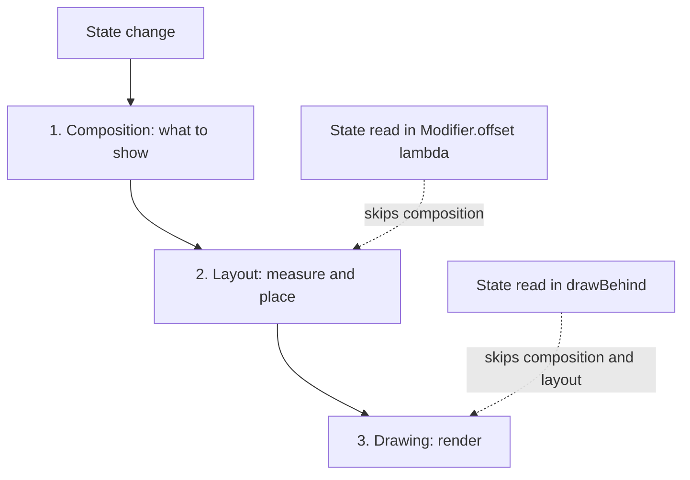
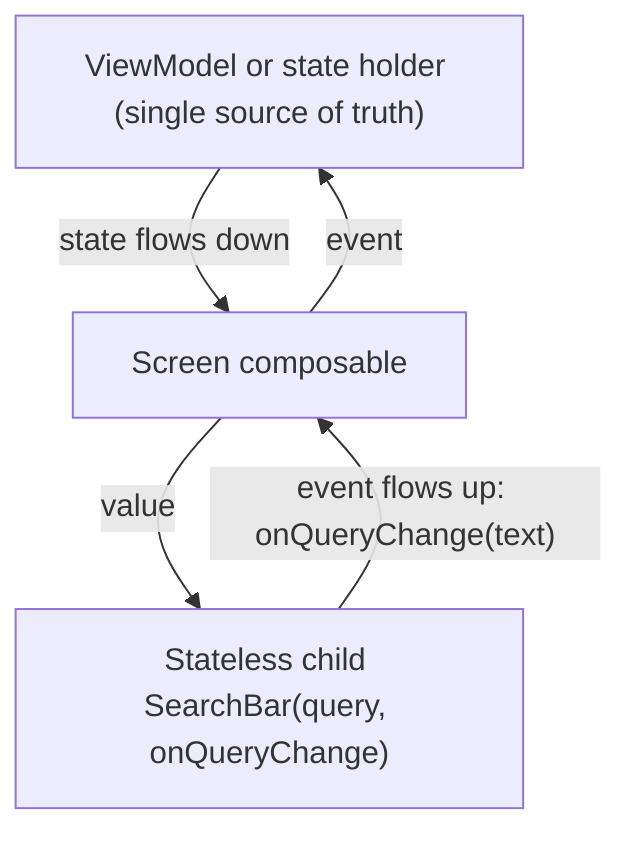
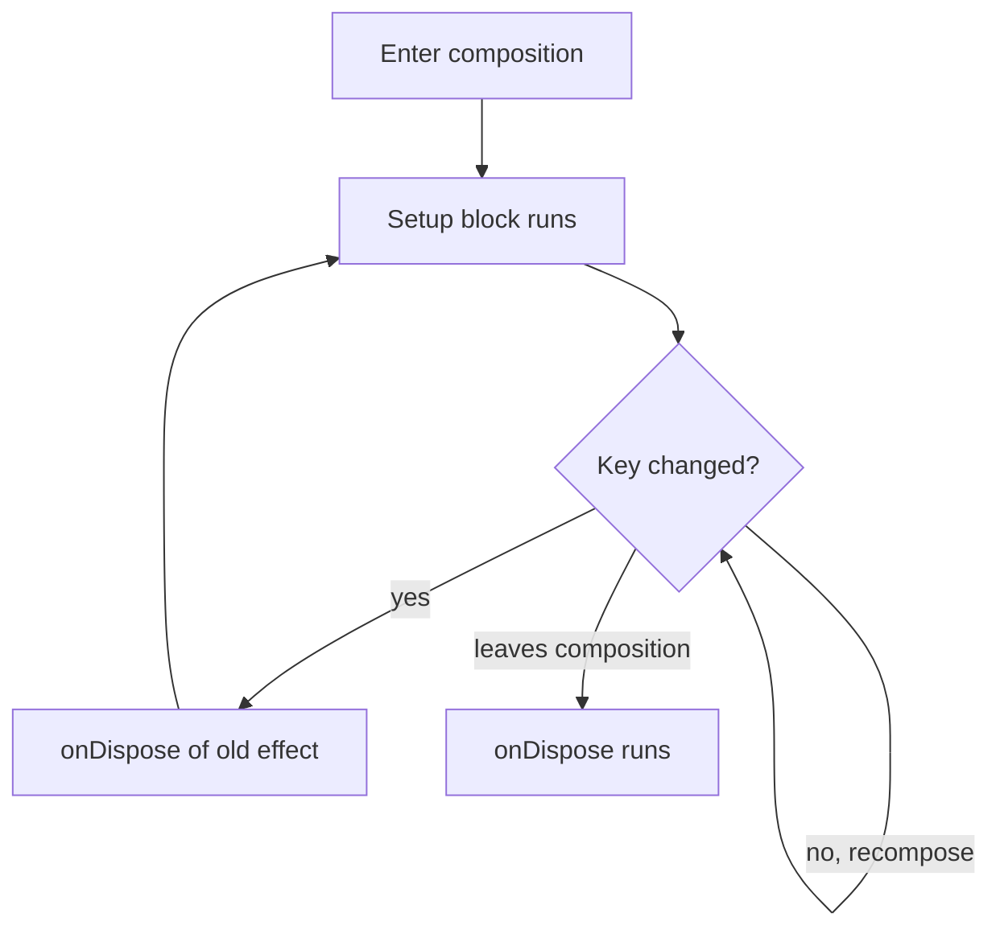
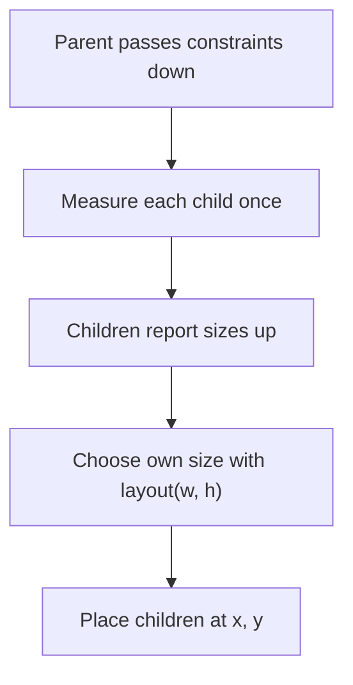
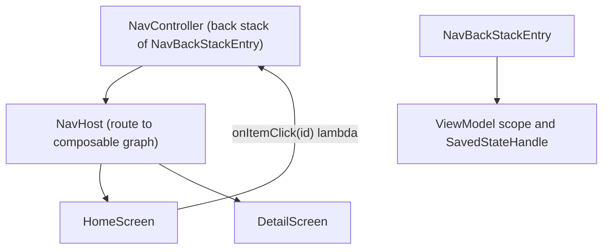
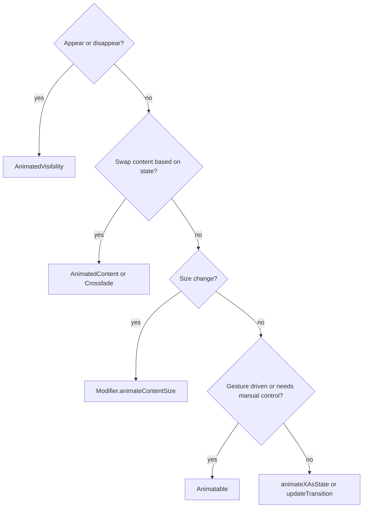
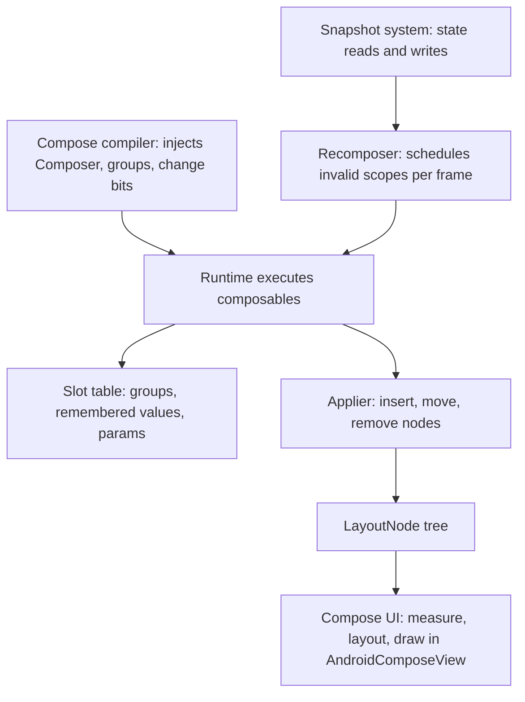
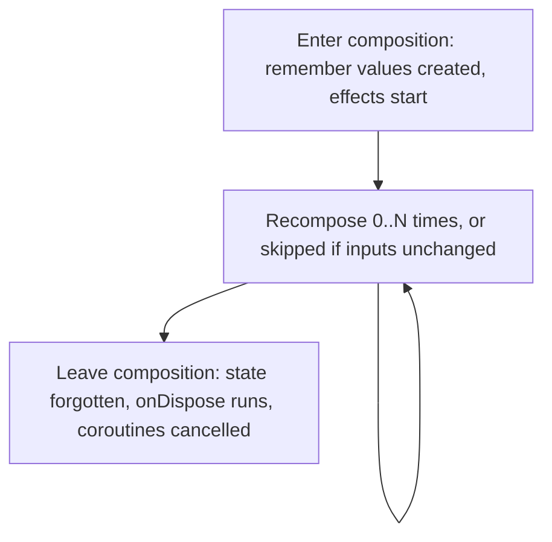

# Jetpack Compose

[⬅ Back to index](../README.md)

Covers: fundamentals, composition & recomposition, state, side effects, stability & performance, layouts & modifiers, lists, navigation, theming, interop, testing, internals.

---

## Fundamentals

### 1. What is Jetpack Compose? Why use it over Views?

<details>
<summary>Answer</summary>

**In short:** Compose is Android's modern **declarative UI toolkit**, written in Kotlin. You describe **what** the UI should look like for a given state, and Compose updates the screen when that state changes. Compared with Views it means less code, fewer "UI out of sync" bugs, and one language for logic and layout.

#### The problem it solves

The View system dates from 2008. A screen is an XML layout inflated into a tree of `View` objects, and your Kotlin code finds those objects (`findViewById`, ViewBinding) and mutates them. As screens get more dynamic, you end up writing lots of "if loading, hide this, show that, set this text" code, and every new state multiplies the ways the UI can drift from the data. Views also carry a lot of legacy: `View` itself is a class of tens of thousands of lines, and lists need adapters, ViewHolders and DiffUtil.

Compose replaces that with plain Kotlin functions:

```kotlin
@Composable
fun Greeting(user: User?, onRetry: () -> Unit) {
    when (user) {
        null -> Button(onClick = onRetry) { Text("Retry") }
        else -> Text("Hello, ${user.name}")
    }
}
```

There is no "hide the button, show the text" step. You say what the screen is for each state, and when `user` changes Compose re-runs the function and updates only what differs.

#### Benefits over Views

| Area | Views | Compose |
|---|---|---|
| Layout definition | XML + Kotlin, wired by IDs/binding | Kotlin functions only |
| Updating UI | Manually mutate widgets | Re-describe UI from state (UI = f(state)) |
| Lists | RecyclerView + Adapter + ViewHolder + DiffUtil | `LazyColumn { items(list) { ... } }` |
| Reuse | Custom Views, include/merge, styles | Ordinary functions with parameters |
| Animations | Animators, transitions, often verbose | `animate*AsState`, `AnimatedVisibility`, etc. |
| Theming | XML themes/attrs | `MaterialTheme` + CompositionLocals |
| Previews | Layout editor for XML only | `@Preview` for any composable with fake data |

Other points worth mentioning:
- **Interoperable**: you can put Compose inside Views (`ComposeView`) and Views inside Compose (`AndroidView`), so migration can be gradual.
- **Unbundled**: Compose ships as libraries, not in the OS, so fixes and new features reach all supported API levels without waiting for platform updates.
- **Multiplatform**: the same API runs on iOS, desktop and web through Compose Multiplatform.
- It's Google's recommended toolkit for new Android UI, and new Jetpack features (Material 3 components, adaptive layouts, Navigation 3) are Compose-first.

#### Trade-offs to be honest about

- Debug builds are noticeably slower than release builds; you must judge performance in release with R8 and Baseline Profiles.
- You need to understand recomposition, stability and side effects to avoid subtle performance or correctness bugs.
- APK size grows a bit when you ship both Views and Compose during migration.

**Likely follow-ups:**
- *Is Compose built on top of Views?* No. On Android the whole composition is hosted in a single `AndroidComposeView`, and Compose does its own measuring, layout and drawing for its `LayoutNode` tree.
- *Can a team adopt it gradually?* Yes, screen by screen or component by component through interop APIs.

</details>

### 2. Declarative vs imperative UI?

<details>
<summary>Answer</summary>

**In short:** In **imperative** UI (Views) you keep references to widgets and **mutate** them step by step. In **declarative** UI (Compose) you write a function that **describes the UI for the current state**, and the framework works out what changed and updates the screen for you.

#### Imperative: you give instructions

```kotlin
// Views: you are responsible for every transition between states
fun render(state: UiState) {
    if (state.isLoading) {
        progressBar.visibility = View.VISIBLE
        list.visibility = View.GONE
    } else {
        progressBar.visibility = View.GONE
        list.visibility = View.VISIBLE
        adapter.submitList(state.items)
    }
    errorText.isVisible = state.error != null   // easy to forget in one branch
}
```

Each widget holds its own state (text, visibility, checked). Your data holds state too. Keeping the two in sync is your job, and bugs appear when one code path forgets to reset something.

#### Declarative: you describe the result

```kotlin
@Composable
fun Screen(state: UiState) {
    when {
        state.isLoading -> CircularProgressIndicator()
        else -> ItemList(state.items)
    }
    state.error?.let { Text(it, color = MaterialTheme.colorScheme.error) }
}
```

There is no "hide" call. If a composable isn't called for the current state, it simply isn't in the UI. When `state` changes, Compose **re-executes** the functions that read it (recomposition) and applies only the differences to the UI tree.

| | Imperative (Views) | Declarative (Compose) |
|---|---|---|
| You write | Steps to transform the UI | What the UI is for a state |
| Source of truth | Widgets and your data (two copies) | Your state only |
| Change handling | Manual mutation in every path | Framework diffs and updates |
| Typical bug | UI out of sync with data | Unnecessary recomposition, misplaced side effects |

**Analogy:** imperative is giving a taxi driver turn-by-turn directions; declarative is giving the address and letting the driver find the route.

Declarative isn't magic: under the hood Compose still mutates a node tree. The difference is that **the framework** does the mutation, driven by state, instead of you.

**Likely follow-ups:**
- *Is React/SwiftUI/Flutter the same idea?* Yes, all are declarative, state-driven UI frameworks; Compose uses a compiler plugin and positional memoization rather than a virtual DOM.

</details>

### 3. What is a `@Composable` function? What does the annotation do?

<details>
<summary>Answer</summary>

**In short:** A `@Composable` function describes a piece of UI and **emits** it into the composition instead of returning a View. The annotation tells the **Compose compiler plugin** to transform the function: it adds a hidden `Composer` parameter and change-tracking bitmasks, and wraps the body in groups so Compose can remember state and re-run or skip that function on its own.

#### What the compiler does

`@Composable` works more like the `suspend` keyword than a normal annotation: it changes the function's type and how it's compiled. Conceptually, this:

```kotlin
@Composable
fun Greeting(name: String) {
    Text("Hello $name")
}
```

becomes something like this (simplified):

```kotlin
fun Greeting(name: String, $composer: Composer, $changed: Int) {
    $composer.startRestartGroup(/* key */ 123)
    // $changed bits say whether `name` is known to be unchanged
    if ($changed and 0b0001 != 0 || !$composer.skipping) {
        Text("Hello $name", $composer, ...)
    } else {
        $composer.skipToGroupEnd()      // inputs unchanged: skip the body
    }
    $composer.endRestartGroup()?.updateScope { c, _ ->
        Greeting(name, c, $changed or 1) // how Compose re-runs just this function
    }
}
```

Key pieces:
- **`Composer`**: the object that records what's emitted and where, stored in the slot table. It's threaded through every composable call, which is why composables can only be called from other composables (the same way suspend functions need a coroutine).
- **`$changed` bitmasks**: let the function know which parameters are already known to be the same, so it can **skip** the body.
- **Groups and restart scopes**: each call site gets an identity (its position in the code). That's what lets `remember` give back the same value next time and lets Compose re-run only `Greeting` when the state it reads changes.

#### Rules for writing composables

- Return `Unit` when emitting UI. (Composables that return values, like `remember` or `stringResource`, conventionally start with a lowercase letter.)
- Be **fast**: they can run as often as every frame.
- Be **idempotent and side-effect free**: same inputs give the same UI, and no network calls, analytics or state writes in the body.
- Don't depend on **execution order**: Compose may run them in any order, may skip some, and the design allows parallel execution in future.

```kotlin
// Wrong: side effect in the body runs on every recomposition
@Composable
fun Profile(id: String, vm: ProfileViewModel) {
    vm.load(id)                 // called again and again
    ...
}

// Right: run it as an effect keyed on id
@Composable
fun Profile(id: String, vm: ProfileViewModel) {
    LaunchedEffect(id) { vm.load(id) }
    ...
}
```

**Likely follow-ups:**
- *Why can't I call a composable from `onClick`?* `onClick` is a regular lambda with no `Composer`; to change UI from a click you change state, and the composable reacts.
- *Is the compiler plugin separate from Kotlin?* Since Kotlin 2.0 the Compose compiler ships with Kotlin and is applied with the `org.jetbrains.kotlin.plugin.compose` Gradle plugin.

</details>

### 4. What are the phases of Compose rendering?

<details>
<summary>Answer</summary>

**In short:** A Compose frame has three phases: **Composition** (run composables to decide *what* to show), **Layout** (measure and place nodes: *where*), and **Drawing** (render pixels: *how* it looks). Compose tracks state reads per phase, so a state read in a later phase only re-runs that phase and the ones after it.



#### The phases

1. **Composition**: Compose runs your `@Composable` functions and builds or updates the UI tree of `LayoutNode`s. Output: which nodes exist and their modifiers.
2. **Layout**: each node is **measured** (children first, given constraints from the parent) and then **placed** at x/y coordinates. Compose enforces **single-pass measurement**: a child can be measured only once per layout pass, which keeps deep trees fast.
3. **Drawing**: each node draws itself into a canvas, top to bottom.

These mirror Views (measure/layout/draw), with composition added in front.

#### Why the phase where you read state matters

Compose records *which phase* read a state. When the state changes:
- Read during **composition** → recompose that scope, then re-layout and redraw.
- Read in a **layout** lambda (`Modifier.offset { }`, `Modifier.layout { }`) → only re-layout and redraw.
- Read in a **draw** lambda (`drawBehind { }`, `graphicsLayer { }`) → only redraw.

```kotlin
// Recomposes on every scroll pixel: the value is read during composition
Box(Modifier.offset(y = scrollState.value.dp))

// Only re-runs layout: the value is read inside the lambda at layout time
Box(Modifier.offset { IntOffset(0, scrollState.value) })

// Only re-runs drawing
Box(Modifier.drawBehind { drawRect(color = animatedColor) })
```

This "defer state reads" technique is one of the most effective Compose performance tips for animations and scroll-driven effects.

**Pitfalls:**
- `Modifier.offset(x.dp)` and `Modifier.offset { }` look similar but behave very differently for performance.
- Passing a fast-changing value as a parameter (instead of a lambda `() -> Int`) forces the read into composition.

**Likely follow-ups:**
- *What if a child needs to know its size before composing?* Use `SubcomposeLayout` / `BoxWithConstraints`, which composes during layout.
- *Can a composable be measured twice?* No, measuring a measurable twice throws; use intrinsic measurements if you need size information first.

</details>

### 5. What is recomposition? What triggers it?

<details>
<summary>Answer</summary>

**In short:** Recomposition is Compose **re-running composable functions whose inputs or read state changed**, so the UI matches the new state. It's triggered when a `State` object that a composable read is written to, or when a parent recomposes and passes changed parameters. Compose re-runs only the affected scopes and **skips** children whose inputs are unchanged.

#### How Compose knows what to re-run

1. During composition, every read of a snapshot `State` (`mutableStateOf`, `StateFlow` collected into state, `derivedStateOf`) is recorded against the current **restart scope** (roughly: the nearest enclosing composable function that isn't inline).
2. When code writes to that state (from a click, a coroutine, a Flow), the **snapshot system** notices the write and marks those scopes **invalid**.
3. On the next frame, the **Recomposer** re-executes just the invalid scopes.
4. While running, each child call compares its parameters with last time. If all are equal (and their types are stable, or strong skipping applies), the child is **skipped**.

```kotlin
@Composable
fun Counter() {
    var count by remember { mutableStateOf(0) }  // state lives here
    Column {
        Header()                                  // no changing inputs: skipped
        Text("Count: $count")                     // reads count: re-runs
        Button(onClick = { count++ }) { Text("+") } // write triggers recomposition
    }
}
```

Note: `Column` is an inline function, so it doesn't have its own restart scope. The read of `count` invalidates `Counter`, but `Header()` is still skipped because its inputs didn't change.

#### What does *not* trigger recomposition

- Changing a regular `var` or a mutable object that isn't snapshot state.
- Mutating a `MutableList` in place inside `mutableStateOf` (the reference didn't change).
- Writing a value equal to the current one (the default policy is `structuralEqualityPolicy`, so `equals` duplicates are ignored).

#### Properties of recomposition

- **Smart/skippable**: only invalidated scopes run; unchanged children are skipped.
- **Optimistic and cancellable**: if state changes again mid-recomposition, Compose may throw away the in-progress work and restart with the latest values. That's why composables must not have side effects in the body.
- **Unordered and possibly frequent**: it can run every frame during an animation; don't rely on order or count.

**Pitfalls:**
- Reading fast-changing state (scroll offset, animation value) high in the tree recomposes a large subtree.
- Unstable parameters (before strong skipping) prevented skipping and caused "recomposes everything" problems.

**Likely follow-ups:**
- *How do you see recompositions?* Layout Inspector shows recomposition and skip counts per composable.
- *Recomposition vs relayout?* Recomposition re-runs functions; a layout-only state read just re-measures/places without re-running composables.

</details>

---

## State

### 6. What is state in Compose? `remember` vs `rememberSaveable`?

<details>
<summary>Answer</summary>

**In short:** State is any value that can change over time and that the UI depends on. `mutableStateOf()` creates an **observable** `MutableState<T>`: reading it subscribes the composable, writing it schedules recomposition. `remember` keeps a value **across recompositions** only; `rememberSaveable` additionally survives **configuration changes and process death** by saving into the saved-instance-state Bundle.

#### Why you need both `mutableStateOf` and `remember`

They solve different problems:
- `mutableStateOf` makes the value **observable**, so changing it updates the UI.
- `remember` makes it **persist** across recompositions. A composable is just a function; without `remember` every re-run would create a fresh state and reset it.

```kotlin
@Composable
fun Broken() {
    var text by mutableStateOf("")          // recreated on every recomposition: typing resets it
    TextField(text, { text = it })
}

@Composable
fun Works() {
    var text by remember { mutableStateOf("") }   // same instance across recompositions
    TextField(text, { text = it })
}
```

(Lint flags the first version with "Creating a state object during composition without using remember".)

#### `remember` vs `rememberSaveable`

| | `remember` | `rememberSaveable` |
|---|---|---|
| Survives recomposition | Yes | Yes |
| Survives rotation / config change | No (Activity is recreated) | Yes |
| Survives process death | No | Yes |
| Leaves composition (e.g. `if` turns false) | Lost | Lost (except inside saveable navigation/back stack entries) |
| Allowed types | Anything | Bundle-able types (primitives, String, Parcelable, Serializable) or a custom `Saver` |
| Use for | Derived objects, animation state, things cheap to recreate | Small user-entered UI state: text, selected tab, expanded flag |

```kotlin
var query by rememberSaveable { mutableStateOf("") }

// Custom type: provide a Saver
data class Filter(val min: Int, val max: Int)
val FilterSaver = listSaver<Filter, Int>(
    save = { listOf(it.min, it.max) },
    restore = { Filter(it[0], it[1]) },
)
var filter by rememberSaveable(stateSaver = FilterSaver) { mutableStateOf(Filter(0, 100)) }
```

#### Keys

Both accept keys: `remember(userId) { ... }` recalculates when `userId` changes, which is how you cache something derived from inputs.

**Pitfalls:**
- Saving large data (lists from the network) in `rememberSaveable`: the Bundle has a size limit (around 1 MB across the transaction) and you risk `TransactionTooLargeException`. Keep that data in a ViewModel/repository.
- Forgetting `by` needs `import androidx.compose.runtime.getValue/setValue`.

**Likely follow-ups:**
- *Where does `rememberSaveable` store data?* In a `SaveableStateRegistry` connected to the Activity/Fragment's saved instance state (or the navigation back stack entry).
- *`remember` vs ViewModel?* ViewModel survives config change and holds business state; `remember` is for UI-local state.

</details>

### 7. What is state hoisting? Stateful vs stateless composables?

<details>
<summary>Answer</summary>

**In short:** **State hoisting** means moving state **up** to the caller and making the composable **stateless**: it receives the current `value` and an event callback like `onValueChange: (T) -> Unit`. This gives a single source of truth and **Unidirectional Data Flow**: state flows down, events flow up.



#### Stateful vs stateless

- **Stateful** composable: owns its state internally with `remember`. Easy to drop in, but the caller can't read or control the state.
- **Stateless** composable: holds no state; everything comes from parameters. Reusable, testable, previewable.

A common pattern is to provide both: a stateless version with the real implementation, and a thin stateful wrapper for convenience.

```kotlin
// Stateless: caller owns the state
@Composable
fun SearchBar(
    query: String,
    onQueryChange: (String) -> Unit,
    modifier: Modifier = Modifier,
) {
    TextField(value = query, onValueChange = onQueryChange, modifier = modifier)
}

// Stateful convenience wrapper
@Composable
fun SearchBar(modifier: Modifier = Modifier) {
    var query by rememberSaveable { mutableStateOf("") }
    SearchBar(query, { query = it }, modifier)
}
```

Material components follow this: `TextField(value, onValueChange)`, `Checkbox(checked, onCheckedChange)`. The checkbox doesn't toggle itself; you have to update the state.

#### Benefits

- **Single source of truth**: no duplicated, conflicting copies of the same value.
- **Shareable**: two siblings can read the same hoisted state (e.g. a search bar and the results list).
- **Interceptable**: the caller can validate or transform before updating (e.g. limit length).
- **Testable and previewable**: pass any value in a test or `@Preview`.

#### How far to hoist

Hoist to the **lowest common ancestor** of everything that reads or writes the state, and no higher. Purely visual state (is this card expanded) can stay near the UI; screen-level business state (search results, loading, errors) belongs in the **ViewModel**.

**Pitfalls:**
- Hoisting too high: a fast-changing value at screen level makes the whole screen recompose.
- Passing `MutableState<T>` down as a parameter instead of value + lambda; it hides who writes it.

**Likely follow-ups:**
- *What's UDF?* State goes down as parameters, events go up as callbacks, and only the state owner mutates state.

</details>

### 8. Where should state live: composable, state holder class, or ViewModel?

<details>
<summary>Answer</summary>

**In short:** Put **UI element state** (scroll position, expanded, animation) in the composable with `remember`, or in a **plain state holder class** when the logic grows. Put **screen UI state** that comes from business logic or data in a **ViewModel**, exposed as `StateFlow<UiState>`. Pass state and lambdas down to children, not the ViewModel itself.

#### Three levels

| Where | What goes there | Survives config change | Example |
|---|---|---|---|
| `remember` / `rememberSaveable` in the composable | Simple UI element state | Only with `rememberSaveable` | `var expanded by remember { mutableStateOf(false) }` |
| Plain state holder class (remembered) | UI logic involving several values or UI-only dependencies | Only if you give it a `Saver` | `rememberLazyListState()`, `rememberDrawerState()`, custom `rememberCheckoutFormState()` |
| ViewModel | Screen UI state, business logic, data loading | Yes; with `SavedStateHandle`, also process death | `StateFlow<FeedUiState>` |

#### Plain state holder example

When a composable has several related state values and logic between them, extract a class:

```kotlin
@Stable
class SearchFieldState(initial: String) {
    var query by mutableStateOf(initial)
        private set
    val isValid: Boolean get() = query.length >= 3
    fun onQueryChange(new: String) { query = new.take(50) }
}

@Composable
fun rememberSearchFieldState(initial: String = "") =
    remember { SearchFieldState(initial) }
```

This is UI logic: it may depend on Compose things (Resources, `FocusRequester`, `LazyListState`) and its lifetime equals the composable's.

#### ViewModel

The ViewModel holds **business logic** and screen state. It shouldn't reference composables, `Context` of an Activity, or Compose UI types.

```kotlin
class FeedViewModel(private val repo: FeedRepository) : ViewModel() {
    val uiState: StateFlow<FeedUiState> = repo.feed()
        .map { FeedUiState.Success(it) }
        .stateIn(viewModelScope, SharingStarted.WhileSubscribed(5_000), FeedUiState.Loading)
}

@Composable
fun FeedRoute(vm: FeedViewModel = hiltViewModel()) {
    val state by vm.uiState.collectAsStateWithLifecycle()
    FeedScreen(state, onRefresh = vm::refresh)   // stateless screen below
}
```

#### Don't pass the ViewModel deep

Pass `state` and `onX` lambdas to children instead. Children then don't depend on a ViewModel class, which keeps them reusable, previewable with fake data, and testable without DI. The common pattern is a "Route" composable that talks to the ViewModel and a stateless "Screen" composable below it.

**Likely follow-ups:**
- *Can a composable lower in the tree get its own ViewModel?* Yes, `viewModel()` is scoped to the nearest `ViewModelStoreOwner` (Activity, Fragment or nav back stack entry), not to the composable, which surprises people.

</details>

### 9. How do you observe a ViewModel's Flow / LiveData in Compose?

<details>
<summary>Answer</summary>

**In short:** Convert it into Compose `State`: for `StateFlow`/`Flow` use **`collectAsStateWithLifecycle()`** (lifecycle-aware, recommended on Android); for `LiveData` use `observeAsState()`. Reading the resulting state in a composable makes it recompose on each new value.

```kotlin
@Composable
fun ProfileRoute(viewModel: ProfileViewModel = viewModel()) {
    // Recommended: stops collecting when the lifecycle drops below STARTED
    val uiState by viewModel.uiState.collectAsStateWithLifecycle()

    // LiveData (needs runtime-livedata artifact); nullable until the first value
    val name: String? by viewModel.nameLiveData.observeAsState()

    ProfileScreen(uiState)
}
```

#### `collectAsStateWithLifecycle` vs `collectAsState`

| | `collectAsState()` | `collectAsStateWithLifecycle()` |
|---|---|---|
| Artifact | compose runtime | `androidx.lifecycle:lifecycle-runtime-compose` |
| Collects while | The composable is in the composition | Lifecycle is at least `STARTED` (configurable `minActiveState`) |
| In background | Keeps collecting | Stops, restarts on return |
| Platform | Multiplatform | Android lifecycle aware (also available in multiplatform lifecycle) |

Why it matters: an app in the background is still "in composition". With `collectAsState`, a Flow backed by location updates or a database query would keep running and wasting battery. With the lifecycle-aware version, collection stops; combined with `stateIn(..., SharingStarted.WhileSubscribed(5_000), ...)` in the ViewModel, the upstream work also stops after 5 seconds in the background.

#### Initial values

- `StateFlow` already has a value, so the state starts with it.
- A plain `Flow` needs `initialValue`: `flow.collectAsStateWithLifecycle(initialValue = emptyList())`.

**Pitfalls:**
- Collecting a cold Flow directly from a repository in the composable re-subscribes on each new Flow instance; expose a `StateFlow` from the ViewModel instead.
- One-off events (navigate, show toast) modeled as `SharedFlow` can be lost while not collecting; prefer modeling them as state that the UI consumes and then acknowledges.

</details>

### 10. What is `derivedStateOf`? When to use it?

<details>
<summary>Answer</summary>

**In short:** `derivedStateOf` creates a state whose value is **computed from other states**, and it only notifies readers when the **computed result** changes. Use it when the inputs change **much more often** than the output, such as a scroll position (changes every pixel) mapped to a boolean (changes rarely).

#### Example: show a "scroll to top" button

```kotlin
val listState = rememberLazyListState()

// Wrong: reads firstVisibleItemIndex in composition, so this recomposes on every item scrolled
val showButton = listState.firstVisibleItemIndex > 0

// Right: readers recompose only when the boolean flips
val showButton by remember {
    derivedStateOf { listState.firstVisibleItemIndex > 0 }
}

AnimatedVisibility(visible = showButton) { ScrollToTopButton() }
```

#### How it works

1. Inside the lambda, Compose records every snapshot state read (`firstVisibleItemIndex`).
2. When any of those change, the derived state re-computes its value.
3. It compares the new result with the old one (by `equals` by default). If equal, nobody is notified. If different, readers of the derived state are invalidated.

So the calculation still runs often, but **recomposition** of readers happens only on real changes. It must be wrapped in `remember`, otherwise a new derived state object is created on each recomposition.

#### When *not* to use it

```kotlin
// Unnecessary: the output changes every time an input changes
val fullName by remember { derivedStateOf { "$first $last" } }

// Enough: plain expression, or remember with keys for expensive work
val fullName = "$first $last"
val sorted = remember(items) { items.sortedBy { it.name } }
```

`derivedStateOf` has bookkeeping overhead; it only pays off when it filters out many changes.

**Pitfalls:**
- Reading a non-state value (a plain parameter) inside `derivedStateOf` captured once by `remember`: it won't update. Either pass it as a `remember` key or wrap it with `rememberUpdatedState`.

**Likely follow-ups:**
- *`derivedStateOf` vs `remember(key)`?* `remember(key)` recalculates when a key passed by the caller changes; `derivedStateOf` reacts to snapshot state reads and filters out unchanged results.

</details>

### 11. What is `snapshotFlow`?

<details>
<summary>Answer</summary>

**In short:** `snapshotFlow { }` turns Compose **state reads into a cold Flow**. It runs the block, records which snapshot states it read, and emits a new value whenever one of those states changes and the result differs from the previous emission. Use it to feed Compose state into Flow-based logic, usually inside a `LaunchedEffect`.

```kotlin
val listState = rememberLazyListState()

LaunchedEffect(listState) {
    snapshotFlow { listState.firstVisibleItemIndex }
        .filter { it > 0 }
        .distinctUntilChanged()
        .collect { index -> analytics.logScrolledTo(index) }
}
```

#### Why it's useful

Compose state isn't a Flow, and side effects shouldn't run in the composable body. `snapshotFlow` bridges the two so you can use Flow operators (`debounce`, `filter`, `map`, `collectLatest`) on UI state:

```kotlin
// Load more items when the user nears the end of the list
LaunchedEffect(listState) {
    snapshotFlow { listState.layoutInfo.visibleItemsInfo.lastOrNull()?.index }
        .filterNotNull()
        .distinctUntilChanged()
        .collect { lastVisible ->
            if (lastVisible >= listState.layoutInfo.totalItemsCount - 5) onLoadMore()
        }
}
```

#### Behaviour details

- **Cold**: nothing runs until collected; each collector gets its own observation.
- **Conflates equal values**: like `distinctUntilChanged`, it only emits when the block's result changes (by `equals`). The extra `distinctUntilChanged()` above is harmless but redundant.
- Runs in the collector's coroutine, so cancelling the `LaunchedEffect` stops it.

| | `derivedStateOf` | `snapshotFlow` |
|---|---|---|
| Output | `State<T>` for composables to read | `Flow<T>` for coroutines |
| Used for | Reducing recompositions | Side effects (analytics, paging, saving) |

It's the reverse of `collectAsState`: that turns Flow into state; `snapshotFlow` turns state into Flow.

</details>

### 12. Why should you use immutable collections / avoid `mutableListOf` in state?

<details>
<summary>Answer</summary>

**In short:** Compose only knows state changed when a **snapshot state object is written**. Mutating a `MutableList` held inside `mutableStateOf` changes the list's contents but not the reference, so **no recomposition happens**. Either replace the list with a new one (`items = items + item`) or use observable collections like `mutableStateListOf()`. Separately, `List` parameters were treated as **unstable**, which prevented skipping before strong skipping mode; immutable collections fix that.

#### The bug

```kotlin
// Wrong: UI never updates
val items = remember { mutableStateOf(mutableListOf<String>()) }
Button(onClick = { items.value.add("new") }) { Text("Add") }   // same reference, no write

// Right option 1: immutable list, new reference on each change
var items by remember { mutableStateOf(listOf<String>()) }
Button(onClick = { items = items + "new" }) { Text("Add") }

// Right option 2: snapshot-aware list
val items = remember { mutableStateListOf<String>() }
Button(onClick = { items.add("new") }) { Text("Add") }        // observed
```

`mutableStateListOf` / `mutableStateMapOf` return `SnapshotStateList` / `SnapshotStateMap`, which record reads and writes like `mutableStateOf` does.

In a ViewModel, the same rule applies to `MutableStateFlow`: `_state.value.items.add(x)` emits nothing. Use `_state.update { it.copy(items = it.items + x) }`.

#### The stability side

Kotlin's `List<T>` is a read-only *interface*; the actual object might be an `ArrayList` someone else mutates. The Compose compiler therefore treats `List`, `Set`, `Map` parameters as **unstable**. Before strong skipping, a composable taking `items: List<Item>` could never be skipped.

Options:
- `kotlinx.collections.immutable` (`ImmutableList`, `persistentListOf()`), which the compiler knows are stable.
- A wrapper class annotated `@Immutable`.
- Listing `kotlin.collections.*` in a stability configuration file (only if your team guarantees no mutation).

With strong skipping (default since Kotlin 2.0.20), unstable parameters are compared by instance (`===`), so skipping works when you pass the same list instance. Creating a new list with equal contents still causes recomposition, which is another reason to keep state immutable and only produce new lists when data really changes.

**Pitfalls:**
- Holding mutable objects (data classes with `var` fields) in state and mutating fields; same problem as lists.

</details>

---

## Side Effects

### 13. What are side effects in Compose? Explain the effect handlers.

<details>
<summary>Answer</summary>

**In short:** A side effect is anything a composable does that's visible **outside its own scope**: a network call, analytics event, navigation, showing a snackbar, registering a listener. Because composables can run often, in any order, and be cancelled, side effects must go through **effect APIs** (`LaunchedEffect`, `DisposableEffect`, `SideEffect`, etc.) that run them at controlled points in the composable's lifecycle.

#### Why the body isn't safe

```kotlin
@Composable
fun Checkout(cart: Cart, analytics: Analytics) {
    analytics.log("checkout_viewed")   // Wrong: logs on every recomposition, maybe dozens of times
    ...
}
```

Recomposition can happen on every frame during an animation and can be discarded midway. Effect handlers tie the work to **entering/leaving the composition** and to **keys**, so it runs a predictable number of times and is cleaned up.

#### The effect handlers

| API | What it does | Typical use |
|---|---|---|
| `LaunchedEffect(key)` | Launches a **suspend** block when entering composition; cancels and relaunches when a key changes; cancels when leaving | Load data for an id, show a snackbar for an error, start an animation |
| `rememberCoroutineScope()` | Returns a scope bound to the composition, to launch coroutines **from callbacks** | `onClick = { scope.launch { drawerState.open() } }` |
| `DisposableEffect(key)` | Runs setup code and requires an `onDispose { }` cleanup | Register/unregister listeners, lifecycle observers, broadcast receivers |
| `SideEffect { }` | Runs after **every successful recomposition** | Push Compose state into non-Compose objects (e.g. set a property on an analytics or system UI controller) |
| `rememberUpdatedState(value)` | Keeps the **latest** value available to a long-running effect without restarting it | Latest `onTimeout` lambda in a delay effect |
| `produceState(initial, keys)` | Launches a coroutine that writes into a returned `State` | Turn a callback or suspend API into state |
| `derivedStateOf`, `snapshotFlow` | State computed from state; state as a Flow | Reduce recompositions; feed state into Flow logic |

```kotlin
@Composable
fun Checkout(cartId: String, analytics: Analytics, snackbar: SnackbarHostState, error: String?) {
    LaunchedEffect(cartId) { analytics.log("checkout_viewed", cartId) }   // once per cartId

    LaunchedEffect(error) {
        if (error != null) snackbar.showSnackbar(error)                   // when error changes
    }

    SideEffect { analytics.setCurrentScreen("checkout") }               // after each recomposition
}
```

#### Choosing one

- Need to suspend (delay, network, animation)? `LaunchedEffect`, or `rememberCoroutineScope` if triggered by a user event.
- Need cleanup on leave? `DisposableEffect`.
- Need to sync something every time the UI commits? `SideEffect`.
- Need a value out of an async source? `produceState` or collect a Flow.

**Pitfalls:**
- Business logic in effects that belongs in the ViewModel (e.g. calling the repository from `LaunchedEffect`). The effect should usually just call `viewModel.onScreenShown()`.
- Wrong keys (see Q15).

</details>

### 14. `LaunchedEffect` vs `rememberCoroutineScope`?

<details>
<summary>Answer</summary>

**In short:** **`LaunchedEffect`** starts a coroutine **automatically** when the composable enters the composition (or its key changes); it's driven by state. **`rememberCoroutineScope`** gives you a scope to launch coroutines **yourself from event callbacks** like `onClick`, which aren't composable. Both are cancelled when the composable leaves the composition.

#### `LaunchedEffect`: reacting to state

```kotlin
@Composable
fun ErrorSnackbar(error: String?, snackbarHostState: SnackbarHostState) {
    LaunchedEffect(error) {
        if (error != null) snackbarHostState.showSnackbar(error)   // suspend call
    }
}
```

It's itself a composable, so you call it in the composable body. It runs when composition decides, not when a user acts.

#### `rememberCoroutineScope`: reacting to events

```kotlin
@Composable
fun Screen(drawerState: DrawerState) {
    val scope = rememberCoroutineScope()
    IconButton(onClick = {
        // LaunchedEffect can't be called here: onClick is not a composable context
        scope.launch { drawerState.open() }       // open() is a suspend animation
    }) { Icon(Icons.Default.Menu, contentDescription = "Menu") }
}
```

The scope is remembered across recompositions and cancelled when the call site leaves the composition, so the animation stops if the screen disappears.

| | `LaunchedEffect` | `rememberCoroutineScope` |
|---|---|---|
| Triggered by | Entering composition / key change | Your code, usually a user event |
| Called from | Composable body | Returns a scope used in callbacks |
| Restart | Automatic on key change | Manual; each `launch` is independent |
| Cancelled | On key change and on leave | On leave |
| Example | Load on screen open, show snackbar for error | Scroll to top on button tap, open drawer |

**Pitfalls:**
- Using `rememberCoroutineScope().launch { }` directly in the composable body: it launches on every recomposition. Use `LaunchedEffect` for that.
- Using `GlobalScope` or `viewModelScope` from UI for UI animations: they won't be cancelled when the UI goes away.

**Likely follow-ups:**
- *Which dispatcher do they use?* `Dispatchers.Main` with the composition's frame clock (`MonotonicFrameClock`), which is why animations can await frames inside them.

</details>

### 15. What is the `key` in `LaunchedEffect(Unit)` vs `LaunchedEffect(userId)`?

<details>
<summary>Answer</summary>

**In short:** The key decides **when the effect restarts**. `LaunchedEffect(Unit)` (or `true`) runs **once** for as long as the composable stays in the composition. `LaunchedEffect(userId)` **cancels the running coroutine and starts a new one** whenever `userId` changes. Choose keys equal to the values the effect depends on.

#### How keys work

On each recomposition Compose compares the keys with the previous ones (with `equals`):
- **Same keys** → leave the running coroutine alone.
- **Different keys** → cancel the old coroutine, launch the block again.
- **Leaving composition** → cancel.

```kotlin
@Composable
fun UserProfile(userId: String, vm: ProfileViewModel) {
    // Restarts for each user; the old load is cancelled if the user changes quickly
    LaunchedEffect(userId) { vm.load(userId) }
}

@Composable
fun Splash(onDone: () -> Unit) {
    val latestOnDone by rememberUpdatedState(onDone)
    // Runs once; we don't want to restart the timer if onDone is a new lambda
    LaunchedEffect(Unit) {
        delay(1_500)
        latestOnDone()
    }
}
```

#### Getting keys wrong

| Mistake | Result |
|---|---|
| `LaunchedEffect(Unit) { vm.load(userId) }` | **Stale**: when `userId` changes, the old user's data stays |
| `LaunchedEffect(someObject)` where a new instance is created each recomposition | **Restarts every recomposition**, maybe cancelling work before it finishes |
| `LaunchedEffect(onClick)` with an unstable lambda | Same as above |
| Keying on everything "just in case" | Unnecessary restarts and duplicate requests |

Rule of thumb: every value the effect *reads that should cause a restart* goes in the keys. Values that it should use but that shouldn't restart it (like callbacks) go through `rememberUpdatedState`.

Multiple keys are allowed: `LaunchedEffect(userId, filter) { ... }`. The same key rules apply to `DisposableEffect`, `produceState` and `remember(key)`.

**Pitfalls:**
- `LaunchedEffect(Unit)` inside a screen runs again when the screen re-enters composition, for example after navigating back, because the composable left and re-entered. "Once" means once per stay in the composition, not once per app run.

</details>

### 16. Explain `DisposableEffect` with an example.

<details>
<summary>Answer</summary>

**In short:** `DisposableEffect(key) { ...; onDispose { ... } }` is for side effects that **need cleanup**. The setup block runs when the composable enters the composition (or a key changes), and `onDispose` runs when the key changes (before re-running setup) or when the composable leaves. It's the Compose equivalent of register in `onStart` / unregister in `onStop`.

#### Example: observing the lifecycle

```kotlin
@Composable
fun LifecycleLogger(owner: LifecycleOwner = LocalLifecycleOwner.current) {
    DisposableEffect(owner) {
        val observer = LifecycleEventObserver { _, event -> Log.d("Lifecycle", "$event") }
        owner.lifecycle.addObserver(observer)

        onDispose {
            owner.lifecycle.removeObserver(observer)   // no leaks when we leave or owner changes
        }
    }
}
```

#### Example: a system listener

```kotlin
@Composable
fun NetworkStatus(onChange: (Boolean) -> Unit) {
    val context = LocalContext.current
    val currentOnChange by rememberUpdatedState(onChange)

    DisposableEffect(context) {
        val cm = context.getSystemService(ConnectivityManager::class.java)
        val callback = object : ConnectivityManager.NetworkCallback() {
            override fun onAvailable(network: Network) = currentOnChange(true)
            override fun onLost(network: Network) = currentOnChange(false)
        }
        cm.registerDefaultNetworkCallback(callback)
        onDispose { cm.unregisterNetworkCallback(callback) }
    }
}
```

#### Order of calls



The `onDispose` call is **mandatory**: the block must end with it (the compiler enforces it via the return type). If there's nothing to clean up, you probably want `LaunchedEffect` or `SideEffect` instead.

**Pitfalls:**
- Capturing a callback directly in the listener: if the caller passes a new lambda, the listener keeps calling the old one. Use `rememberUpdatedState`, as above.
- Doing suspend work: `DisposableEffect` isn't a coroutine. Use `LaunchedEffect` with `try { awaitCancellation() } finally { cleanup() }` if you need both.

**Likely follow-ups:**
- *Is there something simpler for lifecycle events?* Yes, `LifecycleEventEffect`, `LifecycleStartEffect` and `LifecycleResumeEffect` from lifecycle-runtime-compose (see Q38).

</details>

### 17. What is `rememberUpdatedState`?

<details>
<summary>Answer</summary>

**In short:** `rememberUpdatedState(value)` returns a `State` that always holds the **latest** value passed in. A long-running effect can read it to use the newest value (usually a callback) **without being restarted** when that value changes.

#### The problem

```kotlin
@Composable
fun SplashScreen(onTimeout: () -> Unit) {
    // Option A: key on Unit. The lambda captured here is the first one forever.
    LaunchedEffect(Unit) {
        delay(2_000)
        onTimeout()            // may call a stale lambda from the first composition
    }

    // Option B: key on onTimeout. Every new lambda restarts the 2s timer from zero.
    LaunchedEffect(onTimeout) { delay(2_000); onTimeout() }
}
```

Neither is right: A can call outdated logic, B may never fire if the parent keeps passing new lambdas.

#### The fix

```kotlin
@Composable
fun SplashScreen(onTimeout: () -> Unit) {
    val currentOnTimeout by rememberUpdatedState(onTimeout)

    LaunchedEffect(Unit) {          // timer starts once
        delay(2_000)
        currentOnTimeout()          // but always calls the newest lambda
    }
}
```

#### How it works

It's essentially:

```kotlin
@Composable
fun <T> rememberUpdatedState(newValue: T): State<T> =
    remember { mutableStateOf(newValue) }.apply { value = newValue }
```

The `State` object is the same across recompositions (so the effect's captured reference stays valid), and its `value` is overwritten on each recomposition with the newest argument.

#### When to use it

Use it for values an effect **uses but shouldn't restart on**: callbacks in `LaunchedEffect`/`DisposableEffect`, values read inside listeners, or values read in `derivedStateOf` that aren't state themselves.

If the effect *should* restart when the value changes (e.g. a different `userId` means a different load), use a key instead.

</details>

---

## Stability & Performance

### 18. What is stability in Compose? Stable vs unstable types?

<details>
<summary>Answer</summary>

**In short:** A type is **stable** when the Compose compiler can trust that (1) `equals` reliably tells whether two instances are the same, and (2) if a public property changes, Compose will be **notified** (because it's snapshot state). When all of a composable's parameters are stable and equal to last time, Compose can **skip** it. Unstable parameters historically prevented skipping.

#### Why Compose cares

Skipping is the main way Compose avoids re-running unchanged UI. But skipping is only safe if "equal parameters" really means "same UI". If a class has a `var` property that someone mutates without telling Compose, the old and new instance may be the *same object* with different content, so skipping would show stale UI. The compiler is conservative and calls such types unstable.

#### What's stable

| Stable | Unstable |
|---|---|
| Primitives, `String`, enums | Classes with any `var` property (not backed by snapshot state) |
| Function types (lambdas) | `List`, `Set`, `Map` and other interfaces (implementation may be mutable) |
| `State<T>`, `MutableState<T>` | Classes from modules **not compiled with the Compose compiler** (e.g. a pure Kotlin `domain` module), unless configured |
| Data classes whose properties are all `val` of stable types | Classes from Java libraries, `java.util.Date`, etc. |
| Classes annotated `@Immutable` or `@Stable` | Generic types whose type argument is unstable |
| `ImmutableList` from kotlinx.collections.immutable | |

```kotlin
data class User(val id: String, val name: String)        // stable
data class Cart(var total: Int)                          // unstable: var
data class Feed(val items: List<Post>)                    // unstable: List
@Immutable data class Feed2(val items: List<Post>)        // you promise it's immutable
```

#### `@Immutable` vs `@Stable`

- `@Immutable`: all properties never change after construction.
- `@Stable`: properties may change, but only through snapshot state, so Compose is notified (e.g. a state holder class with `mutableStateOf` fields).

Both are **promises** you make; the compiler doesn't verify them. Lying leads to stale UI.

#### Fixes for unstable types

1. Use immutable types: `val` properties, `ImmutableList`.
2. Annotate with `@Immutable`/`@Stable` when you control the class.
3. Use a **stability configuration file** (`stabilityConfigurationFiles` in the Compose compiler Gradle options) to mark external classes (e.g. `com.example.domain.*`, `java.time.LocalDate`) as stable.
4. Map domain models to UI models in the UI module.

#### How to check

Enable **Compose compiler reports/metrics**: they list each composable as `restartable`/`skippable` and each parameter as `stable`/`unstable`.

**Likely follow-ups:**
- *Does stability still matter with strong skipping?* Less, but yes: unstable params are compared by `===`, so a new-but-equal instance still recomposes (see Q19).

</details>

### 19. What is Strong Skipping mode?

<details>
<summary>Answer</summary>

**In short:** Strong skipping is a Compose compiler mode, **enabled by default since Kotlin 2.0.20 / Compose compiler 2.0.20**, that lets composables with **unstable parameters still be skipped**: unstable parameters are compared by **instance equality (`===`)**, stable ones by `equals`. It also **automatically remembers lambdas** based on what they capture. It removes most of the manual stability work that Compose used to need.

#### Before strong skipping

A composable was skippable only if *all* parameters were stable. One `List<Item>` parameter made it non-skippable, so it re-ran every time its parent recomposed. Lambdas that captured unstable values were recreated every recomposition, so children receiving them also couldn't skip. Teams spent time adding `@Immutable`, wrapping lists and `remember`ing lambdas by hand.

#### What changes

| | Default before | Strong skipping |
|---|---|---|
| Composable with unstable params | Never skipped | Skippable |
| Comparison for stable params | `equals` | `equals` |
| Comparison for unstable params | n/a (no skipping) | `===` (same instance) |
| Lambdas in composables | Remembered only if captures were stable | Always remembered, keyed on captures |

```kotlin
@Composable
fun ItemList(items: List<Item>, onClick: (Item) -> Unit) { ... }

// With strong skipping:
// - same `items` instance as last time → skipped
// - `onClick = { vm.select(it) }` is auto-remembered, so it's the same lambda instance
```

#### Why stability still matters

- A **new instance with equal content** is still treated as changed for unstable types. For example, mapping a list inside the composable (`items.filter { ... }`) produces a new list every recomposition, so children recompose. With an `ImmutableList` (stable, compared by `equals`) they'd skip.
- Correctness: if you mutate an object in place and pass the same instance, `===` says "unchanged", so the UI won't update. Immutable state avoids this.

#### Opting out

You can opt a specific composable out with `@NonSkippableComposable`, and a lambda out of memoization with `@DontMemoize`. Rarely needed.

**Likely follow-ups:**
- *Do I still need compiler reports?* They're still useful to find hot composables recomposing due to new instances, but the "everything unstable" class of problems mostly went away.

</details>

### 20. How do you optimize Compose performance?

<details>
<summary>Answer</summary>

**In short:** Measure in a **release build with R8 and Baseline Profiles**, then reduce work: give lazy items **keys** and `contentType`, **defer state reads** to layout/draw with lambda modifiers, `remember` expensive calculations, use `derivedStateOf` for fast-changing inputs, keep parameters stable and minimal, and avoid backwards writes. Use Layout Inspector recomposition counts, compiler reports and Perfetto traces to find the real problem first.

#### 1. Measure correctly

- Debug builds run with extra checks and without R8 optimizations, so Compose looks much slower than it is. Always test **release** builds.
- **Baseline Profiles** precompile Compose and app code paths, which mainly improves startup and first-scroll jank. (Compose libraries ship their own profiles; add one for your app too.)
- Tools: **Layout Inspector** (recomposition and skip counts), **Compose compiler reports** (skippable/stable), **composition tracing** in Perfetto / Android Studio profiler, **Macrobenchmark** for frame timing.

#### 2. Lazy lists

```kotlin
LazyColumn {
    items(feed, key = { it.id }, contentType = { it::class }) { post ->
        PostRow(post)
    }
}
```

Keys keep item state and avoid recomposing everything when items shift; `contentType` lets Compose reuse compositions only between items of the same kind.

#### 3. Defer state reads

```kotlin
// Recomposes every frame of the animation
Box(Modifier.offset(x = animatedX.dp).background(animatedColor))

// Only re-layouts / redraws
Box(
    Modifier
        .offset { IntOffset(animatedX.roundToInt(), 0) }
        .drawBehind { drawRect(animatedColor) }
)
```

Also pass lambdas instead of values to children when the value changes very often: `Header(scrollProvider = { scrollState.value })`.

#### 4. Avoid repeated work in composition

```kotlin
val sorted = remember(contacts) { contacts.sortedBy { it.name } }  // not on every recomposition
val showFab by remember { derivedStateOf { listState.firstVisibleItemIndex == 0 } }
```

Better still, do sorting/filtering in the ViewModel.

#### 5. Keep inputs stable and small

- Pass only what the child needs (`name: String` rather than the whole `User` if only the name is used).
- Use immutable data and avoid creating new lists/objects in the composable body.

#### 6. Avoid backwards writes

Writing state that was already read in the same composition causes an infinite recomposition loop (Q21).

#### 7. Other wins

- Don't read fast-changing state high in the tree; push the read down to the smallest composable.
- Avoid `BoxWithConstraints`/`SubcomposeLayout` in lists when a plain `Layout` will do.
- Use `Modifier.graphicsLayer { alpha = ...; translationX = ... }` for animations that only change visuals.

**Pitfalls:**
- Optimizing blind: check what's actually recomposing first.
- Premature `@Stable` everywhere: with strong skipping it's rarely needed and false promises cause bugs.

</details>

### 21. What is a "backwards write"?

<details>
<summary>Answer</summary>

**In short:** A backwards write is **writing to a state after it has already been read in the same composition**. The write invalidates the scope that just read it, so Compose recomposes, which writes again, and so on: an **infinite recomposition loop** (or at best wasted frames). State should only change from **event callbacks or effects**, never directly in the composable body.

```kotlin
@Composable
fun BadCounter() {
    var count by remember { mutableStateOf(0) }
    Text("Recomposed $count times")   // read
    count++                           // write after read → invalidates → recompose → write → ...
}
```

#### Why it loops

1. Composition reads `count` and records the read.
2. The body writes `count`. The snapshot system sees a write to state already read by this scope and invalidates it.
3. The next frame recomposes, reads again, writes again. It never settles.

#### Less obvious versions

```kotlin
// Updating "derived" state in the body
@Composable
fun Cart(items: List<Item>, state: CartState) {
    Text("Total ${state.total}")
    state.total = items.sumOf { it.price }    // backwards write
}

// Fix: compute instead of storing
@Composable
fun Cart(items: List<Item>) {
    val total = remember(items) { items.sumOf { it.price } }
    Text("Total $total")
}
```

#### Where writes are fine

- Event callbacks: `onClick = { count++ }`.
- Effects: `LaunchedEffect(key) { state.value = load() }`.
- Writing state *before* anything reads it in that composition is technically allowed, but it's still a smell; prefer computing values directly.

**Likely follow-ups:**
- *How do you detect it?* Layout Inspector shows a composable recomposing continuously; the UI may freeze or CPU spikes with no user input.

</details>

---

## Layouts, Modifiers & Lists

### 22. What are the basic layouts in Compose?

<details>
<summary>Answer</summary>

**In short:** The core layouts are **`Column`** (vertical), **`Row`** (horizontal) and **`Box`** (stacked on top of each other). For long or dynamic lists use **lazy layouts** (`LazyColumn`, `LazyRow`, `LazyVerticalGrid`, `LazyVerticalStaggeredGrid`). Add `FlowRow`/`FlowColumn` for wrapping content, `Scaffold` for screen structure, `BoxWithConstraints` for size-dependent layouts, and `ConstraintLayout` for rare complex cases.

| Layout | What it does | View equivalent |
|---|---|---|
| `Column` | Children top to bottom | Vertical `LinearLayout` |
| `Row` | Children left to right (start to end in RTL) | Horizontal `LinearLayout` |
| `Box` | Children stacked; align each with `Modifier.align` | `FrameLayout` |
| `LazyColumn` / `LazyRow` | Only composes visible items | `RecyclerView` |
| `LazyVerticalGrid` / `LazyVerticalStaggeredGrid` | Grids, fixed or staggered | `GridLayoutManager` / `StaggeredGridLayoutManager` |
| `FlowRow` / `FlowColumn` | Wraps to the next line when out of space | `ChipGroup`, flexbox |
| `Scaffold` | Slots for top bar, bottom bar, FAB, snackbar host, content | `CoordinatorLayout` setups |
| `BoxWithConstraints` | Exposes `maxWidth`/`maxHeight` to choose content | Custom view logic |
| `ConstraintLayout` (separate artifact) | Constraint-based positioning | `ConstraintLayout` |

```kotlin
@Composable
fun ContactCard(contact: Contact, modifier: Modifier = Modifier) {
    Row(modifier.padding(16.dp), verticalAlignment = Alignment.CenterVertically) {
        Box {
            Avatar(contact.photoUrl)
            if (contact.isOnline) OnlineDot(Modifier.align(Alignment.BottomEnd))
        }
        Spacer(Modifier.width(12.dp))
        Column(Modifier.weight(1f)) {          // take remaining width
            Text(contact.name, style = MaterialTheme.typography.titleMedium)
            Text(contact.email, maxLines = 1, overflow = TextOverflow.Ellipsis)
        }
    }
}
```

#### Arrangement and alignment

- **Arrangement** is along the main axis: `Column(verticalArrangement = Arrangement.spacedBy(8.dp))`, `Row(horizontalArrangement = Arrangement.SpaceBetween)`.
- **Alignment** is across the axis: `Row(verticalAlignment = Alignment.CenterVertically)`.
- **`Modifier.weight(1f)`** (inside Row/Column) shares remaining space, like `layout_weight`.

#### Why nesting is cheap

In Views, deeply nested `LinearLayout`s with weights caused multiple measure passes, so `ConstraintLayout` was recommended to flatten hierarchies. Compose enforces **single-pass measurement**, so nesting `Row`/`Column` is fine. `ConstraintLayout` in Compose is mostly for complex relative positioning or readability, not performance.

**Pitfalls:**
- Using `Column` + `verticalScroll` for a long list (composes everything); use `LazyColumn`.
- Forgetting that `Scaffold` passes `PaddingValues` to content; ignore them and content goes under the bars.

</details>

### 23. What is a Modifier? Why does modifier order matter?

<details>
<summary>Answer</summary>

**In short:** A `Modifier` is an **ordered, immutable chain** of elements that decorate or augment a composable: size, padding, background, clicks, semantics, drawing, layout. **Order matters** because each modifier wraps everything after it, so the chain is applied from outside in. `padding().background()` and `background().padding()` give different results.

#### How the chain works

Think of each modifier as a layer around the content. The first one in the chain is the outermost layer:

```kotlin
// 16dp space OUTSIDE the red box (padding acts like a margin here)
Modifier.padding(16.dp).background(Color.Red)

// Red fills the whole area INCLUDING the 16dp padding
Modifier.background(Color.Red).padding(16.dp)

// The whole area, padding included, is clickable (bigger touch target)
Modifier.clickable { }.padding(16.dp)

// Only the inner content is clickable; padding area isn't
Modifier.padding(16.dp).clickable { }
```

Size constraints also flow through the chain in order:

```kotlin
Modifier.size(100.dp).padding(10.dp)   // 100dp total, content gets 80dp
Modifier.padding(10.dp).size(100.dp)   // content 100dp, total 120dp
```

Compose has no separate "margin": padding before a background/border acts as margin, padding after acts as inner padding.

#### Kinds of modifiers

| Kind | Examples |
|---|---|
| Layout / size | `size`, `fillMaxWidth`, `padding`, `offset`, `weight`, `wrapContentSize` |
| Drawing | `background`, `border`, `clip`, `drawBehind`, `graphicsLayer` |
| Input | `clickable`, `toggleable`, `pointerInput`, `draggable` |
| Semantics | `semantics`, `testTag`, `clearAndSetSemantics` |
| Scope-specific | `weight` (Row/Column), `align` (Box), `animateItem` (lazy items) |

Under the hood, modifiers are implemented as `Modifier.Node`s attached to the `LayoutNode`; custom modifiers should use `Modifier.Node` + `ModifierNodeElement` (the older `Modifier.composed { }` is discouraged for performance).

#### The `modifier` parameter convention

Every reusable composable that emits UI should accept `modifier: Modifier = Modifier` as the **first optional parameter** and apply it to its **root** element, first in the chain:

```kotlin
@Composable
fun Tag(text: String, modifier: Modifier = Modifier) {
    Text(
        text,
        modifier = modifier                                   // caller's modifiers first
            .background(MaterialTheme.colorScheme.secondaryContainer, CircleShape)
            .padding(horizontal = 8.dp, vertical = 4.dp),
    )
}
```

This lets callers position and size it (`Tag("New", Modifier.align(Alignment.TopEnd))`) without the component knowing its context.

**Pitfalls:**
- Applying the `modifier` parameter to a child instead of the root, or applying it twice.
- `clip` after `background`: the background isn't clipped. Clip first: `Modifier.clip(RoundedCornerShape(8.dp)).background(...)`.

</details>

### 24. How does LazyColumn work? LazyColumn vs Column with verticalScroll?

<details>
<summary>Answer</summary>

**In short:** `LazyColumn` **composes, measures and draws only the items that are visible** (plus a few prefetched ahead), and disposes or reuses item compositions as you scroll. It's Compose's RecyclerView, without adapters or ViewHolders. `Column(Modifier.verticalScroll())` composes **every child up front**, which is fine for a small, fixed amount of content but bad for long or unbounded lists.

#### Using it

```kotlin
LazyColumn(
    contentPadding = PaddingValues(16.dp),
    verticalArrangement = Arrangement.spacedBy(8.dp),
) {
    item { Header() }                                    // single item
    stickyHeader { SectionTitle("Friends") }
    items(users, key = { it.id }, contentType = { "user" }) { user ->
        UserRow(user)
    }
    item { if (isLoadingMore) CircularProgressIndicator() }
}
```

The lambda is a **DSL**, not composable code: it describes the items, and the lazy layout composes each one on demand.

#### How it works

1. `LazyColumn` is built on `SubcomposeLayout`. During **layout**, it knows the viewport height and the scroll offset.
2. Starting from the first visible index, it **subcomposes** item after item and measures it, until the viewport is filled.
3. Items scrolled off screen are removed; their compositions can be **reused** for new items of the same `contentType` (Compose's version of view recycling).
4. Between frames, a **prefetcher** composes and measures upcoming items so scrolling stays smooth.
5. `LazyListState` holds the scroll position (`firstVisibleItemIndex`, `firstVisibleItemScrollOffset`) and exposes `layoutInfo`; `rememberLazyListState()` saves it across configuration changes.

#### Comparison

| | `LazyColumn` | `Column` + `verticalScroll` |
|---|---|---|
| Composes | Visible + prefetched items | All children |
| Memory/time for 1,000 items | Proportional to screen | Proportional to list |
| Item state keys / animations | `key`, `animateItem()` | Manual |
| Best for | Feeds, search results, any data list | Forms, settings pages, short static content |

#### Nesting

A vertically scrollable parent gives its children **infinite max height**. A `LazyColumn` inside it would have to compose infinitely many items, so Compose throws an exception ("Vertically scrollable component was measured with an infinity maximum height constraints"). Instead, make the whole screen one `LazyColumn` with several `item {}`/`items {}` sections. Nesting a `LazyRow` inside a `LazyColumn` (different direction) is fine.

**Pitfalls:**
- Doing heavy work (formatting, sorting) inside the item block; it runs every time the item is composed.
- Missing keys (Q25).
- Giving items `fillParentMaxHeight` or zero-size content, which breaks the "how many fit" calculation.

**Likely follow-ups:**
- *How to load more?* Observe `listState.layoutInfo` with `snapshotFlow`/`derivedStateOf`, or use Paging 3 with `collectAsLazyPagingItems()`.

</details>

### 25. Why are `key`s important in LazyColumn?

<details>
<summary>Answer</summary>

**In short:** Without keys, a lazy item's identity is its **position**. When items are inserted, removed or reordered, state attached to an item (`remember`, `rememberSaveable`, animations, focus) stays at the old index and shows up on the **wrong item**, and more items recompose than needed. With **stable, unique keys** (usually the item's id), Compose tracks each item across changes, keeps its state, scroll position stays anchored, and `Modifier.animateItem()` can animate moves.

#### The bug without keys

```kotlin
// Each row remembers whether it's expanded
LazyColumn {
    items(messages) { msg ->                      // no key: identity = index
        var expanded by remember { mutableStateOf(false) }
        MessageRow(msg, expanded, onToggle = { expanded = !expanded })
    }
}
```

Expand message at index 0, then a new message is inserted at the top. The `expanded = true` state still belongs to index 0, which is now the *new* message. The old message lost its state.

#### With keys

```kotlin
LazyColumn {
    items(messages, key = { it.id }, contentType = { it.type }) { msg ->
        var expanded by rememberSaveable { mutableStateOf(false) }
        MessageRow(
            msg, expanded, { expanded = !expanded },
            modifier = Modifier.animateItem(),       // animates insert, remove, move
        )
    }
}
```

What keys give you:
- **Correct state**: state follows the item, not the index.
- **Less work**: unchanged items keep their composition when others shift around.
- **Stable scroll position**: if items are inserted above the visible one, the list stays on the same item instead of jumping.
- **Item animations**: `animateItem()` needs keys to know which item moved where.

#### Rules for keys

- **Unique** within the list (duplicates crash).
- **Stable**: the same item keeps the same key across updates. Don't use the index or `random()`.
- **Bundle-saveable** type (`String`, `Int`, `Long`, Parcelable), since keys are saved with `rememberSaveable` state.

#### `contentType`

`contentType` tells Compose which items have the same structure so it can **reuse** a composition from a disappeared "image post" for a new "image post", not for a "text post". It improves scroll performance in heterogeneous lists.

The same concept outside lists is the `key(id) { }` composable, which gives identity to items inside a `for` loop in a `Column`.

</details>

### 26. How do you create a custom layout in Compose?

<details>
<summary>Answer</summary>

**In short:** Use the **`Layout`** composable: it gives you the children as **measurables** and the parent's **constraints**; you measure each child once into a **placeable**, decide your own size with `layout(width, height)`, then **place** each child. For changing how a single element is measured or placed, use **`Modifier.layout { }`** instead.

#### A simple vertical layout

```kotlin
@Composable
fun MyColumn(modifier: Modifier = Modifier, content: @Composable () -> Unit) {
    Layout(content = content, modifier = modifier) { measurables, constraints ->
        // 1. Measure children. Each can be measured only once.
        val looseConstraints = constraints.copy(minWidth = 0, minHeight = 0)
        val placeables = measurables.map { it.measure(looseConstraints) }

        // 2. Decide our size, respecting the parent's constraints
        val width = placeables.maxOfOrNull { it.width }?.coerceIn(constraints.minWidth, constraints.maxWidth) ?: constraints.minWidth
        val height = placeables.sumOf { it.height }.coerceIn(constraints.minHeight, constraints.maxHeight)

        // 3. Place children
        layout(width, height) {
            var y = 0
            placeables.forEach { placeable ->
                placeable.placeRelative(x = 0, y = y)   // placeRelative mirrors in RTL
                y += placeable.height
            }
        }
    }
}
```

#### The model



- **Constraints** are min/max width and height. A child must choose a size within them.
- **Single-pass measurement**: measuring the same measurable twice throws an exception. This keeps deep trees O(n) instead of exponential.

#### `Modifier.layout` for one element

```kotlin
// Position text so its first baseline is a given distance from the top
fun Modifier.firstBaselineToTop(distance: Dp) = layout { measurable, constraints ->
    val placeable = measurable.measure(constraints)
    val baseline = placeable[FirstBaseline]
    val y = distance.roundToPx() - baseline
    layout(placeable.width, placeable.height + y) { placeable.placeRelative(0, y) }
}
```

#### When you need sizes before measuring

- **Intrinsic measurements**: `Modifier.height(IntrinsicSize.Min)` lets a parent ask "what's the minimum height you'd need?" before real measurement. Classic use: a `Row` with a `VerticalDivider` that should be as tall as the tallest text.
- **`SubcomposeLayout`**: composes children *during* layout, so content can depend on measured sizes or constraints. `BoxWithConstraints`, `LazyColumn` and `Scaffold` use it. It's more expensive, so use it only when needed.

**Pitfalls:**
- Ignoring the parent's constraints (returning a size outside min/max); Compose will coerce it, and the result looks wrong.
- Using `place` instead of `placeRelative`, which breaks right-to-left layouts.

</details>

### 27. What is `CompositionLocal`?

<details>
<summary>Answer</summary>

**In short:** `CompositionLocal` passes data **implicitly down the composition tree**, so any descendant can read it without threading it through every parameter. You create one with `compositionLocalOf` or `staticCompositionLocalOf`, provide a value with `CompositionLocalProvider`, and read it with `.current`. Built-in examples are `LocalContext`, `LocalDensity`, `LocalLifecycleOwner`, and the values behind `MaterialTheme`.

```kotlin
// 1. Define, with a default (or an error if it must be provided)
val LocalAnalytics = staticCompositionLocalOf<Analytics> { error("No Analytics provided") }

// 2. Provide near the root
@Composable
fun App(analytics: Analytics) {
    CompositionLocalProvider(LocalAnalytics provides analytics) {
        HomeScreen()
    }
}

// 3. Read anywhere below
@Composable
fun BuyButton() {
    val analytics = LocalAnalytics.current
    Button(onClick = { analytics.log("buy_clicked") }) { Text("Buy") }
}
```

#### How it works

Values are scoped to the tree: a provider affects only its subtree, and a nested provider overrides the value for its own subtree. That's how `MaterialTheme` can be nested to theme part of a screen differently.

#### `compositionLocalOf` vs `staticCompositionLocalOf`

| | `compositionLocalOf` | `staticCompositionLocalOf` |
|---|---|---|
| On value change | Only composables that **read** `.current` recompose | The **whole subtree** under the provider recomposes |
| Read tracking cost | Tracks readers (small overhead) | No tracking |
| Use for | Values that may change (e.g. a theme's colors toggling) | Values that rarely or never change (`LocalContext`, analytics, image loader) |

#### When to use it

Good for **cross-cutting, tree-scoped** values: theme, density, layout direction, content color, a design system's spacing tokens.

Avoid it for regular dependencies of a screen (repositories, ViewModels, screen state). It makes dependencies **implicit**: the function signature no longer tells you what it needs, previews and tests have to provide values, and a missing provider crashes at runtime. Prefer explicit parameters or DI (Hilt) for those.

**Pitfalls:**
- A default value that silently "works" in production but hides a missing provider; prefer `error("...")` defaults for required values.
- Reading `LocalContext.current` inside a non-composable lambda: read it in composition first, then capture the variable.

</details>

### 28. What are slot-based APIs?

<details>
<summary>Answer</summary>

**In short:** A slot-based API is a composable that takes **composable lambdas as parameters** (slots), so the **caller** decides what goes in each area. `Scaffold(topBar = { ... }, floatingActionButton = { ... }) { padding -> ... }` and `Button(onClick) { Text("OK") }` are examples. Slots make components flexible without dozens of configuration parameters.

#### The problem slots solve

Without slots, a button that might show text, or an icon plus text, or a spinner, would need parameters like `text`, `icon`, `iconPosition`, `showProgress`, `textStyle`... and still wouldn't cover every case. With a slot, the button handles its own concerns (shape, color, ripple, minimum size, click) and lets the caller supply the content:

```kotlin
Button(onClick = { save() }) {
    Icon(Icons.Default.Save, contentDescription = null)
    Spacer(Modifier.width(8.dp))
    Text("Save")
}
```

`Button`'s content lambda is `@Composable RowScope.() -> Unit`, so the content is laid out in a row and can use `RowScope` modifiers like `weight`.

#### Writing your own

```kotlin
@Composable
fun InfoCard(
    title: @Composable () -> Unit,
    modifier: Modifier = Modifier,
    trailing: (@Composable () -> Unit)? = null,     // optional slot
    content: @Composable ColumnScope.() -> Unit,     // trailing lambda = main content
) {
    Card(modifier) {
        Row(verticalAlignment = Alignment.CenterVertically) {
            Box(Modifier.weight(1f)) {
                ProvideTextStyle(MaterialTheme.typography.titleMedium) { title() }
            }
            trailing?.invoke()
        }
        Column(content = content)
    }
}

InfoCard(title = { Text("Storage") }, trailing = { Icon(Icons.Default.Info, null) }) {
    LinearProgressIndicator(progress = { 0.7f })
    Text("7 of 10 GB used")
}
```

Conventions:
- The main content slot is the **last** parameter so it can be a trailing lambda.
- Optional slots are nullable (`(@Composable () -> Unit)? = null`) so the component can leave out the area entirely.
- The component can **style** slot content through CompositionLocals (`ProvideTextStyle`, `LocalContentColor`) without knowing what the content is.
- Slots can pass data in: `Scaffold`'s content receives `PaddingValues`.

**Likely follow-ups:**
- *Slots vs many parameters?* Use slots where content varies a lot; use simple parameters (`text: String`) for common, simple cases. Material often offers both.

</details>

---

## Navigation, Theming, Interop, Testing

### 29. How does navigation work in Compose?

<details>
<summary>Answer</summary>

**In short:** The standard library is **Navigation Compose**: a `NavHost` maps destinations to composables and a `NavController` holds the back stack. Since Navigation 2.8, routes are **type-safe**: destinations are `@Serializable` objects or classes, and arguments are their properties. Best practice is to pass **IDs, not objects**, keep the `NavController` at the top (screens get lambdas), and read arguments in the ViewModel from `SavedStateHandle`. **Navigation 3** is a newer Compose-first library where **you own the back stack** as a list of keys.

#### Navigation Compose with type-safe routes

```kotlin
@Serializable object Home
@Serializable data class Detail(val id: String)

@Composable
fun AppNavHost(navController: NavHostController = rememberNavController()) {
    NavHost(navController, startDestination = Home) {
        composable<Home> {
            HomeScreen(onItemClick = { id -> navController.navigate(Detail(id)) })
        }
        composable<Detail> { entry ->
            val detail: Detail = entry.toRoute()
            DetailScreen(id = detail.id, onBack = { navController.popBackStack() })
        }
    }
}

// In the ViewModel, arguments come from SavedStateHandle
@HiltViewModel
class DetailViewModel @Inject constructor(savedStateHandle: SavedStateHandle) : ViewModel() {
    private val id = savedStateHandle.toRoute<Detail>().id
}
```

The library serializes the route object into a URL-like string under the hood, so arguments must be serializable types (primitives, strings, enums, or custom types with a `NavType`).

#### How it fits together



Each `NavBackStackEntry` is a `LifecycleOwner`, `ViewModelStoreOwner` and `SavedStateRegistryOwner`, so `viewModel()` inside a destination is scoped to that entry and cleared when it's popped.

#### Best practices

- **Pass IDs, not objects**: objects can be large (Bundle size limits), become stale, and must be serializable. Load the data by id in the destination's ViewModel.
- **Don't pass `NavController` into screens**: expose `onNavigateToX` lambdas. Screens stay testable and previewable, and navigation logic stays in one place.
- Use **nested graphs** (`navigation<AuthGraph>(startDestination = Login) { ... }`) to group features and share a ViewModel across a flow.
- Use `launchSingleTop`, `popUpTo(...) { inclusive = true }` for bottom navigation and login flows.
- Deep links: `composable<Detail>(deepLinks = listOf(navDeepLink<Detail>(basePath = "https://example.com/detail")))`.

#### Navigation 3

A newer, separate library designed for Compose: **you own the back stack**, typically a `SnapshotStateList` of keys (`mutableStateListOf<Any>(Home)`), and render it with `NavDisplay`. Navigating is just `backStack.add(Detail(id))`, going back is `backStack.removeLastOrNull()`. Because the back stack is plain state, it's easier to reason about, test, and adapt for multi-pane layouts (it has better support for adaptive layouts, e.g. showing list and detail side by side).

**Pitfalls:**
- Calling `navigate()` from the composable body (navigates on every recomposition). Navigate from an event or an effect.
- Double navigation on fast double taps; guard with lifecycle state or `launchSingleTop`.

</details>

### 30. How does theming work in Compose (Material 3)?

<details>
<summary>Answer</summary>

**In short:** `MaterialTheme(colorScheme, typography, shapes) { content }` provides theme values to everything below it through **CompositionLocals**, and components read them via `MaterialTheme.colorScheme.primary`, `MaterialTheme.typography.titleLarge`, etc. You switch schemes for **dark theme** (`isSystemInDarkTheme()`) and use **dynamic color** (colors from the user's wallpaper) on Android 12+. Custom design systems can add their own CompositionLocal-backed theme objects.

#### A typical app theme

```kotlin
private val LightColors = lightColorScheme(primary = Color(0xFF6750A4), secondary = Color(0xFF625B71))
private val DarkColors = darkColorScheme(primary = Color(0xFFD0BCFF), secondary = Color(0xFFCCC2DC))

@Composable
fun AppTheme(
    darkTheme: Boolean = isSystemInDarkTheme(),
    dynamicColor: Boolean = true,
    content: @Composable () -> Unit,
) {
    val context = LocalContext.current
    val colorScheme = when {
        dynamicColor && Build.VERSION.SDK_INT >= Build.VERSION_CODES.S ->
            if (darkTheme) dynamicDarkColorScheme(context) else dynamicLightColorScheme(context)
        darkTheme -> DarkColors
        else -> LightColors
    }
    MaterialTheme(colorScheme = colorScheme, typography = AppTypography, shapes = AppShapes, content = content)
}
```

Then wrap your UI in `setContent { AppTheme { App() } }`.

#### The three subsystems

| Subsystem | What's in it | Read with |
|---|---|---|
| `ColorScheme` | Roles: `primary`, `onPrimary`, `surface`, `surfaceContainer`, `error`... | `MaterialTheme.colorScheme.primary` |
| `Typography` | Type scale: `displayLarge` ... `labelSmall` | `MaterialTheme.typography.bodyMedium` |
| `Shapes` | `extraSmall` ... `extraLarge` corner shapes | `MaterialTheme.shapes.medium` |

Use **color roles**, not raw colors, in components (`colorScheme.onSurface`, not `Color.Black`). Then dark theme and dynamic color work automatically.

Components also use **content color**: `Surface(color = primary)` sets `LocalContentColor` to `onPrimary`, so `Text` and `Icon` inside get the right contrast without you specifying it.

#### Custom design systems

When Material's tokens aren't enough (e.g. brand spacing, extra semantic colors), add your own:

```kotlin
@Immutable data class Spacing(val small: Dp = 4.dp, val medium: Dp = 8.dp, val large: Dp = 16.dp)
val LocalSpacing = staticCompositionLocalOf { Spacing() }

object AppTheme {
    val spacing: Spacing @Composable get() = LocalSpacing.current
}

// In AppTheme(): CompositionLocalProvider(LocalSpacing provides Spacing()) { MaterialTheme(...) }
// Usage: Modifier.padding(AppTheme.spacing.large)
```

**Pitfalls:**
- Hardcoding colors breaks dark mode.
- Forgetting that dynamic color needs a fallback scheme below API 31.
- Status/navigation bar colors: with edge-to-edge (`enableEdgeToEdge()`), draw behind system bars and use insets rather than setting bar colors.

</details>

### 31. How do you use Compose with existing Views (interop)?

<details>
<summary>Answer</summary>

**In short:** Interop works both ways. **Compose inside Views**: use `ComposeView` (in XML or created in a Fragment) and call `setContent { }`, choosing the right `ViewCompositionStrategy`. **Views inside Compose**: use `AndroidView(factory = { ... }, update = { ... })` for things like `MapView`, `WebView`, ad views or legacy custom views. This lets teams migrate **incrementally**.

#### Compose inside Views

```kotlin
class ProfileFragment : Fragment() {
    override fun onCreateView(inflater: LayoutInflater, container: ViewGroup?, s: Bundle?): View =
        ComposeView(requireContext()).apply {
            // Dispose the composition with the Fragment's VIEW lifecycle, not the Fragment
            setViewCompositionStrategy(ViewCompositionStrategy.DisposeOnViewTreeLifecycleDestroyed)
            setContent {
                AppTheme { ProfileScreen() }
            }
        }
}
```

In XML: `<androidx.compose.ui.platform.ComposeView android:id="@+id/compose_view" ... />`, then `binding.composeView.setContent { }`.

`ViewCompositionStrategy` decides when the composition is disposed:

| Strategy | Disposes when | Use for |
|---|---|---|
| `DisposeOnDetachedFromWindowOrReleasedFromPool` (default) | View detached from window (and not in a RecyclerView pool) | Most standalone uses, RecyclerView items |
| `DisposeOnViewTreeLifecycleDestroyed` | The view tree's `LifecycleOwner` is destroyed | Fragments (view lifecycle) |
| `DisposeOnLifecycleDestroyed(lifecycle)` | A given lifecycle is destroyed | Custom cases |

#### Views inside Compose

```kotlin
@Composable
fun MapContainer(location: LatLng, modifier: Modifier = Modifier) {
    AndroidView(
        modifier = modifier,
        factory = { context ->
            MapView(context).apply { onCreate(null) }   // runs once: create the View
        },
        update = { mapView ->
            mapView.getMapAsync { it.moveCamera(CameraUpdateFactory.newLatLng(location)) }
            // runs on first composition and whenever state read here changes
        },
        onRelease = { mapView -> mapView.onDestroy() },  // cleanup when leaving composition
    )
}
```

- `factory` creates the View once. Don't read changing state there.
- `update` is where you push Compose state into the View; it re-runs when the state it reads changes.
- For XML layouts, `AndroidViewBinding(MyLayoutBinding::inflate) { ... }` inflates them with ViewBinding.
- Prefer existing Compose wrappers where they exist (e.g. Maps Compose).

#### Migration strategy

1. Add Compose and a shared theme (map XML theme colors to `MaterialTheme`).
2. Build **new screens** in Compose.
3. Convert **leaf components** (buttons, cards, list items) bottom-up and reuse them in both worlds via `ComposeView`.
4. Replace whole screens, then move navigation to Navigation Compose at the end.

**Pitfalls:**
- Wrong `ViewCompositionStrategy` in Fragments, causing leaks or lost state when the Fragment's view is destroyed but the Fragment isn't.
- Two sources of truth: the View holding state the Compose side also holds. Keep the state in Compose/ViewModel and push it into the View in `update`.

</details>

### 32. How do you test Compose UI?

<details>
<summary>Answer</summary>

**In short:** Use a **Compose test rule** (`createComposeRule()`, or `createAndroidComposeRule<MyActivity>()` when you need an Activity), set content, then **find nodes in the semantics tree** (by text, content description or `testTag`), **perform actions** and **assert**. The test rule synchronizes automatically with recomposition and animations. Add **screenshot tests** for visual regressions and use **Previews** for fast iteration.

#### A UI test

```kotlin
class LoginScreenTest {
    @get:Rule val composeTestRule = createComposeRule()

    @Test
    fun showsErrorWhenPasswordEmpty() {
        var loginClicked = false
        composeTestRule.setContent {
            AppTheme {
                LoginScreen(
                    state = LoginUiState(error = "Password required"),
                    onLogin = { loginClicked = true },
                )
            }
        }

        composeTestRule.onNodeWithText("Login").performClick()
        composeTestRule.onNodeWithTag("error").assertIsDisplayed()
            .assertTextEquals("Password required")
        assertTrue(loginClicked)
    }
}
```

Because the screen is **stateless** (state in, events out), the test passes fake state and checks events, without a ViewModel or DI. That's a direct payoff of state hoisting.

#### Finders, actions, assertions

| Category | Examples |
|---|---|
| Finders | `onNodeWithText`, `onNodeWithContentDescription`, `onNodeWithTag`, `onAllNodesWithTag`, `onNode(hasText("x") and hasClickAction())` |
| Actions | `performClick`, `performTextInput`, `performScrollTo`, `performTouchInput { swipeUp() }` |
| Assertions | `assertIsDisplayed`, `assertExists`, `assertDoesNotExist`, `assertIsEnabled`, `assertTextEquals` |
| Debugging | `onRoot().printToLog("TAG")` prints the semantics tree |

Tests operate on the **semantics tree**, the same one accessibility services use. Good accessibility (labels, roles) makes tests easier to write.

#### Synchronization

The rule waits for the UI to be idle (no pending recompositions, animations finished) before each find/assert. For async work outside Compose, use `waitUntil { ... }` or register idling resources. You can control time with `composeTestRule.mainClock.autoAdvance = false` and `advanceTimeBy(...)` to test animations frame by frame.

#### Other layers

- **Screenshot tests**: Paparazzi and Roborazzi (JVM, fast, no device) or Compose Preview Screenshot Testing (generates screenshots from `@Preview`s). Catch visual regressions.
- **Previews**: `@Preview`, `@PreviewParameter` for data sets, multi-preview annotations (e.g. `@PreviewLightDark`, `@PreviewScreenSizes`) to check many configurations at once.
- **Robolectric** can run Compose UI tests on the JVM for speed.
- ViewModel logic is tested separately with plain unit tests.

**Pitfalls:**
- Matching on text that changes with locale; prefer `testTag` or resource strings.
- Merged semantics hiding a child node; use `useUnmergedTree = true`.

</details>

### 33. What are animations in Compose?

<details>
<summary>Answer</summary>

**In short:** Compose has layered animation APIs. **High level**: `AnimatedVisibility`, `AnimatedContent`, `Crossfade`, `Modifier.animateContentSize()`, `Modifier.animateItem()`. **Value-based**: `animate*AsState` for a single value, `updateTransition` for several values driven by one state, `rememberInfiniteTransition` for looping. **Low level**: `Animatable` (coroutine-based, good for gestures) and `AnimationSpec`s (`spring`, `tween`, `keyframes`). **Shared element transitions** use `SharedTransitionLayout`.

#### Choosing an API



#### High level

```kotlin
AnimatedVisibility(visible = showBanner, enter = fadeIn() + expandVertically(), exit = fadeOut()) {
    Banner()
}

AnimatedContent(targetState = count, label = "counter") { value ->
    Text("$value")
}

Column(Modifier.animateContentSize()) { if (expanded) LongText() else ShortText() }
```

#### Value-based

```kotlin
// One value animates toward a target when the target changes
val elevation by animateDpAsState(if (pressed) 8.dp else 2.dp, label = "elevation")

// Several values driven by one state, kept in sync
val transition = updateTransition(targetState = selected, label = "chip")
val bg by transition.animateColor(label = "bg") { if (it) Color.Blue else Color.LightGray }
val corner by transition.animateDp(label = "corner") { if (it) 16.dp else 4.dp }

// Looping
val infinite = rememberInfiniteTransition(label = "pulse")
val alpha by infinite.animateFloat(0.3f, 1f, infiniteRepeatable(tween(800), RepeatMode.Reverse), label = "alpha")
```

#### Low level: `Animatable`

```kotlin
val offsetX = remember { Animatable(0f) }
Modifier.pointerInput(Unit) {
    coroutineScope {                       // gives a scope to launch animations from callbacks
        detectHorizontalDragGestures(
            onHorizontalDrag = { _, dx -> launch { offsetX.snapTo(offsetX.value + dx) } },
            onDragEnd = { launch { offsetX.animateTo(0f, spring()) } },  // springs back
        )
    }
}.offset { IntOffset(offsetX.value.roundToInt(), 0) }   // read in layout phase
```

`Animatable` is a suspend-based value holder: `animateTo` suspends until done, and starting a new animation cancels the old one, which handles interruptions naturally.

#### Specs

- `spring(dampingRatio, stiffness)`: physics-based, the default for most APIs; handles interruptions smoothly.
- `tween(durationMillis, easing)`: fixed duration with easing curves.
- `keyframes { }`: specific values at specific times.

#### Shared elements

`SharedTransitionLayout { AnimatedContent(...) { ... Modifier.sharedElement(rememberSharedContentState(key), this) } }` animates an element (e.g. an image) from one screen to another. Navigation Compose integrates with it through the `AnimatedContentScope` of each destination.

**Pitfalls:**
- Reading an animated value in composition (`Modifier.offset(x.dp)`) recomposes every frame; read it in layout/draw lambdas or `graphicsLayer`.
- Missing `label` makes animations hard to find in Android Studio's Animation Preview.

</details>

### 34. How does Compose work internally? (Slot table, Applier)

<details>
<summary>Answer</summary>

**In short:** Four parts work together. The **Compose compiler** rewrites `@Composable` functions to take a `Composer` and track changes. The **runtime** stores the composition in a **slot table** (positional memoization: groups, remembered values and parameters keyed by call position). The **snapshot system** records state reads and writes, so a write invalidates exactly the scopes that read it, and the **Recomposer** re-runs them on the next frame. An **Applier** applies the resulting changes to a node tree, which for Android UI is a tree of `LayoutNode`s that Compose UI measures and draws inside one `AndroidComposeView`.



#### Compiler

Adds the `$composer` and `$changed` parameters, wraps bodies in groups with compile-time keys (derived from source location), generates restart scopes and skipping logic, and memoizes lambdas. This is what makes `remember` and skipping possible.

#### Slot table and positional memoization

The slot table is a flat array-based structure (using a gap buffer, so insertions near the current position are cheap) that records, in execution order, each **group** (a composable call) and its **slots** (parameters, remembered values, state objects).

On recomposition, the Composer walks the table alongside the code. At each call site it checks: is the group here the same key as before? If yes, `remember` returns the stored value and parameters are compared for skipping. If the structure changed (an `if` branch flipped), groups are inserted or removed. That's **positional memoization**: identity comes from *where* in the code and tree the call happens, which is why `key()` exists for loops whose items move.

#### Snapshot system

`mutableStateOf` values live in **snapshots**, an MVCC-like (multi-version concurrency control) system:
- Composition runs inside a snapshot that **records reads**, linking each state to the scopes that read it.
- Writes happen in the global snapshot (or a mutable snapshot) and, when applied, notify observers.
- The Recomposer marks the affected scopes invalid and requests a frame from the `MonotonicFrameClock` (backed by `Choreographer` on Android). On that frame it recomposes the invalid scopes.
- Snapshots also give isolation: composition sees a consistent view of state even if another thread writes in the meantime.

#### Applier and nodes

The runtime is UI-agnostic: it just produces a list of changes. An **Applier** applies them to a concrete tree. Compose UI uses `LayoutNode`s (each with a modifier chain of `Modifier.Node`s). Other appliers exist, which is how the runtime can drive other trees (for example, vector graphics nodes, or third-party libraries targeting non-UI trees).

After the Applier updates the tree, Compose UI runs **layout** (measure/place) and **draw** on the `LayoutNode`s inside a single Android View, `AndroidComposeView`. Accessibility and tests see the **semantics tree** derived from those nodes.

**Likely follow-ups:**
- *Why can't composables be called conditionally without issues?* They can; the compiler emits groups for `if`/`when` so the slot table can insert/remove content correctly.
- *Is the runtime Android-specific?* No, `compose-runtime` is pure Kotlin and multiplatform; Android specifics are in `compose-ui`.

</details>

### 35. What is the Compose BOM?

<details>
<summary>Answer</summary>

**In short:** The Compose **BOM (Bill of Materials)** is a Gradle platform that pins a **set of Compose library versions known to work together**. You declare the BOM version once, and then add Compose dependencies **without versions**. Upgrading Compose becomes a one-line change.

#### Why it exists

Compose is split into many libraries (`ui`, `foundation`, `material3`, `animation`, `runtime`, `ui-tooling`...) that are released on separate schedules with different version numbers (Material 3 had different numbers from core Compose). Picking compatible versions by hand was error-prone. The BOM records one tested combination.

```kotlin
dependencies {
    val composeBom = platform("androidx.compose:compose-bom:<version>")
    implementation(composeBom)
    androidTestImplementation(composeBom)       // apply to test configurations too

    implementation("androidx.compose.ui:ui")
    implementation("androidx.compose.material3:material3")
    implementation("androidx.compose.ui:ui-tooling-preview")
    debugImplementation("androidx.compose.ui:ui-tooling")
    androidTestImplementation("androidx.compose.ui:ui-test-junit4")
}
```

With a version catalog (`libs.versions.toml`), you define the BOM with a version and the Compose libraries without one, then use `implementation(platform(libs.androidx.compose.bom))`.

#### Details worth knowing

- The BOM only sets versions; it doesn't add any library by itself.
- You can **override** one library by giving it an explicit version (e.g. trying an alpha of `material3`). Gradle will resolve to the higher of the BOM's version and yours.
- The **Compose compiler** isn't in the BOM. Since Kotlin 2.0 it's tied to your **Kotlin version** via the `org.jetbrains.kotlin.plugin.compose` Gradle plugin.
- Libraries outside `androidx.compose` (Navigation Compose, `lifecycle-runtime-compose`, `activity-compose`) aren't covered and need their own versions.

**Pitfalls:**
- Adding the BOM only to `implementation` and not to `androidTestImplementation`, so test artifacts lack a version and the build fails.

</details>

### 36. What are common Compose mistakes?

<details>
<summary>Answer</summary>

**In short:** The common mistakes are: doing work or side effects in the composable body, forgetting `remember` (or using `remember` where `rememberSaveable` is needed), passing ViewModels/NavControllers deep into the tree, missing keys in lazy lists, mutating collections in place, reading fast-changing state too high, wrong effect keys, and not exposing a `modifier` parameter. Most come from forgetting that composables **re-run often and should be pure functions of state**.

| Mistake | Why it hurts | Fix |
|---|---|---|
| Heavy work or API calls in the body | Runs on every recomposition | `remember(key)`, effects, or move to ViewModel |
| No `remember` around state | State resets on recomposition | `remember { mutableStateOf(...) }` |
| `remember` for user input | Lost on rotation and process death | `rememberSaveable` |
| ViewModel/NavController passed to children | Tight coupling, hard to preview and test | Pass state and lambdas |
| No `key` in lazy lists | State on wrong items, extra recomposition | `items(list, key = { it.id })` |
| Mutating a list in place | No recomposition | New list or `mutableStateListOf` |
| Reading scroll offset at screen level | Whole screen recomposes every frame | Read in a small child, `derivedStateOf`, or lambda modifiers |
| Wrong `LaunchedEffect` key | Stale effect or repeated restarts | Key on what the effect depends on; `rememberUpdatedState` for callbacks |
| No `modifier` parameter | Callers can't size/position the component | `modifier: Modifier = Modifier` applied to root |
| Navigating in the body | Repeated navigation | Navigate from events or effects |

#### Examples

```kotlin
// Wrong: sorts and formats on every recomposition, and logs every time
@Composable
fun OrderList(orders: List<Order>, analytics: Analytics) {
    analytics.log("orders_shown")
    val sorted = orders.sortedByDescending { it.date }
    LazyColumn { items(sorted) { OrderRow(it) } }
}

// Right
@Composable
fun OrderList(orders: List<Order>, analytics: Analytics, modifier: Modifier = Modifier) {
    LaunchedEffect(Unit) { analytics.log("orders_shown") }
    val sorted = remember(orders) { orders.sortedByDescending { it.date } }
    LazyColumn(modifier) { items(sorted, key = { it.id }) { OrderRow(it) } }
}
```

Other frequent ones:
- `collectAsState()` instead of `collectAsStateWithLifecycle()` on Android, so flows keep running in the background.
- Using `Column` + `verticalScroll` for long lists.
- Nesting a `LazyColumn` in a vertically scrollable parent (crash).
- Ignoring `Scaffold`'s `PaddingValues` / window insets, so content sits under system bars.
- Judging performance in debug builds.
- Hardcoded colors and sizes instead of theme values.

</details>

### 37. What is Compose Multiplatform?

<details>
<summary>Answer</summary>

**In short:** Compose Multiplatform is **JetBrains' framework that brings the Compose UI API to iOS (stable since 2025), desktop and web (Wasm)**, built on **Kotlin Multiplatform (KMP)**. Teams can share UI, not only business logic, across platforms while still calling native APIs where needed. It's increasingly asked about as KMP adoption grows.

#### How it relates to Jetpack Compose and KMP

| Layer | What it is |
|---|---|
| Kotlin Multiplatform | Compile Kotlin to JVM/Android, native (iOS), JS/Wasm; share code in `commonMain` with `expect`/`actual` for platform parts |
| Jetpack Compose (Google) | Compose runtime + UI for Android |
| Compose Multiplatform (JetBrains) | The same Compose runtime and UI APIs ported to other targets; on Android it uses Jetpack Compose directly |

On non-Android targets, Compose Multiplatform draws with **Skia** (via Skiko) instead of Android's rendering, so the UI looks the same everywhere rather than using native UIKit widgets.

#### A typical project

```kotlin
// commonMain: shared UI
@Composable
fun App() {
    MaterialTheme {
        var count by remember { mutableStateOf(0) }
        Button(onClick = { count++ }) { Text("Clicked $count times") }
    }
}

// androidMain
class MainActivity : ComponentActivity() {
    override fun onCreate(savedInstanceState: Bundle?) {
        super.onCreate(savedInstanceState)
        setContent { App() }
    }
}

// iosMain: exposed to Swift as a UIViewController
fun MainViewController() = ComposeUIViewController { App() }
```

Many Jetpack libraries now have multiplatform versions (ViewModel, Lifecycle, Room, DataStore, Navigation), which makes shared architecture practical.

#### Trade-offs

- **Pros**: one UI codebase, shared ViewModels and logic, Kotlin everywhere, Android developers productive on iOS quickly.
- **Cons**: non-native look on iOS unless you design for it; interop with SwiftUI/UIKit (via `UIKitView` and `ComposeUIViewController`) adds work; larger iOS binary; smaller library ecosystem than native.
- Common alternative: share only data/domain layers with KMP and keep native UI (SwiftUI on iOS).

**Likely follow-ups:**
- *Compose Multiplatform vs Flutter?* Both draw their own UI; CMP uses Kotlin, shares code with existing Android apps, and can be adopted per screen, while Flutter uses Dart and its own ecosystem.

</details>


---

## More Compose Questions

### 38. What is the lifecycle of a composable?

<details>
<summary>Answer</summary>

**In short:** A composable has no Activity-style callbacks. Its lifecycle is: **enter the composition** (first call; `remember` values created, effects start), **recompose 0 or more times** (re-run when state it reads changes, or skipped if inputs are unchanged), and **leave the composition** (no longer called; remembered state is forgotten and effects are cancelled/disposed).



#### What happens at each stage

1. **Enter**: the composable is called for the first time at this position. `remember { }` blocks run and store results in the slot table. `LaunchedEffect` launches its coroutine; `DisposableEffect` runs its setup.
2. **Recompose**: when state it reads changes or its parent passes new parameters, it re-runs. `remember` returns stored values. Effects with **changed keys** restart (old one cancelled/disposed first). `SideEffect` runs after each successful recomposition.
3. **Leave**: the composable isn't called any more, e.g. an `if` became false, the item scrolled out of a lazy list, or the screen was popped. Remembered values are dropped (objects implementing `RememberObserver` get `onForgotten`), `onDispose` runs, coroutines are cancelled.

```kotlin
@Composable
fun Screen(showTimer: Boolean) {
    if (showTimer) {
        Timer()      // enters when showTimer becomes true, leaves when false
    }
}

@Composable
fun Timer() {
    var seconds by remember { mutableStateOf(0) }       // created on enter, lost on leave
    LaunchedEffect(Unit) {                               // starts on enter, cancelled on leave
        while (true) { delay(1_000); seconds++ }
    }
    Text("$seconds s")
}
```

If `showTimer` goes false and back to true, the timer **starts from zero**: it's a new instance.

#### Identity

Each **call site** is a separate instance, identified by its position in the composition. Calling `Timer()` twice creates two independent timers. In loops, use `key(item.id) { }` so instances follow items instead of positions.

#### Reacting to Activity/Fragment lifecycle

The composable lifecycle is separate from the Android lifecycle: a screen in the background is still "in the composition". To react to `ON_RESUME`, `ON_STOP` etc., use the lifecycle-runtime-compose APIs:

```kotlin
LifecycleEventEffect(Lifecycle.Event.ON_RESUME) { viewModel.refresh() }

LifecycleStartEffect(Unit) {
    player.play()
    onStopOrDispose { player.pause() }
}

LifecycleResumeEffect(Unit) {
    camera.start()
    onPauseOrDispose { camera.stop() }
}
```

Or a `DisposableEffect` that observes `LocalLifecycleOwner.current.lifecycle` (see Q16).

**Likely follow-ups:**
- *Does state survive navigating away and back?* `remember` doesn't; `rememberSaveable` inside a Navigation destination does, because the back stack entry saves it.

</details>

### 39. What are Semantics in Compose?

<details>
<summary>Answer</summary>

**In short:** Alongside the UI tree, composables produce a **semantics tree** that describes the UI's **meaning**: text, content descriptions, roles (button, checkbox), states (selected, disabled) and actions (click, scroll). **Accessibility services** like TalkBack and **UI tests** both read this tree. You adjust it with `contentDescription`, `Modifier.semantics { }`, `mergeDescendants`, `clearAndSetSemantics` and `testTag`.

#### Why it matters

Compose draws everything itself into one Android View, so the OS can't inspect individual widgets the way it can with Views. The semantics tree is how Compose tells accessibility services "there's a button here, labelled X, and it's selected". Material components fill in most semantics automatically (`Button` has a click action and role; `Text` has text).

#### Common tools

```kotlin
// Images and icons: describe meaning, or null if purely decorative
Icon(Icons.Default.Favorite, contentDescription = "Add to favorites")
Image(painter, contentDescription = null)

// Merge a group so TalkBack reads it as one item: "4.5 rating"
Row(Modifier.semantics(mergeDescendants = true) { }) {
    Icon(Icons.Default.Star, contentDescription = null)
    Text("4.5 rating")
}

// Custom clickable with a role, a state, and a better action label
Box(
    Modifier
        .clickable(onClickLabel = "Open details") { open() }
        .semantics {
            role = Role.Button
            stateDescription = if (selected) "Selected" else "Not selected"
        }
)

// Replace children's semantics entirely with one description
Row(Modifier.clearAndSetSemantics { contentDescription = "Alice, online, 3 unread" }) { ... }

// Identify a node for tests
Button(onClick = {}, modifier = Modifier.testTag("login_button")) { Text("Login") }
```

#### Merged vs unmerged tree

| | Merged tree | Unmerged tree |
|---|---|---|
| What it is | Children of `mergeDescendants` nodes (and clickable/Button content) folded into the parent | Every node separately |
| Used by | TalkBack, and tests by default | Tests with `useUnmergedTree = true` |

So in a test, `onNodeWithText("Login")` finds the `Button` (text merged into it). To find an `Icon` inside a merged row by its tag, pass `useUnmergedTree = true`.

#### Other semantics properties

`heading()` (lets TalkBack jump between headings), `traversalIndex`/`isTraversalGroup` to fix reading order, `liveRegion` for announcements, `customActions` for swipe actions, `disabled()`, `progressBarRangeInfo`.

**Pitfalls:**
- Giving decorative images a description (noise) or meaningful icon buttons none (unusable).
- `testTag`s don't help accessibility; real labels help both.
- Touch targets under 48dp; Material components enforce minimum touch size, custom clickables don't.

</details>

### 40. How do you handle user input and gestures in Compose?

<details>
<summary>Answer</summary>

**In short:** Use the highest-level API that fits. **Clicks**: `Button`, `Modifier.clickable`, `combinedClickable` for long/double clicks. **Text**: `TextField`/`OutlinedTextField`, either value + `onValueChange` (hoisted) or the newer `TextFieldState`-based API. **Scroll/drag/swipe/zoom**: `verticalScroll`, `draggable`, `anchoredDraggable`, `SwipeToDismissBox`, `transformable`. **Custom gestures**: `Modifier.pointerInput { detectTapGestures / detectDragGestures }`. **Focus**: `FocusRequester`, `onFocusChanged`, `LocalFocusManager`. Events flow **up** through lambdas to the state holder.

#### Clicks

```kotlin
Modifier.clickable(onClickLabel = "Open") { open() }   // ripple, a11y and keyboard support included

Modifier.combinedClickable(
    onClick = { open() },
    onLongClick = { showMenu = true },
    onDoubleClick = { like() },
)
```

#### Text input

```kotlin
// Value-based (state hoisted)
var email by rememberSaveable { mutableStateOf("") }
OutlinedTextField(
    value = email,
    onValueChange = { email = it.trim() },
    label = { Text("Email") },
    keyboardOptions = KeyboardOptions(keyboardType = KeyboardType.Email, imeAction = ImeAction.Next),
    keyboardActions = KeyboardActions(onNext = { focusManager.moveFocus(FocusDirection.Down) }),
)

// State-based (newer): the field owns a TextFieldState you can read and edit
val passwordState = rememberTextFieldState()
SecureTextField(state = passwordState)
```

The `TextFieldState` API avoids the classic issue where async updates to `value` (e.g. from a ViewModel) cause cursor jumps or lost characters, and supports input transformations.

#### Scroll, drag, swipe, transform

| Need | API |
|---|---|
| Scroll content | `Modifier.verticalScroll(rememberScrollState())`, lazy lists |
| Drag in one direction | `Modifier.draggable(state, Orientation.Horizontal)` |
| Snap between positions (bottom sheets, reveal actions) | `Modifier.anchoredDraggable` |
| Swipe to dismiss list items | `SwipeToDismissBox` (Material 3) |
| Pinch zoom, rotate, pan | `Modifier.transformable(rememberTransformableState { zoom, pan, rotation -> ... })` |
| Nested scroll coordination (collapsing toolbar) | `Modifier.nestedScroll(connection)` |

#### Low-level gestures

```kotlin
Modifier.pointerInput(Unit) {
    detectTapGestures(
        onTap = { offset -> select(offset) },
        onDoubleTap = { zoomIn() },
        onLongPress = { showMenu() },
    )
}

Modifier.pointerInput(Unit) {
    detectDragGestures { change, dragAmount ->
        change.consume()
        offset += dragAmount
    }
}
```

The `key` of `pointerInput` matters: the gesture detector restarts when it changes, so key it on values the handler captures (or use `rememberUpdatedState`).

#### Focus

```kotlin
val focusRequester = remember { FocusRequester() }
val focusManager = LocalFocusManager.current
TextField(value, onChange, Modifier.focusRequester(focusRequester).onFocusChanged { hasFocus = it.isFocused })
LaunchedEffect(Unit) { focusRequester.requestFocus() }   // focus on screen open
Button(onClick = { focusManager.clearFocus() }) { Text("Done") }  // hides keyboard
```

**Pitfalls:**
- Custom gesture handlers with `pointerInput` lose built-in accessibility; add semantics actions.
- Forgetting `change.consume()` so parent scroll containers also react.
- Keyboard covering inputs: use `Modifier.imePadding()` with edge-to-edge.

</details>

### 41. How do you handle orientation and configuration changes in Compose?

<details>
<summary>Answer</summary>

**In short:** By default a configuration change **recreates the Activity**, which rebuilds the composition: `remember` state is lost, while `rememberSaveable` and **ViewModel** state survive. So keep screen state in a ViewModel and UI-local state in `rememberSaveable`. Fully Compose apps can opt out of recreation with `android:configChanges`, and Compose then just recomposes with the new configuration. For different screen sizes, build **adaptive layouts** from **window size classes**, not orientation checks.

#### What survives what

| Holder | Recomposition | Config change (default) | Process death |
|---|---|---|---|
| `remember` | Yes | No | No |
| `rememberSaveable` | Yes | Yes | Yes |
| ViewModel | Yes | Yes | No (unless saved in `SavedStateHandle`) |
| `SavedStateHandle` in ViewModel | Yes | Yes | Yes |
| Repository / database | Yes | Yes | Yes |

```kotlin
@Composable
fun SearchScreen(vm: SearchViewModel = viewModel()) {
    val results by vm.results.collectAsStateWithLifecycle()    // survives rotation
    var query by rememberSaveable { mutableStateOf("") }        // survives rotation and process death
    var showTips by remember { mutableStateOf(true) }           // reset on rotation
    ...
}
```

`LazyListState` from `rememberLazyListState()` and `ScrollState` from `rememberScrollState()` are saveable, so scroll position survives too.

#### Opting out of recreation

In a fully Compose app, you can declare the changes you handle yourself:

```xml
<activity
    android:name=".MainActivity"
    android:configChanges="orientation|screenSize|screenLayout|smallestScreenSize|keyboardHidden|uiMode|density" />
```

Then the Activity isn't recreated; Compose recomposes with the new `LocalConfiguration`, which is faster and keeps all `remember` state. But **process death still happens**, so you still need saveable state, and any View-based code must handle these changes correctly. Many teams keep the default and rely on ViewModel + `rememberSaveable`.

#### Adaptive layouts, not orientation checks

Orientation is a poor signal: a tablet in portrait may be wider than a phone in landscape, and foldables and multi-window resize freely. Use window size classes:

```kotlin
@Composable
fun AppContent() {
    val windowSizeClass = currentWindowAdaptiveInfo().windowSizeClass
    if (windowSizeClass.isWidthAtLeastBreakpoint(WindowSizeClass.WIDTH_DP_EXPANDED_LOWER_BOUND)) {
        ListDetailTwoPane()
    } else {
        SinglePane()
    }
}
```

The Material 3 adaptive library also offers ready-made scaffolds (`NavigationSuiteScaffold`, `ListDetailPaneScaffold`) that switch layouts by size class.

**Pitfalls:**
- Locking orientation to avoid handling state: recent Android versions ignore orientation and resizability restrictions on large screens, and multi-window resizing still happens, so apps must handle configuration changes anyway.
- Storing large lists in `rememberSaveable`: keep them in the ViewModel.

</details>

### 42. How do you convert non-Compose state (Flow, LiveData, callbacks) into Compose state?

<details>
<summary>Answer</summary>

**In short:** Each source has an adapter that returns `State<T>`: **Flow** → `collectAsStateWithLifecycle()` (or `collectAsState()`), **LiveData** → `observeAsState()`, **RxJava** → `subscribeAsState()`. For anything else (suspend functions, callback listeners), use **`produceState`**, which runs a coroutine that writes into a `State`. Going the other way, Compose state → Flow is `snapshotFlow`.

| Source | Adapter | Artifact |
|---|---|---|
| `StateFlow` / `Flow` | `collectAsStateWithLifecycle()` | `lifecycle-runtime-compose` |
| `Flow` (non-lifecycle-aware) | `collectAsState()` | compose runtime |
| `LiveData` | `observeAsState()` | `compose-runtime-livedata` |
| RxJava `Observable`/`Flowable` | `subscribeAsState(initial)` | `compose-runtime-rxjava2/3` |
| Suspend function or callback API | `produceState` | compose runtime |
| Compose state → Flow | `snapshotFlow { }` | compose runtime |

#### `produceState` for a suspend source

```kotlin
@Composable
fun rememberUser(id: String, repo: UserRepository): State<Result<User>?> =
    produceState<Result<User>?>(initialValue = null, id) {
        value = runCatching { repo.getUser(id) }     // relaunches when id changes
    }
```

`produceState` is a `LaunchedEffect` plus a `remember { mutableStateOf(initial) }`: the coroutine starts on enter, restarts on key change, and is cancelled on leave.

#### `produceState` for a callback source

```kotlin
@Composable
fun rememberBatteryLevel(): State<Int> {
    val context = LocalContext.current
    return produceState(initialValue = -1, context) {
        val receiver = object : BroadcastReceiver() {
            override fun onReceive(c: Context, intent: Intent) {
                value = intent.getIntExtra(BatteryManager.EXTRA_LEVEL, -1)
            }
        }
        context.registerReceiver(receiver, IntentFilter(Intent.ACTION_BATTERY_CHANGED))
        awaitDispose { context.unregisterReceiver(receiver) }   // cleanup on leave/key change
    }
}
```

`awaitDispose` suspends until the producer is cancelled, then runs the cleanup, which is the `produceState` equivalent of `onDispose`.

#### Where the conversion should happen

For app data, the better pattern is usually to convert callbacks to a `Flow` with `callbackFlow` in a repository or ViewModel, expose a `StateFlow`, and collect it in the UI with `collectAsStateWithLifecycle()`. Use `produceState` for UI-level sources that don't belong in a ViewModel (system state for one component, small async loads in a reusable composable).

**Pitfalls:**
- Collecting a Flow created inside the composable (`repo.observe(id).collectAsState(...)`) creates a new Flow each recomposition; `remember(id) { repo.observe(id) }` it, or better, expose it from the ViewModel.
- Forgetting an initial value means a nullable state; handle the null/loading case in the UI.

</details>

---

[⬅ Previous: UI – Views](10-ui-views.md) · [⬅ Back to index](../README.md) · [Next: Architecture ➡](12-architecture.md)
