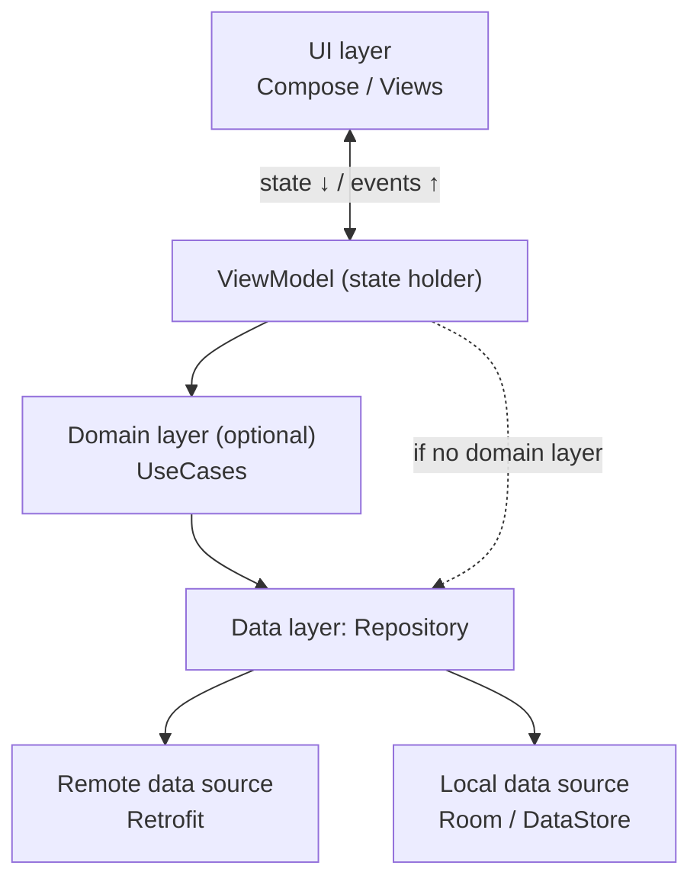
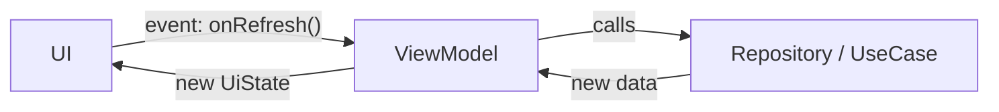
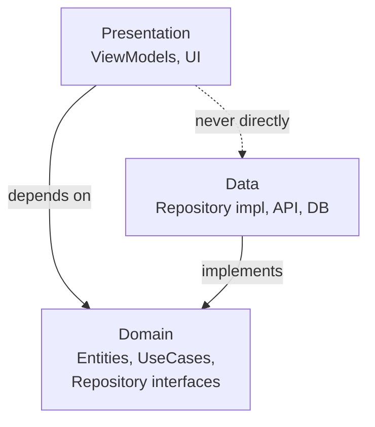
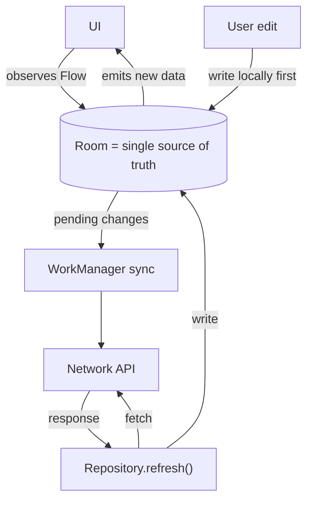

# App Architecture

[⬅ Back to index](../README.md)

Covers: MVC/MVP/MVVM/MVI, Google's recommended architecture, Clean Architecture, Repository pattern, UDF, UI state modelling, offline-first, modularization.

---

### 1. Why do we need an architecture pattern?

<details>
<summary>Answer</summary>

To get **separation of concerns**, **testability**, **maintainability** and **scalability** across a team. Without one, logic piles up in Activities ("god activities") that are tied to the lifecycle, hard to test and fragile under configuration changes and process death.

</details>

### 2. Explain MVC, MVP, MVVM and MVI.

<details>
<summary>Answer</summary>

- **MVC** – Model, View, Controller. On Android the Activity ends up being both View and Controller, which makes it bloated and hard to test.
- **MVP** – the **Presenter** holds the presentation logic and talks to the View through an **interface** (`view.showUsers()`). Testable, but it needs lots of interfaces, keeps a reference to the View (leak and lifecycle issues), and doesn't survive configuration changes.
- **MVVM** – the **ViewModel** exposes **observable state** (StateFlow/LiveData). The View observes and renders it. The ViewModel has **no reference to the View**, and it survives configuration changes. This is Google's recommended approach.
- **MVI** – Model-View-Intent. **Unidirectional** and strict: the user sends **Intents/Actions** → a reducer produces a new **immutable State** → the View renders the single state. Very predictable and easy to debug; more boilerplate.

</details>

### 3. MVP vs MVVM?

<details>
<summary>Answer</summary>

| MVP | MVVM |
|---|---|
| The Presenter **holds a View reference** (interface) | The ViewModel **doesn't know the View** |
| Imperative: `view.showLoading()` | Reactive: the View observes state |
| 1:1 Presenter-View relationship | One ViewModel can serve multiple views |
| Doesn't survive configuration changes by default | ViewModel survives configuration changes |
| More interfaces and boilerplate | Less boilerplate; lifecycle-aware observation |

</details>

### 4. MVVM vs MVI? Which do you prefer?

<details>
<summary>Answer</summary>

- **MVVM** often exposes **multiple** observable fields. Simple, flexible, but state can become inconsistent (e.g. loading = true and error != null at the same time).
- **MVI** has a **single immutable state** + **actions/intents** + a **reducer**. Predictable, easy to debug and log (time travel), and a natural fit for **Compose** (UI = f(state)).

In practice, most modern apps use "**MVVM with MVI ideas**": a ViewModel exposing a single `StateFlow<UiState>`, with event functions (or a sealed `UiAction`) as input. A good answer: "I pick based on screen complexity. Single state + UDF is the default."

</details>

### 5. What is Google's recommended app architecture?

<details>
<summary>Answer</summary>

Three layers:
1. **UI layer** – UI elements (Compose/Views) + **state holders** (ViewModels). Displays state and forwards events.
2. **Domain layer (optional)** – **UseCases** that encapsulate reusable or complex business logic.
3. **Data layer** – **Repositories** (expose data, resolve conflicts between sources, contain business logic about data) and **data sources** (network, database, DataStore, which only deal with one source each).



Principles: **separation of concerns**, **driving UI from data models**, **single source of truth (SSOT)**, **unidirectional data flow (UDF)**, **offline-first** where possible, dependency injection.

</details>

### 6. What is Unidirectional Data Flow (UDF)?

<details>
<summary>Answer</summary>

**State flows down, events flow up.**



`UI → event (onClick) → ViewModel → updates data/state → new UiState → UI renders`

The UI never modifies state directly. This gives **one source of truth**, consistent state, easier debugging and testability.

</details>

### 7. What is Clean Architecture? Explain the layers and the dependency rule.

<details>
<summary>Answer</summary>

Uncle Bob's architecture, which organizes code in concentric layers:
- **Domain (innermost)** – entities, **use cases**, repository **interfaces**. **Pure Kotlin**: no Android, no frameworks.
- **Data** – repository implementations, API/DB data sources, DTOs and mappers.
- **Presentation** – ViewModels and UI.



**Dependency rule:** dependencies point **inward only**. Domain knows nothing about data or presentation. Data implements domain interfaces (**Dependency Inversion**).

**Benefits:** testable business logic, framework independence, swappable data sources.
**Cost:** more boilerplate (mappers, use cases). Don't over-engineer small apps. Google's guide treats the domain layer as **optional**.

</details>

### 8. What is a UseCase / Interactor? When do you need one?

<details>
<summary>Answer</summary>

A class with **one business action**, often exposed with `operator fun invoke()`:

```kotlin
class GetSortedUsersUseCase @Inject constructor(private val repo: UserRepository) {
    operator fun invoke(): Flow<List<User>> = repo.users().map { it.sortedBy(User::name) }
}
```

Use one when logic is **reused across ViewModels**, when it **combines multiple repositories**, or when it's complex enough to deserve isolated tests. Avoid "pass-through" use cases that only call `repo.get()`. They add nothing.

</details>

### 9. What is the Repository pattern?

<details>
<summary>Answer</summary>

A repository is a **facade over data sources** (remote API, local DB, cache) that exposes clean data to the rest of the app. It decides **where data comes from** (cache policy), **maps DTOs to domain models**, handles syncing, and is the **single source of truth**.

```kotlin
class UserRepositoryImpl(private val api: UserApi, private val dao: UserDao) : UserRepository {
    override fun observeUsers(): Flow<List<User>> = dao.observeAll().map { it.toDomain() }
    override suspend fun refresh() { dao.upsertAll(api.getUsers().map { it.toEntity() }) }
}
```

</details>

### 10. What is a Single Source of Truth (SSOT)? What is offline-first?

<details>
<summary>Answer</summary>



- **SSOT** – each piece of data has exactly one owner that's allowed to modify it, and everything else observes it. Typically the **local database**.
- **Offline-first:** the UI **always reads from the DB** (Room Flow). The network only **refreshes the DB** (the network → DB → UI pattern). The app works without connectivity, and it's consistent.
- Writes: save locally first, then sync with **WorkManager** when online. Resolve conflicts with timestamps, versions or last-write-wins.

</details>

### 11. How do you model UI state?

<details>
<summary>Answer</summary>

**Option A – sealed interface** (mutually exclusive screen states):
```kotlin
sealed interface UiState {
    data object Loading : UiState
    data class Success(val items: List<Item>) : UiState
    data class Error(val message: String) : UiState
}
```

**Option B – a single data class** (when states overlap, e.g. showing data *and* a refreshing indicator):
```kotlin
data class FeedUiState(
    val items: List<Item> = emptyList(),
    val isRefreshing: Boolean = false,
    val userMessage: String? = null
)
```

Expose it as an immutable `StateFlow<UiState>` and update it with `_state.update { it.copy(...) }`.

</details>

### 12. Should a ViewModel know about Android classes (Context, Views)?

<details>
<summary>Answer</summary>

**No.** Never hold an Activity/Fragment/View/Context reference in a ViewModel. It **outlives** the Activity (configuration changes), so this **leaks memory**, and it makes unit testing harder. If you need resources or system services, inject an abstraction (a `StringProvider`, or a repository that uses the application context). `AndroidViewModel` (application context) works but is discouraged.

</details>

### 13. What is a mapper and why use separate models per layer?

<details>
<summary>Answer</summary>

**DTOs** (network, with `@SerialName`), **Entities** (Room, with `@Entity`) and **Domain models** (pure) are mapped with extension functions (`fun UserDto.toDomain()`). This decouples the layers: an API change doesn't ripple into the UI, and domain models stay free of framework annotations. The cost is boilerplate, so it's acceptable to share models in small apps.

</details>

### 14. What is modularization? Why and how?

<details>
<summary>Answer</summary>

Splitting the codebase into multiple Gradle modules.

**Benefits:** faster **incremental and parallel builds**, enforced boundaries (`internal`), team ownership, reusability, Play **Feature Delivery** (dynamic features), better testability.

**Common structure (Now in Android):**
- `:app` – wiring, navigation.
- `:feature:home`, `:feature:profile` – screens + ViewModels. **Features don't depend on each other.**
- `:core:data`, `:core:domain`, `:core:network`, `:core:database`, `:core:designsystem`, `:core:model`, `:core:testing`.

Use **convention plugins** (`build-logic`) and a **version catalog** to share build config. Use `api` vs `implementation` correctly.

</details>

### 15. How do feature modules navigate to each other without depending on each other?

<details>
<summary>Answer</summary>

- The **app module** owns the navigation graph and wires the features together. Features expose navigation functions or routes and accept callbacks (`onNavigateToDetail: (id) -> Unit`).
- Or create a shared `:core:navigation` module with route contracts, or use deep-link URIs.
- With DI, use interfaces defined in an API module (`:feature:profile:api`) and implemented in `:feature:profile:impl`.

</details>

### 16. Where would you put validation logic, formatting and business rules?

<details>
<summary>Answer</summary>

- **Business rules** (discount calculation, eligibility) → domain (UseCase) or repository.
- **Input validation** → UseCase or a validator class, called from the ViewModel.
- **Presentation formatting** (dates, currency for display) → ViewModel or UI mappers (UI state models).
- **UI logic** (show/hide, animations) → UI layer.

</details>

### 17. How would you architect an app to survive process death properly?

<details>
<summary>Answer</summary>

- Persistent data in **Room/DataStore** (SSOT).
- Screen inputs and important transient state (IDs, search query, form input) in **`SavedStateHandle`** inside the ViewModel, and `rememberSaveable` in Compose.
- Navigation arguments are restored automatically by Navigation.
- Reload data from the SSOT on restore. Test with `adb shell am kill`.

</details>

### 18. What architecture does your current app use? (How to answer)

<details>
<summary>Answer</summary>

Structure your answer:
1. **Pattern:** "MVVM with UDF; single `StateFlow<UiState>` per screen."
2. **Layers:** UI (Compose) → ViewModel → UseCases (where logic is shared) → Repository → Retrofit/Room.
3. **Tools:** Hilt, Coroutines/Flow, Room as SSOT, WorkManager for sync, Navigation.
4. **Modularization:** feature + core modules.
5. **Testing:** unit tests for ViewModels and UseCases with fakes, UI tests for critical flows.
6. **One trade-off or improvement** you made (e.g. "moved from LiveData to StateFlow", "introduced offline-first caching").

</details>

### 19. What are the drawbacks of Clean Architecture / over-engineering?

<details>
<summary>Answer</summary>

Lots of boilerplate (interfaces with a single implementation, pass-through use cases, triple models + mappers), slower development for small teams, and indirection that hurts readability. Apply it **pragmatically**: make the domain layer optional, and add abstractions when they bring real value (testing, multiple implementations, reuse).

</details>

### 20. What is the difference between architecture patterns and design patterns?

<details>
<summary>Answer</summary>

- **Architecture patterns** (MVVM, Clean, MVI) define the **high-level structure** of the whole app: layers, responsibilities, data flow.
- **Design patterns** (Singleton, Observer, Factory) solve **local, recurring design problems** within that structure.

</details>

---

[⬅ Previous: Jetpack Compose](11-jetpack-compose.md) · [⬅ Back to index](../README.md) · [Next: Jetpack Components ➡](13-jetpack-components.md)
