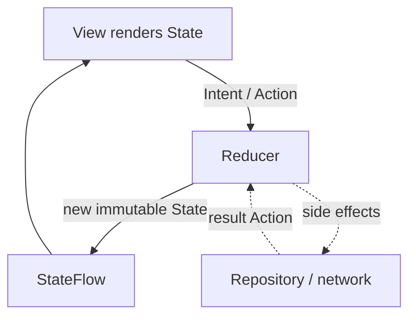
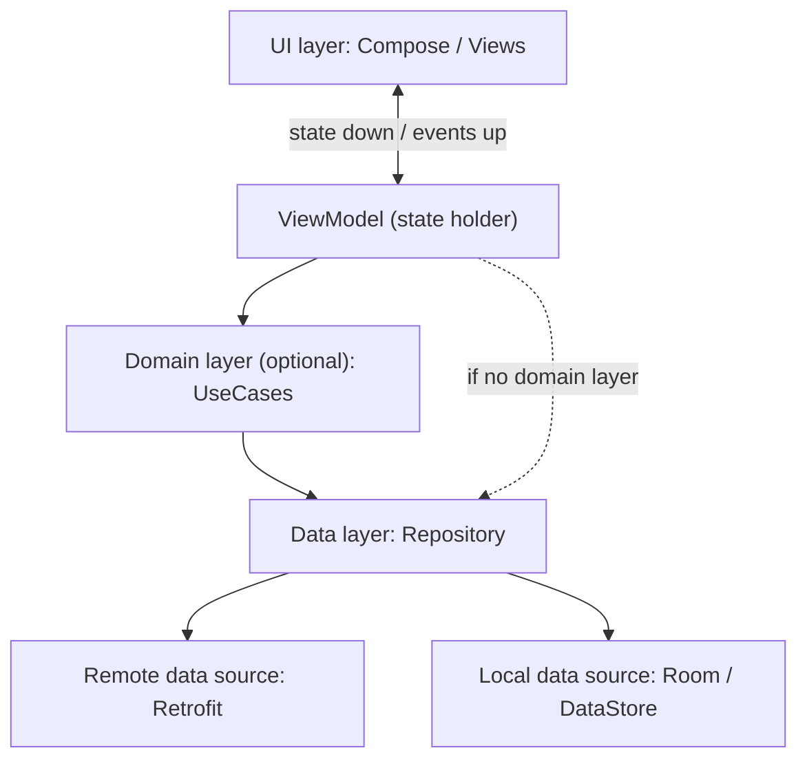
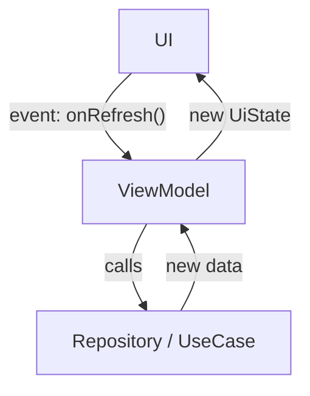
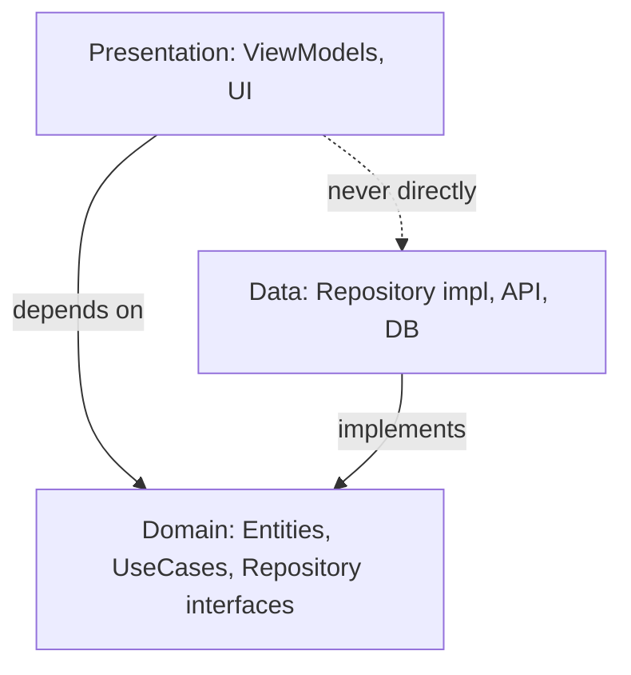
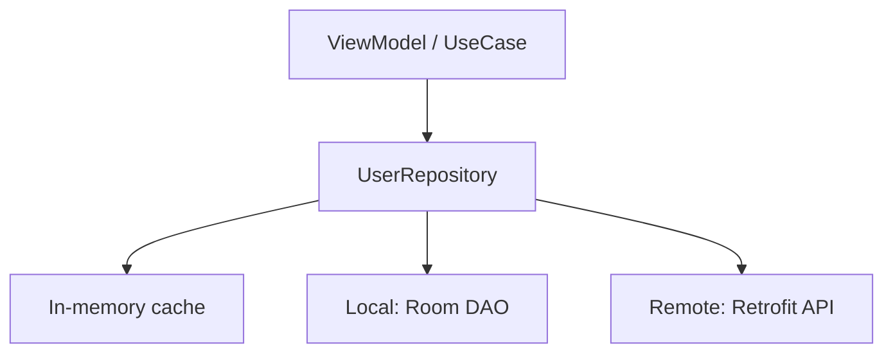
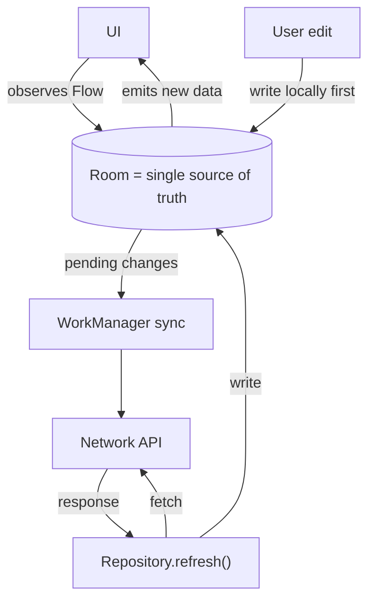
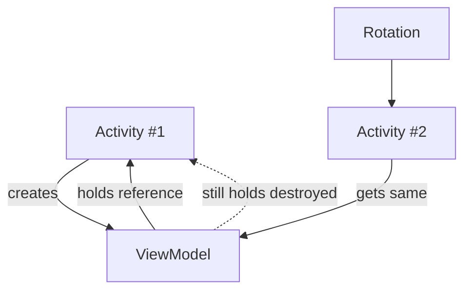
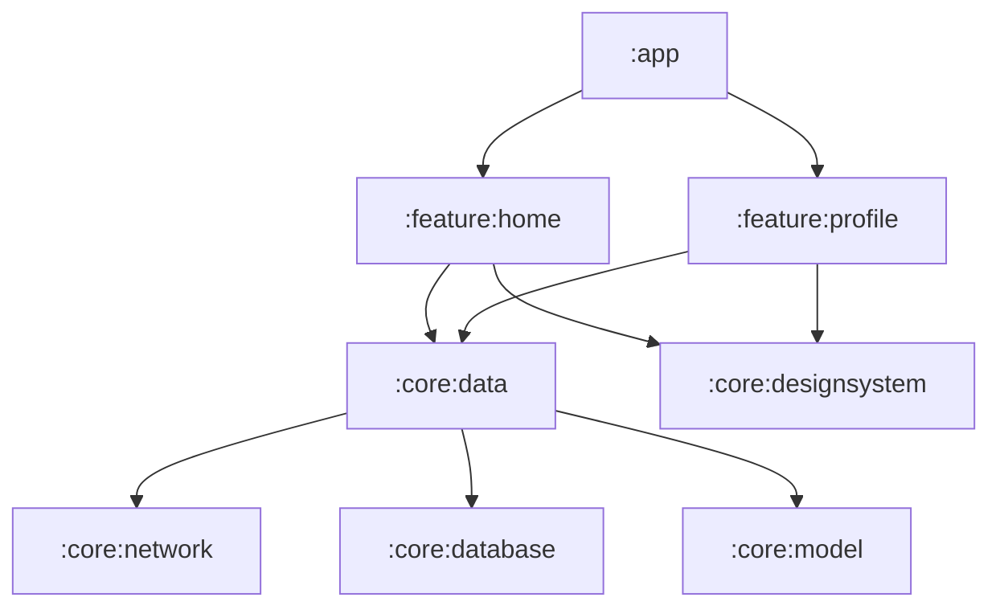
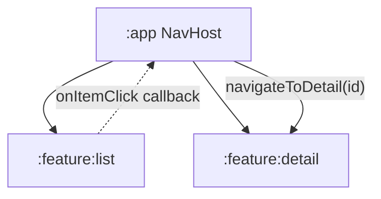
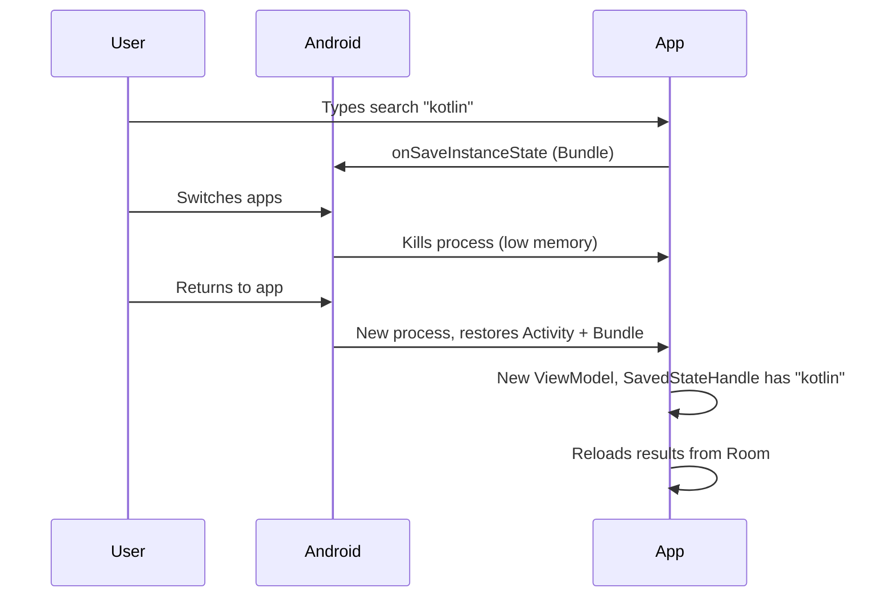

# App Architecture

[⬅ Back to index](../README.md)

Covers: MVC/MVP/MVVM/MVI, Google's recommended architecture, Clean Architecture, Repository pattern, UDF, UI state modelling, offline-first, modularization.

---

### 1. Why do we need an architecture pattern?

<details>
<summary>Answer</summary>

**In short:** An architecture pattern gives the code **separation of concerns**, which makes it **testable, maintainable and scalable** across a team. Without one, logic piles up in Activities ("god activities") that are tied to the lifecycle, hard to test, and fragile under configuration changes and process death.

#### The problem it solves

Android components such as `Activity` and `Fragment` are created and destroyed by the system. They get recreated on rotation, killed in the background, and restored later. If your network calls, business rules and state all live inside an Activity, then:

- **State is lost or duplicated** on rotation, because the Activity instance is thrown away.
- **Work leaks**: a callback that holds the Activity keeps it in memory after it is destroyed.
- **Testing needs a device or Robolectric**, because the logic can't be called without Android classes.
- **Changes are risky**: one 2,000-line file touched by five developers produces merge conflicts and regressions.

```kotlin
// "God activity": UI, networking, caching and rules all mixed together
class ProfileActivity : AppCompatActivity() {
    override fun onCreate(savedInstanceState: Bundle?) {
        super.onCreate(savedInstanceState)
        api.getUser(id).enqueue(object : Callback<UserDto> {      // refetched on every rotation
            override fun onResponse(call: Call<UserDto>, r: Response<UserDto>) {
                val user = r.body()!!
                if (user.age >= 18) showAdultBadge()               // business rule hidden in UI
                db.userDao().insert(user.toEntity())               // persistence in UI
                nameText.text = user.name                          // may crash if Activity is gone
            }
            override fun onFailure(call: Call<UserDto>, t: Throwable) { /* ... */ }
        })
    }
}
```

#### What a pattern gives you

| Goal | How architecture helps |
|---|---|
| Separation of concerns | Each class has one job: render, hold state, fetch data, apply rules |
| Testability | Business logic in plain Kotlin classes, tested with JVM unit tests and fakes |
| Lifecycle safety | State lives in a ViewModel or data layer that outlives the screen |
| Team scale | Clear boundaries let people work in parallel with fewer conflicts |
| Changeability | Swap Retrofit for Ktor, or Views for Compose, without rewriting everything |

A good analogy: a restaurant separates the waiter (UI), the kitchen (business logic) and the pantry (data). The waiter doesn't cook, and the kitchen doesn't care which table ordered.

**Likely follow-ups:**
- *Is architecture always worth it?* For a throwaway prototype, keep it light; for anything a team maintains, yes, but scale the ceremony to the app.
- *Which pattern do you use?* Usually MVVM with unidirectional data flow, following Google's app architecture guide.

</details>

### 2. Explain MVC, MVP, MVVM and MVI.

<details>
<summary>Answer</summary>

**In short:** All four separate the UI from logic; they differ in **who talks to the View and how**. MVC uses a Controller (on Android the Activity becomes both View and Controller). MVP uses a Presenter that calls the View through an interface. MVVM uses a ViewModel that exposes observable state the View subscribes to. MVI adds a single immutable state and a strict intent → reducer → state loop.

#### MVC (Model-View-Controller)

The Controller handles input, updates the Model, and the View reflects the Model. On Android there's no natural place for the Controller, so the Activity ends up as **both View and Controller**. That makes it bloated, lifecycle-bound and hard to unit test.

#### MVP (Model-View-Presenter)

The **Presenter** holds the presentation logic and talks to the View through an **interface**, so it can be tested with a fake View.

```kotlin
interface UsersView { fun showLoading(); fun showUsers(users: List<User>); fun showError(msg: String) }

class UsersPresenter(private val repo: UserRepository) {
    private var view: UsersView? = null
    fun attach(v: UsersView) { view = v }
    fun detach() { view = null }                  // forget this and you leak the Activity
    suspend fun load() {
        view?.showLoading()
        runCatching { repo.getUsers() }
            .onSuccess { view?.showUsers(it) }
            .onFailure { view?.showError(it.message.orEmpty()) }
    }
}
```

Downsides: lots of interfaces, the Presenter holds a View reference (leak and lifecycle risk), and it doesn't survive configuration changes unless you add extra machinery.

#### MVVM (Model-View-ViewModel)

The **ViewModel** exposes **observable state** (`StateFlow` or `LiveData`). The View observes and renders it. The ViewModel has **no reference to the View** and, as a Jetpack `ViewModel`, survives configuration changes. This is the approach Google's architecture guide recommends.

```kotlin
class UsersViewModel(private val repo: UserRepository) : ViewModel() {
    val users: StateFlow<List<User>> = repo.observeUsers()
        .stateIn(viewModelScope, SharingStarted.WhileSubscribed(5_000), emptyList())
}
```

#### MVI (Model-View-Intent)

Strictly **unidirectional**: the user sends **Intents/Actions** → a **reducer** combines the current state and the action into a **new immutable State** → the View renders that single state. Very predictable and easy to debug; more boilerplate.



| | Talks to View via | View reference? | Survives rotation | State shape |
|---|---|---|---|---|
| MVC | Activity is the Controller | Is the View | No | Scattered |
| MVP | Interface calls | Yes | No (by default) | Implicit in View |
| MVVM | Observable state | No | Yes (ViewModel) | One or more streams |
| MVI | Single state stream | No | Yes (ViewModel) | One immutable object |

**Likely follow-ups:**
- *Is MVI a replacement for MVVM?* Not really; on Android MVI is usually implemented on top of a ViewModel, so it's MVVM with stricter rules.
- *Why did the community move away from MVP?* Configuration-change handling and View-reference leaks; Jetpack ViewModel solved both.

</details>

### 3. MVP vs MVVM?

<details>
<summary>Answer</summary>

**In short:** In MVP the Presenter **holds a View interface and tells it what to do** (`view.showLoading()`). In MVVM the ViewModel **doesn't know the View**; it exposes state and the View observes it. MVVM with Jetpack ViewModel also survives configuration changes and needs less boilerplate.

| MVP | MVVM |
|---|---|
| The Presenter **holds a View reference** (interface) | The ViewModel **doesn't know the View** |
| Imperative: `view.showLoading()` | Reactive: the View observes state |
| 1:1 Presenter-View relationship | One ViewModel can serve multiple views |
| Doesn't survive configuration changes by default | ViewModel survives configuration changes |
| More interfaces and boilerplate | Less boilerplate; lifecycle-aware observation |

#### Why the direction of the reference matters

In MVP the Presenter pushes commands to the View. If an async call returns after the Activity is destroyed, the Presenter either calls a dead View (crash) or keeps it alive (leak), so you must `attach`/`detach` carefully. On rotation the Presenter is usually recreated and the in-flight request is lost.

In MVVM the dependency points one way: the View depends on the ViewModel, never the reverse. The ViewModel just updates a `StateFlow`. Whichever View is currently subscribed (the old Activity, the new one after rotation, or none) gets the latest value. Lifecycle-aware collection stops observing when the UI is in the background.

```kotlin
// MVVM: View side
lifecycleScope.launch {
    repeatOnLifecycle(Lifecycle.State.STARTED) {
        viewModel.uiState.collect { render(it) }   // re-subscribes after rotation, gets latest state
    }
}
```

#### Testing

Both are testable. In MVP you verify calls on a mock View (`verify(view).showUsers(...)`). In MVVM you assert on emitted state values, which tends to be simpler and closer to what the user sees.

**Pitfalls:**
- Making a ViewModel hold a View or "callback interface" to the Activity turns it back into MVP, with the leaks.
- Exposing `MutableStateFlow` publicly lets the View write state and breaks the one-way flow.

**Likely follow-ups:**
- *Can MVP survive rotation?* Yes, with retained fragments or by storing the Presenter in a ViewModel, but that's extra work MVVM gives you for free.
- *Does Compose favour one?* Compose is state-driven (UI = f(state)), which fits MVVM/MVI naturally.

</details>

### 4. MVVM vs MVI? Which do you prefer?

<details>
<summary>Answer</summary>

**In short:** Classic MVVM often exposes **several** observable fields, which is simple but can let state become inconsistent. MVI uses a **single immutable state**, **actions/intents** as input and a **reducer**, which is predictable and fits Compose. In practice I use "**MVVM with MVI ideas**": a ViewModel with one `StateFlow<UiState>` and event functions or a sealed `UiAction`, and I pick the strictness based on screen complexity.

#### The inconsistency problem with multiple streams

```kotlin
// Classic MVVM: three independent streams
val isLoading = MutableLiveData(false)
val items = MutableLiveData<List<Item>>()
val error = MutableLiveData<String?>()
// Nothing stops isLoading = true AND error != null at the same time,
// and the View can observe them in any order, rendering half-updated screens.
```

#### MVI-style single state

```kotlin
data class SearchUiState(
    val query: String = "",
    val results: List<Item> = emptyList(),
    val isLoading: Boolean = false,
    val error: String? = null,
)

sealed interface SearchAction {
    data class QueryChanged(val q: String) : SearchAction
    data object Retry : SearchAction
}

class SearchViewModel(private val repo: SearchRepository) : ViewModel() {
    private val _state = MutableStateFlow(SearchUiState())
    val state: StateFlow<SearchUiState> = _state.asStateFlow()

    fun onAction(action: SearchAction) = when (action) {
        is SearchAction.QueryChanged -> { _state.update { it.copy(query = action.q) }; search() }
        SearchAction.Retry -> search()
    }

    private fun search() = viewModelScope.launch {
        _state.update { it.copy(isLoading = true, error = null) }
        runCatching { repo.search(_state.value.query) }
            .onSuccess { r -> _state.update { it.copy(isLoading = false, results = r) } }
            .onFailure { e -> _state.update { it.copy(isLoading = false, error = e.message) } }
    }
}
```

Every change is an atomic `copy`, so the View always sees a consistent snapshot. Logging every action and resulting state gives you a clear audit trail ("time travel" debugging).

| | MVVM (multi-stream) | MVI (single state + reducer) |
|---|---|---|
| Boilerplate | Low | Higher (actions, reducer, effects) |
| Consistency | Can drift | Guaranteed per snapshot |
| Debugging | Harder to reconstruct | Log action → state |
| Compose fit | OK | Natural (UI = f(state)) |
| Best for | Simple screens | Complex, interactive screens |

**Pitfalls:**
- Full MVI frameworks for a two-field settings screen add ceremony without benefit.
- Putting one-off events (navigate, show snackbar) in a replaying state stream can re-trigger them after rotation; model them as state that the UI consumes and clears, as Google's guide suggests.

**Likely follow-ups:**
- *How do you handle one-time events?* Prefer representing them in state and clearing after handling; a `Channel` is a common alternative but can drop events if no one is collecting.
- *Is a single huge state a performance issue in Compose?* Not usually; Compose skips composables whose inputs didn't change, especially with stable/immutable types.

</details>

### 5. What is Google's recommended app architecture?

<details>
<summary>Answer</summary>

**In short:** Three layers: a **UI layer** (UI elements plus state holders like ViewModels), an **optional domain layer** (UseCases for reusable or complex business logic), and a **data layer** (repositories and data sources). It's built on separation of concerns, driving UI from data models, a single source of truth, unidirectional data flow and dependency injection.

1. **UI layer** – UI elements (Compose/Views) + **state holders** (ViewModels). Displays state and forwards events.
2. **Domain layer (optional)** – **UseCases** that encapsulate reusable or complex business logic.
3. **Data layer** – **Repositories** (expose data, resolve conflicts between sources, contain business logic about data) and **data sources** (network, database, DataStore, which each deal with only one source).



#### Key principles

- **Separation of concerns**: Activities and composables only render and forward events.
- **Drive UI from data models**: preferably persistent ones, so the app keeps working after process death and offline.
- **Single source of truth (SSOT)**: each data type has one owner (often the repository backed by Room).
- **Unidirectional data flow (UDF)**: state flows down, events flow up.
- **Offline-first** where possible, and **dependency injection** (Hilt recommended) to wire layers.

#### Conventions in the guide

- Layers above depend on layers below, never the reverse.
- Data is exposed as `Flow` for streams and `suspend` functions for one-shot operations.
- Repositories are the entry point to the data layer; ViewModels don't call Retrofit or DAOs directly.
- Naming: `NewsRepository`, `NewsRemoteDataSource`, `GetLatestNewsWithAuthorsUseCase`.

```kotlin
@HiltViewModel
class NewsViewModel @Inject constructor(
    getNews: GetLatestNewsWithAuthorsUseCase,
) : ViewModel() {
    val uiState: StateFlow<NewsUiState> = getNews()
        .map { NewsUiState.Success(it) as NewsUiState }
        .catch { emit(NewsUiState.Error(it.message)) }
        .stateIn(viewModelScope, SharingStarted.WhileSubscribed(5_000), NewsUiState.Loading)
}
```

**Likely follow-ups:**
- *How does this differ from Clean Architecture?* Clean puts the domain at the centre and has the data layer depend on domain interfaces; Google's layering is simpler, the domain layer is optional, and it can depend directly on the data layer.
- *When add the domain layer?* When logic is reused across ViewModels or combines several repositories.

</details>

### 6. What is Unidirectional Data Flow (UDF)?

<details>
<summary>Answer</summary>

**In short:** **State flows down, events flow up.** The UI renders state it receives and sends user events to a state holder (the ViewModel); only the state holder changes state, and the new state flows back down to the UI. The UI never mutates state directly.



`UI → event (onClick) → ViewModel → updates data/state → new UiState → UI renders`

#### Why it matters

With two-way flow, the UI and the ViewModel can both change the same data, and you can't tell which update "won". With UDF:

- There is **one owner** of each piece of state, so it's always consistent.
- **Debugging** is easy: every change starts from a known event.
- **Testing** is easy: send an event to the ViewModel, assert on the state it emits.
- It matches **Compose**, where the UI is a function of state.

#### In code

```kotlin
// State holder
class CounterViewModel : ViewModel() {
    private val _count = MutableStateFlow(0)
    val count: StateFlow<Int> = _count.asStateFlow()   // read-only to the UI
    fun onIncrement() = _count.update { it + 1 }       // event in
}

// UI: renders state, forwards events
@Composable
fun CounterScreen(vm: CounterViewModel = viewModel()) {
    val count by vm.count.collectAsStateWithLifecycle()
    Counter(count = count, onIncrement = vm::onIncrement)
}

@Composable
fun Counter(count: Int, onIncrement: () -> Unit) {     // stateless, easy to preview and test
    Button(onClick = onIncrement) { Text("Count: $count") }
}
```

The same idea applies inside Compose as **state hoisting**: a stateless composable takes `value` and `onValueChange`, and the caller owns the state.

**Pitfalls:**
- Exposing `MutableStateFlow` publicly; the UI can then write state and bypass the flow.
- Keeping a copy of the state in the UI and editing it locally, creating two sources of truth.

**Likely follow-ups:**
- *Is UDF the same as MVI?* MVI is one strict implementation of UDF; MVVM with a single state is also UDF.
- *Where does UDF appear in Compose?* State hoisting: state goes down as parameters, events go up as lambdas.

</details>

### 7. What is Clean Architecture? Explain the layers and the dependency rule.

<details>
<summary>Answer</summary>

**In short:** Clean Architecture (Robert C. Martin, "Uncle Bob") organizes code in concentric layers with the **business logic at the centre**. On Android this is usually **Domain** (entities, use cases, repository interfaces, pure Kotlin), **Data** (repository implementations, APIs, DB) and **Presentation** (ViewModels, UI). The **dependency rule**: source-code dependencies point **inward only**, so the domain knows nothing about frameworks.

#### The layers

- **Domain (innermost)** – entities, **use cases**, repository **interfaces**. **Pure Kotlin**: no Android, no Retrofit, no Room.
- **Data** – repository implementations, API/DB data sources, DTOs and mappers.
- **Presentation** – ViewModels and UI.



#### The dependency rule and Dependency Inversion

Normally a use case would need the repository, which needs Retrofit, so the domain would depend on the network library. Clean Architecture flips this: the domain **declares the interface it needs**, and the data layer **implements it**. That's the Dependency Inversion Principle.

```kotlin
// :domain (pure Kotlin module)
data class Order(val id: String, val total: Double)
interface OrderRepository { suspend fun getOrders(): List<Order> }

class GetHighValueOrdersUseCase(private val repo: OrderRepository) {
    suspend operator fun invoke() = repo.getOrders().filter { it.total > 100 }
}

// :data (depends on :domain)
class OrderRepositoryImpl(private val api: OrderApi) : OrderRepository {
    override suspend fun getOrders() = api.fetchOrders().map { it.toDomain() }
}

// DI (Hilt) binds the interface to the implementation
@Module @InstallIn(SingletonComponent::class)
abstract class DataModule {
    @Binds abstract fun bindOrders(impl: OrderRepositoryImpl): OrderRepository
}
```

If you replace Retrofit with Ktor, only `:data` changes. Use cases can be unit tested with a fake `OrderRepository` and no Android at all.

#### Benefits and cost

**Benefits:** testable business logic, framework independence, swappable data sources, clear boundaries enforced by modules.

**Cost:** more boilerplate (interfaces, mappers, use cases). Don't over-engineer small apps. Google's guide treats the domain layer as **optional**, and in Google's layering the domain can depend on the data layer directly, which is the main difference from strict Clean.

**Pitfalls:**
- Importing `android.*` or Room annotations into the domain module breaks the rule; making `:domain` a pure Kotlin/JVM module enforces it at compile time.
- Treating "Clean" as "three folders" without the dependency direction misses the point.

**Likely follow-ups:**
- *What are entities?* Core business objects and rules that would exist even without the app.
- *Where does the ViewModel live?* Presentation; it depends on use cases (domain), never on data implementations.

</details>

### 8. What is a UseCase / Interactor? When do you need one?

<details>
<summary>Answer</summary>

**In short:** A UseCase (or Interactor) is a small class that performs **one business action**, often exposed through `operator fun invoke()`. Add one when logic is **reused across ViewModels**, **combines multiple repositories**, or is complex enough to deserve isolated tests. Skip "pass-through" use cases that just call `repo.get()`.

```kotlin
class GetSortedUsersUseCase @Inject constructor(private val repo: UserRepository) {
    operator fun invoke(): Flow<List<User>> = repo.users().map { it.sortedBy(User::name) }
}

// Called like a function from the ViewModel
val users = getSortedUsers()
```

#### Why they exist

ViewModels should handle presentation; repositories should handle data. Business rules that sit in between (combining data, applying policy) need a home, otherwise they get copy-pasted into several ViewModels. A use case gives that logic a **name**, a **single responsibility**, and a place to test it.

#### A use case that earns its keep

```kotlin
class GetCheckoutSummaryUseCase @Inject constructor(
    private val cartRepo: CartRepository,
    private val userRepo: UserRepository,
    private val promoRepo: PromoRepository,
    @DefaultDispatcher private val dispatcher: CoroutineDispatcher,
) {
    operator fun invoke(): Flow<CheckoutSummary> =
        combine(cartRepo.items(), userRepo.currentUser(), promoRepo.activePromos()) { items, user, promos ->
            val subtotal = items.sumOf { it.price * it.qty }
            val discount = promos.bestFor(user, subtotal)
            CheckoutSummary(subtotal, discount, subtotal - discount)
        }.flowOn(dispatcher)
}
```

It combines three repositories, applies a business rule, moves the work off the main thread, and is used by both the cart and checkout screens.

#### Pass-through use case (avoid)

```kotlin
class GetUserUseCase(private val repo: UserRepository) {
    suspend operator fun invoke(id: String) = repo.getUser(id)   // adds a class, no value
}
```

Some teams keep these for consistency ("ViewModels only talk to use cases"). That's a team decision; be ready to justify either side.

**Pitfalls:**
- Use cases holding mutable state; they should be stateless so they can be reused safely.
- Huge "Manager" use cases that do ten things; keep one action per class.

**Likely follow-ups:**
- *Should use cases be main-safe?* Yes; move heavy work to an appropriate dispatcher inside them so callers don't have to.
- *Can a use case call another use case?* Yes, composing them is fine and avoids duplication.

</details>

### 9. What is the Repository pattern?

<details>
<summary>Answer</summary>

**In short:** A repository is a **facade over data sources** (remote API, local DB, cache) that exposes clean data to the rest of the app. It decides **where data comes from** (cache policy), **maps DTOs to domain models**, handles syncing and conflicts, and acts as the **single source of truth** for that data type.

```kotlin
class UserRepositoryImpl(private val api: UserApi, private val dao: UserDao) : UserRepository {
    override fun observeUsers(): Flow<List<User>> = dao.observeAll().map { it.toDomain() }
    override suspend fun refresh() { dao.upsertAll(api.getUsers().map { it.toEntity() }) }
}
```

#### Why it exists

Without a repository, ViewModels would call Retrofit and Room directly, each deciding on caching and error handling in its own way. The repository centralizes that, so:

- Callers ask "give me users" and don't care whether they come from memory, disk or network.
- You can change the caching strategy or the API library in one place.
- Tests replace the repository with a fake that returns canned data.



#### Typical responsibilities

| Responsibility | Example |
|---|---|
| Expose data | `Flow<List<User>>` for streams, `suspend fun` for one-shot calls |
| Choose source | Read from Room; refresh from network if stale |
| Map models | `UserDto` → `UserEntity` → `User` |
| Handle concurrency | Use a `Mutex` to avoid duplicate refreshes |
| Be main-safe | Do I/O on `Dispatchers.IO` internally |

```kotlin
class NewsRepository(
    private val remote: NewsRemoteDataSource,
    private val local: NewsLocalDataSource,
    private val clock: Clock,
) {
    private val refreshMutex = Mutex()

    fun observeNews(): Flow<List<Article>> = local.observe()

    suspend fun refreshIfStale(maxAge: Duration) = refreshMutex.withLock {
        if (clock.now() - local.lastUpdated() > maxAge) {
            local.replaceAll(remote.fetchLatest())
        }
    }
}
```

**Pitfalls:**
- Exposing DTOs or Room entities from the repository leaks data-layer details into the UI.
- Creating repositories per screen instead of per data type ("ProfileScreenRepository"); repositories are organized around data.

**Likely follow-ups:**
- *Repository vs data source?* A data source wraps exactly one source (one API, one DAO); the repository coordinates several.
- *Should the repository be a singleton?* Usually yes (scoped in DI), since it often holds caches and mutexes that must be shared.

</details>

### 10. What is a Single Source of Truth (SSOT)? What is offline-first?

<details>
<summary>Answer</summary>

**In short:** **SSOT** means each piece of data has exactly **one owner** that's allowed to modify it, and everything else observes it; on Android this is typically the **local database**. **Offline-first** means the UI **always reads from that local DB**, the network only **refreshes the DB**, and local writes are synced later (for example with WorkManager), so the app works without connectivity.



#### Why SSOT

If the UI shows data from the network response *and* from the database, the two can disagree. With an SSOT, every screen observes the same Room `Flow`; when the data changes, all observers update together. Only the repository writes to the DB, so changes are centralized and easy to reason about.

#### Offline-first reads (network → DB → UI)

```kotlin
class ArticleRepository(private val api: ArticleApi, private val dao: ArticleDao) {
    fun observeArticles(): Flow<List<Article>> =
        dao.observeAll().map { list -> list.map { it.toDomain() } }   // UI always reads the DB

    suspend fun refresh() {
        val fresh = api.getArticles()                                 // may throw when offline
        dao.upsertAll(fresh.map { it.toEntity() })                    // DB emits, UI updates
    }
}
```

If `refresh()` fails, the user still sees the cached data, and you show a non-blocking error.

#### Offline-first writes

1. Write the change locally, marked as pending (a `syncStatus` column or a separate outbox table).
2. Enqueue a `WorkManager` job with a network constraint.
3. The worker pushes pending changes and marks them synced.
4. Resolve conflicts with timestamps, version numbers or last-write-wins, depending on the domain.

```kotlin
suspend fun addNote(note: Note) {
    dao.insert(note.toEntity(syncStatus = SyncStatus.PENDING))
    val request = OneTimeWorkRequestBuilder<SyncWorker>()
        .setConstraints(Constraints(requiredNetworkType = NetworkType.CONNECTED))
        .build()
    workManager.enqueueUniqueWork("sync", ExistingWorkPolicy.KEEP, request)
}
```

**Pitfalls:**
- Emitting network results directly to the UI and also saving them, which causes double emissions and two sources of truth.
- Ignoring conflicts: two devices editing the same record offline need an explicit strategy.

**Likely follow-ups:**
- *How do you know data is stale?* Store a `lastUpdated` timestamp per dataset and refresh past a threshold or on pull-to-refresh.
- *Why WorkManager for sync?* It persists work across app restarts and reboots and respects constraints like network availability.

</details>

### 11. How do you model UI state?

<details>
<summary>Answer</summary>

**In short:** Use a **sealed interface** when screen states are mutually exclusive (Loading / Success / Error), or a **single data class** when states overlap (showing data while refreshing, with an optional message). Expose it as an immutable `StateFlow<UiState>` from the ViewModel and update it atomically with `_state.update { it.copy(...) }`.

**Option A – sealed interface** (mutually exclusive screen states):

```kotlin
sealed interface UiState {
    data object Loading : UiState
    data class Success(val items: List<Item>) : UiState
    data class Error(val message: String) : UiState
}
```

The compiler forces the UI to handle every case in a `when`, and impossible combinations (loading *and* error) can't be represented.

**Option B – a single data class** (when states overlap, e.g. showing data *and* a refreshing indicator):

```kotlin
data class FeedUiState(
    val items: List<Item> = emptyList(),
    val isRefreshing: Boolean = false,
    val userMessage: String? = null
)
```

**Hybrid** is common: a data class with shared fields plus a sealed property for the main content.

#### Exposing and updating

```kotlin
class FeedViewModel(private val repo: FeedRepository) : ViewModel() {
    private val _state = MutableStateFlow(FeedUiState())
    val state: StateFlow<FeedUiState> = _state.asStateFlow()

    fun refresh() = viewModelScope.launch {
        _state.update { it.copy(isRefreshing = true) }
        runCatching { repo.refresh() }
            .onFailure { e -> _state.update { it.copy(userMessage = e.message) } }
        _state.update { it.copy(isRefreshing = false) }
    }

    fun messageShown() = _state.update { it.copy(userMessage = null) }  // UI consumes the event
}
```

`update {}` is atomic (compare-and-set), so concurrent coroutines don't overwrite each other's changes the way `_state.value = _state.value.copy(...)` can.

You can also derive state from repository flows with `combine(...).stateIn(...)` instead of a mutable flow, which keeps the state always in sync with the source.

| | Sealed interface | Data class |
|---|---|---|
| Impossible states | Prevented | Possible, needs care |
| Overlapping states | Awkward | Natural |
| Exhaustive `when` | Yes | No |
| Good for | Initial load screens | Feeds, forms, refreshable lists |

**Pitfalls:**
- Using mutable collections (`MutableList`) in state; changes won't trigger emission and Compose can't treat them as stable.
- Passing raw `Throwable`s or Android `Context`-dependent strings into state; map to UI-ready messages or resource IDs.

**Likely follow-ups:**
- *Why `StateFlow` over `LiveData`?* It's Kotlin-first, always has a value, works with coroutine operators, and has no Android dependency.
- *What does `WhileSubscribed(5_000)` do?* Keeps the upstream active for 5 seconds after the last collector leaves, so a rotation doesn't restart it.

</details>

### 12. Should a ViewModel know about Android classes (Context, Views)?

<details>
<summary>Answer</summary>

**In short:** **No.** Never hold an Activity, Fragment, View or Activity Context in a ViewModel. The ViewModel **outlives** the Activity across configuration changes, so the reference **leaks memory**, and Android dependencies make unit testing harder. If you need resources or system services, inject an abstraction or use the application context in the data layer.

#### Why it leaks



After rotation, Activity #1 is destroyed, but the ViewModel still references it, so its whole view hierarchy can't be garbage collected. Lint flags `Context` fields in ViewModels for this reason.

#### What to do instead

```kotlin
// Wrong
class ProfileViewModel(private val context: Context) : ViewModel() {
    fun title() = context.getString(R.string.profile_title)
}

// Better: abstraction backed by the application context, injected by Hilt
interface StringProvider { fun get(@StringRes id: Int, vararg args: Any): String }

class AndroidStringProvider @Inject constructor(
    @ApplicationContext private val ctx: Context
) : StringProvider {
    override fun get(id: Int, vararg args: Any) = ctx.getString(id, *args)
}

// Often best: expose the resource ID and let the UI resolve it
data class ProfileUiState(@StringRes val errorRes: Int? = null)
```

Resolving strings in the UI also handles locale changes correctly, because the UI re-reads resources after a configuration change while a cached string in the ViewModel would be stale.

For system services (location, connectivity), wrap them in a repository or data source that uses the application context and inject that.

`AndroidViewModel` gives you the `Application`, which doesn't leak, but it couples the ViewModel to Android and makes JVM tests harder, so it's discouraged in favour of injection.

**Pitfalls:**
- Passing a View or an Activity callback into a ViewModel "just for navigation"; expose navigation as state or events instead.
- Holding a `LifecycleOwner` or a `Fragment` in the ViewModel for the same leak reasons.

**Likely follow-ups:**
- *Is application context safe?* It doesn't leak, but it can't inflate themed UI and doesn't reflect Activity configuration.
- *How do you test a ViewModel that needs strings?* Inject a fake `StringProvider`, or assert on resource IDs.

</details>

### 13. What is a mapper and why use separate models per layer?

<details>
<summary>Answer</summary>

**In short:** Each layer has its own model: **DTOs** for the network (with `@SerialName`), **Entities** for Room (with `@Entity`), and pure **Domain models**. **Mappers**, usually extension functions like `fun UserDto.toDomain()`, convert between them. This decouples the layers so an API or schema change doesn't ripple into the UI, and it keeps domain models free of framework annotations. The cost is boilerplate, so sharing models in small apps is acceptable.

```kotlin
// Network (data layer)
@Serializable
data class UserDto(
    @SerialName("user_id") val id: String,
    @SerialName("full_name") val name: String,
    @SerialName("avatar_url") val avatar: String?,
)

// Database (data layer)
@Entity(tableName = "users")
data class UserEntity(@PrimaryKey val id: String, val name: String, val avatarUrl: String?)

// Domain (pure Kotlin)
data class User(val id: String, val name: String, val avatarUrl: String?)

// Mappers
fun UserDto.toEntity() = UserEntity(id = id, name = name, avatarUrl = avatar)
fun UserEntity.toDomain() = User(id = id, name = name, avatarUrl = avatarUrl)
```

#### Why separate models

- **API changes are contained.** If the backend renames `full_name` to `name`, only `UserDto` and its mapper change.
- **Each model fits its job.** Room may need flattened fields or extra columns (`lastSyncedAt`); the API may send nested JSON; the UI wants something display-ready.
- **The domain stays pure**, so it can live in a Kotlin-only module.
- **Nullability is cleaned up at the boundary.** DTOs are defensive (nullable everything); mappers apply defaults so the rest of the app gets non-null values.

There is often a fourth model, a **UI model** (`UserItemUiState`), with formatted values such as `"Joined 3 days ago"`.

#### Where mappers live

Put mappers in the layer that owns the "outer" type: DTO and entity mappers in the data layer, UI mappers in the presentation layer. The domain shouldn't know DTOs exist.

**Pitfalls:**
- Mapping on the main thread for large lists; do it inside the repository on a background dispatcher.
- Mappers with business logic; keep them dumb conversions.

**Likely follow-ups:**
- *Extension functions or mapper classes?* Extension functions are simplest; injectable mapper classes help when mapping needs dependencies (a clock, a formatter).
- *When is one shared model fine?* Small apps where the API shape and the UI shape are almost the same and won't change independently.

</details>

### 14. What is modularization? Why and how?

<details>
<summary>Answer</summary>

**In short:** Modularization is splitting the codebase into **multiple Gradle modules**. It gives faster incremental and parallel builds, enforced boundaries (`internal`), team ownership, reuse, Play Feature Delivery and better testability. A common structure (Now in Android) is `:app`, independent `:feature:*` modules, and shared `:core:*` modules, with build config shared through **convention plugins** and a **version catalog**.

#### Why

- **Faster builds**: Gradle only recompiles changed modules and their dependents, and compiles independent modules in parallel.
- **Enforced boundaries**: `internal` classes are invisible outside their module, so features can't reach into each other's internals.
- **Ownership**: teams own modules; code review and CODEOWNERS map cleanly.
- **Reuse and testing**: core modules can be tested in isolation and reused across apps.
- **Play Feature Delivery**: dynamic feature modules can be downloaded on demand.

#### Common structure (Now in Android)

- `:app` – wiring, navigation.
- `:feature:home`, `:feature:profile` – screens + ViewModels. **Features don't depend on each other.**
- `:core:data`, `:core:domain`, `:core:network`, `:core:database`, `:core:designsystem`, `:core:model`, `:core:testing`.



#### How

- **Convention plugins** in a `build-logic` included build hold shared Gradle setup (compile SDK, Kotlin options, Compose, Hilt), so each module's `build.gradle.kts` is a few lines.
- A **version catalog** (`gradle/libs.versions.toml`) centralizes dependency versions.
- Use `implementation` by default and `api` only when a module's public API exposes types from that dependency. `api` leaks the dependency to consumers and widens recompilation.

```kotlin
// feature/profile/build.gradle.kts
plugins {
    alias(libs.plugins.myapp.android.feature)   // convention plugin: android library + compose + hilt
}
dependencies {
    implementation(projects.core.data)
    implementation(projects.core.designsystem)
}
```

**Pitfalls:**
- Splitting too early or too fine; dozens of tiny modules add configuration time and overhead.
- A giant `:core:common` that everything depends on, which recreates the monolith.
- Feature-to-feature dependencies, which create cycles and coupling.

**Likely follow-ups:**
- *Layer-based or feature-based modules?* Feature-based for UI, layer/core modules for shared infrastructure; most apps combine both.
- *How do features navigate without depending on each other?* The app module wires them together (see the next question).

</details>

### 15. How do feature modules navigate to each other without depending on each other?

<details>
<summary>Answer</summary>

**In short:** The **app module** owns the navigation graph and wires features together: each feature exposes its routes/destinations and accepts navigation callbacks like `onNavigateToDetail: (id) -> Unit`. Alternatives are a shared `:core:navigation` module of route contracts, deep-link URIs, or API/impl module pairs connected by DI.

#### Approach 1: app module wires callbacks (Now in Android style)

```kotlin
// :feature:list  (knows nothing about :feature:detail)
@Serializable data object ListRoute

fun NavGraphBuilder.listScreen(onItemClick: (String) -> Unit) {
    composable<ListRoute> { ListScreen(onItemClick = onItemClick) }
}

// :feature:detail
@Serializable data class DetailRoute(val id: String)

fun NavController.navigateToDetail(id: String) = navigate(DetailRoute(id))
fun NavGraphBuilder.detailScreen() { composable<DetailRoute> { DetailScreen() } }

// :app  (depends on both features)
NavHost(navController, startDestination = ListRoute) {
    listScreen(onItemClick = { id -> navController.navigateToDetail(id) })
    detailScreen()
}
```



Features stay independent and testable; the app decides what happens on click.

#### Approach 2: shared route contracts

A `:core:navigation` module defines route types; features depend on it, not on each other. Simple, but the module can grow into a coupling point.

#### Approach 3: deep-link URIs

Navigate with `navController.navigate(Uri.parse("myapp://profile/42"))`. Fully decoupled, but routes are strings, so you lose compile-time checks.

#### Approach 4: API/impl split with DI

`:feature:profile:api` holds an interface (`ProfileNavigator`, or a route), `:feature:profile:impl` implements it, and DI binds them. Other features depend only on the small `:api` module. This scales well in very large apps because changes to `:impl` don't recompile consumers.

| Approach | Coupling | Type safety | Best for |
|---|---|---|---|
| App wires callbacks | Lowest | Yes | Most apps |
| Shared routes module | Medium | Yes | Medium apps |
| Deep links | Lowest | No | Cross-app links, dynamic features |
| API/impl + DI | Low | Yes | Large multi-team apps |

**Likely follow-ups:**
- *How do you pass results back?* Through the previous back stack entry's `SavedStateHandle`, or via shared data in the data layer.
- *Why not let features depend on each other?* It creates cycles and recompiles one feature whenever the other changes.

</details>

### 16. Where would you put validation logic, formatting and business rules?

<details>
<summary>Answer</summary>

**In short:** **Business rules** (pricing, eligibility) go in the domain layer (UseCases) or the repository. **Input validation** goes in a UseCase or validator class called from the ViewModel. **Presentation formatting** (display dates, currency) goes in the ViewModel or UI-state mappers. **Pure UI logic** (show/hide, animations) stays in the UI layer.

- **Business rules** (discount calculation, eligibility) → domain (UseCase) or repository.
- **Input validation** → UseCase or a validator class, called from the ViewModel.
- **Presentation formatting** (dates, currency for display) → ViewModel or UI mappers (UI state models).
- **UI logic** (show/hide, animations) → UI layer.

#### The test: "who else needs this?"

- If the rule must hold no matter which screen triggers it (or even on the backend), it's **business logic**, so put it in the domain/data layers where it can be reused and tested without UI.
- If it only exists because of how this screen looks, it's **UI logic**.

#### Example: sign-up form

```kotlin
// Domain: reusable, pure Kotlin, easy to unit test
class ValidateEmailUseCase {
    operator fun invoke(email: String): ValidationResult = when {
        email.isBlank() -> ValidationResult.Error(EmailError.Empty)
        !EMAIL_REGEX.matches(email) -> ValidationResult.Error(EmailError.Invalid)
        else -> ValidationResult.Ok
    }
    private companion object { val EMAIL_REGEX = Regex("^[^@\\s]+@[^@\\s]+\\.[^@\\s]+$") }
}

// ViewModel: calls the validator, maps the result to UI state
fun onEmailChanged(value: String) {
    val result = validateEmail(value)
    _state.update {
        it.copy(email = value, emailErrorRes = (result as? ValidationResult.Error)?.toStringRes())
    }
}

// UI: decides how the error looks (red outline, shake animation)
OutlinedTextField(value = state.email, onValueChange = vm::onEmailChanged, isError = state.emailErrorRes != null)
```

#### Formatting

Formatting a `BigDecimal` price as `"$12.50"` or an `Instant` as `"3 days ago"` is presentation work. Do it in a UI-state mapper in the ViewModel (testable) or in the composable when it depends on locale/resources. Don't format in the repository, because then other features get strings instead of usable values.

**Pitfalls:**
- Validation only in the UI; the same rules need enforcing wherever the data is created, and the server must still validate.
- Formatting in the domain layer, which ties business code to a locale.

**Likely follow-ups:**
- *Is validation business logic?* Format checks are often UI-adjacent, but rules like "username must be unique" or "age ≥ 18" are business rules.
- *Where does "button enabled" logic go?* Derive it in the ViewModel as part of the state (`isSubmitEnabled`), so it's testable.

</details>

### 17. How would you architect an app to survive process death properly?

<details>
<summary>Answer</summary>

**In short:** Keep persistent data in **Room/DataStore** (the SSOT), keep small screen inputs and transient UI state (IDs, search query, form input) in **`SavedStateHandle`** in the ViewModel and `rememberSaveable` in Compose, rely on Navigation to restore the back stack and arguments, and reload everything else from the SSOT on restore. Test it with `adb shell am kill`.

#### What process death is

When your app is in the background and the system needs memory, it can kill the whole process. When the user returns, Android recreates the Activity and back stack and hands back the saved instance state `Bundle`, but **all in-memory objects are gone, including ViewModels**. Configuration changes keep ViewModels; process death doesn't.



#### Where each kind of state goes

| State | Storage | Survives process death |
|---|---|---|
| User data, cached content | Room / DataStore | Yes (on disk) |
| Screen inputs: IDs, query, filters, form drafts | `SavedStateHandle` | Yes (in Bundle) |
| Compose UI element state (scroll, expanded) | `rememberSaveable` | Yes (in Bundle) |
| Back stack and nav arguments | Navigation component | Yes |
| Loaded lists, in-memory caches | ViewModel fields | No, reload from SSOT |

```kotlin
@HiltViewModel
class SearchViewModel @Inject constructor(
    private val savedState: SavedStateHandle,
    private val repo: SearchRepository,
) : ViewModel() {
    val query: StateFlow<String> = savedState.getStateFlow("query", "")

    val results = query
        .debounce(300)
        .flatMapLatest { repo.search(it) }     // re-run against the SSOT after restore
        .stateIn(viewModelScope, SharingStarted.WhileSubscribed(5_000), emptyList())

    fun onQueryChange(q: String) { savedState["query"] = q }
}
```

The `Bundle` is limited in size (keep it to small data; large Bundles can throw `TransactionTooLargeException`), so store IDs, not whole objects.

#### Testing

Put the app in the background, run `adb shell am kill <package>`, then reopen it from Recents. Android Studio's "Terminate application" in the Logcat/Device tools does the same. The screen should look as the user left it.

**Pitfalls:**
- Singletons or `object`s holding session state that silently reset to null after restore.
- Assuming the previous screen's ViewModel has loaded data; each screen must be able to load itself from its arguments.
- Using "Don't keep activities" as the only test; it destroys Activities but doesn't kill the process.

**Likely follow-ups:**
- *Why not save everything in `SavedStateHandle`?* Size limits and serialization cost; persistent data belongs in a database.
- *Does `remember` survive process death?* No; only `rememberSaveable` does.

</details>

### 18. What architecture does your current app use? (How to answer)

<details>
<summary>Answer</summary>

**In short:** Give a structured, honest overview: the **pattern**, the **layers**, the **tools**, the **module structure**, how you **test** it, and **one trade-off or improvement** you made. Keep it to about two minutes and be ready to go deeper on any part.

Structure your answer:
1. **Pattern:** "MVVM with UDF; single `StateFlow<UiState>` per screen."
2. **Layers:** UI (Compose) → ViewModel → UseCases (where logic is shared) → Repository → Retrofit/Room.
3. **Tools:** Hilt, Coroutines/Flow, Room as SSOT, WorkManager for sync, Navigation.
4. **Modularization:** feature + core modules.
5. **Testing:** unit tests for ViewModels and UseCases with fakes, UI tests for critical flows.
6. **One trade-off or improvement** you made (e.g. "moved from LiveData to StateFlow", "introduced offline-first caching").

#### Sample answer

> "We use MVVM with unidirectional data flow. Each screen has a ViewModel exposing one `StateFlow<UiState>`, and the Compose UI sends events back as function calls. Below that, we add use cases only where logic is shared, for example combining cart and promotions. Repositories own the data and Room is our single source of truth, so the UI works offline; WorkManager syncs pending writes. Hilt wires everything. We're split into about fifteen modules, feature modules plus core data, network and design system, with convention plugins. ViewModels and use cases are unit tested with fake repositories and Turbine. One thing I drove was migrating from multiple LiveData fields to a single state object, which removed a class of inconsistent-state bugs."

#### What interviewers listen for

- That you understand **why** each choice was made, not only the names.
- Awareness of **trade-offs**: what you'd change, what's painful.
- Your **own contribution**.

**Pitfalls:**
- Listing libraries without explaining the structure.
- Claiming a perfect architecture; mentioning a known weakness and how you'd fix it is stronger.
- Describing things you didn't work on as if you built them; follow-ups will expose it.

**Likely follow-ups:**
- *Why did you choose X over Y?* Have one reason per major choice (e.g. StateFlow over LiveData for Kotlin-first operators and testability).
- *What would you change?* Pick something concrete, like removing pass-through use cases or splitting a slow-building module.

</details>

### 19. What are the drawbacks of Clean Architecture / over-engineering?

<details>
<summary>Answer</summary>

**In short:** Clean Architecture adds a lot of boilerplate: interfaces with a single implementation, pass-through use cases, three copies of each model plus mappers. That slows small teams and adds indirection that hurts readability. Apply it **pragmatically**: keep the domain layer optional and add abstractions only when they bring real value (testing, multiple implementations, reuse).

#### Where the cost shows up

| Over-engineering symptom | Cost |
|---|---|
| Interface for every class, one implementation each | More files, "Go to implementation" on every click |
| Pass-through use cases (`GetUserUseCase` just calls `repo.getUser`) | Extra class and DI binding with no logic |
| DTO + Entity + Domain + UI model for trivial data | Four classes and three mappers per concept |
| Too many tiny modules | Slower Gradle configuration, harder navigation |
| Generic base classes (`BaseViewModel<S, E, A>`) | Hard to read, hard to change |

A simple feature like "show a settings toggle" can end up touching ten files. New team members spend time tracing indirection instead of shipping.

#### Pragmatic rules

- **Start simple** (ViewModel → Repository) and introduce a use case when logic is shared or complex.
- **Interfaces when they pay**: for a test fake, multiple implementations, or a module boundary. Kotlin fakes can often just subclass or you can test against real classes with fake data sources.
- **Share models** when the shapes are identical and won't diverge; split them when the API and UI start to differ.
- **Modularize** when build times or team boundaries justify it.

```kotlin
// Enough for many screens: no use case, no extra interface
@HiltViewModel
class SettingsViewModel @Inject constructor(private val prefs: UserPreferencesRepository) : ViewModel() {
    val darkMode = prefs.darkMode.stateIn(viewModelScope, SharingStarted.WhileSubscribed(5_000), false)
    fun setDarkMode(enabled: Boolean) = viewModelScope.launch { prefs.setDarkMode(enabled) }
}
```

The opposite failure exists too: too little structure leads back to god classes. The goal is matching the architecture to the app's size, team and expected lifetime.

**Likely follow-ups:**
- *How do you decide when to add a layer?* When the same logic appears in a second place, or when testing it requires faking too much.
- *Does Google require Clean Architecture?* No; its guide recommends layered architecture with an optional domain layer.

</details>

### 20. What is the difference between architecture patterns and design patterns?

<details>
<summary>Answer</summary>

**In short:** **Architecture patterns** (MVVM, MVI, Clean Architecture) define the **high-level structure of the whole app**: its layers, responsibilities and how data flows between them. **Design patterns** (Singleton, Observer, Factory, Builder) solve **local, recurring problems** in how a few classes are built or interact, inside that structure.

| | Architecture pattern | Design pattern |
|---|---|---|
| Scope | Whole app or a major subsystem | A few classes |
| Question it answers | "How is the app organized?" | "How do I solve this specific problem?" |
| Examples | MVVM, MVI, Clean, layered | Singleton, Observer, Factory, Adapter, Builder, Strategy |
| Cost of changing | High, touches everything | Low, local refactor |

#### How they work together

An MVVM app is built from many design patterns:

- **Observer**: the UI observes `StateFlow`/`LiveData` from the ViewModel.
- **Repository / Facade**: the repository hides several data sources behind one API.
- **Factory**: `ViewModelProvider.Factory` creates ViewModels with dependencies.
- **Singleton**: DI scopes a single `Retrofit` or `RoomDatabase` instance.
- **Adapter**: `RecyclerView.Adapter` adapts data to views.
- **Builder**: `Retrofit.Builder`, `NotificationCompat.Builder`.
- **Dependency Injection** (Hilt) wires it all together.

Analogy: the architecture is the floor plan of a building (which rooms exist and how they connect); design patterns are the standard ways of building a door, a staircase or a window inside it.

**Likely follow-ups:**
- *Is Repository an architecture or design pattern?* It's usually described as a design pattern (from domain-driven design) that plays a key role in the data layer of an architecture.
- *Is DI a design pattern?* Yes, it's a technique for supplying dependencies from outside a class, which supports the testability that architectures aim for.

</details>

---

[⬅ Previous: Jetpack Compose](11-jetpack-compose.md) · [⬅ Back to index](../README.md) · [Next: Jetpack Components ➡](13-jetpack-components.md)
