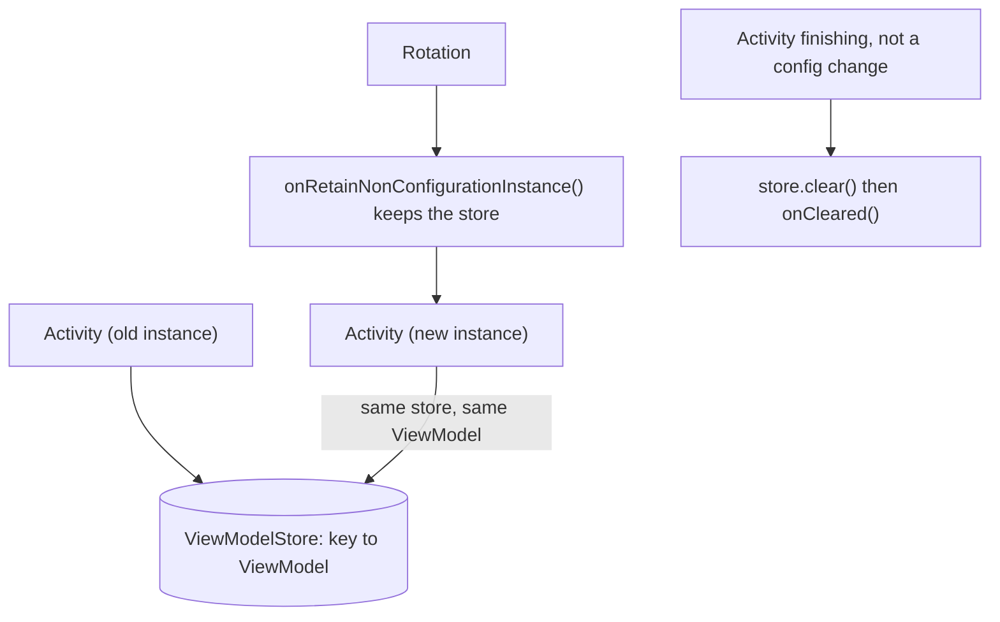
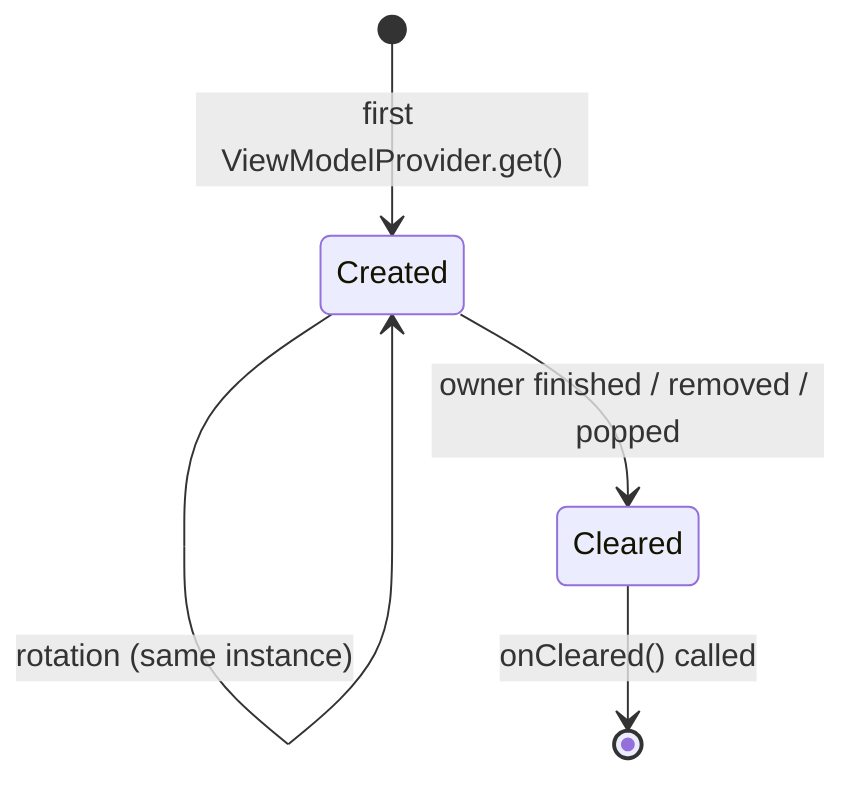
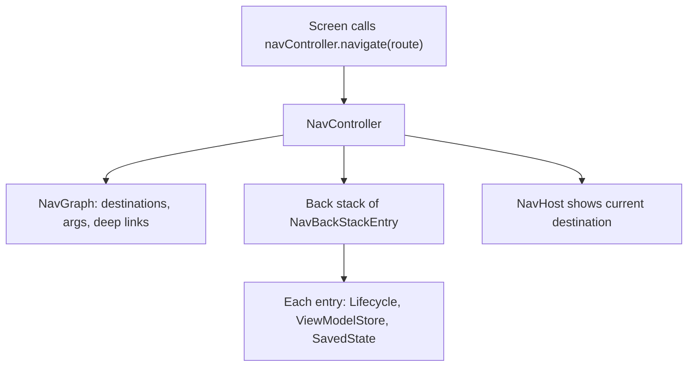
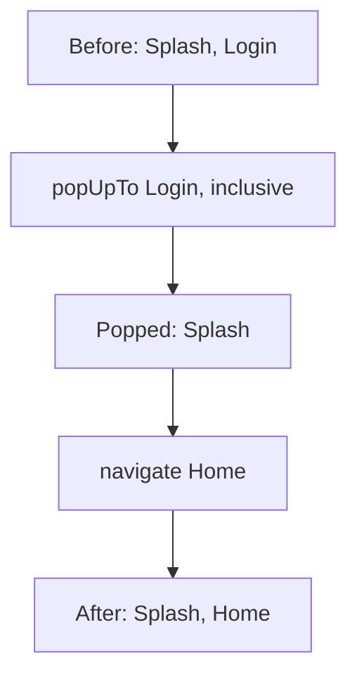
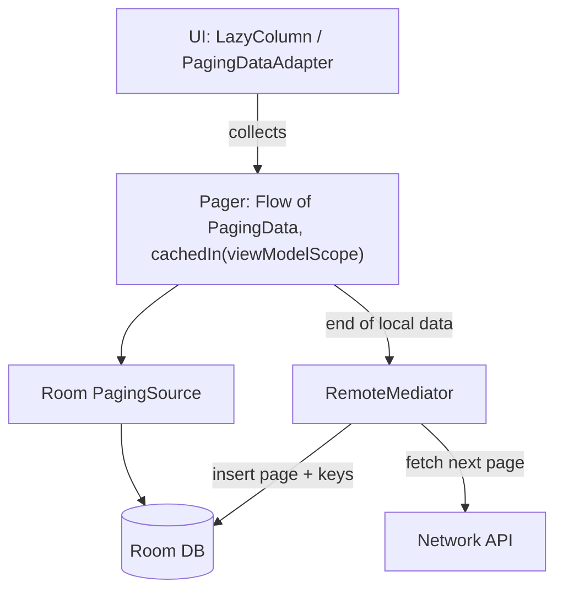
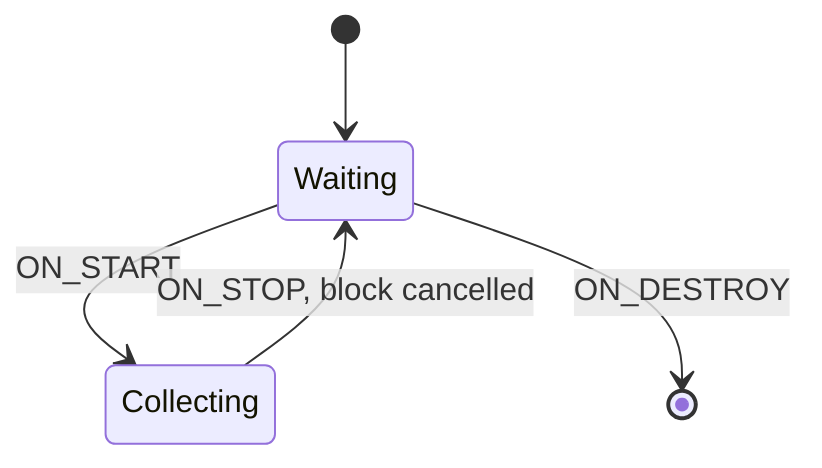

# Jetpack Components – ViewModel, LiveData, Navigation, Paging

[⬅ Back to index](../README.md)

Covers: ViewModel (and its internals), SavedStateHandle, LiveData, Navigation component, Paging 3, App Startup. (Room/DataStore → [Data Storage](16-data-storage.md); WorkManager → [Background Work](17-threading-background-work.md).)

---

## ViewModel

### 1. What is a ViewModel? Why use it?

<details>
<summary>Answer</summary>

**In short:** A ViewModel is a lifecycle-aware **state holder** for a screen. It keeps UI state and handles UI events, and it **survives configuration changes** (rotation, theme or language change), so data isn't refetched and running work isn't lost. It does **not** survive process death; `SavedStateHandle` covers that.

#### The problem it solves

An Activity is destroyed and recreated on every configuration change. If the Activity owns the data, you either refetch everything after each rotation or juggle `onSaveInstanceState` for data that doesn't belong in a Bundle (lists, network results). Network calls started by the old Activity also either leak it (they hold a reference) or get cancelled and restarted.

A ViewModel moves state and logic out of the UI controller into an object whose lifetime is "this screen", not "this Activity instance".

#### What a typical ViewModel looks like

```kotlin
@HiltViewModel
class ProfileViewModel @Inject constructor(
    private val repo: UserRepository,
    savedStateHandle: SavedStateHandle,
) : ViewModel() {

    private val userId: String = checkNotNull(savedStateHandle["userId"])

    private val _uiState = MutableStateFlow<ProfileUiState>(ProfileUiState.Loading)
    val uiState: StateFlow<ProfileUiState> = _uiState.asStateFlow()   // read-only to the UI

    init { refresh() }

    fun refresh() {
        viewModelScope.launch {                       // cancelled in onCleared()
            _uiState.value = try {
                ProfileUiState.Success(repo.getUser(userId))
            } catch (e: IOException) {
                ProfileUiState.Error(e.message)
            }
        }
    }
}
```

#### Key rules

- **Expose state, receive events.** The UI observes a `StateFlow` (or LiveData) and calls functions like `refresh()`. This is unidirectional data flow.
- **`viewModelScope`** is a `CoroutineScope` bound to the ViewModel; it is cancelled when the ViewModel is cleared, so work stops when the screen is really gone, not on rotation.
- **Never hold a reference to a View, Activity, Fragment or their Context.** The ViewModel outlives them, so it would leak the old Activity after rotation.
- **It is not a persistence layer.** When the system kills the process in the background, the ViewModel is gone. Persist durable data in a repository (Room, DataStore) and small UI state in `SavedStateHandle`.

| Survives | Rotation / config change | Process death | User presses Back (finish) |
|---|---|---|---|
| Activity fields | No | No | No |
| ViewModel | Yes | No | No |
| SavedStateHandle / `onSaveInstanceState` | Yes | Yes | No |
| Room / DataStore | Yes | Yes | Yes |

#### Common pitfalls

- Passing an `Activity` or `View` into the ViewModel (leak).
- Assuming the ViewModel "saves state" across process death.
- Exposing `MutableStateFlow`/`MutableLiveData` publicly so the UI can write to it.

#### Likely follow-ups

- *How does it survive rotation?* The `ViewModelStore` is retained across the config change (see Q2).
- *Where should business logic live?* Complex rules in domain/repository layers; the ViewModel orchestrates and maps to UI state.

</details>

### 2. How does ViewModel survive configuration changes? (Internals)

<details>
<summary>Answer</summary>

**In short:** Every `ViewModelStoreOwner` has a `ViewModelStore`, basically a `Map<String, ViewModel>`. On a configuration change, `ComponentActivity` hands that store to the new Activity instance through `onRetainNonConfigurationInstance()`, so `ViewModelProvider` finds the existing ViewModel instead of creating a new one. When the Activity is finishing for real, the store is cleared and `onCleared()` runs.



#### The pieces

- **`ViewModelStore`**: holds ViewModels keyed by a string (by default derived from the class's canonical name, plus an optional custom key).
- **`ViewModelStoreOwner`**: anything with a store: `ComponentActivity`, `Fragment`, `NavBackStackEntry`.
- **`ViewModelProvider(owner, factory)`**: `get(MyVM::class)` looks up the key in the owner's store; only if it's missing does it call the factory and put the result in the store.
- **`by viewModels()`** is just a lazy wrapper around `ViewModelProvider`.

#### Step by step on rotation

1. The old Activity is about to be destroyed because of a config change.
2. The framework calls `onRetainNonConfigurationInstance()`. `ComponentActivity` returns an object containing its `ViewModelStore`. This object is kept in memory by the framework (it is not serialized into a Bundle).
3. The new Activity instance is created. In its setup, `ComponentActivity` calls `getLastNonConfigurationInstance()` and reuses the retained store.
4. `ViewModelProvider` looks up the same key and returns the **same ViewModel instance**.
5. The ViewModel never noticed the rotation; coroutines in `viewModelScope` keep running.

#### When it is cleared

`ComponentActivity` registers a lifecycle observer. On `ON_DESTROY`, if `isChangingConfigurations` is `false` (the Activity is really finishing), it calls `viewModelStore.clear()`, which calls `onCleared()` on every ViewModel and cancels `viewModelScope`.

```kotlin
// Simplified from ComponentActivity
lifecycle.addObserver(LifecycleEventObserver { _, event ->
    if (event == Lifecycle.Event.ON_DESTROY && !isChangingConfigurations) {
        viewModelStore.clear()
    }
})
```

#### Fragments

A Fragment's store is held by the `FragmentManagerViewModel`, which is itself a ViewModel stored in the parent's (Activity's or parent Fragment's) store. So fragment ViewModels survive rotation by piggybacking on the Activity mechanism. Nav back stack entries work similarly through the `NavControllerViewModel`.

#### Why this matters

This is purely in-memory retention. It explains why ViewModels survive rotation but **not process death**: when the process dies, the retained object dies with it.

#### Likely follow-ups

- *What did people use before ViewModel?* Retained headless Fragments (`setRetainInstance(true)`) or `onRetainNonConfigurationInstance()` directly.
- *Can two ViewModels of the same class live in one store?* Yes, by passing different keys to `ViewModelProvider.get(key, MyVM::class)`.

</details>

### 3. What is the ViewModel lifecycle / when is `onCleared()` called?

<details>
<summary>Answer</summary>

**In short:** A ViewModel lives from the first time it's requested until its owner is **permanently** gone: the Activity finishes, the Fragment is removed for good, or the navigation destination is popped. At that point the store is cleared and `onCleared()` is called. Configuration changes do not end it.



#### When `onCleared()` runs, per owner

| Owner | Cleared when |
|---|---|
| Activity | It finishes (`finish()`, Back), not on rotation |
| Fragment | It is removed and not kept on the back stack, or its host is cleared |
| `NavBackStackEntry` (destination or graph) | The entry is popped off the back stack |
| Activity killed with process | Never called; the process just dies |

#### What to do in `onCleared()`

- Release resources the ViewModel owns (listeners on a singleton, a manually created scope, an SDK client).
- `viewModelScope` is **cancelled automatically**, so you don't need to cancel it.
- Since lifecycle 2.5 you can register objects with `addCloseable(closeable)` (or pass them into the constructor); they are closed when the ViewModel is cleared. This is handy for things that implement `AutoCloseable`.

```kotlin
class PlayerViewModel(private val player: Player) : ViewModel() {
    private val listener = MyPlayerListener()

    init { player.addListener(listener) }

    override fun onCleared() {
        player.removeListener(listener)   // otherwise the singleton keeps us alive
        super.onCleared()
    }
}
```

#### Pitfalls

- Expecting `onCleared()` on process death: it isn't called. Don't rely on it to save data.
- A Fragment ViewModel in a Fragment that is replaced but added to the back stack is **not** cleared; it stays until the transaction is popped and the Fragment is destroyed.

</details>

### 4. What is a ViewModelProvider.Factory? How do you pass parameters to a ViewModel?

<details>
<summary>Answer</summary>

**In short:** The framework creates ViewModels for you, so you can't call the constructor yourself. By default it can only call an empty constructor (or `(Application)` / `(SavedStateHandle)` ones). A `ViewModelProvider.Factory` tells it how to build a ViewModel that needs dependencies. In practice you use the `viewModelFactory { initializer { } }` DSL or let **Hilt** generate the factory.

#### Why you can't just call the constructor

If you wrote `val vm = DetailViewModel(repo)` in `onCreate`, you'd get a new instance after every rotation, defeating the point. The provider must decide whether to reuse or create, so creation goes through a factory it can call when needed.

#### Manual factory with the DSL

```kotlin
class DetailViewModel(
    private val repo: ItemRepository,
    private val savedStateHandle: SavedStateHandle,
) : ViewModel()

val detailFactory = viewModelFactory {
    initializer {
        // `this` is CreationExtras: gives access to Application, SavedStateHandle, etc.
        val app = this[ViewModelProvider.AndroidViewModelFactory.APPLICATION_KEY] as MyApp
        DetailViewModel(app.container.itemRepository, createSavedStateHandle())
    }
}

// In an Activity/Fragment
val vm: DetailViewModel by viewModels { detailFactory }

// In Compose
val vm: DetailViewModel = viewModel(factory = detailFactory)
```

`CreationExtras` (lifecycle 2.5+) lets a single stateless factory receive per-request data like the Application and the default arguments used for `SavedStateHandle`.

#### With Hilt (most common in interviews)

```kotlin
@HiltViewModel
class DetailViewModel @Inject constructor(
    private val repo: ItemRepository,
    private val savedStateHandle: SavedStateHandle,   // provided by Hilt automatically
) : ViewModel()

// Fragment: by viewModels()      Compose: hiltViewModel()
```

Hilt generates the factory. Navigation arguments arrive through `SavedStateHandle`.

#### Runtime parameters: assisted injection

When a value is only known at runtime and isn't a nav argument (e.g. an ID chosen in a dialog), use assisted injection:

```kotlin
@HiltViewModel(assistedFactory = DetailViewModel.Factory::class)
class DetailViewModel @AssistedInject constructor(
    @Assisted val itemId: String,
    private val repo: ItemRepository,
) : ViewModel() {
    @AssistedFactory
    interface Factory { fun create(itemId: String): DetailViewModel }
}

// Compose
val vm = hiltViewModel<DetailViewModel, DetailViewModel.Factory> { f -> f.create(itemId) }
```

#### Pitfalls

- Creating a factory that captures an Activity reference (leaks after rotation).
- Changing the parameter (a new `itemId`) does **not** create a new ViewModel for the same owner and key; the existing one is returned. Use a different key or owner if needed.

#### Likely follow-ups

- *How does Hilt get `SavedStateHandle`?* From `CreationExtras` via `createSavedStateHandle()` in its generated factory.

</details>

### 5. `by viewModels()` vs `by activityViewModels()` vs `navGraphViewModels()`?

<details>
<summary>Answer</summary>

**In short:** They differ only in **which `ViewModelStoreOwner`** the ViewModel is stored in, which decides who shares it and when it's cleared. `viewModels()` = this Fragment/Activity; `activityViewModels()` = the host Activity (shared by all its fragments); `navGraphViewModels()` = a navigation graph's back stack entry (shared across a flow, cleared when the graph is popped).

| Delegate | Owner | Shared with | Cleared when |
|---|---|---|---|
| `viewModels()` in Activity | That Activity | Nobody else | Activity finishes |
| `viewModels()` in Fragment | That Fragment | Nobody else | Fragment removed for good |
| `activityViewModels()` | Host Activity | All fragments in that Activity | Activity finishes |
| `navGraphViewModels(R.id.graph)` | Graph's `NavBackStackEntry` | All destinations in that graph | Graph popped |
| `viewModels(ownerProducer = { requireParentFragment() })` | Parent Fragment | Child fragments | Parent removed |

#### Example: checkout flow

```kotlin
// Each step of checkout gets the same CheckoutViewModel
class AddressFragment : Fragment() {
    private val checkoutVm: CheckoutViewModel by navGraphViewModels(R.id.checkout_graph)
}
class PaymentFragment : Fragment() {
    private val checkoutVm: CheckoutViewModel by navGraphViewModels(R.id.checkout_graph)
}
```

When the user completes or leaves checkout, the `checkout_graph` entry is popped and the ViewModel is cleared, so stale cart data doesn't linger. With `activityViewModels()` it would live as long as the whole app's Activity, which in a single-Activity app is effectively forever.

#### Compose

`viewModel()` / `hiltViewModel()` use `LocalViewModelStoreOwner`, which inside a `NavHost` is the current `NavBackStackEntry` (outside, the Activity). To share across a nested graph:

```kotlin
composable<PaymentRoute> { entry ->
    val parentEntry = remember(entry) { navController.getBackStackEntry<CheckoutGraph>() }
    val checkoutVm: CheckoutViewModel = hiltViewModel(parentEntry)
}
```

#### Pitfalls

- Using `activityViewModels()` for flow-specific data: it never gets cleared, causing stale state and memory use.
- Calling `getBackStackEntry()` for a graph that isn't on the back stack throws `IllegalArgumentException`.

</details>

### 6. What is SavedStateHandle?

<details>
<summary>Answer</summary>

**In short:** `SavedStateHandle` is a key-value map passed into a ViewModel that **survives process death**: its contents are written into the saved-instance-state Bundle and restored when the screen is recreated. It also automatically contains the screen's **navigation arguments** (and Intent extras / Fragment arguments). Use it for small UI state like a search query or selected tab.

#### Why it's needed

A ViewModel survives rotation but not process death. When your app is in the background, Android may kill the process to reclaim memory; when the user returns, the Activity is recreated from its saved Bundle, but a brand-new ViewModel is created. Without `SavedStateHandle` the user's typed query or scroll target would be lost. Before it existed, you had to pass state from `onSaveInstanceState` into the ViewModel manually.

#### Usage

```kotlin
class SearchViewModel(private val savedState: SavedStateHandle) : ViewModel() {

    // Reading a nav argument (present automatically)
    private val categoryId: String = checkNotNull(savedState["categoryId"])

    // Observable, restored after process death
    val query: StateFlow<String> = savedState.getStateFlow("query", "")

    fun onQueryChange(q: String) {
        savedState["query"] = q     // written to the Bundle on the next save
    }

    // Results are NOT saved; they're re-derived from the query
    val results = query
        .debounce(300)
        .flatMapLatest { repo.search(categoryId, it) }
        .stateIn(viewModelScope, SharingStarted.WhileSubscribed(5_000), emptyList())
}
```

With type-safe Navigation Compose you can read the whole route object: `savedState.toRoute<SearchRoute>()`.

#### How it works

The `SavedStateRegistry` of the owner (Activity/Fragment/NavBackStackEntry) has a provider for each ViewModel's handle. When the owner saves state, the handle's map is written into the owner's Bundle. On recreation, the factory (via `createSavedStateHandle()` in `CreationExtras`) builds a new handle seeded with the restored values plus the default arguments.

#### What to store

- **Yes:** IDs, query text, selected filter, scroll anchor, form field drafts.
- **No:** large lists, bitmaps, network results. The Bundle is limited (transactions over about 1 MB fail with `TransactionTooLargeException`), and those can be reloaded from the repository using the saved ID.

Values must be Bundle-compatible (primitives, String, Parcelable, Serializable, lists of those).

#### Pitfalls

- Storing a whole data model "to be safe": slow and risks the size limit.
- Testing only rotation. Test process death with "Don't keep activities" or `adb shell am kill <package>` while backgrounded.

#### Likely follow-ups

- *`getStateFlow` vs `getLiveData`?* Same idea, different observable type; both write back into the handle.
- *Compose equivalent at UI level?* `rememberSaveable`.

</details>

### 7. Can a ViewModel be shared between Activities?

<details>
<summary>Answer</summary>

**In short:** Not with standard scoping. Each Activity has its own `ViewModelStore`, so `viewModels()` in two Activities gives two different instances. To share data between Activities, put it in a layer that outlives both, a **repository or other singleton provided by DI** exposing a `Flow`, or move to a **single-Activity** architecture where screens are destinations that can share graph- or Activity-scoped ViewModels.

#### Why not

A ViewModel's scope is tied to one owner's lifecycle. Two Activities have independent lifecycles (one may be destroyed while the other lives), so a single ViewModel "owned" by both would have no clear moment to call `onCleared()`.

#### The right way: shared state in the data layer

```kotlin
@Singleton
class CartRepository @Inject constructor() {
    private val _items = MutableStateFlow<List<CartItem>>(emptyList())
    val items: StateFlow<List<CartItem>> = _items.asStateFlow()
    fun add(item: CartItem) = _items.update { it + item }
}

@HiltViewModel
class ProductViewModel @Inject constructor(private val cart: CartRepository) : ViewModel() {
    fun addToCart(item: CartItem) = cart.add(item)
}

@HiltViewModel
class CartViewModel @Inject constructor(cart: CartRepository) : ViewModel() {
    val items = cart.items      // updates as soon as ProductActivity adds an item
}
```

Each Activity has its own ViewModel; both observe the same source of truth. If the data must survive process death, back the repository with Room or DataStore.

#### Hacks to avoid

- Making the `Application` a `ViewModelStoreOwner` and storing ViewModels there: they'd never be cleared, and you're really just building a singleton with extra steps.
- Static fields holding a ViewModel.

#### Likely follow-ups

- *How do two Fragments share one?* `activityViewModels()` or `navGraphViewModels()` (Q5).
- *Passing results between Activities?* Activity Result API, not a shared ViewModel.

</details>

### 8. Why not use `AndroidViewModel`?

<details>
<summary>Answer</summary>

**In short:** `AndroidViewModel` is a ViewModel that receives the `Application`. It doesn't leak (the Application context lives as long as the process), but it couples the ViewModel to the Android framework, makes plain JVM unit tests harder, and usually hides a design problem: the ViewModel is doing work (resources, file access, system services) that belongs in an injected class.

#### What it looks like

```kotlin
// Works, but ViewModel now depends on Android
class SettingsViewModel(app: Application) : AndroidViewModel(app) {
    val title = app.getString(R.string.settings_title)
    private val prefs = app.getSharedPreferences("settings", Context.MODE_PRIVATE)
}
```

#### Problems

- **Testing:** you need Robolectric or a mocked `Application` to run the test; a plain ViewModel can be tested with JUnit alone.
- **Hidden dependencies:** anything can reach into the Application, so the ViewModel's real dependencies are invisible from its constructor.
- **Configuration bugs:** strings resolved from the Application context won't reflect a per-Activity locale or configuration change, so the text can be stale after the user changes language.

#### Better

Inject what you actually need:

```kotlin
@HiltViewModel
class SettingsViewModel @Inject constructor(
    private val settingsRepo: SettingsRepository,   // wraps DataStore, uses @ApplicationContext inside
) : ViewModel()
```

For text, expose a resource ID or a `UiText` sealed type and resolve it in the UI:

```kotlin
sealed interface UiText {
    data class Res(@StringRes val id: Int) : UiText
    data class Raw(val value: String) : UiText
}
```

#### When it's acceptable

Small apps without DI, or quick prototypes. It's not "wrong", it's just less testable.

</details>

---

## LiveData

### 9. What is LiveData? What are its benefits?

<details>
<summary>Answer</summary>

**In short:** LiveData is an **observable, lifecycle-aware data holder**. Observers get updates **only while their LifecycleOwner is active** (`STARTED` or `RESUMED`) and are **removed automatically** when it reaches `DESTROYED`. For new Kotlin code, `StateFlow` is generally preferred, but LiveData is still common in existing codebases.

#### How it works

```kotlin
class UserViewModel(repo: UserRepository) : ViewModel() {
    private val _user = MutableLiveData<User>()
    val user: LiveData<User> = _user           // read-only for the UI
}

// Fragment
viewModel.user.observe(viewLifecycleOwner) { user ->
    binding.name.text = user.name
}
```

When you call `observe(owner, observer)`, LiveData wraps the observer in a `LifecycleBoundObserver` that watches the owner's lifecycle:

- Owner becomes active → the observer becomes active and, if it hasn't seen the latest value, receives it immediately.
- Owner goes to `STOPPED` → the observer is inactive; new values are held, not delivered.
- Owner is `DESTROYED` → the observer is removed.

LiveData keeps a version number; each observer remembers the last version it saw, so it's never delivered the same value twice and always catches up to the latest when it becomes active.

#### Benefits

| Benefit | Why |
|---|---|
| No memory leaks | Observers are removed on destroy |
| No crashes from stopped UIs | No updates while in background |
| Always up to date | Latest value is delivered on becoming active |
| Survives rotation (with ViewModel) | New Activity re-observes and gets the current value |
| Resource hooks | `onActive()` / `onInactive()` let a custom LiveData start/stop a source (e.g. location) |

#### Limitations (why StateFlow took over)

- Android-only, so it can't live in a pure Kotlin domain layer or KMP code.
- Few operators (`map`, `switchMap`, `distinctUntilChanged`) compared to Flow.
- Delivered on the main thread only.
- Value can be null before first set; `StateFlow` requires an initial value.

#### Pitfalls

- Observing in a Fragment with `this` instead of `viewLifecycleOwner`: the Fragment outlives its view, so observers pile up after each `onCreateView` and update a destroyed view.
- `observeForever` without `removeObserver`: leaks.

</details>

### 10. `setValue()` vs `postValue()`?

<details>
<summary>Answer</summary>

**In short:** `setValue()` must be called on the **main thread** and updates the value and notifies observers **synchronously**. `postValue()` can be called from **any thread**; it posts a task to the main thread, and if it's called several times before that task runs, **only the last value is delivered**.

| | `setValue()` (`value =`) | `postValue()` |
|---|---|---|
| Thread | Main only (throws otherwise) | Any |
| When value changes | Immediately | When the posted main-thread task runs |
| Observers notified | Synchronously, inside the call | Later, on main thread |
| Multiple quick calls | Every value dispatched | Intermediate values dropped |

#### Why values get dropped

Simplified from the source:

```kotlin
fun postValue(value: T) {
    val postTask: Boolean
    synchronized(dataLock) {
        postTask = pendingData == NOT_SET     // is a task already scheduled?
        pendingData = value                   // overwrite pending value
    }
    if (!postTask) return                     // a task is pending; it will pick up our value
    mainExecutor.post { setValue(pendingData).also { pendingData = NOT_SET } }
}
```

Only one task is in flight; later calls just overwrite `pendingData`. That's fine for state (you only care about the latest) but bad for events.

#### Example of the gotcha

```kotlin
// Background thread
liveData.postValue(1)
liveData.postValue(2)
liveData.postValue(3)
// Observer most likely sees only 3

// Another gotcha: read right after post
liveData.postValue(5)
println(liveData.value)    // may still print the old value
```

#### Which to use

- Inside `viewModelScope.launch { }` (which runs on `Dispatchers.Main` by default), use `value =`. Do the heavy work with `withContext(Dispatchers.IO)` and set the result back on main.
- Use `postValue` only when you're genuinely on a background thread and can't switch.

#### Likely follow-ups

- *What does StateFlow do?* `value =` is thread-safe from any thread, and it's conflated too: collectors may skip intermediate values.

</details>

### 11. What are `Transformations.map` / `switchMap` and `MediatorLiveData`?

<details>
<summary>Answer</summary>

**In short:** They're the LiveData operators. `map` transforms each value; `switchMap` swaps to a **new source LiveData** each time the input changes (like Flow's `flatMapLatest`); `MediatorLiveData` observes **several** LiveData sources and combines them. The `liveData { }` builder creates a LiveData from a coroutine that runs while it has active observers.

In current lifecycle versions these are Kotlin extension functions (`liveData.map { }`, `liveData.switchMap { }`); the old `Transformations.map(...)` static style is the same thing.

#### `map`

```kotlin
val userName: LiveData<String> = user.map { it.firstName + " " + it.lastName }
```

Runs on the main thread for each new value; keep it cheap.

#### `switchMap`

```kotlin
private val userId = MutableLiveData<String>()

val user: LiveData<User> = userId.switchMap { id ->
    repo.observeUser(id)          // returns LiveData<User>, e.g. from Room
}

fun select(id: String) { userId.value = id }
```

When `userId` changes, the old `observeUser(oldId)` source is **unsubscribed** and the new one is observed, so you never see updates for a stale ID.

#### `MediatorLiveData`

```kotlin
val canSubmit = MediatorLiveData<Boolean>().apply {
    fun update() { value = !email.value.isNullOrBlank() && (password.value?.length ?: 0) >= 8 }
    addSource(email) { update() }
    addSource(password) { update() }
}
```

`map` and `switchMap` are built on `MediatorLiveData` internally. Sources are only observed while the mediator itself has active observers.

#### `liveData { }` builder

```kotlin
val profile: LiveData<Result<Profile>> = liveData {
    emit(Result.Loading)
    emit(runCatching { repo.fetchProfile() })   // suspend call
}
```

The block starts when the LiveData gets an active observer and is cancelled after a timeout (5 seconds by default) when it has none, which avoids restarting on rotation.

#### Flow equivalents

| LiveData | Flow |
|---|---|
| `map` | `map` |
| `switchMap` | `flatMapLatest` |
| `MediatorLiveData` | `combine` / `merge` |
| `liveData { }` | `flow { }` + `stateIn(WhileSubscribed(5000))` |

</details>

### 12. What is the SingleLiveEvent problem?

<details>
<summary>Answer</summary>

**In short:** LiveData is a **state** holder: it re-delivers its last value to every new observer. After a rotation, the new Fragment observes again and receives the last value, so a one-time event stored in it (navigate, show a Toast or Snackbar) fires a **second time**. `SingleLiveEvent` and the `Event<T>` wrapper were workarounds. Current guidance is to **model events as state** that the UI explicitly consumes, or, if you must, use a `Channel`. See [Flow Q8](04-flow.md).

#### The bug

```kotlin
// ViewModel
val navigateToDetail = MutableLiveData<String>()
fun onItemClick(id: String) { navigateToDetail.value = id }

// Fragment
viewModel.navigateToDetail.observe(viewLifecycleOwner) { id ->
    findNavController().navigate(...)   // fires again after rotation or on returning via Back
}
```

#### Old workarounds

- **`SingleLiveEvent`**: a `MutableLiveData` subclass with an `AtomicBoolean` that delivers only once. It supports only one observer, and a value set while no observer is active can be lost or misdelivered.
- **`Event<T>` wrapper**: holds `hasBeenHandled`; observers call `getContentIfNotHandled()`. Works with multiple observers but is boilerplate and easy to misuse.

#### Modern approaches

**1. Events as state (recommended in the official architecture guide):**

```kotlin
data class ListUiState(
    val items: List<Item> = emptyList(),
    val userMessage: String? = null,
)

fun onMessageShown() = _uiState.update { it.copy(userMessage = null) }

// UI
uiState.userMessage?.let { msg ->
    LaunchedEffect(msg) {
        snackbarHostState.showSnackbar(msg)
        viewModel.onMessageShown()      // UI confirms it was handled
    }
}
```

The event survives rotation and even process death (if saved), and it's shown exactly once because the UI acknowledges it.

**2. `Channel` + `receiveAsFlow()`:** each value is delivered to one collector and not replayed. It can still be lost if emitted while the collector is stopped between `onStop` and the next start (collect with `Dispatchers.Main.immediate` to reduce this). `SharedFlow(replay = 0)` drops events when there are no collectors, so it's riskier.

#### Pitfalls

- Using `postValue` for events: rapid events are merged and lost (Q10).

</details>

### 13. LiveData vs StateFlow – when would you still use LiveData?

<details>
<summary>Answer</summary>

**In short:** Both hold the latest value and notify observers. **LiveData** is lifecycle-aware out of the box, simple, and works well from Java and with DataBinding. **StateFlow** is pure Kotlin: it needs an initial value, has the full Flow operator set, works outside Android (domain layer, KMP), and is easier to test, but the UI must collect it lifecycle-safely with `repeatOnLifecycle` or `collectAsStateWithLifecycle`. New Kotlin code generally uses StateFlow; LiveData is fine in Java codebases, DataBinding layouts, and existing code.

| | LiveData | StateFlow |
|---|---|---|
| Platform | Android only | Kotlin (JVM, KMP) |
| Initial value | Optional (nullable) | Required |
| Lifecycle awareness | Built in (`observe(owner)`) | Via `repeatOnLifecycle` / `collectAsStateWithLifecycle` |
| Operators | `map`, `switchMap`, `distinctUntilChanged` | Entire Flow API |
| Equality | Dispatches even if value is equal | Skips equal values (`distinctUntilChanged` built in) |
| Thread for updates | `setValue` main only, `postValue` any | `value =` from any thread |
| Java friendliness | Good | Awkward (suspend functions) |
| Compose | `observeAsState()` | `collectAsStateWithLifecycle()` |

#### Collecting StateFlow safely

```kotlin
// Views
viewLifecycleOwner.lifecycleScope.launch {
    viewLifecycleOwner.repeatOnLifecycle(Lifecycle.State.STARTED) {
        viewModel.uiState.collect { render(it) }
    }
}

// Compose
val state by viewModel.uiState.collectAsStateWithLifecycle()
```

A plain `lifecycleScope.launch { flow.collect {} }` keeps collecting while the app is in the background, which LiveData would never do. That's the main trap when migrating.

#### Converting

- `flow.asLiveData()`: collects the flow while the LiveData has active observers.
- `liveData.asFlow()`: a cold flow that observes the LiveData.

#### When to still pick LiveData

- Java-only modules.
- XML DataBinding where `binding.lifecycleOwner` makes LiveData work in layouts (StateFlow also works with DataBinding in newer versions, but LiveData is the established path).
- A large existing codebase where consistency matters more than migration.

</details>

---

## Navigation Component

### 14. What is the Navigation component? What are its parts?

<details>
<summary>Answer</summary>

**In short:** Jetpack Navigation is a library for moving between screens inside an app, designed around a **single Activity** hosting many destinations. It has three core parts: the **NavGraph** (destinations and how they connect), the **NavHost** (the container that shows the current destination), and the **NavController** (the object you call to navigate and that manages the back stack).



#### The parts

- **NavGraph**: the map of destinations, their arguments, actions and deep links. Defined in XML (`res/navigation/*.xml`), with the Kotlin DSL, or in Compose with type-safe `@Serializable` routes.
- **NavHost**: the UI container. `NavHostFragment` for Fragments, the `NavHost` composable for Compose.
- **NavController**: `navigate()`, `popBackStack()`, `navigateUp()`, and it exposes `currentBackStackEntry` / `currentBackStackEntryFlow`.
- **NavBackStackEntry**: one per destination on the stack; it is a `LifecycleOwner`, `ViewModelStoreOwner` and `SavedStateRegistryOwner`, which is why destination-scoped ViewModels work.

#### Compose example with type-safe routes

```kotlin
@Serializable object Home
@Serializable data class Detail(val itemId: String)

@Composable
fun AppNavHost(navController: NavHostController = rememberNavController()) {
    NavHost(navController, startDestination = Home) {
        composable<Home> {
            HomeScreen(onItemClick = { id -> navController.navigate(Detail(id)) })
        }
        composable<Detail>(
            deepLinks = listOf(navDeepLink<Detail>(basePath = "https://example.com/item"))
        ) { entry ->
            val args = entry.toRoute<Detail>()
            DetailScreen(args.itemId)
        }
    }
}
```

#### Features you're expected to know

- **Back stack management** with consistent Back and Up behaviour.
- **Type-safe arguments**: Safe Args (Gradle plugin generating `Directions`/`Args` classes) for XML; `@Serializable` routes for Compose and the Kotlin DSL.
- **Deep links**: explicit (`NavDeepLinkBuilder` builds a `PendingIntent`, used for notifications) and implicit (URI intent filters).
- **Nested graphs** to group flows (login, checkout) and scope ViewModels to them.
- **Transitions/animations** between destinations.
- **UI integration**: `NavigationUI` / `setupWithNavController` for toolbar, bottom nav and drawer.

#### Pitfalls

- Passing big objects as arguments: pass an ID and load the object from a repository (args are stored in the saved state Bundle).
- Calling `navigate()` twice on a fast double tap can push two destinations; guard with lifecycle state or `launchSingleTop`.

#### Likely follow-ups

- *`navigateUp()` vs `popBackStack()`?* Usually the same; `navigateUp()` also handles leaving to the parent task when launched from a deep link in another app's task.
- *Navigation 3?* A newer Compose-first library where you own the back stack as a list of keys; know it exists but don't claim details you're unsure of.

</details>

### 15. What are `popUpTo` and `launchSingleTop`?

<details>
<summary>Answer</summary>

**In short:** They're `NavOptions` that control the back stack when you navigate. `popUpTo(X)` pops destinations off the stack until X is on top (and `inclusive = true` pops X too) **before** navigating. `launchSingleTop = true` avoids pushing a second copy of a destination that's already on top. `saveState` / `restoreState` save and restore the popped stack's state, which is how bottom-nav tabs keep their own history.

#### `popUpTo`: the login example

Back stack before: `Splash → Login`. After login you want Home, and Back should exit the app, not return to Login.

```kotlin
navController.navigate(Home) {
    popUpTo<Login> { inclusive = true }   // remove Login (and anything above it)
}
// Stack after: Splash → Home   (pop Splash too by popping up to the graph start)
```



In XML: `app:popUpTo="@id/loginFragment" app:popUpToInclusive="true"` on the action.

#### `launchSingleTop`

Without it, navigating to the destination already on top creates another instance: `Home → Search → Search`. With `launchSingleTop = true`, the existing top entry is reused, similar to the `singleTop` launch mode for Activities. Useful for bottom nav taps and double-tap protection.

#### `saveState` / `restoreState`

- `popUpTo(...) { saveState = true }` saves the state (including ViewModels and saved instance state) of everything being popped instead of discarding it.
- `restoreState = true` when navigating restores that saved state if it exists for the destination.

This combination is what enables multiple back stacks (Q16).

| Option | Effect |
|---|---|
| `popUpTo(X)` | Pop until X is on top |
| `inclusive = true` | Also pop X |
| `saveState = true` | Keep popped entries' state for later restore |
| `launchSingleTop = true` | Don't duplicate the top destination |
| `restoreState = true` | Restore previously saved state for this destination |

#### Pitfalls

- Forgetting `inclusive = true` and ending up with Login still behind Home.
- Using `popUpTo` with a destination that isn't on the stack: nothing is popped.

</details>

### 16. How do you implement bottom navigation with multiple back stacks?

<details>
<summary>Answer</summary>

**In short:** Each tab keeps its own back stack by navigating with `popUpTo(startDestination) { saveState = true }`, `launchSingleTop = true` and `restoreState = true`. Switching tabs saves the current tab's stack and restores the target tab's previously saved stack, so the user returns to where they left each tab.

```kotlin
fun NavController.navigateToTab(tabRoute: Any) {
    navigate(tabRoute) {
        // Pop everything above the graph's start, but save it instead of discarding it
        popUpTo(graph.findStartDestination().id) { saveState = true }
        // Don't push a second copy if the user re-taps the current tab
        launchSingleTop = true
        // If this tab had saved state, bring its stack back
        restoreState = true
    }
}
```

#### What happens step by step

1. User is on the Home tab and has drilled into `Home → Article`.
2. They tap Profile. `popUpTo(start) { saveState = true }` pops `Article` (and Home if it's not the start) and **saves** that stack under the Home tab.
3. Profile is navigated to; it had no saved state, so it starts fresh.
4. They tap Home again. `restoreState = true` restores `Home → Article`, including each entry's ViewModels and saved state.

#### Compose bottom bar

```kotlin
val backStackEntry by navController.currentBackStackEntryAsState()
val currentDestination = backStackEntry?.destination

NavigationBar {
    tabs.forEach { tab ->
        NavigationBarItem(
            selected = currentDestination?.hierarchy?.any { it.hasRoute(tab.route::class) } == true,
            onClick = { navController.navigateToTab(tab.route) },
            icon = { Icon(tab.icon, contentDescription = tab.label) },
            label = { Text(tab.label) },
        )
    }
}
```

Using `hierarchy` marks the tab selected even when the user is on a nested destination inside that tab's graph. Usually each tab is its own nested graph.

With Fragments, `bottomNavView.setupWithNavController(navController)` applies these options for you (Navigation 2.4+).

#### Pitfalls

- Missing `restoreState` means tabs always reset to their root.
- Re-tapping the active tab: many apps expect it to pop to the tab's root; handle that explicitly with `popBackStack(tabStart, inclusive = false)`.

</details>

---

## Paging 3

### 17. What is Paging 3? Explain its components.

<details>
<summary>Answer</summary>

**In short:** Paging 3 is a Jetpack library for loading large data sets **page by page** as the user scrolls, built on coroutines and Flow. A `PagingSource` loads pages from one source; an optional `RemoteMediator` fills a Room database from the network for offline-first lists; a `Pager` turns these into a `Flow<PagingData>` that you `cachedIn(viewModelScope)`; and the UI (`PagingDataAdapter` or `collectAsLazyPagingItems()`) displays items and `LoadState`s for loading, errors and retry.

#### Why use it

Loading thousands of items at once wastes memory, network and time. Hand-rolled paging usually gets the hard parts wrong: deduplicating requests, tracking the next key, retry, refreshing, placeholders, surviving rotation. Paging handles these.

#### Components

- **`PagingSource<Key, Value>`**: `load(params)` returns `LoadResult.Page(data, prevKey, nextKey)` or `LoadResult.Error(e)`. `getRefreshKey()` says where to restart after invalidation.
- **`RemoteMediator`**: for **network + database**. Room is the single source of truth and provides the `PagingSource`; when it runs out of local data, Paging calls the mediator to fetch the next network page and insert it into Room.
- **`Pager`** with `PagingConfig(pageSize, prefetchDistance, enablePlaceholders)` → `Flow<PagingData<T>>`.
- **`cachedIn(scope)`**: caches loaded pages in the ViewModel so rotation doesn't reload from scratch, and lets multiple collectors share it.
- **UI**: `PagingDataAdapter` (a `RecyclerView` adapter with `DiffUtil`) or `collectAsLazyPagingItems()` in Compose.
- **`LoadState`** (`Loading`, `NotLoading`, `Error`) for `refresh`, `append`, `prepend`.



#### Network-only PagingSource

```kotlin
class ArticlePagingSource(private val api: ArticleApi) : PagingSource<Int, Article>() {

    override suspend fun load(params: LoadParams<Int>): LoadResult<Int, Article> {
        val page = params.key ?: 1
        return try {
            val articles = api.getArticles(page = page, size = params.loadSize)
            LoadResult.Page(
                data = articles,
                prevKey = if (page == 1) null else page - 1,
                nextKey = if (articles.isEmpty()) null else page + 1,   // null = end of list
            )
        } catch (e: IOException) {
            LoadResult.Error(e)
        } catch (e: HttpException) {
            LoadResult.Error(e)
        }
    }

    override fun getRefreshKey(state: PagingState<Int, Article>): Int? =
        state.anchorPosition?.let { pos ->
            state.closestPageToPosition(pos)?.let { it.prevKey?.plus(1) ?: it.nextKey?.minus(1) }
        }
}
```

#### ViewModel and Compose UI

```kotlin
class ArticlesViewModel(api: ArticleApi) : ViewModel() {
    val articles: Flow<PagingData<Article>> = Pager(
        config = PagingConfig(pageSize = 20, prefetchDistance = 5),
        pagingSourceFactory = { ArticlePagingSource(api) },   // must return a NEW instance each time
    ).flow
        .map { data -> data.map { it.toUiModel() } }           // transform before caching
        .cachedIn(viewModelScope)
}

@Composable
fun ArticleList(vm: ArticlesViewModel) {
    val items = vm.articles.collectAsLazyPagingItems()
    LazyColumn {
        items(count = items.itemCount, key = items.itemKey { it.id }) { index ->
            items[index]?.let { ArticleRow(it) }     // null = placeholder
        }
        when (val append = items.loadState.append) {
            is LoadState.Loading -> item { CircularProgressIndicator() }
            is LoadState.Error -> item { RetryButton(onClick = items::retry) }
            else -> Unit
        }
    }
}
```

#### Pitfalls

- Reusing the same `PagingSource` instance in `pagingSourceFactory`: a source is single-use; after invalidation Paging needs a fresh one.
- Calling `cachedIn` before your `map`/`filter` means the transformation reruns on every new collector; apply operations, then cache.
- Collecting `PagingData` twice without `cachedIn` throws.
- Room's PagingSource invalidates automatically on table changes; a custom network source must call `invalidate()` (or you call `refresh()`) to reload.

#### Likely follow-ups

- *How does RemoteMediator know the next page?* You store remote keys (next/prev page per item or per query) in a Room table alongside the items.
- *How do you implement pull-to-refresh?* `lazyItems.refresh()` / `adapter.refresh()`, observing `loadState.refresh`.

</details>

---

## Others

### 18. What is the App Startup library?

<details>
<summary>Answer</summary>

**In short:** Many libraries initialize themselves using their own `ContentProvider`, because providers are created automatically before `Application.onCreate()`. Each provider adds startup cost. **App Startup** replaces them with one shared `InitializationProvider` where you declare `Initializer<T>` classes and their dependencies; they run in the right order at startup, or you can disable automatic init and run them **lazily**. The result is less cold start overhead and explicit init ordering.

#### The problem

The `ContentProvider` trick lets a library initialize without the app calling `Library.init(context)`. But every provider is instantiated and its `onCreate()` called on the main thread during app launch. With ten libraries, that's ten providers, each with its own overhead, and no control over order.

#### How it works

```kotlin
class AnalyticsInitializer : Initializer<Analytics> {
    override fun create(context: Context): Analytics {
        return Analytics.init(context)                    // runs once
    }
    // Initializers that must run before this one
    override fun dependencies(): List<Class<out Initializer<*>>> =
        listOf(LoggerInitializer::class.java)
}
```

```xml
<provider
    android:name="androidx.startup.InitializationProvider"
    android:authorities="${applicationId}.androidx-startup"
    android:exported="false"
    tools:node="merge">
    <meta-data
        android:name="com.example.AnalyticsInitializer"
        android:value="androidx.startup" />
</provider>
```

At launch the single `InitializationProvider` reads its `<meta-data>` entries, builds the dependency order, and calls each `create()` once.

#### Lazy initialization

To move something off the startup path, remove its meta-data (`tools:node="remove"`) and initialize it on first use:

```kotlin
AppInitializer.getInstance(context).initializeComponent(AnalyticsInitializer::class.java)
```

You can also use this to disable a library's own App Startup initializer (for example WorkManager's, when you provide a custom `Configuration`).

#### Pitfalls

- It still runs on the main thread at startup; it doesn't make slow init fast. Move heavy work off startup or make it lazy.
- Circular dependencies throw at startup.

#### Likely follow-up

- *How else do you improve cold start?* Baseline Profiles, lazy DI, avoiding work in `Application.onCreate()`, and measuring with Macrobenchmark.

</details>

### 19. What is the Lifecycle-aware `repeatOnLifecycle` and `flowWithLifecycle`?

<details>
<summary>Answer</summary>

**In short:** `repeatOnLifecycle(STARTED) { }` is a suspend function that launches the block when the lifecycle reaches `STARTED`, **cancels** it when it drops below (`ON_STOP`), and **relaunches** it when it's started again, until the lifecycle is destroyed. `flow.flowWithLifecycle(lifecycle, STARTED)` does the same for a single flow. They're the recommended way to collect flows in the View system, so collection stops while the app is in the background. See [Flow Q6](04-flow.md).

#### The problem

```kotlin
// Wrong: keeps collecting while the app is in the background
lifecycleScope.launch {
    viewModel.locationUpdates.collect { updateMap(it) }
}
```

`lifecycleScope` is only cancelled on destroy. While stopped, the flow keeps running, wasting battery, keeping upstream work (GPS, DB queries) alive and possibly touching views that aren't visible. The older `launchWhenStarted` only **suspended** the coroutine, so upstream producers kept working and buffering; it is deprecated.

#### The fix

```kotlin
override fun onViewCreated(view: View, savedInstanceState: Bundle?) {
    viewLifecycleOwner.lifecycleScope.launch {
        viewLifecycleOwner.repeatOnLifecycle(Lifecycle.State.STARTED) {
            // Collect several flows in parallel, each in its own launch
            launch { viewModel.uiState.collect { render(it) } }
            launch { viewModel.events.collect { handle(it) } }
        }
        // Code here runs only after the lifecycle is DESTROYED
    }
}
```



#### `flowWithLifecycle`

```kotlin
viewLifecycleOwner.lifecycleScope.launch {
    viewModel.uiState
        .flowWithLifecycle(viewLifecycleOwner.lifecycle, Lifecycle.State.STARTED)
        .collect { render(it) }
}
```

Good for one flow; for several, use `repeatOnLifecycle` with multiple `launch`es.

#### Compose

Use `collectAsStateWithLifecycle()`, which uses `repeatOnLifecycle` internally.

#### Pitfalls

- In Fragments use `viewLifecycleOwner`, not the Fragment's own lifecycle.
- Calling `repeatOnLifecycle` in `onStart`/`onResume`: each call starts another loop. Call it once in `onCreate`/`onViewCreated`.
- Combined with a `WhileSubscribed(5000)` `stateIn`, stopping collection lets the upstream stop after 5 s in the background; that's the intended pairing.

</details>

### 20. What other Jetpack libraries should you know?

<details>
<summary>Answer</summary>

**In short:** Beyond ViewModel, LiveData, Navigation and Paging, interviewers expect you to know what these are for: Room and DataStore (storage), WorkManager (guaranteed background work), Hilt (DI), CameraX, Media3, Biometric and Credential Manager, Window / Material3 Adaptive for large screens, Macrobenchmark and Baseline Profiles for performance, and Glance for widgets. You don't need every API, but you should know which problem each solves.

| Library | Solves | One-liner to say |
|---|---|---|
| **Room** | Local SQL storage | Compile-time-checked SQLite with Flow support ([Data Storage](16-data-storage.md)) |
| **DataStore** | Key-value / typed settings | Coroutine-based replacement for SharedPreferences |
| **WorkManager** | Deferrable, guaranteed background work | Runs even after app restart or reboot, with constraints ([Background Work](17-threading-background-work.md)) |
| **Hilt** | Dependency injection | Dagger with Android components and scopes preconfigured |
| **CameraX** | Camera | Consistent, lifecycle-aware API on top of Camera2 |
| **Media3 (ExoPlayer)** | Media playback | Player, media session and UI in one library |
| **Biometric** | Fingerprint / face auth | `BiometricPrompt` across API levels |
| **Credential Manager** | Sign-in | Unified API for passkeys, passwords and federated sign-in |
| **Window / Material3 Adaptive** | Foldables, tablets | Window size classes, fold posture, list-detail layouts |
| **Macrobenchmark / Baseline Profiles / ProfileInstaller** | Performance | Measure startup and jank; ship AOT profiles to speed up cold start |
| **Glance** | App widgets | Write widgets with Compose-style code |
| **Health Connect** | Health data | Shared on-device store of health and fitness data |
| **Security-crypto** | Encrypted prefs/files | Now deprecated; use the Android Keystore directly |
| **Splash Screen API** | Launch screen | Backport of the Android 12 splash screen |
| **Activity Result API** | Results / permissions | `registerForActivityResult` replaces `onActivityResult` |
| **Photo Picker** | Media selection | Pick images/videos without storage permissions |

#### How to use this in an interview

When asked "what Jetpack libraries have you used", pick 3 to 4 you've actually used and say **why** you chose each (for example: "WorkManager for uploading logs because it must survive process death and respect network constraints"). Listing many without context is weak.

#### Pitfalls

- Saying Security-crypto (`EncryptedSharedPreferences`) is the recommended approach: it's deprecated.
- Confusing WorkManager with coroutines: coroutines are for in-process async work; WorkManager is for work that must run even if the app is killed.

</details>


### 21. LiveData vs ObservableField (DataBinding)?

<details>
<summary>Answer</summary>

**In short:** `ObservableField<T>` is DataBinding's simple observable holder; it is **not lifecycle-aware**, so manually added callbacks must be removed or they leak and update dead views, and it's only practical with DataBinding. `LiveData` is **lifecycle-aware** (delivers only to active owners and cleans up automatically) and works with or without DataBinding. Today, expose **StateFlow** (or LiveData) from a ViewModel; `ObservableField` is mostly legacy.

#### ObservableField

```kotlin
class FormViewModel : ViewModel() {
    val name = ObservableField<String>("")
}
```

```xml
<EditText android:text="@={vm.name}" />
```

The binding registers an `OnPropertyChangedCallback` on the field. Generated binding code handles this with weak references, but if you add callbacks yourself (`name.addOnPropertyChangedCallback(...)`) nothing removes them for you. It has no idea whether the UI is started or destroyed, so it can update views of a stopped or destroyed screen.

#### LiveData with DataBinding

```kotlin
binding.lifecycleOwner = viewLifecycleOwner   // required, or LiveData in layouts won't update
binding.vm = viewModel
```

```xml
<TextView android:text="@{vm.userName}" />   <!-- vm.userName is LiveData<String> -->
```

The binding observes LiveData using the lifecycle owner you gave it, so updates stop when the view is stopped and observers are removed when it is destroyed.

| | ObservableField | LiveData | StateFlow |
|---|---|---|---|
| Lifecycle-aware | No | Yes | Via collector |
| Usable outside DataBinding | Barely | Yes | Yes |
| Android dependency | DataBinding library | Lifecycle library | None (Kotlin) |
| Operators | None | Few | Full Flow API |
| Status | Legacy | Maintained | Recommended for new code |

#### Pitfalls

- Forgetting `binding.lifecycleOwner`: LiveData values never appear in the layout.
- Mixing `ObservableField` in the ViewModel with non-DataBinding UI: you end up writing manual callback plumbing.

</details>

---

[⬅ Previous: Architecture](12-architecture.md) · [⬅ Back to index](../README.md) · [Next: Dependency Injection ➡](14-dependency-injection.md)
