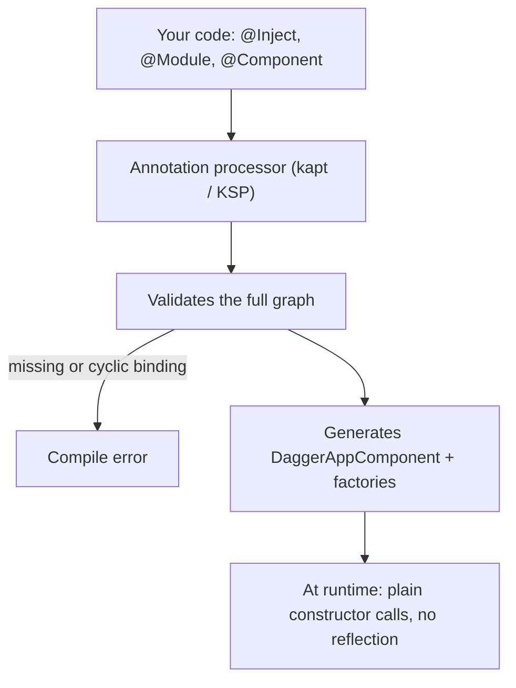
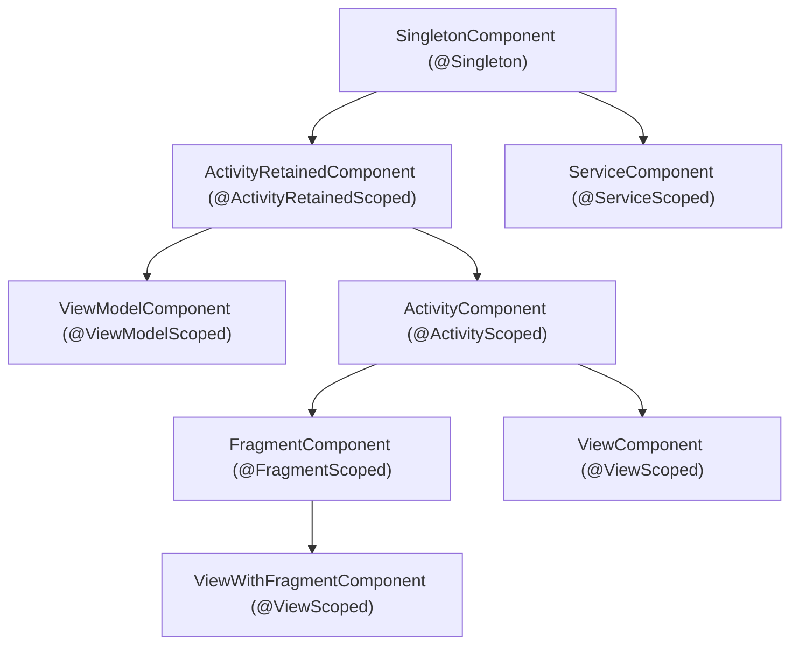
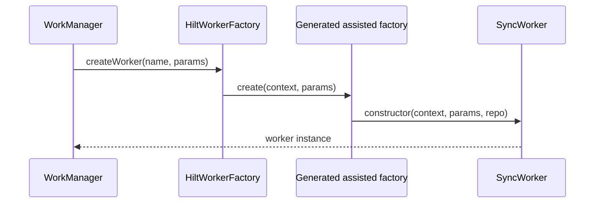
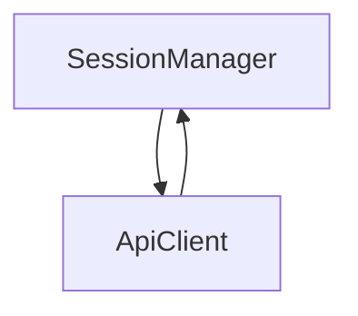
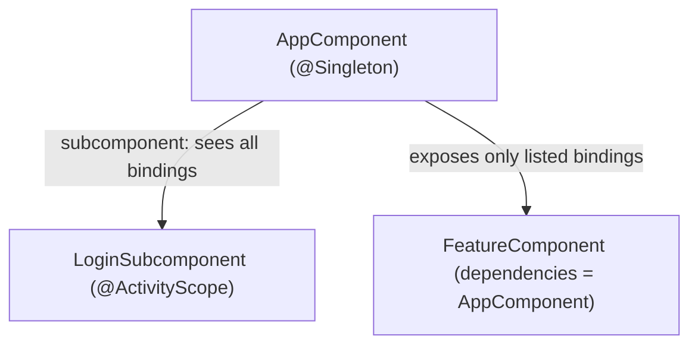

# Dependency Injection – Hilt, Dagger, Koin

[⬅ Back to index](../README.md)

Covers: DI concepts, Dagger 2 internals, Hilt components & scopes, qualifiers, assisted injection, testing, Koin, Service Locator.

---

### 1. What is Dependency Injection? Why use it?

<details>
<summary>Answer</summary>

**In short:** Dependency Injection means a class **receives its dependencies from outside** instead of creating them itself. It gives you loose coupling, easy testing with fakes, and one central place that decides how objects are built and how long they live.

#### The problem it solves

A class that creates its own collaborators is welded to them:

```kotlin
// ❌ Without DI: the repository builds its own Retrofit and Room instances
class UserRepository(context: Context) {
    private val api = Retrofit.Builder()
        .baseUrl("https://api.example.com/")
        .addConverterFactory(MoshiConverterFactory.create())
        .build()
        .create(UserApi::class.java)

    private val dao = Room.databaseBuilder(context, AppDb::class.java, "app.db")
        .build()
        .userDao()
}
```

Problems with this:
- **You can't test it** without a real network and a real database, because there is no way to swap `api` or `dao` for a fake.
- **No sharing.** Every `UserRepository` builds its own Retrofit and its own database, which is wasteful and can even be wrong (two Room instances on one file).
- **Hidden requirements.** The constructor says "give me a Context", but the class really needs an HTTP client, a base URL, a database...
- **Changes ripple.** Switching from Moshi to kotlinx.serialization means editing every class that builds Retrofit.

```kotlin
// ✅ With DI: dependencies are handed in
class UserRepository(
    private val api: UserApi,
    private val dao: UserDao,
)
```

Now the class only describes *what it needs*. Someone else (a container, Hilt, Koin, or your test) decides *how* those things are created.

#### Benefits

| Benefit | What it means in practice |
|---|---|
| Loose coupling | Depend on interfaces (`UserRepository`), not concrete classes |
| Testability | Pass `FakeUserApi` in a unit test, no network |
| Reuse / sharing | One `OkHttpClient` shared by the whole app |
| Single configuration point | The object graph is defined in one place (modules) |
| Lifecycle / scope management | Singletons, per-Activity or per-ViewModel instances handled for you |

#### Types of injection

- **Constructor injection** (preferred): dependencies are constructor parameters. They're explicit, can be `val`/immutable, and the object is never half-built.
- **Field injection**: the framework sets `lateinit var` fields after creation. Used for classes the **Android system instantiates** (Activity, Fragment, Service), where you don't control the constructor.
- **Method (setter) injection**: a method is called with the dependency. Rare; useful for optional dependencies.

```kotlin
// Field injection in an Activity (Hilt)
@AndroidEntryPoint
class ProfileActivity : AppCompatActivity() {
    @Inject lateinit var analytics: Analytics   // set during super.onCreate()
}
```

DI is the practical application of the **Dependency Inversion Principle** (the "D" in SOLID): high-level code depends on abstractions, and the concrete wiring is pushed to the edges of the app.

**Common pitfalls**
- Thinking DI requires a framework. It doesn't: passing things through constructors *is* DI. Frameworks just automate the wiring.
- Using field injection in ordinary classes you construct yourself. Prefer constructor injection everywhere you can.

**Likely follow-ups**
- *Why is constructor injection preferred?* Dependencies are visible, immutable, and you can create the object in a test with a plain constructor call.
- *What is "inversion of control"?* The class no longer controls creating its dependencies; control moves to the caller or container. DI is one form of IoC.

</details>

### 2. Dependency Injection vs Service Locator?

<details>
<summary>Answer</summary>

**In short:** With DI, dependencies are **pushed** into a class (usually through the constructor), so they're visible in the signature and, with Dagger/Hilt, checked at **compile time**. With a Service Locator, the class **pulls** dependencies from a global registry (`ServiceLocator.get<Api>()`), which is simpler but hides dependencies and fails at **runtime** if something is missing.

#### Side by side

```kotlin
// Service Locator: the class asks a registry
object ServiceLocator {
    private val map = mutableMapOf<KClass<*>, Any>()
    fun <T : Any> register(type: KClass<T>, instance: T) { map[type] = instance }
    @Suppress("UNCHECKED_CAST")
    fun <T : Any> get(type: KClass<T>): T =
        map[type] as? T ?: error("No binding for $type")   // runtime failure
}

class CheckoutViewModel : ViewModel() {
    private val repo = ServiceLocator.get(CartRepository::class)   // hidden dependency
}

// Dependency Injection: the class is given what it needs
class CheckoutViewModel @Inject constructor(
    private val repo: CartRepository,       // visible in the signature
) : ViewModel()
```

| | Dependency Injection | Service Locator |
|---|---|---|
| Direction | Pushed in from outside | Pulled by the class itself |
| Visibility | Explicit in the constructor | Hidden inside the implementation |
| Missing binding | Compile error (Dagger/Hilt) | Runtime crash |
| Coupling | Class knows nothing about the container | Class depends on the locator |
| Testing | Pass fakes to the constructor | Must reconfigure global state before each test |
| Setup cost | Higher (framework, annotations) | Very low |

#### Where Koin fits

Koin is often described as a **service locator with a DI-style API**. Internally, `get()` and `by inject()` look up definitions in a runtime registry, and a missing definition fails at runtime (unless you verify modules in tests or use Koin Annotations' compile-time checks). But if you write your classes with constructor parameters and let Koin call those constructors (`singleOf(::UserRepositoryImpl)`), your *classes* are DI-style: they don't know Koin exists. Only the edges (Activities calling `by viewModel()`) pull from the container.

That's the useful interview nuance: the **pattern** depends on how a class gets its dependencies, not on which library you use. You can misuse Hilt as a locator (`EntryPoints.get(...)` everywhere) and use Koin in a clean DI style.

**Common pitfalls**
- Calling the locator deep inside business logic. It spreads a global dependency everywhere and makes tests order-dependent.
- Claiming Service Locator is always "bad". For tiny apps or library internals it's pragmatic; Android's own `getSystemService()` is a service locator.

**Likely follow-ups**
- *Is `Context.getSystemService()` DI?* No, it's a service locator: you pull a service by name/class.
- *How do you catch Koin wiring errors early?* A test that calls `verify()` on your modules (or uses Koin Annotations' compile-time checks).

</details>

### 3. What is Dagger 2? How does it work?

<details>
<summary>Answer</summary>

**In short:** Dagger 2 is a **compile-time** DI framework (by Google, originally from Square). An annotation processor (kapt or KSP) reads your `@Inject`, `@Module` and `@Component` annotations and **generates plain Java code** that builds the object graph. There's no reflection, so it's fast at runtime, and a **missing or duplicate binding is a compile error**.

#### How it works



1. You describe **how to build** each type: `@Inject` constructors for your own classes, `@Provides`/`@Binds` in modules for everything else.
2. You declare a **`@Component`** interface: the entry point that says "I need to inject `MainActivity`" or "give me a `UserRepository`".
3. At build time Dagger walks the graph from each entry point, checks every dependency can be satisfied exactly once, and generates `DaggerAppComponent` plus a `Factory` class per binding.
4. At runtime the generated code just calls constructors in the right order. Scoped bindings are wrapped in a `DoubleCheck` provider that caches the instance.

#### A minimal example

```kotlin
class UserRepository @Inject constructor(          // "this is how you build me"
    private val api: UserApi,
)

@Module
object NetworkModule {
    @Provides @Singleton
    fun provideRetrofit(): Retrofit = Retrofit.Builder()
        .baseUrl("https://api.example.com/")
        .build()

    @Provides
    fun provideUserApi(retrofit: Retrofit): UserApi = retrofit.create(UserApi::class.java)
}

@Singleton
@Component(modules = [NetworkModule::class])
interface AppComponent {
    fun inject(activity: MainActivity)        // members-injection method
    fun userRepository(): UserRepository      // provision method
}

// In Application.onCreate():
val appComponent = DaggerAppComponent.create()
// In MainActivity.onCreate():
(application as App).appComponent.inject(this)
```

#### Key annotations

| Annotation | Purpose |
|---|---|
| `@Inject` | On a constructor: how to create the type. On a field: where to inject |
| `@Module` + `@Provides` | Provide objects you can't annotate (Retrofit, Room, third-party classes) |
| `@Binds` | Bind an interface to its implementation (abstract method, less generated code) |
| `@Component` | The graph / injector that connects modules to injection targets |
| `@Singleton` / custom `@Scope` | One instance per component instance |
| `@Subcomponent`, component dependencies | Child graphs with shorter lifetimes |
| `@Qualifier` / `@Named` | Distinguish multiple bindings of the same type |
| `@BindsInstance` | Pass a runtime value (e.g. `Application`) into the component builder/factory |

#### Trade-offs

- **Pros:** compile-time safety, no reflection, fast at runtime, readable generated code you can step through.
- **Cons:** steep learning curve, lots of boilerplate in plain Dagger (components, manual `inject()` calls), and build-time cost from code generation. Moving from kapt to KSP reduces that cost.

**Likely follow-ups**
- *Why is "no reflection" important on Android?* Reflection is slow, especially at startup, and it hides errors until runtime. Dagger 1 used some reflection; Dagger 2 removed it.
- *What does Dagger generate for a scoped binding?* A provider wrapped in `DoubleCheck`, which lazily creates and caches the instance with double-checked locking.

</details>

### 4. What is Hilt? How is it different from Dagger?

<details>
<summary>Answer</summary>

**In short:** Hilt is a DI library **built on top of Dagger** and made for Android. It gives you **predefined components tied to Android lifecycles** (application, activity, fragment, ViewModel...) and generates the component and injection code for you, so you keep Dagger's compile-time safety without most of its boilerplate.

#### What Hilt removes

In plain Dagger you write the component interfaces, create the component in `Application`, hold references to it, and call `component.inject(this)` in every Activity and Fragment. Hilt generates all of that from a few annotations.

```kotlin
@HiltAndroidApp                       // generates the app-level component
class App : Application()

@AndroidEntryPoint                    // enables field injection
class ProfileActivity : AppCompatActivity() {
    @Inject lateinit var analytics: Analytics
    private val viewModel: ProfileViewModel by viewModels()
}

@HiltViewModel
class ProfileViewModel @Inject constructor(
    private val repo: UserRepository,
    private val savedStateHandle: SavedStateHandle,   // provided by Hilt automatically
) : ViewModel()

@Module
@InstallIn(SingletonComponent::class) // which component these bindings live in
object NetworkModule {
    @Provides @Singleton
    fun provideOkHttp(): OkHttpClient = OkHttpClient.Builder().build()
}
```

#### The main annotations

- `@HiltAndroidApp` on the `Application`: triggers code generation and creates the `SingletonComponent`. Required.
- `@AndroidEntryPoint` on Activity / Fragment / View / Service / BroadcastReceiver: Hilt generates a base class (`Hilt_ProfileActivity`) that performs field injection at the right moment (in `super.onCreate()` for Activities, `onAttach()` for Fragments).
- `@HiltViewModel` + `@Inject constructor`: ViewModel injection, obtained with `by viewModels()` in Views or `hiltViewModel()` in Compose.
- `@Module @InstallIn(XComponent::class)`: decides which component a module's bindings belong to.
- `@EntryPoint`: access the graph from classes Hilt doesn't support.

#### Dagger vs Hilt

| | Dagger | Hilt |
|---|---|---|
| Components | You define them | Predefined, tied to Android lifecycles |
| Creating components / calling `inject()` | Manual | Generated |
| Scopes | You define your own | Standard ones (`@Singleton`, `@ActivityScoped`, `@ViewModelScoped`...) |
| Jetpack integration | DIY | ViewModel, WorkManager (`@HiltWorker`), Navigation, Compose |
| Testing | DIY test components | `@HiltAndroidTest`, `@TestInstallIn`, `@BindValue` |
| Platform | Any JVM / Android | Android apps |
| Compile-time safety | Yes | Yes (it *is* Dagger underneath) |

**Common pitfalls**
- Annotating a Fragment with `@AndroidEntryPoint` but not its host Activity: the Activity must also be an entry point.
- Forgetting `@HiltAndroidApp`: the app crashes at runtime when an entry point tries to find the component.
- Using an injected field before `super.onCreate()` in an Activity: it isn't set yet.

**Likely follow-ups**
- *Can Hilt and plain Dagger coexist?* Yes. Hilt generates Dagger components, and you can add custom components or use entry points.
- *Is Hilt a runtime library?* Mostly no. It's code generation plus a small runtime; the graph is still built by generated Dagger code.

</details>

### 5. What are Hilt components and their scopes?

<details>
<summary>Answer</summary>

**In short:** Hilt has a fixed hierarchy of **components**, each created and destroyed with an Android class (Application, Activity, ViewModel, Fragment...). Each has a matching **scope annotation**; a scoped binding gives **one shared instance per component instance**. Child components can use everything from their parents. Unscoped bindings create a new instance on every injection.

#### The hierarchy



| Component | Scope annotation | Created at | Destroyed at |
|---|---|---|---|
| `SingletonComponent` | `@Singleton` | `Application#onCreate()` | Process death |
| `ActivityRetainedComponent` | `@ActivityRetainedScoped` | First `Activity#onCreate()` | Final `Activity#onDestroy()` (survives configuration changes, like a ViewModel) |
| `ViewModelComponent` | `@ViewModelScoped` | ViewModel created | ViewModel cleared |
| `ActivityComponent` | `@ActivityScoped` | `Activity#onCreate()` | `Activity#onDestroy()` |
| `FragmentComponent` | `@FragmentScoped` | `Fragment#onAttach()` | `Fragment#onDestroy()` |
| `ViewComponent` / `ViewWithFragmentComponent` | `@ViewScoped` | `View#super()` | View destroyed |
| `ServiceComponent` | `@ServiceScoped` | `Service#onCreate()` | `Service#onDestroy()` |

#### How scoping works

```kotlin
@ActivityScoped                     // one instance per Activity instance
class ScreenTracker @Inject constructor(private val analytics: Analytics)

class Formatter @Inject constructor()   // unscoped: new instance every time it's injected
```

- A scoped binding must live in the component whose scope it uses (or a descendant must request it). You can't put an `@ActivityScoped` type in a `@Module @InstallIn(SingletonComponent::class)`: Dagger reports an error.
- Children see parents' bindings, never the other way round. A `@Singleton` class can't depend on something only available in `ActivityComponent` (like the `Activity` itself).
- Each component provides some **default bindings**: `@ApplicationContext Context` and `Application` in `SingletonComponent`, `Activity` and `@ActivityContext Context` in `ActivityComponent`, `Fragment` in `FragmentComponent`, `SavedStateHandle` in `ViewModelComponent`.

#### When to scope

Scope only when you **need shared state** or the object is **expensive to create** (OkHttp client, database). Scoping has a cost: Dagger wraps the provider in a `DoubleCheck`, which uses synchronized double-checked locking, and the instance stays in memory for the whole lifetime of the component. Stateless helpers should be unscoped.

**Common pitfalls**
- Making everything `@Singleton` "to be safe". It keeps objects alive for the whole process and can leak screen-level state across screens.
- Injecting an Activity-scoped object (or the `Activity` itself) into a singleton, which leaks the Activity. Hilt prevents the direct case at compile time.
- Confusing `@ActivityScoped` (recreated on rotation) with `@ActivityRetainedScoped` (survives rotation).

**Likely follow-ups**
- *Where do ViewModel dependencies come from?* `ViewModelComponent`, a child of `ActivityRetainedComponent`, so a ViewModel can use singleton and activity-retained bindings but not Activity ones.
- *What's `@ViewModelScoped` for?* Sharing one instance between several dependencies of the same ViewModel, e.g. a use case and a repository that both need the same in-memory cache.

</details>

### 6. `@Provides` vs `@Binds`?

<details>
<summary>Answer</summary>

**In short:** `@Binds` is an **abstract** function that tells Dagger "when someone asks for this interface, use this implementation" (the implementation must already be injectable). `@Provides` is a **concrete** function containing creation logic, for third-party types, builders, or anything you can't put `@Inject` on. Prefer `@Binds` when you can: it generates less code.

```kotlin
// @Binds: interface -> implementation. No body; Dagger just aliases the binding.
@Module
@InstallIn(SingletonComponent::class)
abstract class RepoModule {
    @Binds
    @Singleton
    abstract fun bindUserRepo(impl: UserRepositoryImpl): UserRepository
}

class UserRepositoryImpl @Inject constructor(       // must be injectable
    private val api: UserApi,
) : UserRepository

// @Provides: you write how to build it.
@Module
@InstallIn(SingletonComponent::class)
object NetworkModule {
    @Provides
    @Singleton
    fun provideRetrofit(client: OkHttpClient): Retrofit = Retrofit.Builder()
        .baseUrl("https://api.example.com/")
        .client(client)
        .addConverterFactory(MoshiConverterFactory.create())
        .build()

    @Provides
    fun provideUserApi(retrofit: Retrofit): UserApi = retrofit.create(UserApi::class.java)
}
```

| | `@Binds` | `@Provides` |
|---|---|---|
| Function type | Abstract, no body | Concrete, has a body |
| Module type | `abstract class` or `interface` | `object` (or class) |
| Parameters | Exactly one: the implementation | Any number of dependencies |
| Use for | Interface → your own implementation | Third-party classes, builders, factories, config values |
| Generated code | Less (Dagger aliases the existing binding) | A factory class calling your method |

#### Why `@Binds` is cheaper

With `@Provides fun provide(impl: UserRepositoryImpl): UserRepository = impl`, Dagger generates a factory class and a method call just to return its argument. With `@Binds`, Dagger knows it's a pure alias and reuses the implementation's provider directly, with no extra class and no module instance.

#### Mixing them

Kotlin doesn't let an `abstract class` have static methods without a companion, so the common pattern is two modules: an `abstract class` for `@Binds` and an `object` for `@Provides`. Putting `@Provides` in a `companion object` of the abstract module also works.

**Common pitfalls**
- Writing a `@Provides` that returns `impl` just to bind an interface. Use `@Binds`.
- Using `@Binds` for a class without an `@Inject` constructor: Dagger reports a missing binding for the implementation.
- Putting `@Provides` in a non-`object` Kotlin class: Dagger then needs an instance of the module.

**Likely follow-ups**
- *Where does the scope go with `@Binds`?* On the `@Binds` method or on the implementation class. Both work; pick one convention.
- *What's `@BindsOptionalOf`?* Declares an optional binding, so you can inject `Optional<T>` that's present only if some module binds `T`.

</details>

### 7. What are Qualifiers? When do you need them?

<details>
<summary>Answer</summary>

**In short:** Dagger identifies a binding by its **type**. When you have **several bindings of the same type** (two `OkHttpClient`s, several `CoroutineDispatcher`s, two base URL `String`s), you add a **qualifier** annotation to say which one you mean, both where it's provided and where it's injected.

#### Example: coroutine dispatchers

```kotlin
@Qualifier
@Retention(AnnotationRetention.BINARY)
annotation class IoDispatcher

@Qualifier
@Retention(AnnotationRetention.BINARY)
annotation class DefaultDispatcher

@Module
@InstallIn(SingletonComponent::class)
object DispatchersModule {
    @Provides @IoDispatcher
    fun provideIo(): CoroutineDispatcher = Dispatchers.IO

    @Provides @DefaultDispatcher
    fun provideDefault(): CoroutineDispatcher = Dispatchers.Default
}

class ImageRepository @Inject constructor(
    @IoDispatcher private val io: CoroutineDispatcher,
    @DefaultDispatcher private val cpu: CoroutineDispatcher,
)
```

Without the qualifiers Dagger would report "`CoroutineDispatcher` is bound multiple times". Injecting dispatchers this way is also what makes coroutine code testable: tests provide a `StandardTestDispatcher` instead.

#### Example: two HTTP clients

```kotlin
@Qualifier @Retention(AnnotationRetention.BINARY) annotation class AuthClient
@Qualifier @Retention(AnnotationRetention.BINARY) annotation class PublicClient

@Provides @Singleton @AuthClient
fun authClient(interceptor: AuthInterceptor): OkHttpClient =
    OkHttpClient.Builder().addInterceptor(interceptor).build()

@Provides @Singleton @PublicClient
fun publicClient(): OkHttpClient = OkHttpClient.Builder().build()
```

#### `@Named` vs custom qualifiers

```kotlin
@Provides @Named("auth") fun authClient(): OkHttpClient = ...
class Api @Inject constructor(@Named("auth") val client: OkHttpClient)
```

`@Named` works, but it's string-based: a typo (`"Auth"` vs `"auth"`) gives a confusing missing-binding error, and you can't "find usages" on it. Custom qualifier annotations are type-safe and self-documenting.

Hilt ships two qualifiers you'll use constantly: `@ApplicationContext` and `@ActivityContext`, to distinguish the two kinds of `Context`.

**Common pitfalls**
- Forgetting the qualifier at the injection site: Dagger then looks for an *unqualified* binding and fails (or silently picks a different one if that exists).
- Using qualifiers on Kotlin properties with field injection: you may need `@field:IoDispatcher` so the annotation lands on the Java field.

**Likely follow-ups**
- *Why `AnnotationRetention.BINARY`?* Dagger reads qualifiers at compile time from class files; they aren't needed at runtime, so `BINARY` is enough. `RUNTIME` also works.
- *Qualifier vs a wrapper type?* A small wrapper (`value class BaseUrl(val value: String)`) is another type-safe option for primitive config values.

</details>

### 8. What is assisted injection?

<details>
<summary>Answer</summary>

**In short:** Assisted injection is for objects that need **some dependencies from the DI graph and some values only known at runtime** (an ID from user input, a file path). You mark the runtime parameters with `@Assisted`, and Dagger generates a **factory** whose `create(...)` takes only those runtime values and fills in the rest from the graph.

#### The problem

```kotlin
class Uploader(private val api: Api, private val fileId: String)
```

`api` comes from the graph, but `fileId` is chosen by the user at runtime. Dagger can't provide a `String` it knows nothing about, and you don't want to pass `api` around by hand just to call the constructor.

#### The solution

```kotlin
class Uploader @AssistedInject constructor(
    private val api: Api,                       // from the graph
    @Assisted private val fileId: String,       // from the caller
) {
    suspend fun upload() = api.upload(fileId)
}

@AssistedFactory
interface UploaderFactory {
    fun create(fileId: String): Uploader
}

// Usage: inject the factory, not the Uploader
class UploadViewModel @Inject constructor(
    private val uploaderFactory: UploaderFactory,
) : ViewModel() {
    fun onUploadClicked(id: String) = viewModelScope.launch {
        uploaderFactory.create(id).upload()
    }
}
```

Dagger generates the factory implementation, so there's no hand-written factory class to keep in sync.

#### Assisted ViewModels in Hilt

Normally runtime arguments reach a ViewModel through `SavedStateHandle` (navigation arguments). When you want them as typed constructor parameters, Hilt supports assisted ViewModels:

```kotlin
@HiltViewModel(assistedFactory = DetailViewModel.Factory::class)
class DetailViewModel @AssistedInject constructor(
    private val repo: ItemRepository,
    @Assisted private val itemId: String,
) : ViewModel() {
    @AssistedFactory
    interface Factory { fun create(itemId: String): DetailViewModel }
}

// Compose
val vm = hiltViewModel<DetailViewModel, DetailViewModel.Factory> { factory ->
    factory.create(itemId)
}
```

**Common pitfalls**
- Two `@Assisted` parameters of the same type need identifiers: `@Assisted("from") from: String, @Assisted("to") to: String`, with matching annotations in the factory method.
- Assisted-injected types **can't be scoped**: every `create()` call returns a new instance by design.
- You can't inject the `Uploader` type directly; you must inject `UploaderFactory`.

**Likely follow-ups**
- *What did people use before Dagger's built-in support?* Square's AssistedInject library, or hand-written factories.
- *Where else does Hilt use assisted injection?* `@HiltWorker`: `Context` and `WorkerParameters` are `@Assisted` because WorkManager supplies them.

</details>

### 9. What are `Lazy<T>` and `Provider<T>` in Dagger?

<details>
<summary>Answer</summary>

**In short:** Both let you inject a *handle* instead of the instance itself. `Lazy<T>` creates the instance on the **first `get()`** and then returns that same instance every time. `Provider<T>` asks the graph **on every `get()`**, so you get a **new instance each time if the binding is unscoped** (and the shared one if it's scoped).

```kotlin
class SettingsPresenter @Inject constructor(
    private val heavyParser: dagger.Lazy<HeavyParser>,       // not built yet
    private val rowFactory: javax.inject.Provider<RowModel>, // builds on demand
) {
    fun onAdvancedOpened() {
        heavyParser.get().parse()    // created here, on first use, then cached
        heavyParser.get().parse()    // same instance
    }

    fun buildRows(n: Int) = List(n) { rowFactory.get() }   // n new RowModels (if unscoped)
}
```

| | Direct `T` | `Lazy<T>` | `Provider<T>` |
|---|---|---|---|
| When created | When the owner is created | On first `get()` | On each `get()` |
| Repeated `get()` | n/a | Same instance (cached per `Lazy`) | New instance if unscoped; same if scoped |
| Typical use | Default | Expensive object that may not be needed | Many fresh instances, or deferring a lookup |

#### When to use which

- **`Lazy<T>`**: something expensive that might never be used on this code path, for example a big parser, or an SDK that slows app startup if it's built in `Application.onCreate()`. It improves startup time by deferring work.
- **`Provider<T>`**: you need several fresh instances (per row, per request), or you need to defer resolving a dependency, e.g. to **break a dependency cycle** (see the cycle question).

#### Details worth knowing

- Each injected `Lazy` caches **its own** instance. Two classes each holding `Lazy<Foo>` for an unscoped `Foo` get two different `Foo`s. Laziness is not scoping.
- For a scoped binding, `Provider.get()` returns the one scoped instance every time.
- Use `dagger.Lazy`, **not** Kotlin's `kotlin.Lazy`. Injecting `kotlin.Lazy<T>` fails or does something you didn't intend.
- `Lazy.get()` is thread-safe; the first call does the creation.

**Likely follow-ups**
- *Can you combine them?* Yes, `Provider<Lazy<T>>` gives a new lazy handle on each `get()`. It's rarely needed.
- *Is `Lazy` the same as `@Singleton`?* No. `@Singleton` shares one instance across the whole component; `Lazy` only defers creation for one injection site.

</details>

### 10. How do you inject into classes Hilt doesn't support (e.g. ContentProvider)?

<details>
<summary>Answer</summary>

**In short:** Define an **`@EntryPoint`** interface installed in a component, listing the dependencies you need, then fetch it with `EntryPointAccessors` (for example `fromApplication(context, MyEntryPoint::class.java)`). It's the official escape hatch for pulling dependencies out of Hilt's graph in classes that can't be `@AndroidEntryPoint`.

#### Why it's needed

`@AndroidEntryPoint` only works for Activity (`ComponentActivity` subclasses), Fragment, View, Service and BroadcastReceiver. Other classes the system or a library instantiates (`ContentProvider`, App Startup `Initializer`, some third-party callbacks) have no constructor you control and no generated base class, so Hilt can't inject them automatically.

#### Example: ContentProvider

```kotlin
class NotesProvider : ContentProvider() {

    @EntryPoint
    @InstallIn(SingletonComponent::class)
    interface NotesProviderEntryPoint {
        fun notesRepository(): NotesRepository     // one method per dependency
    }

    override fun onCreate(): Boolean = true

    override fun query(
        uri: Uri, projection: Array<String>?, selection: String?,
        selectionArgs: Array<String>?, sortOrder: String?,
    ): Cursor? {
        val repo = EntryPointAccessors
            .fromApplication(context!!.applicationContext, NotesProviderEntryPoint::class.java)
            .notesRepository()
        return repo.queryCursor(uri)
    }
    // insert / update / delete / getType ...
}
```

Note that a `ContentProvider`'s `onCreate()` runs **before** `Application.onCreate()`. Fetching the entry point lazily (in `query()` etc.) instead of in `onCreate()` avoids touching the graph before the app has finished initializing.

#### The accessors

| Accessor | Component it reads from |
|---|---|
| `EntryPointAccessors.fromApplication(context, X::class.java)` | `SingletonComponent` |
| `EntryPointAccessors.fromActivity(activity, X::class.java)` | `ActivityComponent` |
| `EntryPointAccessors.fromFragment(fragment, X::class.java)` | `FragmentComponent` |
| `EntryPointAccessors.fromView(view, X::class.java)` | `ViewComponent` |

The entry point must be `@InstallIn` the same component you read it from.

#### Other uses

- Code in a library module or a non-Hilt class that still needs a singleton (e.g. a custom `Coil` image loader factory).
- Bridging legacy code during a migration from plain Dagger or a service locator.

**Common pitfalls**
- Using entry points everywhere: that turns Hilt into a service locator, with hidden dependencies. Keep them to the edges.
- Installing the entry point in `ActivityComponent` but calling `fromApplication`: you get a runtime cast error.

**Likely follow-ups**
- *Is `@EntryPoint` checked at compile time?* The bindings it exposes are; the lookup itself is a runtime cast.
- *How does `@AndroidEntryPoint` relate?* Under the hood it generates an entry point for each annotated class and calls it from the generated base class.

</details>

### 11. How does Hilt work with WorkManager?

<details>
<summary>Answer</summary>

**In short:** Annotate the worker with **`@HiltWorker`** and give it an **`@AssistedInject` constructor** where `Context` and `WorkerParameters` are `@Assisted` (WorkManager supplies them) and everything else comes from the graph. Then make your `Application` implement **`Configuration.Provider`** using the injected **`HiltWorkerFactory`**, and **remove WorkManager's default initializer** from the manifest so your configuration is used.

#### Why extra setup is needed

WorkManager creates workers itself, through a `WorkerFactory`, by reflection on a `(Context, WorkerParameters)` constructor. That default factory knows nothing about Hilt, so a worker with a `repo` parameter would crash. `HiltWorkerFactory` replaces it.



#### Step by step

1. Dependencies: `androidx.hilt:hilt-work` plus the `androidx.hilt:hilt-compiler` processor (in addition to Hilt itself).

2. The worker:

```kotlin
@HiltWorker
class SyncWorker @AssistedInject constructor(
    @Assisted appContext: Context,
    @Assisted params: WorkerParameters,
    private val repo: SyncRepository,          // from the Hilt graph
) : CoroutineWorker(appContext, params) {

    override suspend fun doWork(): Result =
        if (repo.sync()) Result.success() else Result.retry()
}
```

3. The Application provides the configuration:

```kotlin
@HiltAndroidApp
class App : Application(), Configuration.Provider {
    @Inject lateinit var workerFactory: HiltWorkerFactory

    override val workManagerConfiguration: Configuration
        get() = Configuration.Builder()
            .setWorkerFactory(workerFactory)
            .build()
}
```

4. Remove the default initializer (WorkManager initializes through App Startup), otherwise WorkManager initializes itself with the default factory before your `Configuration.Provider` is ever asked:

```xml
<provider
    android:name="androidx.startup.InitializationProvider"
    android:authorities="${applicationId}.androidx-startup"
    tools:node="merge">
    <meta-data
        android:name="androidx.work.WorkManagerInitializer"
        android:value="androidx.startup"
        tools:node="remove" />
</provider>
```

WorkManager is then initialized on demand the first time you call `WorkManager.getInstance(context)`.

**Common pitfalls**
- Forgetting the manifest change: the worker fails to instantiate with a "Could not create Worker" / `NoSuchMethodException` style error.
- Forgetting the `androidx.hilt` compiler: the `@HiltWorker` factory is never generated.
- Scoping a worker: workers are created per run and can't be scoped.

**Likely follow-ups**
- *Why are Context and WorkerParameters assisted?* They're created by WorkManager for each run, not by the DI graph.
- *Can you inject a worker into something?* No. You enqueue a `WorkRequest`; WorkManager creates the worker through the factory.

</details>

### 12. How do you test with Hilt?

<details>
<summary>Answer</summary>

**In short:** For **unit tests, don't use Hilt at all**: construct the class and pass fakes through its constructor. For **instrumented / Robolectric tests**, annotate the test with `@HiltAndroidTest`, add a `HiltAndroidRule`, run with `HiltTestApplication` (via a custom test runner), and swap real bindings with `@TestInstallIn` (for the whole test suite) or `@UninstallModules` + `@BindValue` (for one test class).

#### Unit tests: plain constructors

This is the main payoff of constructor injection.

```kotlin
class ProfileViewModelTest {
    private val repo = FakeUserRepository()
    private val vm = ProfileViewModel(repo, SavedStateHandle(mapOf("userId" to "42")))

    @Test fun showsName() = runTest {
        repo.user = User("42", "Ada")
        vm.load()
        assertEquals("Ada", vm.state.value.name)
    }
}
```

#### Instrumented tests: setup

```kotlin
// 1. A runner that swaps in HiltTestApplication (set it as testInstrumentationRunner in Gradle)
class HiltTestRunner : AndroidJUnitRunner() {
    override fun newApplication(cl: ClassLoader?, name: String?, context: Context?): Application =
        super.newApplication(cl, HiltTestApplication::class.java.name, context)
}

// 2. The test
@HiltAndroidTest
class ProfileScreenTest {
    @get:Rule(order = 0) val hiltRule = HiltAndroidRule(this)
    @get:Rule(order = 1) val composeRule = createAndroidComposeRule<MainActivity>()

    @Inject lateinit var repo: UserRepository     // can inject into the test itself

    @Before fun setUp() { hiltRule.inject() }
}
```

For Robolectric, use `@Config(application = HiltTestApplication::class)` instead of a runner. If your app needs a custom `Application` base class in tests, use `@CustomTestApplication`.

#### Replacing bindings

```kotlin
// Whole test source set: replaces NetworkModule for every test
@Module
@TestInstallIn(components = [SingletonComponent::class], replaces = [NetworkModule::class])
object FakeNetworkModule {
    @Provides @Singleton
    fun provideApi(): UserApi = FakeUserApi()
}

// One test class: remove the module and bind a field
@HiltAndroidTest
@UninstallModules(RepoModule::class)
class OfflineTest {
    @get:Rule val hiltRule = HiltAndroidRule(this)

    @BindValue @JvmField
    val repo: UserRepository = FakeUserRepository(offline = true)
}
```

| Tool | Scope of the change | Cost |
|---|---|---|
| `@TestInstallIn` | All tests in the source set | Cheap: one shared generated component |
| `@UninstallModules` + `@BindValue` | One test class | Hilt generates a separate component for that class (slower builds) |

**Common pitfalls**
- Rule order: `HiltAndroidRule` must run before rules that launch the Activity (`order = 0`).
- `launchFragmentInContainer` uses a non-Hilt Activity, so `@AndroidEntryPoint` fragments crash. The usual fix is a small `@AndroidEntryPoint` `HiltTestActivity` in the debug source set and a helper that launches fragments in it.
- Overusing `@UninstallModules`: each such class gets its own component, slowing builds.

**Likely follow-ups**
- *Why not use Hilt in unit tests?* It adds code generation and Android dependencies for no benefit; constructors are enough.
- *How do you make tests deterministic for coroutines?* Inject dispatchers via qualifiers and replace them with a test dispatcher.

</details>

### 13. What is Koin? Hilt vs Koin?

<details>
<summary>Answer</summary>

**In short:** Koin is a lightweight DI framework that uses a **Kotlin DSL** and resolves dependencies at **runtime**, with no code generation. Hilt validates the graph at **compile time** and is faster at runtime but slower to build; Koin builds fast, is simple to read, and supports **Kotlin Multiplatform**, but wiring mistakes show up at runtime unless you verify modules in tests.

#### Koin basics

```kotlin
val appModule = module {
    single { Retrofit.Builder().baseUrl("https://api.example.com/").build() }  // one instance
    single { get<Retrofit>().create(UserApi::class.java) }                      // get() resolves at runtime
    singleOf(::UserRepositoryImpl) { bind<UserRepository>() }                   // constructor reference
    factory { DateFormatter() }                                                 // new instance each time
    viewModelOf(::ProfileViewModel)
}

class App : Application() {
    override fun onCreate() {
        super.onCreate()
        startKoin {
            androidContext(this@App)
            modules(appModule)
        }
    }
}

class ProfileActivity : AppCompatActivity() {
    private val viewModel: ProfileViewModel by viewModel()
    private val analytics: Analytics by inject()
}

// Compose
@Composable fun ProfileScreen(vm: ProfileViewModel = koinViewModel()) { /* ... */ }
```

Koin keeps a registry of definitions (lambdas). When you ask for a type, it finds the definition and runs it, recursively resolving `get()` calls. That's why it's fast to build (nothing to generate) but pays a small cost at runtime, and why a missing definition throws at runtime.

#### Comparison

| Hilt | Koin |
|---|---|
| Compile-time validation | Runtime resolution (`verify()` / `checkModules` tests, plus a compile-time plugin with Koin Annotations) |
| Code generation → slower builds, faster runtime | No codegen → faster builds, small runtime cost |
| Android only | **Kotlin Multiplatform** support |
| More boilerplate and a steeper learning curve | Simple, readable DSL |
| Google's recommendation | Popular in KMP projects |

#### Verifying Koin modules

```kotlin
class ModulesTest {
    @Test fun verifyModules() {
        appModule.verify()   // koin-test: checks every definition's constructor dependencies
    }
}
```

This catches most "no definition found" errors in CI instead of in production.

#### How to choose

- **Hilt**: Android-only app, larger team, you want errors at build time and Jetpack integration.
- **Koin**: KMP shared code, smaller app, or you value fast builds and a gentle learning curve.

**Common pitfalls**
- Skipping module verification in Koin, then crashing on a screen nobody tested.
- Calling `get()` deep inside business classes, which makes Koin behave like a service locator. Keep constructors plain.

**Likely follow-ups**
- *Does Koin use reflection?* The DSL resolves through lambdas, not reflection-based construction; it's the lookup that happens at runtime.
- *Koin's `single` vs `factory`?* `single` is one shared instance; `factory` creates a new one on every request (like an unscoped Dagger binding).

</details>

### 14. What is Anvil / kotlin-inject / Metro?

<details>
<summary>Answer</summary>

**In short:** They're alternatives or add-ons to Dagger you may hear about. **Anvil** is a Dagger compiler plugin from Square that simplifies multi-module DI with contribution annotations like `@ContributesBinding`. **kotlin-inject** is a compile-time DI library written for Kotlin that works on **KMP**. **Metro** is a newer compile-time DI framework built as a **Kotlin compiler plugin**, also KMP-friendly. It's enough to know they exist and why: **multi-module scaling** and **Kotlin Multiplatform**.

#### The problems they address

1. **Multi-module wiring.** In plain Dagger, a central `AppComponent` must list every module from every feature: `@Component(modules = [FeatureAModule::class, FeatureBModule::class, ...])`. In a 200-module app that list becomes a merge-conflict magnet and couples the app module to every feature's internals.
2. **Multiplatform.** Dagger generates Java and runs on the JVM, so it can't be used in shared KMP code for iOS or JS.
3. **Build speed.** kapt-based code generation is slow; doing the work inside the Kotlin compiler (or with KSP) is faster.

#### Anvil: "contribute" bindings instead of listing them

```kotlin
// In a feature module: no central module list to edit
@ContributesBinding(AppScope::class)
class RealCartRepository @Inject constructor(
    private val api: CartApi,
) : CartRepository
```

Anvil finds all contributions to `AppScope` across modules and merges them into the component at compile time. Hilt's `@InstallIn` solves a similar problem in its own way: any module on the classpath annotated with `@InstallIn` gets aggregated.

#### kotlin-inject and Metro

Both keep the core idea of Dagger (a graph checked at compile time, generated code, no reflection) but are designed for Kotlin first: Kotlin types, default arguments, and multiplatform targets. Metro takes ideas from Dagger, Anvil and kotlin-inject and runs as a compiler plugin rather than a separate annotation-processing step.

| | Dagger / Hilt | Anvil | kotlin-inject | Metro |
|---|---|---|---|---|
| Kind | Annotation processor | Plugin on top of Dagger | Compile-time DI library (KSP) | Kotlin compiler plugin |
| KMP | No | No (uses Dagger) | Yes | Yes |
| Main selling point | Mature, Android standard | Multi-module contributions | Kotlin-first, KMP | Kotlin-first, KMP, faster builds |

**Likely follow-ups**
- *Would you adopt one in an existing Hilt app?* Usually only with a clear reason (KMP or build speed at large scale); Hilt is the default for Android.
- *What does "compiler plugin" buy over KSP?* It runs inside the Kotlin compiler, so it avoids a separate generation round and can be faster.

</details>

### 15. What is a dependency cycle and how do you fix it?

<details>
<summary>Answer</summary>

**In short:** A dependency cycle is when A needs B and B (directly or through others) needs A, so neither can be constructed first. Dagger reports it as a **compile error**. The real fix is to **redesign**: extract the shared logic into a third class both depend on, or split responsibilities. As a tactical fix you can break the cycle with **`Provider<T>` or `Lazy<T>`**, which defers creating one side.

#### What it looks like



```kotlin
class SessionManager @Inject constructor(private val api: ApiClient)   // needs ApiClient
class ApiClient @Inject constructor(private val session: SessionManager) // needs SessionManager
// Dagger: "Found a dependency cycle: ApiClient is injected at SessionManager(api) ..."
```

Constructor injection makes this impossible to satisfy: to build A you need a finished B, and to build B you need a finished A.

#### Fix 1 (preferred): extract the shared piece

Usually only a small part of each class is needed by the other. Here `ApiClient` only needs the current token:

```kotlin
class TokenStore @Inject constructor(prefs: EncryptedPrefs) {      // C: no dependencies on A or B
    var token: String? = null
}

class ApiClient @Inject constructor(private val tokens: TokenStore)
class SessionManager @Inject constructor(
    private val api: ApiClient,
    private val tokens: TokenStore,
)
```

Now the graph is a tree: `SessionManager → ApiClient → TokenStore`, and `SessionManager → TokenStore`.

#### Fix 2 (tactical): defer with `Provider` / `Lazy`

```kotlin
class ApiClient @Inject constructor(
    private val session: Provider<SessionManager>,   // resolved later, on get()
) {
    fun call() { val token = session.get().token }
}
```

Dagger can build `ApiClient` without building `SessionManager` first, because it only needs a provider. This compiles, but the design smell remains, and if both sides are unscoped you can end up creating more instances than expected.

#### Fix 3: question the split

A cycle often means two classes are really one responsibility, or one class is doing too much. Merging them or moving a method to the right class removes the cycle entirely.

**Common pitfalls**
- Reaching for `Lazy` immediately and leaving a confusing design in place.
- Working around Dagger's error with field injection or setters. It hides the cycle without fixing it.

**Likely follow-ups**
- *Does Koin detect cycles?* Only at runtime, typically as a stack overflow or a resolution error when the type is requested.
- *Are OkHttp authenticators a classic example?* Yes: an `Authenticator` that refreshes tokens via an API built on the same `OkHttpClient`. Use a separate client for the refresh call, or a `Provider`.

</details>

### 16. Can you do DI without a framework (manual DI)?

<details>
<summary>Answer</summary>

**In short:** Yes. DI is just passing dependencies in. With **manual DI**, you write a container class (often `AppContainer`, held by your `Application`) that creates and holds dependencies and hands them to constructors or ViewModel factories. It's fine for small apps and great for understanding DI, but it gets painful to scale: you hand-write every factory, manage scopes and lifecycles yourself, and get no compile-time graph validation beyond normal type checks. That pain is why Hilt exists.

#### A typical setup

```kotlin
class AppContainer(context: Context) {
    // Singletons: created once, live as long as the Application
    private val okHttp = OkHttpClient.Builder().build()
    private val retrofit = Retrofit.Builder()
        .baseUrl("https://api.example.com/")
        .client(okHttp)
        .build()
    private val db = Room.databaseBuilder(context, AppDb::class.java, "app.db").build()

    val userRepository: UserRepository =
        UserRepositoryImpl(retrofit.create(UserApi::class.java), db.userDao())

    // Unscoped: a factory creates a new instance each time
    fun profileViewModelFactory() = viewModelFactory {
        initializer { ProfileViewModel(userRepository, createSavedStateHandle()) }
    }
}

class App : Application() {
    lateinit var container: AppContainer
    override fun onCreate() {
        super.onCreate()
        container = AppContainer(this)
    }
}

class ProfileActivity : AppCompatActivity() {
    private val viewModel: ProfileViewModel by viewModels {
        (application as App).container.profileViewModelFactory()
    }
}
```

#### Handling shorter-lived scopes

For a flow like login, you create a `LoginContainer` when the flow starts and set it to `null` when it finishes. That's exactly what a Dagger subcomponent or Hilt's `ActivityRetainedComponent` does for you, automatically.

#### Manual DI vs a framework

| | Manual DI | Hilt / Dagger |
|---|---|---|
| Setup | None, plain Kotlin | Plugin, annotations, codegen |
| Boilerplate | Grows with every class | Mostly generated |
| Scopes / lifecycles | You create and clear containers | Built-in components |
| Build time | No cost | Code generation cost |
| Good for | Small apps, libraries, learning | Medium to large apps |

**Common pitfalls**
- Making the container a global `object` and calling it from everywhere: that's a service locator, not DI.
- Forgetting to clear short-lived containers, leaking screen state.

**Likely follow-ups**
- *When would you choose manual DI in production?* In a library/SDK (don't impose a DI framework on consumers) or a very small app.
- *How does manual DI relate to Hilt?* Hilt generates essentially this container code for you, plus lifecycle-aware scoping.

</details>


### 17. Dagger: Component vs Subcomponent vs component dependencies? How do custom scopes work?

<details>
<summary>Answer</summary>

**In short:** A **Component** is the injector: the generated object that holds the graph. A **Subcomponent** is a **child graph** that inherits **all** of its parent's bindings and adds its own, created from the parent. **Component dependencies** let one component use only the bindings another component **explicitly exposes**, which is looser and works across modules. A **scope** annotation means "one instance per component instance", so the scope lives exactly as long as **you** keep that component object.

#### The three relationships



**Component**: the root of a graph. It has provision methods (`fun repo(): Repo`) and members-injection methods (`fun inject(a: MainActivity)`).

**Subcomponent**: declared with `@Subcomponent`, created through a factory method on the parent. It can use every binding in the parent without the parent listing them.

```kotlin
@ActivityScope
@Subcomponent(modules = [LoginModule::class])
interface LoginComponent {
    fun inject(activity: LoginActivity)

    @Subcomponent.Factory
    interface Factory { fun create(): LoginComponent }
}

@Module(subcomponents = [LoginComponent::class])
object SubcomponentsModule

@Singleton
@Component(modules = [NetworkModule::class, SubcomponentsModule::class])
interface AppComponent {
    fun loginComponent(): LoginComponent.Factory
}
```

**Component dependencies**: a separate component that declares `dependencies = [AppComponent::class]`. It can only use what `AppComponent` exposes through provision methods.

```kotlin
interface CoreApis {                       // what the core module agrees to share
    fun okHttpClient(): OkHttpClient
    fun userRepository(): UserRepository
}

@FeatureScope
@Component(dependencies = [CoreApis::class], modules = [ChatModule::class])
interface ChatComponent {
    fun inject(f: ChatFragment)

    @Component.Factory
    interface Factory { fun create(core: CoreApis): ChatComponent }
}
```

| | Subcomponent | Component dependency |
|---|---|---|
| Access to parent | All bindings | Only explicitly exposed provision methods |
| Generated code | Generated together with the parent | Generated independently |
| Coupling | Tight: parent must know the child | Loose: child only knows an interface |
| Typical use | Shorter-lived scopes in one app (login flow, Activity) | Feature modules, dynamic features |

#### Custom scopes

```kotlin
@Scope
@Retention(AnnotationRetention.RUNTIME)
annotation class ActivityScope

@ActivityScope
class CartManager @Inject constructor()
```

A scope annotation does **not** know about Activities. It only says: "within one instance of a component annotated `@ActivityScope`, create `CartManager` once and reuse it." The lifetime comes from how long you hold the component:

```kotlin
class CartActivity : AppCompatActivity() {
    lateinit var cartComponent: CartComponent
    @Inject lateinit var cartManager: CartManager

    override fun onCreate(savedInstanceState: Bundle?) {
        cartComponent = (application as App).appComponent.cartComponent().create()  // factory exposed like loginComponent()
        cartComponent.inject(this)       // CartManager shared within this component
        super.onCreate(savedInstanceState)
    }
    // When the Activity is destroyed, the component is garbage collected,
    // and so are its scoped instances.
}
```

Rules: a component can only contain bindings of its own scope (or unscoped ones), and a subcomponent can't use the same scope as any of its ancestors. `@Singleton` is just a scope that ships with `javax.inject`; it means "singleton within this component", not a global singleton.

Dagger doesn't know Android lifecycles; you create and drop components at the right moments. **That is exactly what Hilt adds**: its predefined components are created and destroyed with Activities, Fragments and ViewModels for you.

**Common pitfalls**
- Recreating the component on every rotation and losing "activity-scoped" state. Hold it in a retained object or ViewModel if it must survive configuration changes.
- Thinking `@Singleton` alone makes something global: if you create two `AppComponent`s, you get two "singletons".

**Likely follow-ups**
- *Which would you use for a dynamic feature module?* Component dependencies: the base app can't reference the feature's subcomponent at compile time.
- *How does Hilt model these?* Its components are subcomponents of `SingletonComponent` arranged in a fixed hierarchy.

</details>

### 18. How do you choose between Dagger and Hilt?

<details>
<summary>Answer</summary>

**In short:** Use **Hilt** for most Android apps: standard lifecycle-tied components, far less boilerplate, Jetpack integrations and built-in testing support, with Dagger's compile-time safety. Use **plain Dagger** when you need a **custom component hierarchy** Hilt doesn't model, **pure JVM / non-Android** modules, or you're building an **SDK/library** and shouldn't force Hilt on consumers. They aren't exclusive: Hilt is Dagger, so you can mix them.

#### What you get with Hilt

- Predefined components and scopes for Application, Activity, Fragment, View, ViewModel, Service.
- No component interfaces, no `DaggerAppComponent.create()`, no manual `inject(this)` calls.
- Integrations: `@HiltViewModel`, `hiltViewModel()` in Compose, `@HiltWorker` for WorkManager, Navigation graph-scoped ViewModels.
- Testing: `@HiltAndroidTest`, `@TestInstallIn`, `@UninstallModules`, `@BindValue`.
- A consistent structure that any Android developer joining the team already knows.

The trade-off is a **fixed component hierarchy**: you can't, for example, insert a "logged-in user" component between `SingletonComponent` and `ActivityRetainedComponent`.

#### When plain Dagger makes sense

| Situation | Why Dagger |
|---|---|
| Custom hierarchies (e.g. a `UserComponent` living from login to logout that Activities hang off) | Hilt's hierarchy is fixed |
| Pure JVM / server / non-Android modules | Hilt needs Android |
| SDKs and libraries | Don't impose Hilt (and its `Application` requirement) on apps that use your SDK |
| Large existing Dagger codebase | Migration cost may outweigh the benefit; migrate incrementally |

#### Mixing them

- **`@EntryPoint`** exposes Hilt bindings to non-Hilt code.
- **`@DefineComponent`** lets you add a custom component as a child of a Hilt component (for instance a user-session component under `SingletonComponent`), created through a `@DefineComponent.Builder`.

```kotlin
@DefineComponent(parent = SingletonComponent::class)
@UserScope
interface UserComponent {
    @DefineComponent.Builder
    interface Builder {
        fun user(@BindsInstance user: User): Builder
        fun build(): UserComponent
    }
}
```

The catch with custom components is that you manage their lifetime yourself (create on login, drop on logout) and pull bindings out through entry points, so you lose some of Hilt's convenience.

**Likely follow-ups**
- *Can you migrate from Dagger to Hilt incrementally?* Yes. Hilt can be introduced component by component, with entry points bridging old and new code during the transition.
- *Is Hilt slower to build than Dagger?* It adds some aggregation work, but both are dominated by Dagger's code generation; using KSP instead of kapt matters more.

</details>

---

[⬅ Previous: Jetpack Components](13-jetpack-components.md) · [⬅ Back to index](../README.md) · [Next: Networking ➡](15-networking.md)
