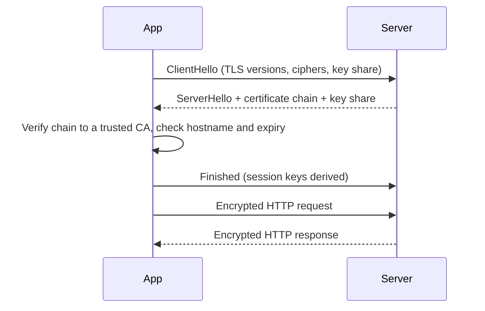
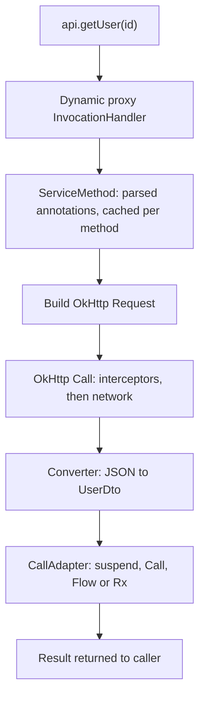
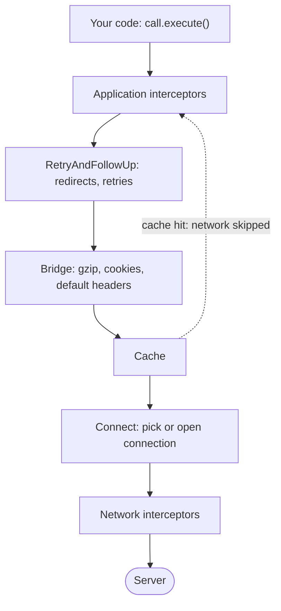
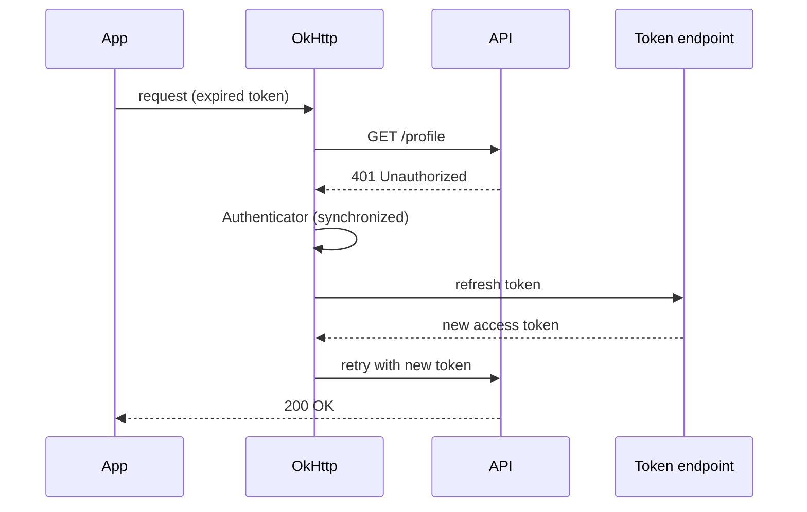
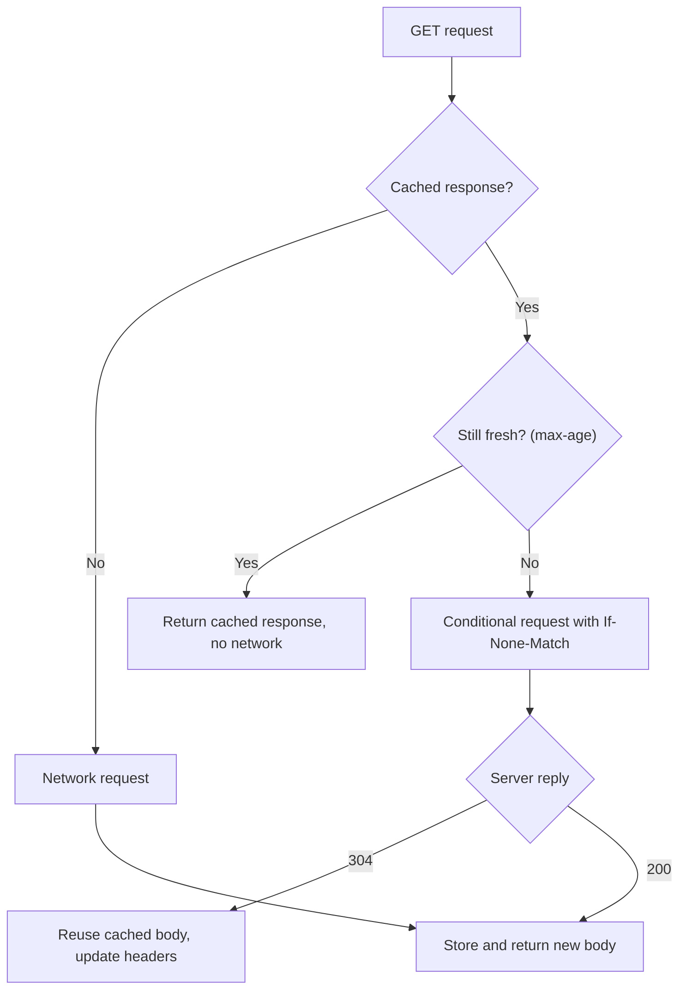
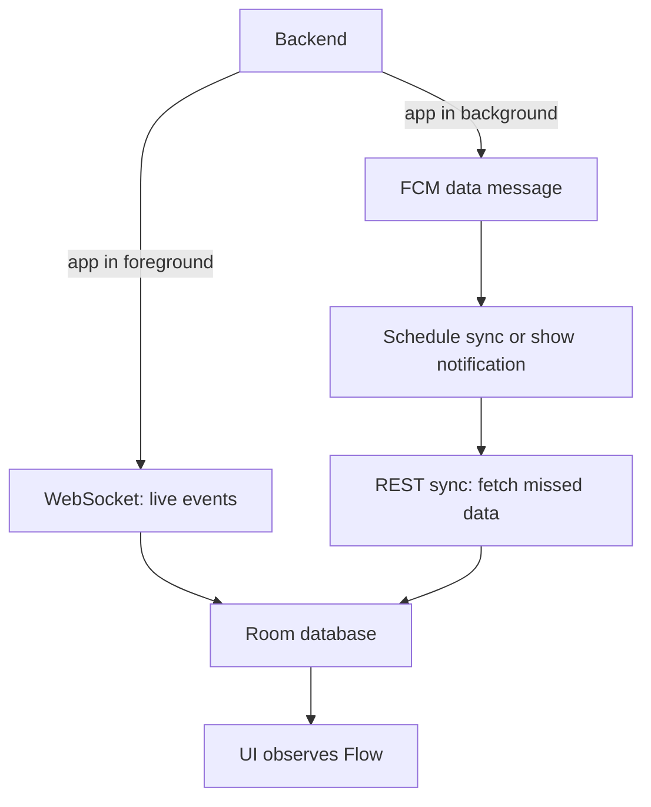
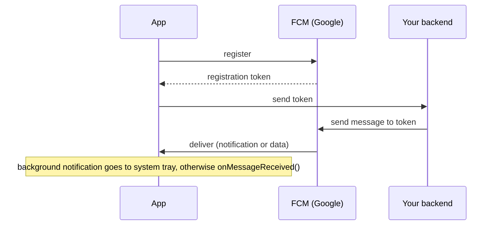
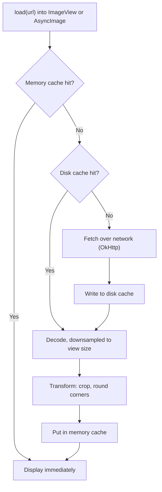
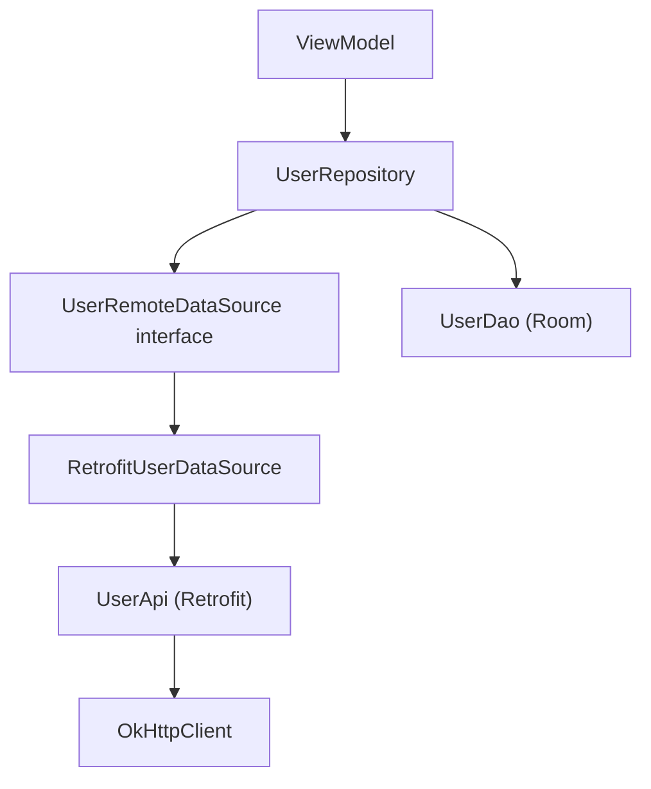
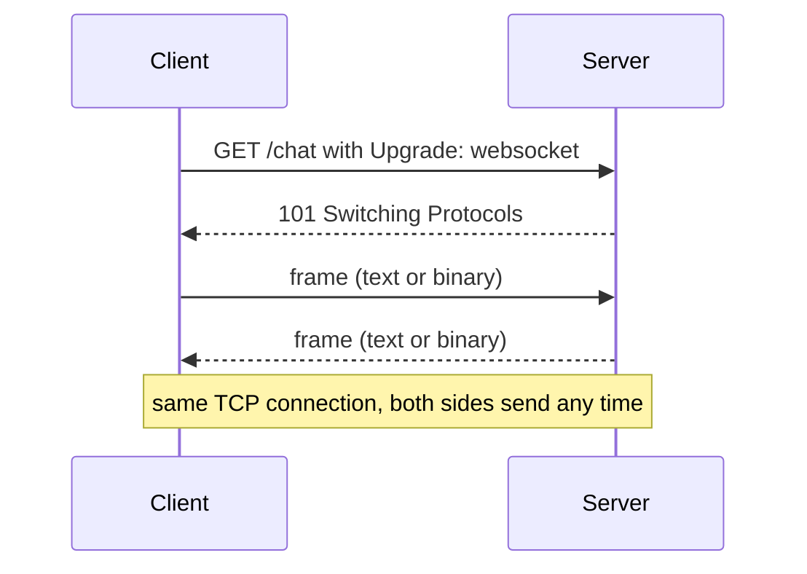

# Networking – Retrofit, OkHttp, APIs

[⬅ Back to index](../README.md)

Covers: HTTP basics, Retrofit, OkHttp & interceptors, auth/token refresh, caching, error handling, serialization, REST vs GraphQL, WebSockets, image loading.

---

## HTTP Basics

### 1. What are the HTTP methods and status codes?

<details>
<summary>Answer</summary>

**In short:** HTTP methods say *what you want to do* with a resource (`GET` read, `POST` create, `PUT` replace, `PATCH` partially update, `DELETE` remove). Status codes say *what happened*: 2xx success, 3xx redirect/cache, 4xx the client did something wrong, 5xx the server failed. On mobile the key ideas are **idempotency** (is it safe to retry?) and mapping codes to the right app behaviour (401 → refresh token, 429/503 → back off and retry, 4xx → show an error, don't retry).

#### Methods

| Method | Purpose | Safe (no side effects) | Idempotent (repeat = same result) | Has body |
|---|---|---|---|---|
| `GET` | Read a resource | Yes | Yes | No |
| `HEAD` | Like GET but headers only (size, ETag) | Yes | Yes | No |
| `OPTIONS` | Ask which methods are allowed (CORS preflight) | Yes | Yes | No |
| `POST` | Create / trigger an action | No | **No** | Yes |
| `PUT` | Replace the whole resource | No | Yes | Yes |
| `PATCH` | Partial update | No | Not guaranteed | Yes |
| `DELETE` | Remove | No | Yes | Usually no |

**Why idempotency matters on Android:** mobile networks drop connections mid-request. If a `PUT /profile` times out, you can safely send it again; the end state is the same. If a `POST /orders` times out, the server may already have created the order, so blindly retrying can create a duplicate. The usual fix is an **idempotency key** header (a UUID generated once per user action) that the server uses to de-duplicate.

#### Status codes

| Range | Meaning | Common codes | What the app usually does |
|---|---|---|---|
| **2xx** | Success | 200 OK, 201 Created, 204 No Content | Parse body (204 has none) |
| **3xx** | Redirect / cache | 301 Moved Permanently, 302 Found, 304 Not Modified | OkHttp follows redirects; 304 means "use your cached copy" |
| **4xx** | Client error | 400 Bad Request, **401 Unauthorized**, **403 Forbidden**, 404 Not Found, 409 Conflict, 422 Unprocessable Entity, **429 Too Many Requests** | Show validation/error message; don't retry (except 401 refresh, 429 back off) |
| **5xx** | Server error | 500 Internal Server Error, 502 Bad Gateway, **503 Service Unavailable**, 504 Gateway Timeout | Often transient: retry with backoff for idempotent calls |

**401 vs 403** is a classic question: **401** means "I don't know who you are" (missing or expired credentials, so refresh the token or log in again). **403** means "I know who you are, but you're not allowed" (refreshing won't help).

```kotlin
when (response.code()) {
    in 200..299 -> handleSuccess(response.body())
    401 -> refreshTokenOrLogout()          // usually done by an OkHttp Authenticator
    403 -> showError("You don't have access")
    404 -> showEmptyState()
    429, 503 -> retryAfter(response.headers()["Retry-After"])
    in 500..599 -> showRetryableError()
    else -> showGenericError()
}
```

**Common pitfalls:**
- Treating every non-200 as "network error". A 422 validation error should show the server's message, not "check your connection".
- Retrying `POST` on timeout without an idempotency key.
- Forgetting that 204 has no body (parsing it as JSON fails; use `Response<Unit>`).

**Likely follow-ups:**
- *Is PATCH idempotent?* Not necessarily, e.g. `{"op": "increment"}` changes the result each time; `PUT` is defined as idempotent.
- *What is 304 used for?* Conditional requests: the client sends `If-None-Match`/`If-Modified-Since`, and the server replies 304 with no body if nothing changed.
- *Which errors are retryable?* Network `IOException`s, 408, 429, 502/503/504, and only for idempotent requests.

</details>

### 2. What is REST? REST vs GraphQL vs gRPC?

<details>
<summary>Answer</summary>

**In short:** **REST** models the API as resources at URLs (`/users/42`) manipulated with HTTP verbs; it's stateless, usually JSON, and easy to cache, but a screen may need several calls (under-fetching) or get fields it doesn't need (over-fetching). **GraphQL** exposes one endpoint where the client sends a query for exactly the fields it needs. **gRPC** uses Protocol Buffers over HTTP/2 with generated, strongly typed stubs; it's compact, fast and supports streaming, so it's popular for internal or performance-critical APIs.

#### REST

REST (Representational State Transfer) is an architectural style rather than a protocol. Its key constraints:
- **Resources and URLs**: `GET /users/42`, `GET /users/42/posts`, `POST /posts`.
- **Uniform interface**: HTTP methods carry the meaning; status codes carry the result.
- **Stateless**: every request carries everything needed (e.g. the auth token); the server keeps no session per client between calls.
- **Cacheable**: responses declare cacheability with `Cache-Control`/`ETag`, so HTTP caches and CDNs work out of the box.

The downside for mobile: a profile screen may need `/users/42`, `/users/42/posts` and `/users/42/followers` (three round trips on a slow network), and each response may include fields the screen never shows.

#### GraphQL

```graphql
query Profile($id: ID!) {
  user(id: $id) {
    name
    avatarUrl
    posts(first: 10) { id title }
  }
}
```

One request, one response shaped exactly like the query. The schema is strongly typed and introspectable, so tools like **Apollo Kotlin** generate Kotlin models from your `.graphql` files. Trade-offs: everything is usually a `POST` to `/graphql`, so standard HTTP/CDN caching doesn't apply (Apollo provides a normalized client cache instead), and the server must guard against expensive queries.

#### gRPC

You define services and messages in a `.proto` file; code generation produces client stubs. Calls travel as binary Protobuf over HTTP/2, which gives small payloads, fast parsing and four call types: unary, server streaming, client streaming and bidirectional streaming.

```proto
service UserService {
  rpc GetUser (GetUserRequest) returns (User);
  rpc WatchPrices (PriceRequest) returns (stream Price);
}
```

#### Comparison

| | REST | GraphQL | gRPC |
|---|---|---|---|
| Transport | HTTP/1.1 or 2 | HTTP (usually POST) | HTTP/2 |
| Payload | JSON (usually) | JSON | Binary Protobuf |
| Shape of data | Fixed by server per endpoint | Chosen by client | Fixed by `.proto` |
| Over/under-fetching | Common | Solved | Fixed per RPC |
| HTTP caching / CDN | Easy | Hard (client cache instead) | Not applicable |
| Streaming | No (use WebSocket/SSE) | Subscriptions (usually via WebSocket) | Built in |
| Android client | Retrofit, Ktor | Apollo Kotlin | grpc-kotlin / grpc-java |
| Debuggability | Easy (curl, readable) | Good (playgrounds) | Harder (binary) |

**When to pick which:** REST for public and simple CRUD APIs; GraphQL when many clients need differently shaped data and the backend team can support it; gRPC for service-to-service or high-throughput mobile features where you control both ends.

**Likely follow-ups:**
- *How else can REST avoid over-fetching?* A Backend-for-Frontend (BFF) endpoint shaped for each screen, or field filtering like `?fields=name,avatar`.
- *What is the N+1 problem in GraphQL?* A naive resolver fetches each nested item separately; servers fix it with batching (DataLoader).

</details>

### 3. HTTP/1.1 vs HTTP/2? What is HTTPS/TLS?

<details>
<summary>Answer</summary>

**In short:** HTTP/1.1 is text-based and handles one request at a time per connection, so clients open several connections and requests queue up. **HTTP/2** is binary, **multiplexes** many requests as parallel streams over a single TCP connection, and compresses headers (HPACK); OkHttp uses it automatically when the server supports it. HTTP/3 runs over QUIC (UDP). **HTTPS** is HTTP over **TLS**, which encrypts traffic and authenticates the server with a certificate chain verified against trusted CAs. Android blocks cleartext HTTP by default for apps targeting API 28+.

#### HTTP/1.1 vs HTTP/2 vs HTTP/3

| | HTTP/1.1 | HTTP/2 | HTTP/3 |
|---|---|---|---|
| Format | Text | Binary frames | Binary frames |
| Concurrency | One in-flight request per connection (pipelining is rarely used) | Many streams multiplexed on one connection | Many streams, independent of each other |
| Headers | Plain text, repeated every request | Compressed (HPACK) | Compressed (QPACK) |
| Transport | TCP | TCP (+ TLS in practice) | QUIC over UDP (TLS 1.3 built in) |
| Head-of-line blocking | At the HTTP level | Fixed at HTTP level, still at TCP level (one lost packet stalls all streams) | Removed (streams are independent) |

**Why it matters on mobile:** each new connection costs a TCP handshake plus a TLS handshake, which is several round trips on a high-latency cellular network. HTTP/2 lets OkHttp send all of a screen's requests over one already-warm connection. OkHttp negotiates HTTP/2 via ALPN during the TLS handshake, so you don't configure anything. HTTP/3/QUIC also survives network changes better (connection migration from Wi-Fi to cellular); on Android it's available through **Cronet**, while OkHttp itself speaks HTTP/1.1 and HTTP/2.

#### How HTTPS/TLS works



TLS provides three things:
1. **Confidentiality**: traffic is encrypted with symmetric session keys agreed during the handshake.
2. **Integrity**: tampering is detected.
3. **Authentication**: the server proves it owns the domain via a certificate signed by a CA that the device trusts. The client checks the chain, the hostname and the validity dates.

TLS 1.3 (enabled by default since Android 10) completes the handshake in one round trip, versus two for TLS 1.2.

#### Cleartext on Android

For apps targeting API 28+, `cleartextTrafficPermitted` defaults to `false`, so plain `http://` calls fail. If you really need it (e.g. a local dev server), allow it for specific domains only with a Network Security Config:

```xml
<!-- res/xml/network_security_config.xml -->
<network-security-config>
    <domain-config cleartextTrafficPermitted="true">
        <domain includeSubdomains="false">10.0.2.2</domain>
    </domain-config>
</network-security-config>
```

**Common pitfalls:**
- Disabling certificate validation with a "trust all" `TrustManager` to fix a dev certificate issue, then shipping it. Use a debug-only `<debug-overrides>` in the Network Security Config instead.
- Allowing cleartext globally (`android:usesCleartextTraffic="true"`) instead of per domain.

**Likely follow-ups:**
- *Does HTTPS hide the URL?* The path, query and headers are encrypted; the hostname is visible through DNS and the TLS SNI field.
- *What is certificate pinning?* Additionally checking that the server's key matches one you ship in the app, so a mis-issued CA certificate can't be used to intercept traffic (see Q19).

</details>

---

## Retrofit & OkHttp

### 4. What is Retrofit? How does it work internally?

<details>
<summary>Answer</summary>

**In short:** Retrofit is Square's **type-safe HTTP client**: you describe endpoints as an annotated Kotlin/Java interface and Retrofit generates the implementation at runtime. `create()` returns a **dynamic proxy**; on each call it uses parsed (and cached) annotations to build an OkHttp `Request`, executes it through **OkHttp**, converts the body with a **Converter** (e.g. kotlinx.serialization) and shapes the return type with a **CallAdapter** (`suspend`, `Call`, Rx, etc.).

#### Defining and building an API

```kotlin
interface UserApi {
    @GET("users/{id}")
    suspend fun getUser(@Path("id") id: String): UserDto

    @GET("users")
    suspend fun search(@Query("q") q: String, @Query("page") page: Int): List<UserDto>

    @POST("users")
    suspend fun create(@Body user: CreateUserRequest): Response<UserDto>  // access code + headers

    @Multipart
    @POST("upload")
    suspend fun upload(@Part file: MultipartBody.Part): UploadDto

    @Headers("Cache-Control: no-cache")
    @GET("feed")
    suspend fun feed(@Header("X-Locale") locale: String): FeedDto
}

val api: UserApi = Retrofit.Builder()
    .baseUrl("https://api.example.com/")          // must end with '/'
    .client(okHttpClient)                          // shared OkHttpClient
    .addConverterFactory(Json.asConverterFactory("application/json".toMediaType()))
    .build()
    .create(UserApi::class.java)
```

#### What happens on a call



1. **Dynamic proxy**: `create()` uses `java.lang.reflect.Proxy` to produce an object implementing your interface. Every method call goes to a single `InvocationHandler`.
2. **ServiceMethod parsing**: the first time a method is called, Retrofit reads its annotations (`@GET`, `@Path`, `@Query`, `@Body`...) and parameter types, validates them, and builds a `RequestFactory`. The result is cached in a map, so reflection cost is paid once per method. (`validateEagerly(true)` parses everything at `create()` time, handy in debug builds to catch mistakes early.)
3. **Request building**: the arguments fill the URL template, query parameters, headers and body; `@Body` objects are serialized by the request Converter.
4. **Execution via OkHttp**: Retrofit wraps an OkHttp `Call`. All interceptors, connection pooling, caching and TLS are OkHttp's job.
5. **Response conversion**: the response Converter turns the `ResponseBody` into your type. Retrofit tries each registered converter factory in order and uses the first that can handle the type.
6. **CallAdapter**: decides the return type. The built-in one returns `Call<T>`; others adapt to RxJava, or `Result`-style wrappers. `suspend` functions are supported natively: Retrofit enqueues the call asynchronously and resumes the coroutine on completion, so the function is **main-safe**; you can call it from `viewModelScope` without `withContext(Dispatchers.IO)`.

**Return type behaviour for `suspend`:**

| Return type | Non-2xx response | Network failure |
|---|---|---|
| `T` | Throws `HttpException` | Throws `IOException` |
| `Response<T>` | Returns it; check `isSuccessful`, `errorBody()` | Throws `IOException` |

**Common pitfalls:**
- `baseUrl` without a trailing `/`, or a path starting with `/`, which makes it resolve from the host root and drop the base path.
- Creating a new Retrofit/OkHttpClient per request, which loses the connection pool and cache. Build them once (via DI).
- Forgetting R8 keep rules for models when using a reflection-based converter.

**Likely follow-ups:**
- *Why a dynamic proxy and not code generation?* It needs no annotation processor and keeps the API small; the parsing cost is cached.
- *How do you change the URL per call?* `@Url` parameter for a full URL, or an interceptor that rewrites the host.

</details>

### 5. What is OkHttp? Retrofit vs OkHttp?

<details>
<summary>Answer</summary>

**In short:** **OkHttp** is the HTTP engine that actually talks to the network: connections, connection pooling, HTTP/2, TLS, transparent GZIP, caching, redirects, retries and interceptors. **Retrofit sits on top of OkHttp** and adds a declarative, type-safe interface layer plus (de)serialization. You almost always use both: Retrofit for your REST API, the same shared OkHttpClient underneath (and directly for things like WebSockets or raw downloads).

#### What OkHttp gives you

- **Connection pooling and keep-alive**: reuses TCP/TLS connections across requests, avoiding repeated handshakes.
- **HTTP/2** with multiplexing, negotiated automatically.
- **Transparent GZIP**: adds `Accept-Encoding: gzip` and decompresses responses for you.
- **Response cache** on disk following HTTP caching headers.
- **Automatic recovery**: follows redirects, retries certain connection failures, tries alternative IP addresses for a host.
- **TLS configuration** and `CertificatePinner`.
- **Interceptors** and `Authenticator` for cross-cutting concerns.
- **WebSockets** and (via an extra module) Server-Sent Events.

```kotlin
// Plain OkHttp: you build requests and parse bodies yourself
val request = Request.Builder()
    .url("https://api.example.com/users/42")
    .header("Accept", "application/json")
    .build()

client.newCall(request).execute().use { response ->   // execute() blocks: background thread only
    if (!response.isSuccessful) throw IOException("HTTP ${response.code}")
    val user = json.decodeFromString<UserDto>(response.body!!.string())
}
```

```kotlin
// Retrofit: the same call, declared once
interface UserApi {
    @GET("users/{id}") suspend fun getUser(@Path("id") id: String): UserDto
}
```

#### Comparison

| | OkHttp | Retrofit |
|---|---|---|
| Level | Low-level HTTP client | High-level API layer |
| You write | `Request` objects, manual parsing | Annotated interface |
| Serialization | Manual | Converters (kotlinx.serialization, Moshi, Gson) |
| Coroutines | `execute()` / `enqueue()` (extensions available) | Native `suspend` support |
| Networking features | All of them | Delegates to OkHttp |
| Best for | WebSockets, file streaming, custom protocols, building other libraries | REST APIs |
| Multiplatform | JVM/Android | JVM/Android |

**Ktor Client** is the main alternative when you need **Kotlin Multiplatform**: the same networking code runs on Android and iOS (see Q20).

**Common pitfalls:**
- Not closing response bodies (`use { }`), which leaks connections; OkHttp logs "A connection was leaked".
- Calling `execute()` on the main thread, causing `NetworkOnMainThreadException`.
- Multiple OkHttpClient instances: each has its own pool, dispatcher and cache. Share one and derive variants with `newBuilder()`.

**Likely follow-ups:**
- *Can Retrofit work without OkHttp?* No, Retrofit 2 is built on OkHttp's `Call.Factory`; you can supply a custom `Call.Factory`, but OkHttp is the standard.
- *What does OkHttp's Dispatcher do?* It manages async calls: by default up to 64 concurrent requests overall and 5 per host.

</details>

### 6. What are Interceptors? Application vs Network interceptors?

<details>
<summary>Answer</summary>

**In short:** An interceptor is a hook in OkHttp's request pipeline (Chain of Responsibility) that can **observe, modify, short-circuit or retry** requests and responses. **Application interceptors** (`addInterceptor`) run **once per call**, before the cache and redirects, and see the original request; use them for auth headers, logging and common params. **Network interceptors** (`addNetworkInterceptor`) run for **every actual network request** (including each redirect) after a connection is chosen, are skipped for cache hits, and see what really goes over the wire.

#### Where they sit



Each interceptor receives a `Chain`, can change the request, calls `chain.proceed(request)` to pass it down, and can then inspect or replace the response on the way back up.

```kotlin
class AuthInterceptor(private val tokens: TokenStore) : Interceptor {
    override fun intercept(chain: Interceptor.Chain): Response {
        val request = chain.request().newBuilder()
            .header("Authorization", "Bearer ${tokens.accessToken}")
            .build()
        return chain.proceed(request)
    }
}

// Short-circuit: serve a fake response without touching the network (useful for demos/tests)
class MockInterceptor : Interceptor {
    override fun intercept(chain: Interceptor.Chain): Response =
        if (chain.request().url.encodedPath == "/config") {
            Response.Builder()
                .request(chain.request())
                .protocol(Protocol.HTTP_1_1)
                .code(200).message("OK")
                .body("""{"featureX":true}""".toResponseBody("application/json".toMediaType()))
                .build()
        } else chain.proceed(chain.request())
}

val client = OkHttpClient.Builder()
    .addInterceptor(AuthInterceptor(tokenStore))
    .addInterceptor(HttpLoggingInterceptor().apply {
        level = if (BuildConfig.DEBUG) HttpLoggingInterceptor.Level.BODY
                else HttpLoggingInterceptor.Level.NONE
    })
    .addNetworkInterceptor(StethoOrMetricsInterceptor())   // sees real wire traffic
    .build()
```

#### Application vs network

| | Application (`addInterceptor`) | Network (`addNetworkInterceptor`) |
|---|---|---|
| Invocations per call | Exactly once | Once per network hop (0 on cache hit, more on redirects) |
| Sees the cache response | Yes | No |
| Sees redirects / follow-ups | No, only final result | Yes, each one |
| Request it sees | The original one you built | The final one, including OkHttp-added headers (`Accept-Encoding`, `Host`) |
| Access to `chain.connection()` | `null` | The real connection (IP, TLS, protocol) |
| Can short-circuit or call `proceed` multiple times | Yes | Must call `proceed` exactly once |
| Typical use | Auth headers, logging, API keys, User-Agent, mocks, offline cache headers | Rewriting response `Cache-Control`, network metrics, inspecting compression |

**Rule of thumb:** use application interceptors unless you specifically need to see what's on the wire or touch every network hop.

**Common uses:** auth headers, `HttpLoggingInterceptor` (debug only), API keys and User-Agent, forcing cache headers, mock responses, and Chucker for in-app HTTP inspection in debug builds.

**Common pitfalls:**
- Logging at `BODY` level in release builds, which leaks tokens and personal data into logcat and is slow for large bodies.
- Doing token **refresh** inside an interceptor without synchronization; use an `Authenticator` (Q7).
- Order matters: interceptors run in the order added, so a logging interceptor added before the auth interceptor won't show the auth header.

**Likely follow-ups:**
- *How is this Chain of Responsibility?* Each link handles part of the work and delegates to the next via `proceed()`; OkHttp's own features (cache, retry, connect) are built the same way.
- *How would you add a header to every request?* An application interceptor that copies the request with `newBuilder().header(...)`.

</details>

### 7. How do you handle token refresh (401) with OkHttp?

<details>
<summary>Answer</summary>

**In short:** Implement OkHttp's **`Authenticator`**. OkHttp calls it automatically when a response is **401**; you refresh the access token and return a new request with the updated `Authorization` header (or `null` to give up). Three essentials: **synchronize** so that many parallel 401s trigger only one refresh, make the refresh call with a **separate client** that doesn't have the auth logic (to avoid recursion), and **log the user out** when the refresh token itself is rejected.

#### The flow



#### Implementation

```kotlin
class TokenAuthenticator(
    private val tokenStore: TokenStore,
    private val refreshApi: RefreshApi,     // Retrofit built on a client WITHOUT this authenticator
    private val onLogout: () -> Unit
) : Authenticator {

    override fun authenticate(route: Route?, response: Response): Request? {
        // 1. Avoid infinite loops: give up if we already retried with a fresh token
        if (responseCount(response) >= 2) return null

        val tokenUsed = response.request.header("Authorization")?.removePrefix("Bearer ")

        synchronized(this) {
            // 2. Another thread may have refreshed while we waited for the lock
            val current = tokenStore.accessToken
            if (current != null && current != tokenUsed) {
                return response.request.withToken(current)
            }

            // 3. Refresh. runBlocking is acceptable: this runs on an OkHttp background thread
            val newToken = runBlocking {
                runCatching { refreshApi.refresh(tokenStore.refreshToken!!) }.getOrNull()
            }
            if (newToken == null) {
                tokenStore.clear()
                onLogout()                  // refresh token expired/revoked
                return null                 // the original 401 is returned to the caller
            }
            tokenStore.save(newToken)
            return response.request.withToken(newToken.accessToken)
        }
    }

    private fun Request.withToken(token: String) =
        newBuilder().header("Authorization", "Bearer $token").build()

    private fun responseCount(response: Response): Int {
        var count = 1
        var prior = response.priorResponse
        while (prior != null) { count++; prior = prior.priorResponse }
        return count
    }
}

val client = OkHttpClient.Builder()
    .addInterceptor(AuthInterceptor(tokenStore))   // attaches the current token to every request
    .authenticator(TokenAuthenticator(tokenStore, refreshApi, onLogout))
    .build()
```

#### Why each piece matters

- **Interceptor + Authenticator together**: the interceptor adds the token proactively; the authenticator reacts only when the server says it's invalid.
- **Synchronization and the "already refreshed?" check**: a screen often fires 3–5 requests at once. If the token expired, all of them get 401. Without the lock, you'd call the refresh endpoint 5 times, and with rotating refresh tokens the later calls would fail and log the user out. With the lock, the first thread refreshes; the others see a newer token and just retry.
- **Separate client for refresh**: if the refresh call goes through the same authenticator and returns 401, you get recursion.
- **Loop protection**: if the server keeps returning 401 even with a new token, stop after one retry.

**Alternative:** some teams refresh proactively in the interceptor when the JWT's `exp` is close, which avoids the failed first request. It still needs the same locking. Ktor has this built in: the `Auth` plugin's `bearer { refreshTokens { ... } }`.

**Common pitfalls:**
- Using an Interceptor that catches 401 and calls refresh without a lock (thundering herd of refreshes).
- Refreshing on **403**; that's a permission problem, not an expired token.
- Not handling the logout path, leaving the app in a loop of failing requests.

**Likely follow-ups:**
- *What's the difference between `authenticator` and `proxyAuthenticator`?* The first handles 401 from the origin server, the second 407 from a proxy.
- *Where do you store tokens?* Encrypted storage (e.g. data encrypted with a Keystore-backed key), never plain SharedPreferences or logs.

</details>

### 8. How do you handle API errors properly?

<details>
<summary>Answer</summary>

**In short:** Distinguish the failure types: **HTTP errors** (server answered with non-2xx; Retrofit `suspend fun ...: T` throws `HttpException`), **network errors** (no connection, timeout, DNS: `IOException`), and **parsing errors** (unexpected JSON: e.g. `SerializationException`). Catch them once in the data layer, convert them to a sealed **`NetworkResult`/domain error**, never swallow `CancellationException`, and let the ViewModel map errors to user-friendly UI states.

#### What can go wrong

| Failure | Exception / signal | Typical handling |
|---|---|---|
| No internet, timeout, DNS, connection reset | `IOException` (`UnknownHostException`, `SocketTimeoutException`, ...) | "You're offline / try again", retry, show cached data |
| 4xx | `HttpException` (or `Response.isSuccessful == false`) | Parse error body, show specific message, don't retry |
| 401 | Handled by the Authenticator; if still 401, log out | Navigate to login |
| 5xx | `HttpException` | Generic "something went wrong", retry with backoff |
| Bad JSON | `SerializationException` / `JsonDataException` | Log to crash reporting, show generic error |
| Coroutine cancelled | `CancellationException` | **Rethrow**, it's not an error |

#### Wrapping calls in the data layer

```kotlin
sealed interface NetworkResult<out T> {
    data class Success<T>(val data: T) : NetworkResult<T>
    data class HttpError(val code: Int, val error: ApiError?) : NetworkResult<Nothing>
    data object NetworkError : NetworkResult<Nothing>
    data class UnknownError(val cause: Throwable) : NetworkResult<Nothing>
}

@Serializable
data class ApiError(val code: String, val message: String)

suspend fun <T> safeApiCall(call: suspend () -> T): NetworkResult<T> = try {
    NetworkResult.Success(call())
} catch (e: CancellationException) {
    throw e                                        // keep structured concurrency working
} catch (e: HttpException) {
    NetworkResult.HttpError(e.code(), parseError(e.response()?.errorBody()))
} catch (e: IOException) {
    NetworkResult.NetworkError
} catch (e: SerializationException) {
    NetworkResult.UnknownError(e)
}

private fun parseError(body: ResponseBody?): ApiError? =
    body?.string()?.let { runCatching { json.decodeFromString<ApiError>(it) }.getOrNull() }
```

```kotlin
// Repository
suspend fun loadProfile(id: String) = safeApiCall { api.getUser(id) }

// ViewModel: map to UI, never show raw exception text
viewModelScope.launch {
    _state.value = when (val result = repo.loadProfile(id)) {
        is NetworkResult.Success -> UiState.Content(result.data.toUi())
        NetworkResult.NetworkError -> UiState.Error(R.string.error_offline, canRetry = true)
        is NetworkResult.HttpError -> UiState.Error(
            messageFor(result.code, result.error), canRetry = result.code >= 500
        )
        is NetworkResult.UnknownError -> UiState.Error(R.string.error_generic, canRetry = true)
    }
}
```

`Response<T>` as the return type is the alternative: no exception for non-2xx, you check `isSuccessful`, `code()` and `errorBody()` yourself. It still throws `IOException` for network failures.

**Design tips:**
- Convert transport errors to **domain errors** (`ProfileError.NotFound`, `Offline`) so the UI doesn't depend on HTTP codes.
- For offline-first screens, show cached data **plus** a non-blocking error (snackbar) instead of a full-screen error.
- Report unexpected errors (parsing, 5xx spikes) to crash/analytics, not expected ones like offline.

**Common pitfalls:**
- `catch (e: Exception)` without rethrowing `CancellationException`, which breaks cancellation (the coroutine keeps going after the screen is closed).
- Reading `errorBody()` twice: it's a one-shot stream.
- Showing `e.message` to users.

**Likely follow-ups:**
- *Kotlin's `runCatching` here?* It also catches `CancellationException`, so prefer an explicit try/catch or rethrow it.
- *Where do retries go?* In the repository or a use case, around the call, only for retryable errors (Q9).

</details>

### 9. How do you implement retry with exponential backoff?

<details>
<summary>Answer</summary>

**In short:** Retry only **transient** failures (network `IOException`, 408, 429, 502/503/504) and only **idempotent** requests, waiting longer after each attempt (e.g. 0.5 s, 1 s, 2 s) plus random **jitter**, with a maximum number of attempts. Honor the server's `Retry-After` header for 429/503. In coroutines this is a small `suspend` helper or Flow's `retryWhen`; for background sync, let WorkManager do it with `BackoffPolicy.EXPONENTIAL`.

#### Why exponential + jitter

If a server is overloaded and every client retries immediately, the retries make the overload worse. **Exponential backoff** spreads attempts out over time. **Jitter** (randomness) stops thousands of clients that failed at the same moment from retrying in lock-step and hitting the server in synchronized waves (the "thundering herd").

#### Coroutine helper

```kotlin
suspend fun <T> retryWithBackoff(
    times: Int = 3,
    initialDelayMs: Long = 500,
    maxDelayMs: Long = 8_000,
    factor: Double = 2.0,
    shouldRetry: (Throwable) -> Boolean = ::isTransient,
    block: suspend () -> T
): T {
    var delayMs = initialDelayMs
    repeat(times - 1) {
        try {
            return block()
        } catch (e: CancellationException) {
            throw e
        } catch (e: Exception) {
            if (!shouldRetry(e)) throw e
        }
        delay(delayMs + Random.nextLong(0, delayMs / 2))     // jitter
        delayMs = (delayMs * factor).toLong().coerceAtMost(maxDelayMs)
    }
    return block()                                            // last attempt: let it throw
}

fun isTransient(e: Throwable): Boolean = when (e) {
    is IOException -> true
    is HttpException -> e.code() in setOf(408, 429, 502, 503, 504)
    else -> false
}

// Usage
val user = retryWithBackoff { api.getUser(id) }
```

To respect `Retry-After`, read `e.response()?.headers()?.get("Retry-After")` in the catch block and use it (seconds) as the delay for that attempt.

#### With Flow

```kotlin
repository.observePrices()
    .retryWhen { cause, attempt ->
        if (cause is IOException && attempt < 3) {
            delay(500L * (1L shl attempt.toInt()))   // 500, 1000, 2000 ms
            true
        } else false
    }
    .catch { emit(PriceState.Error) }
```

#### With WorkManager (background sync)

```kotlin
val request = OneTimeWorkRequestBuilder<SyncWorker>()
    .setConstraints(Constraints(requiredNetworkType = NetworkType.CONNECTED))
    .setBackoffCriteria(BackoffPolicy.EXPONENTIAL, 30, TimeUnit.SECONDS)
    .build()
// In SyncWorker.doWork(): return Result.retry() on transient failure
```

WorkManager persists the retry across process death and reboots, which an in-memory loop can't.

#### What OkHttp already does

OkHttp has `retryOnConnectionFailure(true)` by default: it silently retries some connection-level failures (e.g. a stale pooled connection, trying another IP of the host). It does **not** retry on HTTP status codes or apply backoff. Writing backoff as an OkHttp interceptor is possible but blocks an OkHttp thread while sleeping; doing it at the coroutine/repository level is usually cleaner.

**Common pitfalls:**
- Retrying 4xx (other than 408/429): a 400 or 404 will fail the same way every time.
- Retrying non-idempotent `POST`s without an idempotency key, creating duplicates.
- No upper bound, so a user waits minutes on a spinner. Combine a small attempt count with a visible "Retry" button.
- Catching `CancellationException` and retrying after the screen was closed.

**Likely follow-ups:**
- *Full jitter vs equal jitter?* Full jitter picks a random delay between 0 and the current cap; equal jitter keeps half the delay fixed and randomizes the rest. Both avoid synchronized retries.
- *Should the user see retries?* Short automatic retries are invisible; after they fail, show an error with a manual retry.

</details>

### 10. How does HTTP caching work with OkHttp?

<details>
<summary>Answer</summary>

**In short:** Give OkHttpClient a `Cache(directory, maxSize)` and it behaves like a browser cache, following standard HTTP headers. `Cache-Control: max-age` decides how long a response is **fresh** (served without any network call); after that OkHttp **revalidates** with `If-None-Match` (ETag) or `If-Modified-Since`, and a **304 Not Modified** lets it reuse the cached body. For offline you can force cached responses with `Cache-Control: only-if-cached, max-stale=...`. For real offline-first apps, a **Room database as the single source of truth** is more reliable than the HTTP cache.

#### Setup

```kotlin
val client = OkHttpClient.Builder()
    .cache(Cache(File(context.cacheDir, "http_cache"), 10L * 1024 * 1024))  // 10 MB
    .build()
```

OkHttp only caches `GET` responses.

#### How a request flows through the cache



#### Key headers

| Header | Direction | Meaning |
|---|---|---|
| `Cache-Control: max-age=60` | Response | Fresh for 60 s; serve from cache without asking |
| `Cache-Control: no-cache` | Either | May store, but **must revalidate** before every use |
| `Cache-Control: no-store` | Either | Never store (sensitive data) |
| `ETag: "abc123"` | Response | Version identifier of the body |
| `If-None-Match: "abc123"` | Request | "Send the body only if it changed" |
| `Last-Modified` / `If-Modified-Since` | Response / Request | Date-based version of the same idea |
| `Cache-Control: only-if-cached, max-stale=N` | Request | Use cache only, accept data up to N seconds stale; returns **504** if nothing cached |

#### Forcing cache behaviour

**Offline fallback** (application interceptor, request side):

```kotlin
class OfflineCacheInterceptor(private val isOnline: () -> Boolean) : Interceptor {
    override fun intercept(chain: Interceptor.Chain): Response {
        var request = chain.request()
        if (!isOnline()) {
            request = request.newBuilder()
                .cacheControl(CacheControl.Builder()
                    .onlyIfCached()
                    .maxStale(7, TimeUnit.DAYS)
                    .build())
                .build()
        }
        return chain.proceed(request)
    }
}
```

**Server sends no cache headers** (network interceptor, response side; use sparingly since it overrides the server's intent):

```kotlin
class ForceCacheInterceptor : Interceptor {
    override fun intercept(chain: Interceptor.Chain): Response =
        chain.proceed(chain.request()).newBuilder()
            .header("Cache-Control", "public, max-age=60")
            .removeHeader("Pragma")
            .build()
}
```

Per request, `CacheControl.FORCE_NETWORK` and `CacheControl.FORCE_CACHE` skip or force the cache.

#### HTTP cache vs Room

| | OkHttp cache | Room as source of truth |
|---|---|---|
| Granularity | Whole response per URL | Individual entities, queryable |
| Offline writes | No | Yes (queue and sync) |
| UI updates | You must re-request | Observe a `Flow` from the DB |
| Eviction | LRU, you don't control it | You decide |
| Effort | Almost none | More code |

The HTTP cache is great for cheap wins (config, images, rarely changing lists); offline-first features should store data in Room and treat the network as a sync mechanism.

**Common pitfalls:**
- Expecting caching to work when the server sends `no-store` or no validators. Check response headers first.
- Caching authenticated, user-specific responses with `public` so they leak across accounts on a shared cache.
- Creating multiple `Cache` instances on the same directory (not allowed; share one client).

**Likely follow-ups:**
- *How do you see if a response came from cache?* `response.cacheResponse` vs `response.networkResponse` (both non-null means a conditional request was made).
- *Why is a 304 still useful if it needs a network call?* It saves the body download, which is most of the bytes.

</details>

### 11. How do you configure timeouts?

<details>
<summary>Answer</summary>

**In short:** Set them on the `OkHttpClient.Builder`: `connectTimeout` (establishing the TCP/TLS connection), `readTimeout` (max gap between bytes received), `writeTimeout` (max gap between bytes sent) and `callTimeout` (the whole call end to end, including DNS, redirects and retries). The first three default to **10 seconds**; `callTimeout` defaults to **none**. Reuse **one** client instance and derive variants with `client.newBuilder()` when an endpoint needs different values.

#### The four timeouts

| Timeout | Covers | Default | Fails with |
|---|---|---|---|
| `connectTimeout` | TCP connect + TLS handshake | 10 s | `SocketTimeoutException` / `ConnectException` |
| `readTimeout` | Each wait for data from the server (per read, not total) | 10 s | `SocketTimeoutException` |
| `writeTimeout` | Each write of the request body | 10 s | `SocketTimeoutException` |
| `callTimeout` | Whole call: DNS, connect, write, server time, read, redirects, retries | 0 (no limit) | `InterruptedIOException` |

**Important subtlety:** `readTimeout` is the maximum *inactivity* between bytes, not the total download time. A slow server that sends one byte every 9 s will never trip a 10 s read timeout. That's why `callTimeout` exists: it puts a hard ceiling on the whole operation.

```kotlin
val baseClient = OkHttpClient.Builder()
    .connectTimeout(15, TimeUnit.SECONDS)
    .readTimeout(30, TimeUnit.SECONDS)
    .writeTimeout(30, TimeUnit.SECONDS)
    .callTimeout(60, TimeUnit.SECONDS)
    .build()

// Variant for large uploads: shares the connection pool, dispatcher and cache
val uploadClient = baseClient.newBuilder()
    .writeTimeout(5, TimeUnit.MINUTES)
    .callTimeout(0, TimeUnit.SECONDS)         // no total limit; rely on per-write timeout
    .build()
```

Per call you can also use `call.timeout().timeout(...)`, and with coroutines `withTimeout(...)` around a suspend call; cancellation of the coroutine cancels the underlying OkHttp call.

#### Why one client

Each `OkHttpClient` owns a **connection pool**, a **dispatcher** (thread pool) and possibly a **cache**. Creating clients per request throws away warm connections (every call pays a new TCP + TLS handshake) and leaks threads. `newBuilder()` creates a client that shares these resources while overriding settings. Provide the base client as a singleton via DI.

#### Choosing values

- Short connect timeouts (10–15 s) fail fast on dead networks.
- Read timeouts should exceed your slowest legitimate server response (report generation, search).
- For user-facing actions, a total `callTimeout` keeps spinners from hanging forever.
- Long uploads/downloads belong in WorkManager with generous per-operation timeouts.

**Common pitfalls:**
- Setting a huge `readTimeout` to "fix" slow endpoints, hiding real server problems.
- Expecting `readTimeout` to cap total time (it doesn't).
- Treating a timeout on a `POST` as "nothing happened"; the server may have processed it.

**Likely follow-ups:**
- *Which exception type is a timeout?* `SocketTimeoutException`, a subclass of `IOException`, so it lands in your network-error branch.
- *Does Retrofit have its own timeouts?* No, all timeouts come from the OkHttp client you pass to it.

</details>

### 12. Gson vs Moshi vs kotlinx.serialization?

<details>
<summary>Answer</summary>

**In short:** **Gson** is reflection-based, not Kotlin-aware (it ignores default values and can put `null` into non-null properties) and is in maintenance mode. **Moshi** is Kotlin-aware, respecting nullability and defaults, either via reflection (`KotlinJsonAdapterFactory`) or via **codegen** (KSP) that avoids reflection. **kotlinx.serialization** is a compiler plugin that generates serializers at compile time: **no reflection**, multiplatform, supports defaults, plays well with R8, and is the usual recommendation for new Kotlin projects.

#### The Gson null-safety trap

```kotlin
data class User(val name: String, val premium: Boolean = false)

// JSON: {}   (fields missing)
val user = gson.fromJson("{}", User::class.java)
// Gson creates the object without calling the constructor (via Unsafe):
// user.name == null even though the type is non-null String  -> NPE later, far from the cause
// user.premium == false only because the JVM default is false, not because of the Kotlin default
```

With kotlinx.serialization or Moshi (Kotlin adapters), the same JSON fails fast with a clear error for `name`, and `premium` uses its default.

#### kotlinx.serialization in practice

```kotlin
@Serializable
data class UserDto(
    val id: String,
    @SerialName("display_name") val name: String,
    val premium: Boolean = false,          // used when field is missing
    val avatarUrl: String? = null
)

val json = Json {
    ignoreUnknownKeys = true      // don't crash when backend adds fields
    coerceInputValues = true      // null for a non-null field with a default -> use default
    explicitNulls = false
}

val retrofit = Retrofit.Builder()
    .baseUrl(BASE_URL)
    .addConverterFactory(json.asConverterFactory("application/json".toMediaType()))
    .build()
```

#### Moshi with codegen

```kotlin
@JsonClass(generateAdapter = true)       // KSP generates UserDtoJsonAdapter at build time
data class UserDto(
    val id: String,
    @Json(name = "display_name") val name: String,
    val premium: Boolean = false
)
```

#### Comparison

| | Gson | Moshi | kotlinx.serialization |
|---|---|---|---|
| Mechanism | Runtime reflection | Reflection or KSP codegen | Compiler plugin |
| Kotlin nullability | Not enforced | Enforced | Enforced |
| Default values | Ignored | Respected | Respected |
| Multiplatform | No | No (JVM) | Yes |
| R8/ProGuard | Needs keep rules | Codegen needs few | Minimal (rules shipped with the library) |
| Formats | JSON | JSON | JSON, Protobuf, CBOR, others |
| Status | Maintenance mode | Active | Active, JetBrains |

**Why reflection matters on Android:** reflection is slower on first use, and R8 renames or removes fields it can't see being used, so reflection-based parsing in release builds can silently produce empty objects unless you add keep rules.

**Common pitfalls:**
- Forgetting `ignoreUnknownKeys = true`, so a new backend field crashes old app versions.
- Using the DTO directly in UI; map DTOs to domain models so API changes don't ripple through the app.
- Mixing converters: Retrofit uses the first factory that claims a type, so order matters.

**Likely follow-ups:**
- *How do you migrate from Gson?* Model by model: add the new converter first for annotated types, or switch per Retrofit service, with tests on real JSON fixtures.
- *How do you handle polymorphic JSON?* kotlinx.serialization sealed classes with a class discriminator; Moshi `PolymorphicJsonAdapterFactory`.

</details>

### 13. How do you upload or download large files?

<details>
<summary>Answer</summary>

**In short:** **Stream** the bytes instead of loading the whole file into memory. Upload with `@Multipart` and a `RequestBody` backed by the file (wrap it to report progress). Download with `@Streaming` and copy `ResponseBody.byteStream()` to a file in chunks. Run long or must-finish transfers in **WorkManager** (as a foreground/long-running worker with a notification), or use `DownloadManager` for simple downloads; resume interrupted downloads with the HTTP **`Range`** header.

#### Upload with progress

```kotlin
interface UploadApi {
    @Multipart
    @POST("upload")
    suspend fun upload(
        @Part file: MultipartBody.Part,
        @Part("description") description: RequestBody
    ): UploadDto
}

class ProgressRequestBody(
    private val file: File,
    private val contentType: MediaType?,
    private val onProgress: (Float) -> Unit
) : RequestBody() {
    override fun contentType() = contentType
    override fun contentLength() = file.length()

    override fun writeTo(sink: BufferedSink) {
        val total = contentLength()
        var uploaded = 0L
        file.source().use { source ->              // Okio: streams, never loads whole file
            while (true) {
                val read = source.read(sink.buffer, 8_192)
                if (read == -1L) break
                uploaded += read
                sink.flush()
                onProgress(uploaded / total.toFloat())
            }
        }
    }
}

val body = ProgressRequestBody(file, "video/mp4".toMediaType()) { p -> progress.value = p }
val part = MultipartBody.Part.createFormData("file", file.name, body)
api.upload(part, "Holiday".toRequestBody("text/plain".toMediaType()))
```

Note: `HttpLoggingInterceptor` at `BODY` level reads the request body itself, which calls `writeTo` twice; disable body logging for uploads.

For content from the system picker (a `content://` Uri), you often don't have a `File`; open `contentResolver.openInputStream(uri)` and stream from it in `writeTo`.

#### Download to a file

```kotlin
interface DownloadApi {
    @Streaming                                    // don't buffer the whole body in memory
    @GET
    suspend fun download(@Url url: String, @Header("Range") range: String? = null): ResponseBody
}

suspend fun downloadTo(url: String, target: File) = withContext(Dispatchers.IO) {
    val existing = if (target.exists()) target.length() else 0L
    val body = api.download(url, if (existing > 0) "bytes=$existing-" else null)
    body.byteStream().use { input ->
        FileOutputStream(target, /* append = */ existing > 0).use { output ->
            val buffer = ByteArray(8 * 1024)
            while (true) {
                ensureActive()                    // stop promptly if cancelled
                val n = input.read(buffer)
                if (n == -1) break
                output.write(buffer, 0, n)
            }
        }
    }
}
```

**Resuming:** send `Range: bytes=<alreadyDownloaded>-`. If the server supports it, it replies **206 Partial Content** and you append; if it replies 200, it ignored the range and you must start over (truncate the file). Use `ETag`/`If-Range` to make sure the file didn't change in between.

#### Making it reliable

| Option | Use when |
|---|---|
| Coroutine in `viewModelScope` | Small files, user is waiting on the screen |
| **WorkManager** (with `setForeground` for long work) | Must complete even if the user leaves or the process dies; needs constraints (Wi-Fi, charging) and retries |
| `DownloadManager` | Plain HTTP downloads to public storage with a system notification; least code, least control |

For very large uploads, backends often support **chunked/resumable uploads** (upload parts, then commit), so a failure only redoes one chunk.

**Common pitfalls:**
- `response.body.string()` or `bytes()` on a large file, causing `OutOfMemoryError`.
- Forgetting `@Streaming`, so Retrofit buffers the entire body before returning.
- Updating UI progress on every 8 KB chunk; throttle updates (e.g. only on whole-percent changes).

**Likely follow-ups:**
- *Where do you save downloads?* App-specific storage (`filesDir`/`cacheDir`) needs no permission; shared media goes through MediaStore.
- *How do you show progress for downloads?* Compare bytes read against `body.contentLength()` (may be -1 if the server uses chunked encoding).

</details>

### 14. How do you check network connectivity?

<details>
<summary>Answer</summary>

**In short:** Use `ConnectivityManager.registerDefaultNetworkCallback` to observe the default network (`onAvailable`, `onLost`, `onCapabilitiesChanged`) and check `NetworkCapabilities` for `NET_CAPABILITY_INTERNET` and `NET_CAPABILITY_VALIDATED` (the system actually verified internet access). Wrap the callback in a `callbackFlow` to expose a `Flow<Boolean>`. `activeNetworkInfo` / `NetworkInfo` are deprecated. And remember: "connected" never guarantees a request will succeed, so always handle `IOException`.

#### One-off check

```kotlin
fun Context.isOnline(): Boolean {
    val cm = getSystemService(ConnectivityManager::class.java)
    val caps = cm.getNetworkCapabilities(cm.activeNetwork) ?: return false
    return caps.hasCapability(NetworkCapabilities.NET_CAPABILITY_INTERNET) &&
           caps.hasCapability(NetworkCapabilities.NET_CAPABILITY_VALIDATED)
}
```

Requires `android.permission.ACCESS_NETWORK_STATE` (a normal, install-time permission).

#### Observing changes as a Flow

```kotlin
class ConnectivityObserver(context: Context) {
    private val cm = context.getSystemService(ConnectivityManager::class.java)

    val isOnline: Flow<Boolean> = callbackFlow {
        val callback = object : ConnectivityManager.NetworkCallback() {
            override fun onCapabilitiesChanged(network: Network, caps: NetworkCapabilities) {
                trySend(
                    caps.hasCapability(NetworkCapabilities.NET_CAPABILITY_INTERNET) &&
                    caps.hasCapability(NetworkCapabilities.NET_CAPABILITY_VALIDATED)
                )
            }
            override fun onLost(network: Network) { trySend(false) }
            override fun onUnavailable() { trySend(false) }
        }
        trySend(currentStatus())                      // initial value
        cm.registerDefaultNetworkCallback(callback)
        awaitClose { cm.unregisterNetworkCallback(callback) }   // no leak
    }.distinctUntilChanged()
     .conflate()

    private fun currentStatus(): Boolean =
        cm.getNetworkCapabilities(cm.activeNetwork)
            ?.hasCapability(NetworkCapabilities.NET_CAPABILITY_VALIDATED) == true
}

// ViewModel
val offlineBanner = connectivityObserver.isOnline
    .map { !it }
    .stateIn(viewModelScope, SharingStarted.WhileSubscribed(5_000), false)
```

**Why `onCapabilitiesChanged` and not just `onAvailable`?** `onAvailable` fires when a network connects, possibly before validation (e.g. a captive-portal Wi-Fi at a hotel). Validation is reported later through capabilities.

#### Useful capabilities

| Check | Meaning |
|---|---|
| `NET_CAPABILITY_INTERNET` | Network is supposed to reach the internet |
| `NET_CAPABILITY_VALIDATED` | System confirmed it actually does |
| `NET_CAPABILITY_NOT_METERED` | Unmetered (typically Wi-Fi): good for large downloads |
| `hasTransport(TRANSPORT_WIFI / CELLULAR / VPN)` | Transport type |
| `linkDownstreamBandwidthKbps` | Rough bandwidth estimate |

**How to use connectivity in practice:** show an offline banner, pause automatic refresh, and trigger a sync when connectivity returns. Don't block requests based on it: try the request and handle failure. For background work, use WorkManager's `NetworkType.CONNECTED`/`UNMETERED` constraint instead of your own listener.

**Common pitfalls:**
- Forgetting to unregister the callback (leak; there's also a per-app limit on registered callbacks).
- Using the deprecated `CONNECTIVITY_ACTION` broadcast, which manifest receivers no longer get for apps targeting API 24+.
- Treating "Wi-Fi connected" as "online" (captive portals, dead routers).

**Likely follow-ups:**
- *`registerDefaultNetworkCallback` vs `registerNetworkCallback`?* The default one tracks whichever network the app's traffic uses; the other one tracks all networks matching a `NetworkRequest`.
- *How do you test offline behaviour?* Airplane mode or emulator network settings, and MockWebServer with failure responses in tests.

</details>

---

## Real-time & Other

### 15. WebSocket vs polling vs SSE vs FCM push?

<details>
<summary>Answer</summary>

**In short:** **Short polling** asks the server every N seconds (simple but wasteful). **Long polling** keeps a request open until there's data, then re-opens it. **SSE** is a one-way server-to-client event stream over a normal HTTP response. **WebSocket** is a persistent **full-duplex** connection, ideal for chat, live tracking or trading while the app is in the foreground. **FCM** push reaches the device even when your app isn't running, using one shared system connection, so it's the battery-friendly choice for background updates.

#### Comparison

| | Direction | Latency | Battery / server cost | Works when app is in background | Typical use |
|---|---|---|---|---|---|
| Short polling | Client pulls | Up to N s | High (many empty requests) | Only with scheduled work | Rarely changing status |
| Long polling | Client pulls, server holds | Low | Medium | No | Fallback when WebSocket blocked |
| SSE | Server to client | Low | Low | No | Live scores, feeds, LLM token streaming |
| WebSocket | Both ways | Lowest | Low per message, connection must stay up | No (keep it to foreground) | Chat, multiplayer, live location |
| FCM | Server to device | Seconds (best effort) | Lowest (shared connection) | **Yes** | New message alerts, "data changed, sync now" |

#### WebSocket with OkHttp

```kotlin
class ChatSocket(private val client: OkHttpClient) {
    private var socket: WebSocket? = null
    val messages = MutableSharedFlow<String>(extraBufferCapacity = 64)

    fun connect() {
        val request = Request.Builder().url("wss://chat.example.com/ws").build()
        socket = client.newWebSocket(request, object : WebSocketListener() {
            override fun onOpen(ws: WebSocket, response: Response) { /* reset backoff */ }
            override fun onMessage(ws: WebSocket, text: String) { messages.tryEmit(text) }
            override fun onClosing(ws: WebSocket, code: Int, reason: String) { ws.close(1000, null) }
            override fun onFailure(ws: WebSocket, t: Throwable, response: Response?) {
                scheduleReconnectWithBackoff()      // network drop, server restart
            }
        })
    }

    fun send(text: String) = socket?.send(text) ?: false
    fun disconnect() = socket?.close(1000, "App in background")
}

// Keep-alive pings so dead connections are detected
val wsClient = baseClient.newBuilder().pingInterval(30, TimeUnit.SECONDS).build()
```

**Lifecycle:** open the socket when the relevant screen/app is in the foreground (e.g. tied to `ProcessLifecycleOwner` or a lifecycle-aware collector), close it in the background, and rely on FCM to wake the app for important events. After reconnecting, fetch missed messages via REST (e.g. "messages since id X"), since a socket gives no delivery guarantees across disconnects.

#### A common combined architecture



**Common pitfalls:**
- Keeping a WebSocket open in a background service to "get push", which drains battery and is restricted by background execution limits; use FCM.
- Reconnecting immediately in a tight loop on failure; use exponential backoff with jitter.
- Assuming messages arrive exactly once and in order across reconnects.

**Likely follow-ups:**
- *Why SSE over WebSocket?* One-way streams over plain HTTP: simpler, works through proxies, automatic reconnect with `Last-Event-ID`; OkHttp has an `okhttp-sse` module.
- *Is FCM delivery guaranteed?* No, it's best effort with possible delays (Doze, priority); treat a push as a hint to sync.

</details>

### 16. What is Firebase Cloud Messaging? Notification vs data messages?

<details>
<summary>Answer</summary>

**In short:** FCM is Google's service for sending messages from your server to app instances, delivered through a single system-wide connection maintained by Google Play services. Each install gets a **registration token** that you send to your backend and update in `onNewToken`. A **notification message** is displayed by the system automatically when the app is in the background (and delivered to `onMessageReceived` in the foreground). A **data message** is always delivered to `onMessageReceived`, so your code decides what to do. Since Android 13 you also need the **`POST_NOTIFICATIONS`** runtime permission to show notifications.

#### How it works



#### Receiving messages

```kotlin
class MyMessagingService : FirebaseMessagingService() {

    override fun onNewToken(token: String) {
        // Called on first install, reinstall, data clear, token rotation
        tokenUploader.upload(token)     // e.g. enqueue a WorkManager job
    }

    override fun onMessageReceived(message: RemoteMessage) {
        // Data messages (any state) and notification messages (foreground only)
        val type = message.data["type"]
        when (type) {
            "chat" -> showChatNotification(message.data)
            "sync" -> WorkManager.getInstance(this)
                .enqueue(OneTimeWorkRequest.from(SyncWorker::class.java))
        }
        // Keep this short: there's only a brief execution window; hand long work to WorkManager
    }
}
```

```xml
<service
    android:name=".MyMessagingService"
    android:exported="false">
    <intent-filter>
        <action android:name="com.google.firebase.MESSAGING_EVENT" />
    </intent-filter>
</service>
```

#### Notification vs data messages

| | Notification message | Data message | Notification + data |
|---|---|---|---|
| Payload key | `notification` | `data` (key-value strings) | Both |
| App in **foreground** | `onMessageReceived` | `onMessageReceived` | `onMessageReceived` (both parts) |
| App in **background** | Shown by system tray automatically; your code isn't called | `onMessageReceived` | Tray shows notification; data is in the launch intent extras when tapped |
| Control over UI | Limited | Full (you build the notification) | Limited |
| Typical use | Marketing, simple alerts | Chat, silent sync, custom notifications | Alert that deep-links with extra data |

**Priority:** `high` priority messages can wake the device from Doze and give the app a short window to run; use it only for time-sensitive messages that result in a user-visible notification, otherwise the system may deprioritize your app's messages. `normal` priority may be delayed until a maintenance window.

#### Permission on Android 13+

```kotlin
if (Build.VERSION.SDK_INT >= 33 &&
    checkSelfPermission(Manifest.permission.POST_NOTIFICATIONS) != PERMISSION_GRANTED) {
    permissionLauncher.launch(Manifest.permission.POST_NOTIFICATIONS)   // ask in context
}
```

Without it, data messages still arrive, but your notifications won't show.

**Common pitfalls:**
- Only sending the token once at login; tokens change, so always handle `onNewToken` and re-send.
- Expecting `onMessageReceived` to run for notification messages in the background (it doesn't).
- Doing network or heavy work directly inside `onMessageReceived` instead of handing it to WorkManager.
- Putting sensitive data in the payload; send an ID and fetch details over an authenticated API.

**Likely follow-ups:**
- *What about a force-stopped app?* Messages are not delivered until the user opens the app again.
- *How do you target groups of users?* Topics (`subscribeToTopic`) or server-side segmentation with tokens.

</details>

### 17. How do image loading libraries (Glide/Coil) work?

<details>
<summary>Answer</summary>

**In short:** They run a pipeline of **fetch → decode → transform → display**, with a **memory cache** (LRU of decoded bitmaps) and a **disk cache** (downloaded or transformed bytes) in front of the network. They **downsample** to the target view size to avoid OOMs, tie each request to a **lifecycle** and **cancel** it when the view is recycled or the screen goes away. **Coil** is Kotlin- and coroutine-first with a Compose `AsyncImage` (Coil 3 is multiplatform); **Glide** is the mature, Java-based option with aggressive bitmap reuse.

#### The pipeline



#### Why you shouldn't do it by hand

A naive `BitmapFactory.decodeStream(url.openStream())` in a RecyclerView has every problem these libraries solve:

1. **Memory**: a 4000×3000 photo decoded at full size is about 48 MB (4 bytes per pixel). Libraries read the image bounds first and decode with `inSampleSize` (or the platform `ImageDecoder` with a target size) to roughly the view's size, e.g. 300×300 is about 360 KB.
2. **Caching**: the memory cache (sized from available heap) gives instant scrolling back; the disk cache avoids re-downloading across sessions.
3. **Threading**: decoding runs on background threads; the result is posted to the main thread.
4. **Recycling and cancellation**: when a RecyclerView row is reused, the old request must be cancelled, or the wrong image appears in the row ("image flicker/shuffle"). The libraries track requests per target view.
5. **Lifecycle**: requests stop when the Activity/Fragment is destroyed (Glide attaches a hidden lifecycle fragment; Coil uses the lifecycle and coroutine scope), avoiding leaks and wasted work.
6. **Extras**: placeholders, error and fallback images, crossfade, transformations, GIF/animated WebP, SVG via extensions, and request de-duplication when several views load the same URL.

Glide additionally keeps a **BitmapPool** to reuse bitmap memory (`inBitmap`) and reduce GC churn.

#### Usage

```kotlin
// Compose with Coil
AsyncImage(
    model = ImageRequest.Builder(LocalContext.current)
        .data(user.avatarUrl)
        .crossfade(true)
        .build(),
    contentDescription = user.name,
    placeholder = painterResource(R.drawable.avatar_placeholder),
    error = painterResource(R.drawable.avatar_error),
    contentScale = ContentScale.Crop,
    modifier = Modifier.size(48.dp).clip(CircleShape)
)

// Views with Glide
Glide.with(fragment)                    // ties request to fragment lifecycle
    .load(url)
    .placeholder(R.drawable.placeholder)
    .centerCrop()
    .into(imageView)
```

#### Coil vs Glide

| | Coil | Glide |
|---|---|---|
| Language / API | Kotlin, coroutines | Java, fluent builder |
| Compose | First-class (`AsyncImage`, `rememberAsyncImagePainter`) | Separate Compose integration |
| Multiplatform | Coil 3: yes | No |
| Networking | Pluggable (OkHttp or Ktor in Coil 3) | Own fetcher, OkHttp integration available |
| Strengths | Lightweight, modern, idiomatic | Very mature, large ecosystem, strong bitmap reuse |

**Common pitfalls:**
- `Glide.with(applicationContext)` inside a screen: the request isn't tied to the screen lifecycle and keeps running.
- Loading full-resolution images into thumbnails because the view size is unknown (`wrap_content`); give images explicit sizes or request a size from the server.
- Creating multiple `ImageLoader` instances in Coil, each with its own caches; use a singleton.

**Likely follow-ups:**
- *What's the cache key?* The URL (or data) plus size and transformations, so the same URL at two sizes is two memory entries.
- *How do you preload?* `Glide.with(...).load(url).preload()` or Coil `imageLoader.enqueue(request)` without a target.

</details>

### 18. How do you design an API layer to be testable?

<details>
<summary>Answer</summary>

**In short:** Hide the network behind interfaces (`UserRemoteDataSource`, the Retrofit service itself is an interface), inject them with DI, and keep mapping and error handling in plain Kotlin classes. Then test at two levels: **unit tests** with **fakes** of the data source (fast, no HTTP), and **integration tests** with OkHttp's **MockWebServer**, which serves real JSON fixtures over a local HTTP server and lets you assert on the requests your app sent. Keep the base URL injectable so tests (and debug builds) can point anywhere.

#### Layering



- **Unit tests for ViewModel/Repository**: replace `UserRemoteDataSource` with a fake.
- **Integration tests for `RetrofitUserDataSource`**: real Retrofit + OkHttp + converter, but against MockWebServer instead of production.

#### Fake for unit tests

```kotlin
interface UserRemoteDataSource {
    suspend fun getUser(id: String): NetworkResult<User>
}

class FakeUserRemoteDataSource : UserRemoteDataSource {
    var result: NetworkResult<User> = NetworkResult.Success(User("1", "Ada"))
    val requestedIds = mutableListOf<String>()

    override suspend fun getUser(id: String): NetworkResult<User> {
        requestedIds += id
        return result
    }
}

@Test
fun `shows offline error when network fails`() = runTest {
    val fake = FakeUserRemoteDataSource().apply { result = NetworkResult.NetworkError }
    val vm = ProfileViewModel(UserRepository(fake, FakeUserDao()))
    vm.load("1")
    assertEquals(UiState.Error(R.string.error_offline, canRetry = true), vm.state.value)
}
```

Fakes are usually preferable to mocking libraries here: they're reusable, readable and don't break when implementation details change.

#### MockWebServer for integration tests

```kotlin
class UserApiTest {
    private val server = MockWebServer()
    private lateinit var api: UserApi

    @Before fun setUp() {
        server.start()
        api = Retrofit.Builder()
            .baseUrl(server.url("/"))              // injected base URL
            .addConverterFactory(json.asConverterFactory("application/json".toMediaType()))
            .build()
            .create(UserApi::class.java)
    }

    @After fun tearDown() = server.shutdown()

    @Test fun `parses user and sends correct request`() = runTest {
        server.enqueue(MockResponse().setResponseCode(200).setBody(readFixture("user_42.json")))

        val user = api.getUser("42")

        assertEquals("Ada", user.name)
        val recorded = server.takeRequest()
        assertEquals("/users/42", recorded.path)
        assertEquals("GET", recorded.method)
    }

    @Test fun `500 throws HttpException`() = runTest {
        server.enqueue(MockResponse().setResponseCode(500))
        assertFailsWith<HttpException> { api.getUser("42") }
    }
}
```

MockWebServer can also simulate slow responses (`throttleBody`), disconnects (`SocketPolicy`) and sequences of responses (e.g. 401 then 200 to test the token Authenticator).

#### Other practices

- **Configurable base URL** via BuildConfig/product flavors, plus a debug menu to switch environments.
- **DTOs separate from domain models**, with mapper functions that are trivial to unit test.
- **JSON fixtures** copied from real responses, including edge cases (missing fields, nulls, unknown fields).
- For UI tests, swap the network module with a Hilt test module, or point the app at MockWebServer / a fake data source.

**Common pitfalls:**
- Calling the real backend in tests (slow, flaky, depends on data).
- Mocking Retrofit interfaces with Mockito and never testing serialization, so a renamed JSON field ships as a bug.
- Hard-coding `"https://api.example.com/"` deep inside a class, making it impossible to redirect.

**Likely follow-ups:**
- *Fake vs mock?* A fake is a working lightweight implementation; a mock records/verifies calls configured per test. Fakes scale better across many tests.
- *How do you test the Authenticator?* MockWebServer: enqueue 401, then the refresh response, then 200, and assert the retried request carries the new token.

</details>

### 19. How do you secure API calls on Android?

<details>
<summary>Answer</summary>

**In short:** Layer defenses: **HTTPS only** (enforced by the Network Security Config), optional **certificate pinning** (OkHttp `CertificatePinner` or `<pin-set>`, always with backup pins and a rotation plan), **no secrets in the APK** (anything shipped can be extracted, so use a backend proxy or short-lived tokens), tokens kept in **encrypted storage**, no request logging in release builds, and **Play Integrity** so your backend can check requests come from a genuine app on a genuine device. The server must still validate everything: the client is never trusted. See [Security](21-security-permissions.md).

#### Threats and mitigations

| Threat | Mitigation |
|---|---|
| Eavesdropping on Wi-Fi | HTTPS/TLS; cleartext disabled |
| Man-in-the-middle with a rogue or user-installed CA | Default trust ignores user CAs (API 24+ targets); certificate pinning for high-value apps |
| Extracting API keys from the APK | Don't ship real secrets; proxy through your backend; restrict keys (package name + signing cert) |
| Stolen tokens | Short-lived access tokens, refresh token rotation, encrypted storage, logout revokes on server |
| Tampered/repackaged app or bot traffic | Play Integrity verdicts checked server-side |
| Leaks via logs | `HttpLoggingInterceptor` at `NONE` in release; R8 strips debug code |
| Replay / duplicate requests | Server-side nonces, idempotency keys, timestamps |

#### Certificate pinning

```kotlin
val pinner = CertificatePinner.Builder()
    // SHA-256 of the server certificate's public key (SPKI). Always include a backup pin.
    .add("api.example.com", "sha256/AAAAAAAAAAAAAAAAAAAAAAAAAAAAAAAAAAAAAAAAAAA=")
    .add("api.example.com", "sha256/BBBBBBBBBBBBBBBBBBBBBBBBBBBBBBBBBBBBBBBBBBB=")
    .build()

val client = OkHttpClient.Builder().certificatePinner(pinner).build()
```

Or declaratively, with an expiration so an outdated app doesn't brick itself:

```xml
<network-security-config>
    <base-config cleartextTrafficPermitted="false" />
    <domain-config>
        <domain includeSubdomains="true">api.example.com</domain>
        <pin-set expiration="2027-06-01">
            <pin digest="SHA-256">AAAAAAAAAAAAAAAAAAAAAAAAAAAAAAAAAAAAAAAAAAA=</pin>
            <pin digest="SHA-256">BBBBBBBBBBBBBBBBBBBBBBBBBBBBBBBBBBBBBBBBBBB=</pin>
        </pin-set>
    </domain-config>
</network-security-config>
```

**Pinning trade-off:** it stops interception even with a compromised CA, but if the server's key changes and no pin matches, every installed app version stops working until users update. Pin to keys you control (or an intermediate CA), ship backup pins, and coordinate certificate rotation with the backend team. Many apps decide the operational risk outweighs the benefit; banking and payments apps commonly pin.

#### Secrets and tokens

- **API keys in the app are public.** Obfuscation, NDK or `BuildConfig` only slow attackers down. Call third-party APIs from your backend, or use keys restricted to your package and signing certificate.
- **Tokens**: store encrypted (data encrypted with a key held in the Android Keystore, e.g. via a DataStore + Tink setup), keep access tokens short-lived, rotate refresh tokens, and clear everything on logout.
- **User authentication** via OAuth 2.0 / OpenID Connect with PKCE in a Custom Tab, not a WebView where the app could read the password.

#### Play Integrity

The app requests an integrity token (optionally bound to a request hash/nonce), sends it to your backend, which decrypts and verifies it with Google and checks the verdicts (genuine app, recognized device, licensed install) before trusting the request. The decision must happen **on the server**; a client-side check can be patched out.

**Common pitfalls:**
- A "trust all certificates" `TrustManager` or `HostnameVerifier` left over from debugging.
- Logging full request/response bodies (including `Authorization` headers) in production.
- Relying on client-side checks (root detection, pinning) as the only defense; they raise the cost, the server enforces.

**Likely follow-ups:**
- *Can pinning be bypassed?* On a rooted device with tools like Frida, yes; pinning protects users on non-compromised devices from network attackers.
- *How do you debug HTTPS traffic with pinning?* Disable pins or trust a proxy CA only in debug via `<debug-overrides>`.

</details>

### 20. What is Ktor client?

<details>
<summary>Answer</summary>

**In short:** Ktor client is JetBrains' **Kotlin Multiplatform HTTP client**. It's coroutine-based, uses pluggable **engines** for the actual networking (OkHttp or Android on Android, Darwin on iOS, CIO on JVM) and adds features through **plugins** (ContentNegotiation for JSON, Auth with bearer token refresh, Logging, HttpRequestRetry, timeouts, WebSockets). It's the default networking choice in **KMP** projects because Retrofit is JVM/Android-only.

#### Setup

```kotlin
// commonMain
val client = HttpClient {
    install(ContentNegotiation) {
        json(Json { ignoreUnknownKeys = true })
    }
    install(HttpTimeout) {
        requestTimeoutMillis = 30_000
    }
    install(HttpRequestRetry) {
        retryOnServerErrors(maxRetries = 3)
        exponentialDelay()
    }
    install(Auth) {
        bearer {
            loadTokens { BearerTokens(tokenStore.access(), tokenStore.refresh()) }
            refreshTokens {                      // called on 401, like OkHttp's Authenticator
                val new = refreshToken(oldTokens?.refreshToken)
                BearerTokens(new.access, new.refresh)
            }
        }
    }
    install(Logging) { level = LogLevel.HEADERS }
    defaultRequest { url("https://api.example.com/") }
}
```

The engine is picked per platform: either by dependencies (`ktor-client-okhttp` in `androidMain`, `ktor-client-darwin` in `iosMain`) or by passing it explicitly, e.g. `HttpClient(OkHttp) { ... }`.

#### Making requests

There are no annotated interfaces; you write small functions instead:

```kotlin
class UserApi(private val client: HttpClient) {
    suspend fun getUser(id: String): UserDto =
        client.get("users/$id").body()

    suspend fun search(q: String, page: Int): List<UserDto> =
        client.get("users") {
            parameter("q", q)
            parameter("page", page)
        }.body()

    suspend fun create(user: CreateUserRequest): UserDto =
        client.post("users") {
            contentType(ContentType.Application.Json)
            setBody(user)
        }.body()
}
```

#### Ktor client vs Retrofit

| | Retrofit | Ktor client |
|---|---|---|
| Platforms | JVM / Android | Android, iOS, JVM, JS, native |
| API style | Declarative annotated interface | Imperative DSL functions |
| Engine | OkHttp | Pluggable (OkHttp, Android, Darwin, CIO...) |
| Serialization | Converter factories | ContentNegotiation plugin (kotlinx.serialization) |
| Auth refresh | OkHttp `Authenticator` | `Auth` plugin `bearer { refreshTokens }` |
| Testing | MockWebServer | `MockEngine` (works in common tests) |
| Error behaviour | Throws `HttpException` for non-2xx with `T` return | Returns response by default; `expectSuccess = true` throws `ResponseException` subclasses |

```kotlin
// Testing with MockEngine
val mockEngine = MockEngine { request ->
    respond("""{"id":"42","name":"Ada"}""", HttpStatusCode.OK,
        headersOf(HttpHeaders.ContentType, "application/json"))
}
val api = UserApi(HttpClient(mockEngine) { install(ContentNegotiation) { json() } })
```

**Common pitfalls:**
- Forgetting `expectSuccess = true` (or status checks), so a 500 response body gets deserialized and fails confusingly.
- Creating a new `HttpClient` per request; like OkHttpClient it holds connection pools and should be shared and closed when no longer needed.
- Missing the ContentNegotiation plugin, then getting "no transformation found" errors on `body()`.

**Likely follow-ups:**
- *Can you use Ktor client only on Android?* Yes, with the OkHttp engine you still get OkHttp's connection pooling and HTTP/2, but most Android-only apps stick with Retrofit.
- *Ktor client vs Ktor server?* Same framework family; the client makes requests, the server is a backend framework.

</details>

---

## More Networking Questions

### 21. TCP vs UDP? What are sockets? WebSocket vs Socket.IO?

<details>
<summary>Answer</summary>

**In short:** **TCP** is connection-oriented and gives **reliable, ordered** delivery (retransmission, flow and congestion control) at the cost of latency; HTTP/1.1, HTTP/2 and WebSockets use it. **UDP** is connectionless with **no delivery or ordering guarantees** but minimal latency; it's used for real-time audio/video, DNS, games and QUIC/HTTP/3. A **socket** is an endpoint (IP address + port) for sending and receiving data. **WebSocket** is a standard protocol (RFC 6455) for full-duplex messaging over one TCP connection; **Socket.IO** is a library with its own protocol built on top of WebSocket (plus long-polling fallback), so a Socket.IO client can't talk to a plain WebSocket server or vice versa.

#### TCP vs UDP

| | TCP | UDP |
|---|---|---|
| Connection | Handshake first (SYN, SYN-ACK, ACK) | None, just send datagrams |
| Reliability | Lost packets are retransmitted | Lost packets are lost |
| Ordering | Guaranteed in-order byte stream | Datagrams may arrive out of order |
| Flow / congestion control | Yes | No (app must handle it) |
| Overhead / latency | Higher | Lower |
| Head-of-line blocking | Yes: one lost packet delays everything after it | No |
| Used by | HTTP/1.1, HTTP/2, TLS, WebSocket, email | DNS, VoIP, WebRTC media, games, QUIC (HTTP/3) |

**Intuition:** for a live video call, a late packet is useless, so it's better to skip it (UDP) than stall the stream waiting for it (TCP). For downloading a JSON response, every byte must arrive in order (TCP). **QUIC** rebuilds reliability, ordering per stream and encryption on top of UDP so it avoids TCP's head-of-line blocking and can migrate connections across networks.

#### Sockets

A socket is the OS abstraction an app uses to talk over the network: one end identified by IP + port, the other by the remote IP + port. On the JVM, `java.net.Socket` is a TCP socket and `DatagramSocket` is UDP. Android apps rarely use raw sockets; OkHttp manages them, but they matter for custom protocols, local network discovery and IoT devices.

```kotlin
// Raw TCP socket (background thread only; needs INTERNET permission)
Socket("example.com", 7000).use { socket ->
    socket.getOutputStream().write("PING\n".toByteArray())
    val reply = socket.getInputStream().bufferedReader().readLine()
}
```

#### WebSocket vs Socket.IO



| | WebSocket | Socket.IO |
|---|---|---|
| What it is | IETF standard protocol | Library + its own protocol on top |
| Transport | WebSocket only | WebSocket, falls back to HTTP long polling |
| Features | Raw text/binary frames | Named events, rooms, acknowledgements, auto-reconnect, buffering |
| Interop | Any WebSocket server/client | Only Socket.IO server + Socket.IO client |
| Android client | OkHttp `newWebSocket`, Ktor WebSockets | `socket.io-client-java` |

With plain WebSockets you implement reconnection, heartbeats and message routing yourself (or use a protocol like STOMP or your own JSON envelope). Socket.IO gives you those out of the box if the backend already uses it.

**Common pitfalls:**
- Pointing a plain WebSocket client at a Socket.IO server (the handshake succeeds partially then fails confusingly).
- Doing socket I/O on the main thread (`NetworkOnMainThreadException`).

**Likely follow-ups:**
- *Why is HTTP/3 on UDP?* To avoid TCP head-of-line blocking and to make handshakes and connection migration faster, with reliability handled by QUIC.
- *What's `wss://`?* WebSocket over TLS, the equivalent of `https://`; always use it.

</details>

### 22. JSON vs Protocol Buffers vs FlatBuffers?

<details>
<summary>Answer</summary>

**In short:** **JSON** is text, human-readable and universal, but larger and slower to parse. **Protocol Buffers** are a compact binary format defined by a `.proto` schema with generated code: smaller payloads, faster parsing, and well-defined backward/forward compatibility (used by gRPC and Proto DataStore). **FlatBuffers** are binary too, but **zero-copy**: you read fields straight from the buffer without a parsing/unpacking step, which suits huge or latency-critical data such as games or large offline datasets.

#### Comparison

| | JSON | Protobuf | FlatBuffers |
|---|---|---|---|
| Format | Text, human-readable | Binary, schema (`.proto`) | Binary, schema (`.fbs`) |
| Payload size | Largest (field names repeated) | **Small** (field numbers, varints) | Small to medium (alignment padding) |
| Reading | Parse whole document into objects | Parse into generated objects (fast) | **Zero-copy**: access fields directly in the buffer |
| Schema evolution | Informal (ignore unknown keys) | Built in: add fields with new numbers, old clients ignore them | Built in: append fields to tables |
| Tooling | Easy to debug, curl, browser | Needs codegen; binary is unreadable without the schema | Needs codegen; less convenient API |
| Typical Android use | Most REST APIs | gRPC, Proto DataStore, bandwidth-sensitive APIs | Game assets, big offline data, ML/maps data |

#### Protobuf example

```proto
syntax = "proto3";

message User {
  string id = 1;
  string name = 2;
  bool premium = 3;
  repeated string tags = 4;
  // Never reuse a removed field's number; mark it reserved instead
  reserved 5;
}
```

On the wire, each field is stored as a small tag (field number + type) followed by the value, with integers as variable-length varints. Field names never travel, which is why it's compact, and why **field numbers, not names, are the contract**: renaming is safe, renumbering breaks compatibility.

```kotlin
// Generated (protobuf-kotlin / javalite) code
val bytes = user { id = "42"; name = "Ada"; premium = true }.toByteArray()
val parsed = User.parseFrom(bytes)

// Retrofit can use a protobuf converter too
Retrofit.Builder().addConverterFactory(ProtoConverterFactory.create())
```

On Android, use the **lite** runtime (`protobuf-javalite`/`protobuf-kotlin-lite`) to keep code size down.

#### FlatBuffers idea

With JSON or Protobuf, reading a 50 MB dataset means parsing it all into objects first (time + memory). A FlatBuffer is laid out so that you can memory-map the file and call `monster.name()` and only those bytes are read. The trade-off is a more awkward builder API, larger files than Protobuf, and data that's immutable by default.

#### Choosing

- Public or third-party REST APIs: **JSON** (with gzip, its size disadvantage shrinks a lot).
- You control both ends and care about bandwidth, battery or strict contracts: **Protobuf**, often via gRPC.
- Very large data read frequently and partially, where parse time dominates: **FlatBuffers**.

**Common pitfalls:**
- Changing a Protobuf field's number or type and breaking old app versions.
- Comparing raw JSON size to Protobuf without compression; compressed JSON is often closer than expected.

**Likely follow-ups:**
- *How does Proto DataStore use this?* It stores typed settings as a Protobuf message on disk, giving type safety and schema evolution.
- *How do you debug Protobuf traffic?* Decode with the schema (e.g. `protoc --decode`) or log the parsed object in debug builds.

</details>

### 23. What options exist for network optimization in a mobile app?

<details>
<summary>Answer</summary>

**In short:** Make **fewer** requests (batching, screen-shaped endpoints via BFF/GraphQL, no N+1 calls), make them **smaller** (compression, pagination, field filtering, Protobuf, correctly sized images), **don't repeat** them (HTTP cache with ETags, Room as offline cache, in-memory caches), **reuse connections** (one OkHttpClient, HTTP/2), **schedule smartly** (prefetch on Wi-Fi/charging, defer non-urgent work to WorkManager), **adapt** to network quality, and prefer **push over polling** while cancelling stale requests.

#### Why it matters on mobile

Each request costs latency (round trips on cellular can be hundreds of milliseconds), data (users pay for it), and **battery**: turning the radio on keeps it in a high-power state for a while afterwards, so many small scattered requests drain more than a few batched ones.

#### Techniques

| Goal | Technique | Android tools |
|---|---|---|
| Fewer requests | Batch calls, BFF or GraphQL endpoints per screen, avoid N+1 (list then one call per item) | Backend design, Apollo |
| Smaller payloads | gzip/brotli, pagination, field selection, Protobuf | OkHttp transparent gzip, `okhttp-brotli`, Paging 3 |
| Right-sized images | Request size-specific URLs (CDN resizing), WebP/AVIF, thumbnails in lists | Coil/Glide size-aware loading |
| Avoid re-downloading | `Cache-Control`, ETags/304, local DB, in-memory cache | OkHttp `Cache`, Room |
| Cheap connections | Reuse connections, HTTP/2 multiplexing, keep-alive | Single shared `OkHttpClient` |
| Smart timing | Prefetch when on Wi-Fi/charging, batch background syncs | WorkManager constraints, periodic work |
| Adapt to network | Lower image quality or disable autoplay on metered/slow networks | `isActiveNetworkMetered`, `NetworkCapabilities` bandwidth |
| No wasted calls | Push instead of polling, debounce input, cancel outdated requests, de-duplicate in-flight requests | FCM, `debounce`, `flatMapLatest`, `viewModelScope` |

#### Example: debounced, cancel-stale search

```kotlin
val results: StateFlow<SearchState> = queryFlow
    .debounce(300)                       // wait until the user pauses typing
    .map { it.trim() }
    .distinctUntilChanged()              // same query: no new request
    .filter { it.length >= 2 }
    .flatMapLatest { query ->            // new query cancels the in-flight request
        flow { emit(SearchState.Results(repo.search(query))) }
            .onStart { emit(SearchState.Loading) }
            .catch { emit(SearchState.Error) }
    }
    .stateIn(viewModelScope, SharingStarted.WhileSubscribed(5_000), SearchState.Idle)
```

#### Example: deferring non-urgent uploads

```kotlin
val constraints = Constraints(
    requiredNetworkType = NetworkType.UNMETERED,
    requiresCharging = true
)
val upload = PeriodicWorkRequestBuilder<AnalyticsUploadWorker>(6, TimeUnit.HOURS)
    .setConstraints(constraints)
    .build()
WorkManager.getInstance(context)
    .enqueueUniquePeriodicWork("analytics", ExistingPeriodicWorkPolicy.KEEP, upload)
```

#### Measuring

Optimize what you measure: Android Studio's **Network Inspector** (request timeline, payload sizes), OkHttp `EventListener` for DNS/connect/TLS timings in production, and backend logs for request counts per session.

**Common pitfalls:**
- Loading full-size images into thumbnails.
- Polling every few seconds in the background.
- Refetching everything on every screen open instead of showing cached data and refreshing in the background (stale-while-revalidate).

**Likely follow-ups:**
- *What is stale-while-revalidate?* Show cached data immediately, fetch fresh data in the background, update the UI when it arrives.
- *How does Paging 3 help?* Loads data in pages as the user scrolls, optionally with a `RemoteMediator` that caches pages in Room.

</details>

### 24. How do you get accurate time in an Android app?

<details>
<summary>Answer</summary>

**In short:** Don't trust `System.currentTimeMillis()` for anything important: it's the device's wall clock, which the user can change and which can drift. Get a trusted time from your **server** (an API field or the `Date` response header), store the offset against **`SystemClock.elapsedRealtime()`** (monotonic since boot, counts deep sleep, can't be changed by the user), and compute "now" as `serverTimeAtSync + (elapsedRealtime() - elapsedAtSync)`. Use `elapsedRealtime()` for measuring durations, and `uptimeMillis()` only for short in-app intervals since it stops during deep sleep.

#### The three clocks

| Clock | What it is | User can change it | Counts deep sleep | Use for |
|---|---|---|---|---|
| `System.currentTimeMillis()` | Wall-clock time (epoch ms) | **Yes** (and NTP/network can adjust it) | Yes | Displaying dates/times to users |
| `SystemClock.elapsedRealtime()` | Time since boot | No | **Yes** | Durations, timeouts, trusted "now" calculation |
| `SystemClock.uptimeMillis()` | Time since boot, excluding deep sleep | No | No | Short intervals while the app runs (e.g. `Handler` scheduling uses it) |

#### Why it matters

- **Trials and subscriptions**: a user sets the date back to extend a free trial.
- **OTP or offer expiry**: changing the clock makes a code look still valid.
- **Ordering events**: messages created on devices with wrong clocks sort incorrectly; let the server timestamp them.
- **Durations**: `end - start` with wall-clock times breaks if the clock jumps (daylight-saving doesn't affect epoch ms, but manual or network time corrections do).

#### Trusted clock based on server time

```kotlin
class TrustedClock {
    @Volatile private var serverTimeAtSync: Long? = null
    @Volatile private var elapsedAtSync: Long = 0

    /** Call after any successful response that carries server time. */
    fun sync(serverEpochMillis: Long) {
        serverTimeAtSync = serverEpochMillis
        elapsedAtSync = SystemClock.elapsedRealtime()
    }

    /** Trusted now, or null if we haven't synced since boot. */
    fun now(): Long? = serverTimeAtSync?.let { it + (SystemClock.elapsedRealtime() - elapsedAtSync) }
}

// Sync from the Date header in an OkHttp interceptor
class ServerTimeInterceptor(private val clock: TrustedClock) : Interceptor {
    override fun intercept(chain: Interceptor.Chain): Response {
        val response = chain.proceed(chain.request())
        response.headers.getDate("Date")?.let { clock.sync(it.time) }
        return response
    }
}
```

Notes:
- `elapsedRealtime()` resets on **reboot**, so the sync must be redone after boot (persist it with the boot count if needed, or just resync on the next request).
- The `Date` header has one-second precision and includes network latency; good enough for expiry checks. For tighter accuracy, subtract roughly half the round-trip time, or use an NTP/SNTP client (open-source libraries implement this pattern; Instacart's TrueTime is a commonly used example).
- For security-critical decisions (is the trial over? is the coupon valid?), the **server** should decide; the client-side clock just makes the UI accurate.

#### Measuring durations

```kotlin
val start = SystemClock.elapsedRealtime()
doWork()
val tookMs = SystemClock.elapsedRealtime() - start     // immune to clock changes
// In pure Kotlin code: kotlin.time.TimeSource.Monotonic.markNow().elapsedNow()
```

**Common pitfalls:**
- Computing durations or timeouts with `currentTimeMillis()` differences.
- Using `uptimeMillis()` for something that must count time while the phone sleeps (e.g. "session expired after 30 minutes").
- Converting times without time zones; store and transmit UTC epoch values or ISO-8601 with offset, and only format to local time in the UI.

**Likely follow-ups:**
- *What does `System.nanoTime()` give you?* A monotonic high-resolution timer for durations within a process; it's not tied to the wall clock.
- *How would you detect clock tampering?* Compare the wall clock to your trusted clock; a large difference means the device time is wrong.

</details>

---

[⬅ Previous: Dependency Injection](14-dependency-injection.md) · [⬅ Back to index](../README.md) · [Next: Data Storage ➡](16-data-storage.md)
