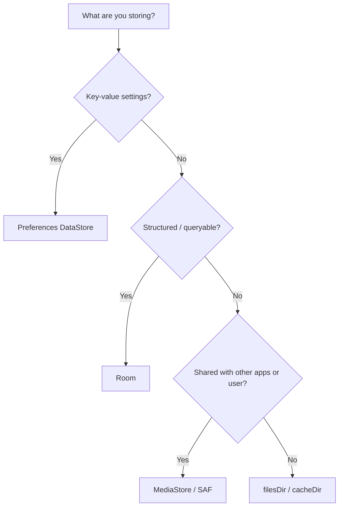
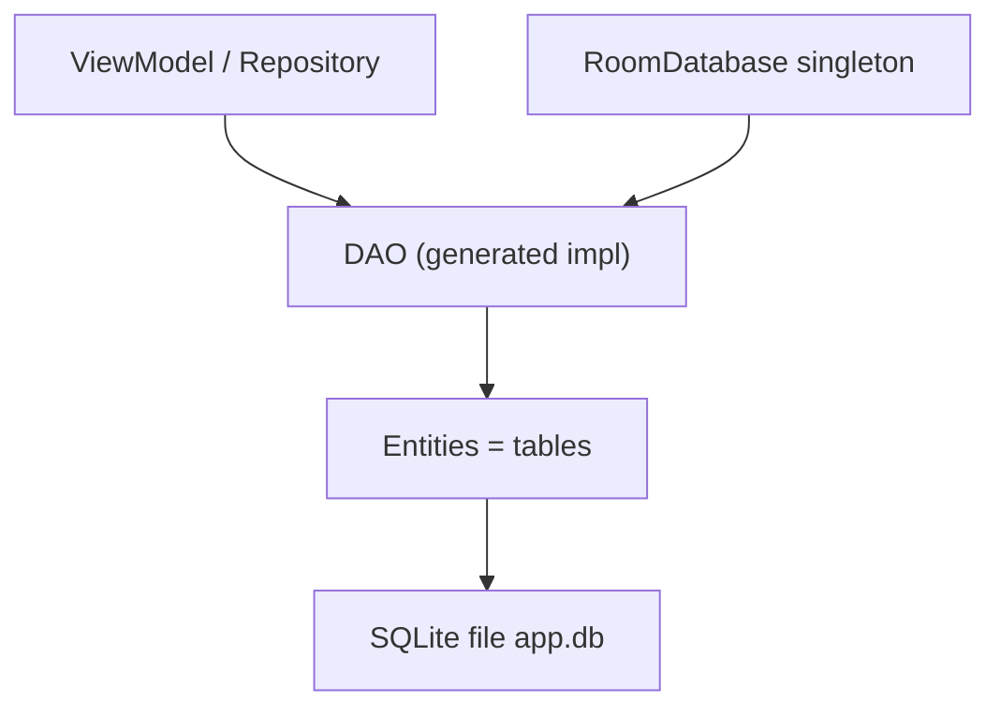
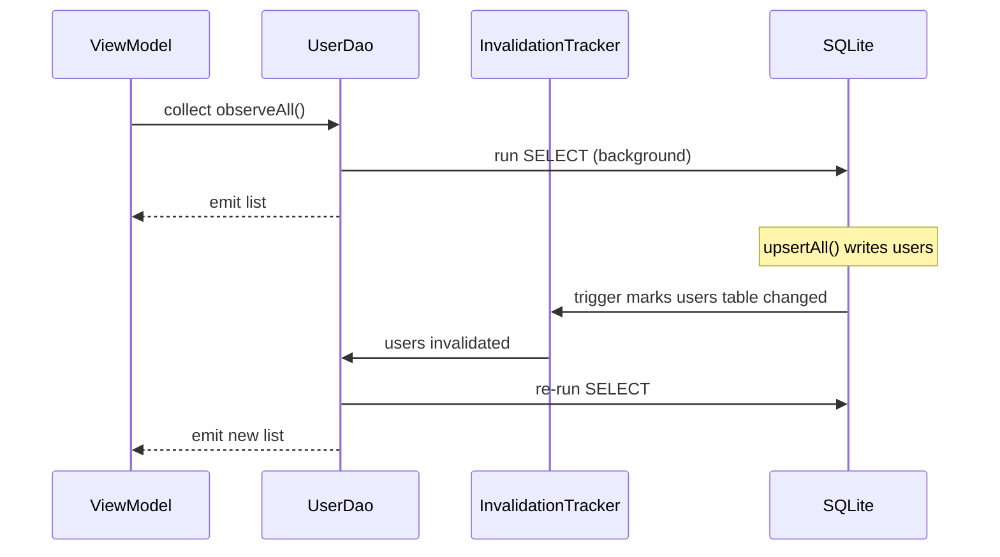
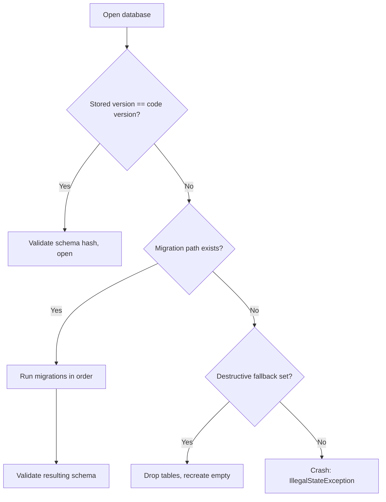
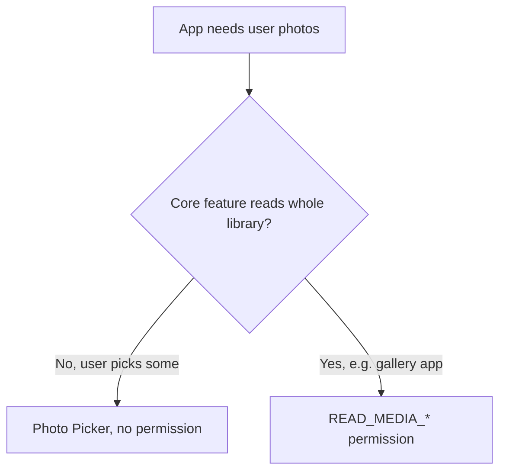
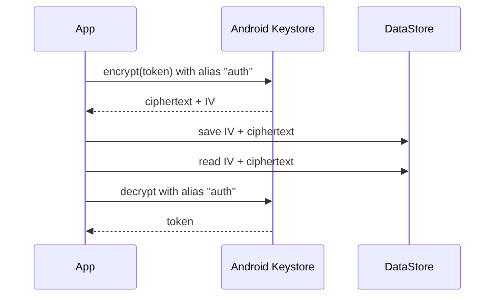
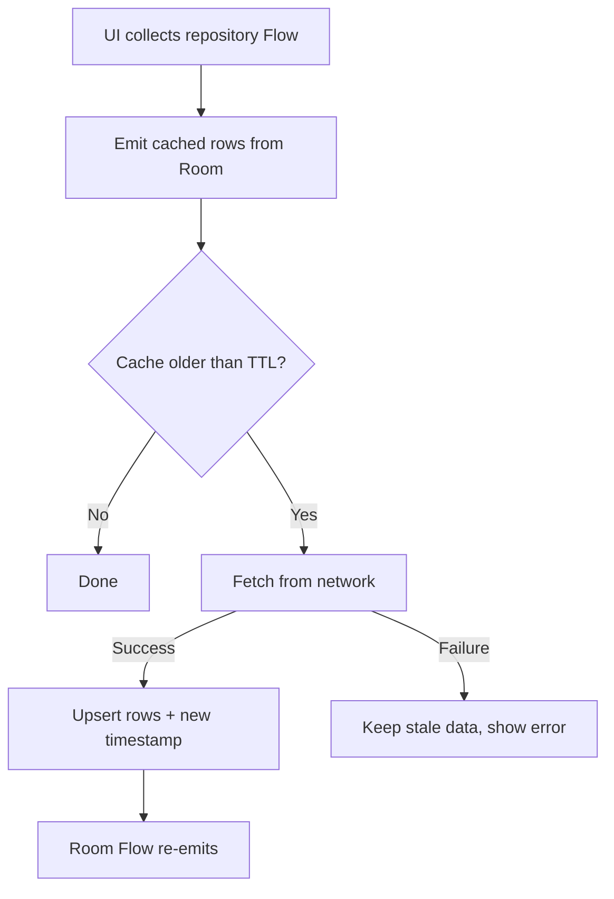

# Data Storage – Room, DataStore, Files

[⬅ Back to index](../README.md)

Covers: storage options, SharedPreferences vs DataStore, Room (entities, DAO, relations, migrations, threading), SQLite, file storage & scoped storage, caching.

---

### 1. What are the storage options in Android?

<details>
<summary>Answer</summary>

**In short:** Pick storage by the shape of the data. Use DataStore for small settings, Room (SQLite) for structured data you query, internal files for private blobs, MediaStore or the Storage Access Framework for files the user shares with other apps, and the Android Keystore for keys that protect sensitive data. For server data, Room usually acts as the local single source of truth.

| Need | Option | Notes |
|---|---|---|
| Small key-value settings | **DataStore** (Preferences) / SharedPreferences (legacy) | Theme, flags, "onboarding done" |
| Small typed objects | **Proto DataStore** | Schema-defined (protobuf), type-safe |
| Structured, relational, queryable data | **Room** (over SQLite) | Lists, search, relations, offline cache |
| Private files (cache, images, JSON) | Internal storage: `filesDir`, `cacheDir` | No permission, removed on uninstall |
| Shareable media/documents | **MediaStore**, Storage Access Framework (scoped storage) | Survives uninstall, visible to other apps |
| Sensitive data (keys, tokens) | **Android Keystore** + encryption | Keys never leave secure hardware |
| Server-synced data | Backend + local cache (Room as SSOT) | UI observes Room, network refreshes it |

#### How to choose



Two questions decide most cases:

1. **Do I need to query it?** If you filter, sort, join or page through it, you need a database. Putting a list of 2,000 items into one preferences value or a JSON file means reading and parsing the whole thing on every change.
2. **Who owns it?** Data only your app uses goes in app-specific storage (no permissions, deleted on uninstall). Data the user thinks of as "theirs" (photos they took, a PDF they exported) belongs in shared storage so it outlives the app.

Sensitive data is a third axis rather than a separate store. You still put the bytes in DataStore or a file, but encrypt them with a key kept in the Keystore.

**Pitfalls**
- Using SharedPreferences as a mini database (large JSON blobs). It is loaded fully into memory and rewritten as a whole on every change.
- Saving user-visible exports into `filesDir`, where the user can't find them and they vanish on uninstall.
- Storing secrets in plaintext anywhere, including logs.

**Likely follow-ups**
- *Where do downloaded images go?* Usually the image loader's disk cache inside `cacheDir`; the OS may clear it under storage pressure.
- *Can Room hold images?* It can store BLOBs, but storing a file path or URL and keeping the file on disk is the norm.

</details>

### 2. SharedPreferences vs DataStore?

<details>
<summary>Answer</summary>

**In short:** SharedPreferences is the old synchronous key-value store: its reads can block the UI thread and its `apply()` writes can cause ANRs. DataStore is the Jetpack replacement, built on coroutines and Flow, with asynchronous, transactional writes and proper error signalling. Proto DataStore also adds a typed schema.

#### Why SharedPreferences causes problems

SharedPreferences loads the whole XML file into memory on a background thread the first time you open it. If you call `getString()` before that load finishes, the calling thread (often the main thread) **waits**. Writes with `apply()` update memory immediately, but the disk write is queued, and the framework waits for queued writes to finish when an Activity pauses or stops or a Service starts. A slow disk at that moment means an ANR. It also doesn't report I/O errors and isn't safe across processes.

#### How DataStore fixes it

- Reads are exposed as a `Flow`, so you never block on disk. The first collection triggers the read on an I/O dispatcher.
- Writes go through `edit {}` / `updateData {}`, which are `suspend` functions. Each one is a read-modify-write **transaction**: the new state is written to a temp file and atomically renamed, so a crash can't leave a half-written file.
- I/O failures surface as `IOException` in the Flow, which you can catch and handle.

| SharedPreferences | DataStore |
|---|---|
| Synchronous API; `getX()` can block the UI thread on first load | **Asynchronous** – Kotlin coroutines + Flow |
| `apply()` is async but may block on `fsync` at `onPause`/`onStop` → **ANRs** | Writes are transactional and off the main thread |
| No error signalling, not safe across processes | Errors are signalled through exceptions; consistent, transactional updates |
| No type safety | Proto DataStore gives **type safety** (schema) |
| Listener callbacks for changes | Changes arrive as a new value in the `Flow` |

```kotlin
// One instance per file: declare it once at the top level
val Context.dataStore by preferencesDataStore(name = "settings")
val DARK = booleanPreferencesKey("dark_mode")

val darkMode: Flow<Boolean> = context.dataStore.data
    .catch { e -> if (e is IOException) emit(emptyPreferences()) else throw e }
    .map { it[DARK] ?: false }

suspend fun setDark(v: Boolean) = context.dataStore.edit { it[DARK] = v }
```

**Preferences vs Proto DataStore:** Preferences DataStore uses typed keys but no schema, so a typo in a key name or a type mismatch is only caught at runtime. Proto DataStore stores a single protobuf message that you define in a `.proto` file, so fields and types are checked at compile time.

**Migrating:** `preferencesDataStore(name, produceMigrations = { listOf(SharedPreferencesMigration(it, "old_prefs")) })` copies existing values over on first access.

Rules: only **one DataStore instance per file**. It's not meant for large or relational data (use Room). DataStore also supports KMP.

**Pitfalls**
- Creating a new DataStore for the same file in several places; DataStore throws when it detects multiple active instances for one file.
- Calling `runBlocking { dataStore.data.first() }` on the main thread, which brings back the exact blocking you wanted to avoid.
- Storing lists of records in it. Every edit rewrites the whole file.

**Likely follow-ups**
- *How do you read a value once?* `dataStore.data.first()` inside a coroutine.
- *Multi-process?* Use the multi-process DataStore factory rather than the default single-process one.

</details>

### 3. `commit()` vs `apply()` in SharedPreferences?

<details>
<summary>Answer</summary>

**In short:** `commit()` writes to disk synchronously on the calling thread and returns a `Boolean` saying whether it worked. `apply()` updates the in-memory map immediately, schedules the disk write in the background, and returns nothing. Use `apply()` unless you really need the result, and never call `commit()` on the main thread.

- `commit()` – writes **synchronously** to disk and returns a `Boolean` for success. Don't call it on the main thread.
- `apply()` – updates memory immediately and writes to disk **asynchronously**. Returns nothing. Pending applies are still waited on at lifecycle points, which can cause ANRs.

#### What happens under the hood

Both methods first update the in-memory copy, so a `getX()` right afterwards sees the new value. The difference is the disk write:

```kotlin
// Blocks the calling thread until the XML file is written (and synced)
val ok: Boolean = prefs.edit().putString("token", t).commit()

// Returns immediately; the write is queued on a background thread
prefs.edit().putString("token", t).apply()

// KTX helper; uses apply() by default, commit = true switches to commit()
prefs.edit { putString("token", t) }
```

The hidden cost of `apply()`: the framework keeps a queue of pending writes and **waits for it to drain** at certain lifecycle points (for example when an Activity is paused or stopped, or a Service handles a command). If many `apply()` calls are pending or the disk is slow, the main thread blocks there, and that shows up as an ANR with no obvious `apply()` in your stack trace.

| | `commit()` | `apply()` |
|---|---|---|
| Disk write | Synchronous, on caller thread | Asynchronous |
| Return value | `Boolean` success | `Unit` |
| Error reporting | Yes (false) | None |
| Main-thread safe | No | Mostly, but can block at lifecycle points |

**Pitfalls**
- Calling `apply()` in a tight loop instead of batching all changes into one editor.
- Assuming `apply()` is durable immediately; if the process is killed before the write, the change is lost.

**Likely follow-ups**
- *Why not just use DataStore?* That's the recommended answer for new code: it removes both the blocking reads and the lifecycle waits.
- *When is `commit()` reasonable?* On a background thread when you must know the write succeeded before continuing (for example right before a deliberate process restart).

</details>

### 4. What is Room? What are its components?

<details>
<summary>Answer</summary>

**In short:** Room is the Jetpack persistence library that sits on top of SQLite. You describe tables with `@Entity`, access them through `@Dao` interfaces, and tie them together in a `@Database` class. Room generates the boilerplate, checks your SQL at compile time and integrates with coroutines and Flow.

Room is the Jetpack **ORM-like abstraction over SQLite**:
- **`@Entity`** – a table (data class); `@PrimaryKey`, `@ColumnInfo`, `@Index`, `@Embedded`, foreign keys.
- **`@Dao`** – data access methods: `@Query`, `@Insert`, `@Update`, `@Delete`, `@Upsert`, `@Transaction`.
- **`@Database`** – an abstract class extending `RoomDatabase`; lists entities, version and DAOs. Create a **single instance** (singleton through DI).



#### Why it exists

Raw SQLite on Android means `SQLiteOpenHelper`, string SQL, manual `Cursor` iteration and hand-written `onUpgrade` logic. Mistakes (a typo in a column name, reading the wrong column index) only show up as runtime crashes. Room keeps SQL but moves the checking to build time: the annotation processor parses each `@Query`, checks it against your entities, and fails the build if a table or column doesn't exist or the return type doesn't match.

#### How the pieces work

- **Entity:** each property becomes a column. `@Embedded` flattens a nested object's fields into the same table. `@ForeignKey` adds real SQLite foreign-key constraints (with `onDelete = CASCADE` if wanted).
- **DAO:** you write an interface; Room generates an implementation class (`UserDao_Impl`) that binds parameters, runs the statement and maps the cursor to your objects.
- **Database:** `Room.databaseBuilder(...)` creates it, opens the file lazily on first use, runs migrations and holds the connection pool. Opening it is expensive, so there must be one instance per process.

Benefits over raw SQLite: **compile-time SQL verification**, less boilerplate, **Flow/LiveData/suspend support**, migrations support, testing helpers. Room uses **KSP** for code generation and supports **Kotlin Multiplatform** (Room 2.7+).

**Pitfalls**
- Building a new `RoomDatabase` per screen: slow, wastes memory, and multiple instances lose invalidation notifications between them.
- Using kapt when KSP is available; KSP is noticeably faster.

**Likely follow-ups**
- *Is Room an ORM?* Partly; it maps rows to objects but you still write SQL (see question 19).
- *How do you test DAOs?* Use `Room.inMemoryDatabaseBuilder` in an instrumented or Robolectric test.

</details>

### 5. Show a basic Room setup.

<details>
<summary>Answer</summary>

**In short:** Define an `@Entity` data class for the table, a `@Dao` interface with your queries (returning `Flow` for observation and `suspend` for one-shot writes), an abstract `@Database` class listing entities and DAOs, and build one instance with `Room.databaseBuilder`, usually provided as a singleton through Hilt or another DI tool.

```kotlin
@Entity(tableName = "users")
data class UserEntity(@PrimaryKey val id: String, val name: String, val updatedAt: Long)

@Dao
interface UserDao {
    @Query("SELECT * FROM users ORDER BY name")
    fun observeAll(): Flow<List<UserEntity>>          // re-emits on table change

    @Query("SELECT * FROM users WHERE id = :id")
    suspend fun getById(id: String): UserEntity?      // one-shot read

    @Upsert suspend fun upsertAll(users: List<UserEntity>)

    @Query("DELETE FROM users") suspend fun clear()
}

@Database(entities = [UserEntity::class], version = 1, exportSchema = true)
abstract class AppDatabase : RoomDatabase() { abstract fun userDao(): UserDao }

Room.databaseBuilder(appContext, AppDatabase::class.java, "app.db").build()
```

#### Wiring it up with Hilt

```kotlin
@Module
@InstallIn(SingletonComponent::class)
object DbModule {
    @Provides @Singleton
    fun db(@ApplicationContext ctx: Context): AppDatabase =
        Room.databaseBuilder(ctx, AppDatabase::class.java, "app.db").build()

    @Provides fun userDao(db: AppDatabase): UserDao = db.userDao()
}
```

#### What each part gives you

- **`Flow` return type:** Room runs the query off the main thread and emits a new list whenever the `users` table changes. The UI just collects it.
- **`suspend` functions:** Room moves the work to its own background executor, so callers can invoke them from `viewModelScope` directly.
- **`@Upsert`:** inserts new rows and updates existing ones by primary key in one call; handy for syncing server data.
- **`exportSchema = true`:** writes a JSON description of each schema version into a folder you configure (for example with the Room Gradle plugin's `schemaDirectory`). You commit these and use them to test migrations.
- **`appContext`:** always the application context, so the singleton doesn't leak an Activity.

A typical repository then exposes `dao.observeAll()` to the UI and calls `dao.upsertAll(api.fetchUsers().map { it.toEntity() })` on refresh. That is the "Room as single source of truth" pattern.

**Pitfalls**
- Exposing entities straight to the UI layer; map them to domain/UI models so DB changes don't ripple everywhere.
- Forgetting the Room compiler (KSP) dependency: the build succeeds but `databaseBuilder` fails at runtime because the generated `_Impl` class is missing.

</details>

### 6. How does Room handle threading?

<details>
<summary>Answer</summary>

**In short:** Room refuses to run queries on the main thread (it throws `IllegalStateException`). `suspend` DAO functions and observable return types (`Flow`, `LiveData`) run on Room's background executors, so they are safe to call from the UI layer. Observable queries are re-run automatically when the tables they read are changed.

- Room **doesn't allow queries on the main thread** (it throws `IllegalStateException`) unless you call `allowMainThreadQueries()`, which you shouldn't.
- `suspend` DAO functions run on Room's internal executors, so they're main-safe.
- Functions that return `Flow`/`LiveData` run their queries in the background and **re-run them when the observed tables are invalidated** (InvalidationTracker).

#### How invalidation works



Room installs SQLite triggers on the observed tables that record which tables were modified. After each write transaction the `InvalidationTracker` checks that record and notifies every observer of an affected table. The observer re-runs its full query. Invalidation is **table-level**, so changing any row in `users` re-runs every query that reads `users`, even if the result is identical. Add `.distinctUntilChanged()` to skip duplicate emissions.

#### Which call style to use

| DAO return type | Runs on | Use for |
|---|---|---|
| `suspend fun ...: T` | Room's query/transaction executor | One-shot reads and writes |
| `fun ...: Flow<T>` | Background, re-runs on change | Observing data in the UI |
| `fun ...: LiveData<T>` | Background, active observers only | Legacy View-based UI |
| `fun ...: T` (blocking) | Caller's thread | Only from your own background thread |

**Pitfalls**
- Blocking DAO calls from the main thread crash; wrapping them in `allowMainThreadQueries()` just hides jank.
- Wrapping `suspend` DAO calls in `withContext(Dispatchers.IO)` is unnecessary; Room already switches threads.
- Writes through a raw SQLite connection or another process bypass the tracker, so observers don't update.

**Likely follow-ups**
- *Can you give Room your own executor?* Yes, `setQueryExecutor` / `setTransactionExecutor` on the builder.
- *Can reads run while a write is in progress?* Yes, with WAL journal mode (see question 11).

</details>

### 7. How do you handle database migrations in Room?

<details>
<summary>Answer</summary>

**In short:** Every schema change requires bumping the `@Database` version and telling Room how to move existing data from the old schema to the new one, either with a manual `Migration` that runs SQL or with an `AutoMigration`. Export schemas, test every migration path, and only use destructive fallback for data you can re-download.

When the schema changes, **increase the version** and provide a migration:

```kotlin
val MIGRATION_1_2 = object : Migration(1, 2) {
    override fun migrate(db: SupportSQLiteDatabase) {
        db.execSQL("ALTER TABLE users ADD COLUMN email TEXT")
    }
}
Room.databaseBuilder(...).addMigrations(MIGRATION_1_2)
```

#### What Room does on open



Room stores the schema version in SQLite's `user_version` and a hash of the schema in its own `room_master_table`. If the versions differ, it chains migrations (1→2→3, or a direct 1→3 if you provide one) and then validates that the resulting tables match what the entities expect. A mismatch, such as a column with the wrong type or nullability, crashes immediately with a message showing expected vs found.

#### Automatic migrations

- **AutoMigrations** (`@Database(autoMigrations = [AutoMigration(from = 1, to = 2)])`) handle simple changes. Renames and deletes need an `AutoMigrationSpec`.

```kotlin
@RenameColumn(tableName = "users", fromColumnName = "name", toColumnName = "displayName")
class Rename2To3 : AutoMigrationSpec

@Database(
    entities = [UserEntity::class], version = 3,
    autoMigrations = [AutoMigration(1, 2), AutoMigration(2, 3, spec = Rename2To3::class)]
)
abstract class AppDatabase : RoomDatabase()
```

Room compares the exported JSON schemas of the two versions to generate the SQL, which is why `exportSchema` must be on.

#### Complex changes

SQLite's `ALTER TABLE` is limited (older versions can't drop or change columns). The usual pattern for type changes: create `users_new` with the new schema, `INSERT INTO users_new SELECT ... FROM users`, drop `users`, rename `users_new` to `users`, then recreate indexes.

- Set `exportSchema = true` and commit the schema JSON files. **Test migrations** with `MigrationTestHelper`.
- `fallbackToDestructiveMigration()` **wipes the data**. Only acceptable for pure caches.
- A missing migration → `IllegalStateException` crash on app update.

**Pitfalls**
- Changing an entity without bumping the version: Room detects the hash mismatch and crashes.
- Adding a `NOT NULL` column without a `DEFAULT` in the SQL; existing rows make the migration fail or the schema validation mismatch.
- Only testing 1→latest on a fresh install. Users can jump from any old version, so test each path.

**Likely follow-ups**
- *How does `MigrationTestHelper` work?* It creates the DB at an old version from the exported JSON, inserts data, runs `runMigrationsAndValidate` to the new version, and you assert the data survived.

</details>

### 8. How do you model relationships in Room?

<details>
<summary>Answer</summary>

**In short:** Room entities can't hold references to other entities. You link tables with foreign-key columns, then read related data through a plain data class that has an `@Embedded` parent and `@Relation` children (or a junction table for many-to-many), loaded in a `@Transaction` query so the parent and children are read consistently.

Room doesn't allow object references between entities (to avoid lazy loading on the main thread). Use:
- **One-to-one / one-to-many:** a data class with `@Embedded` parent + `@Relation(parentColumn, entityColumn)` children, queried in a `@Transaction` function.
- **Many-to-many:** a **junction (cross-ref) entity** + `@Relation(associateBy = Junction(...))`.

```kotlin
data class UserWithPosts(
    @Embedded val user: UserEntity,
    @Relation(parentColumn = "id", entityColumn = "userId") val posts: List<PostEntity>
)
@Transaction @Query("SELECT * FROM users") fun usersWithPosts(): Flow<List<UserWithPosts>>
```

#### Why no object references?

In ORMs like Hibernate, accessing `user.posts` silently runs a query (lazy loading). On Android that query could run on the main thread inside a `RecyclerView` bind, causing jank that's hard to trace. Room forces you to declare up front what you load.

#### How `@Relation` executes

Room runs your query for the parents, collects their IDs, then runs a second query like `SELECT * FROM posts WHERE userId IN (...)` and groups the results. Two queries means a write could slip in between them, which is why `@Transaction` is required to get a consistent snapshot.

#### Many-to-many

```kotlin
@Entity(primaryKeys = ["playlistId", "songId"], indices = [Index("songId")])
data class PlaylistSongCrossRef(val playlistId: Long, val songId: Long)

data class PlaylistWithSongs(
    @Embedded val playlist: PlaylistEntity,
    @Relation(
        parentColumn = "playlistId",
        entityColumn = "songId",
        associateBy = Junction(PlaylistSongCrossRef::class)
    )
    val songs: List<SongEntity>
)
```

#### Alternative: JOIN with multimap

Room 2.4+ lets a DAO return a map from a JOIN query, without a wrapper class:

```kotlin
@Query("SELECT * FROM users JOIN posts ON users.id = posts.userId")
fun usersAndPosts(): Flow<Map<UserEntity, List<PostEntity>>>
```

**Pitfalls**
- Forgetting an index on the child's foreign-key column (`userId`); every relation lookup then scans the whole table, and Room warns about it at compile time.
- `@Relation` always loads **all** children; you can't filter or limit them in the annotation. Use a custom query for "latest 3 posts".
- Nested relations (users → posts → comments) multiply queries; consider a flatter, screen-shaped query.

</details>

### 9. What are TypeConverters?

<details>
<summary>Answer</summary>

**In short:** SQLite only understands INTEGER, REAL, TEXT and BLOB. A `@TypeConverter` is a pair of functions that turns a custom type (like `Instant`, an enum, or a list) into one of those and back. You register them with `@TypeConverters`, and Room calls them automatically when reading and writing entities and query parameters.

SQLite only stores primitive types (INTEGER, REAL, TEXT, BLOB). **`@TypeConverter`** functions convert custom types (`Date`, `Instant`, enums, lists as JSON) to supported types and back. Register them with `@TypeConverters` on the Database. Avoid storing large lists as JSON if you need to query inside them; use a related table instead.

```kotlin
class Converters {
    @TypeConverter fun fromInstant(v: Instant?): Long? = v?.toEpochMilli()
    @TypeConverter fun toInstant(v: Long?): Instant? = v?.let(Instant::ofEpochMilli)

    @TypeConverter fun fromTags(v: List<String>): String = Json.encodeToString(v)
    @TypeConverter fun toTags(v: String): List<String> = Json.decodeFromString(v)
}

@Database(entities = [NoteEntity::class], version = 1)
@TypeConverters(Converters::class)
abstract class AppDatabase : RoomDatabase()
```

#### How Room uses them

At compile time, when Room sees a property of type `Instant` it searches the registered converters for one that maps `Instant` to a supported type, and generates code that calls it. The same converter is applied to query parameters, so `@Query("SELECT * FROM notes WHERE createdAt > :since") fun after(since: Instant)` just works.

Scope: on the `@Database` they apply everywhere; you can also put `@TypeConverters` on a single entity, DAO or field.

#### Choosing the stored form

| Type | Good stored form | Why |
|---|---|---|
| `Instant` / `Date` | `Long` epoch millis | Sortable, comparable in SQL |
| Enum | `String` name | Survives reordering enum constants (ordinals don't) |
| `List<String>` | JSON `TEXT` | Fine if you never query inside it |
| List you filter on | Separate table | Can be indexed and joined |

If a converter needs dependencies (for example a configured JSON instance), annotate the class with `@ProvidedTypeConverter` and pass an instance with `addTypeConverter()` on the builder.

**Pitfalls**
- Storing enums by ordinal; adding a constant in the middle corrupts existing data.
- Storing timestamps as formatted strings; ordering and range queries break.
- Big JSON blobs in one column: every read deserializes the whole thing, and a schema change inside the JSON isn't covered by Room migrations.

</details>

### 10. What does `@Transaction` do?

<details>
<summary>Answer</summary>

**In short:** `@Transaction` wraps everything a DAO method does in one SQLite transaction, so either all of it is committed or none of it is, and reads within it see a consistent snapshot. You need it for `@Relation` queries and for DAO methods that combine several writes; outside a DAO, `db.withTransaction {}` does the same for a block of suspend calls.

It runs multiple queries **atomically**: everything succeeds or everything rolls back. It's required for `@Relation` queries (so parent and children are read consistently). For multiple writes, use `db.withTransaction { }` (suspend) or a DAO method annotated with `@Transaction`.

#### Example: replacing a cached list

```kotlin
@Dao
abstract class UserDao {
    @Query("DELETE FROM users") abstract suspend fun clear()
    @Insert abstract suspend fun insertAll(users: List<UserEntity>)

    @Transaction
    open suspend fun replaceAll(users: List<UserEntity>) {
        clear()            // if insertAll throws, the delete is rolled back too
        insertAll(users)
    }
}

// Across several DAOs, from a repository:
db.withTransaction {
    userDao.upsertAll(users)
    postDao.upsertAll(posts)
}
```

Without the transaction, a crash between `clear()` and `insertAll()` leaves an empty table, and an observing `Flow` may briefly emit an empty list (a visible flicker). With it, observers are notified once, after commit, and only see the final state.

#### Why it also speeds things up

Each SQLite write outside a transaction is its own implicit transaction, which means a journal write and sync per statement. Grouping 1,000 inserts in one transaction does that work once, which is often dramatically faster.

**Notes**
- Single `@Insert`, `@Update`, `@Delete` and `@Upsert` methods are already transactional; you don't need to annotate them.
- A `@Query` that reads multiple tables via `@Relation` must be `@Transaction`, otherwise Room warns at compile time.

**Pitfalls**
- Doing network calls inside `withTransaction`. The write lock is held for the whole time, blocking other writers.
- Long transactions on a large dataset can make UI reads wait in non-WAL mode.

**Likely follow-ups**
- *Can a transaction span threads?* `withTransaction` keeps the transaction bound to its coroutine, so suspend DAO calls inside it join the same transaction.

</details>

### 11. How do you optimize Room / SQLite performance?

<details>
<summary>Answer</summary>

**In short:** Index the columns you filter, join and sort on; batch writes in one transaction; select only the columns a screen needs; page large lists; and rely on WAL mode so reads don't wait for writes. Then measure with `EXPLAIN QUERY PLAN` and the Database Inspector instead of guessing.

- Add **indexes** (`@Index`) to columns used in `WHERE`, `JOIN` and `ORDER BY` (indexes slow down writes, so add only what you need).
- **Batch inserts** in one transaction (`insertAll(list)`), not a loop of single inserts.
- Select only the columns you need (a POJO with a subset of fields).
- Use **Paging** for large lists.
- **WAL mode** (Write-Ahead Logging) is on by default, so reads and writes can happen concurrently.
- Use `EXPLAIN QUERY PLAN` and the Database Inspector.

#### Indexes

Without an index, `WHERE userId = ?` makes SQLite scan every row. An index is a sorted B-tree on that column, so lookups become logarithmic. The cost: every insert/update must also update the index, and it takes disk space.

```kotlin
@Entity(
    tableName = "posts",
    indices = [Index("userId"), Index(value = ["userId", "createdAt"])]
)
data class PostEntity(@PrimaryKey val id: Long, val userId: Long, val createdAt: Long, val body: String)
```

A composite index on `(userId, createdAt)` serves `WHERE userId = ? ORDER BY createdAt` in one go, with no separate sort step.

#### Batching

```kotlin
// Slow: 1,000 separate transactions, each synced to disk
users.forEach { dao.insert(it) }

// Fast: one transaction
dao.insertAll(users)
```

#### Projections and paging

```kotlin
data class UserRow(val id: String, val name: String)   // no big "bio" column

@Query("SELECT id, name FROM users ORDER BY name")
fun pagedUsers(): PagingSource<Int, UserRow>
```

Reading fewer columns means less I/O and smaller cursor windows. Paging 3 loads pages on demand instead of materialising 50,000 rows into a `List`.

#### WAL

With Write-Ahead Logging, writes go to a separate log file and readers keep reading the last committed state, so a long write doesn't block UI reads. Room picks WAL automatically (`JournalMode.AUTOMATIC`) except on low-RAM devices.

#### Measuring

Run `EXPLAIN QUERY PLAN SELECT ...` in the Database Inspector. `SCAN posts` means a full scan; `SEARCH posts USING INDEX ...` means your index is used.

**Pitfalls**
- Indexing every column "just in case": writes and sync get slower.
- `LIKE '%term%'` can't use a normal index; consider SQLite FTS (Room supports `@Fts4` entities) for text search.
- Observing a very broad query with `Flow`; every write to the table re-runs it.

</details>

### 12. What is the Database Inspector?

<details>
<summary>Answer</summary>

**In short:** The Database Inspector is part of Android Studio's App Inspection window. It lets you browse, query and edit the SQLite databases of a running debuggable app in real time, and if your app observes data through Room with Flow or LiveData, the UI updates live as you edit rows.

An Android Studio tool (App Inspection) to view, query and modify the **live** databases of a running debug app. It supports live updates for Room Flow queries.

#### What you can do with it

- **Browse tables** of every database the app has open, including Room's internal tables.
- **Run custom SQL**, including `EXPLAIN QUERY PLAN` to check whether your indexes are used.
- **Run DAO queries directly**: Android Studio shows a run icon next to `@Query` annotations in the editor that executes that query against the live database.
- **Edit cell values** and watch the app react. Because writes go through the same SQLite connection, Room's InvalidationTracker fires and observed queries re-emit, which makes it a quick way to test empty, error and edge-case UI states.
- **Keep database connections open**, so you can still inspect a database after the app closes it.
- **Export** a database or query results for offline analysis or bug reports.

#### When it helps in practice

- Verifying that a migration produced the expected columns and data.
- Debugging "the list didn't update": edit a row; if the UI doesn't change, your observer chain is broken, not your sync logic.
- Inspecting the offline cache after a sync to confirm what the server actually returned.

**Limitations**
- Only works on debuggable builds, and requires a reasonably recent API level on the device.
- It inspects the app's databases, not DataStore or plain files; use the Device Explorer for those.

**Likely follow-ups**
- *Alternatives?* Pull the `.db` file with the Device Explorer or `adb` and open it in a desktop SQLite browser (remember to also grab the `-wal` file, or the latest changes may be missing).

</details>

### 13. Internal vs external storage? What is Scoped Storage?

<details>
<summary>Answer</summary>

**In short:** Internal storage (`filesDir`, `cacheDir`) is private to the app, needs no permission and is deleted on uninstall. App-specific external storage behaves similarly but lives on the larger shared volume. Scoped Storage (Android 10, enforced for apps targeting 11+) stops apps from freely reading and writing the whole external storage; instead you use MediaStore for media, the Storage Access Framework for documents, and the Photo Picker for picking images.

- **Internal** (`filesDir`, `cacheDir`) – private to the app, no permission needed, deleted on uninstall. `cacheDir` can be cleared by the system.
- **App-specific external** (`getExternalFilesDir`) – also deleted on uninstall, no permission needed since API 19.
- **Shared storage** – media (MediaStore) and documents (Storage Access Framework).
- **Scoped Storage (Android 10+, enforced on 11+):** apps can't freely access the whole external storage. Use **MediaStore** for your own media (no permission needed to add your own files), `READ_MEDIA_IMAGES/VIDEO/AUDIO` (Android 13+) to read others' media, the **Photo Picker** (no permission at all), and SAF (`ACTION_OPEN_DOCUMENT`) for documents. `MANAGE_EXTERNAL_STORAGE` is only for special apps (file managers) and restricted on Play.

#### Why scoped storage exists

Before Android 10, any app with `READ_EXTERNAL_STORAGE` could read every file on shared storage: other apps' downloads, documents and photos. Apps also scattered folders everywhere and left them behind after uninstall. Scoped storage gives each app a private sandbox on external storage and routes access to shared files through APIs where either the system tracks ownership (MediaStore) or the user explicitly picks the file (SAF, Photo Picker).

#### Which API for which job

| Task | API | Permission |
|---|---|---|
| Private app data | `filesDir`, `cacheDir` | None |
| Large private files (e.g. downloaded videos) | `getExternalFilesDir()` | None |
| Save a photo the user should see in Gallery | MediaStore insert | None for your own files |
| Read all user photos (e.g. gallery app) | MediaStore query | `READ_MEDIA_IMAGES` (13+) |
| User picks a few photos | Photo Picker | None |
| Open/save a PDF or arbitrary document | SAF `ACTION_OPEN_DOCUMENT` / `ACTION_CREATE_DOCUMENT` | None (user grants per file) |
| File manager / backup app | `MANAGE_EXTERNAL_STORAGE` | Special access, Play review |

#### Saving an image to the gallery

```kotlin
val values = ContentValues().apply {
    put(MediaStore.Images.Media.DISPLAY_NAME, "photo_${System.currentTimeMillis()}.jpg")
    put(MediaStore.Images.Media.MIME_TYPE, "image/jpeg")
    put(MediaStore.Images.Media.RELATIVE_PATH, Environment.DIRECTORY_PICTURES + "/MyApp")
}
val uri = resolver.insert(MediaStore.Images.Media.EXTERNAL_CONTENT_URI, values)
uri?.let { resolver.openOutputStream(it)?.use { out -> bitmap.compress(JPEG, 90, out) } }
```

**Pitfalls**
- Building raw file paths like `/sdcard/...`; work with `content://` URIs instead.
- Forgetting `takePersistableUriPermission()` when you need a SAF URI to stay usable after restart.
- Writing temporary files to `filesDir` and never cleaning them; use `cacheDir`.

**Likely follow-ups**
- *What was `requestLegacyExternalStorage`?* A temporary opt-out on Android 10; ignored once you target Android 11.
- *Android 14 change?* Users can grant access to only selected photos (`READ_MEDIA_VISUAL_USER_SELECTED`), so apps must handle partial access.

</details>

### 14. What is the Photo Picker?

<details>
<summary>Answer</summary>

**In short:** The Photo Picker is a system UI that lets the user choose specific photos or videos. Your app needs no storage permission and receives temporary read access to only the selected items as `content://` URIs. You launch it with `ActivityResultContracts.PickVisualMedia()` or `PickMultipleVisualMedia()`.

A system UI to choose photos or videos **without granting any storage permission**. The app gets temporary URI access to only the selected items. Use `ActivityResultContracts.PickVisualMedia()` / `PickMultipleVisualMedia()`. It's backported to older versions through Google Play services. Google Play policy now **pushes apps to use the Photo Picker** instead of broad media permissions when they only need occasional access.

```kotlin
// Compose
val pickPhoto = rememberLauncherForActivityResult(
    ActivityResultContracts.PickVisualMedia()
) { uri: Uri? ->
    uri?.let { viewModel.onAvatarPicked(it) }   // null if the user cancelled
}

Button(onClick = {
    pickPhoto.launch(PickVisualMediaRequest(ActivityResultContracts.PickVisualMedia.ImageOnly))
}) { Text("Choose avatar") }

// Multiple items, capped at 5
val pickMany = rememberLauncherForActivityResult(
    ActivityResultContracts.PickMultipleVisualMedia(maxItems = 5)
) { uris: List<Uri> -> viewModel.onPhotosPicked(uris) }
```

#### Why it's preferred



- **Privacy:** the app sees only what the user chose, not the whole library.
- **No permission dialog:** fewer steps for the user, and nothing to be denied.
- **Consistent UI** with search, albums and cloud photos depending on the device.

#### How the access works

The returned URI grants read access for as long as the receiving component is alive. If you need it after a restart (for example, a draft post that references the image), either copy the file into your own storage or call `contentResolver.takePersistableUriPermission(uri, FLAG_GRANT_READ_URI_PERMISSION)`.

**Pitfalls**
- Saving the URI to a database and reading it days later without persisting the permission; it fails with a `SecurityException`.
- Requesting `READ_MEDIA_IMAGES` "just to show an avatar picker"; Play may reject it.
- Loading the full-resolution image into memory; decode with a downsampling image loader.

**Likely follow-ups**
- *Is it available on old devices?* Natively on Android 13+, and on older versions through the backport; when unavailable, the contract falls back to `ACTION_OPEN_DOCUMENT`.

</details>

### 15. How do you store sensitive data (tokens, passwords)?

<details>
<summary>Answer</summary>

**In short:** Never store secrets in plaintext. Generate an AES key inside the Android Keystore (where it can't be extracted), encrypt the token with AES-GCM, and store only the ciphertext in DataStore or a file. Don't store user passwords at all; keep a token, and use Credential Manager for sign-in.

- Never store them in plain SharedPreferences, files or logs.
- Use the **Android Keystore** to generate or keep encryption keys in hardware-backed storage (they can't be extracted), and encrypt the data with AES-GCM before storing it (DataStore/files).
- `EncryptedSharedPreferences` (Jetpack Security) was widely used, but the **security-crypto library is now deprecated**. Prefer Keystore + your own encryption (or Tink) with DataStore.
- Store passwords only on the server (hashed). On the device, use tokens or **Credential Manager** (passkeys).

#### Why the Keystore matters

Internal storage is private, but on a rooted device or through a careless backup it can be read. If the key sits next to the data (a hard-coded key in the APK, for example), encryption adds nothing, because both can be extracted. The Keystore holds the key material in a separate secure environment (TEE or a StrongBox chip when available). Your app can ask it to encrypt or decrypt, but can't read the key itself.



```kotlin
private const val ALIAS = "auth_key"

private fun key(): SecretKey {
    val ks = KeyStore.getInstance("AndroidKeyStore").apply { load(null) }
    (ks.getKey(ALIAS, null) as? SecretKey)?.let { return it }
    val gen = KeyGenerator.getInstance(KeyProperties.KEY_ALGORITHM_AES, "AndroidKeyStore")
    gen.init(
        KeyGenParameterSpec.Builder(ALIAS, KeyProperties.PURPOSE_ENCRYPT or KeyProperties.PURPOSE_DECRYPT)
            .setBlockModes(KeyProperties.BLOCK_MODE_GCM)
            .setEncryptionPaddings(KeyProperties.ENCRYPTION_PADDING_NONE)
            .build()
    )
    return gen.generateKey()
}

fun encrypt(plain: ByteArray): Pair<ByteArray, ByteArray> {
    val c = Cipher.getInstance("AES/GCM/NoPadding").apply { init(Cipher.ENCRYPT_MODE, key()) }
    return c.iv to c.doFinal(plain)   // store both; the IV is not secret
}

fun decrypt(iv: ByteArray, data: ByteArray): ByteArray =
    Cipher.getInstance("AES/GCM/NoPadding")
        .apply { init(Cipher.DECRYPT_MODE, key(), GCMParameterSpec(128, iv)) }
        .doFinal(data)
```

AES-GCM provides both confidentiality and integrity: tampered ciphertext fails to decrypt instead of producing garbage.

**Extra hardening**
- `setUserAuthenticationRequired(true)` makes the key usable only after biometric or device-credential auth.
- Keep access tokens short-lived and refresh them; the refresh token is the valuable one.
- Exclude these files from backup (see question 18).

**Pitfalls**
- Logging tokens or putting them in crash reports.
- Not handling `KeyPermanentlyInvalidatedException` (for example after the user changes biometrics); catch it, delete the key and force re-login.
- Reusing an IV with the same GCM key; always let the cipher generate a fresh one.

</details>

### 16. How would you implement a cache with expiry?

<details>
<summary>Answer</summary>

**In short:** Store a `lastUpdated` timestamp alongside the cached data (per row or per query) in Room. When data is requested, serve the cache immediately, and if it's older than the TTL, fetch from the network in the background and write the result into Room, which then updates the UI. For in-memory caching, use `LruCache` plus timestamps.

Store a `lastUpdated` timestamp with each item (or per-query metadata) in Room. In the repository, if `now - lastUpdated > TTL`, refresh from the network; otherwise serve the cache. For in-memory caching, use `LruCache` with a size limit plus timestamps. Combine with stale-while-revalidate: show the cached data immediately and refresh in the background.



#### Room implementation

```kotlin
@Entity(tableName = "cache_meta")
data class CacheMeta(@PrimaryKey val key: String, val fetchedAt: Long)

class ArticleRepository(
    private val dao: ArticleDao,
    private val metaDao: CacheMetaDao,
    private val api: Api,
    private val db: AppDatabase,
    private val clock: () -> Long = System::currentTimeMillis,
) {
    private val ttl = 15.minutes.inWholeMilliseconds

    fun articles(): Flow<List<Article>> = dao.observeAll()   // UI always reads Room

    suspend fun refreshIfStale(force: Boolean = false) {
        val meta = metaDao.get("articles")
        val stale = meta == null || clock() - meta.fetchedAt > ttl
        if (!force && !stale) return
        val fresh = api.getArticles()
        db.withTransaction {
            dao.replaceAll(fresh.map { it.toEntity() })
            metaDao.upsert(CacheMeta("articles", clock()))
        }
    }
}
```

The ViewModel collects `articles()` and calls `refreshIfStale()` on start and `refreshIfStale(force = true)` on pull-to-refresh. Because the UI only observes Room, offline behaviour comes for free.

#### In-memory layer

```kotlin
private data class Entry<T>(val value: T, val at: Long)
private val memory = LruCache<String, Entry<User>>(100)   // max 100 entries

fun cachedUser(id: String): User? =
    memory[id]?.takeIf { clock() - it.at < ttl }?.value
```

`LruCache` evicts the least recently used entry when full; override `sizeOf` to bound by bytes (for bitmaps, say).

#### Other options

- **HTTP caching:** if the server sends `Cache-Control` headers, OkHttp's disk `Cache` can handle expiry for raw responses without any Room code.
- **Periodic refresh:** a `WorkManager` periodic job can pre-warm the cache.

**Pitfalls**
- Using `System.currentTimeMillis()` directly makes expiry untestable; inject a clock.
- Writing data and timestamp in separate transactions; a crash between them leaves a fresh timestamp on stale data.
- Clearing the cache on every network error, leaving the user with an empty screen.

</details>

### 17. Room vs Realm vs SQLDelight?

<details>
<summary>Answer</summary>

**In short:** Room is Google's annotation-based layer over SQLite and the default for Android, now also Kotlin Multiplatform. SQLDelight goes the other way: you write `.sq` SQL files and it generates type-safe Kotlin, which has made it popular in multiplatform projects. Realm is an object database not based on SQLite, and its Kotlin SDK has been deprecated by MongoDB, so it isn't a good pick for new projects.

- **Room** – Jetpack, SQLite-based, annotation-driven, now KMP.
- **SQLDelight** – you write **SQL first**, and it generates type-safe Kotlin APIs. KMP-native. Popular in multiplatform projects.
- **Realm** – an object database (not SQLite). Its Kotlin SDK has been deprecated by MongoDB, so it's not recommended for new projects.

| | Room | SQLDelight | Realm |
|---|---|---|---|
| Storage engine | SQLite | SQLite | Own engine |
| Source of truth | Kotlin entities + annotations | `.sq` SQL files | Object model classes |
| Query style | SQL strings in `@Query`, checked at compile time | Named SQL statements → generated functions | Object query API |
| Reactive | Flow, LiveData, Paging | Flow via coroutines extension | Live objects / Flow |
| Migrations | `Migration` / `AutoMigration` | `.sqm` migration files, verifiable | Schema versioning |
| Status | Actively developed Jetpack library | Actively maintained, open source | Kotlin SDK deprecated |

#### SQLDelight in practice

```sql
-- src/commonMain/sqldelight/com/app/User.sq
CREATE TABLE user (
  id TEXT NOT NULL PRIMARY KEY,
  name TEXT NOT NULL
);

selectAll:
SELECT * FROM user ORDER BY name;
```

This generates a `UserQueries` class with `selectAll()` returning a typed `Query<User>` that you can turn into a `Flow`. Because the schema itself is SQL, what you see is exactly what runs.

#### How to pick

- **Android-only app, Jetpack stack:** Room. Best tooling (Database Inspector, Paging, Hilt examples) and the most familiar to other Android devs.
- **KMP project, team comfortable with SQL:** SQLDelight is the long-established choice; Room KMP is now a reasonable alternative, especially when sharing existing Room code.
- **Existing Realm app:** plan a migration path rather than starting new features on it.

**Likely follow-ups**
- *Why would anyone prefer SQL-first?* Complex queries, views and triggers are written natively without fighting annotations, and the schema is reviewable as plain SQL.

</details>

### 18. What is the Auto Backup / data backup in Android?

<details>
<summary>Answer</summary>

**In short:** Auto Backup (API 23+) automatically copies an app's data, up to 25 MB, to the user's Google Drive and restores it when the app is reinstalled or set up on a new device. You control what's included with backup rules, and you must exclude tokens, device-specific IDs and anything encrypted with Keystore keys, because those keys are not backed up.

**Auto Backup** (API 23+) backs up app data (up to 25 MB) to the user's Google Drive and restores it on reinstall or a new device. Configure what to include or exclude with `android:fullBackupContent` / `dataExtractionRules` (Android 12+). **Exclude** tokens, device-specific IDs and encryption-key-dependent data, because Keystore keys aren't backed up, so restored encrypted data would be unreadable.

#### How it works

By default, files in the app's internal directories (files, databases, shared preferences) and app-specific external storage are included; `cacheDir` and `noBackupFilesDir` are not. The system runs the backup periodically, typically when the device is idle, charging and on Wi‑Fi. Restore happens during install, before the app first runs.

Android 12 introduced `dataExtractionRules`, which separates **cloud backup** from **device-to-device transfer** (for example when setting up a new phone), so you can allow one and not the other.

```xml
<!-- AndroidManifest.xml -->
<application
    android:allowBackup="true"
    android:dataExtractionRules="@xml/data_extraction_rules"
    android:fullBackupContent="@xml/backup_rules">  <!-- for Android 11 and lower -->
```

```xml
<!-- res/xml/data_extraction_rules.xml -->
<data-extraction-rules>
    <cloud-backup>
        <exclude domain="file" path="datastore/secure_prefs.preferences_pb"/>
        <exclude domain="database" path="cache.db"/>
    </cloud-backup>
    <device-transfer>
        <exclude domain="file" path="datastore/secure_prefs.preferences_pb"/>
    </device-transfer>
</data-extraction-rules>
```

#### What to exclude and why

| Data | Exclude? | Reason |
|---|---|---|
| Keystore-encrypted tokens | Yes | Key isn't restored, so decryption fails |
| FCM / installation IDs | Yes | Device-specific; restoring causes duplicates |
| Re-downloadable cache DBs | Usually | Wastes the 25 MB quota |
| User settings, drafts | No | This is what backup is for |

**Pitfalls**
- Restored encrypted data that can't be decrypted causes a crash on first launch; exclude it, and also handle decryption failure gracefully.
- Room DB backed up without its `-wal` and `-shm` files, or while open, can be inconsistent; exclude cache DBs or make sure the data can be rebuilt.
- Leaving `allowBackup="true"` on an app that holds sensitive data without reviewing the rules.

**Likely follow-ups**
- *How do you test it?* Use `adb shell bmgr backupnow <package>`, uninstall, reinstall and check the restored data.
- *Alternative?* Key/Value backup with a custom `BackupAgent`, or syncing to your own backend.

</details>


### 19. What is an ORM? How does Room relate to it?

<details>
<summary>Answer</summary>

**In short:** An ORM (Object-Relational Mapper) automatically maps classes to tables and objects to rows, so you work with objects instead of SQL and cursors. Room is a lightweight, ORM-style layer: it maps entities and query results to Kotlin objects, but you still write the SQL yourself, it checks that SQL at compile time, and it deliberately has no lazy-loaded object references.

An **ORM (Object-Relational Mapper)** maps **objects ↔ database rows** automatically: classes are tables, fields are columns, and objects are rows. You work with objects instead of handwritten SQL and cursor parsing.

**Room is a lightweight ORM-style abstraction**: it maps `@Entity` classes to tables and query results to objects, but you **still write SQL** in `@Query` (verified at compile time). It deliberately avoids heavy ORM features like lazy-loaded object references (which would trigger hidden queries on the main thread). Classic ORMs on Android were greenDAO and OrmLite; ObjectBox is an object database that gives a similar objects-only API without SQL.

#### The problem ORMs solve

Relational databases store flat rows; apps use objects with nested fields and relationships. This gap (the "object-relational impedance mismatch") means a lot of repetitive code: build SQL strings, bind parameters, loop over a cursor, read each column by index, construct objects. ORMs generate that code.

```kotlin
// Without an ORM: manual mapping
val c = db.rawQuery("SELECT id, name FROM users WHERE id = ?", arrayOf(id))
val user = c.use { if (it.moveToFirst()) User(it.getString(0), it.getString(1)) else null }

// With Room: you write the SQL, Room writes the mapping
@Query("SELECT id, name FROM users WHERE id = :id")
suspend fun user(id: String): User?
```

#### Full ORM vs Room

| Feature | Typical full ORM (e.g. Hibernate) | Room |
|---|---|---|
| SQL | Generated from object queries | Written by you, verified at build time |
| Relationships | Object references, lazy loading | Explicit `@Relation` / JOIN, eager |
| Change tracking | Dirty-checking of loaded objects | None; you call `@Update` / `@Upsert` |
| Mapping cost | Reflection or runtime proxies common | Generated code, no reflection |

Room's choices fit mobile: predictable queries (no surprise SQL on the main thread), no runtime reflection overhead, and SQL that you can copy into the Database Inspector and analyse.

**Likely follow-ups**
- *What's the N+1 problem?* Loading N parents and then running one extra query per parent for its children; lazy loading in full ORMs often causes it. Room's `@Relation` avoids it by loading all children in one `IN (...)` query.

</details>

### 20. Database normalization vs denormalization on mobile?

<details>
<summary>Answer</summary>

**In short:** Normalization splits data into related tables so each fact is stored once, which keeps updates consistent but needs joins on read. Denormalization duplicates or pre-shapes data so reads are cheap, at the cost of updating several places. A mobile database is usually a read-optimized cache of server data, so moderate denormalization shaped around screens is common, while data the user edits stays normalized.

- **Normalization** – split data into related tables to **avoid duplication** (users, posts and comments linked by foreign keys). Gives consistent updates and less storage, at the cost of **more joins** on reads.
- **Denormalization** – **duplicate or embed** data to make reads fast (store `authorName` directly on the post row, or cache a precomputed feed table). Reads are fast, but updates have to touch multiple places.

#### Example

```kotlin
// Normalized: author stored once, joined on read
@Entity data class UserEntity(@PrimaryKey val id: String, val name: String, val avatarUrl: String)
@Entity(indices = [Index("authorId")])
data class PostEntity(@PrimaryKey val id: String, val authorId: String, val body: String)

// Denormalized feed row: everything the feed item needs, no join
@Entity(tableName = "feed")
data class FeedItemEntity(
    @PrimaryKey val postId: String,
    val body: String,
    val authorName: String,      // copied from the user
    val authorAvatarUrl: String, // copied from the user
    val likeCount: Int,
    val position: Int            // server ranking order
)
```

If a user renames themselves, the normalized model updates one row. The denormalized feed has stale `authorName` values until the next sync rewrites those feed rows, which is usually acceptable for a cache.

| | Normalized | Denormalized |
|---|---|---|
| Duplication | None | Some |
| Reads | Joins, more queries | Single-table, fast |
| Writes | One place | Several places, risk of inconsistency |
| Good for | User-edited data, sources of truth | Feeds, search results, read-heavy screens |

On mobile, the local DB is usually a **read-optimized cache** of server data, so **moderate denormalization** is common (store what each screen needs in a shape that's cheap to query). Keep the data you edit normalized, and use `@Relation`/`@Embedded` and indices for joins.

#### Why mobile leans denormalized

- The server is the real source of truth; the client mainly renders what it got. API responses are often already denormalized (a post with an embedded author).
- Scrolling lists must be fast; a join per item on a cheap device during scroll adds up.
- Cached data is refreshed wholesale on sync, so duplicated values correct themselves.

**Pitfalls**
- Duplicating data the user edits offline (for example a draft's title stored in three tables); conflicts and partial updates follow.
- Going fully normalized for a feed and then fighting nested `@Relation` queries for every list item.

**Likely follow-ups**
- *How do you keep denormalized copies in sync?* Update all copies in one `withTransaction` block, or rebuild the derived table on each sync.

</details>

---

[⬅ Previous: Networking](15-networking.md) · [⬅ Back to index](../README.md) · [Next: Threading & Background Work ➡](17-threading-background-work.md)
