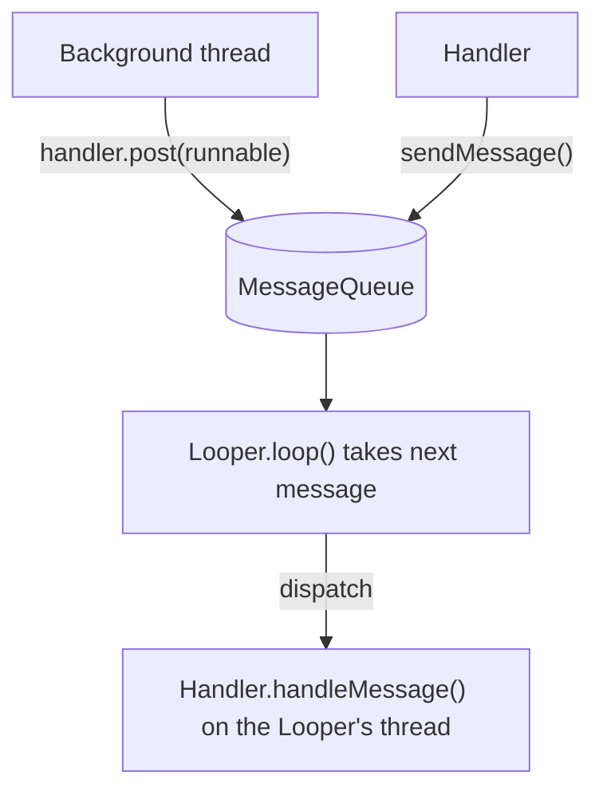
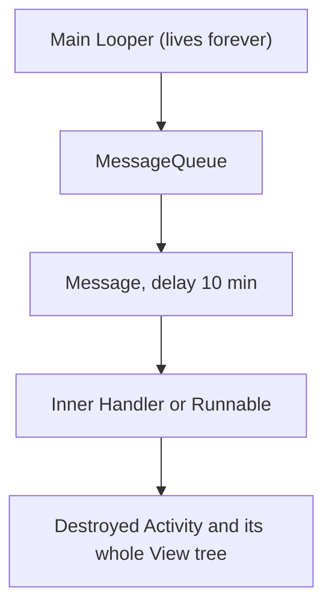
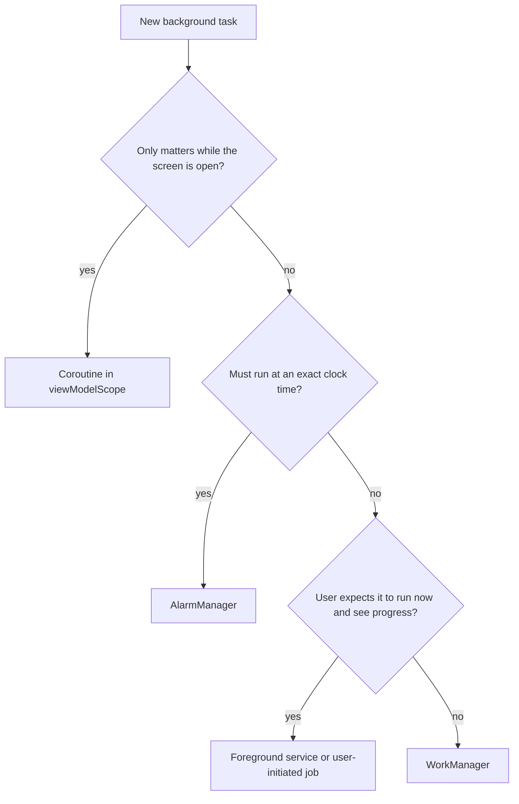
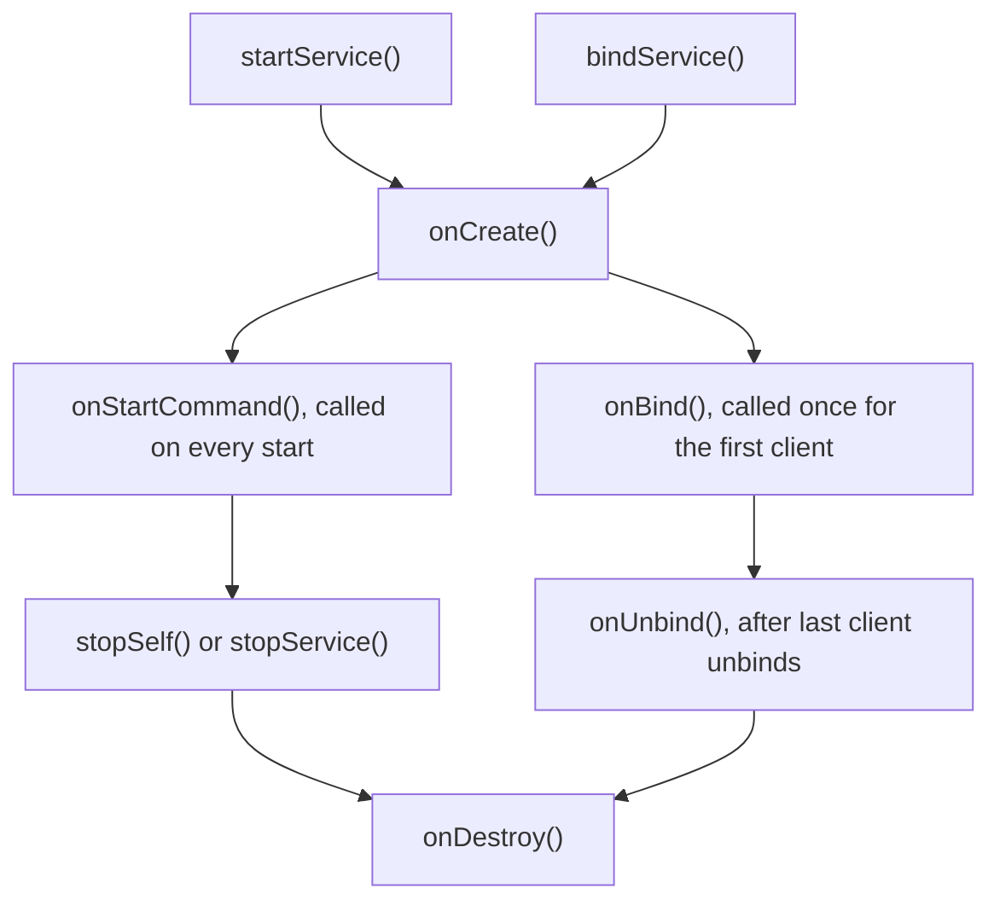
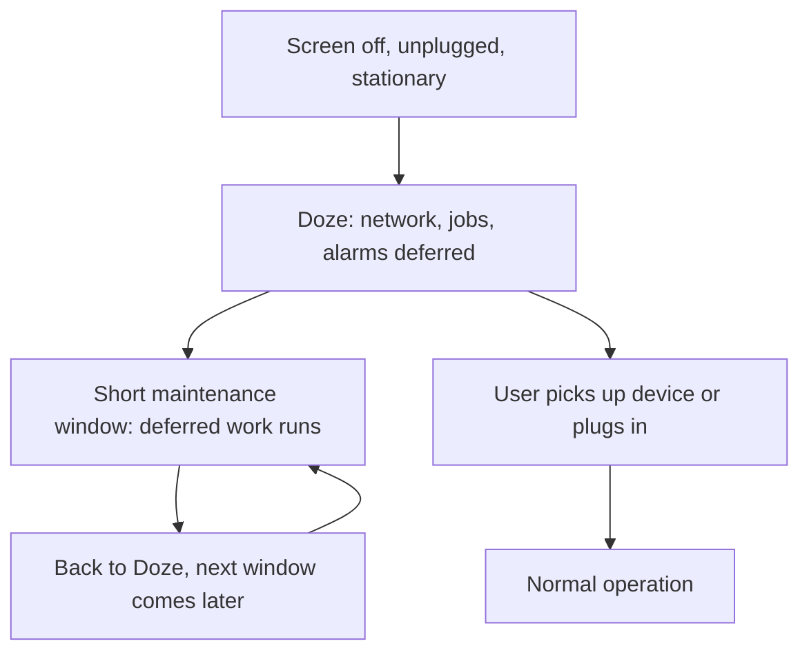
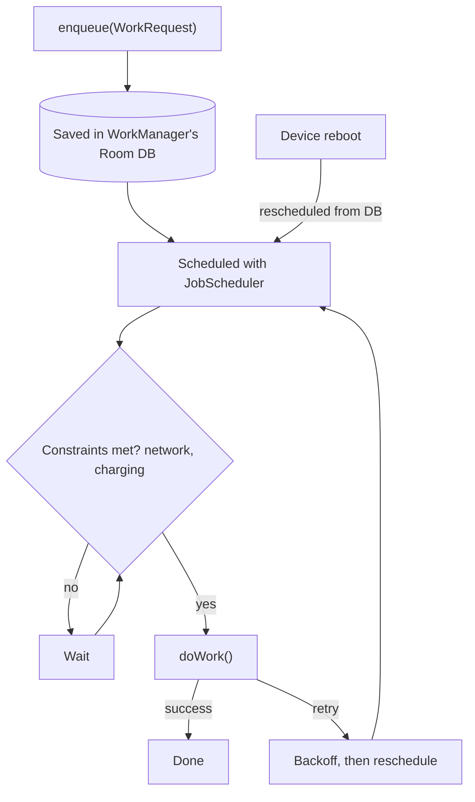
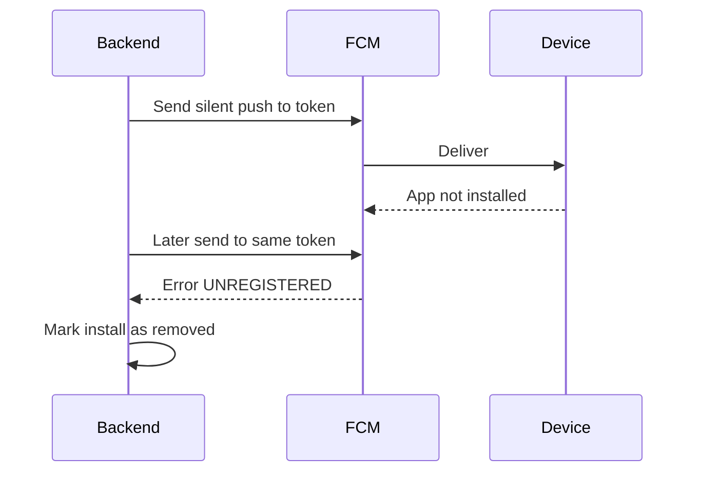

# Threading & Background Work

[⬅ Back to index](../README.md)

Covers: main thread, Looper/Handler/MessageQueue, executors, ANR, Services (started, bound, foreground), WorkManager, AlarmManager, background execution limits, Doze.

---

## Threading Basics

### 1. What is the main (UI) thread? Why shouldn't you block it?

<details>
<summary>Answer</summary>

**In short:** The main thread runs the app's event loop. It handles input, lifecycle callbacks and drawing every frame, and it is the only thread allowed to touch Views. If you block it, frames get dropped (jank), and if input isn't handled for about 5 seconds the system shows an ANR dialog.

#### What the main thread does

When Android starts your process, `ActivityThread.main()` creates the main thread's `Looper` and starts looping. From then on almost everything app-visible arrives as a message on that thread:

- touch and key events,
- lifecycle callbacks (`onCreate`, `onResume`, `onReceive`, `Service.onStartCommand`...),
- `Choreographer` frame callbacks: measure, layout, draw (or Compose recomposition and drawing).

At 60 Hz the device needs a new frame every **~16 ms** (8 ms at 120 Hz). Any work you do on the main thread competes with that budget.

#### Why only the main thread may touch Views

The View system isn't thread-safe; it has no locks. Rather than make every View synchronized (slow and deadlock-prone), Android enforces a single-thread rule. `ViewRootImpl.checkThread()` throws `CalledFromWrongThreadException` if another thread tries to modify the hierarchy.

#### What happens when it's blocked

| Blocked for | Result |
|---|---|
| > 1 frame (~16 ms) | Dropped frames, visible **jank** |
| ~5 s without handling input | **ANR** (Application Not Responding) dialog |
| Network call on main thread | `NetworkOnMainThreadException` (since API 11) |

```kotlin
// Wrong: blocks the main thread for the whole network round trip
button.setOnClickListener {
    val user = api.fetchUserBlocking()   // throws NetworkOnMainThreadException
    nameView.text = user.name
}

// Right: do the work off the main thread, update UI back on it
button.setOnClickListener {
    lifecycleScope.launch {
        val user = withContext(Dispatchers.IO) { api.fetchUserBlocking() }
        nameView.text = user.name        // back on Dispatchers.Main
    }
}
```

**Pitfalls**
- Disk I/O is not caught by an exception the way network is: reading a big file, `SharedPreferences.commit()` or a Room query on the main thread just silently costs frames. Use **StrictMode** in debug builds to catch it.
- "Small" work adds up: JSON parsing, bitmap decoding and large DiffUtil runs all belong on a background thread.

**Likely follow-ups**
- *How do you get back to the main thread?* `withContext(Dispatchers.Main)`, `Handler(Looper.getMainLooper()).post {}`, `View.post {}`, or `runOnUiThread {}`.
- *Can a background thread ever draw?* Yes, a `SurfaceView`/`TextureView` surface or OpenGL can be rendered from another thread, because it doesn't go through the View hierarchy.

</details>

### 2. Explain Looper, Handler, MessageQueue.

<details>
<summary>Answer</summary>

**In short:** A `Looper` runs an infinite loop on one thread, pulling `Message`s from that thread's `MessageQueue` and dispatching them. A `Handler` is bound to a Looper and is how you put work into its queue (`post`, `sendMessage`) and handle it when it comes out. One Looper per thread; this is how all work reaches the main thread.



#### The three pieces

- **MessageQueue**: a linked list of `Message` objects sorted by delivery time (`when`). A `Runnable` you `post()` is wrapped in a `Message` as its `callback`. When the queue is empty, or the next message is in the future, the thread sleeps in native code (`nativePollOnce`, built on `epoll`) instead of busy-waiting, so an idle Looper costs no CPU.
- **Looper**: `Looper.loop()` repeatedly calls `queue.next()` and then `msg.target.dispatchMessage(msg)`. There's **one Looper per thread**, stored in a `ThreadLocal`, so `Looper.myLooper()` returns the current thread's. The main Looper is created by `ActivityThread.main()`. For a background thread you call `Looper.prepare()` then `Looper.loop()`, or simply use `HandlerThread`.
- **Handler**: holds a reference to a Looper (and its queue). Any thread can call `post`, `postDelayed`, `postAtTime`, `sendMessage`; the work then **runs on the Looper's thread**. `dispatchMessage` runs the message's `Runnable` if it has one, else the Handler's `Callback`, else `handleMessage()`.

```kotlin
// Post from any thread to the main thread
val mainHandler = Handler(Looper.getMainLooper())
mainHandler.post { textView.text = "Updated" }

// Message-based handling with a 'what' code
val handler = Handler(Looper.getMainLooper()) { msg ->
    when (msg.what) {
        MSG_REFRESH -> { refresh(); true }
        else -> false
    }
}
handler.sendMessageDelayed(Message.obtain(handler, MSG_REFRESH), 500)
```

`Message.obtain()` reuses messages from a global pool, avoiding allocations.

#### Where you meet it every day

`Activity.runOnUiThread`, `View.post`, `Choreographer` frame callbacks and coroutines' `Dispatchers.Main` are all built on a main-thread Handler. The UI framework also uses **sync barriers** in the queue so that frame (asynchronous) messages jump ahead of ordinary ones.

**Pitfalls**
- `Handler()` with no Looper argument is deprecated (API 30): it silently picks the current thread's Looper, which may not exist or may not be the one you want. Always pass a Looper explicitly.
- Delayed messages hold references to their Handler and Runnable, which can leak an Activity (see the next question).

**Likely follow-ups**
- *Why doesn't `Looper.loop()` freeze the app if it's infinite?* It blocks in `epoll` when there's nothing to do; everything the app does is itself a message processed by that loop.
- *What is an `IdleHandler`?* A callback via `Looper.myQueue().addIdleHandler {}` that runs when the queue has no ready messages, useful for deferring non-urgent startup work.

</details>

### 3. Why can a Handler leak an Activity? How do you fix it?

<details>
<summary>Answer</summary>

**In short:** A non-static inner Handler, or a Runnable lambda that captures the Activity, is stored inside a `Message` in the Looper's queue. While a delayed message is pending, the chain `MessageQueue → Message → Handler/Runnable → Activity` keeps the destroyed Activity reachable, so it can't be garbage collected. Fix it by removing callbacks in `onDestroy`, using a static Handler with a `WeakReference`, or (best) using lifecycle-aware coroutines.

#### The reference chain

The main thread's Looper lives as long as the process, so it acts like a GC root. Every message in its queue holds `target` (the Handler) and maybe `callback` (the Runnable).



In Java, an anonymous or inner class holds an implicit `this$0` reference to the outer Activity. In Kotlin, a lambda that uses any Activity member captures the Activity.

```kotlin
// Leaky: posts a 10-minute delayed task that captures the Activity
class MainActivity : AppCompatActivity() {
    private val handler = Handler(Looper.getMainLooper())

    override fun onCreate(savedInstanceState: Bundle?) {
        super.onCreate(savedInstanceState)
        handler.postDelayed({ titleView.text = "Done" }, 10 * 60 * 1000L)
    }
    // After rotation, the old Activity stays in memory for 10 minutes
}
```

#### Fixes, from simplest to best

```kotlin
// 1. Clear pending work when the owner dies
override fun onDestroy() {
    handler.removeCallbacksAndMessages(null)   // null = remove everything
    super.onDestroy()
}

// 2. Static/top-level Handler holding only a weak reference
class SafeHandler(activity: MainActivity) : Handler(Looper.getMainLooper()) {
    private val ref = WeakReference(activity)
    override fun handleMessage(msg: Message) {
        val activity = ref.get() ?: return      // Activity gone: do nothing
        activity.onTick()
    }
}

// 3. Best: lifecycle-aware coroutine, cancelled automatically in onDestroy
lifecycleScope.launch {
    delay(10.minutes)
    titleView.text = "Done"
}
```

**Pitfalls**
- A leak only lasts while the message is pending, so short `post {}` calls rarely matter; long `postDelayed` and repeating "ticker" runnables are the usual culprits.
- `View.postDelayed` has the same problem if the view is detached and the runnable captures the Activity. Remove it with `view.removeCallbacks(runnable)`.

**Likely follow-ups**
- *How would you find it?* LeakCanary shows the chain ending at `MessageQueue.mMessages`.
- *Why is Android Lint warning "This Handler class should be static"?* Exactly this implicit outer-class reference.

</details>

### 4. What is HandlerThread?

<details>
<summary>Answer</summary>

**In short:** `HandlerThread` is a `Thread` that sets up its own `Looper` when it starts. You attach a `Handler` to that Looper and post tasks; they run one at a time, in order, on that single background thread. Call `quit()` or `quitSafely()` when you're done.

#### Why it exists

A plain `Thread` runs one `Runnable` and ends. Sometimes you need a long-lived background thread that receives a stream of work in order, for example camera callbacks, sensor events or a serial database writer. Writing `Looper.prepare()` / `Looper.loop()` yourself is error-prone (you must wait until the Looper exists before creating a Handler). `HandlerThread` does that wiring for you; `getLooper()` blocks until the Looper is ready.

```kotlin
class CameraController {
    private val thread = HandlerThread("CameraBackground").apply { start() }
    private val handler = Handler(thread.looper)

    fun open(manager: CameraManager, id: String, callback: CameraDevice.StateCallback) {
        // Camera2 delivers callbacks on this handler's thread, off the main thread
        manager.openCamera(id, callback, handler)
    }

    fun processFrame(frame: ByteArray) {
        handler.post { analyze(frame) }   // runs serially, never concurrently
    }

    fun release() {
        thread.quitSafely()               // finish already-due messages, then stop
    }
}
```

#### quit() vs quitSafely()

| Method | Behaviour |
|---|---|
| `quit()` | Drops every pending message immediately |
| `quitSafely()` | Delivers messages already due, drops future delayed ones |

**Pitfalls**
- Forgetting to quit leaks a thread that sleeps forever.
- All tasks are serialized: one slow task delays everything behind it. For parallel work use an executor or `Dispatchers.Default`.

**Likely follow-ups**
- *Modern equivalent?* `Executors.newSingleThreadExecutor()` or `Dispatchers.IO.limitedParallelism(1)` for serialized work; HandlerThread is still used where an API demands a `Handler` (Camera2, sensors, `MediaCodec` callbacks).

</details>

### 5. What ways exist to do background work on Android?

<details>
<summary>Answer</summary>

**In short:** Pick by how long the work runs and whether it must survive the user leaving or the process dying: coroutines for work tied to a screen, WorkManager for deferrable work that must eventually finish, a foreground service for long work the user is aware of right now, AlarmManager for exact times, and user-initiated data transfer jobs for big user-started transfers.

| Need | Solution |
|---|---|
| Async work tied to UI/screen | **Coroutines** (`viewModelScope`) |
| Deferrable, **guaranteed** work (sync, upload), even after app restart | **WorkManager** |
| Long user-visible ongoing task (music, navigation, call, workout) | **Foreground Service** (with type) |
| Exact time-based (alarm clock, reminders) | **AlarmManager** (`setExactAndAllowWhileIdle`) |
| Large user-initiated downloads/uploads | **User-initiated data transfer jobs** (Android 14+) / `DownloadManager` |
| Legacy | `AsyncTask` (**deprecated**), `IntentService` (**deprecated**), `JobIntentService` (deprecated), Loaders (deprecated) |

#### How to choose



#### Why there are so many options

Android aggressively kills background processes and restricts background execution to save battery (Doze, App Standby Buckets, background service limits since Android 8). So the question isn't "which thread" but "**which component keeps the work alive**":

- A **coroutine** is just code in your process. If the process dies, the work is gone. That's fine for loading a screen's data.
- **WorkManager** writes the request to a database and asks the system (JobScheduler) to run it later, so it survives process death and reboot.
- A **foreground service** raises your process priority and shows a notification, so the system keeps it alive while the user is aware of it.
- **AlarmManager** asks the system to wake you at a time, even if your app isn't running.

**Pitfalls**
- Using a foreground service for work that could be deferred: Android 12+ blocks starting one from the background, and Play requires justifying the type.
- Using `GlobalScope` for "fire and forget" work: it's not lifecycle-aware and dies with the process anyway. Use WorkManager if it must finish.

**Likely follow-ups**
- *How do you sync data every few hours?* `PeriodicWorkRequest` with a network constraint.
- *How do you start an upload when the user taps "Send" and the app is closed right after?* Enqueue an expedited WorkManager request (or a user-initiated data transfer job if it's large).

</details>

### 6. Why was AsyncTask deprecated?

<details>
<summary>Answer</summary>

**In short:** `AsyncTask` leaked Activities, ignored the lifecycle (results were delivered to a destroyed Activity after rotation), switched between serial and parallel execution across Android versions, swallowed errors and was awkward to cancel. It was deprecated in API 30; use coroutines (or `Executor` + `Handler`) instead.

#### How it worked

`AsyncTask<Params, Progress, Result>` ran `doInBackground()` on a background executor and `onPostExecute()` on the main thread, with `onProgressUpdate()` in between. It looked convenient, which is why it was everywhere.

```java
// Typical leaky usage
class LoadTask extends AsyncTask<Void, Void, User> {   // inner class: holds MainActivity.this
    @Override protected User doInBackground(Void... v) { return api.loadUser(); }
    @Override protected void onPostExecute(User u) { nameView.setText(u.name); }
}
new LoadTask().execute();
```

#### The problems

| Problem | Why it hurt |
|---|---|
| Memory leaks | Declared as an inner class, it held the Activity until `doInBackground` finished |
| No lifecycle awareness | After rotation the old Activity received `onPostExecute`, often crashing or updating dead views |
| Changing execution model | Serial at first, parallel from 1.6, back to serial (one shared thread) from 3.0; one slow task blocked every other `AsyncTask` in the app |
| Poor error handling | No built-in error channel; exceptions in `doInBackground` crashed or had to be smuggled through the result |
| Hard cancellation | `cancel(true)` only interrupts the thread; your code had to keep checking `isCancelled()` |
| Lost on process death | Not persistent, but often misused for uploads that needed to be guaranteed |

#### The replacement

```kotlin
class UserViewModel(private val repo: UserRepository) : ViewModel() {
    val user = MutableStateFlow<User?>(null)

    fun load() = viewModelScope.launch {           // cancelled in onCleared()
        user.value = withContext(Dispatchers.IO) { repo.loadUser() }
    }
}
```

The ViewModel survives rotation, the scope cancels automatically, errors propagate as normal exceptions, and structured concurrency handles cancellation. For Java code, use an `ExecutorService` plus a main-thread `Handler`, or `ListenableFuture`.

**Likely follow-ups**
- *What about `IntentService`?* Also deprecated (API 30) because background service limits made it unreliable; WorkManager replaces it.
- *What was `executeOnExecutor(THREAD_POOL_EXECUTOR)`?* The opt-in to run AsyncTasks in parallel after 3.0 made them serial by default.

</details>

### 7. What is an ANR? What causes it and how do you debug it?

<details>
<summary>Answer</summary>

**In short:** An ANR (Application Not Responding) happens when the main thread fails to respond in time, most commonly when an input event isn't handled within 5 seconds. Causes are blocking work on the main thread: I/O, network, lock contention, slow Binder calls. You debug it from the main thread's stack trace in the ANR trace (bug report, Play Console vitals, `ApplicationExitInfo`).

#### When the system declares an ANR

- **input dispatch** (touch or key) isn't handled within **5 s**,
- a `BroadcastReceiver.onReceive` doesn't finish within **~10 s** (foreground) or longer (background),
- a **Service** doesn't finish its lifecycle callbacks in time (~20 s foreground),
- a **foreground service** doesn't call `startForeground()` within ~5–10 s of `startForegroundService()`,
- a JobScheduler job's `onStartJob`/`onStopJob` doesn't return in time (Android 14+).

The system (`ActivityManagerService` / `InputDispatcher`) sets a timer when it hands your app the event or callback. If your main thread hasn't come back by the deadline, it dumps thread stacks and either shows the "isn't responding" dialog or, for background ANRs, kills the app silently.

#### Common causes

- Heavy **I/O or network** on the main thread: large file reads, Room queries, `SharedPreferences.commit()`.
- **Lock contention / deadlock**: the main thread waits on a `synchronized` lock held by a background thread doing slow work.
- Long `Application.onCreate` / `Activity.onCreate` (SDK initialization).
- `SharedPreferences.apply()` writes being flushed synchronously during `onPause`/`onStop` (`QueuedWork.waitToFinish`).
- Slow **Binder** calls to system services or another app's ContentProvider.
- Too much work in `onReceive` (use `goAsync()` or enqueue work instead).

```kotlin
// Wrong: main thread waits for a lock a background thread holds during network I/O
synchronized(cacheLock) { cache.get(key) }   // blocks while bg thread does network inside the lock

// Right: never do slow work while holding a lock the main thread needs,
// and move the read itself off the main thread
viewModelScope.launch { val v = withContext(Dispatchers.IO) { cache.get(key) } }
```

#### How to debug

1. **Read the main thread stack** in the ANR trace (`/data/anr/traces.txt` historically, now `/data/anr/anr_*` in a bug report). Look at what `"main"` is doing: `NativePollOnce` means it was idle (the cause may be elsewhere, such as system load); `waiting to lock ... held by thread 23` points to contention; a stack inside `SQLiteConnection` or `FileInputStream` points to I/O.
2. **Play Console → Android vitals**: ANRs clustered by stack, with device and OS breakdowns.
3. **`ApplicationExitInfo`** (API 30+): on next launch, `activityManager.getHistoricalProcessExitReasons()` gives `REASON_ANR` with a trace stream.
4. **StrictMode** in debug builds catches main-thread disk/network access before it ships.
5. **Perfetto / system traces** show what the main thread did slice by slice.

ANR rate is a **Play Store vitals metric** (the bad-behaviour threshold is 0.47% user-perceived ANR rate), so it affects store visibility.

**Likely follow-ups**
- *Is a 3-second freeze an ANR?* No, but it's terrible jank; ANRs are just the extreme end.
- *How do you do long work in a BroadcastReceiver?* Call `goAsync()` for short async work (still bounded by the timeout), or enqueue WorkManager work.

</details>

### 8. What is StrictMode?

<details>
<summary>Answer</summary>

**In short:** StrictMode is a developer tool that detects accidental bad practices at runtime. `ThreadPolicy` catches disk reads/writes, network and slow calls on the main thread; `VmPolicy` catches leaks like unclosed resources and leaked Activities. Enable it only in debug builds.

#### The two policies

- **ThreadPolicy**: per-thread checks, normally set on the main thread. Detects disk reads, disk writes, network, custom slow calls (`StrictMode.noteSlowCall`), unbuffered I/O and resource mismatches.
- **VmPolicy**: process-wide checks. Detects leaked Activities, `Closeable`s not closed (cursors, streams), leaked SQLite objects, leaked registrations (receivers, service connections), `file://` URI exposure, cleartext network traffic, and (API 29+) non-SDK API usage.

```kotlin
class MyApp : Application() {
    override fun onCreate() {
        if (BuildConfig.DEBUG) {
            StrictMode.setThreadPolicy(
                StrictMode.ThreadPolicy.Builder()
                    .detectDiskReads()
                    .detectDiskWrites()
                    .detectNetwork()
                    .penaltyLog()            // log to Logcat with a stack trace
                    .build()
            )
            StrictMode.setVmPolicy(
                StrictMode.VmPolicy.Builder()
                    .detectLeakedClosableObjects()
                    .detectActivityLeaks()
                    .penaltyLog()
                    .build()
            )
        }
        super.onCreate()
    }
}
```

`detectAll()` is a shortcut for everything the current OS supports.

#### Penalties

| Penalty | Effect |
|---|---|
| `penaltyLog()` | Log the violation and stack trace |
| `penaltyDeath()` | Crash the app (forces the team to fix it) |
| `penaltyDialog()` | Show a dialog (ThreadPolicy only) |
| `penaltyListener(executor) {}` | Callback (API 28+), for example to report to your own tooling |

**Pitfalls**
- Some violations come from libraries or even the framework; use `permitDiskReads()` temporarily around known-acceptable code instead of disabling StrictMode.
- Never ship it enabled in release builds: it costs performance and `penaltyDeath` would crash users.

**Likely follow-ups**
- *Is NetworkOnMainThreadException part of StrictMode?* Yes, it's StrictMode's network check, enabled by default for apps targeting API 11+.

</details>

### 9. What are Executors and thread pools?

<details>
<summary>Answer</summary>

**In short:** An `ExecutorService` keeps a pool of reusable threads and a queue of tasks, so you submit work instead of creating a thread per task. Pools avoid thread-creation overhead and cap concurrency. Coroutine dispatchers are built on similar pools, and you can convert one with `executor.asCoroutineDispatcher()`.

#### Why not just `Thread { }.start()`?

Each thread costs memory (a stack, often ~1 MB reserved) and creation time. Starting hundreds of threads for hundreds of image loads would thrash the CPU and memory. A pool reuses a fixed set of worker threads and queues the rest.

#### Factory methods

| Factory | Behaviour | Use for |
|---|---|---|
| `newFixedThreadPool(n)` | Exactly n threads, unbounded queue | CPU-bound work (n ≈ cores) |
| `newCachedThreadPool()` | Creates threads as needed, reuses idle ones (60 s keep-alive), no upper bound | Many short-lived tasks; risky under load |
| `newSingleThreadExecutor()` | One thread, tasks run in order | Serialized work (a log writer) |
| `newScheduledThreadPool(n)` | Supports delays and periodic tasks | Timers, polling |

All of these are configurations of `ThreadPoolExecutor(corePoolSize, maximumPoolSize, keepAliveTime, unit, workQueue, threadFactory, rejectedExecutionHandler)`.

```kotlin
val ioPool: ExecutorService = Executors.newFixedThreadPool(4)

val future: Future<Bitmap> = ioPool.submit<Bitmap> { decodeBitmap(file) }
val bitmap = future.get()   // blocks the caller; don't call this on the main thread

// Post results to the main thread
val main = Handler(Looper.getMainLooper())
ioPool.execute {
    val data = loadData()
    main.post { render(data) }
}

// Bridge to coroutines
val dispatcher = ioPool.asCoroutineDispatcher()
scope.launch(dispatcher) { loadData() }

// Shut down when the owner is done
ioPool.shutdown()
```

#### How coroutine dispatchers compare

- `Dispatchers.Default`: a shared pool sized to the number of CPU cores (at least 2), for CPU work.
- `Dispatchers.IO`: shares threads with Default but allows many more concurrent blocking tasks (64 by default, or more on many-core devices), for blocking I/O.
- `limitedParallelism(n)` creates a view with a concurrency cap without a new pool.

**Pitfalls**
- Forgetting `shutdown()` on a custom pool leaks its threads.
- `newCachedThreadPool` can create unbounded threads if tasks block.
- An exception in `execute {}` kills that worker thread; in `submit {}` it's captured in the `Future` and silently lost unless you call `get()`.

**Likely follow-ups**
- *`execute` vs `submit`?* `execute` is fire-and-forget; `submit` returns a `Future` for the result or exception.
- *How do you size a pool?* About the number of cores for CPU-bound work; larger for blocking I/O, since threads spend time waiting.

</details>

---

## Services

### 10. What is a Service? What are the types?

<details>
<summary>Answer</summary>

**In short:** A Service is an app component for work without a UI. It runs on the main thread by default, so you still need your own threads or coroutines. There are started services (run until stopped), bound services (client-server interface, live while clients are bound) and foreground services (started services with an ongoing notification). Since Android 8, background apps can't freely start services, so most background work belongs in WorkManager.

#### What a Service actually gives you

A Service is not a thread. It's a component declared in the manifest that tells the system "this process is doing something useful", which affects process priority, and gives other components or apps a way to talk to it. The code in `onStartCommand` runs on the main thread, so blocking there causes ANRs.

#### The types

1. **Started service**: `startService()`; runs until it calls `stopSelf()` or someone calls `stopService()`. `onStartCommand` returns `START_STICKY`, `START_NOT_STICKY` or `START_REDELIVER_INTENT` (restart behaviour after the process is killed).
2. **Bound service**: `bindService()`; a client-server interface (`onBind` returns an `IBinder`). It lives **only while clients are bound**. Within one app you return a `Binder` subclass; across processes you use AIDL or a `Messenger`.
3. **Foreground service**: a started service that shows an **ongoing notification**, so the user knows about it and it's unlikely to be killed.

| `onStartCommand` return | After process is killed |
|---|---|
| `START_NOT_STICKY` | Not restarted |
| `START_STICKY` | Restarted with a `null` Intent |
| `START_REDELIVER_INTENT` | Restarted and the last Intent redelivered |

```kotlin
class PlayerService : Service() {
    private val scope = CoroutineScope(SupervisorJob() + Dispatchers.Main)
    private val binder = LocalBinder()

    inner class LocalBinder : Binder() {
        fun service(): PlayerService = this@PlayerService
    }

    override fun onStartCommand(intent: Intent?, flags: Int, startId: Int): Int {
        scope.launch {
            withContext(Dispatchers.IO) { prepareTrack() }   // off the main thread
        }
        return START_NOT_STICKY
    }

    override fun onBind(intent: Intent): IBinder = binder

    override fun onDestroy() {
        scope.cancel()
        super.onDestroy()
    }
}
```

#### Background restrictions

Background services are **heavily restricted since Android 8** (`IllegalStateException` when starting from the background). An app in the background gets a short window (about a minute) before its services are stopped. Use WorkManager for background work.

**Likely follow-ups**
- *Does a Service run in a separate process?* No, unless you set `android:process` in the manifest.
- *How do Activities talk to a local bound service?* Through the `Binder` returned from `onBind`, received in `ServiceConnection.onServiceConnected`.

</details>

### 11. What is the Service lifecycle?

<details>
<summary>Answer</summary>

**In short:** A started service goes `onCreate()` → `onStartCommand()` (once per `startService` call) → `onDestroy()` when stopped. A bound service goes `onCreate()` → `onBind()` → `onUnbind()` → `onDestroy()` when the last client unbinds. A service that is both started and bound is destroyed only when it's stopped **and** every client has unbound.



#### Started

- `onCreate()` runs once when the service instance is created.
- `onStartCommand(intent, flags, startId)` runs **every** time someone calls `startService`, even if already running.
- `onDestroy()` runs after `stopSelf()` / `stopService()`.

Use `stopSelf(startId)` when handling several start requests: it stops only if `startId` is the most recent one, so a newer request isn't killed by an older task finishing.

#### Bound

- `onBind()` is called for the first client; the system caches the `IBinder` and gives it to later clients without calling `onBind()` again.
- `onUnbind()` runs when all clients are gone. Return `true` to get `onRebind()` when a new client binds later.
- If the service was only bound (never started), it's destroyed right after the last unbind.

#### Started and bound together

A music player is a typical example: it's started so playback continues when the UI closes, and bound so the UI can call `play()` / `pause()` directly. Unbinding the UI doesn't stop playback; only `stopSelf()` plus no bound clients destroys it.

**Pitfalls**
- Forgetting `unbindService()` in the client leaks the `ServiceConnection` (StrictMode's VmPolicy reports it).
- `onDestroy()` isn't guaranteed if the process is killed; don't rely on it for saving critical state.

**Likely follow-ups**
- *Which thread do these callbacks run on?* The main thread, all of them.
- *What's `onTaskRemoved()`?* Called when the user swipes the app away from Recents while the service runs.

</details>

### 12. What is a Foreground Service? What changed in Android 14?

<details>
<summary>Answer</summary>

**In short:** A foreground service does work the user is actively aware of (music, navigation, workout, ongoing call) and must show a persistent notification. Since Android 14 every foreground service must declare a type in the manifest and hold the matching permission, and since Android 12 apps generally can't start one from the background.

A service doing **user-noticeable** work, with a persistent notification: music playback, navigation, a fitness workout, an ongoing call. Because the user can see it, the system treats the process as important and rarely kills it.

#### The rules

- Start it with `ContextCompat.startForegroundService()`, then call `startForeground(id, notification, type)` **quickly** (within ~5–10 s), or the app gets an ANR/crash.
- Requires the `FOREGROUND_SERVICE` permission.
- **Android 14 (API 34)** requires a **foreground service type** (`dataSync`, `mediaPlayback`, `location`, `camera`, `microphone`, `phoneCall`, `health`, `connectedDevice`, `shortService`, `specialUse`…) declared in the manifest, plus the type-specific permission (e.g. `FOREGROUND_SERVICE_LOCATION`). Google Play requires a declaration justifying the types.
- Since Android 12, apps **can't start foreground services from the background** (with some exemptions, such as handling a high-priority FCM message or an exact alarm). Use WorkManager instead, or user-initiated data transfer jobs on Android 14+.
- Android 15 added time limits on `dataSync` and `mediaProcessing` FGS (about 6 hours per 24 hours).
- On Android 13+ the notification needs `POST_NOTIFICATIONS`; without it the service still runs but the notification only shows in the Task Manager.

```xml
<uses-permission android:name="android.permission.FOREGROUND_SERVICE" />
<uses-permission android:name="android.permission.FOREGROUND_SERVICE_MEDIA_PLAYBACK" />

<service
    android:name=".PlayerService"
    android:foregroundServiceType="mediaPlayback"
    android:exported="false" />
```

```kotlin
// From the Activity (app is in the foreground)
ContextCompat.startForegroundService(context, Intent(context, PlayerService::class.java))

// Inside the service
override fun onStartCommand(intent: Intent?, flags: Int, startId: Int): Int {
    val notification = NotificationCompat.Builder(this, CHANNEL_PLAYBACK)
        .setSmallIcon(R.drawable.ic_play)
        .setContentTitle("Playing")
        .setOngoing(true)
        .build()
    ServiceCompat.startForeground(
        this, NOTIFICATION_ID, notification,
        ServiceInfo.FOREGROUND_SERVICE_TYPE_MEDIA_PLAYBACK
    )
    return START_STICKY
}
```

#### Special types worth knowing

- **`shortService`**: for short critical work (around 3 minutes) that needs no special permission; the system calls `onTimeout()` and you must stop.
- **`specialUse`**: a catch-all that requires a written justification in the manifest and in Play review.
- **`dataSync`**: for transfers; consider WorkManager or user-initiated data transfer jobs instead, especially with Android 15 time limits.

**Pitfalls**
- Starting the FGS from a background context on 12+ throws `ForegroundServiceStartNotAllowedException`.
- Calling `startForeground()` with a type not declared in the manifest throws on 14+.
- Missing the type-specific permission (or runtime permission like location/camera) is a crash, not a warning.

**Likely follow-ups**
- *How does a user stop it?* From the notification, or the FGS Task Manager in the notification shade (Android 13+).
- *Can WorkManager run a foreground service?* Yes, a worker can call `setForeground(ForegroundInfo)` for long-running work.

</details>

### 13. Service vs IntentService vs WorkManager vs Thread?

<details>
<summary>Answer</summary>

**In short:** A Thread or coroutine is in-process async work that dies with the process. A Service is a component that keeps the process important while it runs, but it runs on the main thread and is restricted in the background. IntentService was a Service that processed Intents one by one on a worker thread (now deprecated). WorkManager is the recommended choice for background work that must be guaranteed, even across restarts and reboots.

| | Thread / coroutine | Service | IntentService | WorkManager |
|---|---|---|---|---|
| What it is | Execution context | App component | Service + worker thread | Jetpack scheduling library |
| Runs on | Its own thread / dispatcher | **Main thread** by default | One background thread | Background executor / `Dispatchers.Default` |
| Survives leaving the screen | Only if scoped beyond it | Yes (while allowed) | Yes (while allowed) | Yes |
| Survives process death / reboot | No | Maybe restarted (`START_STICKY`) | No | **Yes**, persisted in a DB |
| Background restrictions | n/a (process may be killed) | Can't start from background (8+) | Same, unreliable | Designed for them |
| Status | Current | Current (mainly foreground/bound) | **Deprecated** (API 30) | **Recommended** |

#### When each fits

- **Thread / coroutine**: in-process async work, dies with the process. Tied to the component's lifecycle if scoped (`viewModelScope`). Loading a screen's data.
- **Service**: a component for long-running work without UI. Runs on the main thread by default. Background start restrictions apply. Today mostly used as a **foreground service** (media, navigation) or a **bound service** exposing an API (including to other apps).
- **IntentService**: (deprecated) ran tasks sequentially on a worker thread and stopped itself when the queue was empty. Background limits in Android 8 made it unreliable, so it was replaced by `JobIntentService` and then WorkManager.
- **WorkManager**: **guaranteed**, constraint-aware, persistent background work that survives app restarts and reboots. **Recommended** for most background tasks.

```kotlin
// "Upload this photo even if the user closes the app"
val upload = OneTimeWorkRequestBuilder<UploadWorker>()
    .setInputData(workDataOf("uri" to photoUri.toString()))
    .setConstraints(Constraints(requiredNetworkType = NetworkType.CONNECTED))
    .build()
WorkManager.getInstance(context).enqueue(upload)
```

**Likely follow-ups**
- *Is WorkManager good for work that must start immediately?* Use expedited work for short urgent tasks; it still isn't a real-time guarantee.
- *Why not just a Thread inside a Service?* That's what a Service needs anyway, but WorkManager also gives persistence, constraints and retries, and it isn't blocked by background start limits.

</details>

---

## WorkManager

### 14. What is WorkManager? When do you use it?

<details>
<summary>Answer</summary>

**In short:** WorkManager is the Jetpack API for persistent, deferrable, guaranteed background work. Work requests are saved in an internal Room database and handed to the system scheduler (JobScheduler on API 23+), so they run even if the app exits or the device restarts. Use it for sync, uploads and cleanup; don't use it for exact-time work or work that only matters while a screen is open.

#### The problem it solves

Before WorkManager you had to choose between `JobScheduler` (API 21+, with bugs on early versions), `AlarmManager` + `BroadcastReceiver`, Firebase JobDispatcher and plain services, each with different restrictions per Android version. WorkManager wraps these behind one API and picks the right backend: **JobScheduler** on API 23+, AlarmManager plus receivers on older devices.

WorkManager is the recommended API for **persistent, deferrable, guaranteed** background work. It runs even if the app exits or the device restarts, because work is stored in an internal Room DB.

#### The three words that matter

- **Persistent**: the request survives process death and reboot.
- **Deferrable**: it runs when conditions allow (constraints, Doze windows), not necessarily now.
- **Guaranteed**: it will eventually run (unless cancelled or the app is force-stopped), with retries on failure.

```kotlin
class CleanupWorker(ctx: Context, params: WorkerParameters) : CoroutineWorker(ctx, params) {
    override suspend fun doWork(): Result {
        cacheDir.deleteOlderThan(days = 7)
        return Result.success()
    }
}

WorkManager.getInstance(context).enqueueUniquePeriodicWork(
    "cleanup",
    ExistingPeriodicWorkPolicy.KEEP,
    PeriodicWorkRequestBuilder<CleanupWorker>(1, TimeUnit.DAYS)
        .setConstraints(Constraints(requiresCharging = true))
        .build()
)
```

#### When to use it, and when not

| Use WorkManager for | Use something else for |
|---|---|
| Syncing data with the server | Loading data for the current screen (coroutines) |
| Uploading logs, photos, analytics | Firing at an exact time, like an alarm clock (AlarmManager) |
| Periodic cleanup / prefetch | Continuous user-visible work like playback (foreground service) |
| Sending a message that must not be lost | Large user-started transfers on 14+ (user-initiated data transfer jobs) |

**Pitfalls**
- Periodic work has a 15-minute minimum interval and no exact timing.
- If the user force-stops the app, scheduled work doesn't run until the app is opened again.

**Likely follow-ups**
- *How do you inject dependencies into a worker?* With a custom `WorkerFactory`, or Hilt's `@HiltWorker` + `HiltWorkerFactory` (requires disabling the default initializer).
- *Does it need the app to be running?* No; the system wakes the process to run the worker.

</details>

### 15. Explain WorkManager's features (constraints, chaining, periodic, unique work).

<details>
<summary>Answer</summary>

**In short:** You describe work as a `WorkRequest` with constraints (network, charging, battery, storage), backoff policy and input data. Requests can be one-time or periodic (minimum 15 minutes), chained into sequences or parallel groups, enqueued as unique work to avoid duplicates, observed via Flow/LiveData, expedited for urgent short tasks, and promoted to the foreground for long-running ones.

```kotlin
class SyncWorker(ctx: Context, params: WorkerParameters) : CoroutineWorker(ctx, params) {
    override suspend fun doWork(): Result = try {
        val userId = inputData.getString("userId") ?: return Result.failure()
        repo.sync(userId)
        Result.success(workDataOf("syncedAt" to System.currentTimeMillis()))
    } catch (e: IOException) {
        if (runAttemptCount < 3) Result.retry() else Result.failure()
    }
}

val request = OneTimeWorkRequestBuilder<SyncWorker>()
    .setConstraints(Constraints(requiredNetworkType = NetworkType.CONNECTED, requiresBatteryNotLow = true))
    .setBackoffCriteria(BackoffPolicy.EXPONENTIAL, 30, TimeUnit.SECONDS)
    .setInputData(workDataOf("userId" to id))
    .addTag("sync")
    .build()

WorkManager.getInstance(ctx).enqueueUniqueWork("sync", ExistingWorkPolicy.KEEP, request)
```

#### Feature by feature

- **Constraints:** network type, charging, battery not low, storage not low, device idle. Work waits until all are met; if a constraint stops holding mid-run, the worker is stopped and retried later.
- **OneTime vs Periodic:** `PeriodicWorkRequestBuilder<W>(15, MINUTES)`. **The minimum interval is 15 minutes**, and timing isn't exact. You can add a flex interval so it runs in the last part of each period.
- **Chaining:** `beginWith(a).then(b).then(listOf(c, d)).enqueue()`. Outputs pass to the next work through `Data` (**10 KB limit**). If any work in a chain fails or is cancelled, everything after it is too.
- **Unique work:** `REPLACE`, `KEEP`, `APPEND`, `APPEND_OR_REPLACE`, `UPDATE` (periodic) to avoid duplicates.
- **Observe:** `getWorkInfoByIdFlow(id)`. **Tags**, cancellation (`cancelWorkById`, `cancelAllWorkByTag`, `cancelUniqueWork`).
- **Expedited work:** `setExpedited(OutOfQuotaPolicy.RUN_AS_NON_EXPEDITED_WORK_REQUEST)` for important, short tasks. It runs as soon as possible, subject to a system quota; on older versions it's backed by a foreground service, so the worker should implement `getForegroundInfo()`.
- **Long-running:** `setForeground(ForegroundInfo)` from the worker, which promotes it to a foreground service with a notification.
- **Progress:** `setProgress(workDataOf("percent" to 40))`, visible in `WorkInfo.progress`.

| Unique work policy | If work with that name exists |
|---|---|
| `KEEP` | Ignore the new request |
| `REPLACE` | Cancel the old one, enqueue the new one |
| `APPEND` | Run the new one after the old one (fails if old fails) |
| `APPEND_OR_REPLACE` | Like APPEND, but starts fresh if the old chain failed |
| `UPDATE` | Update the existing request's spec in place (keeps its timing) |

```kotlin
// Chain: compress then upload, observe the final step
val compress = OneTimeWorkRequestBuilder<CompressWorker>().build()
val upload = OneTimeWorkRequestBuilder<UploadWorker>().build()
WorkManager.getInstance(ctx).beginWith(compress).then(upload).enqueue()

WorkManager.getInstance(ctx).getWorkInfoByIdFlow(upload.id)
    .collect { info -> if (info?.state == WorkInfo.State.SUCCEEDED) showDone() }
```

**Pitfalls**
- Passing large payloads through `Data` fails (10 KB); pass a file path or database ID instead.
- Calling `enqueue` (not unique) every app start creates duplicate periodic jobs.

**Likely follow-ups**
- *How do you test a worker?* `TestListenableWorkerBuilder<SyncWorker>(context).build().doWork()`, or `WorkManagerTestInitHelper` with a test driver to fake constraints and delays.

</details>

### 16. Worker vs CoroutineWorker vs RxWorker vs ListenableWorker?

<details>
<summary>Answer</summary>

**In short:** They differ only in how `doWork` expresses asynchrony. `Worker` is a blocking `doWork()` on a background executor; `CoroutineWorker` has a suspend `doWork()` (recommended for Kotlin); `RxWorker` returns a `Single<Result>`; `ListenableWorker` is the base class that returns a `ListenableFuture` for fully custom threading. All get about 10 minutes before the system stops them, unless promoted to the foreground.

| Class | `doWork` signature | Threading | Stopping |
|---|---|---|---|
| `Worker` | `fun doWork(): Result` (blocking) | WorkManager's background `Executor` | Check `isStopped`, override `onStopped()` |
| **`CoroutineWorker`** | `suspend fun doWork(): Result` | `Dispatchers.Default` by default; switch with `withContext` | Coroutine is **cancelled** automatically |
| `RxWorker` | `fun createWork(): Single<Result>` | Subscribed on the background executor | Subscription disposed |
| `ListenableWorker` | `fun startWork(): ListenableFuture<Result>` | Called on the **main thread**; you manage threads | Override `onStopped()` |

- `Worker`: synchronous `doWork()` on a background executor thread.
- **`CoroutineWorker`**: a suspend `doWork()` (Kotlin). Recommended. Runs on `Dispatchers.Default` by default.
- `RxWorker`: returns a `Single<Result>`.
- `ListenableWorker`: the base class; returns a `ListenableFuture`, for custom threading (for example wrapping a callback-based SDK).

```kotlin
// Worker: plain blocking code
class LogUploadWorker(ctx: Context, p: WorkerParameters) : Worker(ctx, p) {
    override fun doWork(): Result {
        for (file in logFiles()) {
            if (isStopped) return Result.retry()   // cooperate with cancellation
            uploadBlocking(file)
        }
        return Result.success()
    }
}

// CoroutineWorker: suspend APIs, structured cancellation
class PhotoUploadWorker(ctx: Context, p: WorkerParameters) : CoroutineWorker(ctx, p) {
    override suspend fun doWork(): Result = withContext(Dispatchers.IO) {
        api.upload(inputData.getString("uri")!!)   // cancelled if constraints drop
        Result.success()
    }
}
```

#### Execution time limit

A worker has about **10 minutes** of execution time before it's stopped (unless it's running in the foreground). When stopped, a `CoroutineWorker`'s coroutine is cancelled and the work is retried later. For longer jobs, call `setForeground(...)` or split the work into smaller chained requests.

**Pitfalls**
- Doing blocking network I/O in a `CoroutineWorker` without `withContext(Dispatchers.IO)` ties up a `Default` thread meant for CPU work.
- In `ListenableWorker`, doing heavy work in `startWork()` blocks the main thread.

**Likely follow-ups**
- *What does `Result.retry()` do?* Reschedules using the backoff policy; `runAttemptCount` tells you how many attempts there were.

</details>

---

## System Restrictions

### 17. What are Doze mode and App Standby?

<details>
<summary>Answer</summary>

**In short:** Both are battery savers introduced in Android 6.0. Doze kicks in when the device is unplugged, stationary and screen-off: it defers network, jobs, syncs and alarms to periodic maintenance windows and ignores wake locks. App Standby restricts apps the user hasn't used recently, refined in Android 9 into App Standby Buckets. Work with them via WorkManager, high-priority FCM and `setExactAndAllowWhileIdle`.

Battery-saving features introduced in **Android 6.0**:
- **Doze**: when the device is unplugged, stationary and the screen is off, the system defers network access, jobs, syncs and alarms to periodic **maintenance windows**. Wake locks are ignored.
- **App Standby**: apps the user hasn't used recently get their network and jobs restricted.
- **App Standby Buckets** (Android 9): Active, Working set, Frequent, Rare, Restricted. Jobs and alarms are throttled per bucket.

#### How Doze progresses



Maintenance windows become less frequent the longer the device stays idle. Android 7.0 added a lighter Doze that applies when the screen is off but the device is moving (in a pocket), restricting network and jobs but not alarms.

#### What's restricted in Doze

| Restricted | Exceptions |
|---|---|
| Network access | High-priority FCM messages briefly grant access |
| Wake locks ignored | |
| Standard `AlarmManager` alarms deferred | `setAndAllowWhileIdle`, `setExactAndAllowWhileIdle` (rate-limited), `setAlarmClock` |
| JobScheduler / WorkManager jobs, syncs | Run in maintenance windows |
| Wi-Fi scans | |

#### App Standby Buckets

| Bucket | Typical app | Effect |
|---|---|---|
| Active | Currently or very recently used | No restrictions |
| Working set | Used regularly | Mild job/alarm limits |
| Frequent | Used often, not daily | Stronger limits |
| Rare | Rarely used | Strict limits, including network for jobs |
| Restricted (Android 12+) | Barely used or misbehaving | Very limited, e.g. jobs about once a day |

The bucket is assigned by the system (often with on-device ML) and you can read it with `UsageStatsManager.getAppStandbyBucket()`.

Work with them: use WorkManager, FCM high-priority messages (for urgent user-visible events) and `setExactAndAllowWhileIdle` alarms (sparingly).

**Pitfalls**
- Testing only on a charging dev device hides these effects. Force them with `adb shell dumpsys deviceidle force-idle` and `adb shell am set-standby-bucket <package> rare`.
- Asking users to disable battery optimization (`REQUEST_IGNORE_BATTERY_OPTIMIZATIONS`) is allowed only for specific use cases under Play policy.

**Likely follow-ups**
- *Does a foreground service bypass Doze?* The process keeps running, but network is still subject to Doze unless the app is exempted; foreground services are mostly about not being killed.

</details>

### 18. What are background execution limits by Android version?

<details>
<summary>Answer</summary>

**In short:** Each release has tightened what apps can do in the background: Doze and App Standby (6.0), background service and implicit broadcast limits (8.0), standby buckets (9), background activity start limits (10), no background foreground-service starts and exact-alarm permission (12), notification permission (13), required FGS types (14), FGS time limits (15) and JobScheduler quota changes (16). The direction is always the same: background work should go through system schedulers the OS can batch.

- **6.0**: Doze and App Standby.
- **7.0**: removed implicit broadcasts like `CONNECTIVITY_ACTION` for manifest receivers.
- **8.0**: **background service limits**: no `startService` from the background; most implicit broadcasts can't be registered in the manifest; location update limits.
- **9.0**: App Standby Buckets; restrictions on background apps' access to sensors.
- **10**: background activity starts restricted; background location became a separate permission.
- **12**: no starting **foreground services from the background**; exact alarms need `SCHEDULE_EXACT_ALARM`.
- **13**: `POST_NOTIFICATIONS` runtime permission; the FGS Task Manager lets users stop apps.
- **14**: FGS **types required**; `USE_EXACT_ALARM` restricted to alarm and calendar apps; user-initiated data transfer jobs.
- **15**: FGS time limits for `dataSync`/`mediaProcessing`; starting FGS from `BOOT_COMPLETED` receivers restricted for some types.
- **16**: JobScheduler quota changes (jobs started while the app is in the foreground keep their quota limits in the background, etc.).

#### What each change means in practice

| Old approach | Broken since | Replacement |
|---|---|---|
| Manifest receiver for `CONNECTIVITY_ACTION` | 7.0 | `ConnectivityManager.registerNetworkCallback`, or a WorkManager network constraint |
| `startService()` from a receiver or background | 8.0 | WorkManager (or FGS while still allowed) |
| Manifest receivers for most implicit broadcasts | 8.0 | Context-registered receivers, or explicit broadcasts |
| Starting an Activity from the background | 10 | A notification (full-screen intent for calls/alarms) |
| `startForegroundService()` from the background | 12 | WorkManager expedited work |
| Free use of exact alarms | 12 / 14 | Inexact alarms, WorkManager, or request the permission |
| Untyped foreground services | 14 | Declare the correct `foregroundServiceType` |

Most restrictions apply based on your app's **`targetSdkVersion`**, some (Doze, buckets, FGS Task Manager) apply to all apps. Raising the target SDK is when these usually bite.

**Pitfalls**
- Implicit-broadcast exemptions exist (`BOOT_COMPLETED`, `LOCALE_CHANGED`, some SMS/telephony ones); check before assuming a receiver is dead.
- OEMs layer their own, often stricter, battery managers on top.

**Likely follow-ups**
- *How do you react to network changes now?* Register a `NetworkCallback` while running, and use a WorkManager network constraint for deferred work.

</details>

### 19. What is AlarmManager? Exact vs inexact alarms?

<details>
<summary>Answer</summary>

**In short:** AlarmManager asks the system to fire a `PendingIntent` at a given time, even if your app isn't running. Inexact alarms let the system batch them to save battery; exact alarms fire on time but need `SCHEDULE_EXACT_ALARM` (Android 12+, denied by default for most new installs on 14+) or `USE_EXACT_ALARM` (alarm/calendar apps only). Alarms are cleared on reboot, so re-register them in a `BOOT_COMPLETED` receiver.

AlarmManager schedules an Intent at a specific time, **even if the app isn't running** (it's delivered through a `PendingIntent`).

#### Exact vs inexact

- **Inexact** (`set`, `setWindow`, `setInexactRepeating`): the system batches them to save battery.
- **Exact** (`setExact`, `setExactAndAllowWhileIdle`, `setAlarmClock`): need the `SCHEDULE_EXACT_ALARM` permission (Android 12+; **denied by default for most new installs on Android 14+**) or `USE_EXACT_ALARM` (only for alarm and calendar apps). Check `canScheduleExactAlarms()`.
- Alarms are **cleared on reboot**. Re-register them in a `BOOT_COMPLETED` receiver.

| Method | Exact | Fires in Doze | Notes |
|---|---|---|---|
| `set` / `setWindow` | No | No | Batched with other alarms |
| `setInexactRepeating` | No | No | Repeating; prefer WorkManager periodic work |
| `setAndAllowWhileIdle` | No | Yes (rate-limited) | |
| `setExact` | Yes | No | |
| `setExactAndAllowWhileIdle` | Yes | Yes (rate-limited) | Reminders |
| `setAlarmClock` | Yes | Yes | Shows an alarm icon in the status bar; for user-set alarms |

```kotlin
fun scheduleReminder(context: Context, triggerAtMillis: Long) {
    val alarmManager = context.getSystemService(AlarmManager::class.java)
    val pending = PendingIntent.getBroadcast(
        context, REQUEST_CODE,
        Intent(context, ReminderReceiver::class.java),
        PendingIntent.FLAG_IMMUTABLE or PendingIntent.FLAG_UPDATE_CURRENT
    )

    if (Build.VERSION.SDK_INT >= Build.VERSION_CODES.S && !alarmManager.canScheduleExactAlarms()) {
        // Fall back to inexact, or send the user to Settings.ACTION_REQUEST_SCHEDULE_EXACT_ALARM
        alarmManager.setWindow(AlarmManager.RTC_WAKEUP, triggerAtMillis, 10 * 60_000L, pending)
        return
    }
    alarmManager.setExactAndAllowWhileIdle(AlarmManager.RTC_WAKEUP, triggerAtMillis, pending)
}
```

#### Clock types

- `RTC` / `RTC_WAKEUP`: wall-clock time (changes if the user changes the clock or timezone).
- `ELAPSED_REALTIME` / `ELAPSED_REALTIME_WAKEUP`: time since boot, unaffected by clock changes; good for "in 30 minutes".
- `_WAKEUP` variants wake the device; the others wait until it's awake anyway.

**Pitfalls**
- Using the same request code and Intent overwrites the previous alarm; use different request codes for separate alarms.
- The receiver has a short time budget; do the real work in WorkManager or post the notification directly.
- Force-stop clears alarms too.

**Likely follow-ups**
- *AlarmManager vs WorkManager?* AlarmManager for "at 7:00 exactly"; WorkManager for "sometime soon, when there's network".
- *How do you know when the user grants the permission?* Listen for `ACTION_SCHEDULE_EXACT_ALARM_PERMISSION_STATE_CHANGED`.

</details>

### 20. What is a WakeLock? Why avoid it?

<details>
<summary>Answer</summary>

**In short:** A `PowerManager.WakeLock` keeps the CPU running (partial wake lock) while the screen is off. It's easy to forget to release, which drains battery and is flagged in Android vitals. Prefer WorkManager or JobScheduler, which hold wake locks for you; if you must use one, set a timeout and release it in `finally`. To keep the screen on, use `FLAG_KEEP_SCREEN_ON` instead.

#### Why it exists

When the screen turns off, the device tries to suspend the CPU quickly. If your code is mid-way through something that must complete (finishing a file write, processing an incoming message), the CPU could sleep under it. A partial wake lock says "don't suspend the CPU until I release this".

```kotlin
val powerManager = context.getSystemService(PowerManager::class.java)
val wakeLock = powerManager.newWakeLock(
    PowerManager.PARTIAL_WAKE_LOCK, "MyApp:ExportTag"   // "app:tag" naming helps debugging
)

wakeLock.acquire(5 * 60 * 1000L)   // always pass a timeout
try {
    exportDatabase()
} finally {
    if (wakeLock.isHeld) wakeLock.release()
}
```

#### Why avoid it

- **Battery**: a leaked wake lock keeps the CPU on for hours. Android vitals reports **excessive partial wake locks**, and Google Play can reduce visibility for apps over the threshold.
- **Doze ignores it** anyway, so it doesn't give you what people often expect.
- **Better tools exist**: WorkManager/JobScheduler acquire and release a wake lock around your job automatically; a foreground service keeps your process alive for user-visible work.

| Goal | Use |
|---|---|
| Finish background work reliably | WorkManager |
| Keep the screen on while a video or map is shown | `window.addFlags(FLAG_KEEP_SCREEN_ON)` or `view.keepScreenOn = true` |
| Wi-Fi active for a long transfer | `WifiManager.WifiLock` (sparingly) or a user-initiated job |

**Pitfalls**
- Acquiring without a timeout and then crashing before `release()` leaves the lock held until the process dies.
- Screen-level wake locks (`SCREEN_BRIGHT_WAKE_LOCK`, `FULL_WAKE_LOCK`) are deprecated; use the window flag.

**Likely follow-ups**
- *How do you find a wake lock leak?* Android vitals, `adb shell dumpsys power`, or Battery Historian.

</details>

### 21. How do you detect whether the app is in the foreground or background?

<details>
<summary>Answer</summary>

**In short:** Observe `ProcessLifecycleOwner.get().lifecycle`: `ON_START` means the app came to the foreground and `ON_STOP` means it went to the background. `ON_STOP` is dispatched with a short delay so configuration changes (rotation) don't count. For a quick check, use `lifecycle.currentState.isAtLeast(Lifecycle.State.STARTED)`.

#### Why it's tricky without it

An app has many Activities. During a transition or rotation, one Activity stops before another starts, so tracking individual Activity callbacks gives false "background" signals. `ProcessLifecycleOwner` (from `androidx.lifecycle:lifecycle-process`) aggregates them into a lifecycle for the whole process:

- `ON_CREATE`: once, when the process starts.
- `ON_START` / `ON_RESUME`: when the first Activity reaches that state.
- `ON_PAUSE` / `ON_STOP`: when the last Activity leaves it, **after a short delay** (about 700 ms) so a rotation doesn't trigger it.
- `ON_DESTROY`: never dispatched.

```kotlin
class MyApp : Application() {
    override fun onCreate() {
        super.onCreate()
        ProcessLifecycleOwner.get().lifecycle.addObserver(object : DefaultLifecycleObserver {
            override fun onStart(owner: LifecycleOwner) {
                analytics.log("app_foreground")
                socket.connect()
            }
            override fun onStop(owner: LifecycleOwner) {
                analytics.log("app_background")
                socket.disconnect()
            }
        })
    }
}

// One-off check anywhere
val isForeground = ProcessLifecycleOwner.get().lifecycle.currentState
    .isAtLeast(Lifecycle.State.STARTED)
```

**Pitfalls**
- "Foreground" here means *a visible Activity*. A running foreground service doesn't count as foreground for `ProcessLifecycleOwner`, though the system treats it as foreground for some restrictions.
- `ActivityManager.getRunningAppProcesses()` importance checks work but are clumsy and less reliable.

**Likely follow-ups**
- *Use case?* Locking the app with a PIN on return, pausing polling or sockets in the background, session analytics.
- *In Compose?* Collect `LocalLifecycleOwner.current.lifecycle.currentStateFlow` for the screen, or still use `ProcessLifecycleOwner` for the app.

</details>


---

## More Background & Notifications

### 22. How does WorkManager guarantee task execution?

<details>
<summary>Answer</summary>

**In short:** WorkManager writes every request to its own Room database before `enqueue()` returns, then hands it to the system scheduler (JobScheduler), which survives process death and is restored after reboot. It runs the work only when constraints are met and retries with backoff on failure. "Guaranteed" means it will eventually run while constraints hold, not that it runs at an exact time, and force-stop pauses everything.



#### The mechanisms

1. **Persistence:** every enqueued `WorkRequest` (with its input data, constraints and state) is stored in WorkManager's **internal Room database** before `enqueue()` returns. If the process dies a millisecond later, the request isn't lost.
2. **System schedulers:** it delegates to **JobScheduler** (API 23+), which survives app death and is **rescheduled after reboot** (WorkManager listens for `BOOT_COMPLETED` through its own receivers). In-process execution happens while the app is alive (the `GreedyScheduler`).
3. **Constraint tracking:** work runs only when the network, charging or storage constraints are met. If they stop holding mid-run, the worker is stopped and rescheduled.
4. **Retries:** `Result.retry()` with exponential or linear **backoff**. Failures are recorded.
5. **Reconciliation on startup:** when the app process starts, WorkManager compares its database with what the system scheduler knows and re-schedules anything missing (for example after an app update or a cleared job).
6. **Force-stop caveat:** if the user **force-stops** the app, all of its jobs and alarms are cancelled until the app is opened again. Some OEM battery optimizations can delay work too.

"Guaranteed" means **eventually executed while the constraints hold**, not executed at an exact time.

#### Work states

`ENQUEUED` → `RUNNING` → `SUCCEEDED` / `FAILED` / `CANCELLED`, with `BLOCKED` for work waiting on a prerequisite in a chain. Periodic work goes back to `ENQUEUED` after each run instead of `SUCCEEDED`.

**Pitfalls**
- Workers must be **idempotent**: a worker can be stopped mid-way (constraint lost, 10-minute limit) and run again from the start.
- Don't hold huge data in the request; the DB stores it.

**Likely follow-ups**
- *What if constraints never become true?* The work stays `ENQUEUED` indefinitely.
- *What survives an app update?* Enqueued work does; it's in the DB, and the worker class name must still exist.

</details>

### 23. What is JobScheduler? JobScheduler vs WorkManager?

<details>
<summary>Answer</summary>

**In short:** JobScheduler (API 21+) is the platform system service that runs background jobs under constraints and batches them across apps to save battery. WorkManager is a Jetpack library built on top of it that adds a friendlier API, chaining, unique work, persistence of inputs and outputs, observable state and testing tools. Use WorkManager unless you need a platform-only feature such as user-initiated data transfer jobs.

**JobScheduler** (API 21+) is the **system service** for scheduling background jobs with constraints (network, charging, idle). It batches jobs across apps to save battery. You implement a `JobService` with `onStartJob`/`onStopJob`.

```kotlin
class SyncJobService : JobService() {
    private var job: Job? = null

    override fun onStartJob(params: JobParameters): Boolean {
        job = CoroutineScope(Dispatchers.IO).launch {
            sync()
            jobFinished(params, /* wantsReschedule = */ false)
        }
        return true   // work continues asynchronously
    }

    override fun onStopJob(params: JobParameters): Boolean {
        job?.cancel()
        return true   // reschedule
    }
}

val info = JobInfo.Builder(JOB_ID, ComponentName(context, SyncJobService::class.java))
    .setRequiredNetworkType(JobInfo.NETWORK_TYPE_UNMETERED)
    .setPersisted(true)        // survive reboot (needs RECEIVE_BOOT_COMPLETED)
    .build()
context.getSystemService(JobScheduler::class.java).schedule(info)
```

Note that `onStartJob` runs on the **main thread**; you must move work off it and call `jobFinished()` yourself.

**WorkManager** is the Jetpack library **built on top of** JobScheduler. It adds a Kotlin/coroutine API (`CoroutineWorker`), **chaining**, **unique work**, observable state (Flow/LiveData), input and output data, persistence, testing tools and backward compatibility. Use **WorkManager** unless you need a platform-only feature (e.g. user-initiated data transfer jobs on Android 14+, which are JobScheduler APIs).

| | JobScheduler | WorkManager |
|---|---|---|
| Type | Platform system service | Jetpack library |
| Threading | `onStartJob` on main thread; you manage threads | Worker types handle threading |
| Chaining, unique work | No | Yes |
| Input/output data | `PersistableBundle` extras | `Data`, passed along chains |
| Observing state | Not really | `WorkInfo` Flow/LiveData |
| Job IDs | You manage int IDs | UUIDs, tags, unique names |
| Platform-only features | User-initiated data transfer jobs, some newest APIs first | Gets them later, or not at all |

**Pitfalls**
- Reusing the same job ID for different jobs replaces the earlier one; WorkManager also uses JobScheduler IDs, so mixing both needs care with ID ranges.

**Likely follow-ups**
- *What is a user-initiated data transfer job?* A JobScheduler job (Android 14+) started from a user action for large transfers, shown with a notification and given more runtime than normal jobs.

</details>

### 24. How do notifications work in Android? (Channels, importance, styles, permission)

<details>
<summary>Answer</summary>

**In short:** Every notification (Android 8.0+) belongs to a channel whose importance controls sound, heads-up and visibility, and users can tune each channel. On Android 13+ you need the `POST_NOTIFICATIONS` runtime permission. You build notifications with `NotificationCompat.Builder` (icon, text, tap `PendingIntent`, actions, styles) and post them with `NotificationManagerCompat.notify()`.

#### The pieces

- **Notification channels** (required since Android 8.0): every notification belongs to a channel (e.g. "Messages", "Promotions") with an **importance** (`IMPORTANCE_HIGH` = heads-up, `DEFAULT` = sound, `LOW` = silent, `MIN`). **Users control each channel** in settings. After a channel is created, the app can't change its importance.
- **Runtime permission:** `POST_NOTIFICATIONS` on **Android 13+**.
- **Building:** `NotificationCompat.Builder(context, CHANNEL_ID)` with a small icon, title, text and a `PendingIntent` (immutable) for the tap action, plus **action buttons**, **direct reply** (`RemoteInput`), styles (`BigTextStyle`, `BigPictureStyle`, `InboxStyle`, **`MessagingStyle`** for chats, `MediaStyle`), **groups** (`setGroup` + a summary), progress, and full-screen intents (calls and alarms; restricted on Android 14+).
- **Show:** `NotificationManagerCompat.from(ctx).notify(id, notification)`.
- **Exact-time local notifications:** schedule an **AlarmManager** alarm (`setExactAndAllowWhileIdle`, which needs the exact-alarm permission) whose receiver posts the notification. For approximate timing, use a WorkManager `OneTimeWorkRequest` with `setInitialDelay`.
- **Android 16** adds progress-centric notifications (`Notification.ProgressStyle`) for Live Updates.

```kotlin
// 1. Create the channel once (safe to call repeatedly)
val channel = NotificationChannel("messages", "Messages", NotificationManager.IMPORTANCE_HIGH).apply {
    description = "New chat messages"
}
context.getSystemService(NotificationManager::class.java).createNotificationChannel(channel)

// 2. Ask permission on Android 13+ (from an Activity)
if (Build.VERSION.SDK_INT >= 33) {
    permissionLauncher.launch(Manifest.permission.POST_NOTIFICATIONS)
}

// 3. Build and post
val tapIntent = PendingIntent.getActivity(
    context, 0, Intent(context, ChatActivity::class.java),
    PendingIntent.FLAG_IMMUTABLE
)
val notification = NotificationCompat.Builder(context, "messages")
    .setSmallIcon(R.drawable.ic_message)
    .setContentTitle("Alice")
    .setContentText("Are we still on for lunch?")
    .setContentIntent(tapIntent)
    .setAutoCancel(true)                      // dismiss on tap
    .build()

if (NotificationManagerCompat.from(context).areNotificationsEnabled()) {
    NotificationManagerCompat.from(context).notify(MESSAGE_ID, notification)
}
```

#### Importance levels

| Importance | Behaviour |
|---|---|
| `IMPORTANCE_HIGH` | Sound + heads-up popup |
| `IMPORTANCE_DEFAULT` | Sound, no popup |
| `IMPORTANCE_LOW` | Shown silently |
| `IMPORTANCE_MIN` | Silent, collapsed, not in the status bar |

**Pitfalls**
- Posting to a channel that doesn't exist on 8.0+ silently shows nothing.
- Changing importance in code after the channel exists has no effect; create a new channel ID if you must change it.
- Using the same notification ID replaces the previous notification; use distinct IDs or groups for separate items.
- `PendingIntent`s must specify `FLAG_IMMUTABLE` or `FLAG_MUTABLE` (Android 12+); use mutable only for things like direct reply.

**Likely follow-ups**
- *How do push notifications fit in?* FCM delivers the message; your `FirebaseMessagingService.onMessageReceived` builds and posts the notification (or the system shows it for notification-only payloads in the background).
- *How do you update a progress notification?* Re-post with the same ID and `setProgress(max, current, false)` and `setOnlyAlertOnce(true)`.

</details>

### 25. How do you run parallel tasks and get a callback when all of them complete?

<details>
<summary>Answer</summary>

**In short:** With coroutines, start each task with `async` and call `awaitAll()` (or `launch` + `joinAll()`); the code after it runs when all finish. Other options are `combine`/`zip` in Flow, `Single.zip` in RxJava, `invokeAll` / `CountDownLatch` / `CompletableFuture.allOf` in plain Java, and parallel work joined by a final step in WorkManager.

#### Coroutines (preferred)

```kotlin
suspend fun loadDashboard(ids: List<String>): Dashboard = coroutineScope {
    val profile = async { api.profile() }                 // starts immediately
    val items = ids.map { id -> async { api.item(id) } }  // all run in parallel

    // Suspends until every task finishes; if one throws, the others are cancelled
    Dashboard(profile.await(), items.awaitAll())
}
```

`coroutineScope` gives structured concurrency: if any child fails, siblings are cancelled and the exception propagates. Use `supervisorScope` and catch per task if you want partial results instead. For many tasks, cap concurrency with a `Semaphore` or `Dispatchers.IO.limitedParallelism(n)`.

#### The other approaches

- **Coroutines:** `val results = ids.map { async { load(it) } }.awaitAll()`, or launch them and call `joinAll()`.
- **Flow:** `combine`/`zip`, or `merge` + `toList`.
- **RxJava:** `Single.zip(a, b) { … }` or `Observable.merge(…).toList()`.
- **Java/Executors:** `invokeAll(callables)`, **`CountDownLatch`** (`countDown()` in each task, `await()` in the waiter), or `CompletableFuture.allOf(...)`.
- **WorkManager:** `beginWith(listOf(workA, workB)).then(combineWork).enqueue()`. The next work runs when all the parallel ones succeed (input merging with an `InputMerger`).

```java
// CountDownLatch: classic Java approach
CountDownLatch latch = new CountDownLatch(3);
for (Task t : tasks) {
    executor.execute(() -> {
        try { t.run(); } finally { latch.countDown(); }   // always count down
    });
}
latch.await();            // blocks this (background) thread until all three finish
onAllDone();

// CompletableFuture (API 24+)
CompletableFuture<Void> all = CompletableFuture.allOf(futureA, futureB);
all.thenRun(() -> onAllDone());
```

| Approach | Blocks a thread? | Cancellation on failure |
|---|---|---|
| `async` + `awaitAll` | No (suspends) | Automatic |
| `CountDownLatch` | Yes (`await`) | Manual |
| `invokeAll` | Yes | Manual |
| `CompletableFuture.allOf` | No | Manual |
| WorkManager parallel chain | No | Dependent work is failed/cancelled |

**Pitfalls**
- Calling `latch.await()` or `future.get()` on the main thread causes an ANR.
- Forgetting `countDown()` in a `finally` block means one exception hangs the waiter forever.
- `GlobalScope.async` loses structured cancellation.

**Likely follow-ups**
- *`awaitAll()` vs `map { it.await() }`?* Both wait for all, but `awaitAll()` fails fast as soon as any one fails.

</details>

### 26. Can you detect that a user uninstalled your app?

<details>
<summary>Answer</summary>

**In short:** Not from inside the app: an app gets no callback for its own uninstall (`ACTION_PACKAGE_REMOVED` goes to *other* apps). Uninstalls are detected on the server, mainly through FCM returning `UNREGISTERED` for the device's token, plus Firebase Analytics' `app_remove` event and inactivity signals.

#### Why the app can't know

Uninstall removes the package and kills its process; there's no lifecycle callback before that. The `ACTION_PACKAGE_REMOVED` broadcast is delivered to other apps (for example launchers), never to the app being removed. Old hacks (watching your own data directory from a native process) stopped working long ago and were never reliable.

#### Server-side signals

- **FCM**: sending a message to an uninstalled app's token returns an **`UNREGISTERED` / `NotRegistered`** error, so you can mark the user as uninstalled (with some delay).
- **Firebase Analytics** logs an `app_remove` event (Android only), which is reported from Google Play services.
- Silent "heartbeat" pushes, or a lack of activity, as weaker signals.



**Pitfalls**
- A token can also become invalid after clearing app data or a long period of inactivity, so `UNREGISTERED` isn't 100% proof of uninstall.
- Sending frequent heartbeat pushes just to detect uninstalls wastes battery and may be throttled.

**Likely follow-ups**
- *Why would you want this?* Churn analytics, cleaning up push tokens, stopping emails for retention campaigns.
- *Can you show a survey on uninstall?* Not on Android; Play doesn't offer an uninstall hook.

</details>

---

[⬅ Previous: Data Storage](16-data-storage.md) · [⬅ Back to index](../README.md) · [Next: RxJava ➡](18-rxjava.md)
