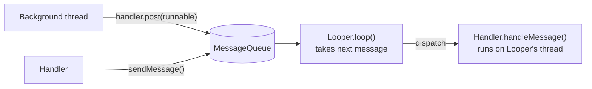
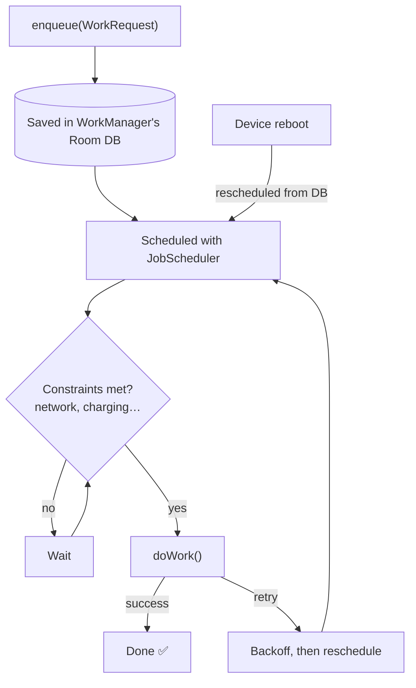

# Threading & Background Work

[⬅ Back to index](../README.md)

Covers: main thread, Looper/Handler/MessageQueue, executors, ANR, Services (started, bound, foreground), WorkManager, AlarmManager, background execution limits, Doze.

---

## Threading Basics

### 1. What is the main (UI) thread? Why shouldn't you block it?

<details>
<summary>Answer</summary>

The main thread runs the app's **event loop**: it handles input, lifecycle callbacks and **drawing frames**. UI toolkits aren't thread-safe, so **only the main thread may touch Views** (otherwise you get `CalledFromWrongThreadException`).

If it's blocked:
- frames take more than 16 ms → **jank** (dropped frames),
- input isn't processed for **5 seconds** → **ANR** (Application Not Responding).

Network calls on the main thread throw `NetworkOnMainThreadException`. Use **StrictMode** in debug builds to detect disk and network access on the main thread.

</details>

### 2. Explain Looper, Handler, MessageQueue.

<details>
<summary>Answer</summary>



- **MessageQueue** – a queue of `Message`s/`Runnable`s, ordered by delivery time.
- **Looper** – runs an infinite loop on a thread: takes the next message from the queue and dispatches it. **One Looper per thread** (stored in a `ThreadLocal`). The main thread's Looper is created by `ActivityThread.main()`. For a background thread, call `Looper.prepare()` + `Looper.loop()`, or use `HandlerThread`.
- **Handler** – bound to a Looper. Used to **post** work to that Looper's thread (`post`, `postDelayed`, `sendMessage`) and to handle messages (`handleMessage`).

```kotlin
val mainHandler = Handler(Looper.getMainLooper())
mainHandler.post { textView.text = "Updated" }   // from background → main
```

It's the basis of `runOnUiThread`, `View.post`, and coroutines' `Dispatchers.Main`.

</details>

### 3. Why can a Handler leak an Activity? How do you fix it?

<details>
<summary>Answer</summary>

A non-static inner `Handler` (or a posted `Runnable` lambda) **implicitly references the Activity**. A delayed message keeps `Message → Handler → Activity` reachable from the MessageQueue (a GC root through the Looper) even after the Activity is destroyed.

Fixes: call `handler.removeCallbacksAndMessages(null)` in `onDestroy`, use a static/top-level Handler with a `WeakReference`, or (best) use **lifecycle-aware coroutines** (`lifecycleScope`) instead.

</details>

### 4. What is HandlerThread?

<details>
<summary>Answer</summary>

A `Thread` that comes with a **Looper**. It's a background thread that processes posted tasks **sequentially**. Used for serialized background work (Camera callbacks, sensor processing). Remember to call `quit()`.

</details>

### 5. What ways exist to do background work on Android?

<details>
<summary>Answer</summary>

| Need | Solution |
|---|---|
| Async work tied to UI/screen | **Coroutines** (`viewModelScope`) |
| Deferrable, **guaranteed** work (sync, upload), even after app restart | **WorkManager** |
| Long user-visible ongoing task (music, navigation, call, workout) | **Foreground Service** (with type) |
| Exact time-based (alarm clock, reminders) | **AlarmManager** (`setExactAndAllowWhileIdle`) |
| Large user-initiated downloads/uploads | **User-initiated data transfer jobs** (Android 14+) / `DownloadManager` |
| Legacy | `AsyncTask` (**deprecated**), `IntentService` (**deprecated**), `JobIntentService` (deprecated), Loaders (deprecated) |

</details>

### 6. Why was AsyncTask deprecated?

<details>
<summary>Answer</summary>

It **leaked** Activities (inner class references), **didn't respect lifecycle** (it kept running after rotation, so the result went to a dead Activity), had confusing changes to serial vs parallel execution across versions, handled errors badly, and was hard to cancel. It was deprecated in API 30. Use coroutines or Executors.

</details>

### 7. What is an ANR? What causes it and how do you debug it?

<details>
<summary>Answer</summary>

**ANR (Application Not Responding)** – the system shows a dialog when:
- **input dispatch** (touch or key) isn't handled within **5 s**,
- a `BroadcastReceiver.onReceive` doesn't finish within **~10 s** (foreground) or longer (background),
- a **Service** doesn't finish its lifecycle callbacks in time (~20 s foreground),
- a **foreground service** doesn't call `startForeground()` within ~5–10 s of `startForegroundService()`,
- a JobScheduler job's `onStartJob`/`onStopJob` doesn't return in time (Android 14+).

**Causes:** heavy I/O or network on the main thread, **lock contention/deadlocks** (main thread waiting on a lock held by a background thread), long `onCreate`, SharedPreferences `apply` flushing, slow Binder calls, too much work in `onReceive`.

**Debug:** read the `/data/anr/traces.txt` stack of the main thread (from a bug report), **Play Console Android vitals** (ANR clusters), `ApplicationExitInfo` (API 30+), **StrictMode**, Perfetto traces. ANR rate is a **Play Store vitals metric** (the bad-behaviour threshold is 0.47% user-perceived ANR rate), so it affects store visibility.

</details>

### 8. What is StrictMode?

<details>
<summary>Answer</summary>

A developer tool that detects accidental bad practices:
- **ThreadPolicy** – disk reads/writes, network, slow calls on the main thread.
- **VmPolicy** – leaked Activities, closeables not closed, SQLite objects leaked, `file://` URI exposure.

Enable it in **debug builds only**, with `penaltyLog()` or `penaltyDeath()`.

</details>

### 9. What are Executors and thread pools?

<details>
<summary>Answer</summary>

`ExecutorService` reuses a pool of threads instead of creating a new one per task: `newFixedThreadPool(n)`, `newCachedThreadPool()`, `newSingleThreadExecutor()`, `newScheduledThreadPool()`. Thread pools avoid creation overhead and limit concurrency. Coroutine dispatchers are built on similar pools. Convert with `executor.asCoroutineDispatcher()`.

</details>

---

## Services

### 10. What is a Service? What are the types?

<details>
<summary>Answer</summary>

A component for work **without a UI**. It runs on the **main thread by default** (you have to create threads or coroutines yourself).

1. **Started service** – `startService()`; runs until it calls `stopSelf()` or someone calls `stopService()`. `onStartCommand` returns `START_STICKY`, `START_NOT_STICKY` or `START_REDELIVER_INTENT` (restart behaviour after the process is killed).
2. **Bound service** – `bindService()`; a client-server interface (`onBind` returns an `IBinder`). It lives **only while clients are bound**.
3. **Foreground service** – a started service that shows an **ongoing notification**, so the user knows about it and it's unlikely to be killed.

Background services are **heavily restricted since Android 8** (`IllegalStateException` when starting from the background). Use WorkManager for background work.

</details>

### 11. What is the Service lifecycle?

<details>
<summary>Answer</summary>

- **Started:** `onCreate()` → `onStartCommand()` (on each `startService`) → … → `onDestroy()`.
- **Bound:** `onCreate()` → `onBind()` → (clients interact) → `onUnbind()` → `onDestroy()`.
- A service can be both started and bound. It's destroyed only when it's stopped **and** all clients have unbound.

</details>

### 12. What is a Foreground Service? What changed in Android 14?

<details>
<summary>Answer</summary>

A service doing **user-noticeable** work, with a persistent notification: music playback, navigation, a fitness workout, an ongoing call.
- Start it with `ContextCompat.startForegroundService()`, then call `startForeground(id, notification, type)` **quickly** (within ~5–10 s).
- Requires the `FOREGROUND_SERVICE` permission.
- **Android 14 (API 34)** requires a **foreground service type** (`dataSync`, `mediaPlayback`, `location`, `camera`, `microphone`, `phoneCall`, `health`, `connectedDevice`, `shortService`, `specialUse`…) declared in the manifest, plus the type-specific permission (e.g. `FOREGROUND_SERVICE_LOCATION`). Google Play requires a declaration justifying the types.
- Since Android 12, apps **can't start foreground services from the background** (with some exemptions). Use WorkManager instead, or user-initiated data transfer jobs on Android 14+.
- Android 15 added time limits on `dataSync` and `mediaProcessing` FGS (about 6 hours per 24 hours).

</details>

### 13. Service vs IntentService vs WorkManager vs Thread?

<details>
<summary>Answer</summary>

- **Thread / coroutine** – in-process async work, dies with the process. Tied to the component's lifecycle if scoped.
- **Service** – a component for long-running work without UI. Runs on the main thread by default. Background start restrictions apply.
- **IntentService** – (deprecated) ran tasks sequentially on a worker thread and stopped itself.
- **WorkManager** – **guaranteed**, constraint-aware, persistent background work that survives app restarts and reboots. **Recommended** for most background tasks.

</details>

---

## WorkManager

### 14. What is WorkManager? When do you use it?

<details>
<summary>Answer</summary>

WorkManager is the recommended API for **persistent, deferrable, guaranteed** background work. It runs even if the app exits or the device restarts, because work is stored in an internal Room DB. Internally it uses **JobScheduler** (API 23+).

Use it for: syncing data, uploading logs or photos, periodic cleanup, sending analytics.
**Not** for: work that has to happen at an exact time (use AlarmManager), or work that can stop when the user leaves the screen (use coroutines).

</details>

### 15. Explain WorkManager's features (constraints, chaining, periodic, unique work).

<details>
<summary>Answer</summary>

```kotlin
class SyncWorker(ctx: Context, params: WorkerParameters) : CoroutineWorker(ctx, params) {
    override suspend fun doWork(): Result = try {
        repo.sync(); Result.success()
    } catch (e: IOException) { if (runAttemptCount < 3) Result.retry() else Result.failure() }
}

val request = OneTimeWorkRequestBuilder<SyncWorker>()
    .setConstraints(Constraints(requiredNetworkType = NetworkType.CONNECTED, requiresBatteryNotLow = true))
    .setBackoffCriteria(BackoffPolicy.EXPONENTIAL, 30, TimeUnit.SECONDS)
    .setInputData(workDataOf("userId" to id))
    .build()

WorkManager.getInstance(ctx).enqueueUniqueWork("sync", ExistingWorkPolicy.KEEP, request)
```

- **Constraints:** network type, charging, battery not low, storage not low, device idle.
- **OneTime vs Periodic:** `PeriodicWorkRequestBuilder<W>(15, MINUTES)`. **The minimum interval is 15 minutes**, and timing isn't exact.
- **Chaining:** `beginWith(a).then(b).then(listOf(c, d)).enqueue()`. Outputs pass to the next work through `Data` (**10 KB limit**).
- **Unique work:** `REPLACE`, `KEEP`, `APPEND`, `APPEND_OR_REPLACE`, `UPDATE` (periodic) to avoid duplicates.
- **Observe:** `getWorkInfoByIdFlow(id)`. **Tags**, cancellation.
- **Expedited work:** `setExpedited(OutOfQuotaPolicy.RUN_AS_NON_EXPEDITED_WORK_REQUEST)` for important, short tasks.
- **Long-running:** `setForeground(ForegroundInfo)` from the worker.

</details>

### 16. Worker vs CoroutineWorker vs RxWorker vs ListenableWorker?

<details>
<summary>Answer</summary>

- `Worker` – synchronous `doWork()` on a background executor thread.
- **`CoroutineWorker`** – a suspend `doWork()` (Kotlin). Recommended. Runs on `Dispatchers.Default` by default.
- `RxWorker` – returns a `Single<Result>`.
- `ListenableWorker` – the base class; returns a `ListenableFuture`, for custom threading.

A worker has about **10 minutes** of execution time before it's stopped (unless it's running in the foreground).

</details>

---

## System Restrictions

### 17. What are Doze mode and App Standby?

<details>
<summary>Answer</summary>

Battery-saving features introduced in **Android 6.0**:
- **Doze** – when the device is unplugged, stationary and the screen is off, the system defers network access, jobs, syncs and alarms to periodic **maintenance windows**. Wake locks are ignored.
- **App Standby** – apps the user hasn't used recently get their network and jobs restricted.
- **App Standby Buckets** (Android 9) – Active, Working set, Frequent, Rare, Restricted. Jobs and alarms are throttled per bucket.

Work with them: use WorkManager, FCM high-priority messages (for urgent user-visible events) and `setExactAndAllowWhileIdle` alarms (sparingly).

</details>

### 18. What are background execution limits by Android version?

<details>
<summary>Answer</summary>

- **6.0** – Doze and App Standby.
- **7.0** – removed implicit broadcasts like `CONNECTIVITY_ACTION` for manifest receivers.
- **8.0** – **background service limits**: no `startService` from the background; most implicit broadcasts can't be registered in the manifest; location update limits.
- **9.0** – App Standby Buckets; restrictions on background apps' access to sensors.
- **10** – background activity starts restricted; background location became a separate permission.
- **12** – no starting **foreground services from the background**; exact alarms need `SCHEDULE_EXACT_ALARM`.
- **13** – `POST_NOTIFICATIONS` runtime permission; the FGS Task Manager lets users stop apps.
- **14** – FGS **types required**; `USE_EXACT_ALARM` restricted to alarm and calendar apps; user-initiated data transfer jobs.
- **15** – FGS time limits for `dataSync`/`mediaProcessing`; starting FGS from `BOOT_COMPLETED` receivers restricted for some types.
- **16** – JobScheduler quota changes (jobs started while the app is in the foreground keep their quota limits in the background, etc.).

</details>

### 19. What is AlarmManager? Exact vs inexact alarms?

<details>
<summary>Answer</summary>

AlarmManager schedules an Intent at a specific time, **even if the app isn't running** (it's delivered through a `PendingIntent`).
- **Inexact** (`set`, `setWindow`, `setInexactRepeating`) – the system batches them to save battery.
- **Exact** (`setExact`, `setExactAndAllowWhileIdle`, `setAlarmClock`) – need the `SCHEDULE_EXACT_ALARM` permission (Android 12+; **denied by default for most new installs on Android 14+**) or `USE_EXACT_ALARM` (only for alarm and calendar apps). Check `canScheduleExactAlarms()`.
- Alarms are **cleared on reboot**. Re-register them in a `BOOT_COMPLETED` receiver.

</details>

### 20. What is a WakeLock? Why avoid it?

<details>
<summary>Answer</summary>

A `PowerManager.WakeLock` keeps the **CPU awake** (partial wake lock) while the screen is off. Misuse drains the battery and is flagged in **Android vitals** (excessive wake locks). Prefer WorkManager or JobScheduler, which manage wake locks for you. If you must use one, always set a **timeout** and release it in `finally`. For keeping the screen on, use `FLAG_KEEP_SCREEN_ON` (or `keepScreenOn = true`) instead.

</details>

### 21. How do you detect whether the app is in the foreground or background?

<details>
<summary>Answer</summary>

`ProcessLifecycleOwner.get().lifecycle` – observe `ON_START` (app in foreground) and `ON_STOP` (app in background, dispatched with a delay so configuration changes don't count). Or check `lifecycle.currentState.isAtLeast(STARTED)`.

</details>


---

## More Background & Notifications

### 22. How does WorkManager guarantee task execution?

<details>
<summary>Answer</summary>



1. **Persistence:** every enqueued `WorkRequest` (with its input data, constraints and state) is stored in WorkManager's **internal Room database** before `enqueue()` returns.
2. **System schedulers:** it delegates to **JobScheduler** (API 23+), which survives app death and is **rescheduled after reboot** (WorkManager listens for `BOOT_COMPLETED` through its own receivers). In-process execution happens while the app is alive (the `GreedyScheduler`).
3. **Constraint tracking:** work runs only when the network, charging or storage constraints are met.
4. **Retries:** `Result.retry()` with exponential or linear **backoff**. Failures are recorded.
5. **Force-stop caveat:** if the user **force-stops** the app, all of its jobs and alarms are cancelled until the app is opened again. Some OEM battery optimizations can delay work too.

"Guaranteed" means **eventually executed while the constraints hold**, not executed at an exact time.

</details>

### 23. What is JobScheduler? JobScheduler vs WorkManager?

<details>
<summary>Answer</summary>

**JobScheduler** (API 21+) is the **system service** for scheduling background jobs with constraints (network, charging, idle). It batches jobs across apps to save battery. You implement a `JobService` with `onStartJob`/`onStopJob`.

**WorkManager** is the Jetpack library **built on top of** JobScheduler. It adds a Kotlin/coroutine API (`CoroutineWorker`), **chaining**, **unique work**, observable state (Flow/LiveData), input and output data, persistence, testing tools and backward compatibility. Use **WorkManager** unless you need a platform-only feature (e.g. user-initiated data transfer jobs on Android 14+, which are JobScheduler APIs).

</details>

### 24. How do notifications work in Android? (Channels, importance, styles, permission)

<details>
<summary>Answer</summary>

- **Notification channels** (required since Android 8.0): every notification belongs to a channel (e.g. "Messages", "Promotions") with an **importance** (`IMPORTANCE_HIGH` = heads-up, `DEFAULT` = sound, `LOW` = silent, `MIN`). **Users control each channel** in settings. After a channel is created, the app can't change its importance.
- **Runtime permission:** `POST_NOTIFICATIONS` on **Android 13+**.
- **Building:** `NotificationCompat.Builder(context, CHANNEL_ID)` with a small icon, title, text and a `PendingIntent` (immutable) for the tap action, plus **action buttons**, **direct reply** (`RemoteInput`), styles (`BigTextStyle`, `BigPictureStyle`, `InboxStyle`, **`MessagingStyle`** for chats, `MediaStyle`), **groups** (`setGroup` + a summary), progress, and full-screen intents (calls and alarms; restricted on Android 14+).
- **Show:** `NotificationManagerCompat.from(ctx).notify(id, notification)`.
- **Exact-time local notifications:** schedule an **AlarmManager** alarm (`setExactAndAllowWhileIdle`, which needs the exact-alarm permission) whose receiver posts the notification. For approximate timing, use a WorkManager `OneTimeWorkRequest` with `setInitialDelay`.
- **Android 16** adds progress-centric notifications (`Notification.ProgressStyle`) for Live Updates.

</details>

### 25. How do you run parallel tasks and get a callback when all of them complete?

<details>
<summary>Answer</summary>

- **Coroutines (preferred):** `val results = ids.map { async { load(it) } }.awaitAll()`, or launch them and call `joinAll()`.
- **Flow:** `combine`/`zip`, or `merge` + `toList`.
- **RxJava:** `Single.zip(a, b) { … }` or `Observable.merge(…).toList()`.
- **Java/Executors:** `invokeAll(callables)`, **`CountDownLatch`** (`countDown()` in each task, `await()` in the waiter), or `CompletableFuture.allOf(...)`.
- **WorkManager:** `beginWith(listOf(workA, workB)).then(combineWork).enqueue()`. The next work runs when all the parallel ones succeed (input merging with an `InputMerger`).

</details>

### 26. Can you detect that a user uninstalled your app?

<details>
<summary>Answer</summary>

**Not from the app itself**: it isn't notified of its own uninstall (`ACTION_PACKAGE_REMOVED` goes to *other* apps). Detection happens **on the server**:
- **FCM**: sending a message to an uninstalled app's token returns an **`UNREGISTERED` / `NotRegistered`** error, so you can mark the user as uninstalled (with some delay).
- **Firebase Analytics** logs an `app_remove` event (Android only), which is reported from Google Play services.
- Silent "heartbeat" pushes, or a lack of activity, as weaker signals.

</details>

---

[⬅ Previous: Data Storage](16-data-storage.md) · [⬅ Back to index](../README.md) · [Next: RxJava ➡](18-rxjava.md)
