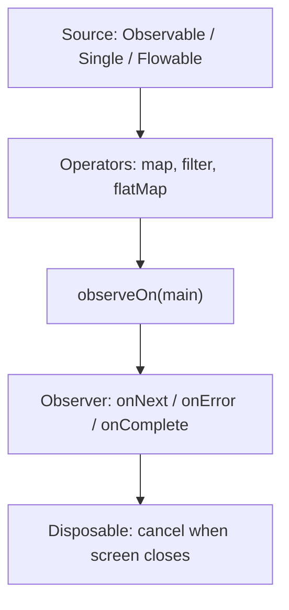
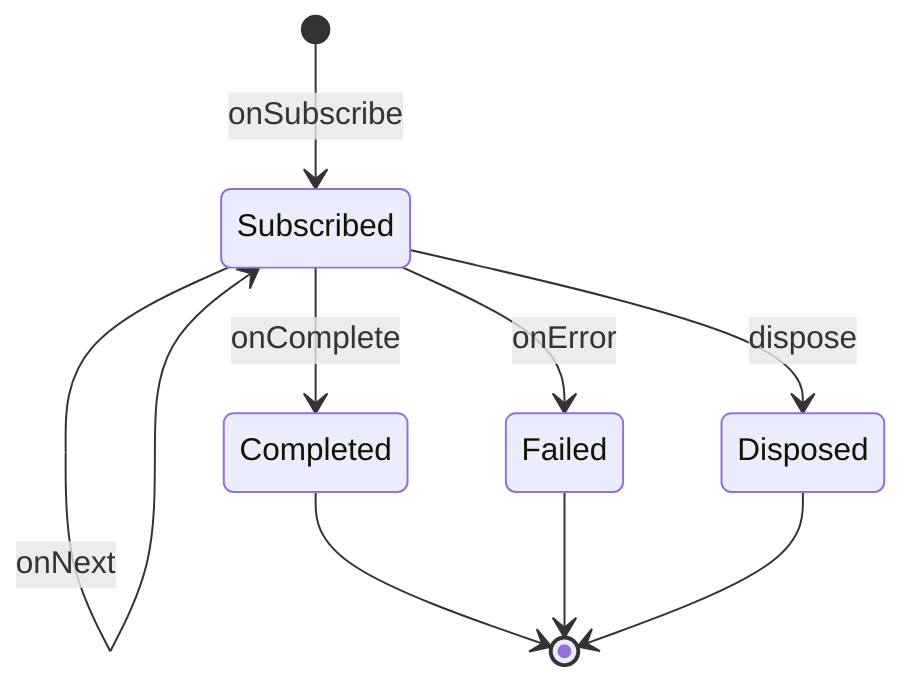
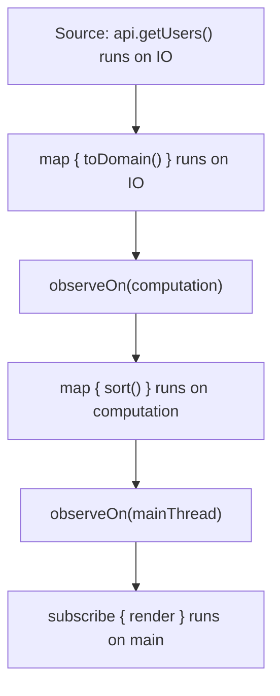
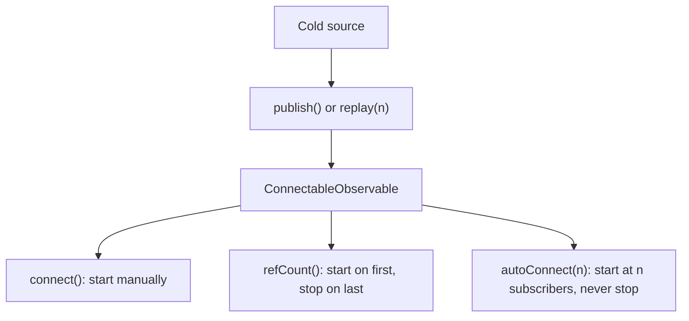
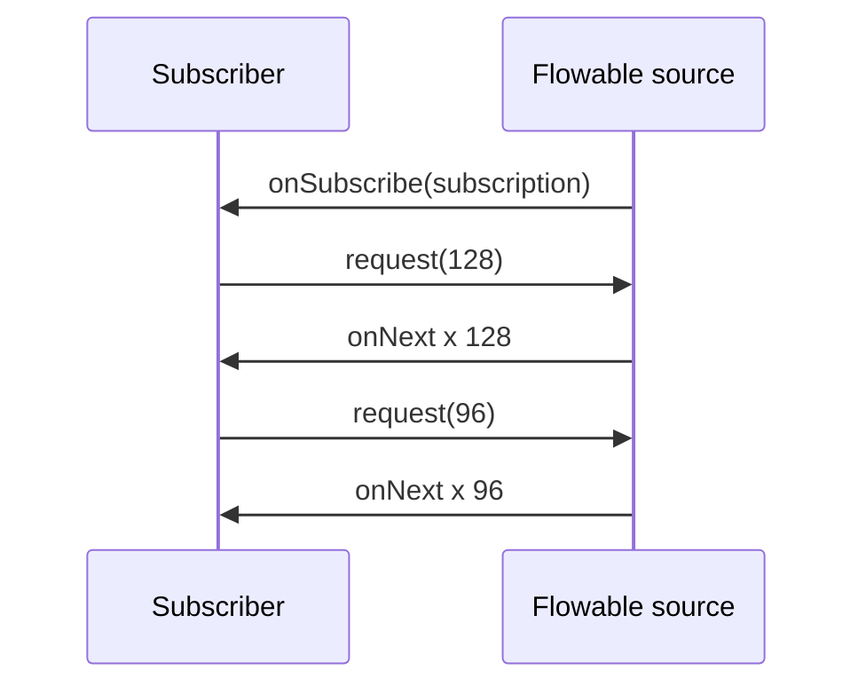
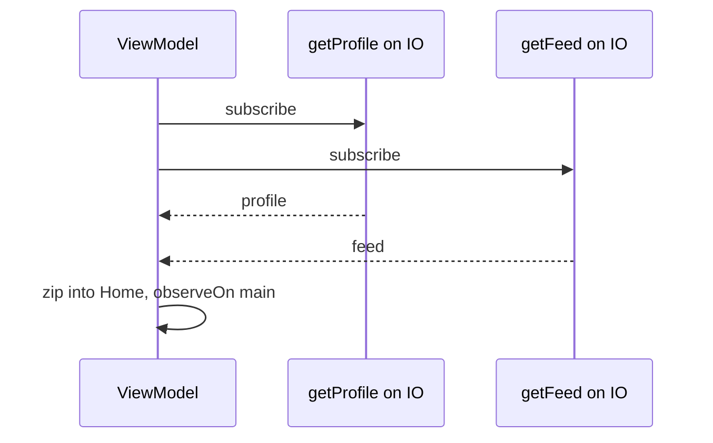

# RxJava

[⬅ Back to index](../README.md)

Covers: reactive basics, Observable types, Schedulers, operators, Subjects, hot vs cold, backpressure, disposal, error handling, migration to Flow. (Still asked often for legacy/large codebases.)

---

### 1. What is RxJava? What is reactive programming?

<details>
<summary>Answer</summary>

**In short:** Reactive programming means programming with **asynchronous data streams**: you declare how data flows and is transformed, and your code reacts to events as they arrive. **RxJava** is the JVM implementation of ReactiveX: a source (**Observable**) emits items, **operators** transform them, an **Observer** consumes them, **Schedulers** decide which threads do the work, and **Disposables** let you cancel.

#### The problem it solves

Android apps are full of asynchronous events: network responses, database changes, clicks, text input, sensor readings. With plain callbacks, combining them gets messy fast: nested callbacks ("callback hell"), manual thread hopping with `Handler`s, no easy way to cancel, and error handling scattered everywhere.

Reactive programming treats every one of those as a **stream of values over time**. Once everything is a stream, you can use the same toolbox on all of them: `map`, `filter`, `zip`, `debounce`, `retry`, and so on.

ReactiveX combines three ideas:
- **Observer pattern**: the source pushes values to subscribers.
- **Iterator pattern, but push-based**: instead of you calling `next()`, the source calls `onNext()`.
- **Functional operators**: declarative, chainable transformations, like Kotlin collection operators but for async events.

#### The building blocks



| Part | Role |
|---|---|
| `Observable`, `Flowable`, `Single`, `Maybe`, `Completable` | Sources of data |
| Operators | Transform, filter, combine, retry, time-shift |
| `Observer` / `Subscriber` | Consumer with `onNext`, `onError`, `onComplete` |
| `Scheduler` | Threading (`io()`, `computation()`, `mainThread()`) |
| `Disposable` | Handle to cancel a subscription |

**RxAndroid** is a tiny add-on that provides `AndroidSchedulers.mainThread()` so results can be delivered to the UI thread.

```kotlin
api.getUser(id)                                  // Single<UserDto>
    .map { it.toDomain() }                       // transform
    .subscribeOn(Schedulers.io())                // do the work on an IO thread
    .observeOn(AndroidSchedulers.mainThread())   // deliver on the UI thread
    .subscribe(
        { user -> render(user) },                // success
        { error -> showError(error) }            // error
    )
    .addTo(disposables)                          // cancel later (RxKotlin extension)
```

Nothing happens until `subscribe()` is called: most Rx sources are **lazy**.

**Likely follow-ups:**
- *Is RxJava still used?* Yes, in many large and older codebases; new Kotlin code usually uses Coroutines and Flow instead.
- *RxJava 2 vs 3?* Same concepts; 3 changed package names (`io.reactivex.rxjava3`) and cleaned up some APIs.

</details>

### 2. What are the types of Observables?

<details>
<summary>Answer</summary>

**In short:** RxJava has five source types, chosen by **how many items** they emit and whether they need **backpressure**: `Observable` (0..N, no backpressure), `Flowable` (0..N with backpressure), `Single` (exactly one value or an error), `Maybe` (zero or one value, or an error) and `Completable` (no value, just done or error).

| Type | Emits | Callbacks | Use case | Coroutine equivalent |
|---|---|---|---|---|
| `Observable` | 0..N items, no backpressure | `onNext`, `onError`, `onComplete` | UI events, small streams | `Flow` |
| `Flowable` | 0..N items, **with backpressure** | `onNext`, `onError`, `onComplete` (+ `request(n)`) | Large/fast streams (DB, sensors, files) | `Flow` |
| `Single` | exactly 1 item or error | `onSuccess`, `onError` | Network call | `suspend fun(): T` |
| `Maybe` | 0 or 1 item, or error | `onSuccess`, `onComplete`, `onError` | Cache lookup | `suspend fun(): T?` |
| `Completable` | no item; completes or errors | `onComplete`, `onError` | Save/delete operation | `suspend fun()` |

#### Why have so many types?

The type is **documentation and a compile-time guarantee**. A Retrofit method returning `Single<User>` tells every reader "this produces exactly one user or fails". If it returned `Observable<User>`, callers would have to wonder whether more values could come and whether it ever completes.

```kotlin
interface UserApi {
    @GET("users/{id}")
    fun getUser(@Path("id") id: String): Single<User>        // one response

    @DELETE("users/{id}")
    fun deleteUser(@Path("id") id: String): Completable       // only success/failure
}

@Dao
interface UserDao {
    @Query("SELECT * FROM users WHERE id = :id")
    fun findById(id: String): Maybe<User>                     // may not exist

    @Query("SELECT * FROM users")
    fun observeAll(): Flowable<List<User>>                    // re-emits on every table change
}
```

#### Converting between them

- `single.toObservable()`, `observable.firstOrError()` (Observable to Single), `observable.firstElement()` (to Maybe), `observable.ignoreElements()` (to Completable).
- `observable.toFlowable(BackpressureStrategy.LATEST)` adds a backpressure strategy.
- `completable.andThen(single)` runs a Completable and then a Single.

**Common pitfalls:**
- Using `Observable` for a single network call: works, but hides intent and allows misuse.
- `Single` with a null value is not allowed (RxJava 2+ forbids nulls); use `Maybe` or a wrapper like `Optional`.

**Likely follow-ups:**
- *When pick Flowable over Observable?* When the source can produce faster than the consumer and you can't control it (thousands of items, DB streams). For a few UI events, `Observable` is fine.
- *Can RxJava emit null?* No; it throws a `NullPointerException`.

</details>

### 3. What is the Observer contract?

<details>
<summary>Answer</summary>

**In short:** An Observer first gets `onSubscribe(Disposable)`, then zero or more `onNext(item)` calls, then **at most one** terminal event: either `onComplete()` or `onError(Throwable)`, never both. Nothing is delivered after a terminal event, and calls must be **serialized** (never concurrent). `Single` and `Maybe` use `onSuccess` instead of `onNext`.



#### The rules

1. **`onSubscribe` comes first.** It hands the Observer a `Disposable` (or a `Subscription` for `Flowable`) so it can cancel at any time.
2. **`onNext` zero or more times.** Represented as `onNext*` in the grammar.
3. **One terminal event at most.** `onComplete` or `onError`. An infinite stream (like clicks) may never terminate.
4. **Serialized calls.** Signals never overlap in time, even if the source runs on several threads. That's why operators like `merge` do internal serialization.
5. **After a terminal event or disposal, silence.**

| Type | Signals |
|---|---|
| `Observable` / `Flowable` | `onSubscribe`, `onNext*`, `onComplete` or `onError` |
| `Single` | `onSubscribe`, then `onSuccess` or `onError` |
| `Maybe` | `onSubscribe`, then `onSuccess`, `onComplete` or `onError` |
| `Completable` | `onSubscribe`, then `onComplete` or `onError` |

#### Why it matters

Every operator relies on this contract. When you write a source with `Observable.create`, **you** are responsible for it:

```kotlin
// Wrong: may emit after completing, and ignores disposal
Observable.create<Int> { emitter ->
    emitter.onNext(1)
    emitter.onComplete()
    emitter.onNext(2)          // violates the contract (the emitter drops it, but it's a bug)
}

// Right: check disposal, terminate once
Observable.create<Int> { emitter ->
    for (i in 1..3) {
        if (emitter.isDisposed) return@create
        emitter.onNext(i)
    }
    emitter.onComplete()
}
```

**Common pitfalls:**
- An error thrown *after* the stream already terminated or was disposed can't be delivered; RxJava routes it to `RxJavaPlugins.onError`, which crashes by default (`UndeliverableException`).
- Calling `onNext` from several threads on a `Subject` without `toSerialized()` breaks rule 4.

**Likely follow-ups:**
- *What happens after `onError`?* The stream is finished; to continue you must resubscribe (`retry`) or switch to another source (`onErrorResumeNext`).

</details>

### 4. `subscribeOn` vs `observeOn`?

<details>
<summary>Answer</summary>

**In short:** `subscribeOn` chooses the thread on which the **source starts** working (where subscription happens); its position in the chain doesn't matter and **only the one closest to the source takes effect**. `observeOn` switches the thread for everything **downstream** of it; you can use it several times to hop threads.

#### How it works

When you call `subscribe()`, the subscription travels **upstream** (from the bottom of the chain to the source). Then items flow **downstream** (from the source to your Observer).

- `subscribeOn(scheduler)` intercepts the *upstream* subscription and continues it on the given scheduler. So the source's work (e.g. the blocking HTTP call) runs there. If you add several, the one nearest the source wins, because it's the last to switch the thread before the source runs.
- `observeOn(scheduler)` intercepts the *downstream* items and re-emits them on the given scheduler. Every operator after it runs on that thread, until the next `observeOn`.



```kotlin
api.getUsers()                                   // Single<List<UserDto>>
    .subscribeOn(Schedulers.io())                // source runs on IO (could be placed anywhere)
    .map { list -> list.map { it.toDomain() } }  // still IO
    .observeOn(Schedulers.computation())
    .map { it.sortedBy(User::name) }             // computation
    .observeOn(AndroidSchedulers.mainThread())
    .subscribe({ render(it) }, { showError(it) }) // main thread
```

| | `subscribeOn` | `observeOn` |
|---|---|---|
| Affects | Where the source (and upstream subscription) runs | Everything downstream of it |
| Multiple calls | Only the one closest to the source counts | Each one switches the thread again |
| Position | Anywhere in the chain | Matters a lot |
| Typical use | `Schedulers.io()` for network/DB | `AndroidSchedulers.mainThread()` before UI code |

**Common pitfalls:**
- Forgetting `observeOn(mainThread())` and touching views on a background thread (`CalledFromWrongThreadException`).
- Expecting a second `subscribeOn` to move work: it doesn't.
- Some operators have their own default scheduler: `interval`, `timer`, `delay` and `debounce` emit on `Schedulers.computation()` regardless of `subscribeOn`.
- Sources that are already async (Retrofit with `createAsync()`, Room's `Flowable`) choose their own threads; `subscribeOn` then only affects the subscription call itself.

**Likely follow-ups:**
- *Which thread does `doOnSubscribe` run on?* The thread where subscription happens at that point in the chain; below `subscribeOn` that's the caller's thread.
- *Flow equivalent?* `flowOn(Dispatchers.IO)` affects upstream like `subscribeOn`; collection happens in the collector's context, like a final `observeOn`.

</details>

### 5. What are Schedulers?

<details>
<summary>Answer</summary>

**In short:** A Scheduler is RxJava's abstraction over a thread pool: it decides **where** work runs. Use `Schedulers.io()` for blocking I/O, `Schedulers.computation()` for CPU work, and `AndroidSchedulers.mainThread()` to deliver results to the UI. You apply them with `subscribeOn` and `observeOn`.

| Scheduler | Backing threads | Use for | Avoid |
|---|---|---|---|
| `Schedulers.io()` | Unbounded, cached pool (threads reused, created on demand) | Network, disk, database: work that waits | CPU-heavy loops (can create too many threads) |
| `Schedulers.computation()` | Fixed pool, one thread per CPU core | Parsing, sorting, image processing, event loops | Blocking calls (they starve the small pool) |
| `Schedulers.single()` | One shared background thread | Strictly sequential background work | Long blocking tasks |
| `Schedulers.newThread()` | A brand-new thread per unit of work | Rarely needed | Frequent use (thread creation is expensive) |
| `Schedulers.trampoline()` | Current thread, tasks queued | Tests, keeping work on the caller | Anything that must be async |
| `Schedulers.from(executor)` | Your own `Executor` | Custom pools, limiting concurrency | |
| `AndroidSchedulers.mainThread()` | Android main looper (RxAndroid) | Updating UI | Blocking work |

#### Why io and computation are different

I/O work spends most of its time **waiting** (on a socket or disk), so having many threads is fine: they're mostly idle. That's why `io()` grows as needed. CPU work keeps a core busy, so more threads than cores just adds context switching; `computation()` is sized to the core count.

If you put a blocking network call on `computation()`, you may block all of its threads, and everything else that uses `computation()` (including `interval`, `delay`, `debounce` timers) stalls.

```kotlin
repository.loadBitmapBytes(url)          // blocking I/O
    .subscribeOn(Schedulers.io())
    .observeOn(Schedulers.computation())
    .map { bytes -> decodeAndBlur(bytes) }  // CPU work
    .observeOn(AndroidSchedulers.mainThread())
    .subscribe(imageView::setImageBitmap, ::showError)
```

**Common pitfalls:**
- Using `newThread()` in a loop: creates a thread per call.
- Hard-coding schedulers inside classes makes testing harder; inject them (e.g. a `SchedulerProvider` interface) or override them with `RxJavaPlugins` in tests.

**Likely follow-ups:**
- *Coroutine equivalents?* `io()` ≈ `Dispatchers.IO`, `computation()` ≈ `Dispatchers.Default`, `mainThread()` ≈ `Dispatchers.Main`.
- *Why is `trampoline()` used in tests?* It runs everything synchronously on the test thread, so assertions run after the work finishes.

</details>

### 6. `map` vs `flatMap` vs `concatMap` vs `switchMap`?

<details>
<summary>Answer</summary>

**In short:** `map` transforms each item 1:1 synchronously. `flatMap` maps each item to a new Observable and **merges** them concurrently (order not guaranteed). `concatMap` does the same but **one at a time, in order**. `switchMap` **cancels** the previous inner Observable when a new item arrives, so only the latest one matters (perfect for search-as-you-type).

#### `map`: plain transformation

```kotlin
users.map { it.name }   // User -> String, same thread, one in one out
```

Use it when the transformation is synchronous and can't fail asynchronously.

#### The `*Map` family: when each item starts async work

When each item needs its own async call (e.g. "for each id, fetch details"), `map` would give you an `Observable<Single<Details>>`. The flattening operators subscribe to those inner sources and forward their results into one stream. They differ in **what happens when inner sources overlap**:

| Operator | Inner sources | Order of results | Typical use |
|---|---|---|---|
| `flatMap` | All run **concurrently** | Interleaved, whichever finishes first | Independent parallel work (upload many files) |
| `concatMap` | **One at a time**, next starts after previous completes | Same as input order | Ordered steps, sequential writes |
| `switchMap` | Only the **latest** runs; previous is disposed | Only latest results | Search, "load details for selected item" |

Example with input ids `1, 2, 3` where each call takes a different time:

```kotlin
ids.flatMap { id -> api.details(id).toObservable() }    // results may arrive 2, 1, 3
ids.concatMap { id -> api.details(id).toObservable() }  // always 1, 2, 3, but slower overall
ids.switchMap { id -> api.details(id).toObservable() }  // if ids arrive quickly, only 3's result
```

There are typed variants that skip the `toObservable()` step: `flatMapSingle`, `concatMapSingle`, `switchMapSingle`, `flatMapCompletable`, `flatMapMaybe`, etc.

#### Real-world picks

- **Search box:** `switchMap`, so a slow response for "an" can't overwrite the results for "android".
- **Sending chat messages:** `concatMap`, so messages arrive in the order they were typed.
- **Uploading 20 photos:** `flatMap` with a concurrency limit: `flatMap({ upload(it) }, 4)` runs at most 4 uploads at once.

**Common pitfalls:**
- Using `flatMap` for search: stale responses can appear after newer ones.
- Unbounded `flatMap` over a huge list can start thousands of requests at once; pass `maxConcurrency`.
- An error in any inner source terminates the whole outer stream; handle errors inside the inner source if the outer stream must survive.

**Likely follow-ups:**
- *Flow equivalents?* `flatMapMerge`, `flatMapConcat`, `flatMapLatest`.
- *What is `exhaustMap`-like behavior in RxJava?* Not built in as an operator; it's usually done with `flatMap` plus a "busy" flag, or `throttleFirst` for clicks.

</details>

### 7. `zip` vs `merge` vs `combineLatest` vs `concat`?

<details>
<summary>Answer</summary>

**In short:** `zip` pairs items **by index** (first with first, second with second): wait for two API calls and combine them. `merge` interleaves items from all sources **as they arrive**. `concat` subscribes to sources **one after another** (cache first, then network). `combineLatest` emits whenever **any** source emits, using the latest value from each (form validation).

| Operator | When it emits | Subscribes to sources | Completes when | Typical use |
|---|---|---|---|---|
| `zip` | When each source has a new item at the same index | All at once | Any source completes (no more pairs) | Combine results of parallel calls |
| `merge` | Every item from any source, immediately | All at once | All sources complete | Several event streams into one |
| `concat` | Every item of source 1, then source 2... | Sequentially | Last source completes | Cache then network |
| `combineLatest` | Whenever any source emits (after all emitted once) | All at once | All sources complete | Form validation, combining UI state |

#### Examples

```kotlin
// zip: two independent calls, one combined result
Single.zip(api.getProfile(), api.getSettings()) { profile, settings ->
    ProfileScreen(profile, settings)
}

// merge: one stream for all refresh triggers
Observable.merge(pullToRefreshClicks, retryClicks, connectivityRestored)
    .switchMapSingle { repository.load() }

// concat: show cached data immediately, then fresh data
Observable.concat(cache.getUsers().toObservable(), api.getUsers().toObservable())

// combineLatest: enable the button when both fields are valid
Observable.combineLatest(emailChanges, passwordChanges) { email, password ->
    email.isValidEmail() && password.length >= 8
}.subscribe(loginButton::setEnabled)
```

#### How to remember

- **zip** is like a zipper: teeth meet in pairs. A fast source waits (buffers) for the slow one.
- **merge** is a road merge: whoever arrives first goes.
- **concat** is a queue: source 2 doesn't even start until source 1 completes.
- **combineLatest** is a dashboard: always showing the latest reading of each gauge.

**Common pitfalls:**
- `concat` with a source that never completes (like a Room `Flowable`) means later sources never start.
- `combineLatest` emits nothing until **every** source has emitted at least once; give sources a `startWith` value if needed.
- `zip` with streams of different rates buffers the fast one and can grow memory.
- For `zip` to actually run calls in parallel, each source needs its own `subscribeOn(Schedulers.io())` (see question 19).

**Likely follow-ups:**
- *Flow equivalents?* `zip`, `merge`, `combine`, and sequential `flow { emitAll(a); emitAll(b) }` for concat.
- *What if one zipped source fails?* The combined stream errors and the other sources are disposed.

</details>

### 8. What are Subjects? Explain their types.

<details>
<summary>Answer</summary>

**In short:** A Subject is both an **Observable and an Observer**: you can push values into it imperatively (`onNext`) and others can subscribe to it. It's **hot** and is used to bridge non-Rx code (callbacks, UI events) into Rx. The four types differ in what a **new subscriber** receives: `PublishSubject` (only future items), `BehaviorSubject` (latest item, then future ones), `ReplaySubject` (all or the last N items) and `AsyncSubject` (only the last item, on completion).

| Subject | New subscriber receives | Like (coroutines) | Typical use |
|---|---|---|---|
| `PublishSubject` | Only items emitted **after** it subscribes | `MutableSharedFlow()` (no replay) | One-off events, click streams |
| `BehaviorSubject` | The **latest** item (or a default), then new ones | `MutableStateFlow` | Current UI state, current user |
| `ReplaySubject` | **All** past items (or the last N / within a time window), then new ones | `MutableSharedFlow(replay = N)` | Caching history, chat log |
| `AsyncSubject` | Only the **last** item, and only when the Subject completes | A deferred result | One final result |

```kotlin
val state = BehaviorSubject.createDefault(UiState.Loading)

state.subscribe { println("A: $it") }   // A: Loading
state.onNext(UiState.Content(items))     // A: Content
state.subscribe { println("B: $it") }   // B: Content  (gets the latest immediately)

val clicks = PublishSubject.create<Unit>()
clicks.onNext(Unit)                       // lost: nobody subscribed yet
clicks.subscribe { println("click") }     // only future clicks
```

#### Relays

`RxRelay` (a small library by Jake Wharton) provides `PublishRelay`, `BehaviorRelay` and `ReplayRelay`. A Relay is a Subject **without** `onComplete` and `onError`. That matters for UI: if a Subject ever receives `onError`, it's terminated forever and every future subscriber immediately gets the error. A Relay can't end up in that state, so it's safer for long-lived event buses and view state.

```kotlin
private val _state = BehaviorRelay.createDefault(UiState.Loading)
val state: Observable<UiState> = _state.hide()   // expose read-only
```

**Common pitfalls:**
- Exposing a Subject publicly lets anyone call `onNext`; expose it as `Observable` with `.hide()`.
- Subjects are **not thread-safe for concurrent `onNext`**; call `toSerialized()` if several threads push into it.
- Overusing Subjects as a global event bus leads to hard-to-trace data flow. Prefer composing operators.
- `ReplaySubject.create()` with no limit keeps every item forever: a memory leak for long streams. Use `createWithSize(n)`.

**Likely follow-ups:**
- *Why is a Subject hot?* It emits whether or not anyone is subscribed; a new subscriber only sees what the Subject's replay policy allows.
- *How do you send one-time events (navigation, toast)?* `PublishSubject`/`PublishRelay`, keeping in mind events emitted while no one is subscribed (e.g. during rotation) are lost.

</details>

### 9. Hot vs cold Observables?

<details>
<summary>Answer</summary>

**In short:** A **cold** Observable starts producing **separately for each subscriber** (every subscription re-runs the source, e.g. a new Retrofit call). A **hot** Observable produces regardless of subscribers, and subscribers **share** the same emissions (Subjects, clicks, sensor events). You turn cold into hot (shared) with `publish().refCount()` / `share()` or `replay(1).refCount()` / `replay(1).autoConnect()`.

#### Analogy

A cold Observable is like a **movie on a streaming service**: each viewer starts from the beginning with their own playback. A hot Observable is like **live TV**: it's broadcasting whether you watch or not, and if you tune in late, you miss what already aired.

| | Cold | Hot |
|---|---|---|
| Starts producing | On each `subscribe()` | Independently, or on `connect()` |
| Subscribers | Each gets its own independent sequence | Share one sequence |
| Late subscribers | Get everything from the start | Miss earlier items (unless replayed) |
| Examples | `Single.fromCallable`, Retrofit calls, `Observable.just` | Subjects, UI click streams, `share()`-d streams |

#### The classic bug

```kotlin
val users = api.getUsers()          // cold
users.subscribe { showList(it) }
users.subscribe { showCount(it.size) }
// Two HTTP requests are made!
```

Fix it by sharing:

```kotlin
val users = api.getUsers()
    .toObservable()
    .replay(1)
    .refCount()          // one request; late subscribers get the cached result while connected

users.subscribe { showList(it) }
users.subscribe { showCount(it.size) }
```

#### Sharing operators



| Operator | Behavior |
|---|---|
| `publish()` | Returns a `ConnectableObservable`; nothing happens until `connect()` |
| `share()` | Shortcut for `publish().refCount()`: connects on the first subscriber, disconnects when the count drops to zero |
| `replay(n)` | Like `publish()` but caches the last n items for late subscribers |
| `replay(1).refCount()` | Shared, caches latest, stops when nobody listens |
| `replay(1).autoConnect()` | Shared, caches latest, keeps the upstream running even after all subscribers leave |
| `cache()` | Replays everything forever; use carefully |

**Common pitfalls:**
- `share()` on a fast synchronous source: the first subscriber can receive everything before the second subscribes.
- `autoConnect()` never disconnects upstream, so it can leak a long-running source.

**Likely follow-ups:**
- *Is `Flow` hot or cold?* `Flow` is cold; `StateFlow` and `SharedFlow` are hot. `shareIn`/`stateIn` are the equivalents of `share()`/`replay(1)`.

</details>

### 10. What is backpressure? How does Flowable handle it?

<details>
<summary>Answer</summary>

**In short:** Backpressure is the situation where a producer emits **faster than the consumer can process**. `Observable` has no backpressure support, so items pile up in unbounded buffers and you can get an `OutOfMemoryError`. `Flowable` implements the Reactive Streams protocol: the consumer **requests** `n` items at a time, and when the source can't slow down you choose a strategy: `BUFFER`, `DROP`, `LATEST`, `ERROR` or `MISSING`, or operators like `onBackpressureDrop()`.

#### Why it happens

Imagine a sensor emitting 10,000 events per second while your consumer writes each one to a database at 500 per second. Where do the other 9,500 go each second? With `Observable` + `observeOn`, they go into an **unbounded queue** between threads, which grows until the app runs out of memory.

#### How Flowable works



The `Subscriber` gets a `Subscription` and calls `request(n)`. The source must not emit more than requested. Operators like `observeOn` request in batches (128 items by default) and request more as they drain their buffer. A source that **can** slow down (reading a file, paging a DB cursor, `Flowable.range`) simply produces on demand.

#### Strategies for sources that can't slow down

Clicks, sensors and network pushes can't be paused, so you decide what to do with the overflow:

| Strategy / operator | What happens on overflow | Good for |
|---|---|---|
| `BackpressureStrategy.BUFFER` / `onBackpressureBuffer()` | Keep everything in a buffer (unbounded, or bounded with a capacity) | Must not lose data, bursts are short |
| `DROP` / `onBackpressureDrop()` | Discard new items until the consumer requests more | Analytics samples, non-critical events |
| `LATEST` / `onBackpressureLatest()` | Keep only the most recent item | UI updates, sensor/location readings |
| `ERROR` | Signal `MissingBackpressureException` | Detecting the problem loudly |
| `MISSING` | No handling; downstream must cope (usually with an `onBackpressure*` operator) | When you add a custom operator later |

```kotlin
// Observable has no backpressure; convert and choose a strategy
locationUpdates                                   // Observable<Location>, very fast
    .toFlowable(BackpressureStrategy.LATEST)
    .observeOn(AndroidSchedulers.mainThread())
    .subscribe(::showOnMap)

// Creating a Flowable from a callback API
Flowable.create<SensorEvent>({ emitter ->
    val listener = SensorListener { emitter.onNext(it) }
    sensor.register(listener)
    emitter.setCancellable { sensor.unregister(listener) }
}, BackpressureStrategy.DROP)
```

Other ways to reduce load: `sample`/`throttleLast`, `debounce`, `buffer(…)` to batch, or `window`.

**Common pitfalls:**
- Using `Flowable` everywhere "to be safe": it adds overhead and complexity. For a few UI events, `Observable` is fine.
- `MissingBackpressureException` usually means a hot source wrapped without a strategy; add `onBackpressureLatest()` or similar.

**Likely follow-ups:**
- *How does Flow handle backpressure?* By suspension: `emit` suspends until the collector is ready. `buffer()`, `conflate()` and `collectLatest` are the equivalents of BUFFER, LATEST and "cancel and restart".

</details>

### 11. What are Disposable and CompositeDisposable? Why are they needed?

<details>
<summary>Answer</summary>

**In short:** `subscribe()` returns a **`Disposable`**, a handle you call `dispose()` on to cancel the subscription and stop its work. If you don't dispose, the subscription's lambdas keep references to your Activity/Fragment/View alive, causing **memory leaks** and callbacks on destroyed views. A **`CompositeDisposable`** groups many Disposables so you can cancel them all in one call, e.g. in `ViewModel.onCleared()`.

#### Why leaks happen

```kotlin
class ProfileActivity : AppCompatActivity() {
    override fun onCreate(savedInstanceState: Bundle?) {
        super.onCreate(savedInstanceState)
        Observable.interval(1, TimeUnit.SECONDS)
            .observeOn(AndroidSchedulers.mainThread())
            .subscribe { textView.text = "$it" }   // lambda captures the Activity
        // Never disposed: after rotation the old Activity can't be garbage-collected,
        // and the timer keeps updating a dead view forever.
    }
}
```

The chain is referenced by a scheduler thread, the chain references the lambda, and the lambda references the Activity. Disposing breaks that chain: it cancels upstream work (e.g. cancels the in-flight OkHttp call through Retrofit's adapter) and drops the references.

#### Using CompositeDisposable

```kotlin
class ProfileViewModel(private val api: Api) : ViewModel() {
    private val disposables = CompositeDisposable()

    fun load() {
        disposables.add(
            api.getUser()
                .subscribeOn(Schedulers.io())
                .observeOn(AndroidSchedulers.mainThread())
                .subscribe(::onUser, ::onError)
        )
        // With RxKotlin: disposables += ...   or   .addTo(disposables)
    }

    override fun onCleared() {
        disposables.clear()   // cancel everything when the ViewModel dies
    }
}
```

| Method | Disposes current items | Container usable afterwards |
|---|---|---|
| `clear()` | Yes | Yes, new Disposables can be added |
| `dispose()` | Yes | No: anything added later is **disposed immediately** |

Use `clear()` when the owner can start new work again (e.g. a Fragment's view in `onDestroyView`, then recreated), and `dispose()` when the owner is gone for good.

#### Where to dispose

| Owner | Subscribe in | Dispose in |
|---|---|---|
| ViewModel | Anywhere | `onCleared()` |
| Activity | `onCreate` / `onStart` | `onDestroy` / `onStop` (match the pair) |
| Fragment views | `onViewCreated` | `onDestroyView` |

Libraries like **AutoDispose** (Uber) bind disposal to a lifecycle automatically.

**Common pitfalls:**
- Calling `dispose()` on the composite in `onDestroyView` and then adding to it again: new subscriptions are silently disposed.
- Ignoring the returned `Disposable` (lint warns via `CheckResult`).

**Likely follow-ups:**
- *Coroutine equivalent?* Structured concurrency: `viewModelScope` cancels automatically, no manual bookkeeping.
- *`SerialDisposable`?* Holds one Disposable and disposes the previous one when you set a new one, handy for "restart this request".

</details>

### 12. How do you handle errors in RxJava?

<details>
<summary>Answer</summary>

**In short:** An error travels down the chain as `onError` and **terminates** the stream. You handle it with operators: `onErrorReturn`/`onErrorReturnItem` to fall back to a value, `onErrorResumeNext` to switch to a fallback source, `retry`/`retryWhen` to resubscribe (with backoff), and `doOnError` only for logging. **Always pass an `onError` callback to `subscribe`**, otherwise you get an `OnErrorNotImplementedException` crash, and set `RxJavaPlugins.setErrorHandler` for undeliverable errors.

#### The operators

| Operator | Effect | Example use |
|---|---|---|
| `onErrorReturn { e -> value }` | Replace the error with a final value, then complete | Default/empty state |
| `onErrorReturnItem(x)` | Same with a constant | `emptyList()` |
| `onErrorResumeNext { e -> source }` | Switch to another source (RxJava 3 also has `onErrorResumeWith(source)`) | Fall back to cache |
| `onErrorComplete()` | Swallow the error and complete | Optional work |
| `retry(3)` / `retry { e -> e is IOException }` | Resubscribe to the source | Flaky network |
| `retryWhen { errors -> ... }` | Resubscribe with custom logic (delay, backoff, limit) | Exponential backoff |
| `doOnError { log(it) }` | Side effect only; error continues downstream | Logging, analytics |

```kotlin
api.getFeed()
    .retryWhen { errors ->
        errors.zipWith(Flowable.range(1, 3)) { error, attempt -> error to attempt }
            .flatMap { (error, attempt) ->
                if (error is IOException && attempt < 3)
                    Flowable.timer(1L shl attempt, TimeUnit.SECONDS)   // 2s, 4s backoff
                else
                    Flowable.error(error)
            }
    }
    .onErrorResumeNext { cache.getFeed() }          // still failing: show cached feed
    .doOnError { Timber.e(it) }
    .subscribeOn(Schedulers.io())
    .observeOn(AndroidSchedulers.mainThread())
    .subscribe(::render, ::showError)               // always handle onError
```

#### Where to put error handling

Because `onError` ends the stream, **position matters**. For long-lived streams (button clicks, search input), handle errors **inside** the inner `flatMap`/`switchMap` so a single failed request doesn't kill the whole click stream:

```kotlin
// Wrong: first network error terminates the click stream; button stops working
refreshClicks.flatMapSingle { api.load() }.subscribe(::render, ::showError)

// Right: errors are converted into results inside the inner source
refreshClicks.flatMapSingle {
    api.load()
        .map<Result>(Result::Success)
        .onErrorReturn { Result.Failure(it) }
}.subscribe(::render)
```

#### Undeliverable exceptions

If an error happens after the downstream already disposed (e.g. a request fails just after the user left the screen), there is nobody to deliver it to. RxJava sends it to `RxJavaPlugins.onError`, which by default crashes with `UndeliverableException`. Most apps install a global handler in `Application.onCreate`:

```kotlin
RxJavaPlugins.setErrorHandler { e ->
    val cause = if (e is UndeliverableException) e.cause else e
    if (cause is IOException || cause is InterruptedException) return@setErrorHandler // expected
    Thread.currentThread().uncaughtExceptionHandler?.uncaughtException(Thread.currentThread(), cause)
}
```

**Common pitfalls:**
- Thinking `doOnError` handles the error: it doesn't stop it.
- `retry()` without a limit on a permanent error (like 401) loops forever.

**Likely follow-ups:**
- *Coroutine equivalent?* `try/catch` around suspend calls, and `catch {}` / `retryWhen {}` operators on Flow.

</details>

### 13. What are `debounce`, `throttleFirst`, `distinctUntilChanged`?

<details>
<summary>Answer</summary>

**In short:** `debounce(300ms)` emits an item only after the source has been **quiet** for that long (search input). `throttleFirst(1s)` emits the **first** item and ignores the rest for a time window (prevents **double clicks**). `distinctUntilChanged()` skips an item if it **equals the previous one** (avoids redundant work and re-renders).

#### `debounce`: wait for a pause

Every new item restarts the timer; only an item followed by silence gets through.

```text
input:     a  an  and  andr ........ android ....
debounce:                  andr (300ms quiet)   android
```

Use for search-as-you-type, auto-saving a text field, or resize events: you only care about the value once the user stops.

#### `throttleFirst`: first wins, then a cooldown

```text
clicks:    X X X ........... X X
output:    X ............... X
           |-- 1s window --|
```

Use for buttons that start navigation or payments, so a quick double tap doesn't open two screens or charge twice.

#### `distinctUntilChanged`: drop consecutive duplicates

```kotlin
Observable.just(1, 1, 2, 2, 1).distinctUntilChanged()   // 1, 2, 1
```

Only *consecutive* duplicates are dropped (unlike `distinct()`, which remembers everything). It uses `equals()`, so Kotlin data classes work well. You can also pass a key: `distinctUntilChanged { user -> user.id }`.

#### Related operators

| Operator | Emits |
|---|---|
| `debounce(t)` (alias `throttleWithTimeout`) | Last item after a quiet period of `t` |
| `throttleFirst(t)` | First item in each window |
| `throttleLast(t)` / `sample(t)` | Last item in each fixed window |
| `throttleLatest(t)` | First item immediately, then the latest at the end of each window |

```kotlin
RxView.clicks(payButton)              // RxBinding
    .throttleFirst(1, TimeUnit.SECONDS)
    .subscribe { viewModel.pay() }

RxTextView.textChanges(searchField)
    .map { it.toString().trim() }
    .debounce(300, TimeUnit.MILLISECONDS)
    .distinctUntilChanged()           // "kotlin " -> "kotlin" doesn't trigger a new search
    .subscribe(viewModel::search)
```

**Common pitfalls:**
- These time-based operators emit on `Schedulers.computation()` by default, so add `observeOn(mainThread())` before touching UI.
- Using `debounce` for buttons delays every click; `throttleFirst` responds instantly.
- `distinctUntilChanged` on mutable objects: if you mutate and re-emit the same instance, it's "equal" and gets dropped.

**Likely follow-ups:**
- *Flow equivalents?* `debounce`, `sample`, `distinctUntilChanged`; there's no built-in `throttleFirst` in Flow, it's usually written as a small custom operator.

</details>

### 14. What are `doOnNext`, `doOnSubscribe`, `doFinally`?

<details>
<summary>Answer</summary>

**In short:** They are **side-effect operators**: they let you run code at certain points in a stream's life without changing the items. Typical uses are logging, analytics and showing/hiding a loader: `doOnSubscribe { showLoading() }` and `doFinally { hideLoading() }`. They pass every signal through unchanged.

#### The family

| Operator | Runs when |
|---|---|
| `doOnSubscribe { }` | The stream is subscribed |
| `doOnNext { item -> }` / `doOnSuccess { }` | Each item (or the Single/Maybe value) passes through |
| `doOnError { e -> }` | An error passes through |
| `doOnComplete { }` | The stream completes |
| `doOnTerminate { }` | Just **before** `onComplete` or `onError` is passed downstream |
| `doAfterTerminate { }` | Just **after** `onComplete` or `onError` |
| `doOnDispose { }` | The downstream disposes |
| `doFinally { }` | Exactly once after complete, error **or dispose** |
| `doOnEach { notification -> }` | Every signal |

#### Loader example

```kotlin
api.getOrders()
    .subscribeOn(Schedulers.io())
    .observeOn(AndroidSchedulers.mainThread())
    .doOnSubscribe { _loading.value = true }     // placed below subscribeOn: runs on the subscribing (main) thread
    .doFinally { _loading.value = false }        // runs on success, error AND cancellation
    .subscribe(::showOrders, ::showError)
    .addTo(disposables)
```

Why `doFinally` and not `doOnTerminate`? If the user leaves the screen and the subscription is disposed, there's no terminal event, so `doOnTerminate`/`doAfterTerminate` never run. `doFinally` also runs on dispose, so the spinner is always hidden.

#### Position matters

Side-effect operators see the stream at **their** position:
- `doOnNext` placed before `map` sees the raw DTO; after `map` it sees the domain object.
- They run on whatever thread the stream is on at that point, so a `doOnNext` above `observeOn(mainThread())` runs on a background thread and must not touch views.
- `doOnSubscribe` runs on the thread where subscription happens at that point in the chain: below `subscribeOn` that's the caller's thread; above it, the `subscribeOn` scheduler's thread.

**Common pitfalls:**
- Putting business logic (e.g. saving to DB) in `doOnNext` when it should be part of the chain (`flatMapCompletable { dao.insert(it) }`); errors and threading then become unclear.
- Throwing from a `doOn*` lambda turns into `onError` downstream.

**Likely follow-ups:**
- *Flow equivalents?* `onStart`, `onEach`, `onCompletion` (which also runs on cancellation, like `doFinally`).

</details>

### 15. How do you test RxJava code?

<details>
<summary>Answer</summary>

**In short:** Subscribe with `test()` to get a **`TestObserver`** (or `TestSubscriber` for Flowable) and assert on it: `assertValues(a, b)`, `assertComplete()`, `assertError(...)`. Make async code synchronous by **replacing schedulers** with `Schedulers.trampoline()` via `RxJavaPlugins` and `RxAndroidPlugins` (usually in a JUnit rule), or by injecting schedulers. Use a **`TestScheduler`** to control virtual time for `delay`, `debounce`, `interval`.

#### TestObserver

```kotlin
@Test
fun `maps users to names`() {
    val repo = UserRepository(FakeApi(listOf(User("Ann"), User("Bob"))))

    repo.names()
        .test()                      // subscribes and records every signal
        .assertValue(listOf("Ann", "Bob"))
        .assertComplete()
        .assertNoErrors()
}

@Test
fun `network error is exposed`() {
    val repo = UserRepository(FailingApi(IOException()))
    repo.names().test().assertError(IOException::class.java)
}
```

If the code under test really runs on another thread, call `awaitDone(5, TimeUnit.SECONDS)` before asserting, but it's simpler to make it synchronous.

#### Replacing schedulers

`AndroidSchedulers.mainThread()` needs a `Looper`, which doesn't exist in plain JVM unit tests, so it must be replaced. A reusable rule:

```kotlin
class RxImmediateSchedulerRule : TestRule {
    override fun apply(base: Statement, description: Description) = object : Statement() {
        override fun evaluate() {
            RxJavaPlugins.setIoSchedulerHandler { Schedulers.trampoline() }
            RxJavaPlugins.setComputationSchedulerHandler { Schedulers.trampoline() }
            RxJavaPlugins.setNewThreadSchedulerHandler { Schedulers.trampoline() }
            RxAndroidPlugins.setInitMainThreadSchedulerHandler { Schedulers.trampoline() }
            try {
                base.evaluate()
            } finally {
                RxJavaPlugins.reset()
                RxAndroidPlugins.reset()
            }
        }
    }
}

class ProfileViewModelTest {
    @get:Rule val rxRule = RxImmediateSchedulerRule()
    // ...
}
```

An alternative many teams prefer is **injecting a scheduler provider** (`interface Schedulers { val io: Scheduler; val main: Scheduler }`) and passing `trampoline()` in tests. It avoids global state.

#### Controlling time with TestScheduler

```kotlin
@Test
fun `search waits for debounce`() {
    val testScheduler = TestScheduler()
    val queries = PublishSubject.create<String>()
    val observer = queries
        .debounce(300, TimeUnit.MILLISECONDS, testScheduler)
        .test()

    queries.onNext("and")
    testScheduler.advanceTimeBy(100, TimeUnit.MILLISECONDS)
    queries.onNext("android")
    observer.assertNoValues()

    testScheduler.advanceTimeBy(300, TimeUnit.MILLISECONDS)
    observer.assertValue("android")
}
```

No real waiting happens: the test runs in milliseconds and is deterministic. You can also set it globally with `RxJavaPlugins.setComputationSchedulerHandler { testScheduler }`.

**Common pitfalls:**
- Forgetting to `reset()` the plugins, so one test's schedulers leak into another.
- Using `trampoline()` with `interval`: it blocks forever; use `TestScheduler` for time-based code.

**Likely follow-ups:**
- *Coroutine equivalent?* `runTest` with a `TestDispatcher`, and Turbine for Flow assertions.

</details>

### 16. RxJava vs Coroutines/Flow – how do you migrate?

<details>
<summary>Answer</summary>

**In short:** Coroutines and Flow cover the same ground as RxJava with simpler sequential code, built-in structured cancellation and first-class Jetpack support, so most teams migrate. Map the types (`Single` to `suspend fun`, `Observable`/`Flowable` to `Flow`, `BehaviorSubject` to `StateFlow`), then migrate **incrementally, layer by layer**, using the interop library `kotlinx-coroutines-rx3` (`await()`, `asFlow()`, `rxSingle {}`, `asObservable()`) at the boundaries.

#### Concept mapping

| RxJava | Coroutines |
|---|---|
| `Single<T>` | `suspend fun(): T` |
| `Maybe<T>` | `suspend fun(): T?` |
| `Completable` | `suspend fun()` |
| `Observable`/`Flowable` | `Flow<T>` |
| `BehaviorSubject` | `MutableStateFlow` |
| `PublishSubject` | `MutableSharedFlow` |
| `subscribeOn`/`observeOn` | `flowOn` / `withContext` |
| `CompositeDisposable` | Structured concurrency (scope cancellation) |
| `switchMap` | `flatMapLatest` |
| `flatMap` / `concatMap` | `flatMapMerge` / `flatMapConcat` |
| `combineLatest` | `combine` |
| `onErrorReturn` / `retryWhen` | `catch { emit(x) }` / `retryWhen` |
| Backpressure strategies | Suspension, `buffer()`, `conflate()` |

#### Why teams migrate

- **Readability**: `val user = api.getUser()` reads top to bottom instead of chains of lambdas.
- **Cancellation by default**: `viewModelScope` and `lifecycleScope` cancel work automatically, no Disposables to forget.
- **Ecosystem**: Room, Retrofit, Paging, DataStore, WorkManager and Compose all support coroutines natively.
- **Smaller learning curve** and smaller API surface than Rx's hundreds of operators.

RxJava still has strengths: a very rich operator set and mature tooling. A well-working Rx codebase doesn't need a rushed rewrite.

#### Incremental migration with interop

```kotlin
// Calling existing Rx code from coroutines
suspend fun loadUser(): User = rxApi.getUser().await()          // Single -> suspend
fun observeUsers(): Flow<List<User>> = rxDao.observeAll().asFlow() // Flowable/Observable -> Flow

// Exposing new coroutine code to old Rx callers
fun getUserRx(): Single<User> = rxSingle { newRepo.getUser() }     // suspend -> Single
fun usersRx(): Observable<List<User>> = newRepo.users.asObservable() // Flow -> Observable
```

A typical order:
1. New features in coroutines; add the interop dependency.
2. Convert the **data layer** (Retrofit `suspend` functions, Room `Flow`), exposing Rx wrappers to old callers if needed.
3. Convert repositories and use cases, then ViewModels (Subjects to StateFlow/SharedFlow).
4. Remove the Rx wrappers and dependency when no callers remain.
5. Migrate tests as you go (`TestObserver` to `runTest` + Turbine).

**Common pitfalls:**
- Mixing both inside one class for a long time: two cancellation models that don't know about each other.
- Forgetting that an Rx `Observable` converted with `asFlow()` is still cold and resubscribes per collector.

**Likely follow-ups:**
- *Is Flow backpressure-aware?* Yes, through suspension: the producer waits for the collector.
- *How does cancellation cross the boundary?* Cancelling the coroutine disposes the Rx subscription, and disposing an `rxSingle` cancels its coroutine.

</details>


### 17. `just` vs `fromCallable` vs `create` vs `defer`?

<details>
<summary>Answer</summary>

**In short:** `just(x)` wraps a value that's **already computed** (evaluated eagerly when the chain is built). `fromCallable { }` computes one value **lazily on subscribe**, on the `subscribeOn` thread, turning exceptions into `onError`; it's the best way to wrap a single blocking call. `create { emitter -> }` gives full manual control, for wrapping **listener/callback APIs**. `defer { }` builds a **fresh source per subscriber** at subscribe time, which makes eager sources lazy.

#### The eager-evaluation trap

```kotlin
// Wrong: db.query() runs RIGHT NOW on the calling (main) thread,
// even if nobody subscribes. subscribeOn can't help: the work is already done.
Observable.just(db.query())
    .subscribeOn(Schedulers.io())

// Right: the lambda runs only when subscribed, on the IO thread
Observable.fromCallable { db.query() }
    .subscribeOn(Schedulers.io())
```

`just` is fine for constants (`Observable.just(1, 2, 3)`, `Single.just(cachedUser)`).

#### `create`: bridging callback APIs

```kotlin
fun locationUpdates(client: FusedLocationProviderClient): Observable<Location> =
    Observable.create { emitter ->
        val callback = object : LocationCallback() {
            override fun onLocationResult(result: LocationResult) {
                result.lastLocation?.let(emitter::onNext)
            }
        }
        client.requestLocationUpdates(request, callback, Looper.getMainLooper())
        emitter.setCancellable { client.removeLocationUpdates(callback) } // cleanup on dispose
    }
```

With `create`, you must respect the Observable contract yourself: don't emit after terminating, check `emitter.isDisposed` in loops, and always register cleanup. Use `Flowable.create(…, BackpressureStrategy.X)` for fast sources.

#### `defer`: fresh source per subscriber

```kotlin
val currentUser = Observable.defer { Observable.just(session.user) }
// Each subscriber reads session.user at subscribe time, not at creation time.
```

`defer` is also handy for choosing a source dynamically: `Single.defer { if (cache.isValid) cache.get() else api.fetch() }`.

| Factory | Evaluated | Values | Exceptions | Use for |
|---|---|---|---|---|
| `just` | Eagerly, at creation | 1..N fixed | Thrown at creation | Constants, already-known values |
| `fromCallable` | Lazily, per subscribe | 1 | Become `onError` | One blocking call |
| `create` | Lazily, per subscribe | Any, manual | Become `onError` | Listener/callback APIs |
| `defer` | Lazily, per subscribe | Whatever the inner source emits | Become `onError` | Making sources lazy or dynamic |

**Likely follow-ups:**
- *Other factories?* `fromIterable`, `fromFuture`, `fromAction` (Completable), `range`, `empty`, `never`, `error`.
- *Coroutine equivalents?* `flowOf` (just), `flow {}` (fromCallable/defer), `callbackFlow` with `awaitClose` (create).

</details>

### 18. How are `timer`, `delay` and `interval` used?

<details>
<summary>Answer</summary>

**In short:** `Observable.timer(2, SECONDS)` emits a **single** `0L` after the delay and completes (one-shot delayed action). `.delay(2, SECONDS)` is an operator that **shifts every emission** of an existing stream later (errors aren't delayed by default). `Observable.interval(1, SECONDS)` emits `0, 1, 2…` **repeatedly** at a fixed period (polling, countdowns) and runs forever until disposed or limited with `take(n)`. All three run on `Schedulers.computation()` by default.

| | Kind | Emits | Completes | Typical use |
|---|---|---|---|---|
| `timer(t)` | Source (factory) | One `0L` after `t` | Yes | Splash timeout, delayed retry, hide a banner later |
| `delay(t)` | Operator | Same items, each shifted by `t` | When source completes (shifted) | Artificial delay, minimum loader time |
| `interval(p)` | Source (factory) | `0, 1, 2, …` every `p` | **Never** | Polling, clocks, countdowns |

#### Examples

```kotlin
// One-shot: dismiss a snackbar after 3 seconds
Completable.timer(3, TimeUnit.SECONDS)
    .observeOn(AndroidSchedulers.mainThread())
    .subscribe { snackbar.dismiss() }
    .addTo(disposables)

// Countdown 10..1 for an OTP resend button
Observable.interval(0, 1, TimeUnit.SECONDS)        // initial delay 0, then every second
    .take(10)
    .map { 10 - it }
    .observeOn(AndroidSchedulers.mainThread())
    .subscribe({ resendButton.text = "Resend in $it s" },
               ::showError,
               { resendButton.isEnabled = true })
    .addTo(disposables)

// Polling an endpoint every 30 seconds
Observable.interval(0, 30, TimeUnit.SECONDS)
    .switchMapSingle { api.getStatus().subscribeOn(Schedulers.io()) }
    .observeOn(AndroidSchedulers.mainThread())
    .subscribe(::render, ::showError)
    .addTo(disposables)
```

#### Details worth knowing

- `delay` has an overload `delay(time, unit, delayError = true)` if you also want errors delayed.
- `Single.timer` and `Completable.timer` exist too; there are overloads that take a `Scheduler`, which is how you pass a `TestScheduler` in tests.
- Because they emit on `computation()`, always `observeOn(mainThread())` before UI work.
- `interval` doesn't wait for slow downstream work; combine it with `switchMap` (drop slow polls) or `concatMap`, or use `repeatWhen` for "poll again N seconds after the previous call finished".

**Common pitfalls:**
- Forgetting to dispose an `interval`: it keeps running (and holding references) after the screen is gone.
- Using `Thread.sleep` inside a chain instead of these operators: it blocks a pool thread.

**Likely follow-ups:**
- *Coroutine equivalents?* `delay()` in a suspend function for timer; `onEach { delay(t) }` for delay; a `flow { while (true) { emit(x); delay(p) } }` loop for interval.

</details>

### 19. How do you make parallel network calls and implement search with RxJava?

<details>
<summary>Answer</summary>

**In short:** For parallel calls, give each source its own `subscribeOn(Schedulers.io())` and combine them with `Single.zip`; the result arrives when all succeed. For instant search, take the text stream and apply `debounce` → `filter`/`distinctUntilChanged` → `switchMapSingle` (which cancels stale requests), handling errors **inside** the inner request so the search stream survives a failure.

#### Parallel calls with zip

```kotlin
Single.zip(
    api.getProfile().subscribeOn(Schedulers.io()),   // each source on its own IO thread
    api.getFeed().subscribeOn(Schedulers.io())
) { profile, feed -> Home(profile, feed) }
    .observeOn(AndroidSchedulers.mainThread())
    .subscribe(::render, ::showError)
    .addTo(disposables)
```

Why `subscribeOn` on **each** source? `zip` subscribes to its sources one after another on the current thread. If the sources are synchronous blocking calls (e.g. Retrofit with the default synchronous call adapter), the second call starts only after the first finishes. A `subscribeOn(io())` on each source moves each subscription to its own thread, so they truly run in parallel. (If Retrofit is set up with `RxJava3CallAdapterFactory.createAsync()`, the calls are already async.)



If either call fails, `zip` emits the error and disposes the other call. If you want partial results, add `onErrorReturn` to each source (e.g. map to a `Result` type).

#### Instant search

```kotlin
searchSubject                                       // PublishSubject<String> fed by the text field
    .debounce(300, TimeUnit.MILLISECONDS)           // wait until the user pauses typing
    .map { it.trim() }
    .filter { it.isNotEmpty() }                     // or length >= 2
    .distinctUntilChanged()                         // same query again: don't refetch
    .switchMapSingle { q ->
        api.search(q)
            .subscribeOn(Schedulers.io())
            .onErrorReturnItem(emptyList())         // error handled inside: outer stream lives on
    }
    .observeOn(AndroidSchedulers.mainThread())
    .subscribe(::showResults)
    .addTo(disposables)
```

What each step prevents:

| Step | Without it |
|---|---|
| `debounce` | A request for every keystroke |
| `filter` | Requests for blank queries |
| `distinctUntilChanged` | Duplicate requests (e.g. after typing and deleting a space) |
| `switchMapSingle` | Stale results for an old query overwrite newer ones (with `flatMap`) |
| Inner `onErrorReturnItem` | One network error terminates the search stream; typing does nothing afterwards |

**Common pitfalls:**
- Putting `onErrorReturnItem` on the outer chain: the stream still completes after the first error.
- Forgetting `observeOn(mainThread())`: `debounce` emits on the computation scheduler.

**Likely follow-ups:**
- *Run N calls in parallel from a list?* `Observable.fromIterable(ids).flatMap({ api.get(it).subscribeOn(io()).toObservable() }, 4).toList()`, which caps concurrency at 4.
- *Coroutine version?* `coroutineScope { val p = async { getProfile() }; val f = async { getFeed() }; Home(p.await(), f.await()) }`, and for search `debounce` + `flatMapLatest` on a `StateFlow`.

</details>

---

[⬅ Previous: Threading & Background Work](17-threading-background-work.md) · [⬅ Back to index](../README.md) · [Next: Performance & Memory ➡](19-performance-memory.md)
