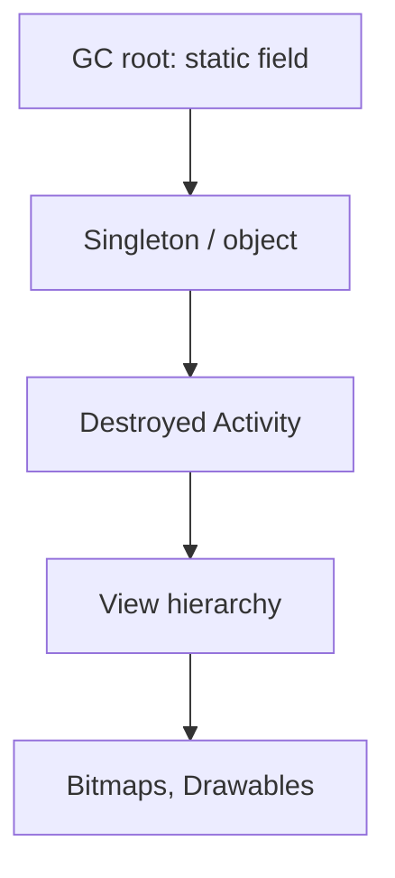
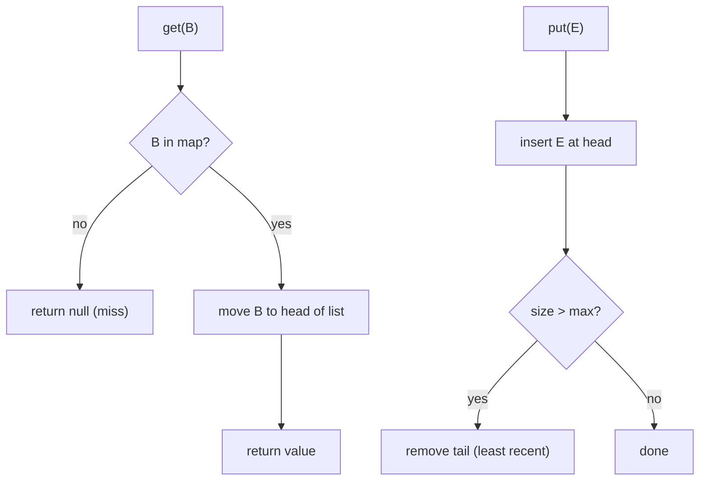
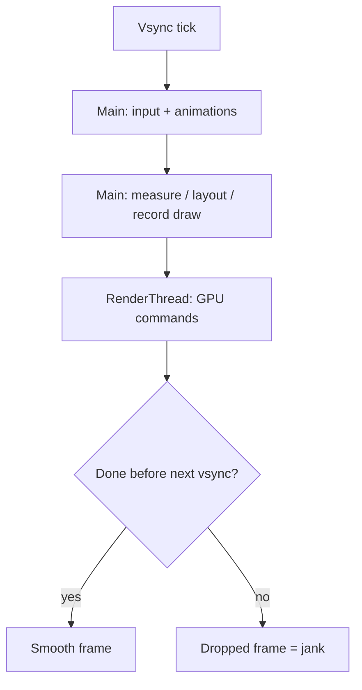
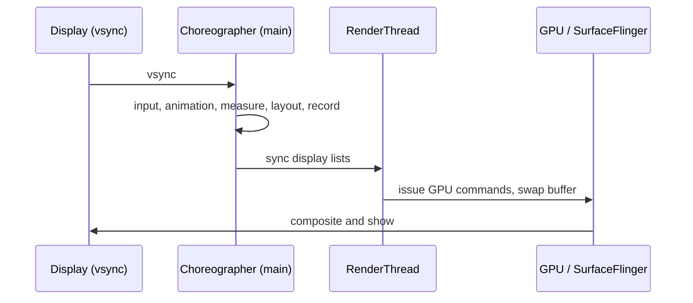
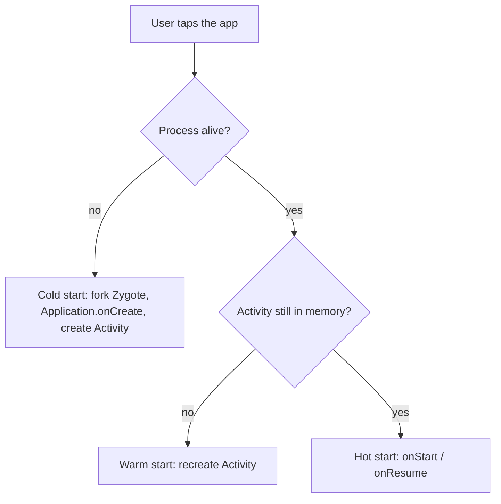
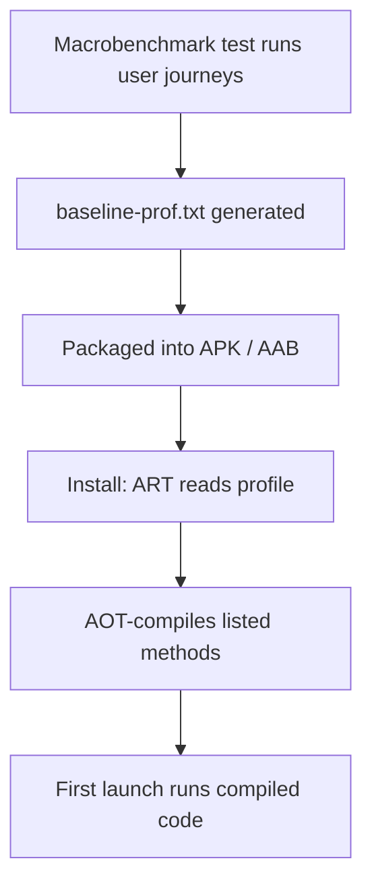
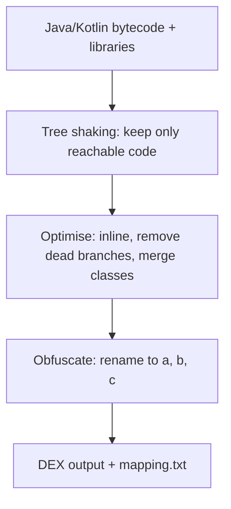

# Performance & Memory

[⬅ Back to index](../README.md)

Covers: memory leaks, LeakCanary, OOM, LRU cache, bitmaps, app lag/jank, startup time, Baseline Profiles, app size, battery, profiling tools, Android vitals.

---

## Memory

### 1. What is a memory leak? What are common leaks in Android?

<details>
<summary>Answer</summary>

**In short:** A memory leak is an object that is **no longer needed but is still reachable** from a GC root, so the garbage collector can't free it. On Android the classic leak is an **Activity** (or Fragment view) kept alive after it's destroyed, which drags its whole view hierarchy and bitmaps with it until the app hits `OutOfMemoryError`.

#### Why leaks happen in a garbage-collected language

Java and Kotlin have a tracing GC: it starts from **GC roots** (static fields, live thread stacks, JNI references, the main `Looper`'s message queue, etc.) and marks everything reachable. Anything not marked is freed. So you can't "forget to free" memory, but you can **accidentally keep a reference** from something long-lived to something short-lived. The GC does exactly what it's told: the object is reachable, so it stays.

Android makes this easy to get wrong because of **lifecycle mismatch**. An Activity lives seconds to minutes and is destroyed on every rotation by default, while singletons, the `Application`, background threads and `ViewModel`s live much longer. A single `Activity` holds its `Window`, every `View`, every `Drawable` and often large `Bitmap`s, so one leaked Activity can cost several MB. Rotate the phone ten times and you have ten copies.



#### Common causes in Android

| # | Leak pattern | Why it leaks | Fix |
|---|---|---|---|
| 1 | Static field / singleton holding an Activity, View or Context (`object Manager { lateinit var context: Context }`) | Static = GC root; lives as long as the process | Store `applicationContext`, or don't store a Context at all |
| 2 | Non-static inner classes, anonymous classes, lambdas (Handler, Runnable, Thread, old `AsyncTask`) that outlive the Activity | They capture an implicit reference to the outer Activity | Cancel/remove them on destroy; use `lifecycleScope` / `viewModelScope` |
| 3 | Unregistered listeners/callbacks: BroadcastReceivers, sensor/location listeners, `ViewTreeObserver` listeners, undisposed RxJava subscriptions | The system service or source keeps your listener (and thus your Activity) | Unregister/dispose in the matching lifecycle callback |
| 4 | Fragment ViewBinding not cleared in `onDestroyView` | The Fragment outlives its view (back stack), but keeps the binding → whole view tree | Set `_binding = null` in `onDestroyView` |
| 5 | LiveData observed with the Fragment instead of `viewLifecycleOwner` | Observers pile up and reference old views | Observe with `viewLifecycleOwner` |
| 6 | Coroutines in `GlobalScope`, or long-running work that captures views | Not tied to any lifecycle | Use structured scopes |
| 7 | A ViewModel holding a View, Activity or Fragment reference | ViewModel survives rotation, the Activity doesn't | Expose state; let the UI observe it |
| 8 | Unclosed resources (Cursor, streams, `TypedArray`) | Native handles and buffers are held | `use { }` / try-with-resources |

A useful rule of thumb: **a reference may only point from a shorter-lived object to a longer-lived one, never the other way round**, unless you clear it at the right lifecycle moment.

**Pitfalls**
- `applicationContext` is not a universal fix: you can't use it to inflate themed views or show dialogs.
- `WeakReference` hides the symptom; usually the real fix is to cancel or unregister.
- Leaks also cause jank indirectly: a bigger heap means more frequent and longer GCs.

**Likely follow-ups**
- *What is a GC root?* Something always considered alive: static fields, active thread stacks, JNI globals, system class loader objects.
- *Is a leak always a crash?* No; often it shows up as gradual memory growth, more GC pauses and eventually OOM or the process being killed in the background sooner.

</details>

### 2. Write code that leaks memory and fix it.

<details>
<summary>Answer</summary>

**In short:** The easiest leaks to show are (1) a singleton storing an Activity `Context`, and (2) a delayed callback or background task that captures the Activity and outlives it. The fix is always to break the long-lived → short-lived reference: use `applicationContext`, cancel the work at the right lifecycle event, or use a lifecycle-aware scope.

#### Leak 1: singleton holding an Activity

```kotlin
// ❌ Leak: the singleton (a GC root via its static INSTANCE) keeps the Activity forever
object ImageCache {
    lateinit var context: Context
}

class MainActivity : AppCompatActivity() {
    override fun onCreate(savedInstanceState: Bundle?) {
        super.onCreate(savedInstanceState)
        ImageCache.context = this          // Activity is now reachable from a static
    }
}

// ✅ Fix: use the Application context (lives as long as the process anyway)
ImageCache.context = applicationContext
// ✅ Better: don't store a Context; pass it into the function that needs it,
// or inject the Application context with DI (e.g. Hilt's @ApplicationContext).
```

After a rotation, the old `MainActivity` is destroyed but `ImageCache.context` still points at it, so its entire view tree stays in memory.

#### Leak 2: a delayed Runnable

```kotlin
// ❌ Leak: the lambda captures `textView` (and therefore the Activity) for 5 minutes.
// The Message sits in the main Looper's queue, which is a GC root.
handler.postDelayed({ textView.text = "Done" }, 300_000)

// ✅ Fix A: remove callbacks when the Activity goes away
override fun onDestroy() {
    handler.removeCallbacksAndMessages(null)
    super.onDestroy()
}

// ✅ Fix B: use a lifecycle-aware coroutine; it's cancelled automatically on destroy
lifecycleScope.launch {
    delay(300_000)
    textView.text = "Done"
}
```

#### Leak 3: a background thread as an inner class

```kotlin
// ❌ Leak: the Thread (a GC root while running) captures `this@MainActivity`
Thread {
    val data = api.loadSlowly()            // takes 30 s
    runOnUiThread { render(data) }
}.start()

// ✅ Fix: move the work to a ViewModel and expose state
class FeedViewModel(private val repo: FeedRepository) : ViewModel() {
    val state = MutableStateFlow<List<Item>>(emptyList())
    init { viewModelScope.launch { state.value = repo.load() } }
}
```

#### Leak 4: Fragment binding

```kotlin
class FeedFragment : Fragment(R.layout.fragment_feed) {
    private var _binding: FragmentFeedBinding? = null
    private val binding get() = _binding!!

    override fun onViewCreated(view: View, savedInstanceState: Bundle?) {
        _binding = FragmentFeedBinding.bind(view)
    }

    // ✅ Without this, a Fragment on the back stack keeps its old view tree alive
    override fun onDestroyView() {
        _binding = null
        super.onDestroyView()
    }
}
```

#### Plain Java: an ever-growing static collection

```java
// ❌ Never cleared → grows forever (classic "cache" leak)
private static final List<Object> cache = new ArrayList<>();

// ✅ Bound it: e.g. an LruCache, or clear it when no longer needed
private static final LruCache<String, Object> cache = new LruCache<>(100);
```

**Pitfalls**
- Calling `removeCallbacks(runnable)` with a different lambda instance removes nothing; keep a reference or use `removeCallbacksAndMessages(null)`.
- `GlobalScope.launch { }` has the same problem as a raw `Thread`.

**Likely follow-ups**
- *How would you prove the fix works?* Rotate a few times with LeakCanary installed, or take a heap dump and check that only one `MainActivity` instance exists.
- *Why not just use `WeakReference<Activity>`?* It avoids the leak but the task keeps running pointlessly; cancelling the work is the cleaner fix.

</details>

### 3. How do you detect memory leaks?

<details>
<summary>Answer</summary>

**In short:** In development, use **LeakCanary**, which automatically detects destroyed Activities, Fragments, ViewModels and Views that aren't garbage collected and shows the reference chain (leak trace) keeping them alive. For deeper analysis, use the **Android Studio Memory Profiler** heap dump, plus `dumpsys meminfo` and **StrictMode** VM policies.

#### LeakCanary (debug builds)

Add it as a `debugImplementation` dependency; no code needed.

```kotlin
dependencies {
    debugImplementation("com.squareup.leakcanary:leakcanary-android:<version>")
}
```

How it works:
1. It hooks lifecycle callbacks. When an Activity, Fragment, Fragment view, ViewModel or root View is **destroyed**, it puts a `WeakReference` to it into a watch list.
2. After about **5 seconds** it forces a GC. If the weak reference hasn't been cleared, the object is **retained**.
3. Once enough retained objects accumulate (a small threshold, lower when the app is in the background), it **dumps the heap** to a `.hprof` file.
4. It analyses the dump (with its Shark library), finds the **shortest strong reference path from a GC root** to the retained object, and shows a notification with the **leak trace**.

A leak trace reads top-down from the GC root; the suspicious links (underlined, "~~~") are where you should look:

```
┬───
│ GC Root: System class
├─ com.example.ImageCache class
│    ↓ static ImageCache.context
│                        ~~~~~~~
╰→ com.example.MainActivity instance
     Leaking: YES (Activity#mDestroyed is true)
```

#### Android Studio Memory Profiler

- Rotate or navigate away a few times, force GC, then **capture a heap dump**.
- Use the "show activity/fragment leaks" filter, or search for your Activity class and check the **instance count** (more than one after rotation = leak).
- Select an instance and inspect its **References** tree to find who holds it.
- **Record allocations** to spot churn (lots of short-lived objects) rather than leaks.

#### Other tools

| Tool | What it tells you |
|---|---|
| `adb shell dumpsys meminfo <package>` | PSS breakdown (Java heap, native heap, graphics) and counts of `Activities`, `Views`, `ViewRootImpl`. A growing Activities count after leaving screens is a red flag |
| StrictMode VM policy | `detectActivityLeaks()`, `detectLeakedClosableObjects()`, `detectLeakedRegistrationObjects()` log or crash on violations |
| Perfetto heap profiling | Native and Java heap profiles over time on a real device |
| Instrumented tests | LeakCanary's test artifact can fail a UI test when a leak is detected |

```kotlin
if (BuildConfig.DEBUG) {
    StrictMode.setVmPolicy(
        StrictMode.VmPolicy.Builder()
            .detectActivityLeaks()
            .detectLeakedClosableObjects()
            .penaltyLog()
            .build()
    )
}
```

**Pitfalls**
- Don't ship LeakCanary in release: heap dumps freeze the app and use a lot of memory.
- Some leaks come from the framework or OEM code; LeakCanary labels many known ones so you don't chase them.

**Likely follow-ups**
- *How do you find leaks in production?* Watch OOM crash rates in Crashlytics/vitals and use `ApplicationExitInfo` (API 30+) to see low-memory kills.
- *Why a weak reference for watching?* So that watching the object doesn't itself keep it alive.

</details>

### 4. What is OutOfMemoryError? How do you prevent it?

<details>
<summary>Answer</summary>

**In short:** `OutOfMemoryError` is thrown when the app's **Java heap** (a per-app limit set by the device, often a few hundred MB) can't fit a new allocation even after GC. Typical causes are **large bitmaps**, **leaks**, loading huge data sets into memory and **unbounded caches**. Prevent it by downsampling images, fixing leaks, bounding caches, paging/streaming data and releasing memory in `onTrimMemory()`.

#### Why apps have a limit

Android runs many apps on a device with limited RAM, so each process gets a maximum **Dalvik/ART heap size** (`dalvik.vm.heapgrowthlimit`). You can read it at runtime:

```kotlin
val maxHeapMb = Runtime.getRuntime().maxMemory() / (1024 * 1024)   // per-app ceiling
val am = getSystemService(ActivityManager::class.java)
val memoryClassMb = am.memoryClass                                   // same idea, in MB
val isLowRam = am.isLowRamDevice
```

When an allocation doesn't fit, ART runs GC; if there still isn't room (or the free memory is too fragmented), it throws `OutOfMemoryError`. The allocation that crashes is often not the culprit; it's just the last straw on a heap that was already full.

Note that the system can also **kill your process** for low memory (the low-memory killer) without any OOM exception, especially in the background. That shows up as a process restart, not a crash.

#### Common causes and fixes

| Cause | Prevention |
|---|---|
| Full-size bitmaps (a 12 MP photo is ~48 MB as ARGB_8888) | Decode at display size; use Coil/Glide; hardware bitmaps |
| Leaked Activities/Fragments | LeakCanary; lifecycle-aware scopes |
| Loading a whole table or JSON file into a list | **Paging 3**, query only needed columns, stream with a JSON reader |
| Reading a large file into a `ByteArray` | Stream it in chunks (`InputStream.copyTo`) |
| Unbounded in-memory caches (`HashMap` that only grows) | `LruCache` sized to a fraction of the heap |
| String concatenation / big logs in loops | `StringBuilder`, avoid building huge strings |

```kotlin
// ❌ Reads the whole file into memory
val bytes = File(path).readBytes()

// ✅ Streams it
File(path).inputStream().use { input ->
    output.use { input.copyTo(it) }
}
```

#### Reacting to memory pressure

Implement `onTrimMemory()` to drop caches when the UI is hidden or the system is low on memory (see the next questions). Clearing an image memory cache there is a cheap win.

#### About `largeHeap`

`android:largeHeap="true"` in the manifest asks for a bigger heap. It is a **last resort**, not a fix: the device may give you little or nothing extra, a bigger heap means longer GC pauses, and your app is more likely to be killed in the background. Use it only for genuinely memory-heavy apps such as photo editors.

**Pitfalls**
- Catching `OutOfMemoryError` and carrying on usually leaves the app in a bad state; prevention is the answer.
- Since Android 8.0, bitmap pixel data lives in the **native heap**, so the Java heap number alone doesn't show the full picture; check `dumpsys meminfo`.

**Likely follow-ups**
- *How do you know the heap limit?* `ActivityManager.memoryClass` or `Runtime.maxMemory()`.
- *OOM vs being killed by LMK?* OOM is an exception in your process; LMK kills the whole process from outside, visible via `ApplicationExitInfo` with reason `REASON_LOW_MEMORY`.

</details>

### 5. What is an LRU Cache? How does it work?

<details>
<summary>Answer</summary>

**In short:** An **LRU (Least Recently Used)** cache has a fixed capacity and, when it's full, **evicts the entry that was accessed longest ago**. It's built from a **HashMap plus a doubly linked list**, giving O(1) `get` and `put`. On Android, `android.util.LruCache` (or `androidx.collection.LruCache`) is the standard choice for in-memory caches such as bitmaps.

#### Why LRU

A cache trades memory for speed, but memory is limited, so you need an eviction rule. LRU bets on **temporal locality**: something used recently is likely to be used again soon (e.g. images just scrolled past). It's simple, cheap and works well for UI caches.

#### How it works

- `get(key)`: look up in the hash map (O(1)). If found, **move the node to the head** of the list (most recently used) and return it.
- `put(key, value)`: insert at the head. If the total size now exceeds capacity, **remove from the tail** (least recently used) until it fits.
- The hash map gives O(1) lookup; the doubly linked list gives O(1) move-to-front and remove-from-tail.



In Java/Kotlin you can get this in a few lines with `LinkedHashMap` in **access order**:

```kotlin
class SimpleLru<K, V>(private val maxEntries: Int) :
    LinkedHashMap<K, V>(16, 0.75f, /* accessOrder = */ true) {
    override fun removeEldestEntry(eldest: MutableMap.MutableEntry<K, V>?) =
        size > maxEntries
}
```

#### Android's LruCache for bitmaps

`LruCache` is thread-safe (synchronized) and lets you measure entries in your own units by overriding `sizeOf`, so the limit can be in **kilobytes** rather than item count:

```kotlin
val maxKb = (Runtime.getRuntime().maxMemory() / 1024).toInt()
val cacheSizeKb = maxKb / 8                       // use ~1/8 of the app heap

val bitmapCache = object : LruCache<String, Bitmap>(cacheSizeKb) {
    override fun sizeOf(key: String, value: Bitmap) = value.byteCount / 1024

    override fun entryRemoved(evicted: Boolean, key: String, old: Bitmap, new: Bitmap?) {
        // optional: put `old` into a reuse pool for inBitmap
    }
}

bitmapCache.put(url, bitmap)
val cached: Bitmap? = bitmapCache.get(url)

// In onTrimMemory: shrink or clear
bitmapCache.trimToSize(cacheSizeKb / 2)
bitmapCache.evictAll()
```

Image libraries combine this **memory cache** with a **disk cache** (also LRU, e.g. `DiskLruCache`) so evicted images can be reloaded without a network call.

| Policy | Evicts | Good for |
|---|---|---|
| LRU | Least recently used | General UI caches |
| LFU | Least frequently used | Stable "popular" items |
| FIFO | Oldest inserted | Simple, ignores access |
| TTL | Expired entries | Data that goes stale |

**Pitfalls**
- Forgetting `sizeOf` means the limit counts **entries**, not bytes, so 8 huge bitmaps can still blow the heap.
- A cache that holds Activities or Views is a leak, not a cache.

**Likely follow-ups**
- *How would you implement it without LinkedHashMap?* HashMap of key → node, plus a doubly linked list with dummy head/tail nodes.
- *Is LruCache thread-safe?* Yes, its methods are synchronized.

See [Scenarios](25-coding-scenarios.md) for an implementation.

</details>

### 6. How do you handle bitmaps efficiently?

<details>
<summary>Answer</summary>

**In short:** A bitmap's memory is `width × height × bytes per pixel`, independent of the file size, so a 4000×3000 photo in ARGB_8888 takes about **48 MB**. Handle bitmaps by **decoding at the size you display** (downsampling), choosing a cheaper pixel format when possible, caching and reusing them, and in practice by letting **Coil or Glide** do all of this.

#### Why bitmaps are the #1 memory problem

A 2 MB JPEG is compressed. To draw it, Android decodes it into raw pixels: `4000 × 3000 × 4 bytes = 48,000,000 bytes`. Showing it in a 200×150 dp thumbnail doesn't reduce that unless you decode smaller. A list of such thumbnails decoded at full size will OOM quickly.

| Config | Bytes/pixel | Notes |
|---|---|---|
| `ARGB_8888` | 4 | Default, full quality with alpha |
| `RGB_565` | 2 | No alpha, some colour banding; half the memory |
| `HARDWARE` | (GPU memory) | API 26+, pixels stored only in graphics memory, immutable |
| `RGBA_F16` | 8 | Wide colour / HDR |

#### Step 1: downsample

Read the dimensions without allocating pixels, compute a power-of-two `inSampleSize`, then decode:

```kotlin
fun decodeSampled(res: Resources, resId: Int, reqW: Int, reqH: Int): Bitmap {
    val opts = BitmapFactory.Options().apply { inJustDecodeBounds = true }
    BitmapFactory.decodeResource(res, resId, opts)          // fills outWidth/outHeight only

    opts.inSampleSize = calculateInSampleSize(opts.outWidth, opts.outHeight, reqW, reqH)
    opts.inJustDecodeBounds = false
    return BitmapFactory.decodeResource(res, resId, opts)
}

fun calculateInSampleSize(w: Int, h: Int, reqW: Int, reqH: Int): Int {
    var sample = 1
    while (w / (sample * 2) >= reqW && h / (sample * 2) >= reqH) sample *= 2
    return sample      // 4 → 1/4 width and height → 1/16 memory
}
```

On API 28+, `ImageDecoder` with `setTargetSize()` does the same more conveniently.

#### Step 2: pick the right format

- `RGB_565` when you don't need transparency and can accept slight banding.
- **Hardware bitmaps** (`Bitmap.Config.HARDWARE`) keep pixels only in GPU memory, saving the app heap and avoiding an upload on every draw. Downsides: immutable, you can't read pixels or draw them on a software `Canvas`.

#### Step 3: cache and reuse

- **Memory cache** (`LruCache`) for what's on or near the screen, plus a **disk cache** for decoded or downloaded images.
- **Reuse bitmap memory** with `BitmapFactory.Options.inBitmap`: decode into an existing mutable bitmap of sufficient size instead of allocating a new one, which reduces GC churn while scrolling.
- Decode **off the main thread**; decoding a large image can take tens of milliseconds.

#### Step 4: use a library

```kotlin
// Coil (Compose): sizes the request to the composable, caches, decodes off-thread
AsyncImage(
    model = ImageRequest.Builder(LocalContext.current)
        .data(url)
        .crossfade(true)
        .build(),
    contentDescription = null,
    modifier = Modifier.size(96.dp)
)

// Glide (Views)
Glide.with(fragment).load(url).into(imageView)
```

They handle downsampling to the target size, memory + disk caching, bitmap pooling, lifecycle cancellation and `onTrimMemory`.

#### Assets

- **Vector drawables** for icons (resolution independent, tiny), but not for complex illustrations, which are slow to rasterise.
- **WebP/AVIF** for raster images: much smaller files than PNG/JPEG for similar quality (AVIF decoding needs newer Android versions).

**Pitfalls**
- Putting large images in `drawable/` (no density qualifier) gets them scaled up on high-density screens, multiplying memory.
- `Bitmap.recycle()` is rarely needed today; just drop references.

**Likely follow-ups**
- *Where is bitmap memory allocated?* Android 3.0–7.1 in the Java heap; since Android 8.0 in the native heap (still counted against the app's memory, and freed when the Bitmap is collected).
- *Why power-of-two inSampleSize?* The decoder rounds down to a power of two anyway and it's fastest.

</details>

### 7. What is `onTrimMemory()`?

<details>
<summary>Answer</summary>

**In short:** `onTrimMemory(level)` is a callback from `ComponentCallbacks2` (implemented by `Application`, `Activity`, `Service`, `Fragment` hosts) that tells your app about **memory pressure** so you can release memory voluntarily. The important levels today are `TRIM_MEMORY_UI_HIDDEN` (your UI went to the background: free UI-only resources) and `TRIM_MEMORY_BACKGROUND` (your process is in the background list: free what you can rebuild).

#### Why it exists

When the device runs low on RAM, the **low-memory killer** kills processes, background ones first and the biggest ones sooner. If your app shrinks itself when asked, it is less likely to be killed, so users come back to a warm app instead of a cold start. It's cooperative: the system hints, you decide what to drop.

#### Levels

| Level | Meaning | What to release |
|---|---|---|
| `TRIM_MEMORY_UI_HIDDEN` | All UI is no longer visible (user pressed Home / switched app) | UI-only resources: big image caches, view-related buffers |
| `TRIM_MEMORY_BACKGROUND` | Process is in the background/cached LRU list | Everything you can easily rebuild |
| `RUNNING_MODERATE / LOW / CRITICAL`, `MODERATE`, `COMPLETE` | Older finer-grained levels | Deprecated in recent API levels; don't rely on them being delivered |

Levels are numeric and ordered, so code typically uses `>=` comparisons.

```kotlin
class MyApp : Application() {
    override fun onTrimMemory(level: Int) {
        super.onTrimMemory(level)
        when {
            level >= ComponentCallbacks2.TRIM_MEMORY_BACKGROUND -> {
                imageCache.evictAll()           // in the background: drop everything
            }
            level >= ComponentCallbacks2.TRIM_MEMORY_UI_HIDDEN -> {
                imageCache.trimToSize(imageCache.maxSize() / 2)   // UI hidden: shrink
            }
        }
    }
}
```

Image libraries hook this for you (Glide and Coil trim their memory caches automatically), which is another reason to use them.

#### Related APIs

- `onLowMemory()`: older, coarse "the whole system is low" callback.
- `ActivityManager.getMemoryInfo()` gives `availMem` and `lowMemory` if you need to decide up front (e.g. whether to preload).
- `ActivityManager.isLowRamDevice()` to choose smaller caches on low-end devices.

**Pitfalls**
- `TRIM_MEMORY_UI_HIDDEN` is also a handy "app went to background" signal, but for lifecycle logic prefer `ProcessLifecycleOwner`.
- Don't do heavy work in the callback; just drop references.

**Likely follow-ups**
- *Does releasing memory guarantee you won't be killed?* No, it just lowers your priority for killing among similarly ranked processes.
- *What is the background LRU list?* The system's ordered list of cached processes; those at the end are killed first.

</details>

---

## UI Performance

### 8. Why does an Android app lag? What is jank?

<details>
<summary>Answer</summary>

**In short:** **Jank** is dropped or late frames. The display refreshes at a fixed rate, so each frame must be produced within **16.6 ms at 60 Hz** (8.3 ms at 120 Hz); if the main thread or RenderThread misses that deadline, the previous frame is shown again and the user sees a stutter. The usual cause is **too much work on the main thread** (I/O, parsing, heavy layout or recomposition, GC pauses).

#### How a frame is produced

Every vsync, the main thread handles input, runs animations, then measures, lays out and records drawing commands; the **RenderThread** then sends them to the GPU. Both must finish before the next vsync. Anything else running on the main thread (a database query, JSON parsing) delays that whole pipeline.



A frame that takes 40 ms on a 60 Hz screen means two missed vsyncs. Frames over about 700 ms are called **frozen frames**, and a main thread blocked for ~5 s causes an **ANR**.

#### Common causes

1. **Main-thread work**: disk I/O, network, database queries, JSON parsing, heavy computation, `SharedPreferences.commit()`.
2. **Complex or deep layouts**: nested `LinearLayout` weights and `RelativeLayout` cause multiple measure passes. In Compose, **excessive recomposition** (unstable parameters, reading fast-changing state too high in the tree).
3. **Overdraw**: drawing the same pixel many times (stacked backgrounds).
4. **Allocations in hot paths** (`onDraw`, `onBindViewHolder`, scroll listeners) → frequent **GC pauses**.
5. **Large bitmaps** decoded on the main thread.
6. **Memory leaks** → memory pressure → more frequent GC.
7. **Lock contention and Binder calls** on the main thread (waiting for a lock held by a background thread, synchronous IPC to system services).
8. **Slow first run**: code is interpreted/JIT-compiled until hot, so first launches and first scrolls are slower. Fix with **Baseline Profiles**.
9. **Low-end devices** and **inefficient third-party SDKs** initialising on the main thread.

```kotlin
// ❌ Allocating and formatting in onDraw (called every frame during animations)
override fun onDraw(canvas: Canvas) {
    val paint = Paint().apply { color = Color.RED }     // new object per frame
    canvas.drawText(String.format("%d%%", progress), x, y, paint)
}

// ✅ Allocate once, reuse
private val paint = Paint().apply { color = Color.RED }
override fun onDraw(canvas: Canvas) {
    canvas.drawText(progressLabel, x, y, paint)          // label updated only when progress changes
}
```

**Pitfalls**
- Judging smoothness in a **debug build**: it's not optimised and much slower; measure in release.
- Assuming a fast flagship represents users; test on low-end devices.

**Likely follow-ups**
- *Jank vs ANR?* Jank is missed frames (ms); ANR is the main thread blocked long enough (about 5 s for input) that the system offers to close the app.
- *What changes at 120 Hz?* The budget halves to ~8.3 ms, so work that was fine at 60 Hz can start to jank.

</details>

### 9. How do you find and fix jank?

<details>
<summary>Answer</summary>

**In short:** **Measure first, then fix.** Capture a **system trace** (Perfetto / Android Studio CPU profiler) to see which work on the main thread or RenderThread exceeds the frame budget, track jank in production with **JankStats** and Android vitals, and guard against regressions with **Macrobenchmark** `FrameTimingMetric`. Typical fixes are moving work off the main thread, simplifying layouts, reducing recomposition and adding Baseline Profiles.

#### Step 1: Measure

| Tool | Use it for |
|---|---|
| **Perfetto / System Trace** (Android Studio CPU profiler) | The main tool. Shows each frame, the main thread and RenderThread slices (`Choreographer#doFrame`, `measure`, `layout`, `draw`, `RV Bind`), GC, lock contention and Binder calls |
| Profile GPU Rendering (developer options) | Quick on-device bars per frame against the 16 ms line |
| Debug GPU Overdraw | Colours pixels by how many times they're drawn |
| Layout Inspector | View hierarchy depth; Compose **recomposition counts** |
| **JankStats** (`androidx.metrics`) | Reports janky frames in production, tagged with UI state |
| **Macrobenchmark** `FrameTimingMetric` | Repeatable frame-time numbers (P50/P90/P99) in CI |
| Android vitals | Slow and frozen frame rates from real users |

Add your own trace sections so they show up in Perfetto:

```kotlin
import androidx.tracing.trace

fun bind(item: Item) = trace("FeedAdapter.bind") {
    // work here appears as a named slice in the system trace
}
```

JankStats in production:

```kotlin
val jankStats = JankStats.createAndTrack(window) { frameData ->
    if (frameData.isJank) {
        analytics.logJank(frameData.frameDurationUiNanos, frameData.states)
    }
}
// Tag what the user was doing:
PerformanceMetricsState.getHolderForHierarchy(view).state?.putState("screen", "feed")
```

#### Step 2: Fix the cause you found

| Symptom in the trace | Fix |
|---|---|
| Long I/O, DB, JSON slices on the main thread | Move to `Dispatchers.IO`/`Default` via a ViewModel; StrictMode to catch it |
| Long `measure`/`layout` | Flatten layouts (`ConstraintLayout`), avoid nested weights, fixed sizes where possible |
| Long `RV Bind` / many `notifyDataSetChanged` | `ListAdapter` + `DiffUtil`, stable IDs, `setHasFixedSize`, no work in bind |
| Many recompositions in Compose | Stable/immutable types, `remember`, `derivedStateOf`, lambda-based modifiers, `key` in lazy lists |
| Frequent GC events | Remove allocations in draw/bind/scroll paths |
| `JIT compiling` slices on first run | **Baseline Profiles** |
| Heavy RenderThread/GPU | Reduce overdraw, large bitmaps, expensive shadows/blur |

```kotlin
// Compose: read fast-changing state as late as possible
// ❌ Recomposes the whole composable on every scroll pixel
val offset = scrollState.value
Box(Modifier.offset(y = offset.dp))

// ✅ Read in the layout phase only, no recomposition
Box(Modifier.offset { IntOffset(0, scrollState.value) })
```

#### Step 3: Verify

Re-run the Macrobenchmark or trace on a **release build** (R8 on, not debuggable) on a mid/low-end device and compare frame percentiles.

**Pitfalls**
- Debug builds and the Layout Inspector add overhead; numbers from them are not representative.
- Optimising without a trace often fixes the wrong thing.

**Likely follow-ups**
- *What is a slow vs frozen frame?* Slow: longer than the frame budget (~16 ms); frozen: longer than ~700 ms.
- *How do you catch regressions?* Macrobenchmarks in CI on a physical device, plus production JankStats dashboards.

</details>

### 10. What is Choreographer / vsync / RenderThread?

<details>
<summary>Answer</summary>

**In short:** **Vsync** is the display's periodic refresh signal. **Choreographer** listens for it and runs the next frame's work on the main thread in order: **input → animation → traversal (measure, layout, draw)**. **RenderThread** is a separate thread that takes the recorded drawing commands (display lists) and issues the GPU calls, so the main thread only records, and some animations can continue even if the main thread is briefly busy.

#### Vsync

The screen refreshes at a fixed rate (60, 90, 120 Hz). Vsync is the tick at each refresh. Rendering is synchronised to it so that a frame is never swapped halfway through scanning out (which would cause tearing) and so work starts at a predictable time. Frames are typically buffered, so the app works on frame N+1 while frame N is displayed.

#### Choreographer

A per-`Looper` (normally main thread) object that coordinates frame timing:

1. Something requests a frame: `View.invalidate()`, `requestLayout()`, an animator, a Compose state change.
2. Choreographer subscribes to the next vsync.
3. On vsync it runs callbacks in a fixed order: **input**, **animation**, then **traversal** (`ViewRootImpl.performTraversals()` → measure, layout, draw), then commit.

```kotlin
// You can hook it yourself, e.g. a simple frame-time monitor
Choreographer.getInstance().postFrameCallback(object : Choreographer.FrameCallback {
    private var last = 0L
    override fun doFrame(frameTimeNanos: Long) {
        if (last != 0L) {
            val ms = (frameTimeNanos - last) / 1_000_000
            if (ms > 17) Log.w("Frames", "Frame took $ms ms")
        }
        last = frameTimeNanos
        Choreographer.getInstance().postFrameCallback(this)
    }
})
```

The well-known Logcat warning "Skipped N frames! The application may be doing too much work on its main thread" comes from Choreographer when vsyncs were missed.

#### RenderThread

With hardware acceleration (default since Android 4.0; RenderThread since 5.0), the main thread's `draw()` doesn't paint pixels. It **records** drawing operations into `RenderNode` display lists. RenderThread then turns these into OpenGL/Vulkan commands, uploads textures and asks the GPU to render, then queues the buffer for SurfaceFlinger to composite.



Some animations (e.g. ripple and certain property animations on `RenderNode`s) run on RenderThread, which is why they can stay smooth while the main thread hiccups.

**Pitfalls**
- A long RenderThread slice (huge bitmaps, many layers, overdraw) causes jank even if the main thread is fast.
- `Thread.sleep()` or blocking on the main thread delays the whole Choreographer cycle.

**Likely follow-ups**
- *What is SurfaceFlinger?* The system service that composites all apps' window buffers into the final screen image.
- *Does Compose use Choreographer too?* Yes; recomposition and its frame clock are driven by Choreographer frames on Android.

</details>

---

## Startup

### 11. Cold vs warm vs hot start?

<details>
<summary>Answer</summary>

**In short:** A **cold start** creates the app process from scratch (slowest); a **warm start** reuses the existing process but has to recreate the Activity; a **hot start** just brings an Activity that's still in memory back to the foreground (fastest). You measure them with **TTID** (time to initial display) and **TTFD** (time to full display), and optimise cold start first because it's the worst case.



#### Cold start

The process doesn't exist (first launch since boot, or the system killed it). The system:
1. Shows a **starting window** (splash) immediately.
2. **Forks the Zygote** process (which has the framework preloaded) to create your process.
3. Creates the `Application` object: `ContentProvider`s are initialised, then `Application.onCreate()` runs.
4. Creates the launch Activity: `onCreate` (inflate layout / set content), `onStart`, `onResume`.
5. Measures, lays out and draws the **first frame**, then removes the starting window.

Steps 3 and 4 are your code, which is why heavy `Application.onCreate()` and SDK initialisation dominate cold-start time.

#### Warm start

The process is alive but the Activity must be created again, e.g. the user backed out of the app and relaunched it, or the Activity was destroyed while in the background. You skip process creation and `Application.onCreate`, but still pay for Activity creation and the first frame. If there's a `savedInstanceState`, it's restored.

#### Hot start

The Activity is still in memory; the system just brings it to the front (`onRestart`/`onStart`/`onResume`). Cheap, unless you do heavy work in `onStart`/`onResume`, or the system trimmed memory and views must be redrawn.

| | Process | Application.onCreate | Activity.onCreate | Typical cost |
|---|---|---|---|---|
| Cold | Created | Yes | Yes | Highest |
| Warm | Exists | No | Yes | Medium |
| Hot | Exists | No | No | Lowest |

#### Metrics

- **TTID (Time To Initial Display)**: until the first frame is drawn. Logged automatically in Logcat as `Displayed com.example/.MainActivity: +850ms`.
- **TTFD (Time To Full Display)**: until the content the user cares about is shown (data loaded). You signal it with `reportFullyDrawn()` (in Compose, `ReportDrawnWhen { }` / `ReportDrawn()`).

```kotlin
class MainActivity : ComponentActivity() {
    override fun onCreate(savedInstanceState: Bundle?) {
        super.onCreate(savedInstanceState)
        setContent {
            val feed by viewModel.feed.collectAsStateWithLifecycle()
            ReportDrawnWhen { feed.isNotEmpty() }   // marks TTFD when real data shows
            FeedScreen(feed)
        }
    }
}
```

Android vitals flags startups as excessive when **cold ≥ 5 s, warm ≥ 2 s, hot ≥ 1.5 s**.

**Pitfalls**
- Measuring startup from a debug build or with the debugger attached gives misleading numbers.
- `ContentProvider`s from libraries run before `Application.onCreate`, so they count toward cold start too.

**Likely follow-ups**
- *How do you measure cold start reliably?* Macrobenchmark with `StartupTimingMetric` and `StartupMode.COLD`, or `adb shell am start -W -S`.
- *Why is the Zygote used?* It has the runtime and common framework classes preloaded, so forking it is much faster than starting a fresh VM.

</details>

### 12. How do you improve app startup time?

<details>
<summary>Answer</summary>

**In short:** Do less before the first frame. Keep `Application.onCreate()` light by **lazily or asynchronously initialising SDKs**, ship **Baseline Profiles and Startup Profiles** (typically ~20–30% faster startup), enable **R8**, make the first screen simple and load its data asynchronously, and avoid main-thread I/O. Measure before and after with **Macrobenchmark** and Perfetto.

#### Where the time goes

Cold start = process creation + `ContentProvider`s + `Application.onCreate()` + Activity creation + first layout/draw. You can't change process creation, so attack the rest. Start with a trace: Macrobenchmark or a Perfetto startup trace shows exactly which `bindApplication`, `activityStart`, `inflate` and your own trace sections are slow.

#### Techniques

**1. Slim down Application.onCreate()**

```kotlin
// ❌ Everything eagerly on the main thread before the first frame
class App : Application() {
    override fun onCreate() {
        super.onCreate()
        Analytics.init(this)
        AdsSdk.init(this)
        ImageLoader.warmUp(this)
        FeatureFlags.fetchBlocking()       // network on the main thread!
    }
}

// ✅ Only what the first screen needs; the rest is deferred or lazy
class App : Application() {
    private val appScope = CoroutineScope(SupervisorJob() + Dispatchers.Default)

    override fun onCreate() {
        super.onCreate()
        CrashReporter.init(this)           // keep: must catch startup crashes
        appScope.launch {
            Analytics.init(this@App)       // background thread
            FeatureFlags.refresh()
        }
        // AdsSdk initialised lazily when the first ad screen opens
    }
}
```

- Use **App Startup** (`androidx.startup`) to replace many library `ContentProvider`s with one, and to control or lazy-load initializers.
- With DI, avoid building heavy objects eagerly; inject `Lazy<T>` / `Provider<T>` for things not needed at launch.

**2. Baseline Profiles + Startup Profiles**

Pre-compile the startup path ahead of time instead of interpreting/JIT-ing it, and lay out the DEX so startup classes are together. Typically ~20–30% faster startup (see the next question).

**3. R8**

Enable minification and optimisation (full mode is the default since AGP 8): less code to load and verify, smaller DEX.

**4. Make the first screen cheap**

- Simple layout, few nested levels; don't inflate hidden screens or tabs eagerly (`ViewStub`, lazy composables).
- Show a skeleton or cached data immediately and load fresh data asynchronously.
- Don't block on the network before showing UI.

**5. SplashScreen API, used properly**

Use `installSplashScreen()` for a consistent launch screen, and `setKeepOnScreenCondition { }` only while genuinely needed data loads. Never add an artificial delay.

**6. No main-thread I/O during startup**

`SharedPreferences` first reads, database opens and file reads all block. Enable **StrictMode** thread policy in debug to catch them; consider DataStore and moving reads to background threads.

#### Measure

```kotlin
@RunWith(AndroidJUnit4::class)
class StartupBenchmark {
    @get:Rule val rule = MacrobenchmarkRule()

    @Test fun coldStartup() = rule.measureRepeated(
        packageName = "com.example.app",
        metrics = listOf(StartupTimingMetric()),
        iterations = 10,
        startupMode = StartupMode.COLD,
        compilationMode = CompilationMode.Partial()   // with Baseline Profile
    ) {
        pressHome()
        startActivityAndWait()
    }
}
```

Track TTID/TTFD in production (Firebase Performance, vitals) to confirm real-world gains.

**Pitfalls**
- Moving init to a background thread can create races if the first screen uses the SDK; make dependencies explicit.
- Deferring init "until after the first frame" can just move the jank to the first scroll; spread it out or make it lazy.

**Likely follow-ups**
- *What does App Startup actually save?* Each library `ContentProvider` has a creation cost; App Startup merges them into one provider and lets you lazy-initialise.
- *TTID or TTFD, which matters more?* Both; TTFD reflects what users perceive as "ready", so report it with `reportFullyDrawn()`.

</details>

### 13. What are Baseline Profiles?

<details>
<summary>Answer</summary>

**In short:** A Baseline Profile is a list of classes and methods used in your **critical user journeys** (startup, scrolling, navigation) that ships inside the APK/AAB. At install time, ART uses it to **ahead-of-time (AOT) compile** those code paths, so the first run doesn't depend on the interpreter and JIT. Google reports roughly **30% faster** code execution from the first launch.

#### The problem they solve

ART uses a hybrid of interpretation, **JIT** and profile-guided **AOT** compilation. Without help, a freshly installed app starts interpreted; the JIT compiles hot methods while the user is using it, and only later (often when the device is idle and charging) does a background job AOT-compile them based on the collected profile. So the **first launches and first scrolls are the slowest**, exactly when first impressions are formed. Play's **Cloud Profiles** help, but only after enough users have generated data for that app version.

A Baseline Profile gives ART that profile **on day one**.



#### What the file looks like

Human-readable rules listing classes and methods, with flags for hot (H), startup (S) and post-startup (P):

```
HSPLcom/example/app/MainActivity;->onCreate(Landroid/os/Bundle;)V
HSPLcom/example/app/feed/FeedViewModel;-><init>()V
Lcom/example/app/feed/FeedItem;
```

You don't write it by hand; you generate it.

#### Generating one

Use the **Baseline Profile Gradle plugin** with a test module and a `BaselineProfileRule` that drives your journeys:

```kotlin
@RunWith(AndroidJUnit4::class)
class BaselineProfileGenerator {
    @get:Rule val rule = BaselineProfileRule()

    @Test fun generate() = rule.collect(packageName = "com.example.app") {
        pressHome()
        startActivityAndWait()                       // startup
        device.findObject(By.res("feed")).fling(Direction.DOWN)   // scrolling
        // navigate to other key screens…
    }
}
```

Run the generation task on a device or Gradle Managed Device; the plugin copies the result into `src/<variant>/generated/baselineProfiles`. Re-generate when key flows change.

#### Related pieces

- **Library profiles**: Compose and many AndroidX libraries ship their own profiles, which are merged into your app's.
- **Startup Profiles**: a subset of the profile used at build time to optimise the **DEX layout** (putting startup classes in the primary DEX), which further speeds startup.
- **ProfileInstaller** (`androidx.profileinstaller`): installs the profile for builds not installed through Play (sideloaded, some stores) and for benchmarking.
- **Verify** with Macrobenchmark by comparing `CompilationMode.None()` vs `CompilationMode.Partial()`.

**Pitfalls**
- A profile only helps code paths you exercised during generation; cover the real journeys.
- Benchmarking a debug build hides the benefit; use a release-like benchmark build.

**Likely follow-ups**
- *Baseline Profile vs Cloud Profile?* Cloud Profiles come from real users' usage via Play after release; Baseline Profiles ship with the app so they work from the first install.
- *Why not AOT-compile everything?* Bigger storage use and longer install/update times; profile-guided compilation targets only hot code.

</details>

### 14. What is Macrobenchmark vs Microbenchmark?

<details>
<summary>Answer</summary>

**In short:** **Macrobenchmark** measures **end-to-end user interactions** (startup, scrolling, animations) by launching and driving your real, release-like app from a separate test module; it reports metrics like `StartupTimingMetric` and `FrameTimingMetric` and also generates Baseline Profiles. **Microbenchmark** measures a **small piece of code** (a function, a parser) in a loop, in-process, with warm-up, reporting time per operation.

#### Why two libraries

Performance problems live at two scales. "Is our cold start 1.2 s or 900 ms?" needs the whole app, the OS and the compiler as users experience them. "Is this JSON parser 20% faster than that one?" needs a tight, repeatable loop that removes noise. One tool can't do both well.

| | Macrobenchmark | Microbenchmark |
|---|---|---|
| Measures | App startup, scrolling, navigation, animations | A function or algorithm |
| Runs | In a separate test module, controls the target app as another process | Inside the instrumented test process |
| Driving the app | UiAutomator (`startActivityAndWait`, `fling`) | Direct calls in `measureRepeated { }` |
| Key metrics | `StartupTimingMetric`, `FrameTimingMetric`, trace section metrics, memory | ns per operation, allocations |
| Compilation control | `CompilationMode.None / Partial / Full` | Code is warmed up until JIT stabilises |
| Also used for | Generating Baseline Profiles | Comparing implementations, catching micro-regressions |
| Typical iterations | 5–20 app runs | Thousands of loop iterations |

#### Macrobenchmark example (scrolling)

```kotlin
@RunWith(AndroidJUnit4::class)
class ScrollBenchmark {
    @get:Rule val rule = MacrobenchmarkRule()

    @Test fun scrollFeed() = rule.measureRepeated(
        packageName = "com.example.app",
        metrics = listOf(FrameTimingMetric()),
        iterations = 5,
        startupMode = StartupMode.WARM,
        setupBlock = { pressHome(); startActivityAndWait() }
    ) {
        val list = device.findObject(By.res("feed"))
        list.setGestureMargin(device.displayWidth / 5)
        list.fling(Direction.DOWN)
        device.waitForIdle()
    }
}
```

Output includes frame duration percentiles (P50, P90, P95, P99) plus a Perfetto trace per iteration that you can open to see why a frame was slow.

#### Microbenchmark example

```kotlin
@RunWith(AndroidJUnit4::class)
class ParserBenchmark {
    @get:Rule val benchmarkRule = BenchmarkRule()

    @Test fun parseFeed() {
        val json = loadFixture("feed.json")
        benchmarkRule.measureRepeated {
            FeedParser.parse(json)          // only this is timed
        }
    }
}
```

The library handles warm-up, many iterations, clock stability warnings (it warns if the device isn't suitable, or if the build is debuggable) and reports median time and allocations.

**Pitfalls**
- Both need a **physical device** for meaningful numbers; emulators are noisy.
- Microbenchmarking code that is never a bottleneck in real traces is wasted effort; find hot spots with Macrobenchmark/Perfetto first.

**Likely follow-ups**
- *How do you use them in CI?* Run on a dedicated device lab, store results, and alert when a metric regresses beyond a threshold.
- *Why a separate module for Macrobenchmark?* It must control the app from outside (kill it, cold start it, compile it) like a user/OS would.

</details>

---

## Size & Battery

### 15. How do you reduce APK/AAB size?

<details>
<summary>Answer</summary>

**In short:** Turn on **R8** code shrinking and **resource shrinking**, publish as an **Android App Bundle** so Play delivers only the code and resources each device needs, compress images (**WebP/AVIF**, vectors), drop unused languages and heavy dependencies, and move rarely used features and large assets to **Play Feature Delivery / Play Asset Delivery**. Use **APK Analyzer** to see what's actually taking space.

#### Why size matters

Download size affects install conversion, especially on slow or metered networks and low-storage devices. Install size affects whether users keep the app when storage runs low. Smaller DEX also loads faster.

#### Step 1: find out what's big

Open the APK/AAB in **APK Analyzer** (Build → Analyze APK). Typical culprits: `classes*.dex` (dependencies), `res/` (images), `lib/` (native `.so` for several ABIs), `assets/` (videos, ML models, fonts).

#### Step 2: apply the right technique

| Technique | What it removes | How |
|---|---|---|
| **R8** | Unused classes/methods, long names, dead code | `isMinifyEnabled = true` |
| Resource shrinking | Resources no code references | `isShrinkResources = true` (needs minify) |
| **App Bundle (AAB)** | Other ABIs, densities, languages per device | Upload `.aab`; Play generates split APKs. Typically ~15%+ smaller downloads |
| Image formats | Bloated PNG/JPEG | Convert to **WebP/AVIF**; **vector drawables** for icons |
| Locale filtering | Translations from libraries you don't support | `androidResources.localeFilters` |
| Dependency audit | Large libraries used for one small feature | Replace or remove; check with `./gradlew :app:dependencies` |
| **Play Feature Delivery** | Rarely used features | Dynamic feature modules installed on demand |
| **Play Asset Delivery** | Large game or media assets | Asset packs (install-time, fast-follow, on-demand) |

```kotlin
android {
    buildTypes {
        release {
            isMinifyEnabled = true
            isShrinkResources = true
            proguardFiles(
                getDefaultProguardFile("proguard-android-optimize.txt"),
                "proguard-rules.pro"
            )
        }
    }
    androidResources {
        localeFilters += listOf("en", "de", "fr")
    }
}
```

#### Native libraries

If you include `.so` files, the AAB ensures each device gets only its ABI (`arm64-v8a`, etc.). Avoid bundling native libraries you don't need, and check whether a dependency pulls in large native code.

**Pitfalls**
- Resource shrinking can't see resources referenced dynamically (`getIdentifier("icon_$name", …)`); keep them with a `tools:keep` resource file.
- Over-aggressive R8 rules can break reflection-based code; test release builds.
- Download size (compressed) and install size (on disk) differ; Play Console shows both.

**Likely follow-ups**
- *APK vs AAB?* An APK is the installable file; an AAB is a publishing format from which Play builds optimised split APKs per device configuration.
- *How do you stop size creeping back?* Track APK size in CI and fail or warn when it grows beyond a budget.

</details>

### 16. How do you optimize battery usage?

<details>
<summary>Answer</summary>

**In short:** Do less work in the background, and do it **at the same time as other work**. Batch and defer network calls with **WorkManager** (with constraints like charging or unmetered), use **FCM** instead of polling, avoid long **wake locks**, request location with the right priority and interval, stop sensors and location updates when the UI isn't visible, respect Doze, and avoid unnecessary foreground services. Verify with **Battery Historian**, Android Studio's power/energy profiling and Android vitals.

#### Why apps drain the battery

The biggest costs are the **cellular/Wi-Fi radio**, **GPS**, keeping the **CPU awake**, and the **screen/GPU**. Radios have a "tail": after a request the radio stays in a high-power state for several seconds. Ten small requests spread over a minute keep the radio hot far longer than one batched request. Wake locks keep the CPU from sleeping.

Android enforces limits to protect users: **Doze** and **App Standby** defer jobs, alarms and network for idle devices and rarely used apps, **App Standby Buckets** restrict how often apps in lower buckets can run, and there are background execution and location limits.

#### Practices

| Area | Do | Avoid |
|---|---|---|
| Sync | WorkManager with constraints; batch requests | Polling every N seconds |
| Server updates | FCM push (high priority only for user-visible messages) | Keeping a socket open in the background |
| Location | Balanced/low-power priority, larger intervals, geofencing, `lastLocation` | High-accuracy GPS continuously |
| Sensors / location listeners | Unregister in `onStop` / use lifecycle-aware components | Leaving them running in the background |
| Wake locks | WorkManager handles them; if manual, always with a timeout and release | Indefinite `PARTIAL_WAKE_LOCK` |
| Alarms | Inexact alarms; WorkManager for deferrable work | Exact repeating alarms |
| Foreground services | Only for user-visible, ongoing tasks (music, navigation) | Using them to dodge background limits |

```kotlin
val syncRequest = PeriodicWorkRequestBuilder<SyncWorker>(6, TimeUnit.HOURS)
    .setConstraints(
        Constraints.Builder()
            .setRequiredNetworkType(NetworkType.UNMETERED)
            .setRequiresCharging(true)
            .build()
    )
    .setBackoffCriteria(BackoffPolicy.EXPONENTIAL, 30, TimeUnit.SECONDS)
    .build()

WorkManager.getInstance(context).enqueueUniquePeriodicWork(
    "sync", ExistingPeriodicWorkPolicy.KEEP, syncRequest
)
```

```kotlin
// Location only while the screen is visible, at balanced power
val request = LocationRequest.Builder(Priority.PRIORITY_BALANCED_POWER_ACCURACY, 60_000L)
    .setMinUpdateIntervalMillis(30_000L)
    .build()
```

#### Measuring

- **Battery Historian**: analyse a `bugreport` to see wake locks, alarms, jobs, radio state and which app caused them.
- Android Studio's power/energy profiling to correlate CPU, network and location activity with your code.
- **Android vitals**: excessive wake-ups, stuck partial wake locks, excessive background Wi-Fi scans and network usage.
- Test with Doze forced: `adb shell dumpsys deviceidle force-idle`.

**Pitfalls**
- High-priority FCM messages that don't show a notification can be deprioritised by the system.
- Retrying failed requests in a tight loop drains battery; use exponential backoff.

**Likely follow-ups**
- *What is Doze?* A device idle mode (screen off, stationary, unplugged) that defers background CPU and network activity to periodic maintenance windows.
- *WorkManager vs foreground service?* WorkManager for deferrable, guaranteed background work; a foreground service for work the user is actively aware of right now.

</details>

---

## Tools & Metrics

### 17. What profiling tools do you use?

<details>
<summary>Answer</summary>

**In short:** Locally: the **Android Studio Profilers** (CPU/system traces, memory heap dumps and allocations, network, power), **Layout Inspector** and **App Inspection**, plus **Perfetto** for deep system traces, and **LeakCanary** and **StrictMode** in debug builds. For regression testing: **Macrobenchmark**. In production: **Play Console Android vitals**, **Firebase Performance Monitoring**, **Crashlytics** and **JankStats**.

#### Pick the tool by question

| Question | Tool |
|---|---|
| Why is this frame/startup slow? | **System trace** in the CPU profiler or **Perfetto** (`ui.perfetto.dev`) |
| Which method is hot? | CPU profiler **sampling** (low overhead) or **method tracing** (exact but adds overhead) |
| Why is memory growing? Is there a leak? | Memory profiler **heap dump** and **allocation tracking**; **LeakCanary** |
| What's slow over the network? | Network Inspector (App Inspection) |
| Why so many recompositions / so deep a view tree? | **Layout Inspector** (Compose recomposition and skip counts) |
| What's in my database / what jobs are scheduled? | App Inspection: **Database Inspector**, **Background Task Inspector** (WorkManager) |
| Is the main thread doing I/O? | **StrictMode** thread policy |
| What's using battery? | Power/energy profiling in Android Studio, **Battery Historian** |
| Did this release get slower? | **Macrobenchmark** in CI, **JankStats** in production |
| How do real users experience it? | **Android vitals**, Firebase Performance, Crashlytics |

#### Perfetto in practice

Perfetto records system-wide traces: every thread's slices, CPU scheduling, frequency, Binder transactions, GC events, and your own `Trace.beginSection` markers. It's the same data Android Studio's system trace shows, with a more powerful UI and SQL queries.

```kotlin
// Your own markers appear as named slices
trace("FeedRepository.load") {
    repository.load()
}
```

You can capture traces from Android Studio, from the on-device "System Tracing" developer option, or from the command line (`adb shell perfetto …`).

#### Debug-only safety nets

```kotlin
if (BuildConfig.DEBUG) {
    StrictMode.setThreadPolicy(
        StrictMode.ThreadPolicy.Builder()
            .detectDiskReads()
            .detectDiskWrites()
            .detectNetwork()
            .penaltyLog()
            .build()
    )
}
```

**Pitfalls**
- Profiling debuggable builds exaggerates costs; Android Studio supports profiling **profileable** release builds, which is closer to reality.
- Method tracing distorts timings of small methods; use sampling or trace sections for timing.

**Likely follow-ups**
- *Sampling vs instrumentation?* Sampling records stacks at intervals (low overhead, approximate); instrumentation records every method entry/exit (precise counts, high overhead).
- *What's a profileable build?* A release-like build with `<profileable android:shell="true"/>` in the manifest, so tools can profile it without making it debuggable.

</details>

### 18. What are Android vitals and why do they matter?

<details>
<summary>Answer</summary>

**In short:** Android vitals are **Play Console metrics collected from real users' devices** (who opted in to sharing diagnostics) about stability, performance and battery. The core ones are **user-perceived crash rate** (bad-behaviour threshold **1.09%**) and **user-perceived ANR rate** (**0.47%**), plus slow rendering, slow startup, excessive wake-ups and battery usage. Exceeding the thresholds can **reduce the app's visibility in the Play Store** and show warnings to users on its listing, so they matter for both quality and growth.

#### What's measured

| Category | Metrics |
|---|---|
| Stability (core) | User-perceived **crash rate**, user-perceived **ANR rate** |
| Rendering | Slow rendering (frames over the budget), **frozen frames** (over ~700 ms) |
| Startup | Slow cold, warm and hot starts (excessive at ≥ 5 s, ≥ 2 s, ≥ 1.5 s) |
| Battery | Excessive wake-ups, stuck partial wake locks, excessive background Wi-Fi scans and network usage |
| Permissions / other | Permission denial rates and similar signals |

"User-perceived" means the crash or ANR happened while the user was engaging with the app (e.g. foreground), which is what users actually notice. Rates are calculated per **daily active users**, so one heavy user crashing 50 times counts once per day.

#### Why it matters

- **Store visibility**: Google Play uses these as quality signals. Above the overall bad-behaviour threshold, the app may be less discoverable; there is also a **per-device-model threshold** (8%), above which users of that device may see a warning or have the app less visible.
- **Real-world truth**: your lab tests run on a few devices; vitals covers thousands of device models, OS versions and network conditions.
- **Benchmarks**: Play shows how you compare with peer apps.

#### How to use it

1. Check vitals after every **staged rollout** step; halt the rollout if crash/ANR rates spike.
2. Use the **ANR and crash clusters** (with stack traces, de-obfuscated via the uploaded `mapping.txt`) to prioritise fixes by affected users.
3. Filter by **device, OS version and app version** to spot device-specific problems.
4. Use the **Play Developer Reporting API** to pull vitals into your own dashboards and alerts.
5. Pair it with Crashlytics/Firebase Performance for faster, more detailed signals; vitals data is aggregated and can lag.

**Pitfalls**
- Vitals only includes users who opted in to usage and diagnostics sharing, and only Play-installed apps.
- ANRs often come from code you don't think of as slow: `SharedPreferences.commit()`, Binder calls, slow `BroadcastReceiver`s, or locks.

**Likely follow-ups**
- *What triggers an ANR?* Main thread unresponsive to input for ~5 s, a `BroadcastReceiver` not finishing in time, or a service not starting/foregrounding in time.
- *How do you reduce ANRs?* Get I/O and locks off the main thread, use `goAsync()`/WorkManager for receiver work, and analyse ANR traces in vitals.

Interviewers like it when you mention monitoring vitals in production.

</details>

### 19. How do you reduce crashes / increase stability?

<details>
<summary>Answer</summary>

**In short:** Combine **visibility** (crash reporting with context, vitals), **safe release practices** (staged rollouts, feature flags with a remote kill switch) and **defensive engineering** (null-safety without `!!`, handling process death and configuration changes, defensive parsing, regression tests for every fix). The goal is to catch crashes early, limit how many users they hit, and stop them from coming back.

#### 1. See every crash, with context

Use **Crashlytics** (or Sentry). Add **breadcrumbs** (logs of what the user did) and **custom keys** (screen, user tier, experiment) so a stack trace becomes reproducible.

```kotlin
Firebase.crashlytics.setCustomKey("screen", "checkout")
Firebase.crashlytics.log("Tapped pay, cart size=${cart.size}")
Firebase.crashlytics.recordException(e)     // non-fatal for caught-but-unexpected errors
```

Upload the R8 `mapping.txt` so stack traces are readable. Track **crash-free users/sessions** and Play's user-perceived crash and ANR rates.

#### 2. Release safely

- **Staged rollouts** (1% → 5% → 20% → 100%), watching crash rates at each step and halting if they rise.
- **Feature flags** with a **remote kill switch** so a broken feature can be turned off without a new release.
- Internal/beta testing tracks and pre-launch reports on many devices.

#### 3. Write code that doesn't crash

| Common crash | Prevention |
|---|---|
| `NullPointerException` / `!!` | Kotlin null-safety; no `!!`; model absent data explicitly |
| Crash after process death (missing state, uninitialised `lateinit`) | Test with "Don't keep activities" and `adb shell am kill`; use `SavedStateHandle` |
| Crash on rotation / config change | ViewModel for state; don't hold Views across recreation |
| Bad server JSON | Defensive parsing with defaults; validate; never trust the network |
| `IllegalStateException` (fragment transactions after `onSaveInstanceState`, not attached) | Lifecycle-aware collection (`repeatOnLifecycle`) |
| `ForegroundServiceStartNotAllowedException`, permission `SecurityException` | Check OS-version rules and permissions before calling |
| OOM | See the memory questions above |

```kotlin
// ❌ Crashes when the server omits a field
val price = json.getJSONObject("product").getDouble("price")

// ✅ Treat the network as untrusted
@Serializable
data class ProductDto(val id: String, val price: Double? = null)
val product = runCatching { json.decodeFromString<ProductDto>(body) }
    .getOrElse { return Result.Error(ParseError(it)) }
```

#### 4. Don't let it come back

Write a **regression test** for every crash fix, run lint/static analysis (Detekt, Android Lint) in CI, and review the top crash clusters each release.

**Pitfalls**
- Catching `Exception` everywhere just hides bugs and creates broken states; catch specific, expected failures.
- A global `UncaughtExceptionHandler` that swallows crashes keeps the app alive in an undefined state; report and let it die.

**Likely follow-ups**
- *Crash vs ANR, which is worse?* Both hurt vitals; ANRs are often harder to diagnose, so pull ANR traces from vitals and check for main-thread I/O and locks.
- *How do you reproduce a process-death crash?* Background the app, run `adb shell am kill <package>`, then return to it.

</details>

### 20. What is R8 and ProGuard?

<details>
<summary>Answer</summary>

**In short:** **R8** is Android's code shrinker and optimiser that replaced **ProGuard**. In one step it **shrinks** (removes unused code), **optimises** (inlining, removing dead branches), **obfuscates** (renames to short names) and **dexes** your code. **Keep rules** (`proguard-rules.pro`, same syntax as ProGuard) protect code accessed via reflection or JNI. **Full mode** (default since AGP 8) optimises more aggressively.

#### Why it exists

Release apps include your code plus every library's, much of it unused. ProGuard used to shrink and obfuscate Java bytecode, then a separate tool (D8/dx) converted it to DEX. R8 merges both steps into one, is faster, and produces smaller, faster code. It reads the same ProGuard rule files, so migration was mostly transparent.

#### What it does



- **Shrinking (tree shaking)**: starting from entry points (Activities and other manifest components, keep rules), it keeps only reachable classes, methods and fields.
- **Optimisation**: inlining, class merging, removing unused parameters, constant folding.
- **Obfuscation**: renames classes and members to short names, making the APK smaller and harder to reverse-engineer.
- **Resource shrinking** (with `isShrinkResources = true`) then removes resources no remaining code references.

```kotlin
android {
    buildTypes {
        release {
            isMinifyEnabled = true
            isShrinkResources = true
            proguardFiles(
                getDefaultProguardFile("proguard-android-optimize.txt"),
                "proguard-rules.pro"
            )
        }
    }
}
```

#### Keep rules

R8 can't see reflection, so anything looked up by name might be removed or renamed. Typical cases: Gson/Moshi models without codegen, JNI methods, classes named in XML or loaded via `Class.forName`, some SDKs (most ship **consumer rules** in their AAR so you don't need to add them).

```
-keep class com.example.api.model.** { *; }
-keepclassmembers class * {
    @com.google.gson.annotations.SerializedName <fields>;
}
-keepclasseswithmembernames class * {
    native <methods>;
}
```

Prefer codegen-based libraries (kotlinx.serialization, Moshi codegen) so fewer keep rules are needed. Annotations like `@Keep` work too.

#### De-obfuscating crashes

Obfuscated stack traces look like `a.b.c.d(Unknown Source)`. R8 writes `mapping.txt` per build; **upload it to Play Console and Crashlytics** (the Crashlytics Gradle plugin does it automatically) or use the `retrace` tool locally.

| | ProGuard | R8 |
|---|---|---|
| Output | Java bytecode (then dexed separately) | DEX directly |
| Speed | Slower (two tools) | Faster |
| Optimisation | Good | Generally better for Android, full mode more aggressive |
| Rules | ProGuard syntax | Same syntax |

**Pitfalls**
- Bugs that appear only in release builds (missing classes, `null` fields from reflection) are usually missing keep rules; test release builds in CI.
- Overly broad rules like `-keep class ** { *; }` disable most of the benefit.

**Likely follow-ups**
- *What changed with full mode?* R8 makes fewer assumptions to stay ProGuard-compatible, e.g. it doesn't implicitly keep default constructors, so reflection-heavy code needs explicit rules.
- *Is obfuscation security?* No, it raises the effort to reverse-engineer but doesn't protect secrets; never put API secrets in the app.

</details>


---

## More Performance Questions

### 21. `HashMap` vs `ArrayMap` vs `SparseArray`?

<details>
<summary>Answer</summary>

**In short:** `HashMap` is fast (O(1)) but memory-heavy: it allocates an entry object per mapping and boxes primitive keys. Android's `ArrayMap` stores keys and values in **two compact arrays** with binary search (O(log n)), saving memory for **small maps**. The `SparseArray` family maps **int/long keys without boxing**. Use the Android collections for small, memory-sensitive maps (up to a few hundred items); use `HashMap` for large ones.

#### How each one is laid out

**HashMap**: an array of buckets; each mapping is a separate `Node` object (hash, key, value, next pointer). A `HashMap<Int, String>` also boxes every `Int` key into an `Integer` object. Lots of small objects means more memory and more GC work, but lookups are O(1) on average.

**ArrayMap** (`android.util` / `androidx.collection`): two arrays:
- `mHashes`: sorted int array of key hash codes,
- `mArray`: keys and values interleaved `[k0, v0, k1, v1, ...]`.

Lookup = binary search in `mHashes` (O(log n)), then compare keys. No per-entry objects, and the arrays are kept compact. `Bundle` uses an `ArrayMap` internally.

**SparseArray** family: a sorted `int[]` of keys and a parallel array of values, binary search, **no boxing**. Variants: `SparseArray<E>`, `SparseIntArray`, `SparseBooleanArray`, `SparseLongArray`, `LongSparseArray<E>`. Removals mark slots as deleted and compact lazily (garbage collection of the arrays).

| | HashMap | ArrayMap | SparseArray |
|---|---|---|---|
| Keys | Any object | Any object | `int` (or `long` for `LongSparseArray`) |
| Lookup | O(1) average | O(log n) | O(log n) |
| Insert/delete | O(1) average | O(n) (array shift) | O(n) (array shift, lazy delete helps) |
| Per-entry objects | Yes (`Node`) | No | No |
| Boxing of int keys | Yes | Yes (if key is Int) | No |
| Best for | Large maps, hot lookups | Small maps (< few hundred) | Small int-keyed maps |

```kotlin
// ❌ Boxes every key and allocates a Node per entry
val positions = HashMap<Int, ItemView>()

// ✅ No boxing, two compact arrays
val positions = SparseArray<ItemView>()
positions.put(42, view)
val v = positions[42]                       // androidx.core.util.get operator

// Small object-keyed map
val headers = ArrayMap<String, String>()
headers["Authorization"] = token
```

There is also `ArraySet` as a small-set equivalent of `HashSet`.

#### The trade-off

Binary search and shifting arrays on insert get **slower than HashMap as size grows** (thousands of items). The memory win matters most when you have **many small maps** (e.g. per view, per list item) or run on low-memory devices. For a single large lookup table, `HashMap` is the better choice.

**Pitfalls**
- Iterating a `SparseArray` with a `for (i in 0 until size())` loop uses `keyAt(i)` / `valueAt(i)`, not `get(i)`; mixing them up is a common bug.
- Lint's "Use SparseArray" warning is a hint, not a rule; for big maps keep `HashMap`.

**Likely follow-ups**
- *Why does boxing matter?* Each `Integer` outside the small cache (-128..127) is a separate heap object, adding memory and GC churn.
- *What does Kotlin's `mutableMapOf()` return?* A `LinkedHashMap`, which is even heavier than `HashMap` because it keeps insertion order.

</details>

### 22. How do you measure method execution time on Android?

<details>
<summary>Answer</summary>

**In short:** For a quick check, wrap the code in Kotlin's `measureTimeMillis { }` / `measureNanoTime { }` / `measureTime { }`. For understanding it in context, add **trace sections** (`trace("name") { }`) and look at them in a **Perfetto / Android Studio system trace**. For reliable numbers, write a **Microbenchmark**. Always measure on a **release-like build**, because debug builds are much slower and distort results.

#### Option 1: quick timing in code

```kotlin
val ms = measureTimeMillis { parser.parse(json) }
Log.d("Perf", "parse took $ms ms")

// Kotlin's Duration API
val (result, duration) = measureTimedValue { repository.loadFeed() }
Log.d("Perf", "loadFeed took $duration")

// Manual, using a monotonic clock (never System.currentTimeMillis for intervals)
val start = SystemClock.elapsedRealtimeNanos()
doWork()
val tookMs = (SystemClock.elapsedRealtimeNanos() - start) / 1_000_000
```

Good for debugging only: a single run includes JIT warm-up, GC pauses and CPU frequency changes, so the number is noisy.

#### Option 2: trace sections + system trace

```kotlin
import androidx.tracing.trace

fun loadFeed(): List<Item> = trace("loadFeed") {
    val raw = trace("loadFeed.db") { dao.getAll() }
    trace("loadFeed.map") { raw.map(::toItem) }
}
// Java / framework equivalent:
// Trace.beginSection("loadFeed"); try { ... } finally { Trace.endSection() }
```

Record a system trace (Android Studio CPU profiler → system trace, or Perfetto). Your sections appear as named slices on the thread that ran them, next to framework slices, GC, and CPU scheduling, so you can see not just *how long* but *why* (was the thread waiting for a lock? descheduled?). Overhead is very low, so you can leave sections in release code. Macrobenchmark's `TraceSectionMetric` can turn a section into a tracked metric.

#### Option 3: CPU profiler method tracing / sampling

- **Sampling**: periodically captures call stacks; low overhead, shows where time is spent overall (flame chart).
- **Instrumented method tracing**: records every method entry/exit; exact call counts but large overhead that inflates small methods.

#### Option 4: Microbenchmark for reliable numbers

```kotlin
@get:Rule val benchmarkRule = BenchmarkRule()

@Test fun sortItems() {
    val items = generateItems(1_000)
    benchmarkRule.measureRepeated {
        val copy = runWithTimingDisabled { items.toMutableList() }  // excluded from timing
        copy.sortBy { it.date }
    }
}
```

It warms up until the JIT stabilises, runs many iterations, reports median time and allocations, and warns if the clocks aren't stable or the build is debuggable.

| Need | Use |
|---|---|
| "Roughly how long?" while debugging | `measureTimeMillis` / `measureTime` |
| "Why is this slow in the real flow?" | Trace sections + Perfetto |
| "Which method is hot?" | CPU profiler sampling |
| "Is A faster than B?" / regression tracking | Microbenchmark |
| "How long does the user wait?" | Macrobenchmark, production traces (Firebase Performance custom traces) |

**Pitfalls**
- Measure on **release-like builds** (R8 on, not debuggable); debug builds can be several times slower.
- Use a monotonic clock (`elapsedRealtime`, `nanoTime`), not wall-clock time, which can jump.

**Likely follow-ups**
- *Why do the first runs take longer?* Code is interpreted and JIT-compiled at first; Baseline Profiles and warm-up iterations address this.
- *Can trace sections cross threads/coroutines?* A section must begin and end on the same thread; for async work use `Trace.beginAsyncSection` / `endAsyncSection` with a cookie.

</details>

### 23. Which app metrics should you monitor continuously?

<details>
<summary>Answer</summary>

**In short:** Monitor four groups: **stability** (crash-free users/sessions, user-perceived crash and ANR rates), **performance** (cold/warm start TTID/TTFD, slow and frozen frames, screen load times, network latency and errors), **resources** (memory/OOMs and low-memory kills, battery, app size) and **business/UX** outcomes (retention, funnels, ratings). Collect them with Play vitals, Crashlytics, Firebase Performance, JankStats, Macrobenchmark in CI and `ApplicationExitInfo`, and alert on regressions per release.

#### Why "continuously"

Performance regresses silently: a new SDK, a heavier screen, a backend change. Lab tests catch some of it; real devices, networks and usage patterns catch the rest. You want a **baseline per release** and alerts when a metric moves.

#### The metrics

| Group | Metric | Where it comes from |
|---|---|---|
| Stability | Crash-free users & sessions | Crashlytics |
| | User-perceived crash rate (1.09%), ANR rate (0.47%) | Play vitals |
| Performance | Cold/warm start, **TTID / TTFD** | Play vitals, Firebase Performance, `reportFullyDrawn()` |
| | **Slow and frozen frames** (jank) | Play vitals, JankStats, Firebase Performance screen traces |
| | Screen load time, custom traces (e.g. checkout) | Firebase Performance custom traces |
| | Network latency, error rate, payload size | Firebase Performance / your HTTP interceptor |
| Resources | OOMs, **low-memory kills** | Crashlytics, `ApplicationExitInfo` |
| | Battery: excessive wake-ups, wake locks, background usage | Play vitals |
| | App **size** (download and install) | Play Console, CI size checks |
| Business / UX | Retention, funnel conversion, feature adoption, ratings and reviews | Analytics, Play Console |

#### Knowing why the process died

`ApplicationExitInfo` (API 30+) tells you why previous processes ended: crash, ANR, low memory, user force-stop, etc. Log it at startup to see kills that never show up as crashes.

```kotlin
val am = context.getSystemService(ActivityManager::class.java)
am.getHistoricalProcessExitReasons(context.packageName, 0, 5).forEach { info ->
    when (info.reason) {
        ApplicationExitInfo.REASON_LOW_MEMORY -> analytics.log("exit_lmk", info.pss)
        ApplicationExitInfo.REASON_ANR -> analytics.log("exit_anr", info.description)
        ApplicationExitInfo.REASON_CRASH_NATIVE -> analytics.log("exit_native_crash")
    }
}
```

#### Making it actionable

- **Percentiles, not averages**: track P50 and P90/P99 start times and frame times; averages hide the slow tail.
- **Segment** by app version, device tier, OS version and country; regressions often hit only low-end devices.
- **Gate releases**: staged rollouts with thresholds; Macrobenchmark in CI to catch startup and jank regressions before release.
- **Alert** on changes relative to the previous release, not just absolute values.

**Pitfalls**
- Too many metrics with no owner or threshold means nobody acts; pick a few with targets.
- Lab numbers (Macrobenchmark) and field numbers (vitals) differ; use lab for regressions, field for real impact.

**Likely follow-ups**
- *Which three would you pick first?* Crash/ANR rate, cold start time and frozen/slow frames: they map directly to Play vitals and user perception.
- *How do you tie performance to business impact?* Correlate start time or jank with retention/conversion per segment, or A/B test the optimisation.

</details>

---

[⬅ Previous: RxJava](18-rxjava.md) · [⬅ Back to index](../README.md) · [Next: Testing ➡](20-testing.md)
