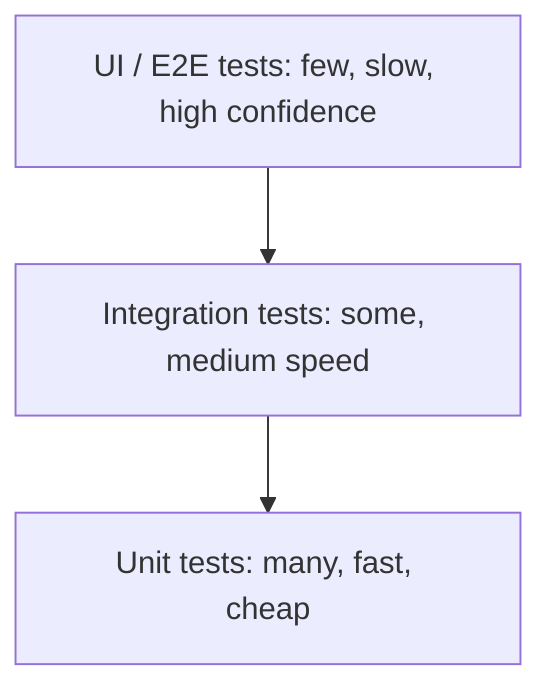
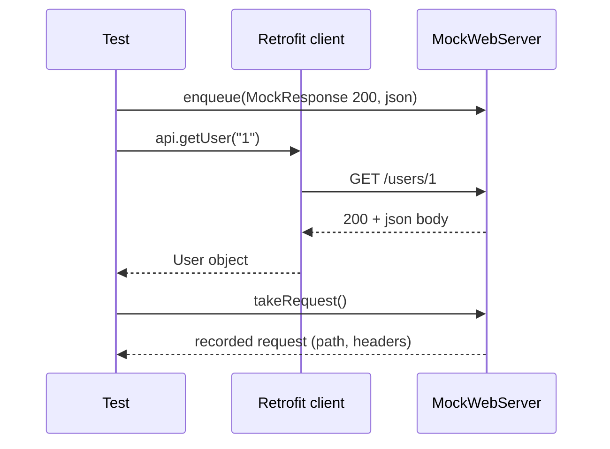
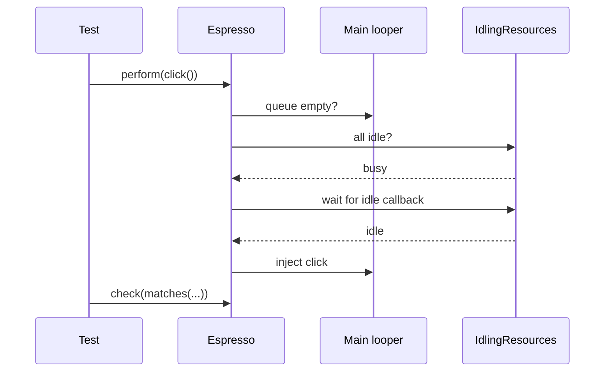
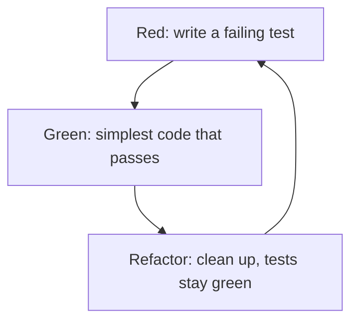
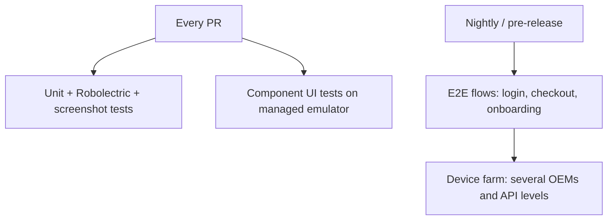

# Testing

[⬅ Back to index](../README.md)

Covers: testing pyramid, unit tests, test doubles (mocks/fakes), MockK/Mockito, testing ViewModels/coroutines/Flow, Robolectric, Espresso, Compose UI tests, screenshot tests, TDD.

---

### 1. What types of tests exist in Android? What is the testing pyramid?

<details>
<summary>Answer</summary>

**In short:** Android has three broad kinds of tests: **unit tests** (fast, local JVM, one class at a time), **integration tests** (a few real pieces wired together), and **UI / end-to-end tests** (on a device or emulator, driving the real app). The testing pyramid says to write **many** cheap unit tests, **fewer** integration tests and **very few** slow E2E tests, roughly 70 / 20 / 10.

#### The three layers

- **Unit tests** (`src/test`, run on the local JVM): fast and isolated. They cover ViewModels, UseCases, Repositories (with fake data sources), mappers, validators, reducers. A suite of thousands runs in seconds. **~70%** of tests.
- **Integration tests**: several units working together, for example a Repository with an in-memory Room database, or a Retrofit API client against MockWebServer. They can be local (pure JVM or Robolectric) or instrumented. **~20%**.
- **UI / end-to-end tests** (`src/androidTest`, device or emulator): Espresso, Compose UI tests, UI Automator, Maestro. They give the most confidence because they exercise the real app, but they are slow, need a device, and are the most likely to be flaky. Keep them for **critical user flows** (login, checkout, onboarding). **~10%**.



#### Why a pyramid?

Each layer trades **speed and precision** against **realism**:

| | Unit | Integration | UI / E2E |
|---|---|---|---|
| Speed | milliseconds | ms to seconds | seconds to minutes |
| Runs on | JVM | JVM or device | device / emulator |
| When it fails, you know... | exactly which function broke | which collaboration broke | "something in the flow" |
| Flakiness | very low | low | higher |
| Cost to maintain | low | medium | high |

A failing unit test points straight at the bug; a failing E2E test only says "the login flow is broken somewhere". So you get most of your coverage from the cheap layer and use the expensive layer to prove that the pieces fit together.

Google's Android testing docs also describe tests by **scope** (small / medium / big) rather than only by type, which maps onto the same idea.

**Common pitfalls:**
- The "ice-cream cone" anti-pattern: mostly manual or E2E tests and few unit tests, which makes CI slow and flaky.
- Putting business logic in Activities/Fragments, which forces you to test it with slow UI tests. Move it into ViewModels and UseCases.

**Likely follow-ups:**
- *Where do screenshot tests fit?* Usually beside unit/integration tests, because tools like Paparazzi and Roborazzi run on the JVM.
- *Is the 70/20/10 split a rule?* No, it's a guideline; the point is the shape, not the exact numbers.

</details>

### 2. Local tests vs instrumented tests?

<details>
<summary>Answer</summary>

**In short:** **Local tests** live in `src/test` and run on your computer's JVM: fast, but without the real Android framework (unless you add Robolectric). **Instrumented tests** live in `src/androidTest` and run inside an app process on a real device or emulator, so they get the genuine framework, but they are much slower.

| | Local (`src/test`) | Instrumented (`src/androidTest`) |
|---|---|---|
| Runs on | Your machine's JVM | Device or emulator (ART) |
| Android framework | Not available (`android.jar` methods throw or return defaults) unless Robolectric | Real framework |
| Speed | Very fast | Slow (build test APK, install, run) |
| Typical tools | JUnit, MockK, Turbine, kotlinx-coroutines-test, Robolectric | Espresso, Compose UI test, UI Automator, Room/`MigrationTestHelper` |
| Gradle task | `./gradlew testDebugUnitTest` | `./gradlew connectedDebugAndroidTest` |
| Used for | Business logic, ViewModels, mappers | UI, real database, hardware, system integration |

#### How they work

- A **local test** compiles against a stub `android.jar`. If your code calls `TextUtils.isEmpty()` or `Log.d()`, it throws `RuntimeException("Method ... not mocked")`. You can set `unitTests.isReturnDefaultValues = true` to return defaults instead, but the better fix is to keep Android out of the logic you are testing.
- An **instrumented test** is packaged into a second test APK. The `AndroidJUnitRunner` (configured as `testInstrumentationRunner`) starts your app's process and runs the tests inside it, so they can use `InstrumentationRegistry`, a real `Context`, real views.

```kotlin
// build.gradle.kts
android {
    defaultConfig {
        testInstrumentationRunner = "androidx.test.runner.AndroidJUnitRunner"
    }
    testOptions {
        unitTests.isIncludeAndroidResources = true // needed for Robolectric
    }
}
dependencies {
    testImplementation("junit:junit:4.13.2")
    androidTestImplementation("androidx.test.espresso:espresso-core:<version>")
}
```

**Common pitfalls:**
- Writing instrumented tests for pure logic that could run locally; your CI pays for it on every build.
- Hitting "Method ... not mocked" and reaching for `isReturnDefaultValues` instead of removing Android dependencies from the class.

**Likely follow-ups:**
- *Can the same test run in both?* Yes, AndroidX Test APIs (`ActivityScenario`, Espresso, Compose test) run on Robolectric locally and on devices; Google calls these "shared tests".
- *How do you run instrumented tests in CI without a physical device?* Gradle Managed Devices or a device farm such as Firebase Test Lab.

</details>

### 3. What are test doubles? Mock vs Stub vs Fake vs Spy?

<details>
<summary>Answer</summary>

**In short:** A test double is any object that stands in for a real dependency in a test. A **dummy** is passed but never used, a **stub** returns canned answers, a **fake** is a working lightweight implementation (like an in-memory repository), a **mock** is programmed with expectations and **verifies interactions**, and a **spy** wraps a real object and records calls. Google recommends **fakes** for your own interfaces.

#### Why test doubles exist

Real dependencies are slow (network, disk), non-deterministic (time, random), hard to put into a specific state (a server returning 500), or have side effects (sending an email). Replacing them makes tests fast, repeatable and focused on the class under test.

| Double | What it does | Example | Checks... |
|---|---|---|---|
| **Dummy** | Fills a parameter, never used | `UserViewModel(repo, mockk(relaxed = true))` for an unused logger | nothing |
| **Stub** | Returns fixed answers | `every { clock.now() } returns 1000L` | state |
| **Fake** | Real, simplified behaviour | `FakeUserRepository` backed by a `MutableMap` | state |
| **Mock** | Records calls, test verifies them | `verify { analytics.track("login") }` | interactions |
| **Spy** | Real object plus call recording / partial stubbing | `spyk(RealFormatter())` | both |

#### A fake in practice

```kotlin
interface UserRepository {
    suspend fun getUser(id: String): User
    fun observeUsers(): Flow<List<User>>
}

class FakeUserRepository : UserRepository {
    private val users = MutableStateFlow<Map<String, User>>(emptyMap())
    var shouldFail = false

    fun setUser(user: User) { users.update { it + (user.id to user) } }

    override suspend fun getUser(id: String): User {
        if (shouldFail) throw IOException("boom")
        return users.value[id] ?: error("No user $id")
    }

    override fun observeUsers() = users.map { it.values.toList() }
}
```

The fake behaves like the real thing (save a user, then read it back), so tests check **outcomes**, not which methods were called.

#### Why Google prefers fakes

- **Less brittle:** if you refactor the ViewModel to call `getUsers()` instead of `getUser()` twice, a fake-based test still passes; a mock-based test with `verify` breaks even though behaviour didn't change.
- **Reusable:** one fake serves hundreds of tests and can live in a shared `:core:testing` module.
- **More realistic:** it can model flows emitting updates, which is awkward to stub.

Mocks are still the right tool when the **interaction itself is the behaviour**: "an analytics event was sent", "the payment SDK was called exactly once".

**Common pitfalls:**
- Mocking everything, including data classes and your own simple classes.
- A fake that drifts from the real implementation's contract. Some teams run the same contract test suite against both.

**Likely follow-ups:**
- *Mock vs stub in one line?* A stub answers questions; a mock checks that it was asked.
- *Where do fakes live?* In a test-fixtures or `:core:testing` module shared across feature modules.

</details>

### 4. MockK vs Mockito?

<details>
<summary>Answer</summary>

**In short:** **MockK** is a Kotlin-first mocking library: it mocks `final` classes (Kotlin's default), `object`s, extension and top-level functions, and has first-class coroutine support (`coEvery`, `coVerify`). **Mockito** is Java-first; with **mockito-kotlin** and the inline mock maker (the default since Mockito 5) it handles final classes too, and it's common in mixed Java/Kotlin codebases.

#### The core problem

Kotlin classes and functions are `final` by default. Classic mocking created a subclass at runtime, which can't be done for final classes. MockK and Mockito's inline mock maker solve this by **instrumenting bytecode** (via ByteBuddy and a Java agent) instead of subclassing.

#### Comparison

| | MockK | Mockito (+ mockito-kotlin) |
|---|---|---|
| Language focus | Kotlin | Java, with Kotlin helpers |
| Final classes | Yes | Yes (inline mock maker, default in Mockito 5) |
| `suspend` functions | `coEvery` / `coVerify` | Works through mockito-kotlin (`onBlocking`, `verifyBlocking`) |
| `object` / companion | `mockkObject` | Limited |
| Top-level / extension functions | `mockkStatic` | Not directly |
| Constructor mocking | `mockkConstructor` | `mockConstruction` |
| Relaxed mocks | `mockk(relaxed = true)` | Default returns null/0/empty |
| Syntax | DSL with lambdas | `whenever(...).thenReturn(...)` |

```kotlin
// MockK
val repo = mockk<UserRepository>()
coEvery { repo.getUser("1") } returns User("1", "Akshay")

val result = GetUserUseCase(repo)("1")

assertEquals("Akshay", result.name)
coVerify(exactly = 1) { repo.getUser("1") }

// Argument capture
val slot = slot<String>()
every { analytics.track(capture(slot)) } just Runs
```

```kotlin
// Mockito + mockito-kotlin
val repo = mock<UserRepository> {
    onBlocking { getUser("1") } doReturn User("1", "Akshay")
}
verifyBlocking(repo, times(1)) { getUser("1") }
```

#### Which to choose

For a Kotlin-only Android project, MockK is the usual choice because its API fits coroutines and Kotlin language features. Mockito is fine if the team already knows it or the codebase has a lot of Java. In both cases, prefer **fakes** for your own interfaces and use the library for third-party types and interaction checks.

**Common pitfalls:**
- A strict MockK mock throws `MockKException: no answer found` for any call you didn't stub; use `relaxed = true` only where you truly don't care.
- Forgetting `unmockkAll()` / `unmockkStatic()` after `mockkStatic` or `mockkObject`, which leaks into other tests.
- MockK is slower than plain fakes, especially with static/object mocking; large suites feel it.

**Likely follow-ups:**
- *Can MockK run in instrumented tests?* Yes, with the `mockk-android` artifact, though some features need newer API levels.
- *What is `just Runs`?* MockK's way to stub a function returning `Unit`.

</details>

### 5. How do you unit test a ViewModel?

<details>
<summary>Answer</summary>

**In short:** Replace `Dispatchers.Main` with a test dispatcher (a JUnit rule), inject **fake** dependencies through the constructor, run the test inside `runTest`, then send inputs (events) and assert on the **state output** (`StateFlow` / `LiveData`), usually with Turbine. You test behaviour, not how the ViewModel achieves it.

#### Why `Dispatchers.Main` needs replacing

`viewModelScope` uses `Dispatchers.Main.immediate`. On the local JVM there is no Android main looper, so any `viewModelScope.launch` throws `IllegalStateException: Module with the Main dispatcher had failed to initialize`. `Dispatchers.setMain(testDispatcher)` swaps it for the test, and `resetMain()` restores it.

```kotlin
class MainDispatcherRule(
    val dispatcher: TestDispatcher = UnconfinedTestDispatcher()
) : TestWatcher() {
    override fun starting(d: Description) = Dispatchers.setMain(dispatcher)
    override fun finished(d: Description) = Dispatchers.resetMain()
}
```

#### The ViewModel under test

```kotlin
class ProfileViewModel(private val repo: UserRepository) : ViewModel() {
    private val _uiState = MutableStateFlow<UiState>(UiState.Loading)
    val uiState: StateFlow<UiState> = _uiState

    init { load() }

    fun retry() = load()

    private fun load() = viewModelScope.launch {
        _uiState.value = UiState.Loading
        _uiState.value = try {
            UiState.Success(repo.getUser("1"))
        } catch (e: IOException) {
            UiState.Error(e.message)
        }
    }
}
```

#### The tests

```kotlin
class ProfileViewModelTest {
    @get:Rule val mainRule = MainDispatcherRule()
    private val repo = FakeUserRepository()

    @Test fun `loads user successfully`() = runTest {
        repo.setUser(User("1", "Akshay"))                 // Arrange
        val vm = ProfileViewModel(repo)                   // Act (init loads)
        vm.uiState.test {                                 // Turbine
            assertEquals(UiState.Success(User("1", "Akshay")), awaitItem())
        }
    }

    @Test fun `shows error when repo fails`() = runTest {
        repo.shouldFail = true
        val vm = ProfileViewModel(repo)
        assertTrue(vm.uiState.value is UiState.Error)
    }

    @Test fun `retry recovers after failure`() = runTest {
        repo.shouldFail = true
        val vm = ProfileViewModel(repo)
        repo.shouldFail = false
        repo.setUser(User("1", "Akshay"))

        vm.retry()

        assertEquals(UiState.Success(User("1", "Akshay")), vm.uiState.value)
    }
}
```

With `UnconfinedTestDispatcher` as Main, `viewModelScope.launch` runs eagerly, so by the time the constructor returns the state is already final. With `StandardTestDispatcher` you would call `advanceUntilIdle()` first, and could then observe the intermediate `Loading` state.

#### What to test

- Initial state, success, error, empty states.
- Each user event (`onRetry`, `onSearchChanged`) produces the right state.
- One-off effects (navigation, snackbar) sent through a `Channel`/`SharedFlow`.
- `SavedStateHandle` restore: construct it with `SavedStateHandle(mapOf("id" to "1"))`.

**Common pitfalls:**
- `StateFlow` is **conflated**: fast successive values (Loading then Success) may be skipped by a collector. Assert on the final state, or use `StandardTestDispatcher` to step through.
- Hardcoding `Dispatchers.IO` inside the ViewModel/repository; inject a dispatcher instead.
- Asserting on private calls with `verify` instead of on the state the UI would see.
- A `stateIn(WhileSubscribed)` flow doesn't start until something collects it; collect it (e.g. in `backgroundScope`) before asserting `.value`.

**Likely follow-ups:**
- *Why Turbine?* It turns a Flow into a queue you can `awaitItem()` from, with timeouts and checks for unconsumed events.
- *Should the ViewModel test use Robolectric?* No; if it needs Android classes, that's a design smell.

</details>

### 6. How do you test coroutines and time-based code?

<details>
<summary>Answer</summary>

**In short:** Use `runTest` from `kotlinx-coroutines-test`. It runs on **virtual time**, so `delay(10_000)` completes instantly. Use `StandardTestDispatcher` with `advanceTimeBy()`, `runCurrent()` and `advanceUntilIdle()` for precise control, inject a `TestDispatcher` wherever production code would use `Dispatchers.IO`, and launch never-ending collectors in `backgroundScope`. See [Coroutines Q27](03-coroutines.md).

#### How virtual time works

`runTest` creates a `TestCoroutineScheduler`, a fake clock with a queue of tasks. When a coroutine calls `delay(1000)`, it is not put to sleep on a real timer; it's scheduled at virtual time `currentTime + 1000`. When the test body is idle, the scheduler jumps the clock forward to the next task. That makes a 30-second debounce test take milliseconds and be fully deterministic.

#### Test dispatchers

| Dispatcher | Behaviour | Use when |
|---|---|---|
| `StandardTestDispatcher` (default in `runTest`) | New coroutines are queued; they run only when the test yields or you advance the scheduler | You want to step through states / test timing |
| `UnconfinedTestDispatcher` | New coroutines start eagerly, until their first suspension | Simple tests, collectors that should start immediately |

All test dispatchers in one test should **share the same scheduler**, otherwise they have separate clocks. Pass `testScheduler` (or the rule's dispatcher) around.

#### Controlling time

```kotlin
class SearchViewModel(
    private val api: SearchApi,
    private val io: CoroutineDispatcher = Dispatchers.IO,
) : ViewModel() {
    val query = MutableStateFlow("")
    val results = query
        .debounce(300)
        .mapLatest { q -> withContext(io) { api.search(q) } }
        .stateIn(viewModelScope, SharingStarted.Eagerly, emptyList())
}

@Test fun `debounces typing`() = runTest {
    val dispatcher = StandardTestDispatcher(testScheduler)
    Dispatchers.setMain(dispatcher)
    val api = FakeSearchApi()
    val vm = SearchViewModel(api, io = dispatcher)

    vm.query.value = "a"
    advanceTimeBy(100)
    vm.query.value = "an"
    advanceTimeBy(100)
    vm.query.value = "and"

    advanceTimeBy(299); runCurrent()
    assertEquals(0, api.callCount)          // still inside the debounce window

    advanceTimeBy(1); runCurrent()
    assertEquals(listOf("and"), api.queries) // only the last query hit the API
    Dispatchers.resetMain()
}
```

- `advanceTimeBy(n)` runs tasks scheduled **before** `currentTime + n`; follow it with `runCurrent()` to run tasks due exactly at that moment.
- `runCurrent()` runs everything due now without moving the clock.
- `advanceUntilIdle()` runs everything, jumping time as needed.
- `currentTime` reads the virtual clock.

#### Infinite collectors and `backgroundScope`

`runTest` waits for all child coroutines before finishing. A collector of a hot flow never ends, so the test would hang until the timeout. Launch it in `backgroundScope`, which is cancelled automatically at the end:

```kotlin
@Test fun `collects updates`() = runTest {
    val values = mutableListOf<Int>()
    backgroundScope.launch(UnconfinedTestDispatcher(testScheduler)) {
        counter.flow.toList(values)
    }
    counter.increment()
    assertEquals(listOf(0, 1), values)
}
```

**Common pitfalls:**
- Creating a new `StandardTestDispatcher()` without passing `testScheduler`: it gets a different clock and `advanceTimeBy` doesn't move it.
- Hardcoded `Dispatchers.IO` / `Default`: work runs on real threads, escapes virtual time and makes tests flaky.
- Using `System.currentTimeMillis()` in logic; inject a clock instead (`testScheduler.currentTime` can back a fake clock).
- Using `runBlocking` in tests: real delays, no virtual time.

**Likely follow-ups:**
- *What happens if a coroutine throws in `runTest`?* The exception is reported and the test fails at the end, even if it was in a child.
- *How do you test a timeout?* `withTimeout` also uses virtual time, so advance past it and assert the `TimeoutCancellationException` path.

</details>

### 7. How do you test LiveData?

<details>
<summary>Answer</summary>

**In short:** Add `InstantTaskExecutorRule` (from `androidx.arch.core:core-testing`), which makes Architecture Components run their background and main-thread tasks synchronously, then read values either by observing with `observeForever` or through a `getOrAwaitValue()` extension that observes, waits for one value and removes the observer.

#### Why the rule is needed

`LiveData.setValue()` checks it's on the main thread, and `postValue()` posts to the main looper through `ArchTaskExecutor`. On the local JVM there is no main looper, so you get `Method getMainLooper in android.os.Looper not mocked`. `InstantTaskExecutorRule` replaces that executor with one that runs every task immediately on the calling thread and says "yes, this is the main thread".

#### Reading values: `getOrAwaitValue`

LiveData is **lazy**: transformations like `map` and `switchMap` only compute while there is an active observer. Reading `.value` without observing can return `null`. This helper (from Google's samples) observes until one value arrives:

```kotlin
fun <T> LiveData<T>.getOrAwaitValue(
    time: Long = 2,
    timeUnit: TimeUnit = TimeUnit.SECONDS,
): T {
    var data: T? = null
    val latch = CountDownLatch(1)
    val observer = object : Observer<T> {
        override fun onChanged(value: T) {
            data = value
            latch.countDown()
            this@getOrAwaitValue.removeObserver(this)
        }
    }
    this.observeForever(observer)
    try {
        if (!latch.await(time, timeUnit)) throw TimeoutException("LiveData value was never set.")
    } finally {
        this.removeObserver(observer)
    }
    @Suppress("UNCHECKED_CAST")
    return data as T
}
```

```kotlin
class CartViewModelTest {
    @get:Rule val instantRule = InstantTaskExecutorRule()
    @get:Rule val mainRule = MainDispatcherRule() // if the VM uses coroutines

    @Test fun `total updates when item added`() {
        val vm = CartViewModel(FakeCartRepository())
        vm.addItem(Item(price = 250))
        assertEquals(250, vm.total.getOrAwaitValue())
    }
}
```

#### Testing a sequence of values

To check every emission (e.g. Loading then Success), attach your own observer that records values into a list, or convert with `asFlow()` and use Turbine:

```kotlin
vm.state.asFlow().test {
    assertEquals(State.Loading, awaitItem())
    assertEquals(State.Success, awaitItem())
}
```

**Common pitfalls:**
- Forgetting the rule, then getting a "not mocked" crash.
- Forgetting to remove an `observeForever` observer, which leaks between tests.
- Expecting every `postValue` to be seen: several quick `postValue` calls can collapse into only the last value.

**Likely follow-ups:**
- *Is the rule needed for StateFlow?* No; StateFlow needs `Dispatchers.setMain` (if using `viewModelScope`), not `InstantTaskExecutorRule`.
- *Does the rule work with JUnit 5?* It's a JUnit 4 rule; JUnit 5 projects use an equivalent extension.

</details>

### 8. How do you test Room DAOs and migrations?

<details>
<summary>Answer</summary>

**In short:** For DAOs, build an **in-memory database** with `Room.inMemoryDatabaseBuilder(...)` in an instrumented test (or under Robolectric), insert data, query it, assert, and close the DB in `@After`. For migrations, export your schemas and use **`MigrationTestHelper`** to create the database at the old version, run the migration, and let Room validate the resulting schema.

#### Why use a real (in-memory) database

DAOs are mostly SQL, and SQL bugs (wrong `WHERE`, wrong `ON CONFLICT`, broken relations) only show up when the query actually runs on SQLite. Mocking a DAO tests nothing. An in-memory DB is fast, starts empty each test, and disappears when closed.

```kotlin
@RunWith(AndroidJUnit4::class)
class UserDaoTest {
    private lateinit var db: AppDatabase
    private lateinit var dao: UserDao

    @Before fun setUp() {
        val context = ApplicationProvider.getApplicationContext<Context>()
        db = Room.inMemoryDatabaseBuilder(context, AppDatabase::class.java)
            .allowMainThreadQueries() // fine in tests only
            .build()
        dao = db.userDao()
    }

    @After fun tearDown() = db.close()

    @Test fun insertAndReadBack() = runTest {
        dao.insert(UserEntity(id = "1", name = "Akshay"))
        assertEquals("Akshay", dao.getById("1")?.name)
    }

    @Test fun observeEmitsUpdates() = runTest {
        dao.observeAll().test {               // Turbine on a Flow<List<UserEntity>>
            assertEquals(emptyList<UserEntity>(), awaitItem())
            dao.insert(UserEntity("1", "Akshay"))
            assertEquals(1, awaitItem().size)
        }
    }
}
```

Running with `AndroidJUnit4` lets the same test run on a device or, with Robolectric on the classpath, locally. Robolectric uses the host's SQLite, so for full confidence keep the instrumented run in CI too.

#### Testing migrations

A broken migration crashes the app for **existing users** at upgrade time, the worst kind of bug because new installs (and your manual testing) never see it.

1. Export schemas: `exportSchema = true` and configure the schema directory (e.g. with the Room Gradle plugin: `room { schemaDirectory("$projectDir/schemas") }`). Commit the JSON files.
2. Make the schemas available to tests as assets (the Room Gradle plugin wires this up; otherwise add the directory to `androidTest` assets).
3. Write the test:

```kotlin
@RunWith(AndroidJUnit4::class)
class MigrationTest {
    private val TEST_DB = "migration-test"

    @get:Rule
    val helper = MigrationTestHelper(
        InstrumentationRegistry.getInstrumentation(),
        AppDatabase::class.java,
    )

    @Test fun migrate1To2() {
        helper.createDatabase(TEST_DB, 1).apply {
            execSQL("INSERT INTO users (id, name) VALUES ('1', 'Akshay')")
            close()
        }
        // Runs the migration and validates the schema against 2.json
        val db = helper.runMigrationsAndValidate(TEST_DB, 2, true, MIGRATION_1_2)

        db.query("SELECT name, email FROM users WHERE id = '1'").use { c ->
            assertTrue(c.moveToFirst())
            assertEquals("Akshay", c.getString(0))
            assertTrue(c.isNull(1)) // new column defaulted
        }
    }
}
```

Also add a test that migrates from version 1 all the way to the latest, opening the result with `Room.databaseBuilder(...).addMigrations(*ALL_MIGRATIONS).build()`.

**Common pitfalls:**
- Not exporting/committing schemas, so `MigrationTestHelper` has nothing to compare against.
- Only checking the schema, not that **existing rows survived** the migration.
- Using `fallbackToDestructiveMigration()` and silently wiping user data.

**Likely follow-ups:**
- *What about AutoMigrations?* Still test them with `MigrationTestHelper`; pass any `AutoMigrationSpec`s to the helper.
- *How do you test a Repository that uses Room?* Either the in-memory DB (integration test) or a fake DAO/data source (unit test).

</details>

### 9. How do you test the network layer?

<details>
<summary>Answer</summary>

**In short:** Use OkHttp's **MockWebServer**: start a local HTTP server, enqueue fake responses (`MockResponse().setBody(json).setResponseCode(200)`), point Retrofit's `baseUrl` at `server.url("/")`, then assert both the **parsed result** and the **request your client sent** (`server.takeRequest()`). Also test error codes, timeouts and malformed JSON.

#### Why MockWebServer instead of mocking Retrofit

Mocking the Retrofit interface skips everything that usually breaks: JSON field names, converters, nullability, headers, interceptors (auth, retry), and HTTP error mapping. MockWebServer runs a **real HTTP server on localhost**, so your full OkHttp + Retrofit + converter stack is exercised, but responses are fully under your control and no real network is involved.



```kotlin
class UserApiTest {
    private val server = MockWebServer()
    private lateinit var api: UserApi

    @Before fun setUp() {
        server.start()
        api = Retrofit.Builder()
            .baseUrl(server.url("/"))
            .client(OkHttpClient.Builder().addInterceptor(AuthInterceptor { "token123" }).build())
            .addConverterFactory(Json.asConverterFactory("application/json".toMediaType()))
            .build()
            .create(UserApi::class.java)
    }

    @After fun tearDown() = server.shutdown()

    @Test fun `parses user and sends auth header`() = runTest {
        server.enqueue(MockResponse().setResponseCode(200).setBody("""{"id":"1","name":"Akshay"}"""))

        val user = api.getUser("1")

        assertEquals("Akshay", user.name)
        val request = server.takeRequest()
        assertEquals("/users/1", request.path)
        assertEquals("Bearer token123", request.getHeader("Authorization"))
    }

    @Test fun `maps 500 to HttpException`() = runTest {
        server.enqueue(MockResponse().setResponseCode(500))
        assertFailsWith<HttpException> { api.getUser("1") }
    }
}
```

#### Cases worth covering

| Scenario | How to simulate |
|---|---|
| Success | `setResponseCode(200).setBody(json)` |
| Server / client errors | `setResponseCode(500)`, `401`, `404` |
| Malformed or missing fields | Body with broken JSON or a missing required field |
| Slow network / timeout | `setBodyDelay(...)` with a short client timeout |
| Connection dropped | `setSocketPolicy(SocketPolicy.DISCONNECT_AT_START)` |
| Several calls (e.g. token refresh then retry) | Enqueue several responses, or set a custom `Dispatcher` that routes by path |

Store larger JSON bodies as files under `src/test/resources` and load them, so they match real API samples.

Note: OkHttp 5 also ships a newer `mockwebserver3` artifact with a builder-style `MockResponse`; the concepts are identical.

#### Where it fits

- **Repository unit tests**: use a fake API (or fake data source) instead; MockWebServer is for the API/client layer.
- **UI tests**: inject the MockWebServer URL into the app (via a Hilt test module) to run E2E flows without a real backend.

**Common pitfalls:**
- Forgetting `shutdown()`, leaving ports open between tests.
- Only testing the happy path; most production bugs are in error handling.
- `takeRequest()` blocks if no request arrived; use the overload with a timeout.

**Likely follow-ups:**
- *How do you test an interceptor alone?* Build an `OkHttpClient` with just that interceptor and hit MockWebServer.
- *Ktor client?* It has a `MockEngine` that serves the same purpose.

</details>

### 10. What is Robolectric?

<details>
<summary>Answer</summary>

**In short:** Robolectric runs Android framework code on the **local JVM** by replacing parts of the framework with "shadows", so tests that need a `Context`, resources, Activities or Views run as **fast local tests** without an emulator. It's good for logic that touches Android APIs and for JVM-based Compose/screenshot tests (Roborazzi), but it's less faithful than a real device.

#### How it works

Normally `android.jar` on the local test classpath is only stubs that throw. Robolectric instead downloads a real Android framework build for the API level under test (the "android-all" jars) and loads it with a special class loader. Where the framework would call native code or hardware (graphics, sensors, system services), Robolectric substitutes **shadow classes** that simulate the behaviour in Java. The result: `Activity` lifecycles, `SharedPreferences`, resources, `Intent`s and the main `Looper` all work on your laptop.

```kotlin
@RunWith(AndroidJUnit4::class)            // Robolectric runner when run locally
@Config(sdk = [34])                       // optional: choose API level(s)
class SettingsActivityTest {

    @Test fun `toggle saves preference`() {
        ActivityScenario.launch(SettingsActivity::class.java).use { scenario ->
            scenario.onActivity { activity ->
                activity.findViewById<SwitchCompat>(R.id.darkMode).performClick()
            }
        }
        val prefs = ApplicationProvider.getApplicationContext<Context>()
            .getSharedPreferences("settings", Context.MODE_PRIVATE)
        assertTrue(prefs.getBoolean("dark_mode", false))
    }

    @Test fun `share button fires intent`() {
        ActivityScenario.launch(ArticleActivity::class.java).onActivity { activity ->
            activity.findViewById<View>(R.id.share).performClick()
            val next = shadowOf(activity).nextStartedActivity
            assertEquals(Intent.ACTION_SEND, next.action)
        }
    }
}
```

Setup: `testImplementation("org.robolectric:robolectric:<version>")` and `testOptions.unitTests.isIncludeAndroidResources = true` so resources are available.

#### When to use it

| Good fit | Poor fit |
|---|---|
| Code that needs a `Context`, resources, `SharedPreferences` | Pure Kotlin logic (no need for it; slower startup) |
| Activity/Fragment behaviour, intents, lifecycle | Real rendering, GPU, performance |
| Compose UI tests and screenshot tests on the JVM | Hardware (camera, Bluetooth), OEM-specific behaviour |
| Running AndroidX Test (Espresso, `ActivityScenario`) without a device | Final confidence before release |

**Common pitfalls:**
- Treating a passing Robolectric test as proof it works on devices; shadows are simulations.
- Slow first run while it downloads framework jars (cache them in CI).

**Likely follow-ups:**
- *Robolectric vs mocking `Context`?* Mocking `Context` is brittle and you end up re-implementing the framework; Robolectric gives you a working one.
- *What's "paused looper mode"?* Robolectric's default where the main looper doesn't run tasks automatically; call `shadowOf(getMainLooper()).idle()` to process posted work, which mirrors real-device behaviour better.

</details>

### 11. What is Espresso? What is idling?

<details>
<summary>Answer</summary>

**In short:** Espresso is Google's UI testing framework for the View system: you **find** a view (`onView(withId(...))`), **perform** an action (`click()`, `typeText()`), and **check** an assertion (`matches(isDisplayed())`). Its key feature is **automatic synchronization**: before each action or check it waits until the app is **idle**. For async work it can't see (coroutines, custom thread pools, network), you register **IdlingResources** or inject test dispatchers. Never use `Thread.sleep()`.

#### The API

```kotlin
@RunWith(AndroidJUnit4::class)
class LoginTest {
    @get:Rule val activityRule = ActivityScenarioRule(LoginActivity::class.java)

    @Test fun validLoginShowsWelcome() {
        onView(withId(R.id.email)).perform(typeText("a@b.com"), closeSoftKeyboard())
        onView(withId(R.id.password)).perform(typeText("secret"), closeSoftKeyboard())
        onView(withId(R.id.login)).perform(click())
        onView(withText("Welcome")).check(matches(isDisplayed()))
    }
}
```

- **ViewMatchers**: `withId`, `withText`, `withContentDescription`, `isDisplayed`, combined with `allOf(...)`.
- **ViewActions**: `click`, `typeText`, `replaceText`, `scrollTo`, `swipeLeft`.
- **ViewAssertions**: `matches(...)`, `doesNotExist()`.
- Extras: `espresso-contrib` (`RecyclerViewActions.actionOnItemAtPosition`), `espresso-intents` (`intended(hasComponent(...))`).

#### What "idle" means

Before every `perform` or `check`, Espresso waits until:

1. The **main thread's message queue** has no pending messages that are due.
2. No `AsyncTask` is running (legacy) on the default executor.
3. Every **registered IdlingResource** reports idle.



Espresso has no idea that your repository is fetching data on `Dispatchers.IO`. Without help, it sees an idle main thread, runs the assertion immediately, and the test fails because the data hasn't arrived yet.

#### Making async work visible

**Option 1: IdlingResource.** A `CountingIdlingResource` is incremented when work starts and decremented when it finishes:

```kotlin
object NetworkIdling {
    val resource = CountingIdlingResource("network")
}

suspend fun <T> trackIdling(block: suspend () -> T): T {
    NetworkIdling.resource.increment()
    try { return block() } finally { NetworkIdling.resource.decrement() }
}

// In the test
@Before fun register() = IdlingRegistry.getInstance().register(NetworkIdling.resource)
@After fun unregister() = IdlingRegistry.getInstance().unregister(NetworkIdling.resource)
```

The downside is test code leaking into production classes. **Option 2:** inject dispatchers and fakes in tests (via Hilt test modules) so work is synchronous or tracked, or use an OkHttp idling resource library for network calls.

#### Why not `Thread.sleep()`

A sleep is either too short (flaky on a slow CI emulator) or too long (wasting minutes across a suite). Idling waits exactly as long as needed.

**Common pitfalls:**
- Animations: disable them on test devices (`testOptions.animationsDisabled = true`), or Espresso may act mid-animation.
- Ambiguous matchers: `withText("OK")` matching two views throws `AmbiguousViewMatcherException`.
- Asserting on views inside a `RecyclerView` that aren't laid out yet; scroll to them first.

**Likely follow-ups:**
- *Can Espresso test Compose?* Compose has its own test APIs; they interoperate in hybrid screens and also auto-synchronize.
- *Can Espresso tap a system permission dialog?* No, it's outside your app; use UI Automator or `GrantPermissionRule`.

</details>

### 12. How do you test Jetpack Compose UI?

<details>
<summary>Answer</summary>

**In short:** Use `createComposeRule()` (or `createAndroidComposeRule<MyActivity>()`), set content, then **find** nodes through the **semantics tree** (`onNodeWithText`, `onNodeWithTag`, `onNodeWithContentDescription`), **act** (`performClick`, `performTextInput`) and **assert** (`assertIsDisplayed`, `assertIsEnabled`). Test **stateless composables** by passing state and lambdas in, and use `composeTestRule.mainClock` to control animations. See [Compose Q32](11-jetpack-compose.md).

#### How it works: the semantics tree

Compose doesn't create Views with IDs. Instead, every composable can contribute **semantics** (text, content description, role, test tag, state such as "selected"). Accessibility services and the test framework both read this tree. That's why good accessibility labels also make tests easier.

```kotlin
@Composable
fun LoginForm(
    state: LoginUiState,
    onEmailChange: (String) -> Unit,
    onSubmit: () -> Unit,
) {
    Column {
        TextField(
            value = state.email,
            onValueChange = onEmailChange,
            label = { Text("Email") },
            modifier = Modifier.testTag("email"),
        )
        Button(onClick = onSubmit, enabled = state.canSubmit) { Text("Log in") }
        if (state.error != null) Text(state.error)
    }
}
```

```kotlin
class LoginFormTest {
    @get:Rule val composeRule = createComposeRule()

    @Test fun submitDisabledUntilEmailValid() {
        var submitted = false
        composeRule.setContent {
            var email by remember { mutableStateOf("") }
            LoginForm(
                state = LoginUiState(email = email, canSubmit = email.contains("@")),
                onEmailChange = { email = it },
                onSubmit = { submitted = true },
            )
        }

        composeRule.onNodeWithText("Log in").assertIsNotEnabled()
        composeRule.onNodeWithTag("email").performTextInput("a@b.com")
        composeRule.onNodeWithText("Log in").assertIsEnabled().performClick()

        assertTrue(submitted)
    }

    @Test fun showsError() {
        composeRule.setContent {
            LoginForm(LoginUiState(error = "Wrong password"), {}, {})
        }
        composeRule.onNodeWithText("Wrong password").assertIsDisplayed()
    }
}
```

Because `LoginForm` is stateless, you drive any state directly, with no ViewModel, network or DI needed. For a full screen with a real Activity and Hilt, use `createAndroidComposeRule<MainActivity>()`.

#### Synchronization and the clock

Like Espresso, Compose tests **wait for idle** (no pending recompositions or layout) before each assertion. Animations are driven by a test clock:

```kotlin
composeRule.mainClock.autoAdvance = false
composeRule.onNodeWithText("Expand").performClick()
composeRule.mainClock.advanceTimeBy(150)      // inspect mid-animation
composeRule.onNodeWithTag("details").assertExists()
```

For data loaded asynchronously, `composeRule.waitUntil(timeoutMillis = 5_000) { ... }` polls a condition instead of sleeping.

#### Useful tools

| Need | API |
|---|---|
| Find several nodes | `onAllNodesWithText(...)`, `onAllNodesWithTag(...)` |
| Child text inside a merged button | `useUnmergedTree = true` |
| Debug "node not found" | `composeRule.onRoot().printToLog("TAG")` |
| Lists | `performScrollToNode(hasText("Item 50"))` |
| Run on JVM | Robolectric with the same test code |

**Common pitfalls:**
- **Merged semantics:** a `Button` merges its children, so `onNodeWithText` finds the button, not the inner `Text`; use `useUnmergedTree` when needed.
- Overusing `testTag` instead of user-visible text or content descriptions (tags don't test accessibility).
- Testing a stateful screen through its ViewModel when a stateless composable test would be simpler.

**Likely follow-ups:**
- *Do Compose tests need a device?* No, they also run on the JVM with Robolectric.
- *How do you test a `LazyColumn` item that's off screen?* Scroll to it with `performScrollToNode` or `performScrollToIndex`.

</details>

### 13. What are screenshot tests?

<details>
<summary>Answer</summary>

**In short:** Screenshot tests render a piece of UI and compare it pixel-by-pixel with a stored **golden (reference) image**, failing if anything visual changed. Common tools are **Paparazzi** (JVM, no device), **Roborazzi** (Robolectric-based), and Google's **Compose Preview Screenshot Testing** (built on `@Preview`). They give fast feedback for design systems and variants: dark mode, font scale, locales, screen sizes.

#### The problem they solve

Normal UI tests check behaviour ("the button is enabled"), not appearance. A padding change, wrong colour token or text clipping at 200% font scale passes every functional test. Screenshot tests catch these **visual regressions** automatically.

#### How the workflow goes

1. **Record**: run the record task to generate golden PNGs; commit them (often via Git LFS).
2. **Verify**: CI renders the same UI and diffs it against the goldens. Any difference fails and produces a diff image.
3. **Intentional change?** Review the diff, re-record, and commit the new goldens in the same PR, so reviewers see the visual change.

#### Tools compared

| | Paparazzi | Roborazzi | Compose Preview Screenshot Testing |
|---|---|---|---|
| Runs on | JVM, uses Android Studio's layout rendering (layoutlib) | JVM via Robolectric (native graphics) | JVM, from `@Preview` functions |
| Device needed | No | No | No |
| Interaction before capture | Limited | Yes (can click, then capture) | No, static previews |
| Views + Compose | Both | Both | Compose |
| Typical tasks | `recordPaparazziDebug` / `verifyPaparazziDebug` | `recordRoborazziDebug` / `verifyRoborazziDebug` | `updateDebugScreenshotTest` / `validateDebugScreenshotTest` |

```kotlin
// Paparazzi example
class ProfileCardScreenshotTest {
    @get:Rule val paparazzi = Paparazzi(deviceConfig = DeviceConfig.PIXEL_5)

    @Test fun lightTheme() = paparazzi.snapshot {
        AppTheme(darkTheme = false) { ProfileCard(user = sampleUser) }
    }

    @Test fun darkTheme() = paparazzi.snapshot {
        AppTheme(darkTheme = true) { ProfileCard(user = sampleUser) }
    }
}
```

With the Compose Preview tool, you write `@Preview` functions (with multiple-preview annotations for dark mode, font scales, devices) in a `screenshotTest` source set, and each preview becomes a screenshot test, so previews and tests stay in sync.

**Common pitfalls:**
- Goldens rendered on different machines/OSes can differ slightly (fonts, anti-aliasing); render in a consistent CI environment, or use a small tolerance.
- Non-deterministic content (current time, random avatars, animations) causes false failures; use fixed sample data.
- Snapshotting whole screens with lots of changing content: every small change invalidates many goldens. Prefer components plus a few key screens.

**Likely follow-ups:**
- *Do they replace UI tests?* No, they check appearance, not behaviour or navigation.
- *Why commit goldens to git?* So the diff is reviewed alongside code and the history shows when the UI changed.

</details>

### 14. What is UI Automator?

<details>
<summary>Answer</summary>

**In short:** UI Automator is Google's instrumented testing framework for **cross-app and system UI**: notifications, permission dialogs, Settings, the launcher/home screen, the recents screen. Espresso can only see your own app's views; UI Automator works at the device level through the accessibility layer, so it can interact with anything on screen. It's also what Macrobenchmark uses to drive user journeys.

#### How it works

UI Automator talks to the device through the instrumentation's `UiAutomation` connection, which reads the **accessibility node tree** of whatever window is on screen and injects input events. That's why it can reach another app's UI, but also why it doesn't have Espresso's automatic synchronization; you wait explicitly with `Until` conditions.

```kotlin
@RunWith(AndroidJUnit4::class)
class NotificationTest {
    private val device = UiDevice.getInstance(InstrumentationRegistry.getInstrumentation())

    @Test fun tappingReminderNotificationOpensDetail() {
        // Trigger the notification from your app (e.g. via a debug hook)
        device.openNotification()
        device.wait(Until.hasObject(By.text("Time to stretch")), 5_000)
        device.findObject(By.text("Time to stretch")).click()

        // Back in our app
        assertTrue(device.wait(Until.hasObject(By.res("com.example.app", "detail_title")), 5_000))
    }

    @Test fun survivesGoingHomeAndBack() {
        device.pressHome()
        device.pressRecentApps()
        // ...select the app again and verify state was restored
    }
}
```

#### Espresso vs UI Automator

| | Espresso | UI Automator |
|---|---|---|
| Scope | Your app's process only | Whole device, any app |
| Synchronization | Automatic (idling) | Manual (`wait(Until...)`) |
| Finds views by | View matchers (IDs, text) | Selectors (`By.text`, `By.res`, `By.desc`) on the accessibility tree |
| Speed / stability | Faster, more stable | Slower, more fragile |
| Typical use | Screens and flows inside the app | Notifications, permissions, system settings, launcher, multi-app flows |

You can **combine** them in one test: Espresso or Compose for in-app steps, UI Automator for the system dialog in between.

#### Use in Macrobenchmark

Macrobenchmark tests run in a separate process from the app, so they can't use Espresso. They use UI Automator to scroll a list or open a screen while measuring startup time or frame timing, and the same journeys can generate Baseline Profiles.

**Common pitfalls:**
- Matching system UI by text ("Allow"), which differs across Android versions, OEMs and locales. For runtime permissions, prefer `GrantPermissionRule` when you don't need to test the dialog itself.
- Forgetting explicit waits, leading to flaky "object not found" failures.

**Likely follow-ups:**
- *Is UI Automator good for testing your own screens?* It works, but Espresso/Compose tests are faster and more reliable for that.
- *What does Maestro use?* It's a separate tool, but it also drives the app from outside through the accessibility/UI hierarchy, similar in spirit.

</details>

### 15. What is TDD? What makes code testable?

<details>
<summary>Answer</summary>

**In short:** **Test-Driven Development** is a short loop: **Red** (write a failing test for the next small behaviour), **Green** (write the minimum code to make it pass), **Refactor** (clean up while tests stay green). Code is testable when its dependencies are **injected** (constructor parameters, interfaces), time and threading are **injectable** (dispatchers, clocks), classes are small with a single responsibility, and business logic has **no Android or global state** in it.

#### The TDD cycle



A small example, building a password validator:

```kotlin
// 1. Red: this fails to compile / fails
@Test fun `password shorter than 8 chars is invalid`() {
    assertFalse(PasswordValidator().isValid("abc"))
}

// 2. Green: simplest thing that works
class PasswordValidator {
    fun isValid(p: String) = p.length >= 8
}

// 3. Next Red: a new rule
@Test fun `password without a digit is invalid`() {
    assertFalse(PasswordValidator().isValid("abcdefgh"))
}
// Green: p.length >= 8 && p.any { it.isDigit() }
// Refactor: extract rules into a list once there are several
```

The benefits: the design is driven by how the code is **used**, every behaviour has a test, and you refactor without fear. Many teams don't do strict TDD for everything, but use it for logic-heavy code (validators, reducers, pricing rules, parsers) and bug fixes (write a test that reproduces the bug first).

#### What makes code testable

| Principle | Hard to test | Testable |
|---|---|---|
| Inject dependencies | `val api = RetrofitClient.instance` inside the class | `class Repo(private val api: UserApi)` |
| Depend on interfaces | Concrete `RoomUserDao` everywhere | `UserDataSource` interface, with a fake in tests |
| Inject dispatchers | `withContext(Dispatchers.IO)` hardcoded | `class Repo(private val io: CoroutineDispatcher)` |
| Inject time | `System.currentTimeMillis()` | `class Session(private val clock: Clock)` |
| No hidden global state | Singletons with mutable fields, `object` caches | State owned by injected instances |
| Keep Android out of logic | ViewModel reads `context.getString()` | ViewModel exposes a string resource ID or a UI model |
| Small, pure functions | 300-line method mixing IO and logic | Pure `calculateTotal(items)` + thin IO wrapper |

```kotlin
// Hard to test: hidden time and dispatcher
class TokenStore {
    suspend fun isExpired(token: Token) = withContext(Dispatchers.IO) {
        token.expiresAt < System.currentTimeMillis()
    }
}

// Testable
class TokenStore(private val clock: Clock, private val io: CoroutineDispatcher) {
    suspend fun isExpired(token: Token) = withContext(io) {
        token.expiresAt < clock.millis()
    }
}
// Test: TokenStore(Clock.fixed(Instant.ofEpochMilli(1_000), ZoneOffset.UTC), testDispatcher)
```

DI frameworks like Hilt make this easy at app scale, but testability comes from **constructor injection**, not the framework; you can still construct the class by hand in a unit test.

**Common pitfalls:**
- Writing the test after the code and then bending the test to fit whatever the code does.
- Writing too big a step in "Green"; the loop should take minutes, not hours.

**Likely follow-ups:**
- *TDD vs BDD?* BDD phrases tests as behaviour scenarios (Given/When/Then), often closer to product language; the mechanics are similar.
- *Is TDD always worth it?* It pays off most for logic with clear inputs/outputs; it's harder for exploratory UI work.

</details>

### 16. What is a good unit test? (FIRST / AAA)

<details>
<summary>Answer</summary>

**In short:** A good unit test is structured as **Arrange → Act → Assert (AAA)** and follows **FIRST**: **F**ast, **I**solated/Independent, **R**epeatable, **S**elf-validating, **T**imely. It checks **one behaviour**, has a **descriptive name** like `` `returns error when network fails` ``, tests **behaviour rather than implementation**, and contains no logic (loops, ifs) of its own.

#### AAA

```kotlin
@Test fun `applying expired coupon leaves total unchanged and shows error`() {
    // Arrange
    val clock = FakeClock(now = Instant.parse("2025-01-10T00:00:00Z"))
    val cart = Cart(clock).apply { add(Item("Shoes", price = 100_00)) }
    val coupon = Coupon("SAVE10", percent = 10, expiresAt = Instant.parse("2025-01-01T00:00:00Z"))

    // Act
    val result = cart.apply(coupon)

    // Assert
    assertEquals(CouponResult.Expired, result)
    assertEquals(100_00, cart.total)
}
```

Three visually separated blocks make the test easy to read: what the world looks like, what happens, what should be true. Some teams write it as **Given / When / Then**, which is the same structure.

#### FIRST

| Letter | Meaning | Why it matters |
|---|---|---|
| **F**ast | Milliseconds each | You run them constantly; slow tests stop being run |
| **I**solated / Independent | No shared state, any order | One test's leftovers must not break another |
| **R**epeatable | Same result every time, anywhere | No real network, time, randomness or device state |
| **S**elf-validating | Pass/fail by assertion | No reading logs or checking output by eye |
| **T**imely | Written with (or before) the code | Tests written much later tend to just mirror the code |

#### Other habits of good tests

- **One behaviour per test.** Several assertions are fine if they describe one outcome; testing login *and* logout in one test is not.
- **Names describe behaviour**, so a failing test name in CI already tells you what broke.
- **Test through the public API.** Don't test private methods or verify internal calls; assert outputs and state changes. Then refactoring doesn't break tests.
- **No logic in tests.** A loop or `if` in a test can have its own bugs; prefer explicit cases or parameterized tests.
- **Minimal, relevant setup.** Use builders/factory helpers (`aUser(name = "X")`) so each test shows only what matters to it.
- **Meaningful assertion messages** or expressive libraries (Truth, AssertK) for clearer failures.

**Common pitfalls:**
- Tests that pass even when the code is broken (asserting on the fake you set up, not on the result). Make sure each test can fail: break the code once and watch it go red.
- Copy-pasted setup that hides the one value that matters.

**Likely follow-ups:**
- *How do you test many inputs cleanly?* Parameterized tests (JUnit 4 `Parameterized`, JUnit 5 `@ParameterizedTest`).
- *How many asserts per test?* As many as needed to verify one behaviour.

</details>

### 17. How do you measure code coverage? Is 100% the goal?

<details>
<summary>Answer</summary>

**In short:** Use **JaCoCo** (built into the Android Gradle Plugin) or **Kover** (JetBrains' Kotlin coverage tool) to generate line/branch coverage reports in CI. 100% isn't the goal: aim for **meaningful coverage of business logic** (ViewModels, UseCases, mappers, edge cases). Coverage shows what is **not** tested, not whether the tests are good; **mutation testing** (e.g. Pitest) measures test quality.

#### How coverage tools work

They instrument the compiled bytecode with probes. While tests run, each probe records whether that line or branch executed. After the run, the tool maps probes back to source and reports percentages per class, package and module.

| Metric | Meaning |
|---|---|
| Line coverage | % of lines executed at least once |
| Branch coverage | % of `if`/`when` branches taken (more meaningful than lines) |
| Method / class coverage | % of functions / classes touched |

#### Setting it up

```kotlin
// Kover: apply the plugin, then run ./gradlew koverHtmlReport
plugins { id("org.jetbrains.kotlinx.kover") version "<version>" }

kover {
    reports {
        filters { excludes { classes("*_Factory", "*Hilt*", "*.BuildConfig") } }
        verify { rule { minBound(70) } }   // fail the build below 70%
    }
}
```

For JaCoCo with AGP, enable it per build type (`enableUnitTestCoverage = true`, `enableAndroidTestCoverage = true`) and run the generated coverage report tasks; many teams add a custom `JacocoReport` task to merge unit and instrumented results. Exclude generated code (Hilt, Room, data binding, `R`, `BuildConfig`) or the numbers mean little.

#### Why not 100%

- **Coverage measures execution, not verification.** A test that calls every function and asserts nothing gets 100% coverage and catches nothing.
- **Diminishing returns:** the last 10–20% is often glue code, generated code, trivial getters or framework callbacks that are expensive to test and rarely break.
- **Gaming the number:** a hard 100% target pushes people into writing low-value tests.

A healthier policy: high coverage on domain and presentation logic, a sensible project-wide floor in CI, and review attention on **uncovered branches in changed code**.

#### Mutation testing

A mutation tool makes small changes to your code (flip `>` to `>=`, replace a return value, remove a call) and reruns the tests. If tests still pass, the "mutant survived", meaning your tests don't actually check that behaviour. It's slow, so teams usually run it on core modules or periodically, not on every build.

**Common pitfalls:**
- Comparing coverage across modules with different exclusions.
- Counting only unit test coverage and ignoring that some code is covered only by instrumented tests (or vice versa).

**Likely follow-ups:**
- *What coverage number would you aim for?* No universal number; something like 70–80% on business-logic modules is common, with the focus on critical paths.
- *Kover vs JaCoCo?* Kover is Kotlin-aware and simpler to set up for Kotlin projects; JaCoCo is built into AGP and also supports instrumented-test coverage.

</details>

### 18. How do you handle flaky tests?

<details>
<summary>Answer</summary>

**In short:** A flaky test passes and fails without code changes. Find the root cause rather than retrying: **timing** (replace sleeps with idling resources or test dispatchers), **shared state** between tests (reset it in `@Before`, use the Test Orchestrator with `clearPackageData`), **animations** (disable them), **real network** (use fakes or MockWebServer), and **order dependence**. Run on consistent environments (Gradle Managed Devices, Firebase Test Lab), and **quarantine** flaky tests while you fix them instead of just retrying them.

#### Why flakiness is so damaging

Once people learn that red CI "is probably just flaky", they rerun and ignore real failures. A few flaky tests can destroy trust in a whole suite.

#### Common causes and fixes

| Cause | Symptom | Fix |
|---|---|---|
| Async timing | Fails on slow CI emulators | IdlingResources, `composeRule.waitUntil`, injected test dispatchers; never `Thread.sleep` |
| Shared state | Passes alone, fails in the suite | Reset singletons/DB/prefs in `@Before`; use Orchestrator + `clearPackageData` |
| Test order | Fails when order changes | Make each test set up everything it needs |
| Animations | Click lands mid-transition | `testOptions.animationsDisabled = true` or turn off animator scales on devices |
| Real network / backend | Fails when a server is slow or data changes | MockWebServer, fake repositories, Hilt test modules |
| Time and randomness | Fails at midnight, on certain dates, or randomly | Inject `Clock` and seeded `Random` |
| Device differences | Fails on one emulator image | Pin device configs with Gradle Managed Devices |
| Leaked coroutines | Random errors in unrelated tests | `runTest`, `backgroundScope`, reset `Dispatchers.Main` |

#### Test Orchestrator

By default, all instrumented tests run in **one** app process, so a crash or leftover state in one affects the rest. The Orchestrator runs each test in its **own** instrumentation invocation, and `clearPackageData` wipes app data between tests:

```kotlin
android {
    defaultConfig {
        testInstrumentationRunner = "androidx.test.runner.AndroidJUnitRunner"
        testInstrumentationRunnerArguments["clearPackageData"] = "true"
    }
    testOptions {
        execution = "ANDROIDX_TEST_ORCHESTRATOR"
        animationsDisabled = true
    }
}
dependencies {
    androidTestUtil("androidx.test:orchestrator:<version>")
}
```

The trade-off is slower runs, since each test restarts the process.

#### A process for dealing with them

1. **Detect:** track per-test pass rates in CI; rerun failures to flag (not hide) flakiness.
2. **Quarantine:** move a known-flaky test out of the blocking suite (with an `@Ignore` or a tag plus a ticket), so it stops blocking merges.
3. **Reproduce:** run it many times in a loop, under load, or in a different order.
4. **Fix the root cause** and bring it back.

**Common pitfalls:**
- Automatic retries as the permanent "fix", which also hides real intermittent bugs in the app (race conditions are bugs too).
- Increasing timeouts until it "works".

**Likely follow-ups:**
- *What are Gradle Managed Devices?* Emulator definitions in the Gradle build, so Gradle creates, boots and tears down identical emulators locally and in CI.
- *Is a flaky test always a test problem?* No, sometimes it's revealing a real race condition in the app.

</details>

### 19. What are the disadvantages of Robolectric? Why use Mockito/MockK at all?

<details>
<summary>Answer</summary>

**In short:** Robolectric **simulates** the Android framework with shadows, so behaviour can differ from real devices (rendering, hardware, OEM quirks); it has slow startup, its shadows can lag behind new API levels, and it can't prove real rendering or performance. Mocking libraries exist because they create test doubles **quickly** for hard-to-construct dependencies, **stub** return values and **verify interactions**; the risk is over-mocking, which couples tests to implementation. Prefer **fakes** for your own interfaces; use mocks for side-effect verification and third-party types.

#### Robolectric drawbacks in detail

| Drawback | Why it happens | Impact |
|---|---|---|
| Not a real device | Shadows reimplement framework behaviour in Java | Tests can pass while the device fails (or the reverse) |
| No real rendering / GPU | Graphics are simulated | Can't verify true pixel output, performance or jank |
| No real hardware | Camera, sensors, Bluetooth are shadowed | Hardware behaviour must be tested on devices |
| OEM differences | It runs AOSP code | Samsung/Xiaomi quirks are invisible |
| Startup cost | Loads a full framework build; first run downloads jars | Much slower than a plain JVM unit test |
| Lag on new APIs | Shadows for a new SDK level arrive after the release | Can't immediately test the newest APIs |

Robolectric is a middle layer: much faster than an emulator, much more realistic than mocking `Context`. A balanced suite uses it for framework-touching logic and keeps a **smaller set of instrumented tests** for real-device confidence.

#### Why mocking libraries at all

Writing a hand-made fake for every dependency isn't always practical:

- **Third-party types** (`FirebaseAnalytics`, a payment SDK, `WorkManager`) are often final, have complex constructors, or touch the network.
- **Interaction is the behaviour:** "track `purchase_completed` exactly once with amount 499" is naturally a `verify`.
- **Hard-to-produce cases:** making a dependency throw a specific exception on the third call is one line with a mock.
- **Speed of writing:** a one-off stub in a single test.

```kotlin
@Test fun `successful purchase is tracked once`() = runTest {
    val analytics = mockk<Analytics>(relaxed = true)
    val vm = CheckoutViewModel(FakePaymentRepository(success = true), analytics)

    vm.pay(amount = 499)

    verify(exactly = 1) { analytics.track("purchase_completed", mapOf("amount" to 499)) }
}
```

Here the payment repository is a **fake** (state-based), and only analytics, a pure side effect, is a **mock**.

#### The over-mocking trap

```kotlin
// Brittle: verifies the "how"
verify { repo.getUser("1") }
verify { mapper.toUi(any()) }
verify { cache.put(any(), any()) }
```

This breaks on any refactor (adding caching, merging calls) even when the user sees the same result. Prefer asserting on the **output** (`uiState`), and mock only boundaries you don't own.

**Common pitfalls:**
- Mocking types you own when a fake would be clearer and reusable.
- Mocking data classes or value objects; just construct them.

**Likely follow-ups:**
- *"Don't mock what you don't own": what does it mean?* Wrap third-party APIs in your own interface, then fake that interface; mock the third-party type only in the wrapper's own tests.
- *Should Robolectric tests replace instrumented tests?* No, they complement them; keep critical flows on real devices.

</details>

### 20. What end-to-end UI testing tools and device farms are used besides Espresso?

<details>
<summary>Answer</summary>

**In short:** Popular options are **Maestro** (simple YAML flows, Android and iOS, tolerant of timing), **Appium** (WebDriver-based, cross-platform, many languages, slower and more brittle), and **UI Automator** (Google's tool for cross-app and system UI). Tests run at scale on **device farms** such as Firebase Test Lab, AWS Device Farm and BrowserStack/Sauce Labs, while **Gradle Managed Devices** give reproducible emulators in CI. Strategy: many unit tests, a moderate number of component UI tests, and a small set of E2E flows run on a farm before releases.

#### The tools

| Tool | How tests are written | Platforms | Strengths | Weaknesses |
|---|---|---|---|---|
| **Espresso / Compose test** | Kotlin, in-process | Android | Fast, auto-synchronized, precise | App-only, Android-only, needs code access |
| **UI Automator** | Kotlin, device-level | Android | System UI, multi-app, used by Macrobenchmark | Manual waits, more fragile |
| **Maestro** | YAML flows | Android, iOS (and more) | Very quick to write, built-in waiting/retries, black-box | Less control over app internals |
| **Appium** | Any WebDriver language (Java, Python, JS) | Android, iOS, web | QA teams can share one framework across platforms | Slower, extra server layer, flakier |

A Maestro flow reads almost like a manual test script:

```yaml
appId: com.example.app
---
- launchApp
- tapOn: "Email"
- inputText: "a@b.com"
- tapOn: "Password"
- inputText: "secret123"
- tapOn: "Log in"
- assertVisible: "Welcome"
```

Because it treats the app as a black box (through the UI hierarchy, like a user), it works against a release-like build and doesn't need test code inside the app.

#### Device farms and managed devices

- **Firebase Test Lab**: run instrumented tests or a "Robo" crawler on many physical and virtual devices; results include videos, logs and screenshots.
- **AWS Device Farm, BrowserStack, Sauce Labs**: hosted real devices across many OEMs and OS versions; support Espresso, Appium and others.
- **Gradle Managed Devices**: define emulators in Gradle (device profile, API level, system image); Gradle creates, boots and shuts them down, so local and CI runs use identical devices. Device groups let you run on several configurations at once.

```kotlin
android {
    testOptions {
        managedDevices {
            localDevices {
                create("pixel6Api34") {
                    device = "Pixel 6"
                    apiLevel = 34
                    systemImageSource = "aosp-atd" // slim image made for tests
                }
            }
        }
    }
}
// ./gradlew pixel6Api34DebugAndroidTest
```

#### A sensible strategy



- Every PR: fast JVM tests and a focused set of Espresso/Compose tests on a Gradle Managed Device.
- Nightly or before release: a small suite of critical E2E flows (Maestro or Espresso) on a device farm across representative devices.
- Keep E2E flows few and stable; each one should protect a flow that would really hurt if broken.

**Common pitfalls:**
- Duplicating every unit-level scenario as an E2E test, making the suite slow and flaky.
- Running E2E tests against a real shared backend whose data changes; use a dedicated test environment or seeded accounts.

**Likely follow-ups:**
- *Why choose Maestro over Espresso?* Faster to write, cross-platform, black-box; Espresso is better for precise, fast in-app tests.
- *What's Firebase Test Lab's Robo test?* A crawler that explores your app automatically without written tests, useful for catching crashes.

</details>

---

[⬅ Previous: Performance & Memory](19-performance-memory.md) · [⬅ Back to index](../README.md) · [Next: Security & Permissions ➡](21-security-permissions.md)
