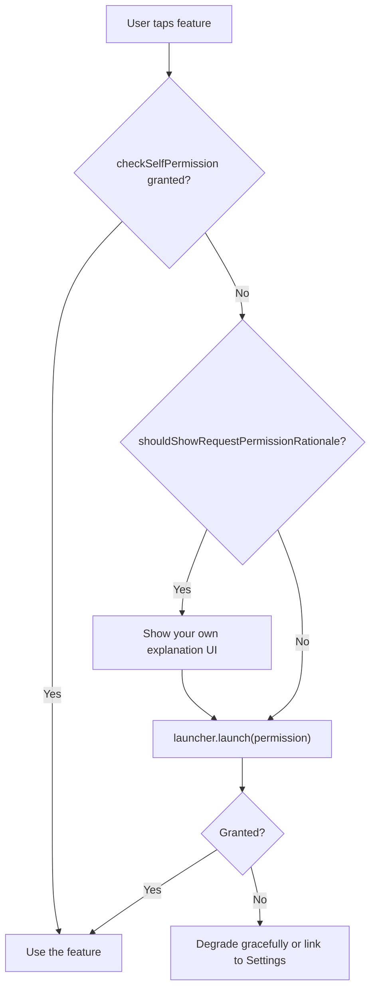
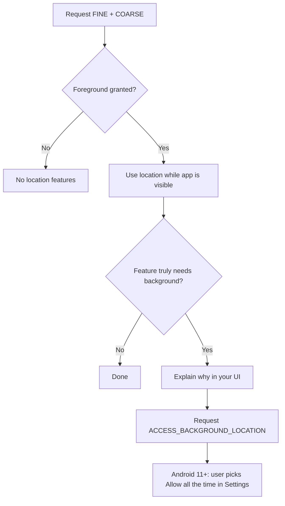
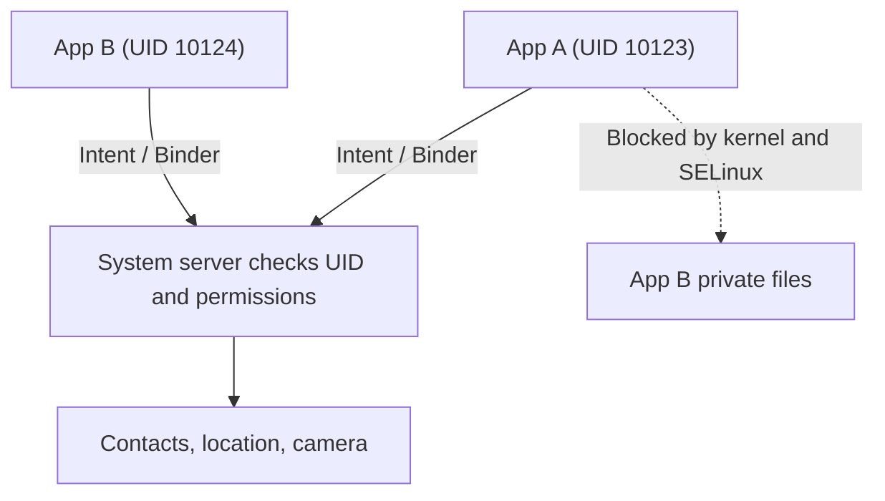
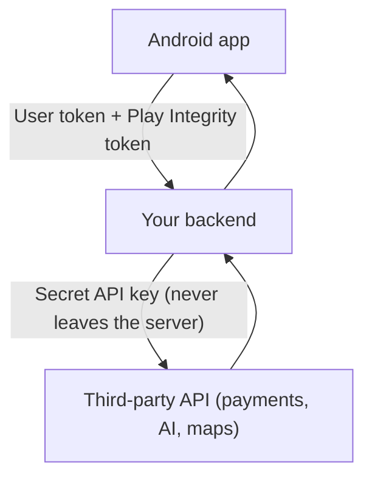
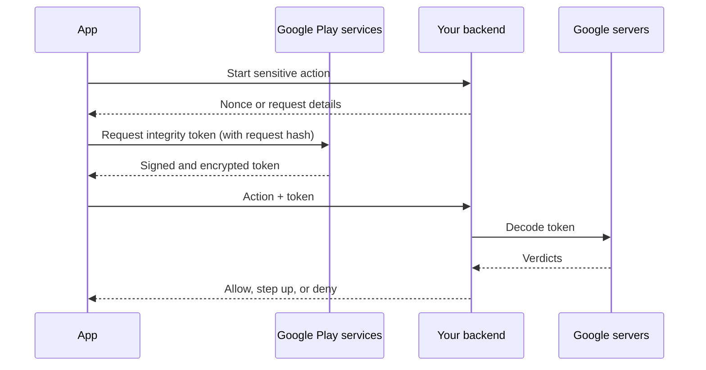
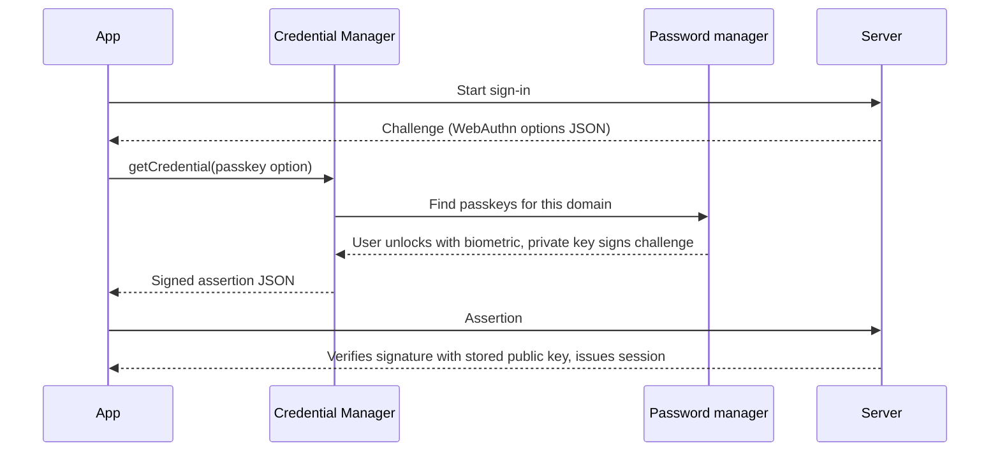
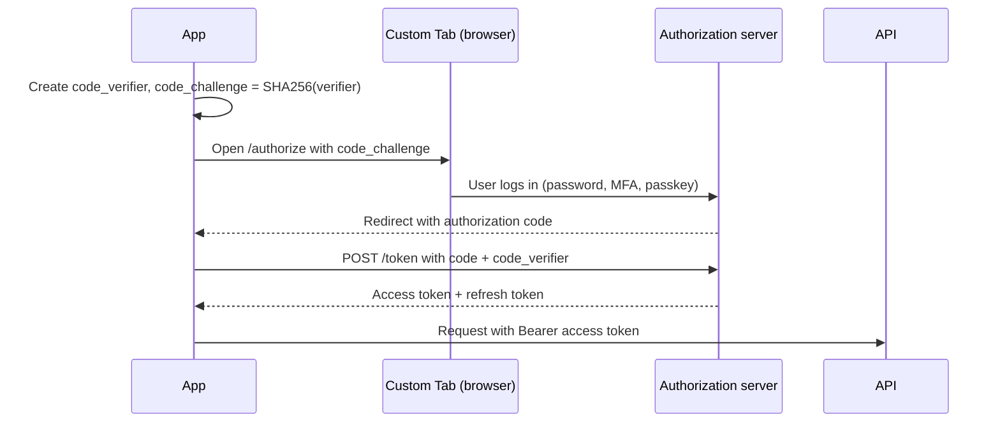
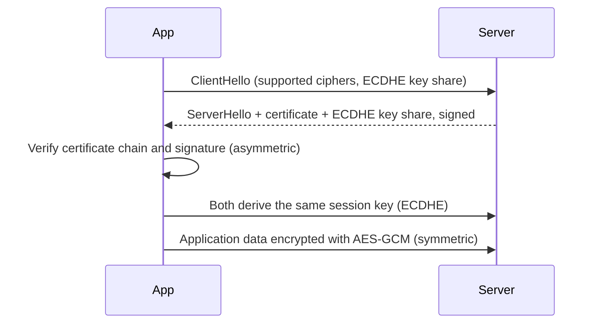
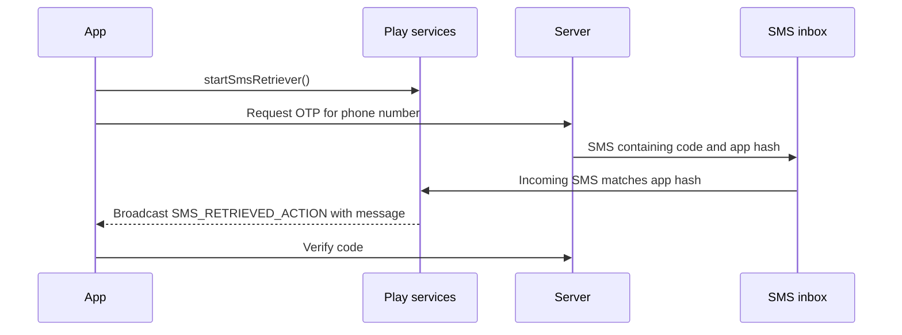
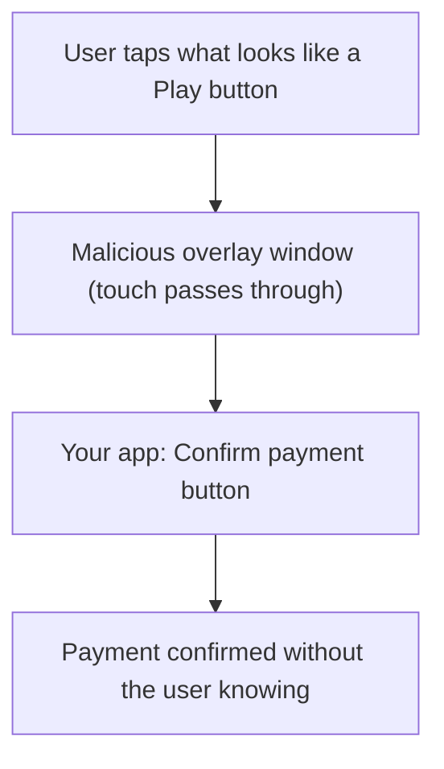

# Security & Permissions

[⬅ Back to index](../README.md)

Covers: permission types & runtime flow, permission changes by version, app sandbox, secure storage & Keystore, network security, obfuscation, root/tamper detection, Play Integrity, biometrics, passkeys, WebView security, exported components.

---

## Permissions

### 1. What are the types of permissions in Android?

<details>
<summary>Answer</summary>

**In short:** Android has four kinds of permissions, split by how risky they are and how they are granted: **normal** (install-time, granted automatically), **signature** (granted only to apps signed with the same certificate as the app that defines the permission), **dangerous/runtime** (the user must grant them in a dialog, API 23+), and **special/app-op** permissions (the user toggles them on a dedicated Settings screen).

#### Why there are different types

Permissions protect three different things: harmless system features (vibration, network state), data that belongs to the user (camera, location, contacts), and powerful system abilities (drawing over other apps, managing all files). Asking the user about everything would cause "dialog fatigue", so Android only asks about what actually matters to privacy. Each permission declares a **`protectionLevel`**, and that level decides how it is granted.

| Type | Granted how | Risk | Examples |
|---|---|---|---|
| **Normal** (install-time) | Automatically at install, if declared in the manifest | Low | `INTERNET`, `ACCESS_NETWORK_STATE`, `VIBRATE`, `WAKE_LOCK` |
| **Signature** | Automatically, but only if the requesting app is **signed with the same certificate** as the app that defines the permission | Varies | Custom permissions shared between your own apps; many platform-only permissions |
| **Dangerous** (runtime) | The **user** grants it at runtime via a system dialog (API 23+) | High: private data or sensitive hardware | `CAMERA`, `ACCESS_FINE_LOCATION`, `READ_CONTACTS`, `RECORD_AUDIO`, `READ_MEDIA_IMAGES`, `POST_NOTIFICATIONS` |
| **Special** (app-op) | The user enables it on a **dedicated Settings screen**, which your app opens with an Intent | Very high / abusable | `SYSTEM_ALERT_WINDOW`, `SCHEDULE_EXACT_ALARM`, `MANAGE_EXTERNAL_STORAGE`, `REQUEST_INSTALL_PACKAGES`, notification listener, accessibility service |

#### How each one behaves in code

- **Normal** and **signature**: you declare them with `<uses-permission>` and they are just there. No runtime code is needed.
- **Dangerous**: you declare them **and** request them at runtime (see question 2). Dangerous permissions are organised into **permission groups** (for example, location or contacts) that the system uses to group the dialog, but you should always request the specific permission you need, because group behaviour has changed across versions.
- **Special**: each has its own check API and Settings Intent:

```kotlin
// Each special permission has its own "is it granted?" check
val canOverlay = Settings.canDrawOverlays(context)                       // SYSTEM_ALERT_WINDOW
val canExact = alarmManager.canScheduleExactAlarms()                     // SCHEDULE_EXACT_ALARM (API 31+)
val allFiles = Environment.isExternalStorageManager()                    // MANAGE_EXTERNAL_STORAGE (API 30+)
val canInstall = context.packageManager.canRequestPackageInstalls()      // REQUEST_INSTALL_PACKAGES

// If not granted, send the user to the matching Settings screen
if (!canOverlay) {
    startActivity(
        Intent(Settings.ACTION_MANAGE_OVERLAY_PERMISSION, Uri.parse("package:${context.packageName}"))
    )
}
```

#### Pitfalls

- Declaring a dangerous permission in the manifest is **not** enough on API 23+; without the runtime request, calls throw `SecurityException` or return empty data.
- Many special permissions (all-files access, accessibility, exact alarms) are also restricted by **Google Play policy**: you must justify them in a declaration form, or the app is rejected.

#### Likely follow-ups

- *Can a permission's level change between versions?* Yes. For example, `SCHEDULE_EXACT_ALARM` behaves like a special permission, while `USE_EXACT_ALARM` (for alarm/calendar apps) is granted at install.
- *What is a "privileged" permission?* A signature-type permission that can also be granted to preinstalled system apps allowlisted by the device maker; normal apps can't get it.

</details>

### 2. How do you request runtime permissions correctly?

<details>
<summary>Answer</summary>

**In short:** Declare the permission in the manifest, check it with `ContextCompat.checkSelfPermission()`, show your own explanation if `shouldShowRequestPermissionRationale()` is true, then request it with the **Activity Result API** (`ActivityResultContracts.RequestPermission`). Handle denial gracefully, and if the user has permanently denied it, send them to app settings. Ask **in context**, when the user taps the feature, not at app launch.

#### The flow



#### Step by step

1. **Declare** it in `AndroidManifest.xml`: `<uses-permission android:name="android.permission.CAMERA"/>`. The system will never grant a permission that isn't declared.
2. **Check** with `ContextCompat.checkSelfPermission()`. Permissions can be revoked at any time from Settings (or auto-reset on Android 11+), so check every time, not once.
3. **Rationale**: `shouldShowRequestPermissionRationale()` returns `true` when the user has denied the permission before but not permanently. That's your cue to explain *why* you need it in your own UI before asking again.
4. **Request** with the Activity Result API. It replaces the old `requestPermissions()` + `onRequestPermissionsResult()` pair and survives configuration changes.
5. **Handle the result**, including permanent denial.

```kotlin
class ScanFragment : Fragment() {

    // Must be registered before the Fragment is STARTED (a property initializer is the usual place)
    private val cameraPermission = registerForActivityResult(
        ActivityResultContracts.RequestPermission()
    ) { granted ->
        if (granted) openCamera()
        else if (!shouldShowRequestPermissionRationale(Manifest.permission.CAMERA)) {
            showGoToSettings()   // denied and "don't ask again": the dialog will no longer appear
        } else {
            showDeniedState()    // denied this time; feature unavailable but app still works
        }
    }

    fun onScanClicked() {
        when {
            ContextCompat.checkSelfPermission(requireContext(), Manifest.permission.CAMERA) ==
                PackageManager.PERMISSION_GRANTED -> openCamera()
            shouldShowRequestPermissionRationale(Manifest.permission.CAMERA) ->
                showRationaleDialog(onOk = { cameraPermission.launch(Manifest.permission.CAMERA) })
            else -> cameraPermission.launch(Manifest.permission.CAMERA)
        }
    }

    private fun showGoToSettings() {
        val intent = Intent(Settings.ACTION_APPLICATION_DETAILS_SETTINGS,
            Uri.fromParts("package", requireContext().packageName, null))
        startActivity(intent)
    }
}
```

For several permissions at once use `ActivityResultContracts.RequestMultiplePermissions()`, which returns a `Map<String, Boolean>`.

**In Compose**, use `rememberLauncherForActivityResult(ActivityResultContracts.RequestPermission()) { ... }` and call `launch()` from a click handler. Accompanist's permissions library offers a state-based wrapper (`rememberPermissionState`), but it has long been marked experimental, so many teams use the launcher directly.

#### Permanent denial

Since Android 11, if the user denies a permission **twice**, the system treats it as "don't ask again" and `launch()` returns `false` immediately with no dialog. The only way back is the app's Settings page. Note that `shouldShowRequestPermissionRationale()` is also `false` **before the first request**, so on its own it can't tell "never asked" from "permanently denied". Check it in the result callback (after a denial), or track whether you have asked before.

#### Best practices

- Request **in context** and only the **minimum** you need (e.g. coarse location if that's enough, the Photo Picker instead of media permissions).
- **Degrade gracefully**: the rest of the app must keep working if the user says no.
- Don't loop the request; respect the user's decision.

#### Likely follow-ups

- *Why not request everything at launch?* Users deny out-of-context requests and you may hit permanent denial before they ever see the feature.
- *What happens to a granted permission when the app is unused for months?* On Android 11+ the system can auto-reset it, so always re-check.

</details>

### 3. What permission changes happened in recent Android versions?

<details>
<summary>Answer</summary>

**In short:** The trend since Android 6 is **more granular, more user-controlled, and shorter-lived** access: runtime permissions (6), separate background location (10), one-time and auto-reset permissions (11), approximate location and Bluetooth permissions (12), notification and granular media permissions (13), partial photo access (14), and stricter foreground-service and health rules after that. Most changes apply when your app **targets** the new API level, so you meet them when you bump `targetSdk`.

| Version (API) | Key permission changes | What you have to do |
|---|---|---|
| **6.0 (23)** | **Runtime permissions** for dangerous permissions | Check and request at runtime |
| **10 (29)** | `ACCESS_BACKGROUND_LOCATION` becomes a **separate** permission; **scoped storage** introduced | Request background location separately; stop relying on broad file paths |
| **11 (30)** | **One-time permissions** ("Only this time"); **auto-reset** of permissions for unused apps; background location must be granted from **Settings**; **package visibility** (`<queries>`) | Re-check permissions every time; declare `<queries>` for apps you interact with |
| **12 (31)** | **Approximate vs precise location** (the user can grant `COARSE` only); Bluetooth permissions `BLUETOOTH_SCAN` / `BLUETOOTH_CONNECT`; **mic and camera toggles and indicators**; `SCHEDULE_EXACT_ALARM` | Handle coarse-only grants; migrate from location-for-Bluetooth-scanning |
| **13 (33)** | **`POST_NOTIFICATIONS`** runtime permission; granular media permissions `READ_MEDIA_IMAGES` / `READ_MEDIA_VIDEO` / `READ_MEDIA_AUDIO` replace `READ_EXTERNAL_STORAGE`; `NEARBY_WIFI_DEVICES` | Ask before posting notifications; request only the media types you need |
| **14 (34)** | **Partial photo/video access** (`READ_MEDIA_VISUAL_USER_SELECTED`, "Select photos"); **foreground service type permissions**; exact alarms **denied by default** | Handle partial access; declare FGS types and their permissions |
| **15 / 16** | Stricter FGS rules; Health Connect permissions (moving from body-sensor permissions to granular health permissions); Play policy pushing the **Photo Picker** over broad media access | Prefer the Photo Picker; review FGS usage and health data access |

#### Notes on the important ones

- **One-time permissions (11)**: if the user picks "Only this time", the grant lasts while your app is in use and is revoked shortly after it goes to the background. Code must not cache the "granted" state.
- **Auto-reset (11)**: if the app isn't used for a few months, the system revokes its runtime permissions (and on newer versions can hibernate the app). You can ask the user to disable this for legitimate cases, but most apps should simply re-request.
- **Approximate location (12)**: when you request `FINE`, the dialog lets the user downgrade to approximate. You must request **both** `FINE` and `COARSE` together; requesting only `FINE` on 12+ is ignored. See question 4.
- **Bluetooth (12)**: before 12, scanning required location permission. Now `BLUETOOTH_SCAN` can be declared with `android:usesPermissionFlags="neverForLocation"` if you don't derive location from scans.
- **Notifications (13)**: apps targeting 13+ must request `POST_NOTIFICATIONS`; until granted, notifications are silently dropped. Ask at a meaningful moment, not on first launch.
- **Partial media (14)**: the user can choose "Select photos and videos". You then get `READ_MEDIA_VISUAL_USER_SELECTED` and see only the chosen items, so your gallery UI must handle a subset and offer a way to pick more.
- **Exact alarms (14)**: `SCHEDULE_EXACT_ALARM` is no longer pre-granted to most newly installed apps targeting 13+. Alarm-clock and calendar apps can use `USE_EXACT_ALARM`; others should check `canScheduleExactAlarms()` or use inexact alarms / WorkManager.
- **FGS types (14)**: every foreground service must declare a `foregroundServiceType` and the matching `FOREGROUND_SERVICE_<TYPE>` permission, otherwise `startForeground()` throws.

#### Pitfalls

- Bumping `targetSdk` without reading the behaviour-change list for that version; this is the most common source of production crashes after an upgrade.
- Requesting `READ_MEDIA_*` just to let the user pick an image: the **Photo Picker** needs no permission at all.

#### Likely follow-ups

- *Do these changes affect apps targeting an old SDK?* Some do (user-facing ones like one-time permissions, mic indicators), most don't until you target the new level, and Play requires a recent `targetSdk` anyway.
- *What is package visibility?* From Android 11, apps can't see all installed apps by default; you declare the packages or intents you need in `<queries>`.

</details>

### 4. How do you handle location permissions properly?

<details>
<summary>Answer</summary>

**In short:** Request `ACCESS_FINE_LOCATION` **together with** `ACCESS_COARSE_LOCATION`, because on Android 12+ the user can choose approximate only, and your code must work with coarse. Ask for **background location separately and later**, only if a feature truly needs it (it requires a Play policy declaration). Get locations through the **Fused Location Provider** and stop updates as soon as you don't need them.

#### Foreground location

Ask for the least precise level that works. A weather app needs coarse; turn-by-turn navigation needs fine.

```kotlin
private val locationPermissions = registerForActivityResult(
    ActivityResultContracts.RequestMultiplePermissions()
) { result ->
    when {
        result[Manifest.permission.ACCESS_FINE_LOCATION] == true -> startPreciseUpdates()
        result[Manifest.permission.ACCESS_COARSE_LOCATION] == true -> startApproximateUpdates() // user chose "Approximate"
        else -> showNoLocationState()
    }
}

fun requestLocation() {
    // On API 31+ you must request BOTH; requesting FINE alone is ignored
    locationPermissions.launch(arrayOf(
        Manifest.permission.ACCESS_FINE_LOCATION,
        Manifest.permission.ACCESS_COARSE_LOCATION
    ))
}
```

Approximate location is an estimate of roughly a few square kilometres, so features like "nearby within 100 m" must either ask the user to upgrade to precise or show a degraded experience.

#### Background location (incremental request)



- Background location was split out in Android 10. On **Android 11+** you can't get it from an in-app dialog together with foreground location: you must already hold foreground location, then request `ACCESS_BACKGROUND_LOCATION` on its own, and the system takes the user to the Settings page where they pick "Allow all the time".
- Google Play requires a **declaration and review** for background location, and rejects apps that use it without a clear, user-visible feature (e.g. geofenced reminders, fitness tracking).
- Often you don't need it: a **foreground service** with type `location`, started while the user is in the app, can keep receiving updates with only foreground permission.

#### Getting the location efficiently

```kotlin
val client = LocationServices.getFusedLocationProviderClient(context)

val request = LocationRequest.Builder(Priority.PRIORITY_BALANCED_POWER_ACCURACY, 10_000L) // every 10 s
    .setMinUpdateIntervalMillis(5_000L)
    .build()

private val callback = object : LocationCallback() {
    override fun onLocationResult(result: LocationResult) {
        result.lastLocation?.let(::updateMap)
    }
}

@SuppressLint("MissingPermission") // checked before calling
fun start() = client.requestLocationUpdates(request, callback, Looper.getMainLooper())

fun stop() = client.removeLocationUpdates(callback) // call in onStop / when the screen leaves
```

The Fused Location Provider combines GPS, Wi-Fi, cell and sensors and picks the cheapest source that meets your priority. For a single fix use `getCurrentLocation()` rather than starting continuous updates.

#### Pitfalls

- Requesting background location in the same dialog as foreground location; on 11+ it simply fails.
- Forgetting to remove updates, which drains the battery and shows the location indicator all the time.
- Assuming fine location: always handle a coarse-only grant.

#### Likely follow-ups

- *How do you use location in a long-running tracker?* A foreground service of type `location` with a visible notification, started from the foreground.
- *Is device location (GPS toggle) the same as permission?* No. Check `LocationSettingsRequest` / `SettingsClient` to prompt the user to turn location on.

</details>

### 5. How can you define custom permissions?

<details>
<summary>Answer</summary>

**In short:** Declare a `<permission>` in your manifest, usually with `android:protectionLevel="signature"`, and protect your components with `android:permission="..."`. Then only apps signed with your certificate (your own apps) can talk to that exported Activity, Service, BroadcastReceiver or ContentProvider.

#### Why

Sometimes your own apps need to share data or functionality: a main app and a companion app, or a set of apps from the same company. Exporting a component makes it reachable by **every** app on the device. A custom signature permission limits it to apps you signed.

#### Defining and using one

```xml
<!-- App A (the provider of the data) -->
<permission
    android:name="com.example.permission.READ_DATA"
    android:label="@string/perm_read_data"
    android:protectionLevel="signature" />

<provider
    android:name=".data.SharedDataProvider"
    android:authorities="com.example.shared"
    android:exported="true"
    android:readPermission="com.example.permission.READ_DATA"
    android:writePermission="com.example.permission.WRITE_DATA" />

<service
    android:name=".sync.SyncService"
    android:exported="true"
    android:permission="com.example.permission.READ_DATA" />
```

```xml
<!-- App B (the caller) just asks for it -->
<uses-permission android:name="com.example.permission.READ_DATA" />
```

You can also check it in code, for example inside a bound service:

```kotlin
override fun onBind(intent: Intent): IBinder {
    // Enforce for every call, not just at bind time, if the binder exposes sensitive methods
    enforceCallingPermission("com.example.permission.READ_DATA", "Caller lacks READ_DATA")
    return binder
}
```

#### Protection levels for custom permissions

| Level | Who gets it | When to use |
|---|---|---|
| `normal` | Any app that declares it | Almost never for security; it only documents intent |
| `dangerous` | Apps whose user approves it at runtime | Third-party apps accessing user data you hold |
| `signature` | Only apps signed with the **same certificate** | Your own app family (most common) |
| `signature\|knownSigner` (API 31+) | Same signer **or** a listed set of certificate digests (`android:knownCerts`) | Trusted partner apps or after a key rotation |

#### Pitfalls

- **Naming collisions**: since Android 5.0, two apps can't define the same permission name unless they have the same signer, so the second app fails to install. Use your package name as a prefix.
- If you use Play App Signing, the certificate that matters is the **Play signing key**, not your upload key. Debug builds are signed differently, so signature checks fail between debug and release builds.
- A `normal` custom permission gives no protection; any app can declare it.

#### Likely follow-ups

- *Can you check the caller's identity without a permission?* Yes: `Binder.getCallingUid()` plus `PackageManager` to check its package and signing certificate.
- *Is a custom permission needed for components only used inside your app?* No. Just set `android:exported="false"`.

</details>

---

## App Security

### 6. What is the Android application sandbox?

<details>
<summary>Answer</summary>

**In short:** Every app gets its own **Linux user ID (UID)** and runs in its **own process**, so the kernel stops apps from reading each other's private files (`/data/data/<package>`) or memory. **SELinux** mandatory access control, **seccomp** system-call filters and the permission system reinforce this. Apps can only talk to each other through defined IPC: Intents, Binder services and Content Providers.

#### How it works

Android reuses classic Linux user separation, but with one "user" per **app** instead of per person:

1. **At install**, the package manager assigns the app a unique UID (e.g. `u0_a123`) and creates its private data directory, owned by that UID with no access for others.
2. **At launch**, Zygote forks a new process and switches it to the app's UID. The process can only touch files owned by that UID, plus whatever permissions grant.
3. **SELinux** (enforcing for all apps since Android 5.0) adds rules the app can't change even if it misbehaves: for example, untrusted apps can't read other apps' data, even world-readable files. Since Android 9, each app gets its own SELinux category, so files are isolated per app at the SELinux level too.
4. **seccomp-bpf** filters block rarely needed, risky system calls, reducing the kernel attack surface.
5. **Permissions** are enforced at the boundary: the system server checks the caller's UID before returning contacts, location, and so on.



#### What it means for you

- Files in `context.filesDir`, `cacheDir`, databases and SharedPreferences are private by default. Don't use world-readable modes (`MODE_WORLD_READABLE` throws on API 24+).
- To share a file, use a `FileProvider` with `content://` URIs and **temporary** URI grants, never raw file paths.
- Native code runs inside the same sandbox, so a native library gets no extra privileges.

#### Limits of the sandbox

- On a **rooted** device, root can read any app's files, so the sandbox is not a reason to store secrets in plain text (see question 7).
- `android:sharedUserId` (deprecated since API 29) used to let apps with the same signer share a UID; don't use it in new apps.
- External/shared storage is outside the per-app sandbox in older versions; scoped storage (10+) narrows that.

#### Likely follow-ups

- *What is Zygote's role?* It is a pre-warmed process with the framework loaded; every app process is forked from it and then dropped to the app's UID.
- *How are multiple users/work profiles isolated?* Each Android user gets its own UID range and data directories (`/data/user/<userId>/<package>`).

</details>

### 7. How do you store sensitive data securely?

<details>
<summary>Answer</summary>

**In short:** Generate keys in the **Android Keystore**, which keeps them in secure hardware (TEE or StrongBox) where they are **non-exportable**, and can require user authentication to use. Encrypt your data with **AES-256-GCM** using that key and store the ciphertext in DataStore, files or Room (or use **SQLCipher** for a fully encrypted database). The Jetpack `EncryptedSharedPreferences` / `EncryptedFile` library is now **deprecated**; use the Keystore directly or Google **Tink**. And never hardcode secrets, log tokens or keep PII in plain text.

#### Why plain storage isn't enough

App-private storage is protected by the sandbox, but it can be read on a rooted device, from some backups, or by forensic tools. Encryption makes the stolen file useless **as long as the key can't be stolen too**. That's what the Keystore solves: the key material never enters your app's memory; your app asks secure hardware to encrypt or decrypt for it.

#### Keystore + AES-GCM

```kotlin
private const val KEY_ALIAS = "token_key"

private fun getOrCreateKey(): SecretKey {
    val ks = KeyStore.getInstance("AndroidKeyStore").apply { load(null) }
    (ks.getEntry(KEY_ALIAS, null) as? KeyStore.SecretKeyEntry)?.let { return it.secretKey }

    val spec = KeyGenParameterSpec.Builder(
        KEY_ALIAS, KeyProperties.PURPOSE_ENCRYPT or KeyProperties.PURPOSE_DECRYPT
    )
        .setBlockModes(KeyProperties.BLOCK_MODE_GCM)
        .setEncryptionPaddings(KeyProperties.ENCRYPTION_PADDING_NONE)
        .setKeySize(256)
        // .setUserAuthenticationRequired(true)  // optionally require biometric/PIN (see question 15)
        // .setIsStrongBoxBacked(true)           // use a dedicated secure chip if the device has one
        .build()

    return KeyGenerator.getInstance(KeyProperties.KEY_ALGORITHM_AES, "AndroidKeyStore")
        .apply { init(spec) }
        .generateKey()
}

fun encrypt(plain: ByteArray): ByteArray {
    val cipher = Cipher.getInstance("AES/GCM/NoPadding")
    cipher.init(Cipher.ENCRYPT_MODE, getOrCreateKey())      // Keystore generates a random IV
    return cipher.iv + cipher.doFinal(plain)                // store IV (12 bytes) with the ciphertext
}

fun decrypt(data: ByteArray): ByteArray {
    val iv = data.copyOfRange(0, 12)
    val cipher = Cipher.getInstance("AES/GCM/NoPadding")
    cipher.init(Cipher.DECRYPT_MODE, getOrCreateKey(), GCMParameterSpec(128, iv))
    return cipher.doFinal(data.copyOfRange(12, data.size)) // throws if data was tampered with
}
```

GCM gives **confidentiality and integrity**: any modification of the ciphertext makes decryption fail. The IV is not secret but must be **unique per encryption**, which is why you let the Keystore generate it.

#### Options compared

| Option | Status | Notes |
|---|---|---|
| Keystore + AES-GCM (manual) | Recommended | Full control; you store the bytes in DataStore, a file or a DB column |
| Google **Tink** (with an Android Keystore master key) | Recommended | Higher-level, harder to misuse; handles key rotation and formats |
| `EncryptedSharedPreferences` / `EncryptedFile` | **Deprecated** | Still in many codebases; known performance and keyset-corruption issues |
| **SQLCipher** | Fine for whole-DB encryption | Encrypts the entire SQLite file; store its passphrase encrypted with a Keystore key |

#### What to never do

- **Hardcode** API secrets or encryption keys in code or resources: they are extractable from the APK (question 8).
- **Log** tokens or PII; logs are readable via `adb` and crash tools.
- **Store user passwords** on the device; store a token instead.
- Back up secrets: exclude them with `android:dataExtractionRules` (API 31+) / `android:fullBackupContent`, or set `android:allowBackup="false"`. Keystore keys aren't backed up, so restored ciphertext would be undecryptable anyway.

#### Pitfalls

- Keystore keys can be **invalidated** (new biometric enrolled, lock screen removed if auth was required). Catch `KeyPermanentlyInvalidatedException` and re-authenticate the user / re-create the key.
- Keystore operations can be slow, especially StrongBox; don't run them on the main thread in a loop.

#### Likely follow-ups

- *TEE vs StrongBox?* TEE is an isolated environment on the main processor; StrongBox is a separate secure chip with its own CPU and storage, more resistant to physical attacks but slower.
- *How do you prove a key is hardware-backed?* **Key attestation**: request a certificate chain for the key and verify it on your server.

</details>

### 8. How do you protect API keys in an Android app?

<details>
<summary>Answer</summary>

**In short:** You can't fully hide a secret in an app: **anything in the APK can be extracted** with jadx/apktool or captured with a proxy. So keep real secrets **on your backend** and have the app call your server, use **short-lived tokens** and **restrict keys** (by package name and signing certificate SHA-1), keep keys out of source control, and use the **Play Integrity API** so your server can tell requests from your genuine app. Obfuscation or the NDK only slow attackers down.

#### Why the APK can't keep a secret

The APK is shipped to every user. An attacker can decompile it (strings in `BuildConfig`, resources and even native `.so` files are easy to find), hook the running app with Frida to read values from memory, or put a proxy in the middle and read the key from the HTTP header. If the app can use the key, so can someone holding the app.

#### The right architecture



The server authenticates the user, checks the integrity verdict, applies rate limits, and only then calls the third party with the secret. If the app is abused, you can revoke or throttle at one point without shipping an update.

#### Mitigations by layer

| Layer | Technique | Protects against |
|---|---|---|
| Architecture | **Secrets on the backend**; app gets only per-user, **short-lived tokens** (OAuth) | Key extraction entirely |
| Key restrictions | Restrict client-side keys (e.g. Google Maps) by **package name + SHA-1 signing cert**, and by API | Reuse of a leaked key from other apps |
| Source control | Read keys from `local.properties` / CI secrets into `BuildConfig` | Leaks via the **repo**; does **not** protect the APK |
| Binary | R8 obfuscation, string encryption, keys in NDK code | Casual extraction; only **slows** attackers |
| Runtime attestation | **Play Integrity API** checked on the server | Requests from modified apps, scripts and emulators |

Keeping keys out of git, for example:

```kotlin
// build.gradle.kts (app)
val mapsKey: String = gradleLocalProperties(rootDir, providers).getProperty("MAPS_API_KEY") ?: ""
android {
    defaultConfig {
        buildConfigField("String", "MAPS_API_KEY", "\"$mapsKey\"")  // ends up in the APK!
    }
}
```

The comment is the point: this only keeps the key out of the repository. The **Secrets Gradle Plugin** automates the same thing.

#### Pitfalls

- Thinking `BuildConfig` or `strings.xml` "hides" a key.
- Shipping long-lived keys for paid APIs (LLM, SMS, payments) in the app; someone will extract them and run up the bill.
- Not monitoring usage, so you only notice abuse from the invoice.

#### Likely follow-ups

- *What if a client-side key must be in the app (e.g. Maps SDK)?* Restrict it by package and certificate fingerprint and set quotas; assume it is public.
- *Can certificate pinning protect the key?* It makes proxy capture harder, but not decompilation or hooking.

</details>

### 9. How do you secure network communication?

<details>
<summary>Answer</summary>

**In short:** Use **HTTPS everywhere**: cleartext HTTP is blocked by default for apps targeting API 28+ through the **Network Security Config**. Since API 24, apps don't trust **user-installed CAs** by default. Add **certificate pinning** (OkHttp `CertificatePinner` or `<pin-set>` in the config) for high-value apps, always with **backup pins** and an expiry, and never disable certificate validation with a "trust all" `TrustManager`.

#### The threat

On public Wi-Fi or a compromised network, an attacker can sit between the app and the server (**man-in-the-middle**, MITM) and read or change traffic. TLS prevents that by encrypting the data and proving the server's identity through a certificate chain signed by a trusted Certificate Authority (CA).

#### Network Security Config

A declarative XML file, referenced from the manifest with `android:networkSecurityConfig="@xml/network_security_config"`:

```xml
<network-security-config>
    <!-- Default for all domains: HTTPS only, system CAs only -->
    <base-config cleartextTrafficPermitted="false">
        <trust-anchors>
            <certificates src="system" />
        </trust-anchors>
    </base-config>

    <!-- Pin the API domain, with a backup pin and an expiry date -->
    <domain-config>
        <domain includeSubdomains="true">api.example.com</domain>
        <pin-set expiration="2027-06-01">
            <pin digest="SHA-256">7HIpactkIAq2Y49orFOOQKurWxmmSFZhBCoQYcRhJ3Y=</pin> <!-- current key -->
            <pin digest="SHA-256">fwza0LRMXouZHRC8Ei+4PyuldPDcf3UKgO/04cDM1oE=</pin> <!-- backup key -->
        </pin-set>
    </domain-config>

    <!-- Let debug builds trust user CAs so you can inspect traffic with a proxy -->
    <debug-overrides>
        <trust-anchors>
            <certificates src="user" />
        </trust-anchors>
    </debug-overrides>
</network-security-config>
```

#### Pinning with OkHttp

```kotlin
val pinner = CertificatePinner.Builder()
    .add("api.example.com", "sha256/7HIpactkIAq2Y49orFOOQKurWxmmSFZhBCoQYcRhJ3Y=")
    .add("api.example.com", "sha256/fwza0LRMXouZHRC8Ei+4PyuldPDcf3UKgO/04cDM1oE=") // backup
    .build()

val client = OkHttpClient.Builder()
    .certificatePinner(pinner)
    .build()
```

Pinning means "I accept only certificates whose public key matches one of these hashes", so even a certificate from a trusted (or user-installed, or compromised) CA is rejected.

| Approach | Pros | Cons |
|---|---|---|
| Default TLS (system CAs) | Zero maintenance; standard | Trusts every system CA |
| NSC `<pin-set>` | Declarative; has `expiration` safety valve | Needs an app update to change pins |
| OkHttp `CertificatePinner` | Fine-grained, in code | Same rotation problem; no built-in expiry |

#### Wrong vs right

```kotlin
// WRONG: accepts any certificate, so any MITM works. Play flags apps that do this.
val trustAll = object : X509TrustManager {
    override fun checkClientTrusted(chain: Array<X509Certificate>, authType: String) {}
    override fun checkServerTrusted(chain: Array<X509Certificate>, authType: String) {}
    override fun getAcceptedIssuers() = arrayOf<X509Certificate>()
}

// RIGHT: use the default trust manager; for local testing use <debug-overrides> instead.
```

#### Pitfalls

- **No backup pin / no rotation plan**: when the server certificate's key changes, every installed app stops working until users update. Pin the public key (SPKI) of an intermediate or keep a spare key, and set an expiry.
- Leaving `cleartextTrafficPermitted="true"` globally because one legacy domain needs HTTP; scope it to that domain.
- Logging full request/response bodies (tokens!) with `HttpLoggingInterceptor` in release builds.

#### Likely follow-ups

- *Does pinning stop a determined attacker?* No: on a device they control they can hook or patch the app to remove it. It protects users on hostile networks, not you from your own users.
- *How do you debug HTTPS traffic?* Use `<debug-overrides>` to trust a proxy's user CA (Charles, mitmproxy) in debug builds only.

</details>

### 10. What is code obfuscation and why use R8?

<details>
<summary>Answer</summary>

**In short:** **R8** is the Android build's shrinker, optimizer and obfuscator. It removes unused code, optimizes what's left and renames classes, methods and fields to short meaningless names. That makes the app **smaller** and **harder (not impossible) to reverse engineer**. Keep the generated `mapping.txt` to de-obfuscate crash stack traces, and keep truly sensitive logic on the server.

#### What R8 does

When you set `isMinifyEnabled = true` on a release build, R8 runs at compile time and:

1. **Shrinks**: walks the code from entry points (Activities in the manifest, keep rules) and removes classes and members that are never reached, including unused library code.
2. **Optimizes**: inlines methods, removes dead branches, merges classes, and so on.
3. **Obfuscates**: renames `com.example.payment.PaymentValidator.validateCard()` to something like `a.b.c.a()`.
4. **Shrinks resources** (with `isShrinkResources = true`): removes unused drawables and layouts.

```kotlin
// app/build.gradle.kts
android {
    buildTypes {
        release {
            isMinifyEnabled = true
            isShrinkResources = true
            proguardFiles(
                getDefaultProguardFile("proguard-android-optimize.txt"),
                "proguard-rules.pro"
            )
        }
    }
}
```

```proguard
-keep class com.example.api.model.** { *; }      # proguard-rules.pro: models parsed with reflection-based JSON
-keepclassmembers class * {
    @android.webkit.JavascriptInterface <methods>; # WebView bridge methods are called by name
}
```

#### Mapping file

R8 writes `build/outputs/mapping/release/mapping.txt`, which maps new names back to old ones. Upload it to the Play Console and Crashlytics (or use the `retrace` tool) so production stack traces are readable. Archive it for **every** release; without it a crash trace from that version is nearly useless.

#### What obfuscation does not do

- **String literals are not encrypted**: URLs, keys and log messages are still readable in the decompiled code.
- Android framework classes and anything kept by rules (your Activities, model classes) keep their names.
- Logic is still there: an attacker can read and patch it, it just takes longer.

So obfuscation is a **cost raiser**, not a vault. For stronger protection, commercial tools such as **DexGuard** add string and class encryption, anti-tamper and anti-hooking checks. For anything that must not be bypassed (pricing, licence checks, fraud rules), enforce it **on the server**.

#### Pitfalls

- Missing keep rules for reflection (Gson models, some DI or serialization setups), causing crashes only in release builds. Prefer libraries that ship their own consumer rules, or code generation (kotlinx.serialization, Moshi codegen).
- Testing only debug builds; always run a minified release build before shipping.

#### Likely follow-ups

- *R8 vs ProGuard?* R8 replaced ProGuard as the default in AGP 3.4; it reads the same rule syntax but shrinks, optimizes and dexes in one step, producing smaller output faster.
- *What is "full mode"?* A more aggressive R8 mode (default in newer AGP versions) that assumes less about reflection, so it shrinks more but needs more precise keep rules.

</details>

### 11. What is the Play Integrity API? (and SafetyNet)

<details>
<summary>Answer</summary>

**In short:** **Play Integrity** (which **replaced the SafetyNet Attestation API**, now shut down) lets your **backend** check that a request comes from your **genuine, unmodified app binary** installed from Play, running on a **genuine certified Android device**, for a **licensed user**. The app asks Google Play for a signed, encrypted integrity token tied to the request, sends it to your server, and the server decodes and verifies it before deciding what to allow. **Always verify on the server**, never in the app.

#### Why it exists

Your API can't trust the client: bots can call it directly, attackers can repackage your APK, and fraud farms run emulators. Client-side checks (question 12) can be patched out. Play Integrity moves the judgement to Google Play services, which signs a verdict the app can't forge, and to your server, which the attacker doesn't control.

#### The flow



There are two request types:

- **Standard requests**: you "prepare" a token provider once in advance (warming it up), then request tokens with low latency, binding each to a `requestHash` of the action (for example a hash of the transfer details). Good for frequent checks.
- **Classic requests**: one token per call, bound to a **nonce** from your server; higher latency, suitable for occasional, high-value actions.

#### The verdicts

| Verdict | Tells you | Example values |
|---|---|---|
| **App integrity** | Is this the binary Play knows, signed with your key? | `PLAY_RECOGNIZED`, `UNRECOGNIZED_VERSION` |
| **Device integrity** | Is this a genuine, certified Android device? | `MEETS_DEVICE_INTEGRITY` (also `MEETS_BASIC_INTEGRITY` / `MEETS_STRONG_INTEGRITY` levels) |
| **Account details** | Did the user get the app from Play (licensed)? | `LICENSED`, `UNLICENSED` |
| **Request details** | Is the token for *this* request (nonce/hash, package name, timestamp)? | Must match what your server expects |

Your server should check **all** of: package name, request hash or nonce, timestamp freshness, then the verdicts.

#### Deciding what to do

Integrity isn't binary pass/fail for the user experience. A common policy:

- Full verdicts: allow.
- Device fails strong integrity but meets basic: allow low-risk actions, step up (OTP) for high-risk ones.
- App unrecognised or no device integrity: block sensitive actions, but let the user browse.

#### Pitfalls

- Verifying the token inside the app; an attacker just patches the check.
- Reusing tokens or not checking the nonce/request hash, which enables **replay**.
- Blocking legitimate users on custom ROMs too aggressively; decide per action.
- Ignoring quotas: there are daily request limits, so check at important moments, not on every API call.

#### Likely follow-ups

- *What happened to SafetyNet?* The SafetyNet Attestation API was deprecated and turned off; Play Integrity is its replacement with more verdicts.
- *Does it work outside Play?* It relies on Google Play services and Play distribution, so sideloaded or non-GMS devices will fail some verdicts.

</details>

### 12. How do you detect rooted devices or tampering?

<details>
<summary>Answer</summary>

**In short:** Prefer **Play Integrity verdicts** checked on the server. Add client-side heuristics as extra **signals**: look for `su` binaries, `test-keys` builds, Magisk, and hooking frameworks (Frida/Xposed); verify the app's **signing certificate** at runtime; and check whether a debugger is attached. Every client-side check can be bypassed by someone who controls the device, so feed the results to the server and let it decide.

#### Why it's an arms race

On a rooted device, the attacker controls the OS. Tools like Magisk can hide root from specific apps, and Frida can hook your detection function and make it return `false`. Detection only raises the cost of an attack; it doesn't prevent one. That's why server-side attestation is preferred: Google signs the result, and your server makes the decision.

#### Common client-side signals

```kotlin
object TamperSignals {

    fun suBinaryPresent(): Boolean = listOf(
        "/system/bin/su", "/system/xbin/su", "/sbin/su", "/system/app/Superuser.apk"
    ).any { File(it).exists() }

    fun testKeysBuild(): Boolean = Build.TAGS?.contains("test-keys") == true

    fun debuggerAttached(): Boolean = Debug.isDebuggerConnected() || Debug.waitingForDebugger()

    fun isDebuggableBuild(context: Context): Boolean =
        (context.applicationInfo.flags and ApplicationInfo.FLAG_DEBUGGABLE) != 0

    // Has someone re-signed (repackaged) the APK?
    @RequiresApi(Build.VERSION_CODES.P)
    fun signatureMatches(context: Context, expectedSha256: String): Boolean {
        val info = context.packageManager.getPackageInfo(
            context.packageName, PackageManager.GET_SIGNING_CERTIFICATES
        )
        val certs = info.signingInfo?.apkContentsSigners ?: return false
        return certs.any { cert ->
            val digest = MessageDigest.getInstance("SHA-256").digest(cert.toByteArray())
            Base64.encodeToString(digest, Base64.NO_WRAP) == expectedSha256
        }
    }
}
```

Other signals teams use: known root-manager package names, writable `/system`, Frida's default port or libraries in `/proc/self/maps`, and emulator properties.

| Approach | Strength | Weakness |
|---|---|---|
| **Play Integrity** (server-verified) | Signed by Google; can't be forged locally | Needs Play services; quota; not every root is detected |
| Client heuristics | Works offline; cheap | Easy to hook or hide; false positives on custom ROMs |
| Commercial RASP (runtime protection SDKs) | Many checks, obfuscated, updated | Cost; still bypassable by experts |

#### What to do with the result

Don't just crash the app; that tells the attacker exactly where the check is. Send signals to the server with the request, then let the server **restrict risky actions** (payments, transfers, DRM content) and log for fraud analysis. Banking and DRM apps may block entirely; most apps should not punish users who root their phones for legitimate reasons.

#### Pitfalls

- Hardcoding the expected signature hash for your **upload key** when Play App Signing re-signs with a different key; the check fails for every Play user.
- Treating the absence of root signals as proof the device is safe.

#### Likely follow-ups

- *Why check the signing certificate?* A repackaged APK (with ads or malware injected) must be re-signed with the attacker's key, so the certificate changes.
- *How does Frida bypass checks?* It injects a JavaScript engine into your process and can replace any method's implementation at runtime.

</details>

### 13. How do you secure exported components?

<details>
<summary>Answer</summary>

**In short:** Set `android:exported="false"` unless other apps truly need the component (on Android 12+ you must set it explicitly for any component with an intent filter). Protect the exported ones with a **signature-level permission**, **validate every incoming Intent** (especially deep-link parameters), avoid **intent redirection**, use **immutable PendingIntents**, and for Content Providers keep them unexported, use `grantUriPermissions` for temporary access and **parameterized queries** to prevent SQL injection.

#### Why it matters

An exported Activity, Service, Receiver or Provider is a public API that **any app** on the device can call with any data. If it trusts its input, a malicious app can open internal screens, trigger actions as your app, or read your data. Many real-world Android vulnerabilities are exactly this.

#### 1. Export only what's needed

```xml
<!-- Launcher Activity must be exported -->
<activity android:name=".MainActivity" android:exported="true">
    <intent-filter> ... MAIN / LAUNCHER ... </intent-filter>
</activity>

<!-- Internal screen: not exported -->
<activity android:name=".PaymentConfirmActivity" android:exported="false" />

<!-- Shared only with your own apps -->
<service android:name=".SyncService"
    android:exported="true"
    android:permission="com.example.permission.SYNC" /> <!-- signature level, see question 5 -->
```

#### 2. Validate incoming data

Treat extras and deep-link URIs as **untrusted user input**: check the scheme and host, validate IDs against an allowlist or format, and never pass a received URL straight into a WebView or a file path.

#### 3. Intent redirection

```kotlin
// WRONG: an attacker sends an Intent with a nested Intent pointing to your
// non-exported activity; your app launches it with its own privileges.
val next = intent.getParcelableExtra<Intent>("next")
startActivity(next)

// RIGHT: never forward a whole untrusted Intent. Map input to a known destination.
when (intent.getStringExtra("dest")) {
    "orders" -> startActivity(Intent(this, OrdersActivity::class.java))
    else -> finish()
}
```

#### 4. PendingIntents

A `PendingIntent` lets another app (e.g. the notification system) run an Intent **as your app**. If it's mutable and the base Intent is implicit, the receiver could fill in the target and redirect it. Since API 31 you must specify mutability, and `FLAG_IMMUTABLE` should be the default:

```kotlin
val pi = PendingIntent.getActivity(
    context, 0,
    Intent(context, OrderDetailActivity::class.java),   // explicit component
    PendingIntent.FLAG_IMMUTABLE or PendingIntent.FLAG_UPDATE_CURRENT
)
```

Use `FLAG_MUTABLE` only when required (inline reply, bubbles), and then with an explicit Intent.

#### 5. Content Providers

```kotlin
// WRONG: SQL injection; selection comes from the caller
db.rawQuery("SELECT * FROM notes WHERE title = '$title'", null)

// RIGHT: parameterized
db.query("notes", null, "title = ?", arrayOf(title), null, null, null)
```

Keep providers `exported="false"`, and to share one item use `android:grantUriPermissions="true"` with `Intent.FLAG_GRANT_READ_URI_PERMISSION`, which gives the receiving app temporary access to that single URI (this is how `FileProvider` works). Also watch for **path traversal** (`../`) in `openFile()`.

#### Pitfalls

- Broadcast receivers registered at runtime: on Android 14+ you must pass `RECEIVER_EXPORTED` or `RECEIVER_NOT_EXPORTED`; choose not-exported unless you expect system or other-app broadcasts.
- Assuming an Activity is private because it has no launcher icon; an intent filter alone makes it reachable.

#### Likely follow-ups

- *How do you find exported components in an APK?* Inspect the merged manifest (Android Studio's Merged Manifest tab), or use tools like `drozer` or MobSF in a security review.
- *Do library manifests matter?* Yes, the merged manifest includes components from libraries, which may be exported.

</details>

### 14. What are WebView security best practices?

<details>
<summary>Answer</summary>

**In short:** Treat a WebView like a small browser running inside your app's permissions. Keep **JavaScript disabled** unless needed, expose `addJavascriptInterface` only to **trusted content** (only `@JavascriptInterface` methods are callable), **disable file access**, validate URLs in `shouldOverrideUrlLoading` and load only HTTPS from domains you trust, **never ignore SSL errors**, and serve local content with `WebViewAssetLoader`.

#### Why WebViews are risky

A WebView runs web content **inside your app's process**, with your app's cookies, files and any JavaScript bridge you add. If an attacker gets their page loaded (via an open redirect, a deep link that passes a URL, or a MITM on HTTP), their script can call your bridge methods or read local files.

#### A hardened setup

```kotlin
webView.settings.apply {
    javaScriptEnabled = false                 // turn on only if the page needs it
    allowFileAccess = false                   // default false when targeting API 30+, set explicitly
    allowContentAccess = false
    @Suppress("DEPRECATION")
    allowFileAccessFromFileURLs = false
    @Suppress("DEPRECATION")
    allowUniversalAccessFromFileURLs = false
    mixedContentMode = WebSettings.MIXED_CONTENT_NEVER_ALLOW
}

webView.webViewClient = object : WebViewClient() {
    private val allowedHosts = setOf("www.example.com", "help.example.com")

    override fun shouldOverrideUrlLoading(view: WebView, request: WebResourceRequest): Boolean {
        val uri = request.url
        return if (uri.scheme == "https" && uri.host in allowedHosts) {
            false                                       // let the WebView load it
        } else {
            openInBrowser(uri)                          // hand unknown links to the browser
            true
        }
    }

    override fun onReceivedSslError(view: WebView, handler: SslErrorHandler, error: SslError) {
        handler.cancel()                                // NEVER handler.proceed()
    }
}
```

#### JavaScript bridges

```kotlin
class Bridge(private val onClose: () -> Unit) {
    @JavascriptInterface                 // only annotated public methods are reachable from JS
    fun close() = onClose()
}

webView.settings.javaScriptEnabled = true
webView.addJavascriptInterface(Bridge(::finish), "AppBridge")
```

Any page loaded in that WebView, including an iframe or a page reached by redirect, can call `AppBridge.close()`. So: only add a bridge when you control **all** content, keep methods minimal, and validate their arguments. Before API 17 this was far worse (JS could reach any public method via reflection), which is why the annotation exists. `WebViewCompat.addWebMessageListener` is a newer alternative that lets you restrict which **origins** can send messages.

#### Local content

Instead of `file:///android_asset/...` with file access enabled, use **`WebViewAssetLoader`**, which serves your assets over a fake HTTPS origin (`https://appassets.androidplatform.net/...`) so the normal same-origin rules apply:

```kotlin
val assetLoader = WebViewAssetLoader.Builder()
    .addPathHandler("/assets/", WebViewAssetLoader.AssetsPathHandler(context))
    .build()

webView.webViewClient = object : WebViewClient() {
    override fun shouldInterceptRequest(view: WebView, request: WebResourceRequest) =
        assetLoader.shouldInterceptRequest(request.url)
}
webView.loadUrl("https://appassets.androidplatform.net/assets/index.html")
```

#### Pitfalls

- Loading a URL taken from a deep link or Intent extra without checking it; that hands the attacker your WebView and bridge.
- `onReceivedSslError { handler.proceed() }` to "fix" a staging certificate; Play flags this and it disables TLS protection.
- Using a WebView for third-party login; use Custom Tabs (question 17).

#### Likely follow-ups

- *WebView vs Custom Tabs?* Custom Tabs run in the user's browser process with its security and saved logins, and your app can't read the content; WebView is for your own content.
- *How is WebView updated?* It ships as an updatable system component via Play, so security fixes arrive without OS updates.

</details>

### 15. How do you implement biometric authentication?

<details>
<summary>Answer</summary>

**In short:** Use the **AndroidX Biometric library** (`BiometricPrompt`), choose the allowed authenticators (`BIOMETRIC_STRONG`, `BIOMETRIC_WEAK`, `DEVICE_CREDENTIAL`), and check `BiometricManager.canAuthenticate()` first. For real security, bind it to a **Keystore key** created with user authentication required, and pass a **`CryptoObject`** to the prompt, so a successful scan actually **unlocks a key** instead of being a UI-only "yes/no" check that can be hooked.

#### UI-only vs crypto-bound

| | UI-only (no CryptoObject) | Crypto-bound (CryptoObject) |
|---|---|---|
| What success means | A callback was called | The Keystore authorised a specific key to be used |
| Bypass by hooking `onAuthenticationSucceeded` | Easy | Doesn't help: the key still refuses to decrypt |
| Use for | Convenience gates (hide content) | Unlocking tokens, approving payments |

#### Step by step

```kotlin
// 1. Key that can only be used right after a strong biometric authentication
val spec = KeyGenParameterSpec.Builder("bio_key",
        KeyProperties.PURPOSE_ENCRYPT or KeyProperties.PURPOSE_DECRYPT)
    .setBlockModes(KeyProperties.BLOCK_MODE_GCM)
    .setEncryptionPaddings(KeyProperties.ENCRYPTION_PADDING_NONE)
    .setUserAuthenticationRequired(true)
    .setInvalidatedByBiometricEnrollment(true)          // new fingerprint added -> key dies
    .apply {
        if (Build.VERSION.SDK_INT >= 30)
            setUserAuthenticationParameters(0, KeyProperties.AUTH_BIOMETRIC_STRONG) // 0 = every use
    }
    .build()
KeyGenerator.getInstance(KeyProperties.KEY_ALGORITHM_AES, "AndroidKeyStore")
    .apply { init(spec) }.generateKey()

// 2. Can we authenticate?
val canAuth = BiometricManager.from(context).canAuthenticate(BIOMETRIC_STRONG)
if (canAuth != BiometricManager.BIOMETRIC_SUCCESS) {
    // BIOMETRIC_ERROR_NONE_ENROLLED -> offer to enrol; NO_HARDWARE -> fall back to password
    return
}

// 3. Prepare a cipher with the key and show the prompt
val cipher = Cipher.getInstance("AES/GCM/NoPadding").apply {
    init(Cipher.ENCRYPT_MODE, loadKey("bio_key"))
}

val prompt = BiometricPrompt(activity, ContextCompat.getMainExecutor(activity),
    object : BiometricPrompt.AuthenticationCallback() {
        override fun onAuthenticationSucceeded(result: BiometricPrompt.AuthenticationResult) {
            val unlocked = result.cryptoObject!!.cipher!!
            val encrypted = unlocked.doFinal(refreshToken)   // only works after a real auth
            save(unlocked.iv, encrypted)
        }
        override fun onAuthenticationError(code: Int, msg: CharSequence) { /* cancel, lockout */ }
        override fun onAuthenticationFailed() { /* wrong finger; prompt stays open */ }
    })

val info = BiometricPrompt.PromptInfo.Builder()
    .setTitle("Unlock your account")
    .setAllowedAuthenticators(BIOMETRIC_STRONG)
    .setNegativeButtonText("Use password")
    .build()

prompt.authenticate(info, BiometricPrompt.CryptoObject(cipher))
```

#### Authenticator classes

- **`BIOMETRIC_STRONG`** (Class 3): meets strict spoof-resistance requirements; the only class that can unlock a Keystore key via `CryptoObject`.
- **`BIOMETRIC_WEAK`** (Class 2): e.g. some face unlock implementations; fine for convenience, not for crypto.
- **`DEVICE_CREDENTIAL`**: PIN, pattern or password; lets users without biometrics still authenticate.

#### Pitfalls

- When `DEVICE_CREDENTIAL` is allowed you **can't** set a negative button (the system provides the fallback), and some combinations (`BIOMETRIC_STRONG or DEVICE_CREDENTIAL` with a CryptoObject) are only supported on newer API levels (30+).
- `KeyPermanentlyInvalidatedException` when a new biometric is enrolled; catch it, delete the key, and ask the user to sign in with their password again.
- The `BiometricPrompt` must be created in `onCreate` or before the Activity/Fragment is resumed, or callbacks can be lost on rotation.

#### Likely follow-ups

- *Why not just trust the success callback?* On a rooted or hooked device it can be called without a real scan; a key that refuses to work without the secure hardware's approval can't be faked that way.
- *What's the time-bound alternative?* A validity duration (e.g. 30 seconds) lets one authentication unlock the key for several operations, at the cost of a weaker guarantee.

</details>

### 16. What are Passkeys / Credential Manager?

<details>
<summary>Answer</summary>

**In short:** **Credential Manager** (Jetpack) is Android's unified sign-in API: **passkeys**, saved passwords and **Sign in with Google** in one bottom sheet. It replaces Smart Lock for Passwords and the older Google Sign-In APIs. **Passkeys** (FIDO2/WebAuthn) are **phishing-resistant**, passwordless credentials: a private key stays on the device and syncs through the password manager, while the server stores only the **public key** and verifies a signature at login.

#### Why passkeys

Passwords get reused, phished and leaked from server breaches. A passkey fixes all three:

- **Nothing secret on the server**: a breach leaks only public keys, which are useless to an attacker.
- **Phishing-resistant**: the credential is bound to your domain (the "relying party ID"). A fake site at a look-alike domain simply can't ask for it.
- **Unique per site** by construction, unlocked with the device's screen lock or biometrics.

#### How passkey sign-in works



Registration is the same shape: the server sends creation options, `createCredential()` generates a new key pair, and the server stores the returned public key.

#### Code

```kotlin
val credentialManager = CredentialManager.create(context)

suspend fun signIn(activity: Activity, requestJson: String /* from your server */) {
    val request = GetCredentialRequest(
        listOf(
            GetPublicKeyCredentialOption(requestJson), // passkeys
            GetPasswordOption()                         // saved passwords, same sheet
        )
    )
    try {
        val result = credentialManager.getCredential(activity, request)
        when (val cred = result.credential) {
            is PublicKeyCredential -> server.verifyPasskey(cred.authenticationResponseJson)
            is PasswordCredential -> server.login(cred.id, cred.password)
            else -> { /* e.g. Google ID token via CustomCredential */ }
        }
    } catch (e: NoCredentialException) {
        showOtherSignInOptions()
    } catch (e: GetCredentialException) {
        showError(e)
    }
}
```

**Sign in with Google** is added as another option (`GetGoogleIdOption` from the Google ID library) in the same request, so the user sees one consistent sheet.

#### Setup requirements

- Your app and website must be linked with **Digital Asset Links**: an `assetlinks.json` file on your domain listing the app's package and signing certificate, so the passkey for `example.com` can be used by your app.
- The server needs a WebAuthn/FIDO2 library to generate challenges and verify signatures.

#### Pitfalls

- Generating the challenge on the client; it must come from the server and be single-use, or replay becomes possible.
- Wrong certificate fingerprint in `assetlinks.json` (e.g. upload key instead of the Play signing key), which makes passkeys silently unavailable.
- Removing passwords too early; keep a fallback while users migrate.

#### Likely follow-ups

- *What if the user loses their phone?* Passkeys sync via the password manager (e.g. Google Password Manager) to their other devices; cross-device sign-in can also use a nearby phone via QR code.
- *Passkey vs biometric login?* Biometrics only unlock the passkey locally; the server never sees the fingerprint, only a signature.

</details>

### 17. What is OAuth 2.0 / how do you implement login securely?

<details>
<summary>Answer</summary>

**In short:** Use the **Authorization Code flow with PKCE**, opened in **Custom Tabs** (not a WebView), for example with the AppAuth library. Exchange the returned code for an **access token** (short-lived) and a **refresh token** (stored encrypted), refresh on `401` with OkHttp's `Authenticator`, and clear everything on logout. Never put a client secret in the app.

#### Why this flow

OAuth 2.0 lets a user grant your app access without giving it their password. Mobile apps are **public clients**: anything inside them can be extracted, so they can't keep a client secret. **PKCE** (Proof Key for Code Exchange) replaces the secret with a one-time random value, so a code stolen in transit (e.g. by another app registered for the same redirect scheme) is useless.



The server only issues tokens if `SHA256(code_verifier)` matches the challenge it saw earlier, which only your app instance knows.

#### Why Custom Tabs, not WebView

- In a WebView your app **can read everything the user types**, including their password, so users and identity providers can't trust it. Google blocks its OAuth sign-in in embedded WebViews.
- Custom Tabs run in the browser, show the real URL, reuse existing sessions (SSO) and password managers.

#### Token handling

```kotlin
class TokenAuthenticator(private val tokens: TokenStore, private val authApi: AuthApi) : Authenticator {
    override fun authenticate(route: Route?, response: Response): Request? {
        if (responseCount(response) >= 2) return null        // avoid infinite retry loops
        synchronized(this) {                                  // one refresh for concurrent 401s
            val newAccess = runBlocking { authApi.refresh(tokens.refreshToken()) }  // OkHttp thread
                ?: run { tokens.clear(); return null }        // refresh failed -> force login
            tokens.saveAccess(newAccess)
            return response.request.newBuilder()
                .header("Authorization", "Bearer $newAccess")
                .build()
        }
    }
    private fun responseCount(r: Response): Int = generateSequence(r) { it.priorResponse }.count()
}
```

| Token | Lifetime | Where to keep it |
|---|---|---|
| Access token | Minutes | Memory (or encrypted storage) |
| Refresh token | Days to months, ideally rotated on use | Encrypted with a Keystore key (question 7) |
| ID token (OpenID Connect) | Short | Only to read user identity; verify on server |

#### Pitfalls

- Using the **implicit flow** or the password grant; both are discouraged for mobile apps.
- Custom URL scheme redirects (`myapp://callback`) can be claimed by another app; prefer **verified App Links** (`https://`) where the provider supports them, and always use PKCE.
- Not handling concurrent `401`s, which causes several refreshes in parallel; with refresh-token rotation that can log the user out.
- Forgetting to revoke tokens on the server at logout.

#### Likely follow-ups

- *OAuth vs OpenID Connect?* OAuth is about authorization (access to APIs); OIDC adds an ID token on top to authenticate *who* the user is.
- *Where does the `state` parameter fit?* It's a random value checked on redirect to prevent CSRF; AppAuth handles it for you.

</details>

### 18. What are common mobile security risks (OWASP Mobile Top 10)?

<details>
<summary>Answer</summary>

**In short:** The OWASP Mobile Top 10 (2024 edition) lists the most common mobile app risks: **improper credential usage** (hardcoded secrets), **inadequate supply-chain security** (third-party SDKs), **insecure authentication/authorization**, **insufficient input/output validation**, **insecure communication**, **inadequate privacy controls**, **insufficient binary protections**, **security misconfiguration** (exported components, debuggable builds), **insecure data storage**, and **insufficient cryptography**.

#### What OWASP is

OWASP (Open Worldwide Application Security Project) is a non-profit that publishes widely used security guidance. Its Mobile Top 10 is a checklist interviewers like because it maps cleanly to concrete Android practices. Its companion projects, **MASVS** (verification standard) and **MASTG** (testing guide), are what security auditors actually test against.

| # | Risk | Android example | Mitigation |
|---|---|---|---|
| M1 | Improper credential usage | API key hardcoded in `BuildConfig` | Secrets on the backend; short-lived tokens (Q8) |
| M2 | Inadequate supply-chain security | Malicious or vulnerable SDK; compromised build | Vet SDKs, pin dependency versions, verify artifacts, scan dependencies |
| M3 | Insecure authentication/authorization | Auth decided only on the client; UI-only biometric | Server-side checks; PKCE (Q17); crypto-bound biometrics (Q15) |
| M4 | Insufficient input/output validation | SQL injection in a Content Provider; unchecked deep-link URL into WebView | Parameterized queries; validate Intents (Q13, Q14) |
| M5 | Insecure communication | Cleartext HTTP; trust-all `TrustManager` | HTTPS, Network Security Config, pinning (Q9) |
| M6 | Inadequate privacy controls | Logging PII; collecting more permissions than needed | Data minimisation; minimal permissions; no PII in logs |
| M7 | Insufficient binary protections | Easy-to-repackage APK; secrets readable after decompile | R8 (Q10), integrity checks (Q11, Q12) |
| M8 | Security misconfiguration | `exported="true"` by accident; `debuggable` release; `allowBackup` with secrets | Review merged manifest; release build checks |
| M9 | Insecure data storage | Tokens in plain SharedPreferences | Keystore + AES-GCM / Tink (Q7) |
| M10 | Insufficient cryptography | ECB mode, MD5, custom crypto, static IVs | Use AES-GCM, SHA-256, vetted libraries (Q20, Q21) |

#### How to use it in an answer

Pick two or three and tie them to something you've done: "On our banking app we moved the payment provider key to the backend (M1), added pinning with backup pins (M5), and stored the refresh token encrypted with a Keystore key (M9)." Concrete examples beat reciting the list.

#### Pitfalls

- Treating security as a one-off audit. Add checks to the pipeline: lint rules, dependency scanning, a release-build manifest review.
- Ignoring third-party SDKs: they run with your app's permissions and data access.

#### Likely follow-ups

- *What's MASVS?* The OWASP Mobile Application Security Verification Standard: a set of testable requirements (storage, crypto, network, platform, code, resilience) used for audits.
- *Which tools help?* MobSF for static/dynamic analysis, jadx to inspect your own APK, Android lint security checks, and dependency vulnerability scanners.

</details>

### 19. How do you prevent screenshots or screen recording of sensitive screens?

<details>
<summary>Answer</summary>

**In short:** Set `WindowManager.LayoutParams.FLAG_SECURE` on the window: `window.setFlags(FLAG_SECURE, FLAG_SECURE)`. The system then blocks screenshots and screen recording (the content appears black) and hides the content in the Recents thumbnail. Android 14 added a **screenshot detection** callback (`registerScreenCaptureCallback`) if you only want to know when one happens. In Compose, apply the flag only while the sensitive screen is shown.

#### How it works

`FLAG_SECURE` marks the window's surface as secure. The compositor won't include secure surfaces in screenshots, screen recordings (`MediaProjection`), casting to non-secure displays, or the Recents preview. It's applied per **window**, not per view.

```kotlin
class CardDetailsActivity : AppCompatActivity() {
    override fun onCreate(savedInstanceState: Bundle?) {
        super.onCreate(savedInstanceState)
        // Set before setContentView so the first frame is already protected
        window.setFlags(
            WindowManager.LayoutParams.FLAG_SECURE,
            WindowManager.LayoutParams.FLAG_SECURE
        )
        setContentView(R.layout.activity_card_details)
    }
}
```

#### One screen in a single-Activity Compose app

```kotlin
@Composable
fun SecureScreen(content: @Composable () -> Unit) {
    val activity = LocalContext.current as Activity   // or find the Activity via a ContextWrapper loop
    DisposableEffect(Unit) {
        activity.window.addFlags(WindowManager.LayoutParams.FLAG_SECURE)
        onDispose { activity.window.clearFlags(WindowManager.LayoutParams.FLAG_SECURE) }
    }
    content()
}
```

#### Detecting instead of blocking (Android 14+)

Some apps (chat, social) want to **notify** rather than block:

```kotlin
// Requires <uses-permission android:name="android.permission.DETECT_SCREEN_CAPTURE" /> (install-time)
private val screenCaptureCallback = Activity.ScreenCaptureCallback { showScreenshotNotice() }

override fun onStart() {
    super.onStart()
    registerScreenCaptureCallback(mainExecutor, screenCaptureCallback)
}
override fun onStop() {
    super.onStop()
    unregisterScreenCaptureCallback(screenCaptureCallback)
}
```

This callback fires for user screenshots taken with the device keys; it does not detect screen recording, and it can't stop the screenshot.

#### Pitfalls

- **Dialogs, bottom sheets and popups have their own windows**; set `FLAG_SECURE` on those windows too, or their content can still be captured.
- Forgetting to clear the flag when leaving the screen in a single-Activity app, which blocks screenshots app-wide and annoys users.
- It doesn't stop someone filming the screen with another phone, and a rooted device can bypass it; it protects against casual capture and malware using screen recording.

#### Likely follow-ups

- *Where is this typically required?* Banking, payment card, OTP, password and DRM video screens; regulators and app-security audits often check it.
- *Can you hide only the Recents thumbnail?* On Android 13+ `setRecentsScreenshotEnabled(false)` hides the preview without blocking screenshots.

</details>


---

## Cryptography Basics & OTP

### 20. Hashing vs encryption vs encoding?

<details>
<summary>Answer</summary>

**In short:** **Encoding** changes the representation of data so it can be transported (Base64, URL encoding) and anyone can reverse it. **Encryption** hides data so only someone with the **key** can read it (AES, RSA). **Hashing** produces a fixed-size, **one-way** fingerprint used to check integrity or store passwords (SHA-256; bcrypt/Argon2 for passwords). Base64 is not security.

| | Purpose | Reversible? | Key? | Examples |
|---|---|---|---|---|
| **Encoding** | Represent data in another format for transport or storage | **Yes**, by anyone | No | Base64, URL encoding, UTF-8 |
| **Encryption** | **Confidentiality**: only key holders can read | **Yes**, with the key | Yes | AES-GCM, RSA |
| **Hashing** | **Integrity / fingerprint**: a fixed-size digest | **No** (one-way) | No (HMAC uses one) | SHA-256, bcrypt/Argon2 for passwords |

#### In code

```kotlin
val data = "hello".toByteArray()

// Encoding: binary -> text, trivially reversible
val b64 = Base64.encodeToString(data, Base64.NO_WRAP)          // "aGVsbG8="
val back = Base64.decode(b64, Base64.NO_WRAP)                   // "hello" again

// Hashing: same input -> same 32-byte digest; can't go back
val sha256 = MessageDigest.getInstance("SHA-256").digest(data)

// HMAC: hash keyed with a secret -> proves integrity AND that the sender knows the key
val mac = Mac.getInstance("HmacSHA256").apply { init(SecretKeySpec(secretKey, "HmacSHA256")) }
val signature = mac.doFinal(data)

// Encryption: see question 7 (AES-GCM with a Keystore key)
```

#### Where each one is used

- **Encoding**: putting binary data (an image, ciphertext, a signature) into JSON, a URL or a header. JWTs are Base64URL-encoded, so anyone can read their payload; only the **signature** protects them from changes.
- **Encryption**: tokens and PII at rest, all traffic in transit (TLS).
- **Hashing**: verifying a downloaded file's checksum, cache keys, certificate pins (SHA-256 of the public key), and **password storage on the server**.
- **HMAC**: signing webhook payloads or API requests so the receiver can detect tampering.

#### Passwords: hash, never encrypt

If passwords were encrypted, whoever got the key could decrypt all of them. Instead servers store a **salted, deliberately slow hash** (bcrypt, scrypt, Argon2). The **salt** (random per user) stops precomputed "rainbow table" attacks and makes identical passwords hash differently; the **slowness** makes brute-forcing billions of guesses expensive. Plain SHA-256 is too fast for passwords.

#### Pitfalls

- "Encrypting" with Base64 or XOR.
- Using MD5 or SHA-1 for anything security-related; both have practical collision attacks.
- Comparing HMACs with `==` on strings instead of a constant-time comparison (`MessageDigest.isEqual`), which can leak timing information.

#### Likely follow-ups

- *Is a hash unique?* Not mathematically, but for SHA-256 finding two inputs with the same digest is computationally infeasible.
- *Why not hash passwords on the client?* Then the hash itself becomes the password; the client sends the password over TLS and the server hashes it.

</details>

### 21. Symmetric vs asymmetric encryption?

<details>
<summary>Answer</summary>

**In short:** **Symmetric** encryption (AES) uses the **same secret key** to encrypt and decrypt: it's fast, so it's used for bulk data, but the key has to be shared securely. **Asymmetric** encryption (RSA, elliptic-curve) uses a **key pair**: the public key encrypts or verifies, the private key decrypts or signs. It's slower but solves key exchange and enables **digital signatures**. In practice they're combined: TLS uses asymmetric crypto to agree on a symmetric session key, then AES for the data.

| | Symmetric | Asymmetric |
|---|---|---|
| Keys | One shared secret key | Public key (shareable) + private key (secret) |
| Speed | Very fast, hardware-accelerated | Much slower |
| Main uses | Bulk data: files, DB, traffic | Key exchange, digital signatures, identity |
| Problem it has | **Distributing** the key safely | Too slow for large data |
| Android examples | AES-GCM key in the Keystore for local encryption | APK signing, JWT verification, passkeys, Play Integrity token signatures |

#### Symmetric

- **AES** with a 128- or 256-bit key, in an authenticated mode like **GCM** (confidentiality + integrity).
- On Android: generate the AES key inside the Keystore and encrypt tokens, files or DB passphrases with it (question 7). The key never leaves the device, so there is no distribution problem.

#### Asymmetric

- **Encrypt** with the recipient's public key, so only the private-key holder can read it.
- **Sign** with your private key, so anyone with your public key can verify that you produced it and it wasn't changed. This is the more common use on Android:
  - **APK signing**: the system verifies updates are signed by the same key.
  - **JWTs** signed by your auth server (RS256/ES256), verified with its public key.
  - **Passkeys**: the device signs a server challenge with its private key (question 16).
  - **Key attestation**: the Keystore signs a certificate proving a key is hardware-backed.
- Elliptic-curve keys (e.g. P-256, Ed25519) give the same security as RSA with much smaller keys and faster operations.

#### How they combine: TLS



The asymmetric part proves the server's identity and agrees on a key over an open network; the symmetric part then encrypts the actual traffic quickly. **Ephemeral** keys (the "E" in ECDHE) give **forward secrecy**: stealing the server's private key later doesn't decrypt past sessions. End-to-end encrypted chat (the Signal protocol) uses the same hybrid idea, with keys that change per message.

#### Pitfalls

- Using RSA to encrypt large data directly (it has size limits and is slow); encrypt the data with AES and the AES key with RSA ("hybrid encryption").
- Confusing **signing** with **encryption**: a signature proves origin and integrity but doesn't hide the content.

#### Likely follow-ups

- *Where does the Android Keystore fit?* It stores both kinds of keys: AES for local encryption, EC/RSA pairs for signing (e.g. device-bound authentication).
- *What is a certificate?* A public key plus identity information, signed by a CA's private key, so you can trust that the key belongs to that domain.

</details>

### 22. How do you read OTPs automatically? (SMS Retriever API)

<details>
<summary>Answer</summary>

**In short:** Apps **can't** use `READ_SMS` for OTPs (Google Play restricts it to default SMS apps and a few exceptions). Use the **SMS Retriever API**: no permission, fully automatic, as long as your server appends the app's **11-character hash** to the SMS. If you can't control the message format, use the **SMS User Consent API**, which shows a one-tap prompt to share one message. Also mark OTP fields with **autofill** hints.

#### SMS Retriever: how it works



1. The app calls `SmsRetriever.getClient(context).startSmsRetriever()`. Play services starts listening for **up to 5 minutes**.
2. The server sends an SMS that contains the code and **ends with the app hash**, e.g.:

```text
Your Example code is 482913

FA+9qCX9VSu
```

3. The **hash** is derived from your **package name and signing certificate**, so only your app can receive that message.
4. Play services delivers the full message text in a broadcast (`SmsRetriever.SMS_RETRIEVED_ACTION`); you extract the code and send it to the server.

```kotlin
SmsRetriever.getClient(context).startSmsRetriever()
    .addOnSuccessListener { requestOtpFromServer() }   // start listening first, then send the SMS

class OtpReceiver(private val onCode: (String) -> Unit) : BroadcastReceiver() {
    override fun onReceive(context: Context, intent: Intent) {
        if (intent.action != SmsRetriever.SMS_RETRIEVED_ACTION) return
        val extras = intent.extras ?: return
        val status = BundleCompat.getParcelable(extras, SmsRetriever.EXTRA_STATUS, Status::class.java)
        when (status?.statusCode) {
            CommonStatusCodes.SUCCESS -> {
                val message = extras.getString(SmsRetriever.EXTRA_SMS_MESSAGE).orEmpty()
                Regex("\\d{6}").find(message)?.value?.let(onCode)
            }
            CommonStatusCodes.TIMEOUT -> { /* 5 minutes passed; let the user type it */ }
        }
    }
}

// Register so only Play services can send it to you
ContextCompat.registerReceiver(
    context, otpReceiver,
    IntentFilter(SmsRetriever.SMS_RETRIEVED_ACTION),
    SmsRetriever.SEND_PERMISSION, null,
    ContextCompat.RECEIVER_EXPORTED
)
```

#### Options compared

| Option | Permission | User action | You control SMS format? | Notes |
|---|---|---|---|---|
| **SMS Retriever** | None | None (automatic) | **Yes**, must append the hash | Best UX |
| **SMS User Consent** | None | One tap to allow one message | No | For third-party SMS providers you can't change |
| Autofill (`autofillHints="smsOTPCode"` / `ContentType.SmsOtpCode`) | None | Tap suggestion from keyboard/autofill | No | Good fallback; works with any format |
| `READ_SMS` | Restricted by Play policy | Grant permission | No | Not allowed for OTP use |

For **User Consent**, call `SmsRetriever.getClient(context).startSmsUserConsent(senderPhoneOrNull)`; the broadcast then carries a consent `Intent` (`SmsRetriever.EXTRA_CONSENT_INTENT`) that you launch, and if the user taps Allow, the result contains the message text.

#### Pitfalls

- **The hash changes with the signing key.** With Play App Signing, compute the hash from the **Play signing certificate**, not your debug or upload key, or the release app never receives the SMS. Keep separate hashes for debug and release.
- Calling `startSmsRetriever()` **after** the server sent the SMS can miss it; start listening first.
- Keeping the receiver registered forever; unregister after success or timeout.

#### Likely follow-ups

- *How do you compute the hash?* Google's sample `AppSignatureHelper` class computes it from the package name and certificate; or derive it with `keytool` and a shell pipeline. Generate it once per signing key and configure it on the server.
- *Is SMS OTP secure?* It's vulnerable to SIM swap and interception, so for high-value accounts prefer passkeys or authenticator apps and use SMS as a fallback.

</details>

### 23. What is tapjacking, and how do you prevent it?

<details>
<summary>Answer</summary>

**In short:** **Tapjacking** is when a malicious app draws an overlay (for example a fake game or dialog) on top of your app so the user's taps land on a sensitive button underneath: granting a permission, confirming a payment. Defend with **`filterTouchesWhenObscured`** on sensitive views (touches are ignored while another window covers them), check the `FLAG_WINDOW_IS_OBSCURED` flags for custom handling, and on Android 12+ call **`setHideOverlayWindows(true)`** to hide non-system overlays on sensitive screens.

#### How the attack works

An app with the `SYSTEM_ALERT_WINDOW` ("display over other apps") permission draws a window above yours. The overlay can be partly transparent or pass touches through to the window below. The user thinks they're tapping "Play" in a game, but the tap actually hits "Confirm transfer" or "Allow" in your app underneath.



#### Defences

**1. Filter obscured touches on sensitive views**

```xml
<Button
    android:id="@+id/confirmPayment"
    android:filterTouchesWhenObscured="true"
    ... />
```

```kotlin
confirmButton.filterTouchesWhenObscured = true   // same thing in code
// In Compose, set it on the hosting view, e.g. LocalView.current.filterTouchesWhenObscured = true
```

When another visible window covers the view, the system marks the touch event and the view drops it.

**2. Custom handling (e.g. show a warning instead of silently ignoring)**

```kotlin
class SecureButton(context: Context, attrs: AttributeSet?) : AppCompatButton(context, attrs) {
    override fun onFilterTouchEventForSecurity(event: MotionEvent): Boolean {
        val obscured = event.flags and MotionEvent.FLAG_WINDOW_IS_OBSCURED != 0 ||
            event.flags and MotionEvent.FLAG_WINDOW_IS_PARTIALLY_OBSCURED != 0
        if (obscured) {
            showOverlayWarning()   // "Another app is drawing over this screen"
            return false           // drop the touch
        }
        return super.onFilterTouchEventForSecurity(event)
    }
}
```

`FLAG_WINDOW_IS_OBSCURED` means a window was over the touch location; `FLAG_WINDOW_IS_PARTIALLY_OBSCURED` means a window covered part of your window but not the touched point (some attacks use that).

**3. Hide overlays on sensitive screens (Android 12+)**

```kotlin
// Manifest: <uses-permission android:name="android.permission.HIDE_OVERLAY_WINDOWS" />
override fun onResume() {
    super.onResume()
    if (Build.VERSION.SDK_INT >= Build.VERSION_CODES.S) window.setHideOverlayWindows(true)
}
```

This hides application overlay windows (not system ones like the status bar) while your window is shown.

**4. Platform protection**

Android 12+ also blocks most **untrusted touches** that pass through overlays from other apps by default. Don't rely on that alone: older devices are still common, and it doesn't cover every case.

#### Pitfalls

- Applying the filter to the whole app; it can break legitimate use with accessibility tools, chat heads or screen filters (blue-light apps). Apply it to the **sensitive actions** only.
- Forgetting the confirmation dialogs; they are separate windows and need the same protection.

#### Likely follow-ups

- *Which screens should be protected?* Payment confirmation, permission or consent screens, password/PIN entry, and any irreversible action.
- *Is this related to accessibility-service abuse?* A malicious accessibility service is a different, stronger attack (it can read and click on its own); defend by detecting enabled unknown services for high-risk apps and relying on server-side checks.

</details>

---

[⬅ Previous: Testing](20-testing.md) · [⬅ Back to index](../README.md) · [Next: Build, Gradle & Release ➡](22-build-gradle-release.md)
