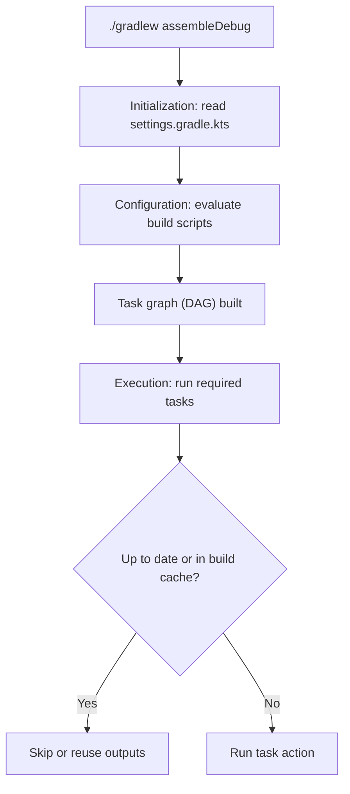
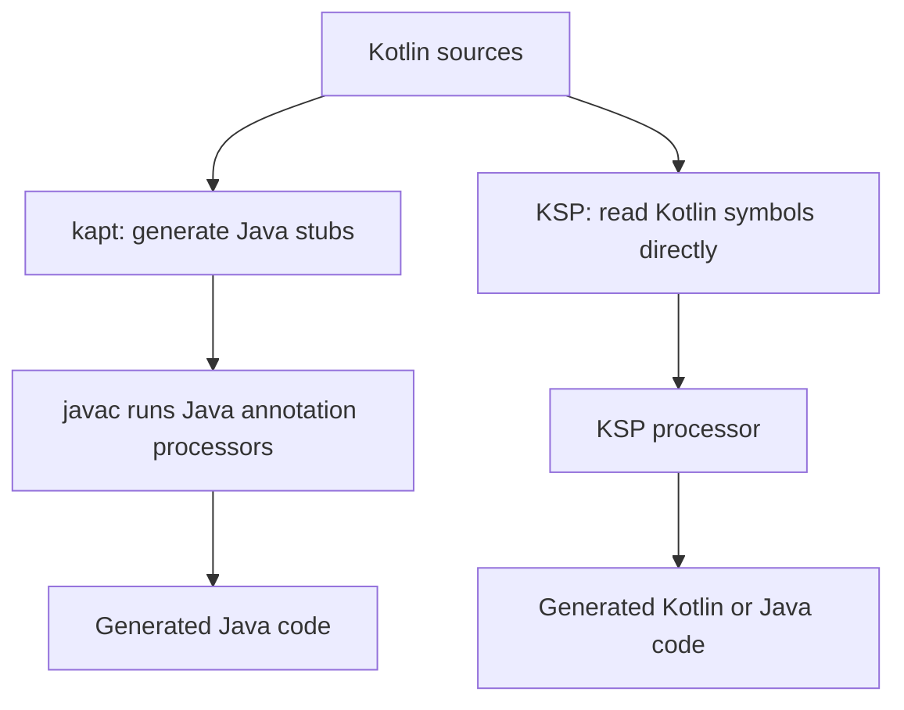
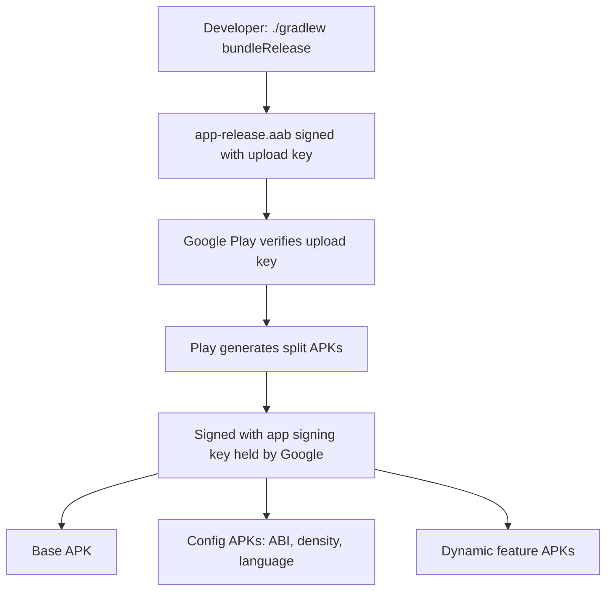
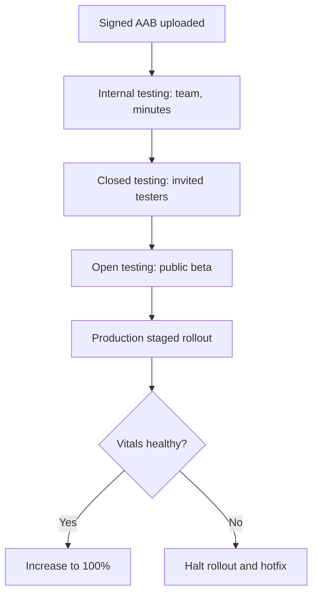
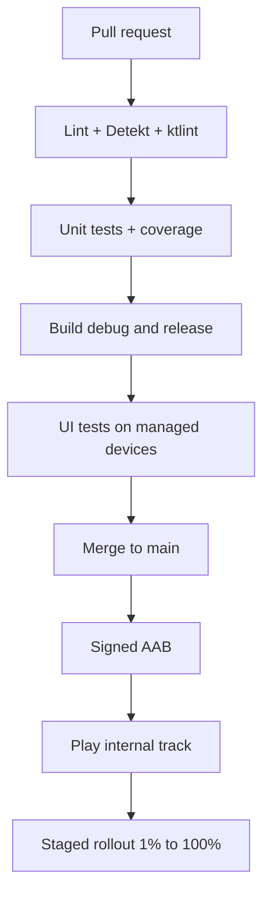
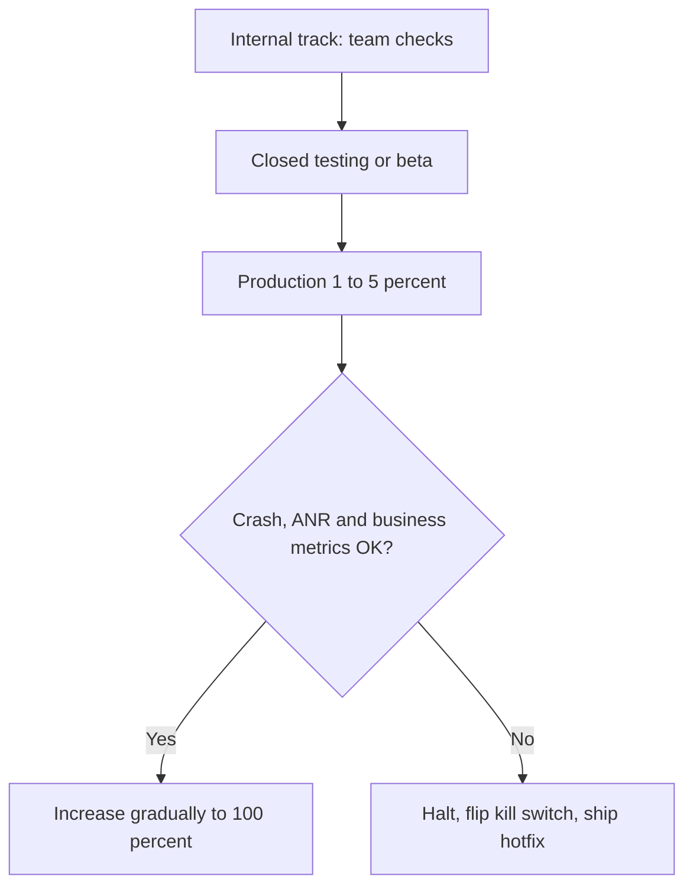

# Build System, Gradle & Release

[⬅ Back to index](../README.md)

Covers: Gradle basics, build types & flavors, dependencies (`api` vs `implementation`), version catalogs, convention plugins, KSP vs kapt, build speed, signing, APK vs AAB, Play release process, CI/CD.

---

### 1. What is Gradle? What files are involved in an Android project?

<details>
<summary>Answer</summary>

**In short:** Gradle is a general-purpose build automation tool; the **Android Gradle Plugin (AGP)** teaches it how to build Android apps (compile Kotlin/Java, dex, merge resources and manifests, package, sign). An Android project is configured by `settings.gradle.kts`, a root `build.gradle.kts`, one `build.gradle.kts` per module, `gradle.properties`, the version catalog `gradle/libs.versions.toml`, and the Gradle wrapper files.

#### Why Gradle and AGP are separate

Gradle itself knows nothing about Android. It knows about **projects** (modules), **tasks** (units of work like "compile" or "copy"), dependencies between tasks, and dependency resolution from repositories. AGP is a Gradle plugin that registers Android-specific tasks such as `compileDebugKotlin`, `mergeDebugResources`, `dexBuilderDebug`, `packageDebug` and `bundleRelease`, and adds the `android { }` DSL block. This is why AGP and Gradle versions must be compatible with each other: each AGP version has a minimum Gradle version.

#### The files and what each one does

| File | Purpose |
|---|---|
| `settings.gradle.kts` | Lists the modules (`include(":app", ":core:data")`), configures plugin repositories (`pluginManagement`) and dependency repositories (`dependencyResolutionManagement`), and can include other builds (`includeBuild("build-logic")`). |
| Root `build.gradle.kts` | Declares plugins with `apply false` so all modules share one plugin version without applying them at the root. |
| Module `build.gradle.kts` | Applies plugins and configures the module: `namespace`, `compileSdk`, `minSdk`, `targetSdk`, build types, flavors, `buildFeatures`, and `dependencies { }`. |
| `gradle/libs.versions.toml` | The **version catalog**: one place for library and plugin coordinates and versions. |
| `gradle.properties` | Build-wide flags and JVM settings: `org.gradle.jvmargs=-Xmx4g`, `org.gradle.caching=true`, `org.gradle.configuration-cache=true`. |
| `gradle/wrapper/gradle-wrapper.properties` | Pins the exact Gradle version. `./gradlew` downloads and uses it, so every developer and CI machine builds with the same Gradle. |
| `local.properties` | Machine-specific (SDK path, local secrets). **Not committed.** |
| `proguard-rules.pro` | R8 keep rules for the module. |

A minimal module file looks like this:

```kotlin
// app/build.gradle.kts
plugins {
    alias(libs.plugins.android.application)
    alias(libs.plugins.kotlin.android)
}

android {
    namespace = "com.example.app"   // package for R and BuildConfig
    compileSdk = 35

    defaultConfig {
        applicationId = "com.example.app"   // the ID on the Play Store
        minSdk = 24
        targetSdk = 35
        versionCode = 1
        versionName = "1.0.0"
    }
}

dependencies {
    implementation(libs.androidx.core.ktx)
}
```

The **Kotlin DSL (`.kts`)** is the default for new projects. Compared with Groovy it gives type checking, IDE auto-complete and refactoring, at the cost of slightly slower first script compilation.

**Common pitfalls**
- Running a globally installed `gradle` instead of `./gradlew`, which builds with a different Gradle version than CI.
- Confusing `namespace` (code package for `R`/`BuildConfig`) with `applicationId` (the installed app's identity). They can differ.
- Committing `local.properties` or keystores.

**Likely follow-ups**
- *What's the difference between the Gradle wrapper and Gradle?* The wrapper is a small script plus properties file that downloads a pinned Gradle version, so builds are reproducible.
- *Why `apply false` in the root?* It puts the plugin on the classpath with one version for all modules without applying it to the root project.

</details>

### 2. What is the Gradle build lifecycle?

<details>
<summary>Answer</summary>

**In short:** Every Gradle build goes through three phases: **Initialization** (read `settings.gradle.kts` and decide which projects are in the build), **Configuration** (run every build script and build the **task graph**), and **Execution** (run only the tasks needed for what you asked, skipping ones that are up to date or cached).



#### 1. Initialization

Gradle finds `settings.gradle.kts`, works out which modules are included (`include(":app", ":feature:login")`) and any included builds (such as `build-logic`), and creates a `Project` object for each.

#### 2. Configuration

Gradle evaluates **every** module's build script (unless configuration-on-demand or the configuration cache avoids it). This is where plugins are applied, the `android { }` block is read, variants are created, and tasks are **registered and wired together** into a directed acyclic graph. No real work (compiling, copying) should happen here. Code you write at the top level of a build script, or inside a task's configuration block, runs on **every** build, even `./gradlew help`.

#### 3. Execution

Gradle runs only the tasks needed for the requested task and its dependencies, in dependency order, in parallel where possible. Before running a task it compares the task's declared **inputs and outputs** with the previous run:
- **UP-TO-DATE**: nothing changed, so the task is skipped.
- **FROM-CACHE**: outputs were found in the local or remote **build cache** using a hash of the inputs.
- Otherwise the task action runs.

#### Why this matters in practice

In a big multi-module app, configuration can take many seconds on every build. The **configuration cache** (`org.gradle.configuration-cache=true`) serializes the computed task graph and reuses it when build scripts and inputs haven't changed, skipping the configuration phase entirely. To be compatible, tasks must not access the `Project` object at execution time.

```kotlin
// Wrong: runs during configuration on every build
val gitSha = Runtime.getRuntime().exec("git rev-parse HEAD").inputStream.reader().readText()

// Better: a lazy provider, only evaluated when a task actually needs it
val gitSha = providers.exec { commandLine("git", "rev-parse", "--short", "HEAD") }
    .standardOutput.asText.map { it.trim() }
```

**Common pitfalls**
- Doing I/O or network calls at configuration time, which slows down every build.
- Using `tasks.create` instead of `tasks.register`, which configures tasks even when they won't run.

**Likely follow-ups**
- *What is the difference between configuration cache and build cache?* Configuration cache skips the configuration phase; build cache reuses task outputs during execution.
- *How do you see why a task re-ran?* Run with `--info` or use a build scan (`--scan`), which shows the inputs that changed.

</details>

### 3. `compileSdk` vs `minSdk` vs `targetSdk`?

<details>
<summary>Answer</summary>

**In short:** `compileSdk` is the API level you **compile against** (which APIs your code can reference). `minSdk` is the **lowest Android version** your app can be installed on. `targetSdk` tells the system which Android version your app was **designed and tested for**, so the OS turns on that version's **behaviour changes**. Google Play requires a recent `targetSdk`.

| Setting | Affects | Typical value | What happens if wrong |
|---|---|---|---|
| `compileSdk` | Build only (which SDK `android.jar` you compile against) | Latest stable | Too low: you can't use new APIs; some AndroidX libraries refuse to build. |
| `minSdk` | Install eligibility; lint `NewApi` checks | Product decision (e.g. 24) | Too high: excludes users. Too low: more compatibility code. |
| `targetSdk` | Runtime behaviour on newer OS versions | Latest, after testing | Too low: Play rejects updates; you miss new behaviour. |

The required order is `minSdk <= targetSdk <= compileSdk`.

#### compileSdk

It changes nothing at runtime. It decides which `android.jar` stubs the compiler sees. Raising it is usually safe and lets you reference new APIs, but the app still runs on old devices, so calls must be guarded:

```kotlin
if (Build.VERSION.SDK_INT >= Build.VERSION_CODES.TIRAMISU) {
    // POST_NOTIFICATIONS exists only on API 33+
    requestPermissionLauncher.launch(Manifest.permission.POST_NOTIFICATIONS)
}
```

Lint's `NewApi` check flags calls above `minSdk` that are not guarded.

#### minSdk

Devices below this level can't install the app; Play hides it from them. It is a business decision based on your user base. Raising it removes old compatibility branches and sometimes needs less desugaring.

#### targetSdk

This is the subtle one. When Android introduces a breaking behaviour change, it usually applies it **only to apps targeting that version or higher**, so old apps keep working. Examples: runtime permissions (API 23), background execution limits (26), scoped storage (29/30), exported flag required on components with intent filters (31), notification permission (33), foreground service types required (34), edge-to-edge enforced (35). Raising `targetSdk` means opting into all of those, so it needs real testing, not just a number change.

**Google Play requires** new apps and updates to target an API level within about a year of the latest major Android release, so you can't stay on an old `targetSdk` for long.

**Common pitfalls**
- Bumping `targetSdk` together with `compileSdk` without reading the behaviour-change list for that release.
- Thinking `compileSdk` affects which devices can install the app (that's `minSdk`).

**Likely follow-ups**
- *Can you run on an Android version newer than `targetSdk`?* Yes; the OS runs the app in compatibility mode for the behaviour changes it hasn't opted into.
- *Where is `maxSdk`?* Rarely used; it exists in the manifest but Play mostly ignores it for filtering.

</details>

### 4. What are build types and product flavors? What is a build variant?

<details>
<summary>Answer</summary>

**In short:** **Build types** describe *how* the app is built (`debug` vs `release`: debuggable, minified, signed). **Product flavors** describe *which version* of the app is built (`free`/`paid`, `dev`/`prod`, different brands). A **build variant** is one combination of flavor(s) and build type, such as `prodRelease`, and Gradle creates tasks and a source set for each.

#### Build types

AGP gives you `debug` and `release` by default. You can add others, for example `staging` or `benchmark`, often using `initWith` to copy an existing one.

```kotlin
android {
    buildTypes {
        debug {
            applicationIdSuffix = ".debug"   // install next to release
            isDebuggable = true
        }
        release {
            isMinifyEnabled = true           // R8 shrink + obfuscate
            isShrinkResources = true
            proguardFiles(getDefaultProguardFile("proguard-android-optimize.txt"), "proguard-rules.pro")
            signingConfig = signingConfigs.getByName("release")
        }
        create("staging") {
            initWith(getByName("release"))
            applicationIdSuffix = ".staging"
            matchingFallbacks += "release"   // libraries without "staging" use release
        }
    }
}
```

#### Product flavors and dimensions

Flavors must belong to a **flavor dimension**. With several dimensions, Gradle combines one flavor from each.

```kotlin
android {
    flavorDimensions += listOf("env", "tier")
    productFlavors {
        create("dev")  { dimension = "env";  applicationIdSuffix = ".dev"
                         buildConfigField("String", "BASE_URL", "\"https://dev.api.example.com\"") }
        create("prod") { dimension = "env"
                         buildConfigField("String", "BASE_URL", "\"https://api.example.com\"") }
        create("free") { dimension = "tier" }
        create("paid") { dimension = "tier" }
    }
}
```

This produces 2 (env) × 2 (tier) × 3 (build types) = **12 variants**, such as `devFreeDebug` or `prodPaidRelease`.

#### Source sets

Each flavor, build type and variant can have its own source set, and Gradle merges them with `main`:

| Folder | Used by |
|---|---|
| `src/main/` | All variants |
| `src/dev/` | All `dev` variants |
| `src/debug/` | All `debug` variants (e.g. debug-only menu, LeakCanary setup) |
| `src/devDebug/` | Only `devDebug` |

More specific source sets override resources from less specific ones. For classes, the same class must not exist in two source sets that end up in the same variant (it would be a duplicate); the usual pattern is to put different implementations of the same class in `src/dev/` and `src/prod/`.

Variant-specific dependencies use the variant name: `debugImplementation(libs.leakcanary)`, `"freeImplementation"(libs.ads)`.

**Common pitfalls**
- Variant explosion: every dimension multiplies build time and CI matrix size. Filter unused combinations with `androidComponents { beforeVariants { ... enable = false } }`.
- Library modules that don't define your custom build type: use `matchingFallbacks`.

**Likely follow-ups**
- *Build type vs flavor for dev/prod servers?* Flavors, because you often need a debuggable build that points at prod and vice versa.
- *How do you give each variant a different app name?* `resValue("string", "app_name", "MyApp Dev")` or a `strings.xml` in the flavor source set.

</details>

### 5. `implementation` vs `api` vs `compileOnly` vs `runtimeOnly`?

<details>
<summary>Answer</summary>

**In short:** `implementation` adds a dependency for your module's internal use and **hides it** from modules that depend on you; `api` **exposes it** to them too. `compileOnly` is on the compile classpath but not packaged; `runtimeOnly` is packaged but not visible to the compiler. Default to `implementation`; use `api` only when the dependency's types appear in your module's public API.

#### The two classpaths

Every module has a **compile classpath** (what the compiler can see) and a **runtime classpath** (what is packaged into the app). The configurations decide where a dependency goes and whether it leaks to consumers:

| Configuration | Your compile classpath | Your runtime | Consumers' compile classpath | Typical use |
|---|---|---|---|---|
| `implementation` | Yes | Yes | **No** | Almost everything |
| `api` | Yes | Yes | **Yes** | Types used in your public signatures |
| `compileOnly` | Yes | No | No | Annotations, APIs provided by the platform at runtime |
| `runtimeOnly` | No | Yes | No | Drivers/implementations loaded by reflection or ServiceLoader |

#### Why `implementation` makes builds faster

Suppose `:app` depends on `:core:network`, which uses OkHttp.

```kotlin
// :core:network build.gradle.kts
dependencies {
    implementation(libs.okhttp)          // :app can't see OkHttp classes
    api(libs.kotlinx.coroutines.core)    // public functions return Flow, so consumers need it
}
```

With `implementation`, when OkHttp's version changes (or `:core:network`'s internals change without changing its ABI), Gradle doesn't need to **recompile `:app`**, because `:app`'s compile classpath doesn't include OkHttp. With `api`, every module up the chain sees OkHttp, so a change triggers recompilation of all of them. In a 50-module project that difference is large.

It also enforces good architecture: `:app` can't accidentally import OkHttp directly and couple itself to a detail of the network layer.

#### When `api` is required

If your module's public class exposes a type from another library, consumers need that library to compile:

```kotlin
// Public API returns an OkHttpClient type
class NetworkModule { fun client(): OkHttpClient = ... }
// => OkHttp must be `api`, or consumers get "cannot access class OkHttpClient"
```

#### Other configurations

- `testImplementation` (JVM unit tests), `androidTestImplementation` (instrumented tests).
- Variant-specific: `debugImplementation(libs.leakcanary)`, `releaseImplementation(...)`.
- Code generators: `ksp(libs.room.compiler)`, `kapt(...)`.
- `coreLibraryDesugaring(...)` for desugaring libraries.

**Common pitfalls**
- Using `api` everywhere "to be safe", which destroys incremental build benefits.
- Using `compileOnly` for something you actually need at runtime: it compiles, then crashes with `NoClassDefFoundError`.

**Likely follow-ups**
- *What was `compile`?* The old deprecated configuration that behaved like `api`; it was removed in Gradle 7.
- *Does `implementation` reduce APK size?* No; the dependency is still packaged. It only affects visibility and recompilation.

</details>

### 6. What is a version catalog?

<details>
<summary>Answer</summary>

**In short:** A version catalog (`gradle/libs.versions.toml`) is a single TOML file that declares all library and plugin coordinates and versions. Gradle generates **type-safe accessors** like `libs.retrofit`, so every module uses the same versions from one source of truth.

#### The problem it solves

In a multi-module project, writing `"com.squareup.retrofit2:retrofit:2.11.0"` in ten build files leads to version drift, painful upgrades and typos. Earlier fixes (`ext` variables, `buildSrc` constants) worked but had downsides: `ext` wasn't type-safe, and changing `buildSrc` invalidated the whole build. The catalog is a built-in Gradle feature designed for this.

#### File structure

File: `gradle/libs.versions.toml`

```toml
[versions]
kotlin = "2.x.x"
retrofit = "2.x.x"
room = "2.x.x"

[libraries]
retrofit = { module = "com.squareup.retrofit2:retrofit", version.ref = "retrofit" }
room-runtime = { module = "androidx.room:room-runtime", version.ref = "room" }
room-compiler = { module = "androidx.room:room-compiler", version.ref = "room" }
compose-bom = { group = "androidx.compose", name = "compose-bom", version = "2025.xx.xx" }
compose-ui = { group = "androidx.compose.ui", name = "ui" }   # version comes from the BOM

[bundles]
room = ["room-runtime"]

[plugins]
kotlin-android = { id = "org.jetbrains.kotlin.android", version.ref = "kotlin" }
ksp = { id = "com.google.devtools.ksp", version = "2.x.x" }
```

The four sections:
- **`[versions]`**: named versions that several entries can share (`version.ref`).
- **`[libraries]`**: dependency coordinates. Dashes become dots in accessors: `room-runtime` is `libs.room.runtime`.
- **`[bundles]`**: groups of libraries added together.
- **`[plugins]`**: Gradle plugin IDs and versions.

#### Using it

```kotlin
plugins {
    alias(libs.plugins.kotlin.android)
    alias(libs.plugins.ksp)
}
dependencies {
    implementation(libs.retrofit)
    implementation(platform(libs.compose.bom))
    implementation(libs.compose.ui)
    implementation(libs.bundles.room)
    ksp(libs.room.compiler)
}
```

#### Benefits

- One place to upgrade a version; IDE auto-complete for accessors.
- Changing the TOML doesn't invalidate the build script classpath the way `buildSrc` does.
- Tools like **Renovate** and **Dependabot** understand the format and open upgrade PRs.
- Works well with BOMs (a BOM aligns versions of a family of libraries; the catalog references the BOM).

**Common pitfalls**
- Expecting the catalog to enforce versions: it only declares them. Transitive dependencies can still pull in newer versions through conflict resolution.
- Catalog accessors aren't directly available inside convention plugin source code without a small workaround (`extensions.getByType<VersionCatalogsExtension>().named("libs")`).

**Likely follow-ups**
- *Catalog vs BOM?* A catalog is a declaration file for your build; a BOM is a published Maven artifact that actually constrains versions of related libraries.

</details>

### 7. What are convention plugins?

<details>
<summary>Answer</summary>

**In short:** Convention plugins are your own small Gradle plugins, usually in an included build called `build-logic/`, that bundle shared configuration (compileSdk, Kotlin options, Compose, Hilt, lint). Each module applies one line such as `id("myapp.android.library")` instead of copy-pasting 60 lines. They're preferred over `buildSrc` because changes to them don't invalidate every module's build script. *Now in Android* uses this pattern.

#### The problem

With 30 modules, each `build.gradle.kts` repeats the same `android { compileSdk = ...; defaultConfig { minSdk = ... } ; compileOptions { ... } }`. Upgrading `compileSdk` or the JVM target means editing 30 files, and modules drift apart.

#### Structure

```
build-logic/
  settings.gradle.kts           // uses the same version catalog
  convention/
    build.gradle.kts            // `kotlin-dsl` plugin, depends on AGP and Kotlin Gradle plugin
    src/main/kotlin/
      AndroidLibraryConventionPlugin.kt
      AndroidFeatureConventionPlugin.kt
```

```kotlin
// settings.gradle.kts (root)
pluginManagement {
    includeBuild("build-logic")
}
```

```kotlin
// build-logic/convention/src/main/kotlin/AndroidLibraryConventionPlugin.kt
class AndroidLibraryConventionPlugin : Plugin<Project> {
    override fun apply(target: Project) = with(target) {
        pluginManager.apply("com.android.library")
        pluginManager.apply("org.jetbrains.kotlin.android")

        extensions.configure<LibraryExtension> {
            compileSdk = 35
            defaultConfig.minSdk = 24
            compileOptions {
                sourceCompatibility = JavaVersion.VERSION_17
                targetCompatibility = JavaVersion.VERSION_17
            }
        }
    }
}
```

```kotlin
// build-logic/convention/build.gradle.kts
gradlePlugin {
    plugins {
        register("androidLibrary") {
            id = "myapp.android.library"
            implementationClass = "AndroidLibraryConventionPlugin"
        }
    }
}
```

A feature module then becomes tiny:

```kotlin
// feature/profile/build.gradle.kts
plugins {
    id("myapp.android.feature")   // library + Compose + Hilt + common deps
}
android { namespace = "com.example.feature.profile" }
```

Plugins can be layered: `myapp.android.feature` applies `myapp.android.library`, `myapp.android.compose` and `myapp.hilt`.

#### Why not `buildSrc`?

| | `buildSrc` | Included build (`build-logic`) |
|---|---|---|
| Setup | Automatic | `includeBuild` in settings |
| Change impact | Any change invalidates the classpath of **all** build scripts, forcing reconfiguration and often recompilation | Only modules applying the changed plugin are affected |
| Composability | One special project | Normal Gradle build; can be shared or published |

Gradle recommends included builds for shared build logic.

**Common pitfalls**
- Putting too much "magic" in a plugin so module behaviour becomes hard to discover. Keep plugins focused and well named.
- Hardcoding versions in plugin code instead of reading them from the version catalog.

**Likely follow-ups**
- *Precompiled script plugins vs class-based plugins?* Both work; `*.gradle.kts` files in `build-logic` are quicker to write, class-based plugins are easier to test and compose.

</details>

### 8. kapt vs KSP?

<details>
<summary>Answer</summary>

**In short:** **kapt** runs Java annotation processors on Kotlin code by first generating **Java stubs** of your Kotlin classes, which is slow, and it is now **in maintenance mode**. **KSP** (Kotlin Symbol Processing) is a Kotlin-native API that reads Kotlin symbols directly, so it is **up to about 2× faster**, supports Kotlin Multiplatform, and is supported by Room, Hilt/Dagger, Moshi and Glide. **KSP2** is the current version and works with the K2 compiler. Migrating from kapt to KSP is a common build-speed win.



#### How kapt works and why it's slow

Java annotation processors (JSR 269) only understand Java's model of code. To run them on Kotlin, kapt:
1. Generates Java **stub** files declaring every Kotlin class and signature (bodies omitted).
2. Runs `javac` with the annotation processors over those stubs.
3. Feeds the generated code back into the Kotlin compilation.

The stub generation step is costly, roughly like an extra partial compilation, and it limits incremental builds. Stubs also lose Kotlin-specific information (nullability nuances, `suspend`, default arguments, sealed classes), so processors see a Java view of your code.

#### How KSP works

KSP is a compiler plugin with its own API (`Resolver`, `KSClassDeclaration`, `KSFunctionDeclaration`). Processors read declarations directly from the Kotlin compiler's symbol information, without stubs, and generate code. Because it understands Kotlin natively, it sees nullability, `suspend`, and other Kotlin features accurately, and it can work on non-JVM targets (KMP). **KSP2** reimplements KSP on top of the K2 compiler's analysis API.

#### Migration

```kotlin
plugins {
    alias(libs.plugins.ksp)      // version must match your Kotlin version line
    // remove: kotlin("kapt")
}

dependencies {
    implementation(libs.room.runtime)
    ksp(libs.room.compiler)      // was: kapt(libs.room.compiler)
    ksp(libs.hilt.compiler)
}

ksp {
    arg("room.schemaLocation", "$projectDir/schemas")   // processor options, was kapt { arguments {} }
}
```

The biggest gain comes when you remove **all** kapt usage from a module, because then the stub generation step disappears entirely. If even one processor still needs kapt, the module still pays that cost.

| | kapt | KSP |
|---|---|---|
| Mechanism | Java stubs + javac processors | Direct Kotlin symbol API |
| Speed | Slower | Up to ~2× faster |
| Kotlin awareness | Java view only | Full Kotlin model |
| KMP | JVM only | Multiplatform |
| Status | Maintenance mode | Recommended |

**Common pitfalls**
- Mixing kapt and KSP in the same module and expecting the full speed-up.
- A library that only ships a Java annotation processor (no KSP processor) still needs kapt.

**Likely follow-ups**
- *Is KSP a compiler plugin?* Yes, but with a stable, simplified API, so processors don't break with each compiler change the way raw compiler plugins can.

</details>

### 9. How do you speed up Gradle builds?

<details>
<summary>Answer</summary>

**In short:** Keep Gradle, AGP, Kotlin and the JDK up to date; turn on the **build cache**, **configuration cache** and **parallel** execution; give the daemon enough memory; **modularize** and prefer `implementation` over `api`; replace **kapt with KSP**; turn off unused build features; avoid dynamic versions. Then **measure** with Build Analyzer and build scans instead of guessing.

#### Think in terms of the three costs

1. **Configuration time**: evaluating build scripts on every build.
2. **Compilation scope**: how many modules recompile after a change.
3. **Repeated work**: tasks that redo work that was already done somewhere.

#### `gradle.properties` settings

```properties
org.gradle.jvmargs=-Xmx4g -XX:+UseParallelGC   # enough heap for the Gradle daemon
org.gradle.parallel=true                       # build independent modules in parallel
org.gradle.caching=true                        # reuse task outputs (local / remote build cache)
org.gradle.configuration-cache=true            # skip the configuration phase when nothing changed
kotlin.incremental=true                        # usually the default
```

| Technique | What it saves |
|---|---|
| Configuration cache | The whole configuration phase on repeat builds |
| Build cache (local) | Re-running tasks after switching branches or `clean` |
| Remote build cache | CI populates it; developers download outputs instead of compiling |
| Parallel execution | Wall-clock time on multi-core machines with many modules |
| Modularization + `implementation` | Recompiling only changed modules and their direct dependents |
| KSP instead of kapt | Java stub generation |
| `buildFeatures { buildConfig = false; aidl = false }` | Skips generation tasks you don't need |
| Non-transitive R classes (default since AGP 8) | Smaller R classes; resource changes recompile fewer modules |
| Fixed versions instead of `1.+` | Network checks for new versions and cache misses |

#### Modularization done right

Many small modules help only if the graph is **wide, not deep**. If `:core:common` is used by everything and changes often, every change rebuilds everything. Keep frequently edited code in leaf (feature) modules, and keep core modules stable with small public APIs.

#### Measure first

- **Build Analyzer** (Android Studio, after a build) shows which tasks and plugins dominate, and flags tasks that always run or aren't cacheable.
- **Build scans** (`./gradlew assembleDebug --scan`) show a timeline, configuration time per plugin, cache hits and misses, and dependency resolution.
- `--profile` produces a local HTML report.
- The **Gradle Profiler** tool can benchmark scenarios like "change one line in a feature module".

#### Day-to-day developer habits

- Build only what you need: `:app:assembleDevDebug` instead of `assemble` (which builds every variant).
- Don't run `clean` routinely; it throws away the up-to-date state.
- Use one JDK across IDE and CLI so the daemon is reused.

**Common pitfalls**
- Turning on the configuration cache with plugins or custom tasks that touch `Project` at execution time; the build fails or falls back.
- A remote cache with low hit rates because CI and local builds use different JDKs or absolute paths.

**Likely follow-ups**
- *Why is my first build after a sync slow but later ones fast?* The daemon JIT warms up and caches fill; keeping the daemon alive matters.

</details>

### 10. What is BuildConfig? How do you manage environment config?

<details>
<summary>Answer</summary>

**In short:** `BuildConfig` is a Java class AGP generates per variant, containing constants such as `DEBUG`, `APPLICATION_ID`, `VERSION_NAME` and any custom `buildConfigField` you define (like `BASE_URL`). Since AGP 8 it is **off by default**; enable it with `buildFeatures { buildConfig = true }`. Use flavors or build types to give each environment different values, read secrets from `local.properties` or CI environment variables (never committed files), and remember anything in the APK can be extracted.

#### What it looks like

```kotlin
android {
    buildFeatures { buildConfig = true }

    productFlavors {
        create("dev") {
            dimension = "env"
            buildConfigField("String", "BASE_URL", "\"https://dev.api.example.com\"")
            buildConfigField("boolean", "ENABLE_LOGGING", "true")
        }
        create("prod") {
            dimension = "env"
            buildConfigField("String", "BASE_URL", "\"https://api.example.com\"")
            buildConfigField("boolean", "ENABLE_LOGGING", "false")
        }
    }
}
```

The generated class for `devDebug`:

```java
public final class BuildConfig {
  public static final boolean DEBUG = Boolean.parseBoolean("true");
  public static final String APPLICATION_ID = "com.example.app.dev";
  public static final String BUILD_TYPE = "debug";
  public static final String FLAVOR = "dev";
  public static final int VERSION_CODE = 42;
  public static final String VERSION_NAME = "2.4.1";
  public static final String BASE_URL = "https://dev.api.example.com";
  public static final boolean ENABLE_LOGGING = true;
}
```

Note the escaped quotes: the third argument is pasted as **Java source**, so a string needs `"\"...\""`.

#### Reading values from outside the repo

```kotlin
// app/build.gradle.kts
val localProps = Properties().apply {
    val f = rootProject.file("local.properties")
    if (f.exists()) f.inputStream().use { load(it) }
}
val mapsKey = localProps.getProperty("MAPS_API_KEY") ?: System.getenv("MAPS_API_KEY") ?: ""

android {
    defaultConfig {
        buildConfigField("String", "MAPS_API_KEY", "\"$mapsKey\"")
        manifestPlaceholders["mapsApiKey"] = mapsKey   // for <meta-data android:value="${mapsApiKey}">
    }
}
```

Locally the developer puts the key in `local.properties` (git-ignored); on CI it comes from a secret environment variable. The Secrets Gradle Plugin for Android automates this pattern.

#### Other options

| Mechanism | Good for |
|---|---|
| `buildConfigField` | Constants needed in Kotlin code |
| `resValue` / flavor `res/` folders | Strings and resources (app name, colours) |
| `manifestPlaceholders` | Values in `AndroidManifest.xml` |
| Remote Config / feature flags | Values that must change **without a release** |

#### Security reality

`BuildConfig` constants are compiled into the dex file and are trivially readable with a decompiler, even with R8. Keeping a key out of git protects it from repository leaks, **not** from someone holding the APK. Truly secret credentials belong on your server; the app should talk to your backend, which calls the third party. For keys that must ship (Maps), restrict them by package name and signing certificate in the provider's console.

**Common pitfalls**
- Using `BuildConfig.DEBUG` from a library module: it reflects the library's build type, which may not match the app's.
- Forgetting `buildConfig = true` after upgrading to AGP 8, causing `Unresolved reference: BuildConfig`.

**Likely follow-ups**
- *How do you hide logs in release?* Check `BuildConfig.DEBUG` (or use Timber with a debug-only tree) and strip log calls with R8 `-assumenosideeffects` rules.

</details>

### 11. APK vs AAB? What is Play App Signing?

<details>
<summary>Answer</summary>

**In short:** An **APK** is the installable package a device runs. An **AAB (Android App Bundle)** is a **publishing format** you upload to Play, required for new apps since 2021; Play uses it to generate optimized **split APKs** for each device (only the right ABI, screen density and language), so downloads are smaller. It also enables **Play Feature Delivery** and **Play Asset Delivery**. With **Play App Signing**, Google keeps the **app signing key** and signs the APKs it generates, while you sign uploads with a separate **upload key** that can be reset if lost.



#### APK

A ZIP containing `classes*.dex`, compiled resources (`resources.arsc`), `res/`, `AndroidManifest.xml` (binary), `lib/<abi>/*.so`, `assets/`, and signature data. A "universal" APK contains everything for every device: all ABIs (`arm64-v8a`, `armeabi-v7a`, `x86_64`...), every density's drawables, every language. Most of that is wasted on any single phone.

#### AAB

An AAB is not installable directly. It contains your compiled code and resources organized into modules, plus metadata. Play (using **bundletool**) builds:
- a **base APK** with the code and common resources,
- **configuration APKs** for the device's ABI, screen density and language,
- APKs for **dynamic feature modules** and asset packs, delivered install-time, on demand or conditionally.

The device installs these together as one app ("split APKs"). Native-heavy apps often see large size reductions because they only download one ABI.

To test locally what Play would produce:

```bash
bundletool build-apks --bundle=app-release.aab --output=app.apks --connected-device
bundletool install-apks --apks=app.apks
```

#### Play App Signing

Because Play generates and signs the final APKs, it needs the signing key. The model:

| Key | Held by | Used for |
|---|---|---|
| **App signing key** | Google (secure key management) | Signing the APKs that users install. Defines the app's identity for updates. |
| **Upload key** | You | Signing the AAB you upload, so Google knows it came from you. |

If you **lose the upload key** or it leaks, you can ask Google to register a new one, and users are unaffected. Before Play App Signing, losing your only signing key meant you could **never update the app again**; you had to publish a new app under a new package name.

**Common pitfalls**
- Using the **upload** certificate's SHA-1/SHA-256 for Google Sign-In, Maps or Firebase configuration of the production app; production APKs are signed with the **app signing** key, whose fingerprints are in Play Console.
- Sideloading a debug APK and expecting it to behave like a Play install (different splits, different signature).

**Likely follow-ups**
- *Can you still ship APKs?* Yes, outside Play (other stores, enterprise, direct download), and for testing.
- *What is the size limit?* Play enforces compressed download size limits on the base module and on the whole app; larger content goes into asset packs.

</details>

### 12. How does app signing work? What are signature schemes?

<details>
<summary>Answer</summary>

**In short:** Every APK must be signed with a developer certificate before Android will install it. The system only accepts an **update** if it is signed with the **same key** (or a properly rotated one), which is how Android proves an update comes from the same developer. Signature schemes evolved: **v1** (JAR signing), **v2** (whole-file, Android 7.0+), **v3** (adds **key rotation**, Android 9+), and **v4** (supports incremental installs, Android 11+). In Gradle you configure `signingConfigs`, with the keystore and passwords coming from secure CI variables.

#### What signing proves

Signing does not prove *who* you are (certificates are usually self-signed). It proves **continuity**: the package `com.example.app` installed today was signed by the same private key as the one installed last year. This protects users from a malicious app replacing a legitimate one with the same package name. The signature also lets apps signed with the same key use `signature`-level permissions with each other.

#### Signature schemes

| Scheme | Introduced | How it works | Notes |
|---|---|---|---|
| v1 (JAR) | Android 1.0 | Signs individual ZIP entries (META-INF manifest) | Doesn't protect ZIP metadata; slow to verify; needed only if `minSdk < 24` |
| v2 | Android 7.0 | Signs the whole APK as a binary blob in an APK Signing Block | Faster install; detects any modification |
| v3 | Android 9 | v2 format plus a **proof-of-rotation** lineage | Lets you rotate to a new signing key |
| v4 | Android 11 | Separate `.idsig` file with a Merkle tree of the APK | Enables ADB incremental install (streaming large APKs) |

AGP and `apksigner` apply the right combination automatically based on `minSdk`.

#### Key rotation

With v3, you can sign with a new key and include a lineage proving the old key authorized the new one. Devices running Android 9+ accept the update. Play App Signing supports requesting a key upgrade for this purpose.

#### Configuring signing safely

```kotlin
android {
    signingConfigs {
        create("release") {
            storeFile = file(System.getenv("KEYSTORE_PATH") ?: "release.jks")
            storePassword = System.getenv("KEYSTORE_PASSWORD")
            keyAlias = System.getenv("KEY_ALIAS")
            keyPassword = System.getenv("KEY_PASSWORD")
        }
    }
    buildTypes {
        release { signingConfig = signingConfigs.getByName("release") }
    }
}
```

On CI the keystore is typically stored base64-encoded in the secret store, decoded to a file during the job, and deleted afterwards. With Play App Signing, this is your **upload** key.

Debug builds are signed automatically with a debug keystore (`~/.android/debug.keystore`), which is why debug and release builds can't be installed over each other.

**Common pitfalls**
- Committing the keystore or passwords to git.
- `INSTALL_FAILED_UPDATE_INCOMPATIBLE`: an app with the same package but a different signature is already installed (e.g. debug vs release). Uninstall first.

**Likely follow-ups**
- *How do you check an APK's signature?* `apksigner verify --print-certs app.apk`.
- *Why did my API key (Maps/Firebase) stop working in production?* Production is signed with Play's app signing key, which has different fingerprints than your local key.

</details>

### 13. What are versionCode and versionName?

<details>
<summary>Answer</summary>

**In short:** `versionCode` is an **integer** that Android and Play use to decide whether one build is newer than another; it must **strictly increase** with every upload to Play. `versionName` is the **human-readable string** shown to users (like "2.4.1"), usually following semantic versioning, and has no effect on upgrade logic.

| | `versionCode` | `versionName` |
|---|---|---|
| Type | Positive integer (Play's maximum is 2,100,000,000) | Any string |
| Seen by | System, Play | Users (Play listing, settings) |
| Rules | Must increase for each upload; Android refuses to install a lower code over a higher one (a downgrade) | None enforced |
| Example | `20401` | `"2.4.1"` |

#### Why there are two

Comparing strings like "2.10" and "2.9" is ambiguous, so the system uses a plain integer for ordering. The name is for humans, marketing and support.

#### Common schemes for `versionCode`

- **Simple counter** incremented per release, or the CI build number.
- **Derived from the version name**: `major * 10000 + minor * 100 + patch` (2.4.1 becomes 20401). Leaves no room for multiple builds of the same version, so some teams add build digits.
- **Timestamp-based** (e.g. minutes since an epoch) for fully automated pipelines.

```kotlin
// Computing from CI, falling back to 1 locally
val ciBuildNumber = providers.environmentVariable("BUILD_NUMBER").map { it.toInt() }.orElse(1)

android {
    defaultConfig {
        versionCode = ciBuildNumber.get()
        versionName = "2.4.1"
    }
}
```

Whatever you choose, make sure it can never go backwards and won't overflow for many years.

#### Multiple APKs

If you still publish multiple APKs (per ABI) instead of an AAB, each needs a distinct `versionCode`, typically by adding an ABI-specific offset. With AABs Play handles this.

**Common pitfalls**
- Two branches both producing `versionCode = 57`; the second upload is rejected.
- A hotfix for an older release line needing a code higher than the current one, which a naive scheme can't produce.
- Reading `versionName` in code to decide behaviour; use `versionCode` for comparisons.

**Likely follow-ups**
- *Can users downgrade?* Not through a normal install; Play won't serve a lower `versionCode` to someone who has a higher one.

</details>

### 14. Explain the Play Store release process / tracks.

<details>
<summary>Answer</summary>

**In short:** Play Console has testing tracks before production: **Internal testing** (up to 100 testers, available within minutes), **Closed testing** (invited testers; new personal developer accounts must run a closed test before they can publish to production), **Open testing** (public beta anyone can join) and **Production**. Releases to production should use a **staged rollout** (for example 1% → 5% → 20% → 100%) while you watch Crashlytics and Android vitals, and **halt the rollout** if crash or ANR rates rise.



#### The tracks

| Track | Audience | Review | Typical use |
|---|---|---|---|
| Internal testing | Up to 100 named testers | Fast, available in minutes | Dev/QA builds every day |
| Closed testing | Email lists or Google Groups | Reviewed | Alpha, dogfooding, stakeholder testing |
| Open testing | Anyone who opts in from the store listing | Reviewed | Public beta, real-device coverage |
| Production | All users (optionally staged, per country) | Reviewed | Real release |

A build can be **promoted** from one track to the next without rebuilding, so QA tests the exact binary users will get.

For **new personal developer accounts**, Play requires a closed test with a minimum number of opted-in testers running for a minimum period before production access is granted. Organisation accounts are exempt from this rule.

#### Staged rollouts

A staged rollout gives the new version to a percentage of eligible users. Play picks them randomly, and you increase the percentage over days:

1. Release to 1–5%.
2. Watch **crash-free users**, **ANR rate**, key business metrics, reviews.
3. Increase gradually; or **halt** if something is wrong. Halting stops new users getting the update, but users who already updated stay on it. You can't roll back a `versionCode`; the fix is a new release with a higher code (or a remote-config kill switch).

Android vitals has **bad behaviour thresholds** for user-perceived crash and ANR rates; staying above them can reduce your app's visibility on Play.

#### Before production

- Store listing, screenshots, release notes.
- **Data safety** form and privacy policy matching what the app and its SDKs collect.
- Content rating questionnaire, target audience.
- **Target API level** requirement met.
- Declarations for sensitive permissions (SMS, location in background, all-files access, exact alarms...).

After release: the **in-app updates** API prompts users to update (flexible or immediate), and the **in-app review** API asks for ratings.

**Common pitfalls**
- Going straight to 100% for a large release.
- Assuming "halt" reverts users to the old version; it doesn't.
- Forgetting review time; production and closed-track reviews can take longer than expected, especially for new apps or policy-sensitive changes.

**Likely follow-ups**
- *How do you automate releases?* Gradle Play Publisher or fastlane `supply` using the Google Play Developer API with a service account.
- *What is managed publishing?* A Play Console setting where approved changes wait until you press publish, so you control the exact go-live time.

</details>

### 15. What does a typical Android CI/CD pipeline look like?

<details>
<summary>Answer</summary>

**In short:** On every pull request, CI (GitHub Actions, Bitrise, GitLab CI, Jenkins) runs **static analysis** (Lint, Detekt, ktlint), **unit tests** with coverage, a **build**, and ideally **UI tests** on Gradle Managed Devices or Firebase Test Lab. On merge or a release tag, CD bumps the version, builds a **signed AAB**, uploads it to the Play **internal track** (Gradle Play Publisher or fastlane), and promotes it through testing to a **staged production rollout**. Secrets live in the CI secret store.



#### Continuous integration (every PR)

1. **Static analysis**: Android Lint, **Detekt** (Kotlin code smells), **ktlint** or Spotless (formatting). Cheap and fast, so run first and fail early.
2. **Unit tests** (`./gradlew testDebugUnitTest`) with coverage via **Kover** or JaCoCo.
3. **Build** (`assembleDebug`, plus `bundleRelease` or a minified build to catch R8 problems before release day).
4. **Instrumented/UI tests** on **Gradle Managed Devices** (emulators defined in Gradle, reproducible in CI) or **Firebase Test Lab** (real devices). These are slow, so many teams run a smoke subset per PR and the full suite nightly.
5. Extras: **screenshot tests** (Paparazzi, Roborazzi), dependency vulnerability scanning, license checks, **APK/AAB size diff** reported on the PR.

Branch protection requires these checks to pass before merging.

#### Continuous delivery (merge or tag)

1. Compute `versionCode` (e.g. CI build number) and `versionName` (from the tag).
2. Decode the keystore from secrets and run `./gradlew bundleRelease`.
3. Upload `mapping.txt` and native symbols to Crashlytics/Play for deobfuscated stack traces.
4. Publish to the **internal track** with **Gradle Play Publisher** (`./gradlew publishReleaseBundle`) or **fastlane** (`supply`), authenticating with a Play service account.
5. Distribute QA builds with **Firebase App Distribution** if testers aren't on the Play track.
6. Promote to closed/open testing, then production with a staged rollout, often as a manual approval step.

#### A minimal GitHub Actions job

```yaml
name: ci
on: [pull_request]
jobs:
  build:
    runs-on: ubuntu-latest
    steps:
      - uses: actions/checkout@v4
      - uses: actions/setup-java@v4
        with: { distribution: temurin, java-version: 17 }
      - uses: gradle/actions/setup-gradle@v4   # caching of Gradle files
      - run: ./gradlew lint detekt testDebugUnitTest assembleDebug
```

#### Making CI fast

- Use the Gradle build cache (and a remote cache shared with developers).
- Run only affected modules' tests in large monorepos.
- Split slow UI tests into a separate or nightly job; use sharding.

**Common pitfalls**
- Only building debug on CI, then discovering R8/minification crashes at release time.
- Secrets printed in logs or available to PRs from forks.
- Flaky UI tests that teams learn to ignore; quarantine and fix them.

**Likely follow-ups**
- *Where do you store the keystore?* Base64-encoded in the CI secret store (or a secrets manager), decoded at build time, never in the repo.

</details>

### 16. What is Android Lint?

<details>
<summary>Answer</summary>

**In short:** Android Lint is a static analysis tool built into AGP and Android Studio that scans code, resources and the manifest for **correctness, security, performance, usability, accessibility and internationalization** issues, such as calling an API above `minSdk` (`NewApi`), missing translations, unused resources, hardcoded text, or a missing `contentDescription`. You configure it in the `lint { }` block or `lint.xml`, use a **baseline** to adopt it on an existing codebase, and can write **custom lint rules** for your team's conventions.

#### What it catches that the compiler doesn't

The compiler checks that code is valid. Lint understands **Android semantics**:

| Category | Example checks |
|---|---|
| Correctness | `NewApi` (API above `minSdk` without a version check), wrong resource types, missing manifest entries |
| Security | `SetJavaScriptEnabled`, exported components without permissions, hardcoded `http://` |
| Performance | `Overdraw`, `UnusedResources`, `DrawAllocation` (allocations in `onDraw`) |
| Usability / i18n | `HardcodedText`, `MissingTranslation`, RTL issues |
| Accessibility | `ContentDescription`, touch target size |
| Libraries | AndroidX/Compose/Hilt ship their own lint checks (e.g. misuse of `remember`) |

#### Running and configuring

```bash
./gradlew lintDebug      # HTML/XML reports in build/reports/
```

```kotlin
android {
    lint {
        baseline = file("lint-baseline.xml")   // ignore issues that already exist
        abortOnError = true                    // fail the build on errors
        warningsAsErrors = false
        checkDependencies = true               // analyse library modules in the app's run
        disable += "ObsoleteLintCustomCheck"
        error += "HardcodedText"
    }
}
```

`lint { }` replaced the older `lintOptions { }` block. Individual issues can be suppressed in code with `@SuppressLint("NewApi")` or `tools:ignore="..."` in XML, ideally with a comment explaining why.

#### Baselines

On a legacy project, turning lint on might report hundreds of issues. A **baseline** file records the current issues; lint then only fails on **new** ones. The team fixes old issues gradually and regenerates the baseline.

#### Custom lint rules

Teams write their own detectors (using the lint API with UAST, which covers Kotlin and Java) to enforce rules like "don't use `android.util.Log`, use our logger" or "don't call `GlobalScope`". They live in a `lint-checks` module and are included with `lintChecks(project(":lint-checks"))`.

**Common pitfalls**
- Suppressing issues globally instead of fixing them.
- Not running lint in CI, so the baseline grows silently.

**Likely follow-ups**
- *Lint vs Detekt?* Lint knows Android (resources, manifest, API levels); Detekt focuses on Kotlin code style and complexity. Most teams run both.

</details>

### 17. What is desugaring?

<details>
<summary>Answer</summary>

**In short:** Desugaring is the build step where **D8/R8** rewrite newer Java language features (lambdas, default and static interface methods, try-with-resources) into bytecode that older Android versions can run. **Core library desugaring** (`isCoreLibraryDesugaringEnabled = true`) goes further and backports **Java library APIs**, such as **`java.time`** and parts of `java.util.stream`, to devices whose runtime doesn't include them.

#### Why it's needed

Your code is compiled to Java bytecode, then **D8** converts it to DEX for the Android runtime. Old Android versions' runtimes don't support some newer bytecode features, and their standard libraries lack newer classes. For example `java.time.LocalDate` only exists on the device from API 26. If your `minSdk` is 24 and you call it, the app crashes on API 24–25 with `NoClassDefFoundError`.

#### Two kinds of desugaring

| Kind | What it covers | Setup |
|---|---|---|
| **Language desugaring** | Lambdas, method references, default/static interface methods, try-with-resources | Automatic in D8/R8 |
| **Core library desugaring** | APIs like `java.time`, some `java.util.function`, `stream`, `Optional`, `ConcurrentHashMap` additions | Opt-in flag + dependency |

#### How language desugaring works

A lambda like `view.setOnClickListener { doThing() }` is compiled for the JVM using `invokedynamic`. Older Android runtimes don't support that, so D8 generates a small synthetic class implementing the interface and replaces the call with an instantiation of it. You never see this; it just works.

#### Enabling core library desugaring

```kotlin
android {
    compileOptions {
        isCoreLibraryDesugaringEnabled = true
        sourceCompatibility = JavaVersion.VERSION_17
        targetCompatibility = JavaVersion.VERSION_17
    }
}

dependencies {
    coreLibraryDesugaring(libs.desugar.jdk.libs)   // com.android.tools:desugar_jdk_libs
}
```

D8/R8 then rewrites calls to `java.time.*` into calls to a bundled backport library (under a different internal package). On devices where the API exists natively, the bundled code is still used for consistency. The cost is a small increase in app size, and in multidex builds a bit of extra build time.

**Common pitfalls**
- Enabling desugaring in the app but not understanding that a **library** module calling `java.time` relies on the consuming app to enable it.
- Expecting every Java API to be backported; only a documented subset is supported.

**Likely follow-ups**
- *Before desugaring, what did people use?* ThreeTenABP (a `java.time` backport) or Joda-Time.
- *Does raising `minSdk` to 26 remove the need for `java.time` desugaring?* Yes, for `java.time` specifically; other APIs have their own minimum levels.

</details>

### 18. What are dynamic feature modules?

<details>
<summary>Answer</summary>

**In short:** Dynamic feature modules are app modules delivered through **Play Feature Delivery** as separate split APKs, either **install-time**, **on-demand** (downloaded when the user needs them, using the `SplitInstallManager` API), or **conditionally** (based on country, device features or API level). They reduce the initial download size. The dependency direction is reversed (the feature depends on `:app`), so the base app navigates into them through reflection, deep links or a navigation abstraction rather than direct class references.

#### Why they exist

Large apps contain features most users never open: a video editor, AR try-on, an admin console. Shipping them to everyone increases install size, which hurts install conversion. Dynamic features let you ship only the base app and fetch the rest on demand. They require publishing as an **AAB**.

#### Delivery options

| Mode | When delivered | Example |
|---|---|---|
| Install-time | With the app (can be uninstalled later) | Onboarding you want to remove after first use |
| On-demand | When code requests it | Video editor, rarely used tools |
| Conditional | At install, if conditions match | AR feature only for devices with ARCore; region-specific payments |

#### Setup

```kotlin
// app/build.gradle.kts
android {
    dynamicFeatures += setOf(":feature:videoeditor")
}

// feature/videoeditor/build.gradle.kts
plugins { id("com.android.dynamic-feature") }
dependencies { implementation(project(":app")) }   // note: feature depends on app
```

The feature's manifest declares delivery mode with `<dist:module>` and `<dist:delivery>` entries.

#### Requesting an on-demand module

```kotlin
val splitInstallManager = SplitInstallManagerFactory.create(context)

val request = SplitInstallRequest.newBuilder()
    .addModule("videoeditor")
    .build()

splitInstallManager.registerListener { state ->
    when (state.status()) {
        SplitInstallSessionStatus.DOWNLOADING -> showProgress(state.bytesDownloaded(), state.totalBytesToDownload())
        SplitInstallSessionStatus.REQUIRES_USER_CONFIRMATION ->
            splitInstallManager.startConfirmationDialogForResult(state, activity, REQUEST_CODE)
        SplitInstallSessionStatus.INSTALLED -> openVideoEditor()
        SplitInstallSessionStatus.FAILED -> showError(state.errorCode())
    }
}
splitInstallManager.startInstall(request)
```

To access a just-installed module's code and resources immediately, the app uses **SplitCompat** (`SplitCompatApplication` or `SplitCompat.install(context)` in the activity).

#### Navigating into a feature

Since `:app` can't depend on the feature module (that would be circular), it can't reference `VideoEditorActivity::class`. Options:
- Start it by class name: `Intent().setClassName(packageName, "com.example.videoeditor.VideoEditorActivity")`.
- Deep links / Navigation's dynamic feature support (`DynamicNavHostFragment`).
- Interfaces defined in a shared module and implementations loaded via reflection or `ServiceLoader`.

**Common pitfalls**
- Using dynamic features just for code organisation; normal library modules do that without delivery complexity.
- Not handling failures (no network, insufficient storage) and user confirmation for large downloads.
- Testing only from Android Studio; use bundletool's local testing or the internal track to test real delivery.

**Likely follow-ups**
- *Library module vs dynamic feature?* Libraries are compiled into the base app; dynamic features are separate APKs delivered by Play.

</details>

### 19. What is a 16 KB page size and why does it matter?

<details>
<summary>Answer</summary>

**In short:** Newer Android devices (Android 15+) can run with a **16 KB memory page size** instead of the traditional 4 KB, which improves performance (faster app launch, lower power use). Apps with **native code (`.so` files)**, whether their own or bundled by SDKs, must be **rebuilt and aligned for 16 KB** (recent NDK and AGP versions do this). Google Play requires **16 KB compatibility for apps targeting Android 15+** (enforced from late 2025). Pure Kotlin/Java apps are unaffected.

#### What a page size is

The OS manages memory in fixed-size **pages**; the CPU's memory management unit maps virtual pages to physical memory. With bigger pages, the kernel tracks fewer pages for the same memory, so there's less bookkeeping (smaller page tables, fewer TLB misses). Google has reported measurable gains in app launch time, system boot and power use on 16 KB devices.

#### Why native code breaks

When Android loads a shared library (`.so`), the dynamic linker maps its **ELF segments** into memory with `mmap`. Each segment must start on a page boundary. A library built assuming 4 KB pages has segments aligned to 4 KB; on a 16 KB device those offsets aren't page-aligned, so loading fails and the app crashes when it calls `System.loadLibrary`.

There's also a packaging side: uncompressed `.so` files inside the APK must be **zip-aligned to 16 KB** so they can be mapped directly from the APK.

#### Who's affected

| App type | Action |
|---|---|
| Kotlin/Java only, no `.so` files | Nothing to do |
| Your own C/C++ (NDK) code | Rebuild with a recent NDK (16 KB alignment by default in newer versions) or set the linker flag `-Wl,-z,max-page-size=16384` |
| Third-party SDKs with native code (games engines, video, ML, crypto, analytics) | Upgrade to versions that ship 16 KB-aligned libraries |
| Packaging | Use a recent AGP so uncompressed native libraries are aligned to 16 KB |

#### How to check

- Android Studio's **APK Analyzer** and lint flag libraries that are not 16 KB aligned.
- Run the app on a **16 KB emulator system image** (Android 15+) and exercise every native code path.
- Play Console reports compliance for uploaded bundles.

**Common pitfalls**
- Assuming you have no native code; many SDKs bring `.so` files transitively. Inspect `lib/` in the APK.
- Code that hardcodes `4096` as the page size instead of querying it (`sysconf(_SC_PAGESIZE)` in native code).

**Likely follow-ups**
- *Does this affect `minSdk`?* No; 16 KB-aligned libraries still work on 4 KB devices.

</details>

### 20. How do you create a custom Gradle task?

<details>
<summary>Answer</summary>

**In short:** Register a task lazily with `tasks.register(...)`, put the actual work in `doLast { }` or a `@TaskAction` method (never at configuration time), and for anything non-trivial write a **typed task class** with declared `@Input`/`@OutputFile` properties so Gradle can **skip it when up to date and cache it**. Wire it to other tasks through outputs or `dependsOn`/`finalizedBy`, and move reusable tasks into a convention plugin.

#### A quick ad-hoc task

```kotlin
// build.gradle.kts
val appVersion = android.defaultConfig.versionName   // read at configuration time into a plain value

tasks.register("printVersion") {
    group = "custom"
    description = "Prints the app version"
    doLast { println("Version: $appVersion") }        // runs only when the task executes
}
```

Capturing `versionName` in a local value (instead of touching `android` inside `doLast`) keeps the task compatible with the **configuration cache**, which forbids accessing `Project` at execution time.

#### A typed, cacheable task

```kotlin
@CacheableTask
abstract class GenerateConfigTask : DefaultTask() {
    @get:Input
    abstract val apiUrl: Property<String>

    @get:OutputFile
    abstract val outputFile: RegularFileProperty

    @TaskAction
    fun generate() {
        outputFile.get().asFile.writeText("API=${apiUrl.get()}")
    }
}

val generateConfig = tasks.register<GenerateConfigTask>("generateConfig") {
    apiUrl.set("https://api.example.com")
    outputFile.set(layout.buildDirectory.file("generated/config.txt"))
}
```

Why the annotations matter:
- Gradle hashes `@Input`, `@InputFile(s)` and `@InputDirectory` values. If they and the outputs are unchanged since the last run, the task is **UP-TO-DATE** and skipped.
- With `@CacheableTask`, outputs are stored in the **build cache** keyed by the input hash, so another machine or branch can reuse them (**FROM-CACHE**).
- A task with **no declared outputs** always runs.

#### Wiring tasks together

```kotlin
// Prefer passing outputs: the dependency is inferred automatically
tasks.register<Copy>("copyConfig") {
    from(generateConfig.map { it.outputFile })
    into(layout.buildDirectory.dir("out"))
}

// Explicit ordering when there's no data flow
tasks.named("preBuild") { dependsOn(generateConfig) }
tasks.named("check") { finalizedBy("printVersion") }
```

For generated **source** files, AGP's variant API is the right hook: `androidComponents.onVariants { variant -> variant.sources.java?.addGeneratedSourceDirectory(taskProvider, MyTask::outputDir) }`, which registers the directory and the task dependency together.

#### `register` vs `create`

`tasks.register` returns a `TaskProvider` and only configures the task if it's actually needed in the task graph (**configuration avoidance**). `tasks.create` configures it eagerly on every build. In a big project eager tasks noticeably slow configuration.

**Common pitfalls**
- Doing the work directly in the configuration block (outside `doLast`), so it runs on every build, even `./gradlew help`.
- Forgetting outputs, so the task can never be up to date.
- Using absolute paths or timestamps as inputs, which break caching across machines.

**Likely follow-ups**
- *What's a `Provider`/`Property`?* A lazy value that is computed only when needed and carries task dependencies with it.
- *How do you share the task across modules?* Put the class and registration in a convention plugin in `build-logic`.

</details>

### 21. What's on your production release checklist?

<details>
<summary>Answer</summary>

**In short:** A release checklist covers five areas: **Build** (minified, signed AAB with correct versions; mapping files uploaded), **Quality** (tests green, the actual release build smoke-tested on low-end and latest devices), **Config** (production endpoints, feature flags and kill switches, crash reporting), **Compliance** (target SDK, permissions, Data safety, 16 KB alignment) and **Rollout** (internal → testing → **staged rollout** with vitals monitoring and a rollback plan).

#### Build

- `isMinifyEnabled = true` and `isShrinkResources = true`; R8 keep rules verified by actually running the release build (reflection, serialization, JNI).
- Not debuggable; debug logging stripped or disabled; debug-only tools (LeakCanary, Chucker, debug menus) only in `debug` source sets.
- Correct, increasing `versionCode`; meaningful `versionName`.
- Signed **AAB** built by CI, not on a laptop.
- `mapping.txt` and native debug symbols uploaded to Play and Crashlytics so crash reports are readable.

#### Quality

- All unit, UI and screenshot tests pass on the release commit.
- Smoke test the **release build** (R8 changes behaviour) on a **low-end device**, the **latest Android version**, and a tablet/foldable if supported.
- Configuration and state edge cases: **process death** (Don't keep activities), rotation, dark mode, large font size, RTL, poor network/offline.
- **Baseline Profile** included and up to date; startup time and APK size compared with the previous release.
- No StrictMode violations or new ANR risks on the main thread.
- Upgrade path tested: install the previous version, use it, then update (database migrations, stored preferences).

#### Config

- Production API endpoints and keys; no staging URLs.
- **Feature flags / remote config** set, with **kill switches** for risky features.
- Analytics events verified in the production project; crash reporting enabled.

#### Compliance

- `targetSdk` meets Play's current requirement.
- Every permission justified; sensitive permission declarations filled in.
- **Data safety** form and privacy policy reflect the app and its SDKs.
- Native libraries are **16 KB aligned**.

#### Rollout



- Release notes written and translated.
- Monitoring dashboards open: crash-free users, ANR rate, key funnels, reviews.
- **Rollback plan**: since you can't downgrade users, the plan is halt rollout + remote-config kill switch + a hotfix with a higher `versionCode`.
- After the release: tag the commit, merge the release branch back, update the changelog.

**Common pitfalls**
- QA testing a debug build and shipping an untested release build.
- Forgetting to upload the mapping file, leaving obfuscated crash stack traces.

**Likely follow-ups**
- *How do you handle a critical bug found after 100% rollout?* Use a kill switch if available, ship a hotfix quickly, and use in-app updates (immediate for critical fixes) or a server-side minimum version to push users to it.

</details>

### 22. What Git workflow questions come up? (merge vs rebase, branching)

<details>
<summary>Answer</summary>

**In short:** `merge` combines branches and keeps history as it happened (with a merge commit), so it's safe on shared branches; `rebase` **rewrites** your commits on top of another branch for a linear history, so **never rebase commits others have already pulled**. Common branching strategies are **trunk-based development** (short-lived branches and feature flags), **GitHub Flow** (feature branch → PR → main) and **Git Flow** (develop/release/hotfix branches, heavier, suited to versioned releases). Mobile teams add release branches and tags per store build.

#### Merge vs rebase

```
Before:            main:    A---B---C
                   feature:      \---D---E

git merge:         A---B---C-------M      (M has two parents; D, E unchanged)
                         \---D---E/

git rebase main:   A---B---C---D'---E'    (D', E' are new commits with new hashes)
```

| | Merge | Rebase |
|---|---|---|
| History | True, branchy | Linear, rewritten |
| Commit hashes | Preserved | New hashes for rebased commits |
| Safe on shared branches | Yes | No (others' copies diverge) |
| Conflicts | Resolved once | Possibly per commit replayed |

A common team rule: rebase your **own local** feature branch onto `main` to stay current, then merge the PR with **squash merge** (one clean commit on `main`) or a merge commit.

#### Branching strategies

| Strategy | How it works | Fits |
|---|---|---|
| **Trunk-based** | Everyone merges small changes to `main` frequently; unfinished work hidden behind **feature flags** | Teams with strong CI, frequent releases |
| **GitHub Flow** | Branch from `main`, open PR, review, merge; `main` is always releasable | Most app teams |
| **Git Flow** | `develop` for integration, `release/x.y` branches for stabilisation, `hotfix/` branches from tags | Strict versioned releases, slower cadence |

#### Commands interviewers like

- `git stash`: shelve uncommitted changes temporarily.
- `git cherry-pick <sha>`: apply a specific commit elsewhere, e.g. a fix from `main` onto `release/2.4` for a hotfix.
- `git bisect`: binary search through history to find the commit that introduced a bug (`git bisect start`, `good`, `bad`).
- `git reflog`: shows where `HEAD` has been; recovers commits "lost" after a bad reset or rebase.
- `git revert <sha>`: creates a new commit undoing an earlier one; safe on shared history.
- `git reset`: moves the branch pointer (and optionally the working tree); for **local** history only.

#### Mobile specifics

Unlike a web deploy, a shipped mobile build lives on users' devices for a long time and can't be instantly replaced. So teams typically:
- cut a **release branch** per version (e.g. `release/2.4`) to stabilise while `main` moves on,
- **tag** every build uploaded to the store (`v2.4.1`) so you can reproduce and hotfix it,
- protect `main` with required CI checks and reviews,
- use feature flags so unfinished features can be merged but stay off.

**Common pitfalls**
- Force-pushing a rebased shared branch, overwriting teammates' work (prefer `--force-with-lease` on your own branches).
- Long-lived feature branches that become painful to merge.

**Likely follow-ups**
- *How do you hotfix a released version?* Branch from its tag (or the release branch), fix, cherry-pick or merge back to `main`, bump `versionCode`, release.

</details>

### 23. How do in-app updates and in-app reviews work?

<details>
<summary>Answer</summary>

**In short:** The Play **in-app updates** API (`AppUpdateManager`) lets you check whether a newer version is available and prompt the user to update inside the app, either **flexibly** (download in the background, then restart) or **immediately** (a full-screen flow that blocks until installed). You can use **update priority** and **staleness** to decide which. The **in-app review** API (`ReviewManager`) shows the Play rating card inside the app, but Google applies a **quota**, so the dialog may not appear and you never learn whether the user reviewed.

Both come from Google Play libraries (formerly part of the monolithic Play Core library, now split into separate `app-update` and `review` artifacts) and only work for apps installed from Play.

#### In-app updates

```kotlin
private val appUpdateManager = AppUpdateManagerFactory.create(context)

private val updateLauncher = registerForActivityResult(
    ActivityResultContracts.StartIntentSenderForResult()
) { result ->
    if (result.resultCode != RESULT_OK) { /* user declined or it failed */ }
}

fun checkForUpdate() {
    appUpdateManager.appUpdateInfo.addOnSuccessListener { info ->
        val available = info.updateAvailability() == UpdateAvailability.UPDATE_AVAILABLE
        val critical = info.updatePriority() >= 4
        val stale = (info.clientVersionStalenessDays() ?: 0) >= 7

        val type = if (critical) AppUpdateType.IMMEDIATE else AppUpdateType.FLEXIBLE
        if (available && (critical || stale) && info.isUpdateTypeAllowed(type)) {
            appUpdateManager.startUpdateFlowForResult(
                info, updateLauncher, AppUpdateOptions.newBuilder(type).build()
            )
        }
    }
}
```

| | Flexible | Immediate |
|---|---|---|
| UX | User keeps using the app while it downloads | Full-screen, blocks the app |
| Finish | Listen for `InstallStatus.DOWNLOADED`, then prompt and call `completeUpdate()` (restarts the app) | Play handles install and restart |
| Use for | Normal improvements | Critical fixes, security issues |

For flexible updates, register an `InstallStateUpdatedListener` to show progress and a "Restart to update" snackbar. For immediate updates, check again in `onResume()`: if an update is `DEVELOPER_TRIGGERED_UPDATE_IN_PROGRESS`, resume the flow so users can't skip it by leaving the app.

**Update priority** (0–5) is set per release when publishing through the Play Developer API. **Staleness** is the number of days since the device learned about the update.

**Forced upgrades**: the API only offers updates; it doesn't guarantee them (the user might not use Play, or the update might not be available yet). For a hard minimum version, also have your **server or remote config** return a minimum supported `versionCode` and block the UI with an "update required" screen.

#### In-app review

```kotlin
val reviewManager = ReviewManagerFactory.create(context)

reviewManager.requestReviewFlow().addOnCompleteListener { request ->
    if (request.isSuccessful) {
        reviewManager.launchReviewFlow(activity, request.result)
            .addOnCompleteListener { /* flow finished; continue normal app flow */ }
    }
}
```

Rules and behaviour:
- Google enforces a **quota** on how often the dialog can show to a user; calling the API doesn't guarantee a dialog.
- The result never tells you if the user rated or what they rated, by design, so you can't reward or gate on it.
- Ask at a natural positive moment (after completing an order, finishing a level), not on first launch or after an error.
- Don't put it behind a "Rate us" button (the dialog might not appear, which looks broken), and don't pre-ask "Do you like the app?" to filter unhappy users.
- Test with internal app sharing or the internal test track; `FakeReviewManager` helps in unit tests.

**Common pitfalls**
- Testing in-app updates with a sideloaded build: the API only works when the app was installed from Play.
- Forgetting to call `completeUpdate()` for flexible updates, so the downloaded update is never installed.

**Likely follow-ups**
- *How do you test in-app updates?* Use internal app sharing to install a lower version, then make a higher version available; `FakeAppUpdateManager` for unit tests.

</details>

### 24. How do you create and publish an Android library?

<details>
<summary>Answer</summary>

**In short:** Create a module with the **`com.android.library`** plugin, which builds an **AAR** (unlike a JAR, it can contain resources, a manifest, consumer R8 rules, native libraries and assets). Ship **consumer ProGuard/R8 rules**, publish with the **`maven-publish`** plugin (using AGP's `publishing { singleVariant("release") }`) to Maven Central, GitHub Packages, an internal repository or JitPack, and keep the public API small, binary-compatible and semantically versioned.

#### AAR vs JAR

| | JAR | AAR |
|---|---|---|
| Compiled classes | Yes | Yes (`classes.jar` inside) |
| Android resources (`res/`, `R.txt`) | No | Yes |
| `AndroidManifest.xml` (merged into the app) | No | Yes |
| Consumer R8 rules (`proguard.txt`) | No | Yes |
| Native libraries (`jni/<abi>/*.so`) | No | Yes |
| Assets | No | Yes |

Pure Kotlin/Java logic with no Android dependencies can be a plain JVM library (JAR), which is also usable from server code.

#### Module setup

```kotlin
// mylib/build.gradle.kts
plugins {
    id("com.android.library")
    id("org.jetbrains.kotlin.android")
    `maven-publish`
}

android {
    namespace = "com.example.mylib"
    compileSdk = 35
    defaultConfig {
        minSdk = 21
        consumerProguardFiles("consumer-rules.pro")   // shipped to apps that use R8
    }
    publishing {
        singleVariant("release") {
            withSourcesJar()
            withJavadocJar()
        }
    }
}

kotlin {
    explicitApi()   // every public declaration must have an explicit visibility modifier
}

publishing {
    publications {
        register<MavenPublication>("release") {
            groupId = "com.example"
            artifactId = "mylib"
            version = "1.2.0"
            afterEvaluate { from(components["release"]) }
        }
    }
    repositories {
        maven {
            name = "internal"
            url = uri("https://maven.example.com/releases")
            credentials(PasswordCredentials::class)
        }
    }
}
```

Run `./gradlew :mylib:publishReleasePublicationToInternalRepository`, or `publishToMavenLocal` to test locally. Maven Central additionally requires signed artifacts, a POM with license, developer and SCM information, and a verified namespace.

#### Consumer rules

R8 runs in the **app**, not the library. If your library uses reflection (e.g. serialization of its model classes), the app's R8 may strip or rename what you need. `consumerProguardFiles` ships keep rules inside the AAR that R8 applies automatically. (Don't minify the library itself unless you have a specific reason.)

#### API hygiene

- **Minimal public surface**: `explicitApi()` forces deliberate `public`/`internal` choices; keep implementation `internal`.
- **Binary compatibility**: the Kotlin binary-compatibility validator (`apiCheck`) fails the build when the public API changes unexpectedly; changing a function signature breaks apps compiled against the old version even if source still compiles.
- **Semantic versioning**: major for breaking changes, minor for features, patch for fixes.
- **Dependencies**: use `implementation` for internals so you don't leak them; avoid forcing large transitive dependencies; prefix resources (`resourcePrefix = "mylib_"`) to avoid clashes with the app.
- Document `minSdk`, required permissions (they merge into the app's manifest) and initialization.

#### Testing

Include a **sample app** in the repo, and test the published artifact in a clean consumer project (via `mavenLocal()` or a staging repository) with R8 enabled, to catch missing resources, missing consumer rules or manifest merge conflicts.

**Common pitfalls**
- Library manifest declaring permissions or components the app didn't expect (they merge silently).
- Exposing dependency types in the public API while declaring them as `implementation`, causing consumer compile errors.

**Likely follow-ups**
- *JitPack vs Maven Central?* JitPack builds from a Git tag on demand (easy, less control); Maven Central is the standard, immutable and trusted, but has stricter publishing requirements.

</details>

---

[⬅ Previous: Security & Permissions](21-security-permissions.md) · [⬅ Back to index](../README.md) · [Next: Android System Design ➡](23-system-design.md)
