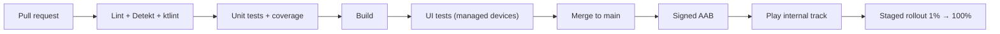

# Build System, Gradle & Release

[⬅ Back to index](../README.md)

Covers: Gradle basics, build types & flavors, dependencies (`api` vs `implementation`), version catalogs, convention plugins, KSP vs kapt, build speed, signing, APK vs AAB, Play release process, CI/CD.

---

### 1. What is Gradle? What files are involved in an Android project?

<details>
<summary>Answer</summary>

Gradle is the build automation tool. The **Android Gradle Plugin (AGP)** adds Android-specific tasks (compile, dex, merge resources, package, sign).

- `settings.gradle.kts` – module includes, plugin and dependency repositories.
- Root `build.gradle.kts` – plugins declared with `apply false`.
- Module `build.gradle.kts` – `android {}` config (namespace, `compileSdk`, `minSdk`, `targetSdk`, build types, flavors) and dependencies.
- `gradle/libs.versions.toml` – **version catalog**.
- `gradle.properties` – JVM args and flags (`org.gradle.caching=true`, `org.gradle.configuration-cache=true`).
- `gradle/wrapper/gradle-wrapper.properties` – the pinned Gradle version (use `./gradlew`).

The **Kotlin DSL (`.kts`)** is the default for new projects.

</details>

### 2. What is the Gradle build lifecycle?

<details>
<summary>Answer</summary>

1. **Initialization** – reads `settings.gradle` and decides which projects (modules) take part.
2. **Configuration** – evaluates every build script and builds the **task graph** (DAG). Keep this phase fast; the **configuration cache** can skip it.
3. **Execution** – runs the requested tasks and their dependencies. Up-to-date checks and the build cache skip unchanged work.

</details>

### 3. `compileSdk` vs `minSdk` vs `targetSdk`?

<details>
<summary>Answer</summary>

- **`compileSdk`** – the API level the app is **compiled against** (which APIs you can call). Use the latest.
- **`minSdk`** – the **lowest Android version** the app can be installed on. Calling newer APIs requires `Build.VERSION.SDK_INT` checks.
- **`targetSdk`** – the version the app is **tested against and declares compatibility with**. The system applies **behaviour changes** for that level (edge-to-edge, FGS types). **Google Play requires a recent targetSdk** for new apps and updates (within about a year of the latest Android release).

</details>

### 4. What are build types and product flavors? What is a build variant?

<details>
<summary>Answer</summary>

- **Build types** – *how* the app is built: `debug` (debuggable, no minify) and `release` (minify, signed, no logs). You can add more, e.g. `staging`.
- **Product flavors** – *different versions* of the app: `free`/`paid`, `dev`/`prod` environments, white-label brands. They're grouped with **flavor dimensions**.
- **Build variant** = flavor(s) × build type, e.g. `prodRelease`, `devDebug`.

Each variant can have its own source set (`src/dev/`), resources, `applicationIdSuffix`, `buildConfigField` (base URL) and `resValue`.

</details>

### 5. `implementation` vs `api` vs `compileOnly` vs `runtimeOnly`?

<details>
<summary>Answer</summary>

- **`implementation`** – the dependency is used internally and **not exposed** to consumers. Changing it **doesn't recompile dependent modules**, so builds are faster. This is the default choice.
- **`api`** – the dependency is **exposed transitively**. Use it when types from the dependency appear in your module's public API.
- **`compileOnly`** – available at compile time only, not packaged (annotations).
- **`runtimeOnly`** – packaged but not on the compile classpath.
- Also: `testImplementation`, `androidTestImplementation`, `debugImplementation` (e.g. LeakCanary), `ksp(...)`.

</details>

### 6. What is a version catalog?

<details>
<summary>Answer</summary>

`gradle/libs.versions.toml` centralizes versions, libraries, bundles and plugins:

```toml
[versions]
kotlin = "2.x.x"
[libraries]
retrofit = { module = "com.squareup.retrofit2:retrofit", version.ref = "retrofit" }
[plugins]
kotlin-android = { id = "org.jetbrains.kotlin.android", version.ref = "kotlin" }
```

Use it as `implementation(libs.retrofit)`. It gives type-safe accessors, a single source of truth for multi-module projects, and works with Dependabot/Renovate.

</details>

### 7. What are convention plugins?

<details>
<summary>Answer</summary>

Shared build logic in an included build (`build-logic/`) with plugins like `myapp.android.library` or `myapp.android.feature`, which apply common config (compileSdk, Kotlin options, Compose, Hilt). It removes copy-paste between module build files, keeps them small, and is better than `buildSrc` (changes don't invalidate the whole build). This is the pattern used by the *Now in Android* sample.

</details>

### 8. kapt vs KSP?

<details>
<summary>Answer</summary>

- **kapt** (Kotlin Annotation Processing Tool) generates **Java stubs** so that Java annotation processors can run. It's slow and **in maintenance mode**.
- **KSP** (Kotlin Symbol Processing) is a Kotlin-native API that understands Kotlin directly. **Up to ~2× faster**, and it supports KMP. Room, Hilt/Dagger, Moshi and Glide all support KSP. **KSP2** is the current version (it works with K2).

Migrating from kapt to KSP is a common build-speed win.

</details>

### 9. How do you speed up Gradle builds?

<details>
<summary>Answer</summary>

- Latest Gradle, AGP, Kotlin and JDK.
- `org.gradle.caching=true` (build cache, local or remote), `org.gradle.configuration-cache=true`, `org.gradle.parallel=true`.
- Increase the daemon heap (`org.gradle.jvmargs=-Xmx4g`).
- **Modularize** and use `implementation` instead of `api` (smaller recompilation scope).
- **KSP instead of kapt**; avoid unnecessary annotation processors.
- Disable unneeded features per module (`buildFeatures { buildConfig = false }`), and avoid dynamic versions (`1.+`).
- Non-transitive R classes (the default in new AGP).
- Analyze with **Build Analyzer** and **Gradle build scans** (`--scan`).

</details>

### 10. What is BuildConfig? How do you manage environment config?

<details>
<summary>Answer</summary>

`BuildConfig` is a generated class with `DEBUG`, `VERSION_NAME`, `APPLICATION_ID` and custom `buildConfigField("String", "BASE_URL", "\"https://..\"")` per variant. It's disabled by default in AGP 8 (`buildFeatures.buildConfig = true` to enable it). Read secrets from `local.properties` or CI environment variables, never from committed files, and remember they're still extractable from the APK.

</details>

### 11. APK vs AAB? What is Play App Signing?

<details>
<summary>Answer</summary>

- **APK** – an installable package with everything for all devices.
- **AAB (Android App Bundle)** – a **publishing format** (required for new apps on Play since 2021). Google Play generates optimized **split APKs** per device (ABI, screen density, language), so downloads are smaller. It enables **Play Feature Delivery** and **Play Asset Delivery**.
- **Play App Signing** – Google holds the **app signing key**, and you upload with an **upload key**. If you lose the upload key, it can be reset (a lost legacy signing key used to mean you could never update the app).

</details>

### 12. How does app signing work? What are signature schemes?

<details>
<summary>Answer</summary>

Every APK must be signed with a certificate. Updates must be signed with the **same key**, which is how Android proves the update comes from the same developer. Signature schemes: v1 (JAR), **v2** (whole-file, Android 7+), **v3** (supports **key rotation**, Android 9+), v4 (incremental installs). Configure `signingConfigs` in Gradle, with the keystore and passwords coming from secure CI variables.

</details>

### 13. What are versionCode and versionName?

<details>
<summary>Answer</summary>

- `versionCode` – an **integer** that must **increase** with every upload to Play. Used for upgrade logic.
- `versionName` – the user-visible string ("2.4.1"). Usually semantic versioning.

</details>

### 14. Explain the Play Store release process / tracks.

<details>
<summary>Answer</summary>

Tracks: **Internal testing** (up to 100 testers, available within minutes) → **Closed testing** (alpha; new personal developer accounts must run a closed test with testers before going to production) → **Open testing** (beta) → **Production**.

Use **staged rollouts** (1% → 5% → 20% → 100%), monitor Crashlytics and Android vitals, and **halt the rollout** if crash or ANR rates spike. Also: data safety form, content rating, target API compliance, the **in-app updates** API (flexible or immediate), and in-app reviews.

</details>

### 15. What does a typical Android CI/CD pipeline look like?

<details>
<summary>Answer</summary>

On every PR (GitHub Actions, Bitrise, GitLab CI, Jenkins):
1. **Static analysis** – Android Lint, **Detekt**, **ktlint**/Spotless.
2. **Unit tests** + coverage (Kover/JaCoCo).
3. **Build** debug/release (`assembleRelease` / `bundleRelease`).
4. **Instrumented/UI tests** on **Gradle Managed Devices** or Firebase Test Lab (often nightly).
5. Screenshot tests, dependency/vulnerability checks, APK size checks.



On merge or tag: version bump → signed AAB → upload to Play (**Gradle Play Publisher** / **fastlane supply**) to the internal track → promote after QA. Distribute QA builds with Firebase App Distribution. Store secrets in the CI secret store.

</details>

### 16. What is Android Lint?

<details>
<summary>Answer</summary>

A static analysis tool that checks for **correctness, security, performance, usability, accessibility and i18n** problems: missing translations, unused resources, `NewApi` calls above minSdk, hardcoded text, missing `contentDescription`. Configure it with `lint.xml` / `lintOptions`, use a **baseline** for existing issues, and write custom lint rules for team conventions.

</details>

### 17. What is desugaring?

<details>
<summary>Answer</summary>

D8/R8 rewrite newer Java language features (lambdas, default methods) so they run on older Android versions. **Core library desugaring** (`isCoreLibraryDesugaringEnabled = true`) backports Java APIs like **`java.time`** and parts of streams to old minSdk levels.

</details>

### 18. What are dynamic feature modules?

<details>
<summary>Answer</summary>

Modules delivered through **Play Feature Delivery**: **install-time**, **on-demand** (downloaded when needed with the `SplitInstallManager` API), or **conditional** (by country, device feature or API level). They reduce the initial download size. The dependency is reversed (the feature depends on `:app`), so navigation into them uses reflection or deep links.

</details>

### 19. What is a 16 KB page size and why does it matter?

<details>
<summary>Answer</summary>

Newer Android devices (Android 15+) can use a **16 KB memory page size** instead of 4 KB, which improves performance (faster app launch and lower power use). Apps with **native code (.so files)**, whether their own or from SDKs, must be **rebuilt and aligned for 16 KB** (recent NDK/AGP do this). Google Play requires **16 KB compatibility for apps targeting Android 15+** (enforced from late 2025). Pure Kotlin/Java apps are unaffected.

</details>


### 20. How do you create a custom Gradle task?

<details>
<summary>Answer</summary>

```kotlin
// build.gradle.kts
tasks.register("printVersion") {
    group = "custom"
    description = "Prints the app version"
    doLast { println("Version: ${android.defaultConfig.versionName}") }
}

// Typed, cacheable task with inputs/outputs
abstract class GenerateConfigTask : DefaultTask() {
    @get:Input abstract val apiUrl: Property<String>
    @get:OutputFile abstract val outputFile: RegularFileProperty
    @TaskAction fun generate() { outputFile.get().asFile.writeText("API=${apiUrl.get()}") }
}
tasks.register<GenerateConfigTask>("generateConfig") {
    apiUrl.set("https://api.example.com")
    outputFile.set(layout.buildDirectory.file("config.txt"))
}
```

Key points: use `tasks.register` (**lazy**, configuration avoidance) instead of `create`; put work in `doLast`/`@TaskAction` (not at configuration time); declare **inputs/outputs** so the task is **up-to-date checked and cacheable**; wire dependencies with `dependsOn`/`finalizedBy` or task outputs. For reusable logic, put it in a convention plugin.

</details>

### 21. What's on your production release checklist?

<details>
<summary>Answer</summary>

- **Build:** `isMinifyEnabled`/`isShrinkResources` on, R8 keep rules verified, `debuggable false`, logging stripped, correct `versionCode`/`versionName`, signed **AAB**, `mapping.txt` and native symbols uploaded (Play/Crashlytics).
- **Quality:** all tests green; smoke-tested the **release build** on low-end and latest devices; process-death, rotation, dark mode, large font, RTL and offline checks; **Baseline Profile** included; no StrictMode violations; size check.
- **Config:** production endpoints and keys, feature flags or kill switches ready, analytics events verified, crash reporting enabled.
- **Compliance:** target SDK requirement met, permissions justified, Data safety form, privacy policy, 16 KB native alignment.
- **Rollout:** internal → closed testing → **staged rollout** (1% → …) while monitoring crash/ANR vitals; release notes; rollback plan (halt the rollout, hotfix, remote config).

</details>

### 22. What Git workflow questions come up? (merge vs rebase, branching)

<details>
<summary>Answer</summary>

- **Merge vs rebase:** `merge` keeps history as it happened (with a merge commit), and it's safe on shared branches. `rebase` **rewrites** your commits on top of the target for a linear history. **Never rebase commits others have already pulled.** Squash-merging PRs keeps `main` clean.
- **Branching strategies:** **trunk-based** (short-lived branches + feature flags, common with CI/CD), **GitHub Flow** (feature branch → PR → main), **Git Flow** (develop/release/hotfix branches, heavier, suited to versioned releases).
- **Useful commands:** `git stash`, `cherry-pick` (hotfixes to release branches), `bisect` (find the commit that introduced a bug), `reflog` (recover lost commits), `revert` (undo safely on shared history) vs `reset` (local only).
- **Mobile specifics:** release branches per version, tags per store build, and protected main branches with required CI checks.

</details>

---

[⬅ Previous: Security & Permissions](21-security-permissions.md) · [⬅ Back to index](../README.md) · [Next: Android System Design ➡](23-system-design.md)
