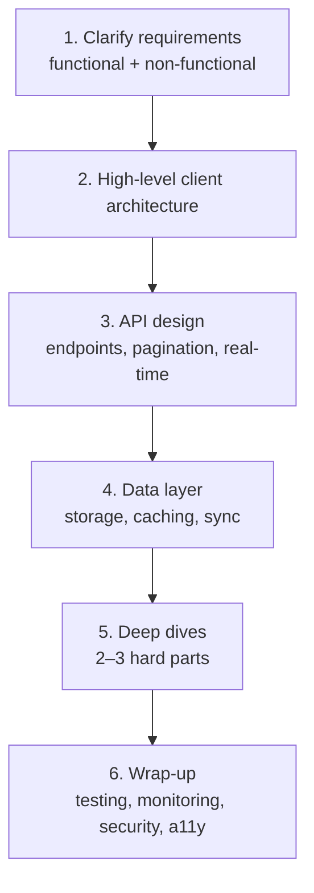
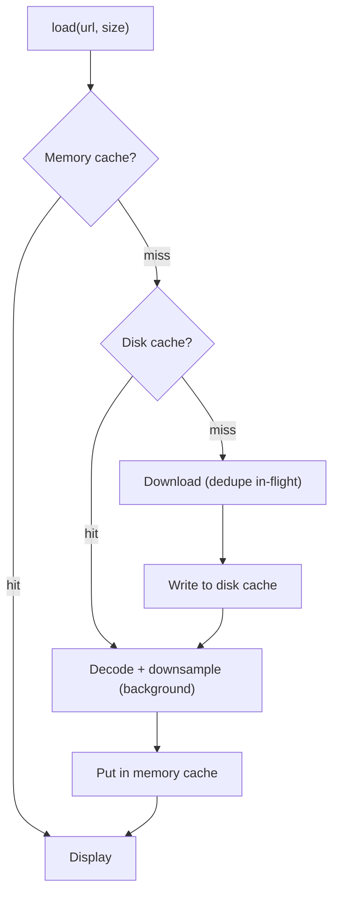
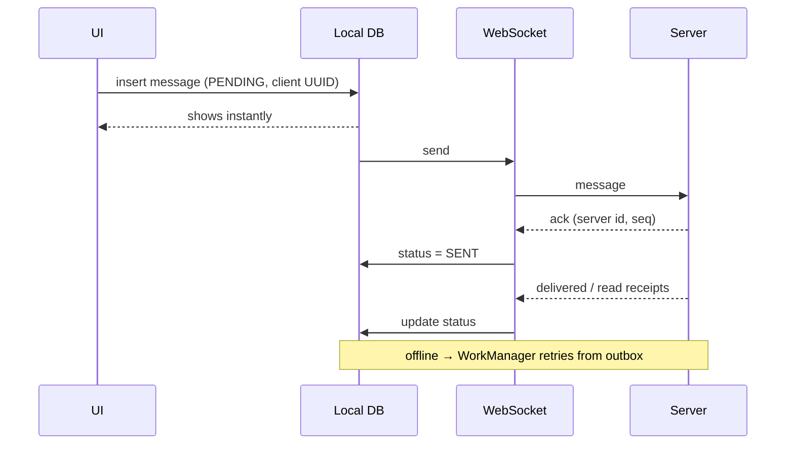
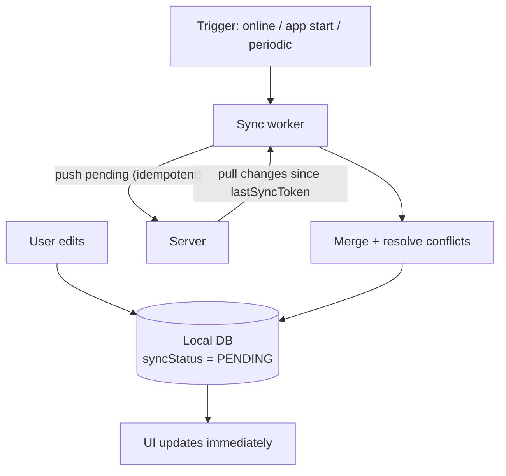

# Android (Mobile) System Design

[⬅ Back to index](../README.md)

Covers: how to approach a mobile system design round, plus worked designs (image loader, chat app, news feed, offline-first app, file downloader, analytics SDK, location tracking, video streaming) and common building blocks.

---

### 1. How should you approach a mobile system design interview?

Answer

Follow a structured flow (~45 min):

1. **Clarify requirements (5 min)**
   - Functional: the core features. Agree on scope ("feed + like + comments; no DMs").
   - Non-functional: offline support, real-time needs, scale (DAU, items), latency, battery and data usage, security, accessibility, supported devices and min SDK.
2. **High-level design (10 min)** – draw the client architecture: UI → ViewModel → UseCase → Repository → (Remote API, Local DB, Cache). Mention modules and DI.
3. **API design (5 min)** – endpoints, pagination (**cursor-based**), payloads, REST vs GraphQL vs WebSocket, auth.
4. **Data layer / storage (10 min)** – DB schema, caching strategy, **single source of truth**, sync and conflict resolution.
5. **Deep dives (10 min)** – pick 2–3: pagination, offline, real-time, image loading, background sync, error handling and retries, performance.
6. **Trade-offs & extras** – testing, monitoring (crash and perf), analytics, feature flags, security, accessibility, i18n, scalability of the codebase (modularization).

**Talk about trade-offs** constantly. There's no single right answer.

### 2. Design an image loading library (like Glide/Coil).

Answer

**Requirements:** load from URL/file/resource into an ImageView or composable; memory and disk caching; resize/downsample; placeholders and error images; transformations; cancel when a view is recycled; lifecycle-aware; avoid OOM.

**Pipeline:**
`request(url, target size)` → **memory cache** (LruCache keyed by url+size+transformations) → hit? display.
Miss → **disk cache** (DiskLruCache, raw or transformed bytes) → hit? decode on a background thread.
Miss → **network fetch** (OkHttp) → write to disk cache → **decode with downsampling** (`inSampleSize` / `ImageDecoder` to the target size) → apply transformations → put in the memory cache → post to the main thread.

**Key design points:**
- **Request deduplication**: the same URL requested concurrently → a single network call.
- **Cancellation**: keep a request tag on the view. When the view is rebound, cancel the old request (coroutine Job).
- **Lifecycle**: pause requests in `onStop`, clear them on destroy.
- **Bitmap pooling / reuse** (`inBitmap`), hardware bitmaps.
- Thread pools: separate network (IO) from decode (CPU-bound).
- Priority (visible items first), prefetching for lists.
- Cache sizes based on device memory (~1/8 of the heap for memory). Disk cache with LRU eviction and a size cap.

### 3. Design a chat / messaging app (like WhatsApp).

Answer

**Requirements:** 1:1 and group chat, real-time delivery, offline send and read, message status (sent/delivered/read), push notifications, media messages, typing indicators, history pagination.

**Client architecture:**
- **Room as the SSOT**: tables `conversations`, `messages(id, localId, conversationId, senderId, body, status, timestamp, …)`. The UI observes a Room Flow and pages it with Paging 3.
- **Real-time**: a **WebSocket** connection while the app is in the foreground (with reconnection and exponential backoff + jitter, and a heartbeat ping). In the background, **FCM** data messages wake the app to sync and notify.
- **Sending (optimistic UI)**: insert locally with `status = PENDING` and a client-generated **UUID** (idempotency key) → show it immediately → send over the socket. If offline, enqueue a **WorkManager** job (network constraint). The server ACK updates the status to SENT; delivery and read receipts update it later.
- **Ordering**: server timestamps or sequence numbers per conversation. Deduplicate by ID.
- **Sync on reconnect**: fetch missed messages since `lastSyncCursor`.
- **Media**: upload to object storage first (with a progress notification, through WorkManager), then send a message with the URL. Thumbnails and blurhash placeholders.
- **Notifications**: MessagingStyle, inline reply (RemoteInput), grouped by conversation.
- **Security**: end-to-end encryption (Signal protocol), keys in the Keystore.
- **Scale**: index `messages(conversationId, timestamp)`, prune old media, lazy-load history.

### 4. Design a news feed / social feed (like Instagram/Twitter).

Answer

**Requirements:** an infinite scrolling feed of posts (text + images/video), like/comment, pull-to-refresh, offline viewing of cached content, fast startup.

**Design:**
- **API**: `GET /feed?cursor=xyz&limit=20` → `{ items, nextCursor }`. **Cursor pagination** is better than offset: stable when new posts are inserted, so there are no duplicates or skipped items.
- **Paging 3 + RemoteMediator**: the network writes pages into Room, and the UI reads from Room (offline-first). Store the cursors in a `remote_keys` table.
- **Refresh**: pull-to-refresh invalidates and refetches the first page. Show a "New posts" pill instead of jumping the scroll position.
- **Likes**: **optimistic update** in the DB, then the API call; roll back on failure. Queue in WorkManager when offline.
- **Media**: Coil/Glide with sized requests, **prefetching** of the next items' images, video autoplay of only the most visible item (a single ExoPlayer instance reused), and release when scrolled off.
- **Performance**: stable keys, `contentType`, DiffUtil, avoiding recomposition, Baseline Profile for the feed scroll.
- **Cache policy**: keep the last N pages and evict older ones. TTL for staleness.
- **Analytics**: impression tracking with visibility thresholds, batched and sent in the background.

### 5. Design an offline-first app (e.g. notes or to-do with sync).

Answer

- **Local DB is the source of truth**: every read comes from Room, and every write goes to Room first.
- Each record has `id` (UUID generated on the client), `updatedAt`, `syncStatus` (SYNCED / PENDING_CREATE / PENDING_UPDATE / PENDING_DELETE), and `version`.
- Deletes are **soft deletes** (tombstones) until they're synced.
- **Sync engine** (WorkManager, unique periodic work + a one-time job on change, network constraint): **push** pending local changes, then **pull** server changes since `lastSyncTimestamp`.
- **Conflict resolution**: last-write-wins (by server timestamp), version vectors, field-level merges, or a prompt to the user. Choose based on the domain.
- **Idempotent APIs** (the client UUID prevents duplicates on retry).
- The UI shows a sync status indicator. Connectivity is observed through `ConnectivityManager`.

### 6. Design a file download manager.

Answer

- **Requirements:** parallel downloads with a limit, pause/resume, progress notifications, survive app kill, retry on failure, storage checks.
- **WorkManager** worker per download (unique work by URL), running as **foreground** work with a progress notification for long downloads. On Android 14+, consider **user-initiated data transfer jobs**.
- **Resume**: HTTP `Range: bytes=<downloaded>-` headers, writing to a `.part` file. Persist the progress in Room.
- **Concurrency**: a queue with a max of N parallel downloads (a Semaphore or WorkManager constraints).
- **Integrity**: verify a checksum, then move to the final location (MediaStore for user-visible files).
- **Network policy**: Wi-Fi only (`NetworkType.UNMETERED`) as a user setting.
- **Errors**: exponential backoff, a disk-full check, and expired URLs refreshed from the server.

### 7. Design an analytics / logging SDK.

Answer

- **API**: `Analytics.track(event, properties)`. Non-blocking, so you never slow down the caller.
- Events go into an **in-memory queue**, which is flushed to a **local DB/file** (so they survive process death).
- **Batch upload** (every N events or T minutes, and on app background) with WorkManager (network constraint, backoff).
- Compress (gzip) the payloads. Cap the storage and drop the oldest events when full. Sample high-volume events.
- Attach common context (app version, OS, device, session ID). Handle privacy: user consent (GDPR), PII scrubbing, an opt-out.
- SDK concerns: **tiny footprint**, minimal dependencies (no conflicts with the host app), lazy initialization (no startup cost), thread safety, R8 consumer rules, a stable public API (binary compatibility).

### 8. Design a location tracking app (e.g. ride-sharing driver app / fitness tracker).

Answer

- **Fused Location Provider** with a priority and interval that fit the use case (high accuracy during a trip, balanced otherwise).
- Continuous tracking runs in a **foreground service** of type `location`, with a persistent notification. Requires `ACCESS_FINE_LOCATION`, plus background location only if it's truly needed.
- Buffer points in **Room**, and **batch upload** them (every N points or seconds) to save battery and data. Send real-time updates over a WebSocket when the rider needs live tracking.
- Filter noisy points (accuracy threshold, speed sanity checks), and simplify the path (Douglas-Peucker).
- Handle Doze and OEM battery optimizations, the GPS being turned off, and permission revocation.
- Use **geofencing** for arrival detection instead of constant polling.

### 9. Design a video streaming app (like YouTube/Netflix).

Answer

- **Media3 ExoPlayer** with **adaptive streaming** (HLS/DASH), so the bitrate adapts to bandwidth (ABR).
- **Player lifecycle**: a single player instance; release it in `onStop` (or keep it in a MediaSessionService for background audio); handle audio focus and PiP (`supportsPictureInPicture`).
- **Offline downloads**: `DownloadService` / `DownloadManager` from Media3, with **DRM** (Widevine) license persistence.
- **Feed**: like the news feed design, with prefetched thumbnails and preloaded first segments.
- Resume position stored locally and synced. Analytics: buffering events, startup time, bitrate switches.
- **MediaSession** for notification and lock-screen controls, Android Auto and Wear.

### 10. What caching strategies exist on mobile?

Answer

- **Cache-first** (stale data OK): show the cache, refresh in the background (stale-while-revalidate).
- **Network-first**: try the network, fall back to the cache when offline (prices, critical data).
- **Cache-only / network-only**.
- **Layers**: memory (LruCache), disk (Room/files), HTTP cache (OkHttp).
- **Invalidation**: TTL, ETags, server push invalidation, version keys. "There are only two hard things in CS: cache invalidation and naming things."

### 11. Offset vs cursor pagination?

Answer

- **Offset** (`?page=3&size=20`) – simple, but if items are inserted or deleted between requests you get **duplicates or missed items**, and large offsets are slow on the server.
- **Cursor/keyset** (`?after=<lastId or encoded cursor>`) – stable under inserts and efficient. You can't jump to an arbitrary page, which feeds don't need anyway. **Preferred for feeds.**

### 12. How do you handle real-time updates? (Polling vs WebSocket vs SSE vs push)

Answer

Choose based on frequency and direction: **FCM push** for infrequent events and background wake-ups; **WebSocket** for bidirectional, frequent updates in the foreground (chat, live location); **SSE** for one-way server streams (live scores); **polling** with backoff only as a fallback. Close sockets in the background to save battery. See [Networking Q15](15-networking.md).

### 13. How do you design for scale in a large codebase (many teams)?

Answer

Modularization by feature with clear API/impl boundaries, a shared design system module, DI per module, convention plugins, ownership (CODEOWNERS), feature flags for trunk-based development, CI with affected-module testing, binary-compatible internal APIs, and documentation/ADRs (Architecture Decision Records).

### 14. How do you implement feature flags and remote config?

Answer

Use **Firebase Remote Config** (or LaunchDarkly, or an in-house service), with default values bundled in the app. Fetch at startup, apply on the next session to avoid UI jumps, and cache locally. Uses: **kill switches** for broken features, gradual rollouts, A/B tests. Wrap flags behind an interface (`FeatureFlags.isEnabled(Feature.NEW_CHECKOUT)`) so you can test them and override them in a debug menu.

### 15. What non-functional aspects should you always mention?

Answer

- **Performance**: startup, scrolling, memory.
- **Battery and data**: batching, compression, WorkManager constraints.
- **Offline support and error handling**: retries, empty and error states.
- **Security**: token storage, pinning, PII.
- **Privacy**: permissions, data safety.
- **Accessibility**, **localization** (RTL).
- **Observability**: crash reporting, logging, analytics, performance monitoring.
- **Testability**, and **app size**.
- **Backward compatibility**: API versioning and forced-update mechanisms (a minimum supported app version from the backend).

---

## More System Design Problems

### 16. Design Instagram Stories.

Answer

**Requirements:** a horizontal tray of users with stories; a full-screen viewer that auto-advances (~5 s per image, video length for video); tap left/right to go back or forward, hold to pause, swipe between users; seen/unseen state; stories expire after 24 h; fast start with no spinners.

**Design:**
- **API:** `GET /stories/tray` → users + story metadata (IDs, media URLs in multiple resolutions, duration, `seen`, expiry). Media is served from a **CDN**.
- **Data:** cache the tray in Room (so it's instant on launch). Keep a seen state table, synced with `POST /stories/{id}/seen` in batches through WorkManager (it works offline).
- **Preloading is the key:** when the viewer opens, **prefetch the next 1–2 stories' media** (images with Coil, the first segments of video with ExoPlayer's `CacheDataSource`/preload). Preload the first story of the next user too.
- **Viewer:** a `HorizontalPager` across users; within a user, a progress bar segment per story, driven by a timer (`Animatable`) that pauses on press and when the app goes to the background. A **single reused ExoPlayer**.
- **Memory:** downsample images to screen size, release players off-screen, and use bounded caches.
- **Expiry:** filter by `expiresAt` on the client and the server; clean up old media in a periodic job.
- **Analytics:** view events, completion rate, tap-through; batched.

### 17. Design a networking library (like Retrofit/Volley).

Answer

**Goals:** a simple API, async (coroutines), request/response transformation, interceptors, caching, retries, cancellation, testability.

**Components:**
1. **Request model** – method, URL, headers, body, priority, tag; built with a builder or an annotated interface (generated through a **dynamic proxy** or KSP).
2. **Dispatcher / executor** – a thread pool with **max concurrent requests** (per host as well), priority queues, and **cancellation** by tag or coroutine Job.
3. **Interceptor chain** (Chain of Responsibility) – auth headers, logging, retries with backoff, metrics.
4. **Transport** – HTTP client with **connection pooling**, HTTP/2, TLS, timeouts (in practice, wrap OkHttp).
5. **Cache layer** – a memory + disk cache honouring `Cache-Control`/ETag.
6. **Converters** – pluggable serialization (JSON, Protobuf) through a factory interface.
7. **Response delivery** – suspend functions/Flow, and delivering on the main thread when needed; typed errors (`HttpError`, `NetworkError`, `ParseError`).
8. **Request deduplication** – merge identical in-flight GET requests.

Also consider: lifecycle-aware cancellation, mock/fake mode for tests, minimal dependencies, and R8 consumer rules.

### 18. Design a ride-hailing app like Uber (rider side), and "nearby friends".

Answer

**Core flows:** pick-up/drop-off selection on a map → fare estimate → request a ride → match a driver → **live driver tracking** → trip in progress → payment and rating.

- **Location:** Fused Location Provider. Higher frequency only during active states (requesting or on a trip), and a **foreground service of type `location`** on the driver side.
- **Real-time:** **WebSocket** (or MQTT) channel during an active ride for driver location (every 2–5 s), ETA and trip state. Fall back to polling with backoff. **FCM** for trip events while the app is in the background.
- **Map rendering:** Google Maps SDK. **Interpolate/animate** the marker between location updates (smooth movement, bearing rotation). Snap to roads on the server.
- **State machine** for the trip (`Idle → Searching → DriverAssigned → Arriving → OnTrip → Completed`), persisted so the app **resumes correctly after process death** or a crash. The server is authoritative.
- **Reliability:** idempotent ride requests (a client request ID), handling network drops mid-trip, and showing the last known state.
- **Battery:** stop high-frequency updates when idle, batch analytics.
- **Nearby friends** variant: devices periodically upload a coarse location (geohash) with privacy controls; the server returns friends in nearby geohash cells; use **geofencing** and significant-motion updates instead of continuous GPS.

### 19. How do voice and video calls work in a mobile app?

Answer

- **WebRTC** is the standard: peer-to-peer **media over UDP** (SRTP, encrypted) with audio/video codecs (Opus, VP8/VP9/H.264/AV1), jitter buffers and echo cancellation.
- **Signaling** (not part of WebRTC): your server, usually over **WebSocket**, exchanges **SDP offers and answers** (capabilities) and **ICE candidates** (network paths).
- **NAT traversal:** **STUN** servers discover public IPs. **TURN** servers relay media when a direct P2P connection fails (corporate or symmetric NATs).
- **Group calls** use an **SFU** (Selective Forwarding Unit) server that forwards streams, because full-mesh P2P doesn't scale beyond a few people.
- **Android specifics:** incoming calls arrive through a **high-priority FCM** message that shows a full-screen notification or uses **`ConnectionService` / the Telecom (Core-Telecom) API** for system call integration; a **foreground service** of type `phoneCall`/`microphone`/`camera`; audio focus and routing (speaker, Bluetooth); handling network switches (ICE restart).
- Commercial SDKs (Agora, Twilio, Stream) wrap all of this.

### 20. Design a caching library and a logging library.

Answer

**Caching library:**
- An API like `get(key)`, `put(key, value, ttl)`, `getOrFetch(key) { loader }`.
- **Tiers:** memory (LRU, size-bounded by count or bytes) → disk (files or SQLite, LRU with a size cap and a journal for crash safety, like DiskLruCache).
- **Policies:** TTL/expiry, max size, eviction (LRU/LFU), invalidation by key or prefix, stale-while-revalidate.
- **Concurrency:** thread-safe (Mutex/actor), with **single-flight** loading (concurrent misses for the same key trigger one load).
- **Serialization:** pluggable serializers; versioning so the cache is invalidated when the format changes.

**Logging library:**
- An API like `Log.d/i/w/e(tag, msg, throwable)` with **levels** and pluggable **sinks/trees** (Logcat, file, remote), similar to Timber.
- **Non-blocking:** enqueue log records to a background writer (Channel or HandlerThread). Buffer and batch them to a file with **rotation** (max file size and count).
- **Remote upload:** compress and upload periodically or on demand (WorkManager, Wi-Fi/charging constraints).
- **Privacy:** PII scrubbing and redaction; release builds drop debug levels.
- **Crash integration:** attach the recent logs to crash reports (breadcrumbs).

### 21. How do you handle data syncing when the network is unstable?

Answer

- **Offline-first:** writes go to the **local DB first** with a `syncStatus`. The UI never waits on the network.
- An **outbox queue** of pending operations, processed by **WorkManager** (unique work, `NetworkType.CONNECTED` constraint, exponential backoff).
- **Idempotency keys** (client-generated UUIDs), so retries after timeouts don't create duplicates.
- **Small, resumable units:** batch small changes; use chunked or resumable uploads for large files (`Range` headers, multipart chunks).
- **Delta sync:** pull changes since `lastSyncToken` instead of full refreshes.
- **Conflict resolution:** version numbers or timestamps, last-write-wins or merge rules.
- Monitor connectivity (`NetworkCallback`) to trigger sync when the network returns, and show sync status in the UI.
- Timeouts, circuit breakers (pause after repeated failures), and respecting metered networks for large transfers.

### 22. How does an app like "Where Is My Train" work without the internet?

Answer

It combines **offline data** with **on-device signals**:
- The **timetable and route data** (stations, schedules, distances) is downloaded once and stored locally (a compact DB), updated occasionally.
- **Location without data:** **cell tower IDs** (from `TelephonyManager`, available without internet) are mapped to known locations along the tracks using a crowdsourced offline **cell-tower → location database**. GPS also works without internet, but it's battery-heavy and poor inside trains.
- **Inference:** given the train's schedule, the last known position and the elapsed time, it **estimates the current position and delay** on the device.
- When connectivity is available, it syncs live running status and uploads anonymized crowdsourced data to improve the tower mapping.

The design lesson: an **offline-first architecture**, preloaded reference data, and on-device inference from cheap signals.

---

[⬅ Previous: Build, Gradle & Release](22-build-gradle-release.md) · [⬅ Back to index](../README.md) · [Next: What's New & Trending ➡](24-whats-new-trending.md)
