# Android (Mobile) System Design

[⬅ Back to index](../README.md)

Covers: how to approach a mobile system design round, plus worked designs (image loader, chat app, news feed, offline-first app, file downloader, analytics SDK, location tracking, video streaming) and common building blocks.

---

### 1. How should you approach a mobile system design interview?

<details>
<summary>Answer</summary>

**In short:** Run the round like a structured conversation: clarify requirements and scope, sketch the client architecture, define the API, design the data layer (storage, caching, sync), then go deep on the 2–3 hardest parts and close with testing, monitoring and other non-functional concerns. Say your trade-offs out loud throughout. The interviewer is grading how you think, not whether you hit one "correct" design.

#### Why a structure matters

A mobile system design round is usually 45–60 minutes and deliberately vague ("Design Instagram"). Candidates fail mostly by jumping straight into classes and libraries, by designing the backend instead of the app, or by running out of time before the interesting parts. A fixed flow keeps you on time and shows seniority: you scope before you build.

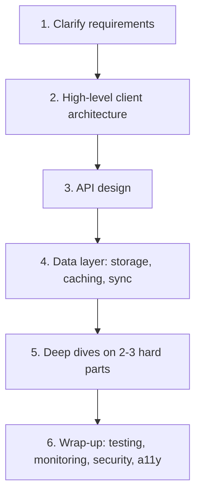

#### The steps, with a rough time budget (~45 min)

1. **Clarify requirements (5 min)**
   - *Functional*: the core features. Agree on scope explicitly ("feed + like + comments; no DMs, no posting").
   - *Non-functional*: offline support, real-time needs, scale (DAU, items per screen, media size), latency targets, battery and data usage, security and privacy, accessibility, supported devices and min SDK.
   - Write the agreed list down where the interviewer can see it; you'll refer back to it.
2. **High-level design (10 min)**: draw the client layers: UI → ViewModel → (UseCase) → Repository → Remote API / Local DB / in-memory cache. Mention modules (feature modules, core modules), DI (Hilt), and which components run in the background (WorkManager, services).
3. **API design (5 min)**: endpoints and payloads, **cursor-based** pagination, REST vs GraphQL vs WebSocket/SSE for real-time, authentication (OAuth tokens + refresh), error format.
4. **Data layer (10 min)**: DB schema, caching strategy, **single source of truth** (usually the local DB), how and when sync happens, conflict resolution.
5. **Deep dives (10 min)**: pick 2–3 that matter for *this* product: pagination, offline writes, real-time delivery, image/video loading, background sync, retries and error handling, startup or scroll performance.
6. **Trade-offs and extras**: testing strategy, monitoring (crashes, ANRs, performance), analytics, feature flags, security, accessibility, i18n, codebase scalability (modularization).

#### What a typical client diagram looks like

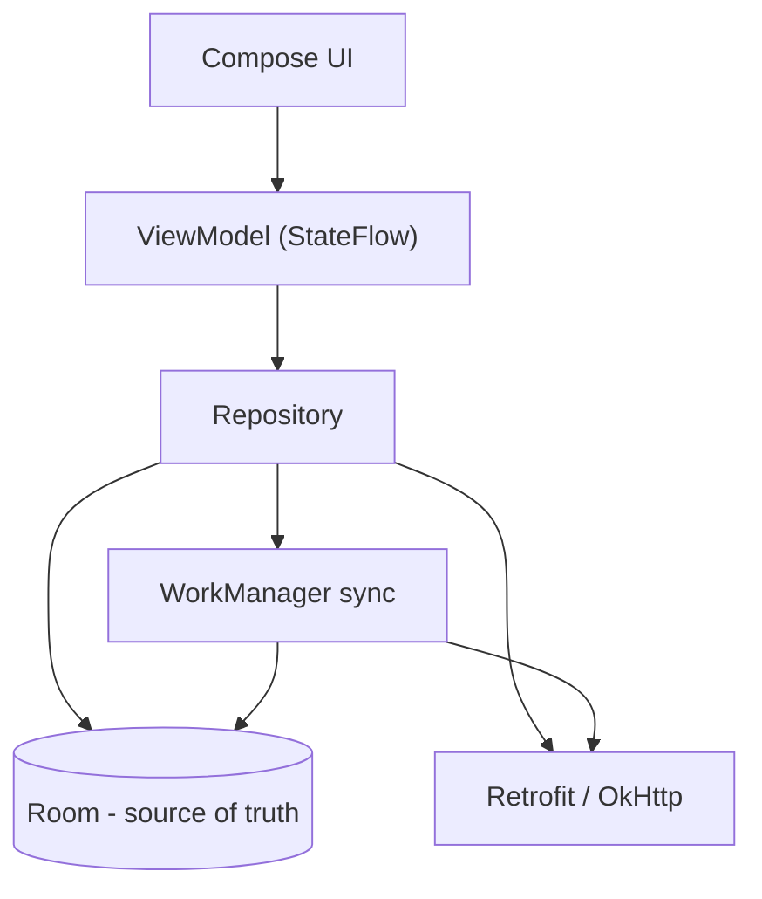

#### Tips that score points

- **Talk about trade-offs constantly**: "Cursor pagination is more complex for the server but avoids duplicates when new posts arrive."
- Ask before assuming: "Do we need this to work offline?" changes the whole design.
- Stay on the client. Mention backend pieces only where they shape the app (CDN, push, pagination contract).
- Let the interviewer steer deep dives; offer options ("I could go deeper on offline sync or on media loading, which is more interesting to you?").

**Common pitfalls**
- Spending 20 minutes on requirements or on one deep dive.
- Naming libraries without explaining *why* (say "Room because we need observable queries and transactions", not just "Room").
- Forgetting process death, configuration changes, and poor networks.

**Likely follow-ups**
- *How would this change for 10x the users?* On the client: more aggressive caching, pagination limits, request batching, and backoff so you don't overwhelm the backend.
- *How would you test it?* Unit tests for ViewModels/repositories with fakes, Room in-memory DB tests, UI tests for critical flows, and a mock server for API contracts.

</details>

### 2. Design an image loading library (like Glide/Coil).

<details>
<summary>Answer</summary>

**In short:** A request for an image goes through a pipeline: memory cache → disk cache → network. On a miss, download once (dedupe concurrent requests), store the bytes on disk, decode **downsampled to the target size** on a background thread, put the bitmap in an LRU memory cache, and deliver it on the main thread. Requests are tied to the target view and lifecycle so they're cancelled when the view is recycled or the screen goes away.

#### Requirements

- Load from URL, file, content URI or resource into an `ImageView` or a composable.
- Memory and disk caching; resize/downsample; placeholders and error images; transformations (circle crop, blur).
- Cancel when a list item is recycled; lifecycle-aware; avoid OutOfMemoryError and jank.

#### The pipeline

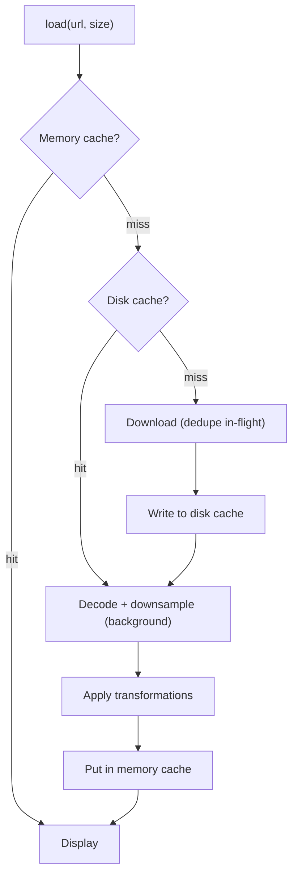

1. **Build the request**: source, target size (measured from the view or given explicitly), transformations, placeholder. The **cache key** combines url + size + transformations, because a 100×100 circle crop is a different bitmap from the full-size original.
2. **Memory cache**: an `LruCache<Key, Bitmap>` sized in bytes. A hit is displayed synchronously, so there's no placeholder flicker when scrolling back.
3. **Disk cache**: a `DiskLruCache`-style store (journal file + size cap + LRU eviction). You can cache the original bytes, the transformed result, or both.
4. **Network**: OkHttp download. Concurrent requests for the same URL share one in-flight call.
5. **Decode**: on a CPU-bound dispatcher, decode to the target size using `BitmapFactory.Options.inSampleSize` or `ImageDecoder` with a target size. A 4000×3000 photo is ~48 MB as ARGB_8888; decoded to 400×300 it's ~0.5 MB.
6. **Deliver** on the main thread, only if the view still wants this request.

#### Sketch of the core

```kotlin
class ImageLoader(
    private val memory: LruCache<String, Bitmap>,
    private val disk: DiskCache,
    private val fetcher: Fetcher,
    private val scope: CoroutineScope,
) {
    private val inFlight = ConcurrentHashMap<String, Deferred<ByteArray>>()

    fun load(url: String, target: ImageView, w: Int, h: Int) {
        val key = "$url@${w}x$h"
        memory.get(key)?.let { target.setImageBitmap(it); return }

        (target.getTag(R.id.image_job) as? Job)?.cancel()      // view was rebound: cancel old work
        val job = scope.launch {
            val bytes = disk.get(url) ?: fetchOnce(url).also { disk.put(url, it) }
            val bmp = withContext(Dispatchers.Default) { decodeSampled(bytes, w, h) }
            memory.put(key, bmp)
            target.setImageBitmap(bmp)                         // scope uses Dispatchers.Main
        }
        target.setTag(R.id.image_job, job)
    }

    // Request deduplication: concurrent loads of the same URL share one download
    private suspend fun fetchOnce(url: String): ByteArray =
        inFlight.computeIfAbsent(url) {
            scope.async(Dispatchers.IO) { fetcher.fetch(url) }
        }.let { d -> try { d.await() } finally { inFlight.remove(url) } }
}
```

#### Key design points

- **Request deduplication**: the same URL requested concurrently → a single network call.
- **Cancellation**: keep a request tag (Job) on the view; when the view is rebound to a different URL, cancel the old request so a slow old image can't overwrite the new one.
- **Lifecycle**: pause requests in `onStop`, cancel on destroy (Glide uses a hidden fragment; Coil uses the `Lifecycle` of the view/composable).
- **Bitmap reuse**: `inBitmap` lets the decoder reuse an existing bitmap's memory (fewer GC pauses). **Hardware bitmaps** (`Bitmap.Config.HARDWARE`, API 26+) keep pixels in GPU memory only.
- **Thread pools**: separate network (IO-bound, many threads) from decode (CPU-bound, about core-count threads).
- **Priority and prefetching**: visible items first; prefetch the next rows in a list.
- **Cache sizing**: memory cache ~1/8 of the app's heap (or a percentage of `ActivityManager.memoryClass`); disk cache with an LRU size cap (e.g. 250 MB). Trim the memory cache in `onTrimMemory`.

| Concern | Choice | Why |
|---|---|---|
| Memory cache | LRU by bytes | Recently shown images are most likely re-shown |
| Disk cache | Journaled LRU | Crash-safe, bounded |
| Decode | Downsample to view size | Prevent OOM, faster |
| Concurrency | Separate IO and CPU pools | Downloads don't starve decodes |

**Common pitfalls**
- Decoding full-size images into thumbnails (the classic OOM).
- Not cancelling on recycle → wrong images appear in RecyclerView rows.
- Cache key that ignores size or transformations → wrong bitmap returned.

**Likely follow-ups**
- *How do you handle GIFs/animated images?* A separate decoder producing a `Drawable` (`AnimatedImageDrawable` on API 28+), not a single bitmap.
- *How do you avoid holding a leaked Activity?* Reference the target weakly or clear it on lifecycle destroy.
- *Original or transformed on disk?* Original saves network when sizes change; transformed saves CPU. Glide supports both strategies.

</details>

### 3. Design a chat / messaging app (like WhatsApp).

<details>
<summary>Answer</summary>

**In short:** Make the local database (Room) the single source of truth. Messages are inserted locally with a client-generated UUID and `PENDING` status, shown instantly, and sent over a WebSocket while the app is in the foreground (or retried from an outbox by WorkManager when offline). The server acks with a server ID and sequence number; delivery and read receipts update the status. In the background, FCM data messages wake the app to sync and notify. On reconnect, fetch everything since the last sync cursor.

#### Requirements

- *Functional*: 1:1 and group chat, real-time delivery, send while offline, read history offline, message status (sent/delivered/read), push notifications, media messages, typing indicators, history pagination.
- *Non-functional*: low latency (< 1 s when both online), no lost or duplicated messages, correct ordering, battery-friendly, end-to-end encryption.

#### Sending a message

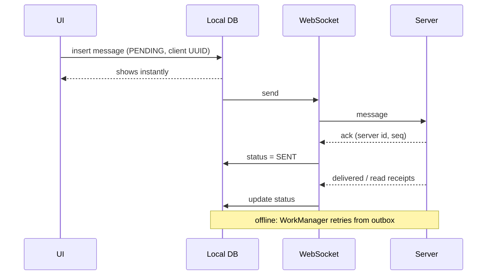

#### Data model

```kotlin
@Entity(indices = [Index("conversationId", "serverSeq")])
data class MessageEntity(
    @PrimaryKey val localId: String,      // client UUID, also the idempotency key
    val serverId: String?,                // null until the server acks
    val conversationId: String,
    val senderId: String,
    val body: String?,
    val mediaUrl: String?,
    val status: Status,                   // PENDING, SENT, DELIVERED, READ, FAILED
    val serverSeq: Long?,                 // per-conversation order from the server
    val createdAt: Long,                  // client time, for display before ack
)
```

Plus a `conversations` table (last message, unread count, muted) and a `sync_state` table holding `lastSyncCursor`.

#### Client architecture

- **Room as the SSOT**: the UI observes `Flow<PagingData<Message>>` from Room via Paging 3. Network events only write into Room; they never update the UI directly. This makes offline, process death and multiple screens consistent for free.
- **Real-time**: a **WebSocket** while the app is in the foreground, with reconnection using **exponential backoff + jitter** and a heartbeat ping to detect dead connections. In the background, close the socket and rely on **FCM** data messages (high priority for new messages) to sync and show a notification.
- **Sending (optimistic UI)**: insert with `PENDING` and a UUID → show immediately → send. If offline, a unique **WorkManager** job with a network constraint drains the outbox. Because the UUID is the idempotency key, the server ignores duplicates if a retry happens after a lost ack.
- **Ordering**: sort by server sequence number per conversation; fall back to client time for messages not yet acked. Never trust device clocks for global order.
- **Sync on reconnect**: `GET /sync?since=<cursor>` returns missed messages and receipt updates; upsert by ID (dedupe).
- **Media**: upload to object storage first (WorkManager, progress notification, resumable for large files), then send a message containing the URL. Show a thumbnail or blurhash placeholder while downloading.
- **Notifications**: `MessagingStyle`, inline reply (`RemoteInput`), grouped per conversation; cancel when the conversation is opened.
- **Typing indicators**: ephemeral WebSocket events, throttled (e.g. one per 3 s), never stored.
- **Security**: end-to-end encryption (e.g. the Signal protocol, as WhatsApp publicly describes); private keys in the Android **Keystore**; the server only relays ciphertext.
- **Scale on device**: index `(conversationId, serverSeq)`, paginate history, prune or offload old media.

| Channel | When | Why |
|---|---|---|
| WebSocket | App in foreground | Low latency, bidirectional, typing/receipts |
| FCM | App in background / killed | System-managed, battery-friendly wake-up |
| REST sync | On reconnect / app start | Catch up on anything missed |

**Common pitfalls**
- Updating the UI from the socket directly → state diverges from the DB after process death.
- Using the device clock for ordering → messages jump around.
- Keeping the WebSocket alive in the background → battery drain, and it will be killed anyway.

**Likely follow-ups**
- *How do you guarantee no duplicates?* Client UUID as idempotency key on the server, and upsert by ID on the client.
- *Group read receipts?* Store per-member receipt state server-side; show aggregated status ("read by 3").
- *Very large groups?* Fan-out happens on the server; the client just paginates and may skip per-member receipts.

</details>

### 4. Design a news feed / social feed (like Instagram/Twitter).

<details>
<summary>Answer</summary>

**In short:** Fetch the feed with **cursor-based pagination**, write each page into Room through **Paging 3's RemoteMediator**, and render from Room so the feed is instant and works offline. Pull-to-refresh refetches the first page; likes are optimistic updates rolled back on failure. Images are loaded at the right size with prefetching, only the most visible video autoplays with one reused player, and impressions are tracked and uploaded in batches.

#### Requirements

- Infinite scrolling feed of posts (text, images, video); like and comment; pull-to-refresh; offline viewing of cached content; fast cold start (first content in well under a second from cache).

#### Architecture

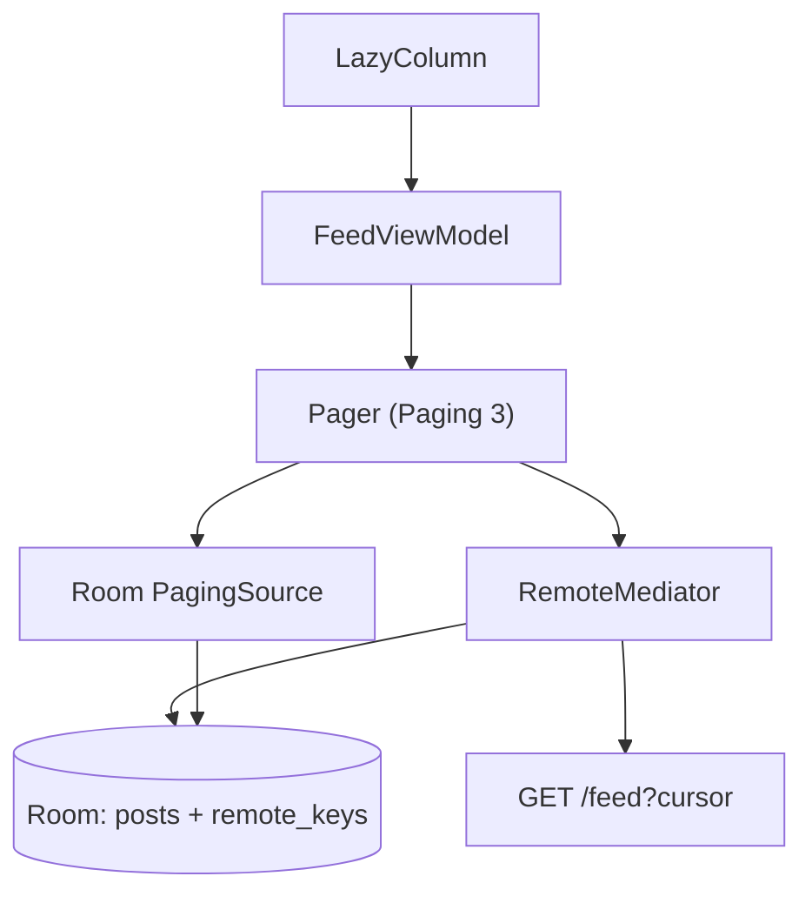

#### API

```
GET /feed?cursor=xyz&limit=20
→ { "items": [ { "id", "author", "text", "media": [ {url, w, h, type} ], "likeCount", "likedByMe", "createdAt" } ],
    "nextCursor": "abc" }
```

**Cursor pagination** beats offset here: when new posts are inserted at the top, an offset shifts and you see duplicates or skip items; a cursor ("items after this one") stays stable. Include media dimensions so the UI can reserve space and avoid layout jumps.

#### Paging 3 + RemoteMediator

- The `RemoteMediator` fetches a page from the network and writes it into Room in one transaction, storing the next cursor in a `remote_keys` table.
- The UI reads only from Room's `PagingSource`. When Room changes, the list updates automatically. Offline, the cached pages are still there.

```kotlin
@OptIn(ExperimentalPagingApi::class)
class FeedMediator(private val api: FeedApi, private val db: AppDb) : RemoteMediator<Int, PostEntity>() {
    override suspend fun load(loadType: LoadType, state: PagingState<Int, PostEntity>): MediatorResult {
        val cursor = when (loadType) {
            LoadType.REFRESH -> null
            LoadType.PREPEND -> return MediatorResult.Success(endOfPaginationReached = true)
            LoadType.APPEND -> db.remoteKeys().get("feed")?.nextCursor
                ?: return MediatorResult.Success(endOfPaginationReached = true)
        }
        return try {
            val page = api.feed(cursor, state.config.pageSize)
            db.withTransaction {
                if (loadType == LoadType.REFRESH) db.posts().clearFeed()
                db.posts().upsert(page.items.map { it.toEntity() })
                db.remoteKeys().put(RemoteKey("feed", page.nextCursor))
            }
            MediatorResult.Success(endOfPaginationReached = page.nextCursor == null)
        } catch (e: IOException) {
            MediatorResult.Error(e)
        }
    }
}
```

#### Other parts

- **Refresh**: pull-to-refresh triggers `REFRESH`. If new posts arrive while the user is scrolled down, show a "New posts" pill instead of jumping the scroll position.
- **Likes**: **optimistic update** in Room (`likedByMe = true, likeCount + 1`), then call the API; roll back on failure. Offline, queue the action in WorkManager. Make the API idempotent (`PUT /posts/{id}/like` rather than a toggle).
- **Media**: Coil/Glide with sized requests; **prefetch** images for the next few items; autoplay only the most visible video, with a **single reused ExoPlayer**; release it when scrolled off.
- **Performance**: stable `key`s and `contentType` in `LazyColumn` (or DiffUtil in RecyclerView), immutable UI models to avoid recomposition, and a **Baseline Profile** covering feed scroll.
- **Cache policy**: keep the last N pages and evict older ones; a TTL decides whether cached content is stale enough to auto-refresh on launch.
- **Analytics**: impression tracking with visibility thresholds (e.g. 50% visible for 1 s), deduped per session, batched and sent in the background.

**Common pitfalls**
- Making the network the source of truth → empty screen offline and flicker on refresh.
- Offset pagination → duplicates.
- Creating one video player per row → memory blowups.

**Likely follow-ups**
- *How is the feed ranked?* On the server; the client just renders the order it gets. The client can send signals (impressions, dwell time).
- *How do you show a post the user just created?* Insert it locally at the top immediately (optimistic), then reconcile with the server's version.
- *What about deleted posts?* A refresh replaces the cached page; for items further down, the server can include tombstones in sync responses.

</details>

### 5. Design an offline-first app (e.g. notes or to-do with sync).

<details>
<summary>Answer</summary>

**In short:** The local database is the source of truth: every read comes from Room and every write goes to Room first, marked with a sync status. A WorkManager sync engine pushes pending local changes (idempotent, keyed by client-generated UUIDs) and then pulls server changes since the last sync token, merging and resolving conflicts. Deletes are tombstones until synced. The UI never waits on the network.

#### Why offline-first

Mobile networks are unreliable: tunnels, elevators, flaky Wi-Fi. If every action needs the network, the app feels slow and loses user data. Offline-first makes the app instant and lets sync happen opportunistically.

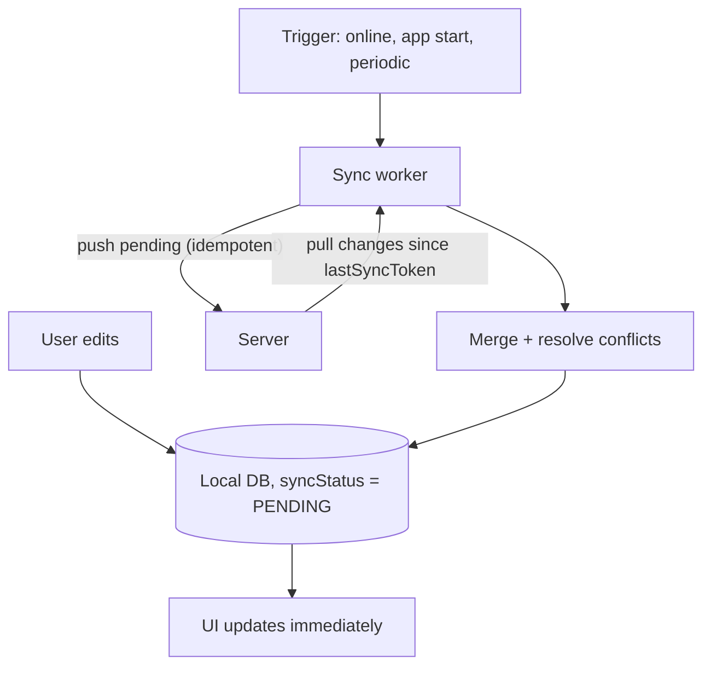

#### Data model

```kotlin
@Entity
data class NoteEntity(
    @PrimaryKey val id: String = UUID.randomUUID().toString(), // generated on the client
    val title: String,
    val body: String,
    val updatedAt: Long,
    val version: Int,             // server version this edit was based on
    val syncStatus: SyncStatus,   // SYNCED, PENDING_CREATE, PENDING_UPDATE, PENDING_DELETE
    val deleted: Boolean = false, // soft delete (tombstone)
)
```

- **Client-generated UUIDs** mean a note has a stable ID before the server ever sees it, and a retried create can't produce a duplicate.
- **Soft deletes**: a deleted note stays as a tombstone with `PENDING_DELETE` until the server confirms; otherwise the next pull would bring it back.

#### The sync engine

- **Triggers**: a one-time unique work enqueued on every local change (with `NetworkType.CONNECTED`), plus unique periodic work as a safety net, plus app start.
- **Push**: send pending changes in batches. The server applies them idempotently and returns new versions. Mark them `SYNCED`.
- **Pull**: `GET /changes?since=<lastSyncToken>` returns created/updated/deleted records and a new token. Apply in one transaction, skipping records that have newer local pending edits (those go through conflict resolution).

```kotlin
class SyncWorker(ctx: Context, params: WorkerParameters, private val repo: NotesRepo) :
    CoroutineWorker(ctx, params) {
    override suspend fun doWork(): Result = try {
        repo.pushPending()
        repo.pullChanges()
        Result.success()
    } catch (e: IOException) {
        Result.retry()    // WorkManager applies the backoff policy
    }
}
```

#### Conflict resolution

| Strategy | How | Good for |
|---|---|---|
| Last-write-wins | Highest server timestamp wins | Simple settings, low-stakes data |
| Version check | Server rejects edit if `version` is stale; client merges | Most CRUD apps |
| Field-level merge | Merge non-overlapping field changes | Records with many independent fields |
| CRDTs / operational transform | Mathematically mergeable data | Collaborative text editing |
| Ask the user | Show both versions | High-value documents |

Choose based on the domain: losing a to-do checkbox is fine; losing a paragraph of a note isn't.

#### UX

- Show a sync indicator ("Saved on device", "Syncing", "Synced"). Observe connectivity with `ConnectivityManager.NetworkCallback` to update it and to kick sync when the network returns.

**Common pitfalls**
- Hard-deleting locally before sync → the delete never reaches the server, or the item reappears.
- Server-generated IDs only → duplicates on retry, and you can't reference unsynced items.
- Trusting device clocks for last-write-wins.

**Likely follow-ups**
- *What if sync fails forever for one record?* Mark it `FAILED` after N attempts, surface it to the user, and don't block the rest of the queue.
- *How do you migrate the schema?* Room migrations locally; version the sync API so old clients still work.

</details>

### 6. Design a file download manager.

<details>
<summary>Answer</summary>

**In short:** Run each download as WorkManager work (unique per URL) that is promoted to foreground with a progress notification for long transfers (or a user-initiated data transfer job on Android 14+). Download into a `.part` file, persist progress in Room, and resume with HTTP `Range` headers after failures or process death. Limit parallelism, verify a checksum, then move the file to its final location. Retry with exponential backoff and respect user network preferences.

#### Requirements

Parallel downloads with a limit, pause/resume/cancel, progress notifications, survive app kill and reboot, retry on failure, storage checks, optional Wi-Fi only.

#### Architecture

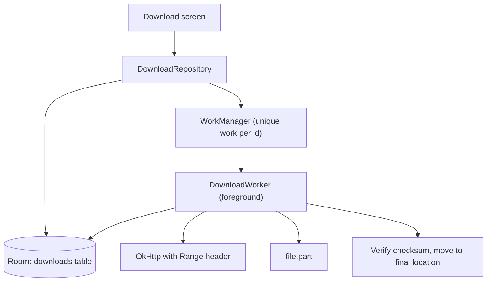

Room stores: `id, url, destination, totalBytes, downloadedBytes, status (QUEUED/RUNNING/PAUSED/FAILED/DONE), etag, checksum`. The UI observes this table, so progress survives rotation and process death.

#### Resume with Range requests

```kotlin
suspend fun downloadChunked(item: DownloadEntity, part: File, onProgress: suspend (Long) -> Unit) {
    val already = if (part.exists()) part.length() else 0L
    val request = Request.Builder()
        .url(item.url)
        .header("Range", "bytes=$already-")
        .apply { item.etag?.let { header("If-Range", it) } } // restart if file changed on server
        .build()

    client.newCall(request).await().use { resp ->
        val append = resp.code == 206           // 200 means server ignored Range: start over
        FileOutputStream(part, append).use { out ->
            val src = resp.body!!.source()
            val buf = ByteArray(64 * 1024)
            var total = if (append) already else 0L
            while (true) {
                coroutineContext.ensureActive()      // honours pause/cancel
                val n = src.read(buf)
                if (n == -1) break
                out.write(buf, 0, n)
                total += n
                onProgress(total)                    // throttle DB/notification updates
            }
        }
    }
}
```

#### Key decisions

- **Scheduling**: `enqueueUniqueWork(id, KEEP, request)` so the same download is never running twice. For long transfers, call `setForeground()` with a notification. On Android 14+, user-initiated transfers can use **user-initiated data transfer jobs** (JobScheduler), which get more runtime.
- **Pause**: cancel the work and set status `PAUSED`; the `.part` file stays. **Resume**: enqueue again; the Range header continues where it left off.
- **Concurrency**: cap parallel downloads (e.g. 3) with a `Semaphore` inside a single coordinator, or by chaining work. Too many parallel downloads compete for bandwidth with no speed gain.
- **Integrity**: verify size and checksum (from the server) before renaming `.part` to the final file. For user-visible files, insert into **MediaStore** (Downloads collection) so they show up in the Files app.
- **Network policy**: Wi-Fi only via `NetworkType.UNMETERED` constraint as a user setting.
- **Errors**: exponential backoff for transient errors; check free space (`StatFs`) before starting; on 403/410 from an expired signed URL, ask the server for a fresh URL; fail permanently on 404.
- **Progress updates**: throttle (e.g. every 500 ms or 1%) so you don't hammer Room and the notification manager.

**Common pitfalls**
- Writing directly to the final filename → a half-written file looks complete after a crash.
- Assuming the server supports Range: check for `206 Partial Content` and `Accept-Ranges`.
- Doing the download in a plain coroutine tied to a ViewModel → dies with the screen.

**Likely follow-ups**
- *Why not the system `DownloadManager`?* It's fine for simple public downloads, but gives less control over auth headers, custom storage, checksum and UI.
- *How would you speed up one big file?* Split into multiple Range segments downloaded in parallel, then concatenate, if the server allows it.

</details>

### 7. Design an analytics / logging SDK.

<details>
<summary>Answer</summary>

**In short:** Expose a tiny non-blocking API (`track(event, props)`) that hands events to a background queue, persists them to local storage so they survive process death, and uploads them in compressed batches via WorkManager (every N events, every T minutes, or when the app goes to the background). Cap storage, enrich with common context, respect consent and strip PII. Because it's an SDK, keep it small, dependency-light, lazily initialized, thread-safe and API-stable.

#### Requirements

- Never slow down or crash the host app.
- Don't lose events across process death or offline periods (within a storage cap).
- Battery and data friendly.
- Privacy compliant (consent, opt-out, no PII).

#### Pipeline

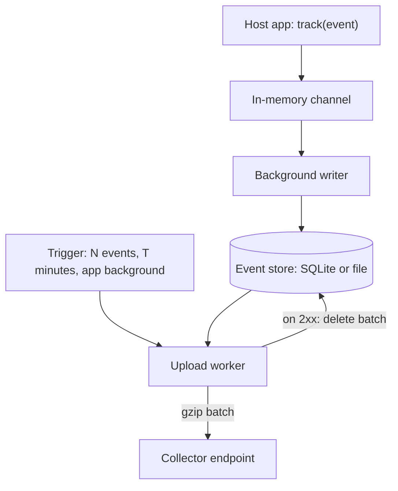

```kotlin
object Analytics {
    private val channel = Channel<Event>(capacity = 1_000, onBufferOverflow = BufferOverflow.DROP_OLDEST)
    private val scope = CoroutineScope(SupervisorJob() + Dispatchers.IO)

    fun track(name: String, props: Map<String, Any?> = emptyMap()) {
        if (!Consent.granted) return
        channel.trySend(Event(name, Scrubber.clean(props), System.currentTimeMillis())) // never blocks
    }

    internal fun start(store: EventStore) = scope.launch {
        for (e in channel) {
            runCatching { store.insert(e.withContext(DeviceContext.current)) } // SDK must never crash host
        }
    }
}
```

#### Design details

- **Persistence**: events go from the in-memory queue to a local DB or append-only file, so they survive process death.
- **Batching**: upload every N events or T minutes, and on app background (via `ProcessLifecycleOwner`). Use WorkManager with a network constraint and exponential backoff. Delete a batch only after a 2xx response; give each event a UUID so the server can dedupe retries.
- **Efficiency**: gzip payloads; cap storage (e.g. 5 MB or 10k events) and drop the oldest when full; **sample** very high-volume events.
- **Context**: attach app version, OS version, device model, locale, session ID, and an anonymous install ID.
- **Privacy**: gate collection on consent (GDPR/CCPA), scrub PII (emails, phone numbers), support opt-out and deletion requests, and declare collected data in the Play Data safety form.

#### SDK-specific concerns

| Concern | Approach |
|---|---|
| Footprint | Few or no transitive dependencies; small method count |
| Dependency conflicts | Avoid pulling large libs; shade or make them `compileOnly` if optional |
| Startup cost | Lazy init, no disk/network on the main thread at init |
| Thread safety | Single writer coroutine; immutable event objects |
| Shrinking | Ship `consumer-rules.pro` for R8 |
| Stability | Small public API; use binary-compatibility checks between versions |
| Failure isolation | Catch everything internally; a bug must not crash the host |

**Common pitfalls**
- Synchronous disk writes in `track()` → main-thread jank and StrictMode violations.
- Unbounded storage when the device is offline for weeks.
- Uploading on every event → battery and radio drain.

**Likely follow-ups**
- *How do you handle clock skew?* Send both device time and the upload time; the server adjusts timestamps by the difference with its own clock.
- *How do you test it?* Inject a fake clock, store and uploader; verify batching rules and that exceptions are swallowed.

</details>

### 8. Design a location tracking app (e.g. ride-sharing driver app / fitness tracker).

<details>
<summary>Answer</summary>

**In short:** Use the Fused Location Provider with a priority and interval matched to the current state, run continuous tracking in a foreground service of type `location` with a visible notification, buffer points in Room and upload them in batches (plus a WebSocket for live tracking when someone is watching). Filter noisy points, simplify the path, use geofencing instead of polling for arrival, and handle Doze, OEM battery killers, GPS-off and permission changes.

#### Requirements

- Driver/fitness case: accurate track while active; survive the app being backgrounded; minimal battery drain; work through poor connectivity.
- Live case: someone else sees the position within a few seconds.

#### Architecture

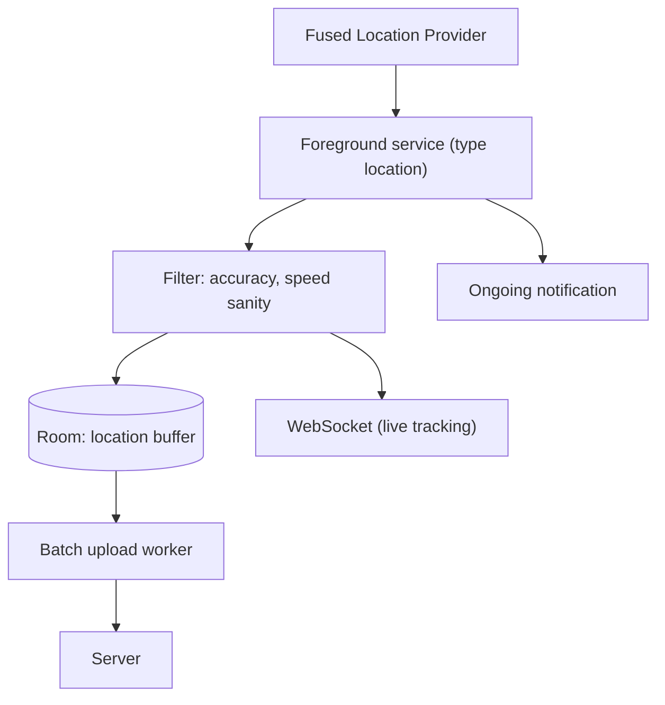

#### Getting locations

```kotlin
val request = LocationRequest.Builder(Priority.PRIORITY_HIGH_ACCURACY, 5_000L) // on a trip
    .setMinUpdateDistanceMeters(10f)
    .setMaxUpdateDelayMillis(30_000L)   // allow batching to save power
    .build()

fusedClient.requestLocationUpdates(request, callback, Looper.getMainLooper())
```

- Switch the request with the app state: `PRIORITY_HIGH_ACCURACY` every few seconds during a trip or run; `PRIORITY_BALANCED_POWER_ACCURACY` or passive when idle; stop entirely when not needed.
- **Permissions**: `ACCESS_FINE_LOCATION` (or coarse); `ACCESS_BACKGROUND_LOCATION` only if you truly need location without a visible foreground service, and it requires a separate request and Play policy justification. Since Android 14, foreground services must declare a type, so declare `foregroundServiceType="location"` and the `FOREGROUND_SERVICE_LOCATION` permission.

#### Processing and uploading

- **Filter** points with poor accuracy (e.g. > 50 m) and impossible jumps (speed > plausible maximum).
- **Simplify** stored paths for display with **Douglas-Peucker**, which drops points that don't change the shape much.
- **Buffer** in Room and **batch upload** every N points or seconds; uploading each point wakes the radio constantly. Each point has an ID so retries are idempotent.
- **Live tracking**: send the latest point over a WebSocket every few seconds only while a viewer exists (rider waiting, friend watching).

#### Robustness

- **Doze and OEM battery optimizations**: a foreground service keeps you running; some OEMs still kill apps, so detect gaps and guide users to battery settings where needed.
- **GPS off / permission revoked**: listen for `LocationSettingsRequest` results and permission changes; show a clear state instead of silently stopping.
- **Geofencing** (`GeofencingClient`) for arrival detection rather than constant polling.
- Restart tracking after process death or reboot if a trip is active (persist trip state).

**Common pitfalls**
- High-accuracy updates every second all day → battery drain and bad reviews.
- Requesting background location when a foreground service would do → Play policy rejection.
- Treating every GPS point as truth → jagged, zig-zag paths.

**Likely follow-ups**
- *How do you estimate distance travelled?* Sum distances between filtered points; smooth with a Kalman filter for better accuracy.
- *How does the driver location reach the rider?* Driver uploads to the server, the server pushes to the rider via WebSocket; the rider app interpolates between updates.

</details>

### 9. Design a video streaming app (like YouTube/Netflix).

<details>
<summary>Answer</summary>

**In short:** Use Media3 ExoPlayer with adaptive streaming (HLS or DASH) from a CDN so the bitrate adapts to bandwidth. Keep a single player instance with a clear lifecycle (release in `onStop`, or hand it to a `MediaSessionService` for background audio), support PiP and audio focus, and expose a `MediaSession` for system controls. Offline downloads use Media3's download APIs with DRM license persistence. Track playback quality metrics (startup time, rebuffering, bitrate switches) and sync resume positions.

#### Requirements

- Browse a catalog, play video quickly with minimal buffering, adapt to network quality, resume where you left off, download for offline (with DRM), PiP and background audio where allowed, casting.

#### How adaptive streaming works

The server encodes each video at several bitrates/resolutions (a "ladder", e.g. 240p to 4K) and splits each into short segments (a few seconds). A manifest (`.m3u8` for HLS, `.mpd` for DASH) lists them. The player downloads segment by segment and its **ABR** (adaptive bitrate) logic picks the quality for the next segment based on measured bandwidth and buffer level. Bad network → drop to 360p instead of stalling.

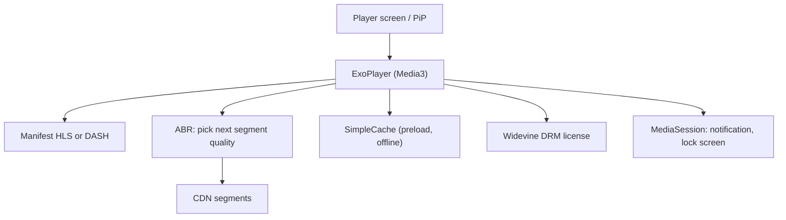

#### Player setup and lifecycle

```kotlin
class PlayerHolder(context: Context) {
    val player = ExoPlayer.Builder(context)
        .setAudioAttributes(
            AudioAttributes.Builder().setUsage(C.USAGE_MEDIA).setContentType(C.AUDIO_CONTENT_TYPE_MOVIE).build(),
            /* handleAudioFocus = */ true,
        )
        .setHandleAudioBecomingNoisy(true)   // pause when headphones unplugged
        .build()

    fun play(uri: String, startMs: Long) {
        player.setMediaItem(MediaItem.fromUri(uri), startMs)
        player.prepare()
        player.playWhenReady = true
    }
}
```

- **One player instance** per screen (or one shared across a feed). Release it in `onStop` (API 24+ multi-window) and save the position; recreate in `onStart`.
- For **background audio** (e.g. podcasts or a "play in background" premium feature), move the player into a `MediaSessionService`.
- **PiP**: `android:supportsPictureInPicture="true"`, call `enterPictureInPictureMode()` (or set auto-enter on API 31+), hide controls while in PiP.
- **MediaSession** gives notification, lock-screen, Bluetooth, Android Auto/Wear controls.

#### Offline downloads

- Media3's `DownloadManager` + `DownloadService` download segments (pick a quality) into a cache, run in the foreground, and survive process death.
- **DRM**: content protected with Widevine needs an **offline license**, downloaded and persisted with the content; it has an expiry the app must respect.

#### Feed and startup performance

- The browse UI is like the news feed design: paginated rows, prefetched thumbnails.
- **Fast start**: preload the first segments of the likely-next video into the cache, start with a moderate bitrate, and reuse the player.
- **Resume position**: stored locally (Room) and synced to the server so it works across devices.

#### Metrics to track

| Metric | Why |
|---|---|
| Startup time (time to first frame) | Biggest driver of abandonment |
| Rebuffering ratio | Core quality signal |
| Bitrate / resolution switches | Is ABR behaving well? |
| Playback errors | DRM, codec, network failures |

**Common pitfalls**
- Creating a new player per screen without releasing → decoder exhaustion (devices have a limited number of hardware decoders).
- Holding playback in a ViewModel-only scope → stops when the UI goes away.
- Ignoring audio focus → playing over a phone call.

**Likely follow-ups**
- *HLS vs DASH?* HLS is Apple's protocol and universally supported; DASH is an open standard. ExoPlayer supports both.
- *How do you implement casting?* Media3's Cast extension (`CastPlayer`) swaps the local player for a remote one, keeping the same session.

</details>

### 10. What caching strategies exist on mobile?

<details>
<summary>Answer</summary>

**In short:** The main read strategies are **cache-first** (show cached data, optionally refresh in the background: stale-while-revalidate), **network-first** (try the network, fall back to cache when offline), and **cache-only / network-only**. Caches live in layers: memory (LruCache), disk (Room/files) and the HTTP cache (OkHttp). The hard part is invalidation: TTLs, ETags/conditional requests, server-pushed invalidation, and version keys.

#### Strategies

| Strategy | Flow | Use for |
|---|---|---|
| Cache-first | Return cache if present; fetch only on miss | Static or slow-changing data (images, config) |
| Stale-while-revalidate | Show cache instantly, refresh in background, update UI | Feeds, profiles, most screens |
| Network-first | Try network; on failure show cache | Prices, balances, stock levels |
| Network-only | Never cache | Payments, one-time tokens, sensitive data |
| Cache-only | Never hit network | Offline mode, bundled data |

Stale-while-revalidate is the default for most mobile screens: instant UI plus fresh data a moment later.

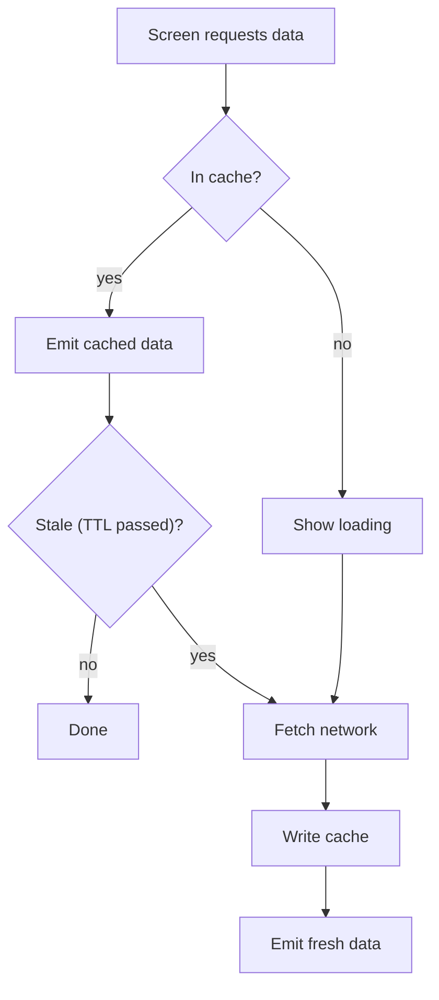

```kotlin
fun observeProfile(id: String): Flow<Profile> = flow {
    dao.profile(id)?.let { emit(it.toModel()) }                 // 1. cached value
    if (dao.isStale(id, maxAge = 10.minutes)) {
        runCatching { api.profile(id) }
            .onSuccess { dao.upsert(it.toEntity()) }            // 2. refresh
    }
    emitAll(dao.observe(id).map { it.toModel() })               // 3. keep observing the SSOT
}.distinctUntilChanged()
```

#### Layers

- **Memory** (`LruCache`, in-memory maps in repositories): fastest, lost on process death, must be bounded.
- **Disk** (Room, DataStore, files): survives restarts; Room makes it observable.
- **HTTP cache** (OkHttp `Cache`): honours `Cache-Control`, `ETag`/`If-None-Match` and `Last-Modified`. A `304 Not Modified` reply saves bandwidth because the body isn't resent.

```kotlin
val client = OkHttpClient.Builder()
    .cache(Cache(File(context.cacheDir, "http"), 50L * 1024 * 1024))
    .build()
```

#### Invalidation

- **TTL**: store `fetchedAt` and treat data as stale after N minutes.
- **ETags / conditional requests**: let the server say "unchanged".
- **Server push**: an FCM message or WebSocket event tells the app to invalidate a key.
- **Version keys**: include a schema/app version in cache keys, so a format change invalidates everything.
- **Event-driven**: after the user edits something, update or invalidate the related cache entries.

"There are only two hard things in computer science: cache invalidation and naming things." (Phil Karlton)

**Common pitfalls**
- Unbounded memory caches → OOM.
- Caching per-user data and not clearing it on logout → data leaks between accounts.
- Caching sensitive data on disk unencrypted.

**Likely follow-ups**
- *Where should cache logic live?* In the repository, so ViewModels don't know where data came from.
- *How do you force refresh?* Pull-to-refresh bypasses the TTL (and can send `Cache-Control: no-cache`).

</details>

### 11. Offset vs cursor pagination?

<details>
<summary>Answer</summary>

**In short:** **Offset** pagination (`?page=3&size=20`) is simple and lets you jump to page N, but inserts or deletes between requests cause **duplicates or skipped items**, and large offsets are slow on the server. **Cursor/keyset** pagination (`?after=<cursor>`) asks for "items after this one", so it's stable under inserts and efficient; you just can't jump to an arbitrary page. Cursor pagination is preferred for feeds and chat.

#### Why offset breaks on live data

Imagine a feed sorted newest first. You load page 1 (items 1–20). Before you load page 2, five new posts arrive at the top. Now `offset=20` starts at what used to be item 16, so items 16–20 appear twice. If items are deleted instead, you skip items.

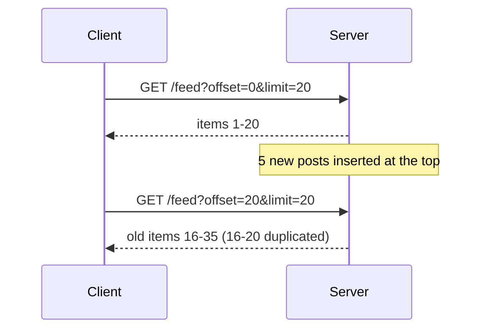

With a cursor, the second request is "20 items older than item 20", which is unaffected by new posts at the top.

#### Server-side cost

- Offset: `SELECT ... ORDER BY created_at DESC LIMIT 20 OFFSET 10000` makes the database walk past 10,000 rows.
- Keyset: `WHERE (created_at, id) < (:lastCreatedAt, :lastId) ORDER BY created_at DESC, id DESC LIMIT 20` uses an index to jump straight there.

The cursor is usually an **opaque encoded string** (e.g. base64 of the last item's sort key and ID) so the server can change its internals without breaking clients.

#### Comparison

| | Offset | Cursor / keyset |
|---|---|---|
| Stable under inserts/deletes | No | Yes |
| Jump to page N | Yes | No |
| Performance on deep pages | Degrades | Constant |
| Total count / page numbers | Easy | Extra query |
| Implementation | Trivial | Needs a unique, ordered key |
| Best for | Admin tables, search results with page numbers | Feeds, chat, timelines, infinite scroll |

#### On Android

Paging 3 works with both: the `PagingSource` key is a page number for offset or the cursor string for keyset. With `RemoteMediator`, store the `nextCursor` in a `remote_keys` table.

**Common pitfalls**
- Using a non-unique sort key (timestamp only) as the cursor → items with equal timestamps get skipped. Add the ID as a tie-breaker.
- Exposing raw DB IDs as cursors and later changing the sort order.

**Likely follow-ups**
- *How do you load newer items above?* Use a "before" cursor (prepend), or just refresh from the top.
- *Can you show "page 3 of 10" with cursors?* Not naturally; you'd need a separate count and can't jump directly.

</details>

### 12. How do you handle real-time updates? (Polling vs WebSocket vs SSE vs push)

<details>
<summary>Answer</summary>

**In short:** Choose by frequency and direction. **FCM push** for infrequent events and to wake the app in the background; **WebSocket** for frequent, bidirectional updates while the app is in the foreground (chat, live location); **SSE** for one-way server-to-client streams (live scores, progress, token streaming); **polling** with backoff only as a simple fallback. Close long-lived connections when the app goes to the background to save battery. See [Networking Q15](15-networking.md).

#### The options

| Mechanism | Direction | Latency | Battery | Works in background | Typical use |
|---|---|---|---|---|---|
| Short polling | Client asks repeatedly | Up to the interval | Poor if frequent | Via WorkManager (min 15 min periodic) | Simple status checks |
| Long polling | Client asks, server holds request | Low | Moderate | No | Legacy real-time |
| SSE | Server → client | Low | Moderate | No | Live scores, feeds, LLM streaming |
| WebSocket | Both ways | Lowest | Moderate (keep-alive) | No (closed in background) | Chat, multiplayer, live tracking |
| FCM push | Server → device | Usually seconds | Best (shared system connection) | Yes | Notifications, sync triggers |

**Why FCM is battery-best**: the system keeps one shared connection to Google's servers for all apps. Your app doesn't need its own socket, and it gets woken only when a message arrives. High-priority messages can wake the app from Doze, but should be used only for user-visible events.

#### A typical combined design

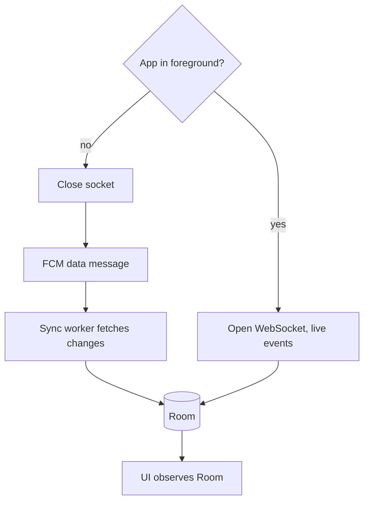

- Tie the WebSocket to `ProcessLifecycleOwner` (connect on `ON_START`, close on `ON_STOP`).
- Reconnect with **exponential backoff + jitter**, send **heartbeats** (ping/pong) to detect dead connections, and resync with a cursor after reconnect because events may have been missed.
- Treat push as a **signal to sync**, not as the data itself; FCM delivery isn't guaranteed and payloads are size-limited (4 KB).

```kotlin
class SocketLifecycle(private val socket: ChatSocket) : DefaultLifecycleObserver {
    override fun onStart(owner: LifecycleOwner) = socket.connect()
    override fun onStop(owner: LifecycleOwner) = socket.disconnect()
}
// ProcessLifecycleOwner.get().lifecycle.addObserver(SocketLifecycle(socket))
```

**Common pitfalls**
- Keeping a socket open in the background → battery drain, and Doze/background limits will break it anyway.
- Polling every few seconds → radio never sleeps.
- Not resyncing after reconnect → silently missed messages.

**Likely follow-ups**
- *SSE vs WebSocket?* SSE is plain HTTP, one-way, auto-reconnecting, easy through proxies; WebSocket is bidirectional and better when the client sends often.
- *What about MQTT?* A lightweight pub/sub protocol popular for IoT and some messaging apps; same foreground/background considerations.

</details>

### 13. How do you design for scale in a large codebase (many teams)?

<details>
<summary>Answer</summary>

**In short:** Split the app into **feature modules** with clear API/implementation boundaries so teams work independently, share a design system and core modules, wire everything with DI, and standardize builds with convention plugins. Add ownership (CODEOWNERS), feature flags for trunk-based development, CI that builds and tests only affected modules, stable internal APIs, and written decisions (ADRs). The goals are fast builds, few merge conflicts, and teams that can ship without blocking each other.

#### The problems at scale

With dozens of engineers in one `app` module you get: slow incremental builds (everything recompiles), merge conflicts, accidental coupling between features, unclear ownership, and risky releases where one team's bug blocks everyone.

#### Module structure

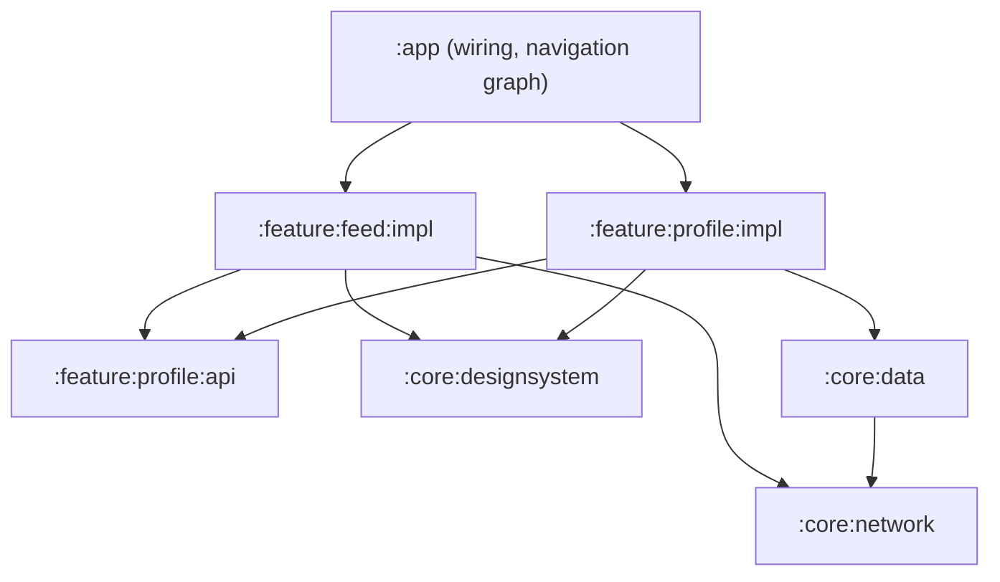

- **`api` / `impl` split**: other features depend only on the small `api` module (interfaces, navigation routes, models). The `impl` module can change freely, and changing it doesn't recompile its consumers.
- **Features never depend on other features' `impl`**: only `:app` sees all impls and wires them together via DI.
- **Core modules**: design system, networking, database, analytics, testing utilities.

#### Practices

| Practice | What it gives you |
|---|---|
| Convention plugins (`build-logic`) | One place for compileSdk, Kotlin options, lint config |
| DI per module (Hilt modules / Koin modules) | Features provide their own bindings |
| CODEOWNERS | Required reviews from the owning team |
| Feature flags + trunk-based development | Merge incomplete work safely, avoid long-lived branches |
| Affected-module CI | Only build/test what changed; faster PRs |
| Build cache (local + remote) | Reuse outputs across machines |
| API compatibility checks | Catch breaking changes to shared modules |
| ADRs (Architecture Decision Records) | Recorded reasoning, easier onboarding |
| Lint / custom rules and dependency rules | Enforce boundaries automatically |

#### Release management

- Release trains (e.g. weekly or bi-weekly) with a code freeze and staged rollouts.
- Kill switches via remote config for each risky feature.
- Per-feature crash and performance dashboards so owners see regressions.

**Common pitfalls**
- Creating modules by layer only (`:data`, `:domain`, `:ui`) → every feature change touches every module; feature modules scale better.
- A "common" or "utils" module that everything depends on and everyone changes → it becomes a bottleneck that recompiles the world.
- Too many tiny modules early → configuration overhead without benefit.

**Likely follow-ups**
- *How do features navigate to each other without depending on each other?* Through route definitions in `api` modules, or a navigation interface implemented in `:app`.
- *How do you measure success?* Build times, PR cycle time, crash-free rate per feature, and number of cross-team conflicts.

</details>

### 14. How do you implement feature flags and remote config?

<details>
<summary>Answer</summary>

**In short:** Use a remote config service (Firebase Remote Config, LaunchDarkly, or an in-house service) with **default values bundled in the app**. Fetch at startup in the background, cache locally, and activate new values at a safe moment (usually the next session) so the UI doesn't change under the user. Access flags through your own interface so they're testable and overridable from a debug menu. Uses: kill switches, gradual rollouts, A/B tests, and tuning values without a release.

#### Why

A mobile release takes days to reach most users, and you can't roll back an installed APK. Remote flags let you turn off a broken feature immediately, release to 1% → 10% → 100%, and run experiments.

#### Flow

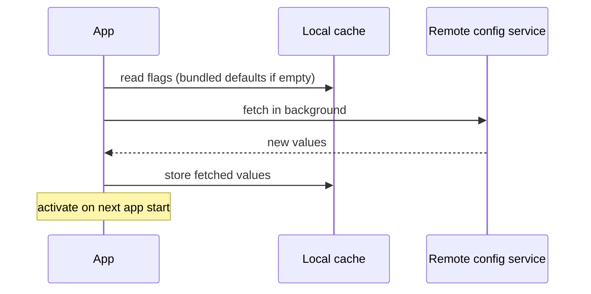

#### Wrapping flags behind an interface

```kotlin
enum class Feature(val key: String, val default: Boolean) {
    NEW_CHECKOUT("new_checkout", false),
    VIDEO_AUTOPLAY("video_autoplay", true),
}

interface FeatureFlags {
    fun isEnabled(feature: Feature): Boolean
}

class RemoteFeatureFlags(
    private val remote: FirebaseRemoteConfig,
    private val overrides: DebugOverrides,      // debug-menu overrides, no-op in release
) : FeatureFlags {
    override fun isEnabled(feature: Feature): Boolean =
        overrides.get(feature) ?: remote.getBoolean(feature.key)
}

// Usage
if (flags.isEnabled(Feature.NEW_CHECKOUT)) NewCheckoutScreen() else LegacyCheckoutScreen()
```

- Defaults: `remote.setDefaultsAsync(R.xml.remote_config_defaults)` so the app works offline and on first launch.
- Fetch: `fetchAndActivate()` at startup is simplest; `fetch()` now + `activate()` on next launch avoids mid-session UI changes.
- Tests inject a fake `FeatureFlags`.

#### Flag types

| Type | Example | Lifetime |
|---|---|---|
| Release toggle | Hide unfinished feature in trunk | Weeks; remove after launch |
| Kill switch | Disable a crashing payment provider | Permanent, rarely flipped |
| Experiment | A/B test checkout button color | Until the result is significant |
| Ops / config value | Page size, retry count, timeout | Permanent |
| Permission / entitlement | Premium feature | Permanent (often server-driven) |

#### Rollouts and targeting

Target by percentage, app version, country, device or user segment. Bucketing must be **sticky** (based on a stable user/install ID) so a user doesn't flip between variants. Log the exposure event when a user actually sees the variant, for clean experiment analysis.

**Common pitfalls**
- Flag debt: old flags never removed → dead code paths and confusing combinations. Track them and delete them after launch.
- Blocking app start waiting for a fetch.
- Using client-side flags for security (anyone can flip them on a rooted device); enforce entitlements on the server.

**Likely follow-ups**
- *How do you test all combinations?* You don't; test default and new paths for each flag, and keep flags independent.
- *How fast does a kill switch take effect?* On the next fetch; you can lower the minimum fetch interval or send an FCM message to trigger a refresh.

</details>

### 15. What non-functional aspects should you always mention?

<details>
<summary>Answer</summary>

**In short:** Beyond features, mention performance (startup, scrolling, memory), battery and data use, offline support and error handling, security, privacy, accessibility and localization, observability (crashes, logs, analytics, performance monitoring), testability, app size, and backward compatibility (API versioning and forced updates). Briefly naming how your design handles each shows senior-level thinking.

#### Checklist with what to say

| Area | What to mention |
|---|---|
| Performance | Cold start target, Baseline Profiles, lazy init, no jank in lists, memory limits (downsampled images, bounded caches) |
| Battery and data | Batching network calls, compression, WorkManager constraints (unmetered, charging), no background polling |
| Offline and errors | Local SSOT, retries with backoff, empty/error/loading states, idempotent writes |
| Security | Tokens in encrypted storage / Keystore, TLS (optionally certificate pinning), no secrets in the APK, R8 obfuscation |
| Privacy | Minimal permissions, runtime permission UX, PII scrubbing, consent, Play Data safety form |
| Accessibility | Content descriptions, touch target sizes, TalkBack order, dynamic font sizes, contrast |
| Localization | String resources, plurals, RTL layouts, locale-aware dates/numbers |
| Observability | Crash and ANR reporting, structured logs, analytics funnels, performance traces |
| Testability | Layered architecture, DI, fakes, UI tests for critical flows |
| App size | App Bundles, R8 resource shrinking, WebP/vector images, dynamic feature delivery |
| Backward compatibility | Versioned APIs, tolerant JSON parsing, minimum supported version from the backend |

#### Forced updates

Old app versions stay installed for years. The backend should support several API versions, and the app should check a **minimum supported version** (from remote config or an API) at startup. Below it, show a blocking "Update required" screen (Play's in-app updates API can do an immediate update); below a "recommended" version, show a soft prompt.

```kotlin
when {
    BuildConfig.VERSION_CODE < config.minSupportedVersion -> showForceUpdate()
    BuildConfig.VERSION_CODE < config.recommendedVersion  -> showSoftUpdatePrompt()
}
```

#### How to fit it into the interview

Don't recite the whole list at the end. Bring items up where they're relevant ("images are downsampled here, which matters for memory"), then use the wrap-up to cover what you skipped. Pick the 3–4 most important for the product: battery for a location app, security for banking, performance for a feed.

**Common pitfalls**
- Saying "we'll add security later": security, privacy and accessibility shape the design (e.g. what you store on disk).
- Forgetting app versioning: a breaking API change crashes every user who hasn't updated.

**Likely follow-ups**
- *How do you monitor performance in production?* Firebase Performance Monitoring or similar traces, Android vitals in Play Console (ANR and crash rates, slow frames), and custom startup metrics.
- *What metrics define success?* Crash-free users, ANR rate, cold start time, frame drop rate, plus product metrics.

</details>


---

## More System Design Problems

### 16. Design Instagram Stories.

<details>
<summary>Answer</summary>

**In short:** Cache the stories tray in Room so it shows instantly, serve media from a CDN in multiple resolutions, and make **preloading** the core of the design: when a story is on screen, the next 1–2 stories (and the first story of the next user) are already downloading. The viewer is a pager across users with timed progress segments that pause on press or backgrounding, uses one reused ExoPlayer, and records seen state locally, syncing it in batches. Expired stories are filtered on both client and server.

#### Requirements

- A horizontal tray of users with stories, unseen ones first and highlighted.
- A full-screen viewer that auto-advances (~5 s per image, video length for video); tap right/left for next/previous, hold to pause, swipe between users.
- Seen/unseen state; stories expire after 24 h.
- Instant start, no spinners between stories.

#### API and data

```
GET /stories/tray
→ [ { "userId", "avatar", "hasUnseen",
      "stories": [ { "id", "type": "image|video", "media": { "720": url, "1080": url },
                     "durationMs", "seen", "expiresAt" } ] } ]
POST /stories/seen   { "ids": [...] }   // batched
```

- Media comes from a **CDN**, in several resolutions; the client picks one by screen size and network type.
- Cache the tray in Room so the app opens with the tray already visible; refresh in the background.
- A local `seen_stories` table is updated immediately when a story is viewed (so the ring turns grey instantly) and flushed via WorkManager in batches, which also works offline.

#### Viewer and preloading

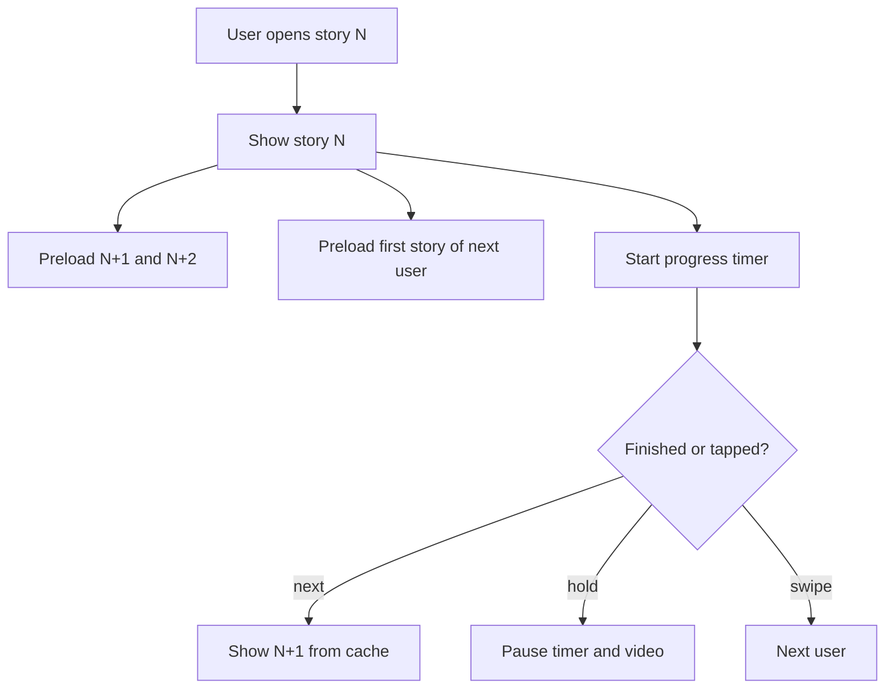

- **Images**: prefetch with Coil/Glide into the memory and disk cache at screen size.
- **Video**: preload the first few seconds into ExoPlayer's `SimpleCache` via `CacheDataSource` (Media3 also offers preloading helpers), so playback starts immediately.
- **UI**: a `HorizontalPager` across users. Within a user, a row of progress segments driven by an `Animatable` whose duration is the story's duration; pause on press and on `ON_PAUSE`; for video, drive progress from the player position and pause the timer while buffering.
- **One reused ExoPlayer**: swap media items rather than creating players.

```kotlin
val progress = remember(story.id) { Animatable(0f) }
LaunchedEffect(story.id, isPaused) {
    if (!isPaused) {
        val remaining = ((1f - progress.value) * story.durationMs).toInt()
        progress.animateTo(1f, tween(remaining, easing = LinearEasing))
        onNext()                                    // auto-advance
    }
}
```

#### Memory, expiry, analytics

- **Memory**: downsample images to screen size, release the player when the viewer closes, and bound caches.
- **Expiry**: filter by `expiresAt` on the client as well as the server (the cache might be old), and clean up old media in a periodic job.
- **Analytics**: view, completion rate, tap-forward/back, exits; batched.

**Common pitfalls**
- Loading each story only when it's shown → spinner on every tap, the main thing users notice.
- Preloading too aggressively on cellular → data waste; limit by network type.
- Timer that keeps running while the video buffers → story ends before it was seen.

**Likely follow-ups**
- *How do you post a story?* Capture/edit locally, upload in WorkManager (resumable for video), show it in the tray optimistically with an "uploading" state.
- *How is tray order decided?* Server-side ranking; the client only places unseen first if the server hasn't.

</details>

### 17. Design a networking library (like Retrofit/Volley).

<details>
<summary>Answer</summary>

**In short:** Split it into a declarative request API (annotated interfaces turned into calls via a dynamic proxy or code generation), a dispatcher that limits concurrency and supports cancellation, an **interceptor chain** for cross-cutting concerns (auth, logging, retries), a transport with connection pooling and HTTP/2 (in practice, OkHttp), an HTTP cache, pluggable converters for serialization, and response delivery as suspend functions/Flow with typed errors. Add request deduplication, test fakes, and minimal dependencies.

#### Goals

Simple API, async (coroutines), request/response transformation, interceptors, caching, retries, cancellation, testability, small footprint.

#### Architecture

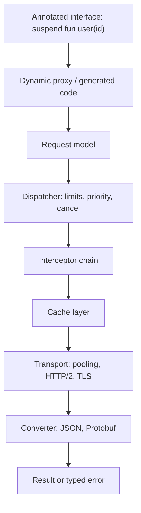

#### Components

1. **Request model**: method, URL, headers, body, priority, tag; built with a builder or from an annotated interface. Retrofit uses `java.lang.reflect.Proxy` to turn interface calls into requests at runtime; a KSP processor could generate the code at build time instead (faster, no reflection).
2. **Dispatcher / executor**: a thread pool or coroutine dispatcher with **max concurrent requests** overall and per host (OkHttp defaults to 64 and 5), priority queues, and **cancellation** by tag or coroutine Job.
3. **Interceptor chain** (Chain of Responsibility): each interceptor can modify the request, short-circuit, or retry.
4. **Transport**: connection pooling, HTTP/2 multiplexing, TLS, timeouts. In practice you wrap OkHttp rather than rewrite this.
5. **Cache layer**: memory + disk, honouring `Cache-Control` and ETags.
6. **Converters**: a factory interface so JSON (kotlinx.serialization, Moshi), Protobuf etc. are pluggable.
7. **Response delivery**: suspend functions or Flow; typed errors.
8. **Request deduplication**: merge identical in-flight GET requests.

```kotlin
fun interface Interceptor {
    suspend fun intercept(chain: Chain): Response
    interface Chain {
        val request: Request
        suspend fun proceed(request: Request): Response
    }
}

class AuthInterceptor(private val tokens: TokenStore) : Interceptor {
    override suspend fun intercept(chain: Interceptor.Chain): Response {
        val authed = chain.request.newBuilder().header("Authorization", "Bearer ${tokens.access()}").build()
        val response = chain.proceed(authed)
        if (response.code == 401 && tokens.refresh()) {          // refresh once, then retry
            return chain.proceed(chain.request.newBuilder()
                .header("Authorization", "Bearer ${tokens.access()}").build())
        }
        return response
    }
}

sealed interface NetError {
    data class Http(val code: Int, val body: String?) : NetError
    data class Network(val cause: IOException) : NetError
    data class Parse(val cause: Throwable) : NetError
}
```

#### Design trade-offs

| Decision | Options | Note |
|---|---|---|
| Interface binding | Reflection proxy vs code generation | Codegen avoids reflection cost and R8 keep rules |
| Async model | Callbacks, RxJava, coroutines | Coroutines give structured cancellation |
| Errors | Exceptions vs `Result` types | Typed results make error handling explicit |
| Retries | In interceptor vs caller | Only retry idempotent requests (GET, PUT with idempotency key) |

Also consider: lifecycle-aware cancellation, a mock/fake mode for tests, minimal dependencies, and R8 consumer rules shipped with the library.

**Common pitfalls**
- Retrying non-idempotent POSTs automatically → duplicate orders.
- Several concurrent 401s each triggering a token refresh: guard refresh with a Mutex.
- Delivering callbacks on a background thread to UI code.

**Likely follow-ups**
- *Application vs network interceptors (OkHttp)?* Application interceptors run once per call; network interceptors run per network request (including redirects) and see the actual wire request.
- *How would you test it?* MockWebServer for end-to-end behaviour; unit tests for each interceptor with a fake chain.

</details>

### 18. Design a ride-hailing app like Uber (rider side), and "nearby friends".

<details>
<summary>Answer</summary>

**In short:** Model the trip as a **server-authoritative state machine** persisted on the device so the app resumes correctly after process death. Use the Fused Location Provider (high frequency only during active states), a WebSocket (or MQTT) during an active ride for driver location, ETA and state, FCM when the app is in the background, and polling as a fallback. Smoothly animate the driver marker between updates, make ride requests idempotent, and save battery when idle. "Nearby friends" uses periodic coarse location (geohash) uploads with privacy controls instead of continuous GPS.

#### Core flow

Pick pickup/drop-off on a map → fare estimate → request ride → driver matched → **live driver tracking** → trip in progress → payment and rating.

#### Trip state machine

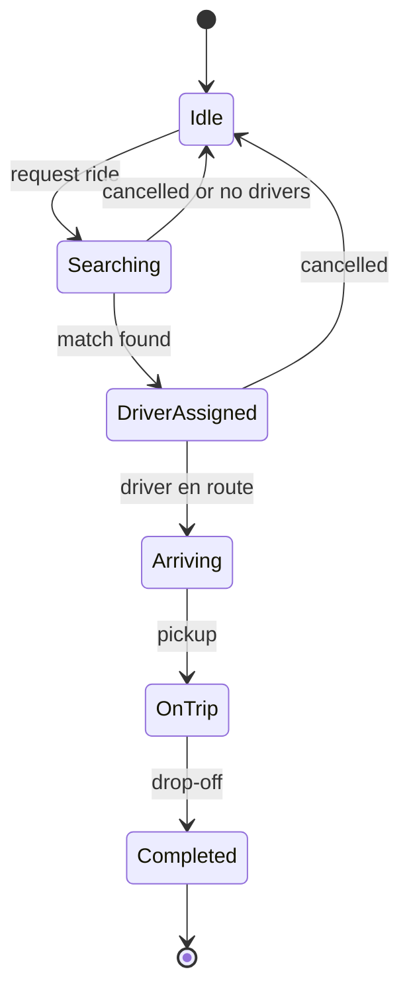

- The **server is authoritative**: the client renders the state it gets and sends intents ("request", "cancel").
- Persist the current trip ID and state (Room/DataStore). On cold start or after a crash, fetch `GET /trips/active` and jump straight back into the right screen.

#### Real-time

- During an active ride, a **WebSocket** (or MQTT) channel streams driver location every 2–5 s, ETA and state changes.
- If the socket can't connect, **poll** with backoff.
- In the background, **FCM** delivers key trip events ("Driver has arrived") as notifications.

#### Map rendering

- Google Maps SDK (Maps Compose). Location updates arrive every few seconds, so **interpolate/animate** the marker between them (linear interpolation of lat/lng plus bearing rotation) to avoid jumps.
- Snap-to-road is done on the server for accuracy.

```kotlin
fun animateMarker(marker: MarkerState, from: LatLng, to: LatLng, durationMs: Long, scope: CoroutineScope) =
    scope.launch {
        val anim = Animatable(0f)
        anim.animateTo(1f, tween(durationMs.toInt(), easing = LinearEasing)) {
            val t = value
            marker.position = LatLng(
                from.latitude + (to.latitude - from.latitude) * t,
                from.longitude + (to.longitude - from.longitude) * t,
            )
        }
    }
```

#### Reliability and battery

- **Idempotent ride requests**: a client request ID so a retry after a timeout doesn't book two rides.
- Handle network drops mid-trip: show the last known state with a "reconnecting" banner; the trip continues on the server.
- **Location**: Fused Location Provider; high frequency only while requesting or on a trip. On the driver app, a **foreground service of type `location`**.
- Stop high-frequency updates when idle; batch analytics.

#### Nearby friends variant

- Devices upload a **coarse location** periodically (e.g. every few minutes or on significant movement), encoded as a **geohash** (a string where shared prefixes mean nearby cells).
- The server returns friends in the same and neighbouring geohash cells.
- Use **geofencing** and significant-motion / low-power location updates instead of continuous GPS.
- **Privacy**: opt-in, per-friend sharing, approximate location only, easy pause, location data expires quickly.

**Common pitfalls**
- Keeping trip state only in memory → user reopens the app mid-trip and sees the home screen.
- Teleporting markers.
- Driving the state machine from the client (e.g. deciding a trip is complete locally).

**Likely follow-ups**
- *How is the ETA computed?* On the server with routing and traffic data; the client may count down between updates.
- *How does matching work?* Server-side; the client only shows "searching" and receives the result.

</details>

### 19. How do voice and video calls work in a mobile app?

<details>
<summary>Answer</summary>

**In short:** Calls typically use **WebRTC**: media flows peer-to-peer over UDP (SRTP, encrypted) using codecs like Opus and VP8/VP9/H.264/AV1. Your own **signaling** server (usually over WebSocket) exchanges SDP offers/answers and ICE candidates. **STUN** discovers public addresses; **TURN** relays media when direct connection fails. Group calls go through an **SFU**. On Android, incoming calls arrive via high-priority FCM, integrate with the system via `ConnectionService` / Core-Telecom, and run in a foreground service of the right type.

#### What WebRTC provides

Capture (camera, microphone), encoding/decoding (Opus for audio; VP8/VP9/H.264/AV1 for video), transport over UDP with **SRTP** encryption, jitter buffers, packet-loss concealment, echo cancellation, noise suppression, and bandwidth adaptation. What it **doesn't** provide is signaling: how two clients find each other.

#### Call setup

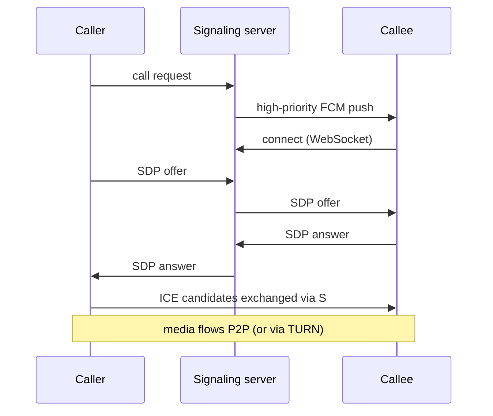

- **SDP** (Session Description Protocol) describes capabilities: codecs, media types, encryption fingerprints.
- **ICE candidates** are possible network paths (local IP, public IP via STUN, relay via TURN). ICE tries them and picks the best working pair.

#### NAT traversal

| Server | Role | Cost |
|---|---|---|
| STUN | Tells a device its public IP/port | Cheap, no media passes through |
| TURN | Relays media when P2P fails (symmetric NATs, firewalls) | Expensive: all media bandwidth flows through it |

A sizeable minority of calls need TURN, so you must run or buy TURN capacity.

#### Group calls

| Topology | How | Scale |
|---|---|---|
| Mesh | Everyone sends to everyone | A few participants (upload grows per peer) |
| SFU (Selective Forwarding Unit) | Each sends once to the server, which forwards streams | Most group calls; simulcast lets the SFU choose quality per receiver |
| MCU | Server mixes into one stream | Low client cost, high server cost |

#### Android specifics

- **Incoming calls**: a **high-priority FCM** data message wakes the app, which shows a full-screen-intent notification (`USE_FULL_SCREEN_INTENT`, which is restricted on newer Android versions for non-calling apps) or registers the call with the system via **`ConnectionService` / the Jetpack Core-Telecom library**, so it integrates with Bluetooth, car and wearables and other calls.
- **Foreground service** with the appropriate type: `phoneCall` (when using Telecom), or `microphone` / `camera`, plus the matching permissions.
- **Audio**: audio mode for communication, audio focus, routing between earpiece, speaker, wired and Bluetooth headsets.
- **Network changes** (Wi-Fi to cellular): trigger an **ICE restart** to find new paths without dropping the call.
- **Proximity sensor** to turn off the screen in voice calls; handle permissions for mic and camera.

Commercial SDKs (Agora, Twilio, Stream, LiveKit and others) wrap signaling, TURN, SFU and the Android integration.

**Common pitfalls**
- No TURN server → calls fail on many corporate and mobile networks.
- Not using Telecom/foreground service → call killed in background, poor Bluetooth behaviour.
- Treating signaling as part of WebRTC.

**Likely follow-ups**
- *Is WebRTC end-to-end encrypted?* P2P media is encrypted with DTLS-SRTP between peers; through an SFU, the server can see media unless you add an extra E2EE layer (insertable streams).
- *Why UDP?* Late packets are useless for real-time media; retransmission (TCP) adds latency.

</details>

### 20. Design a caching library and a logging library.

<details>
<summary>Answer</summary>

**In short:** A **caching library** offers `get / put / getOrFetch` over tiered storage (memory LRU → disk LRU with a crash-safe journal), with TTLs, size-based eviction, invalidation, thread safety and **single-flight** loading so concurrent misses trigger one load. A **logging library** offers levelled logging with pluggable sinks (like Timber's trees), writes asynchronously to rotating files, uploads compressed logs in the background, scrubs PII, and attaches recent logs to crash reports.

#### Caching library

**API**

```kotlin
interface Cache<K : Any, V : Any> {
    suspend fun get(key: K): V?
    suspend fun put(key: K, value: V, ttl: Duration = defaultTtl)
    suspend fun getOrFetch(key: K, ttl: Duration = defaultTtl, loader: suspend () -> V): V
    suspend fun invalidate(key: K)
    suspend fun invalidatePrefix(prefix: String)
}
```

**Tiers**

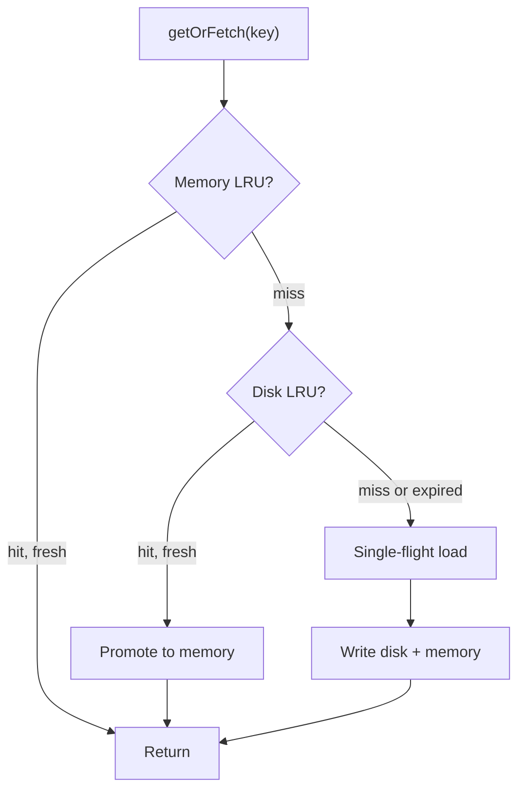

- **Memory**: LRU bounded by count or bytes (`LruCache` with `sizeOf`).
- **Disk**: files or SQLite with an LRU size cap and a **journal** for crash safety (like DiskLruCache: write to a temp file, then commit atomically).

**Policies**: TTL/expiry per entry, max size, eviction (LRU, or LFU for skewed access), invalidation by key or prefix, stale-while-revalidate.

**Single-flight loading**: if 10 coroutines miss the same key, only one runs the loader; the others await its result.

```kotlin
private val inFlight = mutableMapOf<K, Deferred<V>>()
private val lock = Mutex()

override suspend fun getOrFetch(key: K, ttl: Duration, loader: suspend () -> V): V {
    get(key)?.let { return it }
    val deferred = lock.withLock {
        inFlight.getOrPut(key) {
            scope.async { loader().also { put(key, it, ttl) } }
        }
    }
    return try { deferred.await() } finally { lock.withLock { inFlight.remove(key) } }
}
```

**Serialization**: pluggable serializers; store a format version so the cache is cleared when the format changes.

#### Logging library

- **API**: `Log.d/i/w/e(tag, msg, throwable)` with **levels** and pluggable **sinks/trees** (Logcat, file, remote), similar to Timber. Lazy message lambdas (`log.d { "expensive $x" }`) avoid string building when the level is disabled.
- **Non-blocking**: enqueue records to a background writer (a `Channel` consumed by one coroutine, or a `HandlerThread`). Buffer and write in batches to a file with **rotation** (max file size and count, e.g. 5 × 1 MB).
- **Remote upload**: compress and upload periodically or on demand (support asks the user to "send logs"), via WorkManager with Wi-Fi/charging constraints.
- **Privacy**: scrub PII (emails, tokens, phone numbers) before writing; release builds drop debug/verbose levels (and R8 can strip them).
- **Crash integration**: keep a ring buffer of the last N log lines as **breadcrumbs** and attach them to crash reports.

| Concern | Caching library | Logging library |
|---|---|---|
| Hot path cost | Memory lookup only | Enqueue only |
| Thread safety | Mutex / single writer | Single writer |
| Persistence | Journaled disk | Rotating files |
| Bounding | Size caps + eviction | Rotation + max files |

**Common pitfalls**
- Cache: unbounded memory, no versioning (old format crashes deserialization), per-user data surviving logout.
- Logging: synchronous file I/O on the main thread, logging tokens or PII, unbounded log files.

**Likely follow-ups**
- *LRU vs LFU?* LRU is simple and good for recency-driven access; LFU keeps popular items but adapts slowly when popularity shifts.
- *How do you keep logs useful in production?* Structured fields (key-value), session IDs to correlate, and sampling for noisy logs.

</details>

### 21. How do you handle data syncing when the network is unstable?

<details>
<summary>Answer</summary>

**In short:** Go offline-first: write to the local DB first with a sync status, and drain an **outbox** of pending operations with WorkManager (unique work, network constraint, exponential backoff). Make every operation **idempotent** with client-generated IDs so retries after timeouts don't duplicate. Keep units small and resumable (chunked uploads), sync deltas since a token rather than full refreshes, resolve conflicts with versions, and react to connectivity changes while showing sync status in the UI.

#### The core problem

On a flaky network, a request can fail, succeed but lose the response (timeout after the server processed it), or succeed partially. A robust design assumes any request may need to be retried, any number of times.

```mermaid
flowchart TD
    W["User action"] --> DB[("Local DB + outbox row")]
    DB --> UI["UI shows result instantly"]
    NET["Network available"] --> WK["WorkManager sync"]
    WK --> SEND["Send oldest outbox ops (idempotency key)"]
    SEND -->|"2xx"| DEL["Remove from outbox, mark SYNCED"]
    SEND -->|"timeout / 5xx"| RETRY["Retry with backoff"]
    SEND -->|"4xx conflict"| RES["Resolve conflict"]
    DEL --> PULL["Pull deltas since token"]
```

#### Techniques

- **Outbox queue**: a table of pending operations (`id, type, payload, attempts, createdAt`) processed in order by **WorkManager** with `enqueueUniqueWork`, `NetworkType.CONNECTED`, and exponential backoff.
- **Idempotency keys**: client UUIDs sent as an `Idempotency-Key` header or as the entity ID. The server stores processed keys and returns the original result for repeats.
- **Small, resumable units**: batch small changes into one request; upload large files in chunks with a resumable protocol so a drop at 90% doesn't restart from zero.
- **Delta sync**: `GET /changes?since=<token>` returns only what changed (including deletions), and a new token. Much less data than full refreshes.
- **Conflict resolution**: version numbers or timestamps; last-write-wins or domain-specific merge rules.
- **Connectivity**: `ConnectivityManager.NetworkCallback` to update the UI and trigger sync when the network returns (WorkManager constraints already handle the scheduling).
- **Protecting the server and battery**: timeouts, a **circuit breaker** (stop trying for a while after repeated failures), and deferring large transfers to unmetered networks.

```kotlin
val request = OneTimeWorkRequestBuilder<OutboxWorker>()
    .setConstraints(Constraints.Builder().setRequiredNetworkType(NetworkType.CONNECTED).build())
    .setBackoffCriteria(BackoffPolicy.EXPONENTIAL, 30, TimeUnit.SECONDS)
    .build()

WorkManager.getInstance(context)
    .enqueueUniqueWork("outbox-sync", ExistingWorkPolicy.APPEND_OR_REPLACE, request)
```

#### Ordering and failures

- Process outbox operations for the same entity in order (a create must reach the server before its update).
- After N attempts or a permanent error (4xx validation), mark the operation `FAILED` and surface it in the UI rather than retrying forever and blocking the queue.

**Common pitfalls**
- Retrying non-idempotent requests → duplicates (two orders, two messages).
- Treating a timeout as a failure and showing an error when the server actually succeeded.
- Full re-download of all data on each sync.

**Likely follow-ups**
- *How do you detect "connected but no internet" (captive portal)?* Check `NET_CAPABILITY_VALIDATED`, and treat request failures as the real signal.
- *How do you sync across multiple devices?* The server is the hub; each device pushes its changes and pulls deltas; versions resolve conflicts.

</details>

### 22. How does an app like "Where Is My Train" work without the internet?

<details>
<summary>Answer</summary>

**In short:** It combines **offline reference data** with **on-device signals**. Timetables, routes and stations are downloaded once and stored locally. Position comes from **cell tower IDs** (readable without mobile data) matched against an offline, crowdsourced tower-to-location database, with GPS as an optional, more battery-hungry source. Given the schedule, last known position and elapsed time, the app estimates the current position and delay on the device, and syncs live status and crowdsourced data when connectivity returns.

This answer describes how such an app is commonly reported to work; the general pattern is what matters in an interview.

#### Building blocks

```mermaid
flowchart TD
    TT[("Offline timetable DB")] --> INF["On-device inference"]
    CELL["Cell tower ID (TelephonyManager)"] --> MAP[("Offline tower to location map")]
    MAP --> INF
    GPS["GPS (optional)"] --> INF
    CLOCK["Elapsed time"] --> INF
    INF --> UI["Current station, delay, ETA"]
    NET["When online"] --> SYNC["Sync live status, upload anonymized data"]
    SYNC --> MAP
```

- **Timetable and route data**: stations, schedules, distances and route geometry in a compact local database (SQLite), updated occasionally via delta downloads.
- **Location without data**: the phone always knows which cell tower it's connected to (cell ID, location area code) from `TelephonyManager`, even with mobile data off, since it needs the cellular network for calls. The app maps tower IDs to positions along the track using an offline database built from crowdsourced observations (users' devices recording "tower X seen near station Y"). Note that reading cell info requires location permission on modern Android.
- **GPS** also works without internet (satellites, not the network) but is battery-heavy and often poor inside metal train carriages.
- **Inference**: knowing the train's scheduled path, the last confirmed position and the time since then, the app estimates where the train is and how late it's running, entirely on the device.
- **Sync** when online: fetch official running status, and upload anonymized tower observations to improve the mapping for everyone.

#### Design lessons

| Lesson | Applied here |
|---|---|
| Preload reference data | Timetables bundled/downloaded once |
| Use the cheapest adequate signal | Cell IDs before GPS |
| Compute on device | Position and delay estimated locally |
| Crowdsource to improve data | Tower mapping improves with users |
| Sync opportunistically | Live status when a connection exists |

**Common pitfalls (if you design something similar)**
- Assuming GPS is always available or cheap.
- Shipping a huge database in the APK; use downloadable, region-specific packs with delta updates.

**Likely follow-ups**
- *How accurate is cell-based location?* Hundreds of metres to a few kilometres, but on a known railway line that's enough to determine the nearest station segment.
- *How do you keep the offline DB fresh?* Versioned data packs; download diffs in the background on Wi-Fi.

</details>

### 23. Design a music or podcast player app that keeps playing in the background.

<details>
<summary>Answer</summary>

**In short:** Put an ExoPlayer inside a **Media3 `MediaSessionService`**, which runs as a foreground service of type `mediaPlayback` and owns a `MediaSession`. The UI connects through a `MediaController`. The session automatically exposes playback to the media notification, lock screen, headset buttons, Bluetooth, Android Auto and Wear OS. Handle audio focus and "becoming noisy", download episodes for offline with Media3's download APIs, and persist queue and positions so playback resumes after process death.

#### Architecture

```mermaid
flowchart TD
    UI["UI (Compose) + MediaController"] -->|"commands"| SVC["MediaSessionService (foreground, mediaPlayback)"]
    SVC -->|"state"| UI
    SVC --> P["ExoPlayer (Media3)"]
    SVC --> MS["MediaSession: notification, lock screen, Bluetooth, Auto, Wear"]
    P --> SRC["Streaming + download cache for offline"]
    SVC --> DB[("Room: library, queue, playback positions")]
```

Why a service: activities and ViewModels die when the user leaves the app; playback must outlive them. Why a session: it's the standard way for the system and other devices to control playback.

#### Key parts

- **Media3**: `ExoPlayer` for playback, `MediaSessionService` that owns the player and the `MediaSession`, and a `MediaController` in the UI (connected via a `SessionToken`).
- **Foreground service** with `foregroundServiceType="mediaPlayback"` and the `FOREGROUND_SERVICE_MEDIA_PLAYBACK` permission; Media3 creates and updates the media notification and handles moving in and out of foreground.

```kotlin
class PlaybackService : MediaSessionService() {
    private var session: MediaSession? = null

    override fun onCreate() {
        super.onCreate()
        val player = ExoPlayer.Builder(this)
            .setAudioAttributes(
                AudioAttributes.Builder().setUsage(C.USAGE_MEDIA).setContentType(C.AUDIO_CONTENT_TYPE_MUSIC).build(),
                /* handleAudioFocus = */ true,
            )
            .setHandleAudioBecomingNoisy(true)
            .build()
        session = MediaSession.Builder(this, player).build()
    }

    override fun onGetSession(info: MediaSession.ControllerInfo) = session

    override fun onDestroy() {
        session?.run { player.release(); release() }
        session = null
        super.onDestroy()
    }
}

// UI side
val token = SessionToken(context, ComponentName(context, PlaybackService::class.java))
val controllerFuture = MediaController.Builder(context, token).buildAsync()
```

- **Audio focus and noisy events**: with focus handling enabled, playback ducks or pauses for calls, navigation prompts and other apps; "becoming noisy" pauses when headphones are unplugged or Bluetooth disconnects.
- **Offline**: download episodes with Media3's `DownloadManager`/`DownloadService` into a cache; schedule automatic new-episode downloads with WorkManager on Wi-Fi and charging.
- **State**: persist the queue, current item and position (periodically and on pause) in Room, so podcasts resume where the user stopped; restore the session after process death. Media3 also supports playback resumption from the system media controls.
- **Library browsing for Auto/Wear**: use `MediaLibraryService` (a subclass) to expose a browsable tree.
- **Battery and data**: adaptive streaming where available, caching, and no wakelocks beyond what the player needs (ExoPlayer can manage wake and Wi-Fi locks via `setWakeMode`).
- Newer Android versions tighten background audio (e.g. Android 17 blocks audio playback and focus requests from apps not in a valid foreground/service state), so always play from the media session service.

**Common pitfalls**
- Playing audio from an Activity or ViewModel → stops when the UI goes away, or gets blocked by background restrictions.
- Building your own notification and session wiring instead of letting Media3 handle it → broken lock screen and Bluetooth controls.
- Not stopping the service when playback is paused and dismissed → a lingering notification.

**Likely follow-ups**
- *How do you implement a sleep timer?* A coroutine in the service that pauses the player after the delay (or at the end of the current episode).
- *How do playback speed and skip silence work?* `player.setPlaybackSpeed()` and ExoPlayer's skip-silence option; persist them per podcast.

</details>

### 24. Design a photo backup / upload app (like Google Photos backup).

<details>
<summary>Answer</summary>

**In short:** Detect new media through `MediaStore` (with the right media permissions, including Android 14's partial access), track each asset in a Room table with a content hash and upload status, and upload with WorkManager under user-configurable constraints (unmetered network, charging). Use **resumable chunked uploads** that persist the offset, dedupe by hash, show progress, and let the server store originals in object storage and generate thumbnails.

#### Requirements

Back up new photos and videos automatically, resume after interruptions, respect battery and mobile data, avoid duplicates, show progress, work across reinstalls.

#### Architecture

```mermaid
flowchart TD
    MS["MediaStore query / ContentObserver"] --> SCAN["Scanner: find new items"]
    SCAN --> DB[("Room: assets, hash, status, offset")]
    DB --> WM["WorkManager upload workers"]
    WM --> HASH{"Hash already on server?"}
    HASH -->|"yes"| DONE["Mark DONE"]
    HASH -->|"no"| UP["Resumable chunked upload"]
    UP --> DONE
    UP --> OBJ["Object storage + metadata DB"]
    OBJ --> TH["Server generates thumbnails"]
```

#### Access to media

- Request `READ_MEDIA_IMAGES` / `READ_MEDIA_VIDEO` on Android 13+ (older versions use `READ_EXTERNAL_STORAGE`).
- On Android 14+, the user can grant **partial access** (`READ_MEDIA_VISUAL_USER_SELECTED`), meaning only some photos are visible; the app must handle that gracefully and offer to change the selection.
- For one-off uploads (not full backup), use the **Photo Picker**, which needs no permission.

#### Detecting new media

- Query `MediaStore` for items added after the last synced point (`DATE_ADDED`, or the `GENERATION_ADDED` column on API 30+, which is more reliable than timestamps).
- A `ContentObserver` triggers a scan while the app is running; a periodic WorkManager job catches up otherwise.

#### Local state

```kotlin
@Entity(indices = [Index("status"), Index("contentHash")])
data class AssetEntity(
    @PrimaryKey val mediaStoreId: Long,
    val uri: String,
    val contentHash: String?,     // computed lazily (SHA-256 of bytes)
    val sizeBytes: Long,
    val status: UploadStatus,     // PENDING, UPLOADING, DONE, FAILED
    val uploadSessionUrl: String?,
    val bytesUploaded: Long,
)
```

#### Uploading

- **WorkManager** with constraints: `NetworkType.UNMETERED`, `setRequiresCharging(true)`, `setRequiresBatteryNotLow(true)`, all user-configurable ("back up over mobile data").
- For large, user-visible transfers use long-running workers with a foreground notification, or user-initiated data transfer jobs.
- **Resumable chunked uploads**: start an upload session, send chunks (e.g. 8 MB), persist `bytesUploaded` after each acknowledged chunk; after a failure, ask the server for the committed offset and continue. Pre-signed multipart URLs to object storage are an alternative. Retry with exponential backoff.

```kotlin
var offset = server.queryOffset(asset.uploadSessionUrl!!)      // what the server already has
contentResolver.openInputStream(asset.uri.toUri())!!.use { input ->
    input.skipNBytes(offset)
    val buf = ByteArray(CHUNK)
    while (offset < asset.sizeBytes) {
        val n = input.readNBytes(buf, 0, CHUNK)
        server.putChunk(asset.uploadSessionUrl, offset, buf, n)
        offset += n
        dao.updateProgress(asset.mediaStoreId, offset)
        setProgress(workDataOf("progress" to offset * 100 / asset.sizeBytes))
    }
}
```

- **Deduplication**: hash the file and ask the server whether it already has that hash, so reinstalls, duplicate files or a second device don't upload the same bytes twice.
- **Progress**: expose WorkManager progress (`setProgress` / `getWorkInfoByIdFlow`) to the UI and notification ("Backing up 23 of 140").
- **Server side**: originals in object storage, metadata (owner, hash, EXIF, timestamps) in a database; thumbnails and other derivatives generated after upload.

**Common pitfalls**
- Reading entire videos into memory → OOM; always stream.
- Relying only on `DATE_ADDED` → misses items with wrong timestamps (e.g. restored files).
- Uploading over mobile data by default → angry users with big bills.
- Restarting a 2 GB upload from zero after every drop.

**Likely follow-ups**
- *How do you handle deletions?* Decide the policy (backup keeps the copy vs mirror sync); if mirroring, detect missing MediaStore IDs and confirm with the user.
- *How do you free up device space?* After confirmed upload, offer to delete local originals via `MediaStore.createDeleteRequest` (requires user confirmation).

</details>

---

[⬅ Previous: Build, Gradle & Release](22-build-gradle-release.md) · [⬅ Back to index](../README.md) · [Next: What's New & Trending ➡](24-whats-new-trending.md)
