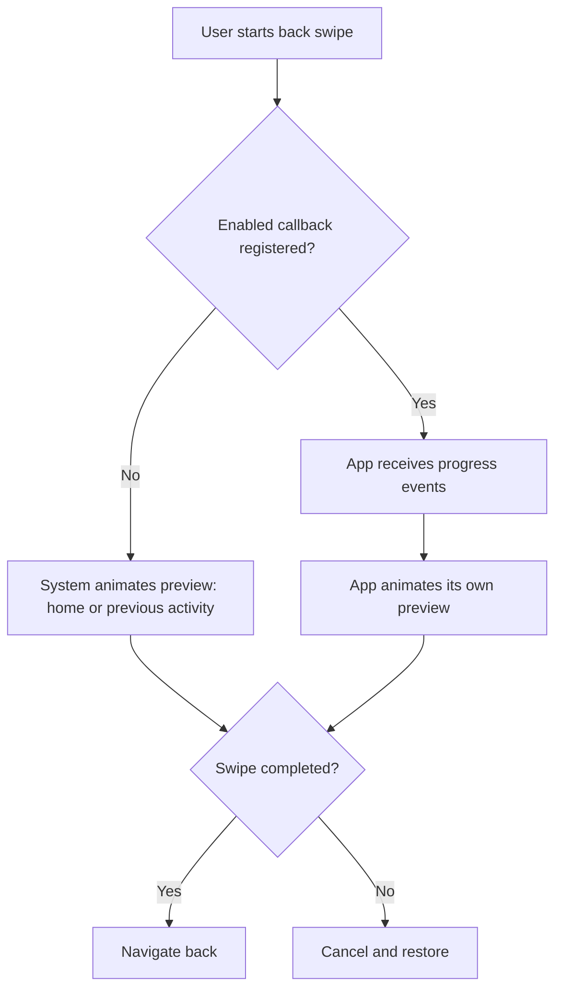
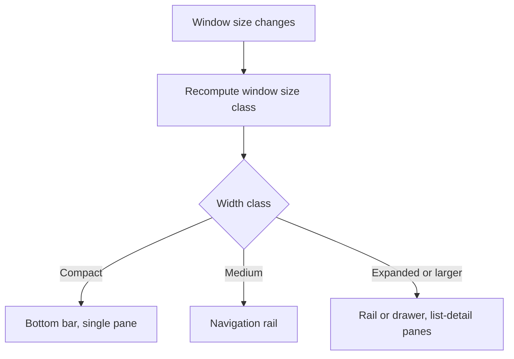
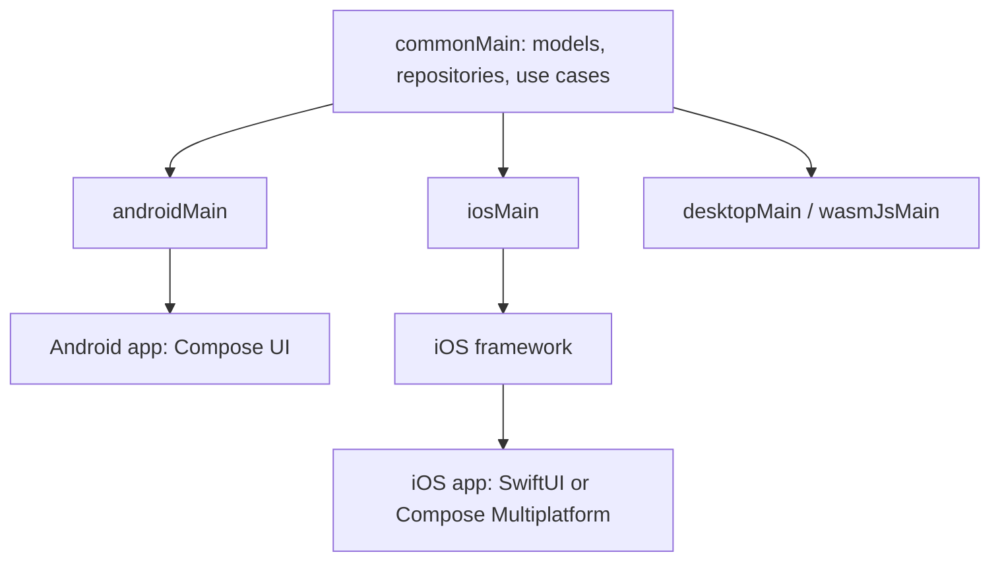
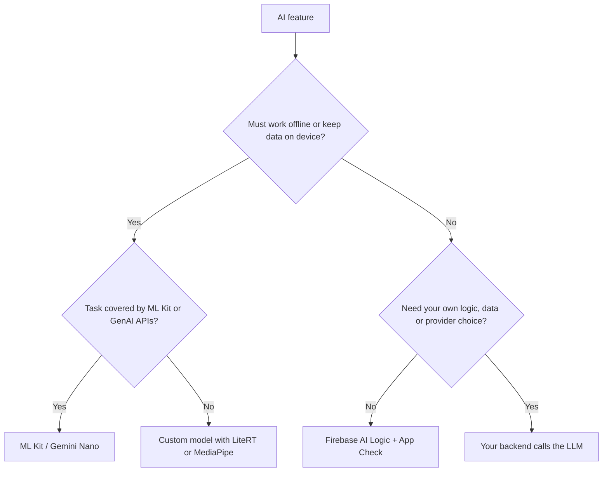
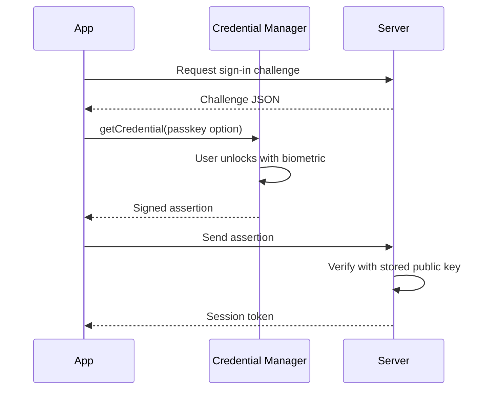
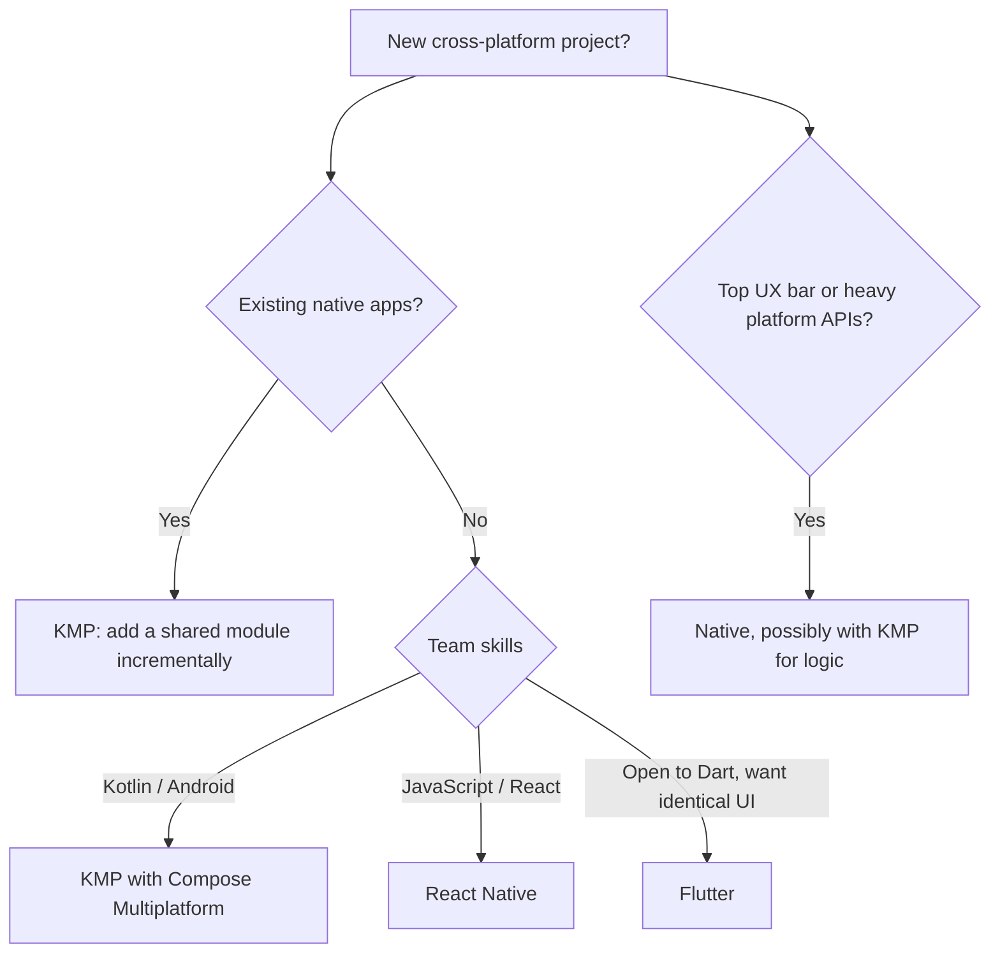

# What's New & Trending in Android

[⬅ Back to index](../README.md)

Interviewers love asking *"What's new in Android?"* or *"What recent changes have you worked with?"*. This section covers the trending topics from roughly 2024 onward. Always check the official release notes before an interview for the very latest.

---

## Platform Changes

### 1. What are the key changes in Android 14 (API 34)?

<details>
<summary>Answer</summary>

**In short:** Android 14 tightened background work and privacy: foreground services must declare a **type** (with a matching permission), users can grant **partial photo/video access**, exact alarms are **denied by default**, and runtime receivers must say whether they are **exported**. It also added **non-linear font scaling up to 200%** and **user-initiated data transfer jobs**.

Most Android 14 changes affect you only once you **target API 34**, though a few (such as the minimum installable targetSdk) apply to every app. Here is what each change means in practice.

#### Foreground service types are mandatory

Each foreground service must declare `android:foregroundServiceType` in the manifest, hold the type-specific permission, and pass the type to `startForeground()`. The system can then check that a "location" service really does location work, and Play asks you to justify each type.

```xml
<uses-permission android:name="android.permission.FOREGROUND_SERVICE" />
<uses-permission android:name="android.permission.FOREGROUND_SERVICE_LOCATION" />

<service
    android:name=".TrackingService"
    android:foregroundServiceType="location"
    android:exported="false" />
```

```kotlin
ServiceCompat.startForeground(
    this, NOTIFICATION_ID, notification,
    ServiceInfo.FOREGROUND_SERVICE_TYPE_LOCATION
)
```

If your work doesn't fit a type, use WorkManager or a user-initiated data transfer job.

#### Partial photo and video access

When an app requests `READ_MEDIA_IMAGES` / `READ_MEDIA_VIDEO`, the user can pick **"Select photos and videos"** and grant only some items. Apps should declare `READ_MEDIA_VISUAL_USER_SELECTED`, handle the "partial" state, and let the user add more photos later. The better option is usually the [Photo Picker](#14-what-is-the-photo-picker-and-why-does-google-push-it), which needs no permission at all.

#### Exact alarms denied by default

`SCHEDULE_EXACT_ALARM` is no longer pre-granted to most newly installed apps targeting 13+. Check `alarmManager.canScheduleExactAlarms()` and, if needed, send the user to `Settings.ACTION_REQUEST_SCHEDULE_EXACT_ALARM`. `USE_EXACT_ALARM` is granted automatically but Play allows it only for real alarm clock and calendar apps.

#### Exported flag for runtime receivers

Context-registered receivers must state whether other apps can send to them; otherwise registration throws a `SecurityException`.

```kotlin
ContextCompat.registerReceiver(
    context, receiver, IntentFilter(ACTION_SYNC_DONE),
    ContextCompat.RECEIVER_NOT_EXPORTED // only your app can send this
)
```

#### Other notable changes

| Change | What to do |
|---|---|
| **Non-linear font scaling** up to 200% | Always use `sp` for text; large text grows less than small text, so don't convert `sp` to px with a fixed multiplier |
| Implicit intents and mutable PendingIntents restricted | Use explicit intents for your own components; implicit intents only reach exported components |
| Minimum installable targetSdk raised to **23** | Very old apps can't be installed (stops malware that targets old SDKs to avoid runtime permissions) |
| **Screenshot detection** API | `Activity.ScreenCaptureCallback` tells you a screenshot was taken (it doesn't block it; use `FLAG_SECURE` for that) |
| **Credential Manager** integration | System-level support for passkeys and password providers |
| **Predictive back** animations | Available behind a developer option |
| Regional preferences | Users choose temperature units, first day of week, etc., independently of language |
| **User-initiated data transfer jobs** | `JobInfo.Builder.setUserInitiated(true)` for long user-started uploads/downloads instead of an FGS |

**Common pitfalls**
- Starting a foreground service without a type when targeting 34 crashes with `MissingForegroundServiceTypeException`.
- Assuming exact alarms always work: check `canScheduleExactAlarms()` and handle revocation.

**Likely follow-ups**
- *What replaces an FGS for big uploads?* A user-initiated data transfer job, or WorkManager for deferrable work.
- *Does screenshot detection prevent screenshots?* No, it only notifies; `FLAG_SECURE` prevents them.

</details>

### 2. What are the key changes in Android 15 (API 35)?

<details>
<summary>Answer</summary>

**In short:** Android 15 **enforces edge-to-edge** for apps targeting 35, adds **16 KB memory page size** support (native libraries must be aligned, and Play requires it for apps targeting 15+), puts **time limits** on `dataSync`/`mediaProcessing` foreground services, and introduces **private space**, **partial screen sharing**, and the `ApplicationStartInfo` API.

#### Edge-to-edge enforced

For apps targeting 35, windows draw behind the status and navigation bars by default: the system bars become transparent and your content goes underneath. If you don't apply window insets, toolbars slide under the status bar and buttons hide behind the gesture bar. See [Q4](#4-what-is-edge-to-edge-and-why-is-it-important-now).

#### 16 KB page size

Android has always used 4 KB memory pages. Devices with 16 KB pages get faster app launches and better overall performance, but native code (`.so` files) must be **built and packaged with 16 KB ELF segment alignment**, or it may fail to load on those devices.

- Pure Kotlin/Java apps are unaffected.
- Apps with native code (your own NDK code, or SDKs that bundle `.so` files such as some media, ML or game libraries) need a recent AGP/NDK, a rebuild, and updated third-party SDKs.
- Check with the APK Analyzer in Android Studio (it flags misaligned libraries) and test on a 16 KB emulator image.

```cmake
target_link_options(mylib PRIVATE "-Wl,-z,max-page-size=16384")  # needed on older NDKs
```

#### Foreground service changes

| Change | Effect |
|---|---|
| `dataSync` and `mediaProcessing` time limits | The system calls `Service.onTimeout()` after the daily limit; you must stop the service there or the app crashes |
| No FGS from `BOOT_COMPLETED` for certain types | `BOOT_COMPLETED` receivers can't start FGS of types such as `dataSync`, `camera` or `mediaPlayback`; use WorkManager instead |

```kotlin
override fun onTimeout(startId: Int, fgsType: Int) {
    // Save progress and stop; schedule the rest with WorkManager
    stopSelf(startId)
}
```

#### Other changes

- **Private space**: a separate, lockable profile for sensitive apps. Apps inside it are hidden and stopped when it's locked, so don't assume your app always runs or receives broadcasts.
- **Partial screen sharing**: users can share or record a single app window instead of the whole screen.
- **Predictive back**: the system animations (back-to-home, cross-activity, cross-task) are now enabled for apps that opted in, no developer option needed.
- **Safer intents**: intents must match the target component's intent filter more strictly.
- `elegantTextHeight` defaults to `true`, which changes line height for some scripts; check text layouts.
- **ApplicationStartInfo** (`ActivityManager.getHistoricalProcessStartReasons()`): tells you why the process started (launcher, broadcast, service...), whether it was cold or warm, and timing details. Very useful for startup metrics in production.

**Common pitfalls**
- Thinking 16 KB only matters for game developers: a single bundled SDK with native code is enough to be affected.
- Ignoring `onTimeout()`: the service crashes if it keeps running past the limit.

**Likely follow-ups**
- *How do you test for 16 KB?* Use the 16 KB emulator system image, or the developer option on supported devices, plus APK Analyzer alignment checks.
- *Why do pages matter to apps?* Native libraries are memory-mapped; segments must align to the page size to be mapped.

</details>

### 3. What are the key changes in Android 16 (API 36)?

<details>
<summary>Answer</summary>

**In short:** For apps targeting 36, Android 16 **ignores orientation, resizability and aspect-ratio restrictions on displays ≥ 600 dp**, removes the **edge-to-edge opt-out**, turns **predictive back on by default**, and adds **progress-centric notifications (Live Updates)**. It also marked the move to a **faster release cadence**: a major release in Q2 2025 and a minor SDK release later in the year.

#### Large screens: your locks are ignored

Many apps set `android:screenOrientation="portrait"` or `resizeableActivity="false"` to avoid handling tablets. That produced letterboxed, tiny phone UIs on tablets and foldables. For apps targeting 36, on displays at least 600 dp wide (tablets, unfolded foldables, desktop windows), the system **ignores**:

- `screenOrientation` and `setRequestedOrientation()`
- `resizeableActivity`
- `minAspectRatio` / `maxAspectRatio`

So your app must handle being any size and orientation, and must survive configuration changes without losing state. Android 16 gave a temporary way to opt out; Android 17 removes it (see [Q22](#22-what-are-the-key-changes-in-android-17-api-37)).

#### Edge-to-edge opt-out removed

Android 15 let apps set `windowOptOutEdgeToEdgeEnforcement` as a temporary escape hatch. For apps targeting 36 it no longer has any effect, so insets handling is mandatory.

#### Predictive back on by default

For apps targeting 36, predictive back system animations are on by default, `onBackPressed()` is **no longer called**, and `KEYCODE_BACK` isn't dispatched. Move Back handling to `OnBackPressedCallback` / `BackHandler` (see [Q5](#5-what-is-predictive-back)).

```kotlin
// Before: override fun onBackPressed() { ... }  <- not called on targetSdk 36
onBackPressedDispatcher.addCallback(this) {
    if (viewModel.hasUnsavedChanges()) showDiscardDialog() else finish()
}
```

#### Progress-centric notifications (Live Updates)

`Notification.ProgressStyle` models a journey: segments, points (pickup, drop-off) and a tracker icon moving along. It is meant for ride-sharing, food delivery and navigation, where the user watches progress toward a goal.

#### Other changes

- **JobScheduler quota changes**: jobs get a runtime quota based on app standby bucket, and jobs running alongside a foreground service follow the quotas too. Expect jobs to be stopped earlier if you rely on long runtimes.
- **Adaptive refresh rate**: APIs to check support and hint at frame rates, so the display can lower its refresh rate to save power.
- **Health permissions** move to Health Connect's granular permissions (for example, body sensors read via Health Connect permissions).

**Release cadence**

| | Timing |
|---|---|
| Major release (Android 16) | Q2 2025, can include behavior changes |
| Minor SDK release | Later in the year, new APIs and features, no app-impacting behavior changes |

**Likely follow-ups**
- *Why did Google force resizability?* Large-screen and foldable usage is growing, and letterboxed apps give a poor experience; it also prepares apps for desktop windowing and XR.
- *How do you check your app?* Run it on a tablet/foldable emulator and resizable emulator, rotate, resize in multi-window, and confirm no state is lost.

</details>

### 4. What is edge-to-edge and why is it important now?

<details>
<summary>Answer</summary>

**In short:** Edge-to-edge means the app draws its content **behind the status and navigation bars**, then uses **window insets** to keep important content clear of them. It's enforced since targetSdk 35, so every app must call `enableEdgeToEdge()` (or accept the default) and apply insets via `Scaffold` padding, `WindowInsets.safeDrawing` or `ViewCompat.setOnApplyWindowInsetsListener`.

#### Why it exists

Modern phones use gesture navigation with a thin handle, and tall screens with cutouts. Painting solid bars wastes space and looks dated. Drawing behind transparent bars makes scrolling lists, maps and images fill the screen. The catch: the system bars now **overlap** your content, so you must pad interactive elements.

#### Insets you'll meet

| Inset type | What it covers |
|---|---|
| `statusBars` | Status bar at the top |
| `navigationBars` | Gesture handle or 3-button bar |
| `ime` | On-screen keyboard |
| `displayCutout` | Camera notch / hole punch |
| `systemGestures` | Edges where swipes go to the system |
| `safeDrawing` | Union of everything you shouldn't draw important content under |

#### Compose

```kotlin
class MainActivity : ComponentActivity() {
    override fun onCreate(savedInstanceState: Bundle?) {
        enableEdgeToEdge()            // transparent bars, correct icon contrast
        super.onCreate(savedInstanceState)
        setContent {
            Scaffold { innerPadding ->   // Scaffold computes insets for its bars
                LazyColumn(contentPadding = innerPadding) { /* items */ }
            }
        }
    }
}

// Without Scaffold:
Column(Modifier.windowInsetsPadding(WindowInsets.safeDrawing).imePadding()) { ... }
```

Pass insets as `contentPadding` to lazy lists (not as `Modifier.padding`) so items scroll **behind** the bars but the last item can still be scrolled clear of them.

#### Views

```kotlin
ViewCompat.setOnApplyWindowInsetsListener(binding.root) { view, insets ->
    val bars = insets.getInsets(
        WindowInsetsCompat.Type.systemBars() or WindowInsetsCompat.Type.displayCutout()
    )
    view.updatePadding(left = bars.left, top = bars.top, right = bars.right, bottom = bars.bottom)
    WindowInsetsCompat.CONSUMED
}
```

For a `RecyclerView`, set bottom padding plus `android:clipToPadding="false"`.

**Common pitfalls**
- A **FAB or bottom button** hidden behind the gesture bar.
- **Toolbar text** under the status bar.
- The **keyboard covering** a text field: use `imePadding()` (Compose) or handle `ime` insets.
- Ignoring **display cutouts** in landscape.
- Hardcoding status bar height instead of reading insets.

**Likely follow-ups**
- *Can you still opt out?* On targetSdk 35 temporarily via `windowOptOutEdgeToEdgeEnforcement`; on 36 no.
- *What does `enableEdgeToEdge()` do?* Makes bars transparent and sets light/dark icon colors for contrast, on all API levels it supports.

See [UI Q23](10-ui-views.md).

</details>

### 5. What is predictive back?

<details>
<summary>Answer</summary>

**In short:** Predictive back is a back gesture that shows a **preview** of where Back will take you (home screen, previous Activity, previous fragment or composable) while the user is still swiping, so they can cancel. To make it work, apps must declare **ahead of time** whether they'll handle Back, using `OnBackPressedCallback`, `BackHandler` or `PredictiveBackHandler`. Overriding `onBackPressed()` breaks it.

#### Why the old way can't work

With `onBackPressed()`, the system only learns what the app wants **after** the gesture finishes. To animate a preview of the home screen while the finger is still moving, the system needs to know **at the start** of the gesture whether the app will intercept Back. So the API changed from "tell me when Back happens" to "register a callback now, enable or disable it as your state changes".



#### How to adopt it

1. Opt in (needed on older target SDKs): `android:enableOnBackInvokedCallback="true"` in the manifest. From targetSdk 36 it's on by default.
2. Replace `onBackPressed()` overrides with callbacks whose **enabled state** mirrors whether you want to intercept.

```kotlin
// Views / Activity: only enabled while a drawer is open
val callback = object : OnBackPressedCallback(false) {
    override fun handleOnBackPressed() = drawer.close()
}
onBackPressedDispatcher.addCallback(this, callback)
drawer.addListener(onOpened = { callback.isEnabled = true },
                   onClosed = { callback.isEnabled = false })
```

```kotlin
// Compose: simple interception
BackHandler(enabled = sheetVisible) { sheetVisible = false }

// Compose: custom animation driven by gesture progress
PredictiveBackHandler(enabled = sheetVisible) { progress: Flow<BackEventCompat> ->
    try {
        progress.collect { event -> sheetOffset = event.progress } // 0f..1f
        sheetVisible = false               // gesture committed
    } catch (e: CancellationException) {
        sheetOffset = 0f                   // gesture cancelled
        throw e
    }
}
```

Jetpack Navigation and Fragments (recent versions) support predictive back animations between destinations automatically.

**Common pitfalls**
- A callback that is **always enabled** and then decides inside `handleOnBackPressed()`: the system can never show the back-to-home preview.
- Still overriding `onBackPressed()`: it's not called on targetSdk 36.
- Forgetting to rethrow `CancellationException` in `PredictiveBackHandler`.

**Likely follow-ups**
- *What about `KEYCODE_BACK` in `onKeyDown`?* Not dispatched when predictive back is on; use the callbacks.
- *How do you test it?* Gesture navigation on a recent emulator; enable the developer option on older versions.

See [Activity Q25](09-activity-fragment.md).

</details>

### 6. What does "adaptive apps" mean (large screens, foldables, XR)?

<details>
<summary>Answer</summary>

**In short:** An adaptive app lays itself out based on the **current window size and posture**, not the device type, so it works on phones, foldables, tablets, ChromeOS, desktop windows, cars and **Android XR**. You use **window size classes** to pick layouts, **Compose Material 3 Adaptive** scaffolds to switch navigation and panes, and you never lock orientation or assume a fixed size.

#### Why it matters now

The window your app gets can change at any time: a foldable unfolds, the user drags a split-screen divider, a desktop window is resized, or the app runs as a panel in an XR headset. Android 16 and 17 also ignore orientation and resizability locks on large screens (see [Q3](#3-what-are-the-key-changes-in-android-16-api-36)). Google Play shows **large-screen quality** ratings, so poor tablet support is visible to users.

#### Window size classes

Size classes are breakpoints on the **window** (not the screen):

| Width class | Typical window | Common layout |
|---|---|---|
| Compact (< 600 dp) | Phone portrait | Single pane, bottom navigation bar |
| Medium (600–839 dp) | Foldable unfolded, small tablet | Navigation rail, maybe two panes |
| Expanded (840 dp+) | Tablet landscape, desktop | Rail or drawer, list-detail |
| Large / Extra-large | Big desktop windows | More panes, wider content |

```kotlin
val sizeClass = currentWindowAdaptiveInfo().windowSizeClass
val showTwoPanes = sizeClass.isWidthAtLeastBreakpoint(WIDTH_DP_MEDIUM_LOWER_BOUND)
```

#### Material 3 Adaptive components

- **`NavigationSuiteScaffold`**: automatically switches between bottom bar, navigation rail and drawer.
- **`ListDetailPaneScaffold`**: list and detail side by side on wide windows, one at a time on narrow ones, with back handling between them.
- **`SupportingPaneScaffold`**: main content plus a supporting pane.

```kotlin
NavigationSuiteScaffold(
    navigationSuiteItems = {
        destinations.forEach { dest ->
            item(selected = dest == current, onClick = { current = dest },
                 icon = { Icon(dest.icon, null) }, label = { Text(dest.label) })
        }
    }
) { CurrentScreen(current) }
```



#### Beyond layout

- **Don't lock orientation**; keep state in a ViewModel/`rememberSaveable` so resizing doesn't lose it.
- **Multi-window and resizing**: handle configuration changes properly.
- **Input**: keyboard shortcuts, mouse hover, right-click, trackpad scrolling, stylus.
- **Fold postures**: Jetpack WindowManager exposes `FoldingFeature` (tabletop or book posture, hinge position) so you can avoid placing content across the hinge.

**Common pitfalls**
- Branching on "is tablet" (screen size) instead of the window size.
- Stretching a phone layout across 1,200 dp: set max content widths.

**Likely follow-ups**
- *How do you test?* Resizable emulator, foldable and tablet emulators, multi-window, and desktop windowing.
- *Why window, not screen?* In split screen a tablet window can be phone-sized.

</details>

---

## Kotlin & Compose

### 7. What's new in Kotlin (K2 and Kotlin 2.x)?

<details>
<summary>Answer</summary>

**In short:** Kotlin 2.0 made the **K2 compiler** stable: a rewritten frontend with up to ~2× faster compilation and smarter smart casts. The **Compose compiler now ships with Kotlin** as a Gradle plugin, and 2.x releases added language features like guard conditions in `when`, non-local `break`/`continue`, multi-dollar interpolation and (in preview) **context parameters**.

#### K2 compiler

K2 is a new compiler frontend (the part that parses and type-checks code) built on a unified data structure (FIR). Benefits:

- **Faster builds**: up to ~2× faster compilation in many projects, and faster IDE analysis.
- **Smarter smart casts**: e.g. smart casts work on local variables captured in more situations, after `||` checks on a common supertype, and in more inline-lambda cases.
- **One frontend for all targets** (JVM, Native, JS, Wasm), so features land consistently in KMP.

```kotlin
sealed interface Animal
class Cat : Animal { fun purr() {} }
class Dog : Animal { fun bark() {} }

fun pet(a: Animal) {
    val isCat = a is Cat
    if (isCat) a.purr()   // K2 smart-casts via the local boolean; K1 did not
}
```

#### Compose compiler moved into Kotlin

Previously each Kotlin version needed a matching Compose compiler version, which caused upgrade pain. Now you apply one plugin and the versions always match:

```kotlin
// build.gradle.kts
plugins {
    id("org.jetbrains.kotlin.plugin.compose") version kotlinVersion
}
```

#### Newer language features

```kotlin
// Guard conditions in when
when (response) {
    is Success if response.items.isEmpty() -> showEmpty()
    is Success -> showList(response.items)
    is Error -> showError()
}

// Non-local break/continue inside inline lambdas
for (file in files) {
    file.lines.forEach { line ->
        if (line.isBlank()) continue   // continues the outer for loop
    }
}

// Multi-dollar interpolation: a single $ is literal, $$ interpolates
val schema = $$"""{ "$schema": "https://json-schema.org", "title": "$$title" }"""

// Context parameters (preview): implicit dependencies passed by context
context(logger: Logger)
fun saveUser(user: User) { logger.info("Saving ${user.id}") }
```

Also: **explicit backing fields** (experimental; expose a `StateFlow` while the backing field is a `MutableStateFlow` without a second property) and **nested type aliases**.

#### Tooling

- **KSP2**: a new KSP implementation built on the K2 APIs (used by Room, Hilt, Moshi codegen and others). Prefer KSP over kapt, which is slow.
- **Power-assert** plugin: failing `assert(...)` shows the value of each sub-expression.
- KMP improvements: better **Kotlin/Wasm** and **Swift export** (cleaner Swift APIs from Kotlin).

**Common pitfalls**
- Upgrading Kotlin but still declaring the old `composeOptions.kotlinCompilerExtensionVersion`: remove it and use the plugin.
- Using preview/experimental features in shared library APIs; they can change.

**Likely follow-ups**
- *Did K2 change the language?* Mostly no; it's a new frontend with the same language, plus some fixed edge cases.
- *Why move from kapt to KSP?* kapt generates Java stubs and is much slower; KSP reads Kotlin symbols directly.

</details>

### 8. What is Kotlin Multiplatform (KMP)? Why is it trending?

<details>
<summary>Answer</summary>

**In short:** KMP lets you **share Kotlin code across Android, iOS, desktop, web and server** while keeping native UI where you want it. It's **stable** and **officially supported by Google** for sharing business logic, and it can be adopted **incrementally**, which is why it's trending.

#### How it works

Code is split into **source sets**. Shared code in `commonMain` compiles to every target: JVM bytecode for Android, native binaries (an iOS framework) via Kotlin/Native, JS or Wasm for web. Platform-specific code lives in `androidMain`, `iosMain` and so on, connected with **`expect`/`actual`** (see [Q9](#9-what-is-expectactual)).



```kotlin
// commonMain
class ArticleRepository(private val api: HttpClient, private val db: ArticleDao) {
    suspend fun refresh() {
        val articles: List<Article> = api.get("https://example.com/articles").body()
        db.insertAll(articles)
    }
}
```

The iOS app calls `ArticleRepository` from Swift like any other framework.

#### KMP-ready libraries

| Need | Library |
|---|---|
| Networking | **Ktor** client |
| JSON | **kotlinx.serialization** |
| Async | **kotlinx.coroutines** |
| Database | **SQLDelight**, **Room (KMP)** |
| Key-value storage | **DataStore (KMP)** |
| DI | **Koin** |
| Architecture | **Jetpack ViewModel and Lifecycle (KMP)** |
| Paging | **Paging (KMP)** |

#### Sharing UI too

**Compose Multiplatform** (from JetBrains) lets you share Compose UI across Android, iOS, desktop and web. It has been **stable on iOS since 2025**. Teams choose: share only logic (native UI per platform), or share logic and UI.

#### Why it's trending

- **Incremental adoption**: start with one shared module (e.g. networking + models) inside existing native apps. No rewrite.
- **Native performance and interop**: it compiles to native code and calls platform APIs directly.
- **Android devs already know Kotlin**, coroutines and Jetpack.
- **Production use**: Google Docs/Workspace shares business logic with KMP, along with Netflix, McDonald's, Cash App and others.

**KMP vs Flutter/React Native:** KMP gives native performance and native interop, and can be adopted **incrementally** (share only the data layer first). Flutter shares everything, including the UI, using Dart and its own renderer. See [Q21](#21-native-vs-flutter-vs-react-native-vs-kotlin-multiplatform).

**Common pitfalls**
- Exposing Kotlin-specific types (sealed classes, suspend functions, Flows) to Swift without thinking about how they look there; use wrappers or tools like SKIE/Swift export.
- Using JVM-only libraries in `commonMain`: they won't compile for iOS.

**Likely follow-ups**
- *How does iOS call suspend functions?* They're exported as completion-handler/async functions; Flows usually need a wrapper.
- *What's hard about KMP?* iOS build tooling, debugging Kotlin/Native, and team buy-in from iOS developers.

</details>

### 9. What is `expect`/`actual`?

<details>
<summary>Answer</summary>

**In short:** `expect`/`actual` is KMP's mechanism for platform-specific code: you **declare** an API in common code with `expect`, and each platform source set provides the **implementation** with `actual`. The compiler checks every target has a matching `actual`.

```kotlin
// commonMain
expect fun platformName(): String
// androidMain
actual fun platformName() = "Android ${Build.VERSION.SDK_INT}"
// iosMain
actual fun platformName() = UIDevice.currentDevice.systemName()
```

Common code calls `platformName()` normally; at compile time each target links to its own `actual`.

#### What can be expect/actual

Functions, properties, classes, objects, enums and annotations. A common use is wrapping a platform type:

```kotlin
// commonMain
expect class UuidGenerator() { fun next(): String }
// androidMain
actual class UuidGenerator { actual fun next() = java.util.UUID.randomUUID().toString() }
// iosMain
actual class UuidGenerator { actual fun next() = platform.Foundation.NSUUID().UUIDString() }
```

#### Often cleaner: interface + DI

`expect class` is still marked Beta and ties the shape of every implementation together. An **interface in common code** with platform implementations injected at startup is more flexible and easier to fake in tests:

```kotlin
// commonMain
interface Analytics { fun track(event: String) }
class CheckoutViewModel(private val analytics: Analytics) { /* ... */ }

// androidMain
class FirebaseAnalyticsImpl : Analytics { override fun track(event: String) { /* ... */ } }
// iosMain: an implementation that can even be written in Swift and passed in
```

| | `expect`/`actual` | Interface + DI |
|---|---|---|
| Best for | Small platform primitives (time, UUID, file paths, `Dispatchers.IO`) | Services with behavior (analytics, auth, storage) |
| Testability | Harder to swap in tests | Easy to fake |
| Implement in Swift? | No, must be Kotlin | Yes |

**Likely follow-ups**
- *Where do `actual` declarations live?* In platform source sets like `androidMain` and `iosMain` (or intermediate ones like `appleMain`).
- *What happens if a target is missing an `actual`?* Compilation fails for that target.

</details>

### 10. What's new in Jetpack Compose recently?

<details>
<summary>Answer</summary>

**In short:** Recent Compose work focused on **performance** (strong skipping by default, faster lazy lists, `Modifier.Node`, pausable composition), **animation** (shared element transitions, `animateItem()`), **navigation** (type-safe routes and Navigation 3), **adaptive and expressive Material 3**, better **text** APIs, and **tooling** like preview screenshot testing.

#### Performance

- **Strong skipping mode** is on by default. Composables can skip even when they take **unstable** parameters (compared by instance equality), and lambdas are remembered automatically. This removed most "why does this recompose" stability problems with `List` parameters and unstable classes.
- **`Modifier.Node`**: the efficient API for custom modifiers, replacing `composed {}`, which allocated and recomposed more.
- Faster **lazy lists**, plus **pausable composition** and **prefetch** so items can be composed across frames ahead of time, reducing jank.

#### Animation

```kotlin
SharedTransitionLayout {
    AnimatedContent(targetState = selected) { item ->
        if (item == null) {
            ListScreen(onClick = { selected = it }, sharedScope = this@SharedTransitionLayout,
                       animatedScope = this)
        } else {
            DetailScreen(item, sharedScope = this@SharedTransitionLayout, animatedScope = this)
        }
    }
}
// Inside each screen: Modifier.sharedElement(rememberSharedContentState("image-${id}"), animatedScope)

LazyColumn {
    items(items, key = { it.id }) { item ->
        Row(Modifier.animateItem()) { /* insert, remove and reorder animate */ }
    }
}
```

#### Navigation

- **Type-safe Navigation**: routes are `@Serializable` classes instead of strings.

```kotlin
@Serializable data class Profile(val userId: String)

NavHost(navController, startDestination = Home) {
    composable<Home> { HomeScreen(onOpen = { navController.navigate(Profile(it)) }) }
    composable<Profile> { entry -> ProfileScreen(entry.toRoute<Profile>().userId) }
}
```

- **Navigation 3**: the back stack is just a list **you own** (e.g. a `SnapshotStateList` of keys); the library renders it. It supports **adaptive scenes** (showing several entries side by side on large screens).

#### Material and text

- **Material 3 Adaptive** layouts (see [Q6](#6-what-does-adaptive-apps-mean-large-screens-foldables-xr)) and **Material 3 Expressive** (new components, shapes and motion).
- **Autosize text** and the **`TextFieldState`-based `BasicTextField`**, which fixes the state-sync issues of the old `value`/`onValueChange` text field.

#### Tooling and other surfaces

- **Compose Preview Screenshot Testing**: turn `@Preview`s into screenshot tests.
- **Live edit** and **recomposition highlighting** in Android Studio.
- **Glance** (Compose-style app widgets), **Compose for Wear OS**, **Compose for TV**.

**Likely follow-ups**
- *Does strong skipping mean stability no longer matters?* It matters less; unstable params are compared by reference, so creating new instances each time still recomposes.
- *Why Navigation 3?* Back stack as plain state works better with Compose, adaptive layouts and custom animations.

</details>

---

## AI on Android

### 11. How can you add AI / LLM features to an Android app?

<details>
<summary>Answer</summary>

**In short:** Choose between **on-device** AI (Gemini Nano via ML Kit GenAI APIs, classic ML Kit, LiteRT/MediaPipe for custom models), which is private, offline and free per call, and **cloud** AI (Firebase AI Logic or your own backend), which gives more powerful models. Either way, stream results into the UI, plan for latency, cost, privacy and wrong answers, and **never ship LLM API keys in the APK**.

#### Options

**On-device (private, offline, no server cost):**
- **Gemini Nano** through **ML Kit GenAI APIs** (summarization, proofreading, rewriting, image description) and the AICore system service, on supported devices.
- **ML Kit** classic APIs: text recognition, barcode scanning, face detection, translation.
- **LiteRT** (formerly TensorFlow Lite) and **MediaPipe** for running custom models.

**Cloud (more powerful models):**
- **Firebase AI Logic** (formerly Vertex AI in Firebase) to call Gemini models from the app, **without embedding API keys**. It works with Firebase App Check.
- Your own backend calling any LLM provider.



| | On-device | Cloud |
|---|---|---|
| Privacy | Data stays on device | Data leaves the device |
| Offline | Yes | No |
| Cost | Free per call | Per-token cost |
| Capability | Smaller models, limited tasks | Large, general models |
| Availability | Only supported devices | Any device with network |

#### Streaming into the UI

LLM responses take seconds; stream tokens as they arrive. A typical ViewModel shape (SDK names vary by version, so check the current docs):

```kotlin
class AssistantViewModel(private val model: GenerativeModel) : ViewModel() {
    private val _answer = MutableStateFlow("")
    val answer: StateFlow<String> = _answer

    fun ask(prompt: String) = viewModelScope.launch {
        _answer.value = ""
        try {
            model.generateContentStream(prompt).collect { chunk ->
                _answer.value += chunk.text.orEmpty()   // UI updates as text arrives
            }
        } catch (e: Exception) {
            _answer.value = "Something went wrong. Please try again."
        }
    }
}
```

#### Why not just put an API key in the app

Anything in the APK can be extracted. A leaked LLM key lets anyone run up your bill. Use Firebase AI Logic (the key isn't the security boundary; **App Check** verifies requests come from your genuine app) or proxy through your backend, where you can add auth, rate limits and logging.

#### Design considerations

- **Latency and loading states**: show progress, allow cancel.
- **Cost**: limit prompt size, cache results, rate-limit per user.
- **Privacy**: be clear what data leaves the device; avoid sending personal data unnecessarily.
- **Safety**: content filtering, and treat model output as untrusted (don't execute it or render it as raw HTML).
- **Hallucinations**: show sources, let users edit, keep a human in the loop for important actions.
- **Fallbacks**: check feature availability on device; fall back to cloud or hide the feature.

**Likely follow-ups**
- *How do you test an AI feature?* Fake the model interface in unit tests; use a fixed evaluation set of prompts for quality.
- *What is App Check?* It attests requests come from your real app on a genuine device (via Play Integrity), so stolen config can't be abused easily.

</details>

### 12. What is Gemini in Android Studio?

<details>
<summary>Answer</summary>

**In short:** Gemini in Android Studio is the AI coding assistant built into the IDE. It does code completion and generation, explains crashes from **App Quality Insights**, generates Compose previews and UI from images, writes commit messages, and has an **agent mode** for multi-step tasks. In an interview, say how you use it **responsibly**: you review and test everything it produces.

#### What it does

| Feature | How it helps |
|---|---|
| Chat and code completion | Ask about APIs, generate functions, refactor, write tests |
| **App Quality Insights** crash explanations | Explains Crashlytics/Android vitals stack traces and suggests fixes, using your code as context |
| Compose help | Generates `@Preview`s with sample data; creates UI from a screenshot or mockup |
| Commit messages | Drafts messages from your diff |
| **Agent mode** | Plans and performs multi-step tasks (edit several files, run a build, fix errors) with your approval |

#### Using AI tools responsibly

Interviewers increasingly ask how you use AI tools. A good answer shows judgment:

- **Review everything**: generated code can compile but be wrong, use deprecated APIs, or miss edge cases.
- **Security**: check for hardcoded secrets, unsafe intents, missing input validation; don't paste confidential code into tools your company hasn't approved.
- **Tests**: ask it to write tests, then read them; they can test the wrong behavior.
- **Understand before committing**: you own the code in review and production.

**Example answer:** "I use Gemini to draft tests and boilerplate, and to get a first explanation of crashes from App Quality Insights. I treat its output like a junior colleague's PR: I read it, run the tests, and check for security and lifecycle issues before committing."

</details>

---

## Other Trending Topics

### 13. What is Credential Manager / passkeys?

<details>
<summary>Answer</summary>

**In short:** Credential Manager is a single Jetpack API for **passkeys, passwords and federated sign-in (Sign in with Google)**, shown in one unified bottom sheet. It replaces the older Smart Lock and Google Sign-In APIs (now deprecated). **Passkeys** are passwordless and phishing-resistant because they use public-key cryptography: the server only stores a public key.

#### How passkeys work

When a user creates a passkey, the device generates a **key pair**. The private key stays in the user's password manager (e.g. Google Password Manager, synced and protected by screen lock); the server stores only the **public key**. To sign in, the server sends a random **challenge**, the device signs it after the user unlocks with fingerprint/face/PIN, and the server verifies the signature.



Why phishing-resistant: the passkey is bound to your app/website domain (via Digital Asset Links), so a fake site can't request it, and there's no secret the user could type into the wrong place. A server breach leaks only public keys.

#### Sign-in code

```kotlin
val credentialManager = CredentialManager.create(context)

val request = GetCredentialRequest(
    listOf(
        GetPublicKeyCredentialOption(requestJson = challengeJsonFromServer), // passkey
        GetPasswordOption(),                                                // saved password
        GetGoogleIdOption.Builder()                                         // Sign in with Google
            .setServerClientId(WEB_CLIENT_ID)
            .setFilterByAuthorizedAccounts(true)
            .build()
    )
)

try {
    val result = credentialManager.getCredential(activityContext, request)
    when (val cred = result.credential) {
        is PublicKeyCredential -> server.verifyPasskey(cred.authenticationResponseJson)
        is PasswordCredential -> server.login(cred.id, cred.password)
        is CustomCredential -> if (cred.type == GoogleIdTokenCredential.TYPE_GOOGLE_ID_TOKEN_CREDENTIAL) {
            server.loginWithGoogle(GoogleIdTokenCredential.createFrom(cred.data).idToken)
        }
    }
} catch (e: GetCredentialException) {
    // NoCredentialException: show the normal sign-up / sign-in screen
}
```

Create a passkey after sign-up with `CreatePublicKeyCredentialRequest(requestJson)`.

**Common pitfalls**
- Missing **Digital Asset Links** (`assetlinks.json`) on your domain: passkeys won't work.
- Treating the client result as proof: the **server** must verify the signature and challenge.

**Likely follow-ups**
- *What if the user loses their phone?* Passkeys sync through the password manager; keep a recovery path anyway.
- *Can the same passkey work on the website?* Yes, if the app and site share the relying party ID via asset links.

See [Security Q16](21-security-permissions.md).

</details>

### 14. What is the Photo Picker and why does Google push it?

<details>
<summary>Answer</summary>

**In short:** The Photo Picker is a system UI that lets users share **only the photos and videos they choose**, **without the app getting broad storage access** or any permission. Google pushes it for privacy, and Google Play policy now **restricts `READ_MEDIA_IMAGES/VIDEO`** to apps whose core function needs broad access (like galleries). Everyone else should use the Photo Picker.

#### Why it exists

A profile-photo feature used to need read access to the user's **entire** library. Most apps only need one image. With the picker, the system shows the media, the user picks, and your app gets temporary read access to just those URIs. No permission dialog, nothing to explain.

#### Code

```kotlin
// Single image
val pickImage = rememberLauncherForActivityResult(
    ActivityResultContracts.PickVisualMedia()
) { uri: Uri? -> uri?.let { viewModel.setAvatar(it) } }

// Up to 5 images or videos
val pickMany = rememberLauncherForActivityResult(
    ActivityResultContracts.PickMultipleVisualMedia(maxItems = 5)
) { uris -> viewModel.attach(uris) }

Button(onClick = {
    pickImage.launch(PickVisualMediaRequest(ActivityResultContracts.PickVisualMedia.ImageOnly))
}) { Text("Choose photo") }
```

The returned URI is readable until the app process restarts. If you need it later, either copy the file into app storage or call `contentResolver.takePersistableUriPermission(uri, Intent.FLAG_GRANT_READ_URI_PERMISSION)`.

#### Availability

It's built into Android 13+, and the AndroidX contract backports it to older versions (via a Google Play system update, or falling back to `ACTION_OPEN_DOCUMENT`), so one code path works everywhere.

| Approach | Permission needed | Use when |
|---|---|---|
| Photo Picker | None | Users choose specific media (most apps) |
| `READ_MEDIA_IMAGES/VIDEO` | Yes, Play policy restricted | Gallery, photo backup or editor apps that need the whole library |
| Partial access (Android 14) | `READ_MEDIA_VISUAL_USER_SELECTED` | Apps that must request media permissions but users limit them |

**Common pitfalls**
- Storing the URI in a database without persisting permission: it fails after restart.
- Requesting `READ_MEDIA_IMAGES` "just in case": Play may reject the update.

See [Storage Q14](16-data-storage.md).

</details>

### 15. What is Health Connect?

<details>
<summary>Answer</summary>

**In short:** Health Connect is an on-device platform service (part of the OS since Android 14) where health and fitness apps **store and share data** like steps, heart rate, sleep and exercise, with **granular, per-data-type user permissions**. It's replacing the Google Fit APIs.

#### The problem it solves

Before, a step-counting app, a running app and a sleep tracker each kept their own data, and sharing meant pairwise cloud integrations. Health Connect is a **shared, local database**: a running app writes an exercise session, and a nutrition app (with permission) can read it. Data stays on the device, and the user controls exactly which app reads or writes which data type, in one settings screen.

On Android 13 and lower it's an app from Play; from Android 14 it's built into the system.

#### Code

```kotlin
// Manifest: <uses-permission android:name="android.permission.health.READ_STEPS" />

val client = HealthConnectClient.getOrCreate(context)

val permissions = setOf(HealthPermission.getReadPermission(StepsRecord::class))
val launcher = registerForActivityResult(
    PermissionController.createRequestPermissionResultContract()
) { granted -> if (granted.containsAll(permissions)) loadSteps() }

suspend fun loadSteps(): Long {
    val response = client.aggregate(
        AggregateRequest(
            metrics = setOf(StepsRecord.COUNT_TOTAL),
            timeRangeFilter = TimeRangeFilter.between(startOfDay, Instant.now())
        )
    )
    return response[StepsRecord.COUNT_TOTAL] ?: 0L
}
```

Check `HealthConnectClient.getSdkStatus(context)` first; on older devices the provider may need installing or updating.

**Common pitfalls**
- Reading raw records to sum them: use `aggregate()`, which also de-duplicates data from several sources.
- Forgetting Play's health apps declaration and a privacy policy rationale screen; both are required.

**Likely follow-ups**
- *Is data synced to the cloud?* Not by Health Connect itself; it's on-device. Apps may sync their own data.
- *How does it relate to Android 16?* Health permissions are moving to Health Connect's granular permissions.

</details>

### 16. What are Baseline Profiles and why are they trending?

<details>
<summary>Answer</summary>

**In short:** A Baseline Profile is a list of the classes and methods your app uses at startup and in key user journeys, shipped inside the app so ART can **compile them ahead of time** at install. They're the main lever for **startup and jank improvements** in modern apps (often around 20–30%), especially for Compose apps, and Google recommends every app ship them.

#### Why they're needed

Android runs app code with an interpreter and JIT at first, and compiles hot code ahead of time (AOT) only later, based on usage profiles. So the **first launches** after install or update are slow. **Compose** is particularly affected because it's a library shipped in your APK, not part of the OS, so none of it is precompiled. A Baseline Profile tells ART "compile these now", so even the first launch is fast.

#### How you create one

1. Add a `baselineprofile` module (Android Studio has a template) and the Baseline Profile Gradle plugin.
2. Write a generator that drives your critical journeys with Macrobenchmark/UiAutomator:

```kotlin
@RunWith(AndroidJUnit4::class)
class BaselineProfileGenerator {
    @get:Rule val rule = BaselineProfileRule()

    @Test fun generate() = rule.collect(packageName = "com.example.app") {
        pressHome()
        startActivityAndWait()                       // startup
        device.findObject(By.res("feed")).fling(Direction.DOWN) // scroll feed
    }
}
```

3. Run the generation task; the plugin writes `baseline-prof.txt` into `src/main` and it's packaged in the release build.
4. **Measure** with a Macrobenchmark startup test comparing `CompilationMode.None()` vs `CompilationMode.Partial()`.

Related: **Startup Profiles** use the same data to optimize **DEX layout** (putting startup classes in the primary DEX) for further gains.

**Common pitfalls**
- Generating profiles but never benchmarking: you don't know if they help.
- Letting profiles go stale: regenerate when journeys change (ideally in CI).
- Testing a debug build: profiles and R8 only matter in release builds.

See [Performance Q13](19-performance-memory.md).

</details>

### 17. What is Media3?

<details>
<summary>Answer</summary>

**In short:** Media3 is the unified Jetpack media library: **ExoPlayer** for playback, **`MediaSession`** and **`MediaSessionService`** for exposing playback to the system, plus **Transformer/editing APIs**. It replaces the standalone ExoPlayer library and the older MediaCompat APIs, and it has Compose UI components for players.

#### Why it was created

Previously a media app combined three things that didn't fit together: ExoPlayer (`com.google.android.exoplayer2`), `MediaSessionCompat` with manual connectors, and `MediaBrowserServiceCompat` for background playback. Media3 merges them under one `Player` interface, so the session talks to the player directly and much of the glue code disappears.

| Old | Media3 |
|---|---|
| ExoPlayer 2 | `androidx.media3:media3-exoplayer` |
| `MediaSessionCompat` + connector | `MediaSession` (wraps any `Player`) |
| `MediaBrowserServiceCompat` | `MediaSessionService` / `MediaLibraryService` |
| Custom transcoding | `Transformer` (trim, transcode, apply effects) |

#### Background playback

```kotlin
class PlaybackService : MediaSessionService() {
    private var session: MediaSession? = null

    override fun onCreate() {
        super.onCreate()
        val player = ExoPlayer.Builder(this).build()
        session = MediaSession.Builder(this, player).build()
    }

    override fun onGetSession(controllerInfo: MediaSession.ControllerInfo) = session

    override fun onDestroy() {
        session?.run { player.release(); release() }
        session = null
        super.onDestroy()
    }
}
```

Declare it in the manifest with `foregroundServiceType="mediaPlayback"`. The session automatically gives you the media notification, lock screen and Bluetooth controls, Android Auto/Wear integration, and Assistant commands. The UI connects with a `MediaController`.

**Common pitfalls**
- Not releasing the player: it holds codecs and memory.
- Creating the player in the Activity for audio apps: playback stops when the Activity is destroyed; put it in the service.

**Likely follow-ups**
- *What's a `MediaController`?* The client side that sends commands to a session, from your UI or other apps.

</details>

### 18. What is Android XR?

<details>
<summary>Answer</summary>

**In short:** Android XR is Google's Android platform for **extended reality headsets and glasses**. Existing Android apps run there as **2D panels** with no changes. With the **Jetpack XR SDK** (Compose for XR spatial panels, ARCore for Jetpack XR, SceneCore), apps can add spatial UI and 3D content. It's another reason to build **adaptive** layouts.

#### Levels of support

| Level | What you do | Result |
|---|---|---|
| Compatible | Nothing | App runs as a resizable 2D panel in the user's space |
| Adaptive | Handle any window size well | Panel looks good at whatever size the user picks |
| Spatialized | Use Jetpack XR SDK | Multiple panels, floating elements, 3D models, environments |

#### Jetpack XR SDK pieces

- **Compose for XR**: spatial versions of layouts (spatial panels, orbiters for floating toolbars) using familiar Compose code.
- **SceneCore**: the scene graph for placing 3D models and entities in space.
- **ARCore for Jetpack XR**: perception features such as plane detection and anchors for placing content in the real world.

Because the user can resize a panel freely, an app that only handles a phone-sized portrait window looks broken. Supporting window size classes and resizing (see [Q6](#6-what-does-adaptive-apps-mean-large-screens-foldables-xr)) is the main preparation most teams need.

**Likely follow-ups**
- *Do I need a new app for XR?* No; your existing app runs as a panel, and you add spatial features gradually.
- *Do I need to learn a game engine?* Not for app-style UIs; Compose for XR covers them (engines like Unity are an option for immersive games).

</details>

### 19. What are recent Google Play policy requirements every developer should know?

<details>
<summary>Answer</summary>

**In short:** Key requirements: **target a recent API level** (roughly within a year of the latest release), be **16 KB page size** compatible if you ship native code, fill in the **Data safety** section and offer **account deletion** in-app and on the web, follow the **photo/video permission**, foreground service type and exact alarm rules, run **closed testing** for new personal developer accounts, and prepare for **developer verification** (rolling out from 2026).

| Requirement | What it means | What you do |
|---|---|---|
| **Target API level** | New apps and updates must target a recent API level, roughly within a year of the latest release | Upgrade `targetSdk` yearly and handle each version's behavior changes |
| **16 KB page size** | Apps with native code must support 16 KB devices | Rebuild native code with 16 KB alignment, update SDKs, check APK Analyzer |
| **Data safety** | Declare what data you collect and share, including from SDKs | Audit your SDKs; keep the form accurate |
| **Account deletion** | Apps with accounts must offer deletion in-app **and** via a web link | Add a delete flow and a web page that works without the app |
| **Photo/video permissions** | `READ_MEDIA_IMAGES/VIDEO` only for core use cases | Use the Photo Picker |
| **Foreground service types** | Declare each FGS type and justify it in Play Console | Match types to real use; move others to WorkManager |
| **Exact alarms** | `USE_EXACT_ALARM` only for alarm/calendar apps | Use `SCHEDULE_EXACT_ALARM` with a fallback, or inexact alarms |
| **Closed testing** | New personal developer accounts must run a closed test before production | Plan testers and time into your launch |
| **Developer verification** | Developers distributing apps on certified devices must verify their identity (rolling out from 2026) | Verify your account and register your package names |

#### Why these matter in interviews

They show you think beyond code: release planning, privacy and compliance. Updates have been rejected, or apps hidden from newer devices, for missing these. A strong answer mentions a concrete example, e.g. "we replaced `READ_MEDIA_IMAGES` with the Photo Picker before the policy deadline".

**Common pitfalls**
- Forgetting third-party SDKs: they count for Data safety and for 16 KB compatibility.
- Leaving the target API upgrade to the last week; behavior changes take testing.

**Likely follow-ups**
- *What happens if you miss the target API deadline?* You can't publish updates, and the app may become unavailable to users on newer Android versions.

</details>

### 20. How do you stay up to date with Android? (Common interview question)

<details>
<summary>Answer</summary>

**In short:** Name **concrete sources** and a **specific recent feature you tried**. For example: the Android Developers Blog, *Now in Android*, Google I/O talks, the Kotlin blog, Android Weekly / Kotlin Weekly, and the behavior-change docs for each API level, plus side projects where you try things out.

#### Sources worth naming

| Source | What you get |
|---|---|
| **Android Developers Blog** | Official announcements, release and policy news |
| ***Now in Android*** app, podcast and video series | Curated summaries of what's new; the app is also a reference architecture sample |
| **Google I/O** and Android Dev Summit talks | Deep dives on new APIs and best practices |
| **Kotlin blog** and **KotlinConf** | Language and KMP updates |
| **Android Weekly / Kotlin Weekly** newsletters | Community articles and libraries |
| AOSP release notes and **behavior-change docs** per API level | What breaks when you raise `targetSdk` |
| Official samples (**Now in Android**, **Jetcaster**) | How Google structures modern apps |
| Side projects | Hands-on experience |

#### How to answer well

Interviewers want evidence of curiosity and judgment, not a list. Structure it as:

1. **Sources**: two or three you actually read.
2. **Practice**: a feature you tried. "I migrated a side project to type-safe Navigation" or "I added a Baseline Profile and measured startup with Macrobenchmark."
3. **Judgment**: how you decide what to adopt at work. "I wait for stable releases for production, try alphas in side projects, and check the target API behavior changes each year."

**Pitfall:** claiming you follow everything but being unable to name a single recent change. Have one or two examples from this page ready.

</details>


### 21. Native vs Flutter vs React Native vs Kotlin Multiplatform?

<details>
<summary>Answer</summary>

**In short:** It depends on team skills, the performance and UX bar, how much code can really be shared, and whether you're starting fresh or adding to existing native apps. **Native** gives the best platform fit; **Flutter** and **React Native** share UI and logic from one codebase; **KMP** shares logic first (UI optional with Compose Multiplatform) and can be adopted incrementally.

| | Native (Kotlin/Swift) | Flutter | React Native | KMP (+ Compose Multiplatform) |
|---|---|---|---|---|
| Language | Kotlin / Swift | Dart | JavaScript/TypeScript | Kotlin |
| UI | Platform UI (Compose/SwiftUI) | Its own rendering engine (Impeller), same pixels everywhere | Native components through the new architecture (Fabric/JSI) | Native UI per platform, **or** shared Compose UI |
| Shared code | None | UI + logic | UI + logic | **Logic first**, UI optional |
| Performance | Best | Very good | Good (JSI improved it) | Native |
| Access to new platform APIs | Day one | Plugins/platform channels | Native modules | Direct (expect/actual) |
| Adoption | — | Full app rewrite | Full app or brownfield | **Incremental**: add a shared module to existing apps |

#### How each one works

- **Native**: separate Android and iOS codebases using each platform's own UI toolkit. Highest fidelity and immediate access to new APIs, but two teams and duplicated logic.
- **Flutter**: Dart code drawn by Flutter's own engine (Impeller) onto a canvas. Pixel-identical UI everywhere and fast development, but the UI doesn't use platform widgets, and platform APIs go through plugins.
- **React Native**: JavaScript/TypeScript with React. The new architecture (JSI, Fabric) lets JS call native code directly instead of through an async bridge, rendering real native views. Good for teams with web/React skills.
- **KMP**: Kotlin compiled to each platform. Share networking, data and business logic, keep native UI, or share UI with Compose Multiplatform.

#### Decision guide



#### Sample interview answer

"It depends on team skills, the performance and UX bar, how much code can really be shared, and whether you're starting fresh or adding to existing native apps. KMP is attractive for sharing business logic while keeping native UX."

**Likely follow-ups**
- *Biggest risk of cross-platform UI?* Lagging behind new platform features and UI that feels "off" on one platform.
- *Why is KMP lower risk for existing apps?* You can share one module, measure, and back out without a rewrite.

</details>

### 22. What are the key changes in Android 17 (API 37)?

<details>
<summary>Answer</summary>

**In short:** Android 17 reached platform stability in March 2026 (Beta 3). For all apps it adds **RAM-based memory limits**, **SMS OTP protection** and **background audio hardening**. For apps targeting 37 it removes the last **large-screen opt-outs** (apps must be fully adaptive on ≥ 600 dp), requires the **`ACCESS_LOCAL_NETWORK`** runtime permission for local network access, and turns on **Certificate Transparency** by default. New APIs include a **contact picker** and **Handoff**.

#### For all apps

- **Memory limits** based on device RAM. If your app exceeds them, it's killed. Detect it via `ApplicationExitInfo` (the description contains `MemoryLimiter`):

```kotlin
val am = context.getSystemService(ActivityManager::class.java)
am.getHistoricalProcessExitReasons(context.packageName, 0, 5)
    .filter { it.description?.contains("MemoryLimiter") == true }
    .forEach { analytics.log("killed_by_memory_limiter", it.timestamp) }
```

- **SMS OTP protection**: messages containing one-time codes are hidden from apps that aren't the intended recipient for a few hours. This blocks malware that reads SMS to steal codes. Use the **SMS Retriever** or **SMS User Consent** APIs instead of reading the SMS inbox.
- **Background audio hardening**: playback, audio focus requests and volume changes fail when the app isn't in a valid state (for example, no foreground service or visible UI). Play audio from a proper `MediaSessionService`.
- **Keystore** limits on the number of keys per app (don't create a new key per item; reuse keys). **IME visibility** isn't restored after rotation unless you handle it, so re-request focus/keyboard if your screen needs it.

#### For apps targeting Android 17

| Change | What to do |
|---|---|
| **Large screens**: on ≥ 600 dp, `screenOrientation`, `resizeableActivity` and aspect-ratio restrictions are ignored, no opt-out (games exempt) | Make the app fully adaptive (see [Q6](#6-what-does-adaptive-apps-mean-large-screens-foldables-xr)) |
| **Local network access** requires **`ACCESS_LOCAL_NETWORK`** (Nearby devices group) | Request it at runtime before talking to LAN devices (casting, smart home, printers) |
| **Certificate Transparency** on by default; **Encrypted Client Hello** where supported | Make sure your servers' certificates are logged in CT (public CAs do this) |
| **Background activity launch** protections extend to `IntentSender` | Don't launch activities from the background via `IntentSender` |
| Widget `RemoteViews` **bitmap memory limits** enforced | Downscale widget images |
| Content capture can't be disabled programmatically | Use `FLAG_SECURE` for sensitive screens |

#### New APIs

- **Contact picker** (`ACTION_PICK_CONTACTS`): shares only the contacts and fields the user selects, without `READ_CONTACTS`. Same idea as the Photo Picker.
- **Handoff**: continue an activity on another device.
- **`ProfilingManager` triggers**: collect profiles automatically on cold start, OOM and anomalies, for production performance debugging.
- **`AlarmManager`** exact alarm with a listener callback.
- **Post-quantum (ML-DSA) hybrid APK signing**: protects app signatures against future quantum attacks.
- **Advanced Protection Mode** detection: apps can tighten behavior for at-risk users who turned it on.
- **Semantic colors** for Live Update notifications.

#### Prepare now

Automatic URI grants for `ACTION_SEND`/`ACTION_IMAGE_CAPTURE` will stop in Android 18, so grant URI permissions explicitly now:

```kotlin
val share = Intent(Intent.ACTION_SEND).apply {
    type = "image/jpeg"
    putExtra(Intent.EXTRA_STREAM, uri)
    clipData = ClipData.newRawUri(null, uri)            // needed for the grant to apply
    addFlags(Intent.FLAG_GRANT_READ_URI_PERMISSION)     // explicit grant
}
startActivity(Intent.createChooser(share, null))
```

**Likely follow-ups**
- *Why the local network permission?* Apps could scan the LAN to fingerprint users and devices without asking.
- *What does Certificate Transparency protect against?* Mis-issued certificates: a certificate not in the public logs is rejected.

</details>

---

[⬅ Previous: System Design](23-system-design.md) · [⬅ Back to index](../README.md) · [Next: Coding & Scenario Questions ➡](25-coding-scenarios.md)
