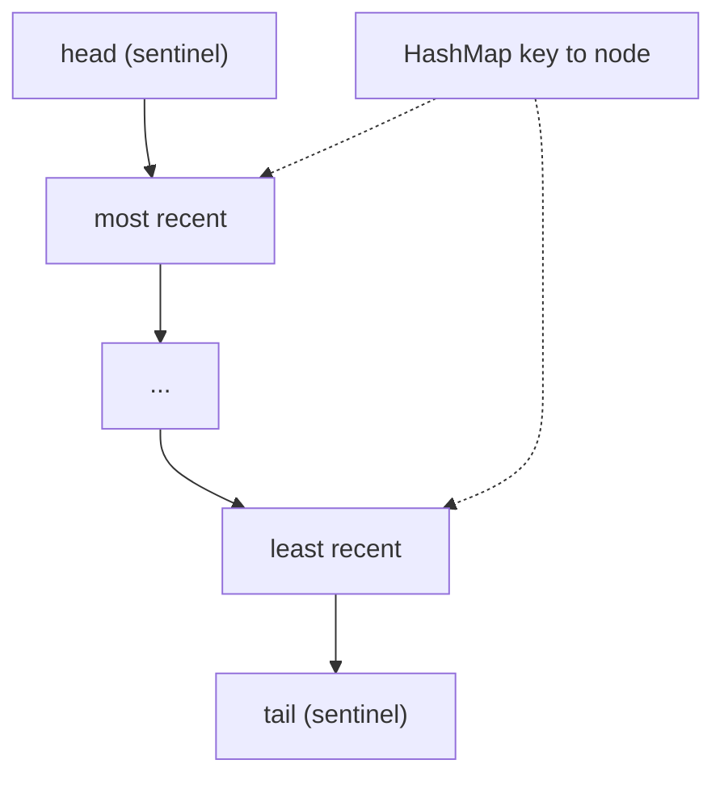
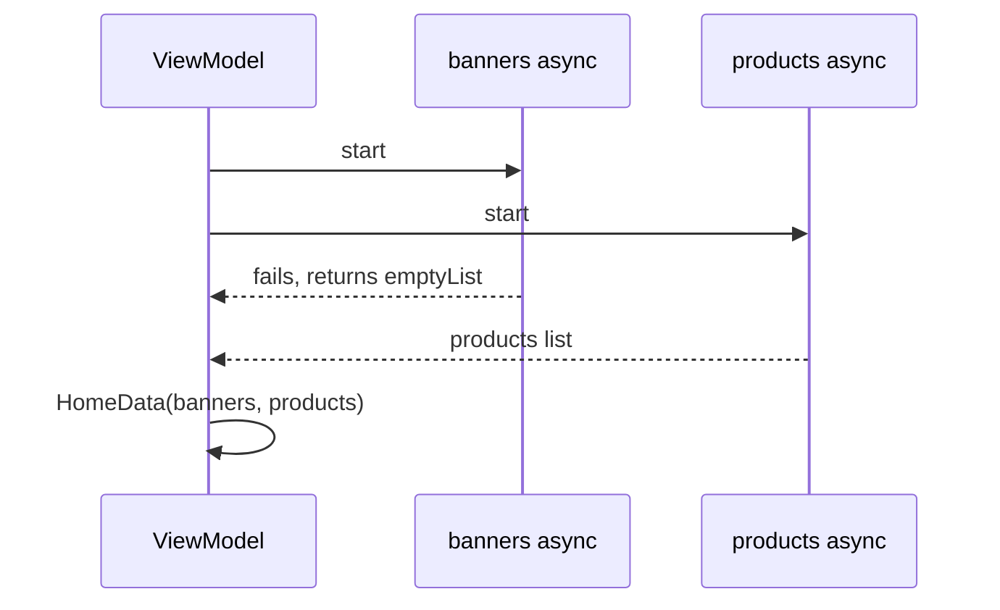
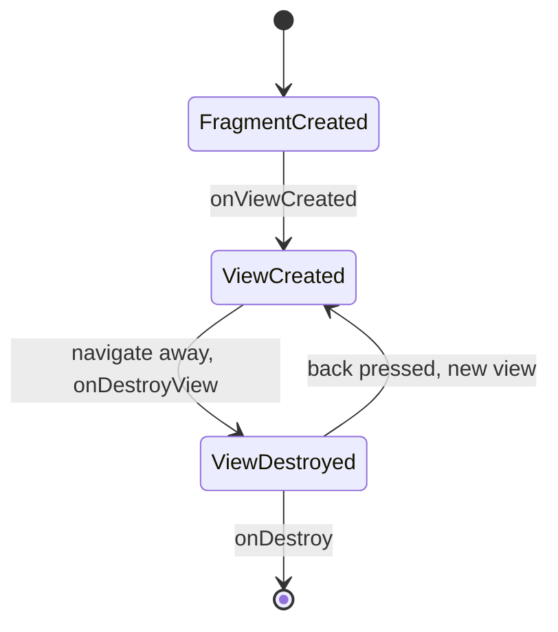
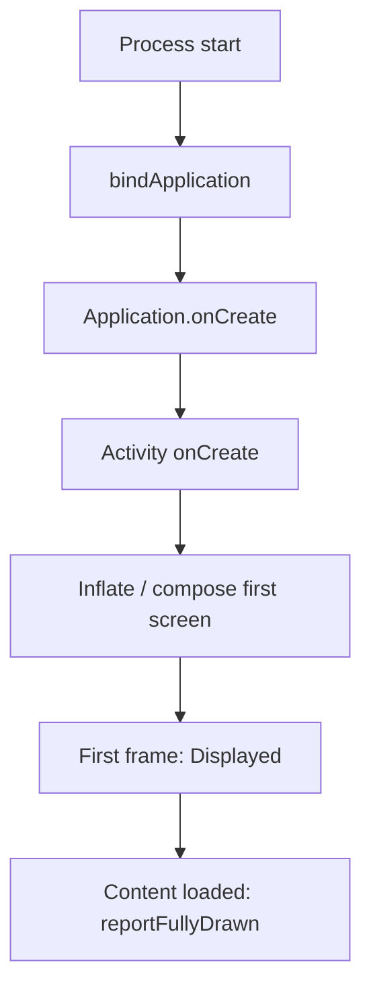
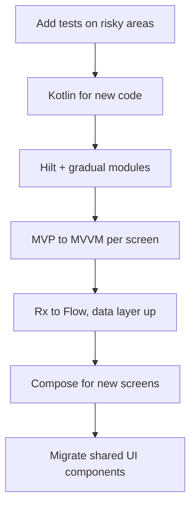
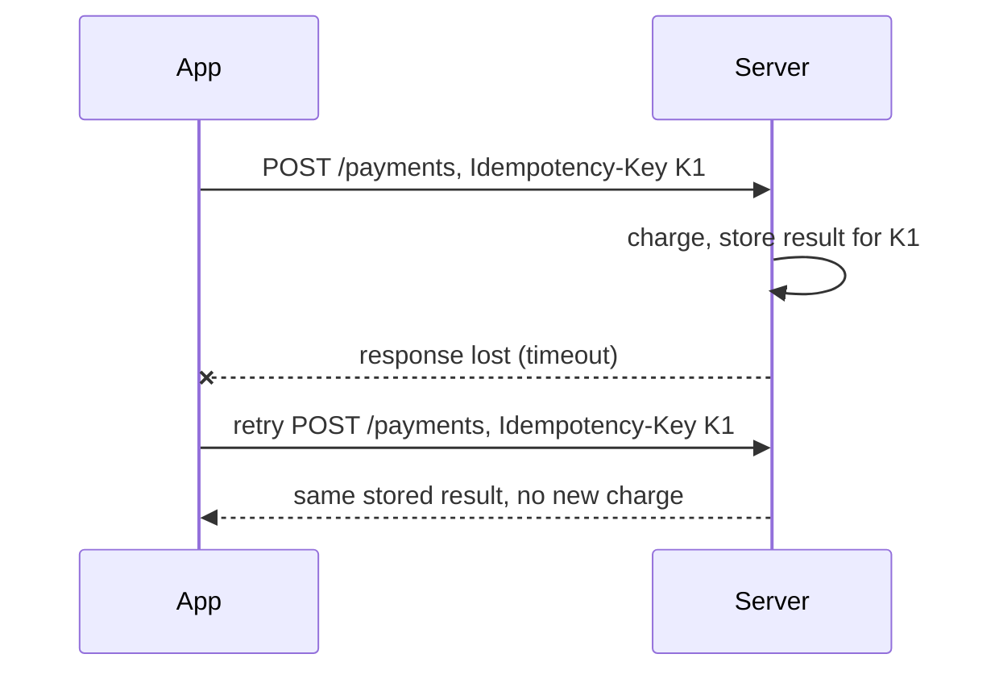
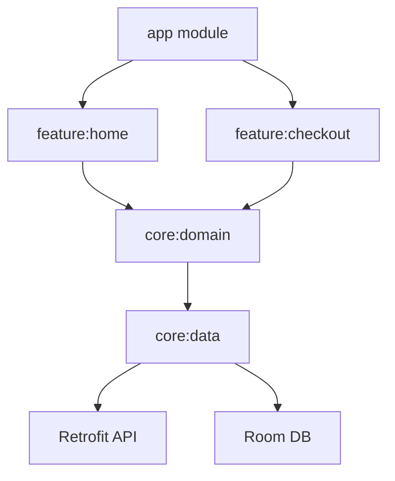
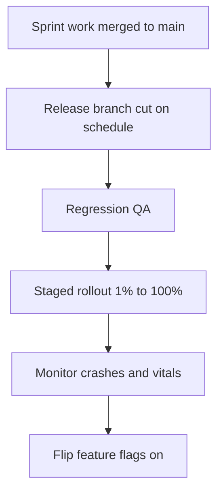

# Coding, Scenario & Behavioral Questions

[⬅ Back to index](../README.md)

Covers: Android-flavoured coding problems frequently asked in machine-coding rounds, debugging scenarios, and behavioral / project questions.

---

## Coding Problems

### 1. Implement an LRU cache.

<details>
<summary>Answer</summary>

**In short:** An LRU (Least Recently Used) cache holds at most N entries and, when full, evicts the entry that was accessed longest ago. The quick answer is a `LinkedHashMap` in access order with `removeEldestEntry` overridden. The "from scratch" answer is a `HashMap` for O(1) lookup plus a doubly linked list for O(1) reordering and eviction.

#### Why it exists

Memory is limited, so caches (bitmaps, network responses, parsed models) need a bound. LRU assumes that something you used recently will probably be used again soon, so the item untouched for the longest time is the safest to drop. Android itself ships `android.util.LruCache`, which is what Glide-style image caches and many repositories are built on.

#### Quick answer: LinkedHashMap

`LinkedHashMap` keeps a linked list through its entries. With `accessOrder = true`, every `get` or `put` moves the entry to the end of that list, so the head is always the least recently used entry. `removeEldestEntry` is called after each insert; returning `true` makes the map drop the head.

```kotlin
class LruCache<K, V>(private val capacity: Int) {
    private val map = object : LinkedHashMap<K, V>(capacity, 0.75f, true) {   // accessOrder = true
        override fun removeEldestEntry(eldest: MutableMap.MutableEntry<K, V>) = size > capacity
    }
    @Synchronized fun get(key: K): V? = map[key]
    @Synchronized fun put(key: K, value: V) { map[key] = value }
}
```

Note that `get` is also `@Synchronized`: in access-order mode a read **mutates** the internal list, so unsynchronized concurrent reads can corrupt it.

#### From scratch: HashMap + doubly linked list, O(1)

Interviewers often forbid `LinkedHashMap` to see whether you understand the structure. The map gives O(1) "find the node for this key"; the list gives O(1) "move this node to the front" and "remove the last node". Sentinel `head`/`tail` nodes remove null checks at the edges.



```kotlin
class LRUCache(private val capacity: Int) {
    private class Node(val key: Int, var value: Int) { var prev: Node? = null; var next: Node? = null }
    private val map = HashMap<Int, Node>()
    private val head = Node(0, 0); private val tail = Node(0, 0)
    init { head.next = tail; tail.prev = head }

    fun get(key: Int): Int {
        val node = map[key] ?: return -1
        remove(node); addFirst(node)          // touching it makes it most recent
        return node.value
    }
    fun put(key: Int, value: Int) {
        map[key]?.let { remove(it) }          // replace existing entry
        val node = Node(key, value)
        addFirst(node); map[key] = node
        if (map.size > capacity) {            // evict from the tail end
            val lru = tail.prev!!
            remove(lru); map.remove(lru.key)
        }
    }
    private fun remove(n: Node) { n.prev!!.next = n.next; n.next!!.prev = n.prev }
    private fun addFirst(n: Node) { n.next = head.next; n.prev = head; head.next!!.prev = n; head.next = n }
}
```

The node stores its `key` so that, on eviction, you can also remove it from the map.

| Operation | Time | Why |
|---|---|---|
| `get` | O(1) | map lookup + unlink/relink |
| `put` | O(1) | map insert + list insert + maybe one eviction |
| Space | O(capacity) | one node + one map entry per item |

**Pitfalls:**
- Forgetting to store the key in the node, so you can't clean the map on eviction.
- Forgetting that a read must also move the node to the front.
- Not thinking about thread safety; say whether your version is single-threaded or synchronized.

**Likely follow-ups:**
- *Size by bytes instead of count?* Track a running `size` and evict while it exceeds the limit; `android.util.LruCache` lets you override `sizeOf()` for this (e.g. `bitmap.byteCount`).
- *Add a TTL?* Store a timestamp per node and treat expired entries as misses (see Q8).
- *LRU vs LFU?* LFU evicts the least *frequently* used entry; it resists one-off scans but needs frequency buckets to stay O(1).

</details>

### 2. Implement a debounced search.

<details>
<summary>Answer</summary>

**In short:** Debouncing means "only act once the user has stopped typing for X ms". With Flow, push queries into a `MutableStateFlow` and apply `debounce(300)`, `distinctUntilChanged()` and `flatMapLatest { search(it) }`. With plain coroutines, cancel the previous `Job` on each keystroke and `delay(300)` before searching.

#### Why it matters

Without debouncing, typing "android" fires seven requests, wastes battery and data, and responses can arrive out of order so the screen shows results for "andr" after "android". Debouncing cuts the request count, and cancelling the previous search fixes the ordering problem.

#### Flow version (preferred)

Covered in detail in [Flow Q20](04-flow.md).

```kotlin
class SearchViewModel(private val repo: Repo) : ViewModel() {
    private val query = MutableStateFlow("")

    val state: StateFlow<UiState> = query
        .debounce(300)                       // wait for a 300 ms pause
        .map { it.trim() }
        .distinctUntilChanged()              // "abc" -> "abc " doesn't re-search
        .flatMapLatest { q ->                // cancels the previous search
            if (q.isEmpty()) flowOf(UiState.Idle)
            else flow {
                emit(UiState.Loading)
                emit(runCatching { repo.search(q) }
                    .fold({ UiState.Success(it) }, { UiState.Error(it.message) }))
            }
        }
        .stateIn(viewModelScope, SharingStarted.WhileSubscribed(5_000), UiState.Idle)

    fun onQueryChanged(q: String) { query.value = q }
}
```

#### Plain coroutines version

```kotlin
class SearchViewModel(private val repo: Repo) : ViewModel() {
    private val _state = MutableStateFlow<UiState>(UiState.Idle)
    val state = _state.asStateFlow()
    private var searchJob: Job? = null

    fun onQueryChanged(query: String) {
        searchJob?.cancel()                  // drop the pending/in-flight search
        searchJob = viewModelScope.launch {
            delay(300)                       // debounce: cancelled if user types again
            _state.value = UiState.Loading
            _state.value = runCatching { repo.search(query) }
                .fold({ UiState.Success(it) }, { UiState.Error(it.message) })
        }
    }
}
```

Both work because `delay` is cancellable: a new keystroke cancels the job while it is still waiting, so only the last query survives the pause.

**Pitfalls:**
- Using `flatMapConcat`/`flatMapMerge` instead of `flatMapLatest`, so stale responses can overwrite newer ones.
- Putting `debounce` in the UI layer, where it restarts on rotation; keep it in the ViewModel.
- `runCatching` also catches `CancellationException`; it's fine here because the result is discarded, but in general rethrow it.

**Likely follow-ups:**
- *Debounce vs throttle?* Debounce waits for silence then emits the last value; throttle emits at most once per window (good for scroll or click events).
- *How do you test it?* `runTest` with virtual time: send queries, `advanceTimeBy(300)`, assert only one repo call.

</details>

### 3. Prevent double clicks on a button.

<details>
<summary>Answer</summary>

**In short:** Two layers. A time-based guard ignores a second tap within a few hundred ms. The more robust fix is state-driven: disable the button (or ignore the event in the ViewModel) while the action is in progress, so a duplicate can't be processed no matter how fast it arrives.

#### Why it happens

A fast double tap delivers two click events before the first one has updated the UI. If each click starts navigation or a network call, you get two screens pushed or two orders submitted.

#### Time-based guard (UI layer)

```kotlin
fun View.setOnSingleClickListener(interval: Long = 600L, onClick: (View) -> Unit) {
    var lastClick = 0L
    setOnClickListener {
        val now = SystemClock.elapsedRealtime()   // monotonic; unaffected by clock changes
        if (now - lastClick >= interval) { lastClick = now; onClick(it) }
    }
}
```

Use `elapsedRealtime()` rather than `System.currentTimeMillis()`, because the wall clock can jump when the user or network changes the time.

#### State-driven guard (preferred)

The ViewModel owns the truth about whether work is in flight:

```kotlin
fun onSubmitClicked() {
    if (_state.value.isLoading) return            // ignore duplicates
    _state.update { it.copy(isLoading = true) }
    viewModelScope.launch {
        val result = repo.submit()
        _state.update { it.copy(isLoading = false, result = result) }
    }
}
```

```kotlin
// View side (XML) or Compose
button.isEnabled = !state.isLoading
Button(onClick = vm::onSubmitClicked, enabled = !state.isLoading) { Text("Submit") }
```

| Approach | Good for | Weakness |
|---|---|---|
| Time-based listener | Navigation, quick UI actions | Arbitrary interval; a slow action can still be retriggered after it |
| Disable via state | Network/DB actions | Needs a loading state in the ViewModel |
| Server idempotency key | Payments, orders | Needs backend support (see Q19) |

**Pitfalls:**
- Relying only on the UI guard for critical operations; the ViewModel should also reject duplicates.
- For navigation, double taps can push the same destination twice; check the current destination or use `launchSingleTop`.

</details>

### 4. Make parallel API calls and combine the results; handle partial failure.

<details>
<summary>Answer</summary>

**In short:** Start each call with `async` inside a scope, then `await()` them all, so total time is the slowest call rather than the sum. Decide per call whether it is **required** (failure fails the screen) or **optional** (failure falls back to a default). Wrap optional calls so their exceptions are caught, and use `supervisorScope` so one child's failure doesn't automatically cancel its siblings.

```kotlin
suspend fun loadHome(): HomeData = supervisorScope {
    val banners = async { runCatching { api.banners() }.getOrDefault(emptyList()) }  // optional
    val products = async { api.products() }          // required — failure propagates on await()
    HomeData(banners.await(), products.await())
}
```

#### How it works

- `async` starts both requests concurrently; `await()` suspends until each one finishes.
- The optional call catches its own exception and returns a fallback, so it never fails.
- In `supervisorScope`, a failing child does not cancel the other children or the scope. The exception from `products` is rethrown when you call `products.await()`, so the caller still sees the failure.
- With `coroutineScope` instead, the first failing child cancels all its siblings and the whole scope fails. That is the right choice when **every** call is required (fail fast, don't waste work).



#### Returning partial results explicitly

Sometimes the UI should show "products loaded, banners unavailable" instead of hiding the failure:

```kotlin
data class HomeData(val products: List<Product>, val banners: Result<List<Banner>>)

suspend fun loadHome(): HomeData = coroutineScope {
    val banners = async { safeCall { api.banners() } }
    val products = async { api.products() }
    HomeData(products.await(), banners.await())
}

suspend fun <T> safeCall(block: suspend () -> T): Result<T> = try {
    Result.success(block())
} catch (e: CancellationException) {
    throw e                                          // never swallow cancellation
} catch (e: Exception) {
    Result.failure(e)
}
```

**Pitfalls:**
- Calling `async { }.await()` immediately for each call, which makes them sequential again.
- `runCatching` catches `CancellationException`, which can hide cancellation; a helper like `safeCall` that rethrows it is safer.
- Using `GlobalScope` or a detached scope: the calls won't be cancelled when the screen goes away.

**Likely follow-ups:**
- *Add a timeout to the optional call?* `withTimeoutOrNull(2_000) { api.banners() } ?: emptyList()`.
- *Combine streams rather than one-shot calls?* Use `combine(flowA, flowB) { a, b -> ... }`.

</details>

### 5. Implement retry with exponential backoff.

<details>
<summary>Answer</summary>

**In short:** Retry a failed call a limited number of times, waiting longer after each failure (e.g. 0.5 s, 1 s, 2 s, 4 s, capped), plus random **jitter** so many clients don't retry in sync. Retry only **transient** errors (timeouts, IO errors, 5xx, 429), never client errors like 400/401, stop after a **max attempts** limit, and use `delay` so the retry loop **respects cancellation**. More detail in [Networking Q9](15-networking.md).

#### Why exponential + jitter

If a server is overloaded and every client retries immediately, the retries make the overload worse. Doubling the wait gives the server room to recover. Jitter matters because a server outage tends to fail thousands of clients at the same moment; without randomness they all retry at the same moment too (the "thundering herd").

```kotlin
suspend fun <T> retryWithBackoff(
    maxAttempts: Int = 4,
    initialDelayMs: Long = 500,
    maxDelayMs: Long = 8_000,
    factor: Double = 2.0,
    shouldRetry: (Throwable) -> Boolean = ::isTransient,
    block: suspend () -> T,
): T {
    var delayMs = initialDelayMs
    repeat(maxAttempts - 1) {
        try {
            return block()
        } catch (e: CancellationException) {
            throw e                                   // stop immediately if cancelled
        } catch (e: Exception) {
            if (!shouldRetry(e)) throw e
        }
        val jitter = Random.nextLong(0, delayMs / 2 + 1)
        delay(delayMs + jitter)                       // cancellable wait
        delayMs = (delayMs * factor).toLong().coerceAtMost(maxDelayMs)
    }
    return block()                                    // last attempt: let it throw
}

fun isTransient(e: Throwable): Boolean = when (e) {
    is IOException -> true                                     // timeouts, no connection
    is HttpException -> e.code() == 429 || e.code() in 500..599
    else -> false
}
```

With Flow there is a built-in operator:

```kotlin
repo.observeFeed()
    .retryWhen { cause, attempt ->
        if (attempt < 3 && isTransient(cause)) { delay(500L shl attempt.toInt()); true } else false
    }
```

**Pitfalls:**
- Retrying non-idempotent requests (e.g. "create payment") without an idempotency key can duplicate them (see Q19).
- Ignoring a `Retry-After` header on 429/503 responses when the server provides one.
- Retrying inside an OkHttp interceptor *and* in the repository, which multiplies attempts.
- For work that must eventually succeed even if the app closes, use WorkManager, which has its own `BackoffPolicy.EXPONENTIAL`.

</details>

### 6. Write a thread-safe singleton in Kotlin with a parameter (e.g. Context).

<details>
<summary>Answer</summary>

**In short:** Kotlin's `object` can't take constructor parameters, so use a private constructor with a `companion object` that does **double-checked locking**: a `@Volatile` instance field, a fast unsynchronized check, and a second check inside `synchronized`. Store `context.applicationContext` so the singleton never holds an Activity. In real apps, let Hilt's `@Singleton` do this for you.

```kotlin
class AppDatabase private constructor(context: Context) {
    companion object {
        @Volatile private var INSTANCE: AppDatabase? = null

        fun getInstance(context: Context): AppDatabase =
            INSTANCE ?: synchronized(this) {                 // 1st check: no lock (fast path)
                INSTANCE ?: AppDatabase(context.applicationContext)   // 2nd check: under lock
                    .also { INSTANCE = it }
            }
    }
}
```

#### Why each piece is there

| Piece | Purpose |
|---|---|
| `private constructor` | Nobody can call `AppDatabase(...)` directly |
| First null check | After initialization, callers skip the lock entirely |
| `synchronized(this)` | Only one thread can create the instance |
| Second null check | A thread that waited for the lock sees the instance the first thread created |
| `@Volatile` | Guarantees other threads see the fully constructed object, not a half-initialized reference |
| `applicationContext` | An Activity context in a singleton leaks the Activity and its whole view tree |

This is exactly the pattern in Google's Room samples.

#### Alternatives

```kotlin
// No parameter needed: `object` is lazily and thread-safely initialized by the JVM
object Analytics { fun log(event: String) { /* ... */ } }

// Lazy with a parameter supplied once at startup
class App : Application() {
    val database by lazy { AppDatabase.getInstance(this) }   // lazy is synchronized by default
}

// Hilt (preferred): the graph guarantees one instance and makes it replaceable in tests
@Module @InstallIn(SingletonComponent::class)
object DbModule {
    @Provides @Singleton
    fun provideDb(@ApplicationContext ctx: Context): AppDatabase =
        Room.databaseBuilder(ctx, AppDatabase::class.java, "app.db").build()
}
```

**Pitfalls:**
- Dropping `@Volatile`: the code may appear to work but is not safe under the Java memory model.
- Singletons hide dependencies and make tests share state; DI-scoped singletons avoid both.
- Note that "singleton" means one per **process**; a multi-process app gets one per process.

</details>

### 7. Convert a callback API to a coroutine / Flow.

<details>
<summary>Answer</summary>

**In short:** For a callback that fires **once** (success or error), use `suspendCancellableCoroutine` and resume the continuation from the callback ([Coroutines Q23](03-coroutines.md)). For a callback that fires **many times** (location updates, listeners), use `callbackFlow`, `trySend` each value, and unregister the listener in `awaitClose` ([Flow Q15](04-flow.md)).

#### One-shot result: suspendCancellableCoroutine

```kotlin
suspend fun FusedLocationProviderClient.awaitLastLocation(): Location? =
    suspendCancellableCoroutine { cont ->
        lastLocation
            .addOnSuccessListener { cont.resume(it) }
            .addOnFailureListener { cont.resumeWithException(it) }
        // If the API supports cancelling, hook it here:
        // cont.invokeOnCancellation { request.cancel() }
    }
```

The coroutine suspends until the callback calls `resume`. Prefer the *cancellable* variant so that if the caller's scope is cancelled, the coroutine stops waiting and you get a hook to cancel the underlying operation.

#### Stream of values: callbackFlow

```kotlin
fun SensorManager.observe(sensor: Sensor): Flow<SensorEvent> = callbackFlow {
    val listener = object : SensorEventListener {
        override fun onSensorChanged(event: SensorEvent) { trySend(event) }  // non-blocking
        override fun onAccuracyChanged(sensor: Sensor, accuracy: Int) = Unit
    }
    registerListener(listener, sensor, SensorManager.SENSOR_DELAY_UI)
    awaitClose { unregisterListener(listener) }   // runs when the collector cancels
}
```

`awaitClose` keeps the flow alive until the collector stops, then runs the cleanup. If you forget it, `callbackFlow` throws an `IllegalStateException`, which is deliberate: it protects you from leaking the listener.

| Callback shape | Use | Cleanup |
|---|---|---|
| Fires once | `suspendCancellableCoroutine` | `invokeOnCancellation` |
| Fires many times | `callbackFlow` | `awaitClose` |
| Fires many times, only latest matters | `callbackFlow` + `conflate()` | `awaitClose` |

**Pitfalls:**
- Resuming a continuation twice throws `IllegalStateException`; make sure only one callback path resumes.
- Using `send` (suspending) inside a callback that isn't a coroutine; use `trySend`.
- Many Google libraries already provide `await()` (e.g. `kotlinx-coroutines-play-services` for Tasks), so check before writing your own.

</details>

### 8. Implement a simple in-memory cache with TTL in a repository.

<details>
<summary>Answer</summary>

**In short:** Store each value with the time it was fetched. On read, return it if it is younger than the TTL; otherwise fetch from the network and overwrite. Guard the map with a `Mutex` for coroutine safety, and inject the clock so tests can control time.

```kotlin
class UserRepository(
    private val api: UserApi,
    private val clock: () -> Long = System::currentTimeMillis,
) {
    private data class Entry(val user: User, val time: Long)
    private val cache = mutableMapOf<String, Entry>()
    private val mutex = Mutex()
    private val ttl = 5 * 60_000L                         // 5 minutes

    suspend fun getUser(id: String, forceRefresh: Boolean = false): User = mutex.withLock {
        val cached = cache[id]
        if (!forceRefresh && cached != null && clock() - cached.time < ttl) return cached.user
        api.getUser(id).also { cache[id] = Entry(it, clock()) }
    }
}
```

Points to mention: an injectable clock (testability), a `Mutex` for thread safety, and TTL-based invalidation.

#### The trade-off in this version

Holding the lock during the network call **serializes** all requests: fetching user B waits for user A's request to finish. That is simple and correct, but slow under load. A production version deduplicates in-flight requests per ID instead, so concurrent callers for the same ID share one request and different IDs run in parallel:

```kotlin
private val inFlight = mutableMapOf<String, Deferred<User>>()
private val scope = CoroutineScope(SupervisorJob() + Dispatchers.IO)

suspend fun getUser(id: String): User {
    val deferred = mutex.withLock {
        cache[id]?.takeIf { clock() - it.time < ttl }?.let { return it.user }
        inFlight.getOrPut(id) {
            scope.async {
                try {
                    api.getUser(id).also { u -> mutex.withLock { cache[id] = Entry(u, clock()) } }
                } finally {
                    mutex.withLock { inFlight.remove(id) }
                }
            }
        }
    }
    return deferred.await()                               // lock is released while waiting
}
```

#### Testing with the injected clock

```kotlin
var now = 0L
val repo = UserRepository(fakeApi, clock = { now })
repo.getUser("1"); now += 4 * 60_000; repo.getUser("1")
assertEquals(1, fakeApi.calls)                          // still fresh
now += 2 * 60_000; repo.getUser("1")
assertEquals(2, fakeApi.calls)                          // expired, refetched
```

**Pitfalls:**
- `synchronized` blocks can't contain suspending calls; use `Mutex` in coroutine code.
- Unbounded maps grow forever; combine TTL with a size limit (LRU, Q1) for large key spaces.
- An in-memory cache is lost on process death; use Room or DataStore when data must survive.

**Likely follow-up:** *Stale-while-revalidate?* Return the stale value immediately and refresh in the background, emitting the new value through a Flow.

</details>

### 9. Build a countdown timer that survives rotation.

<details>
<summary>Answer</summary>

**In short:** Run the timer in the ViewModel (`viewModelScope`), which survives rotation, and keep its state in `SavedStateHandle`, which also survives process death. For accuracy, store the **end timestamp** and compute the remaining time from it, instead of decrementing a counter every second.

#### Simple version

```kotlin
class TimerViewModel(private val savedState: SavedStateHandle) : ViewModel() {
    val remaining = savedState.getStateFlow("remaining", 60)
    private var job: Job? = null

    fun start() {
        job?.cancel()
        job = viewModelScope.launch {
            while (remaining.value > 0) { delay(1000); savedState["remaining"] = remaining.value - 1 }
        }
    }
}
```

This survives rotation because the ViewModel is retained. But it **drifts**: each loop is `delay(1000)` plus the time to run the loop body, and while the process is dead nothing decrements, so a restored timer resumes from where it was instead of where it should be.

#### Accurate version: store the deadline

```kotlin
class TimerViewModel(private val savedState: SavedStateHandle) : ViewModel() {
    private val endAt: Long? get() = savedState["endAt"]        // elapsedRealtime deadline

    private val _remainingSec = MutableStateFlow(0L)
    val remainingSec = _remainingSec.asStateFlow()
    private var job: Job? = null

    init { if (endAt != null) tick() }                          // resume after process death

    fun start(durationSec: Long) {
        savedState["endAt"] = SystemClock.elapsedRealtime() + durationSec * 1000
        tick()
    }

    private fun tick() {
        job?.cancel()
        job = viewModelScope.launch {
            while (true) {
                val left = ((endAt ?: return@launch) - SystemClock.elapsedRealtime()).coerceAtLeast(0)
                _remainingSec.value = (left + 999) / 1000              // round up for display
                if (left == 0L) { savedState.remove<Long>("endAt"); break }
                delay(left % 1000 + 1)                                 // wake at the next second boundary
            }
        }
    }
}
```

`elapsedRealtime()` is monotonic since boot, so it isn't affected by the user changing the clock and it stays valid across process death (but not reboot).

| Survives | ViewModel | SavedStateHandle | Deadline timestamp |
|---|---|---|---|
| Rotation | Yes | Yes | Yes |
| Process death | No | Yes | Yes |
| Time spent while dead is counted | No | No | Yes |

**Pitfalls:**
- Running the timer in the Activity or a composable, where rotation restarts it.
- If the timer must alert the user even when the app is closed (e.g. a cooking timer), the coroutine isn't enough: schedule an `AlarmManager` alarm or use a foreground service.

</details>

### 10. Implement pagination manually in a ViewModel.

<details>
<summary>Answer</summary>

**In short:** Keep the current page, an `isLoading` flag and an `endReached` flag in the ViewModel. When the user scrolls near the end, call `loadNext()`, which returns early if a load is already running or there's nothing left, fetches the next page, appends it to the list in the UI state and advances the page only on success. In production, mention **Paging 3**, which does this plus caching, placeholders and retry.

```kotlin
class ListViewModel(private val repo: Repo) : ViewModel() {
    private val _state = MutableStateFlow(ListState())
    val state = _state.asStateFlow()
    private var page = 1
    private var isLoading = false
    private var endReached = false
    private val pageSize = 20

    init { loadNext() }

    fun loadNext() {
        if (isLoading || endReached) return              // guard against duplicate calls
        isLoading = true
        viewModelScope.launch {
            _state.update { it.copy(isLoadingMore = true, error = null) }
            runCatching { repo.getItems(page, pageSize) }
                .onSuccess { items ->
                    endReached = items.size < pageSize   // a short page means no more data
                    page++                               // advance only on success
                    _state.update { it.copy(items = it.items + items, isLoadingMore = false) }
                }
                .onFailure { e -> _state.update { it.copy(isLoadingMore = false, error = e.message) } }
            isLoading = false
        }
    }
}

data class ListState(
    val items: List<Item> = emptyList(),
    val isLoadingMore: Boolean = false,
    val error: String? = null,
)
```

#### Triggering from the UI

Trigger `loadNext()` when the last visible item is within a threshold of the end.

```kotlin
// Compose
val listState = rememberLazyListState()
val shouldLoad by remember {
    derivedStateOf {
        val last = listState.layoutInfo.visibleItemsInfo.lastOrNull()?.index ?: 0
        last >= listState.layoutInfo.totalItemsCount - 5          // 5 items before the end
    }
}
LaunchedEffect(shouldLoad) { if (shouldLoad) vm.loadNext() }
```

With RecyclerView, do the same check in an `OnScrollListener` using `LinearLayoutManager.findLastVisibleItemPosition()`.

#### Page number vs cursor

| Strategy | How | Problem it has / solves |
|---|---|---|
| Offset / page number | `?page=3&size=20` | Items inserted on the server shift pages, causing duplicates or gaps |
| Cursor / key | `?after=<lastId>` | Stable under inserts; the server returns `nextCursor` |

**Pitfalls:**
- No `isLoading` guard, so fast scrolling fires the same page several times.
- Incrementing `page` before the request succeeds, so a failure skips a page.
- Using `items.isEmpty()` to detect the end costs one extra empty request; a short page is usually enough.
- Showing the error replaces the whole list; better to show a "Retry" footer and keep the loaded items.

</details>

### 11. Find the bug: why does this crash or leak?

<details>
<summary>Answer</summary>

**In short:** The fragment uses its own lifecycle instead of the **view's** lifecycle. Observers registered with `this` outlive the view and pile up, the flow keeps collecting when the screen isn't visible, and the binding is never cleared, so the old view hierarchy leaks while the fragment sits on the back stack.

```kotlin
class MyFragment : Fragment(R.layout.f) {
    private lateinit var binding: FBinding
    override fun onViewCreated(v: View, s: Bundle?) {
        binding = FBinding.bind(v)
        viewModel.data.observe(this) { binding.text.text = it }            // ❌ 1
        lifecycleScope.launch { viewModel.flow.collect { binding.x = it } } // ❌ 2
    }
}
```

#### Background: a fragment has two lifecycles

A fragment on the back stack keeps living (its `Lifecycle` stays CREATED) while its **view** is destroyed and later recreated. Anything tied to the view must use `viewLifecycleOwner`, which ends in `onDestroyView`.



#### The bugs

1. Observing with `this` instead of `viewLifecycleOwner` means observers pile up after the view is recreated (one new observer per `onViewCreated`), and they update a destroyed view.
2. The flow is collected outside `repeatOnLifecycle`, so it keeps collecting in the background, and it uses the fragment's scope instead of the view's.
3. The binding is never cleared in `onDestroyView`, which leaks the view hierarchy while the fragment is on the back stack.

#### Fixed version

```kotlin
class MyFragment : Fragment(R.layout.f) {
    private var _binding: FBinding? = null
    private val binding get() = _binding!!

    override fun onViewCreated(v: View, s: Bundle?) {
        _binding = FBinding.bind(v)
        viewModel.data.observe(viewLifecycleOwner) { binding.text.text = it }     // ✅
        viewLifecycleOwner.lifecycleScope.launch {
            viewLifecycleOwner.repeatOnLifecycle(Lifecycle.State.STARTED) {       // ✅
                viewModel.flow.collect { binding.x = it }
            }
        }
    }

    override fun onDestroyView() {
        super.onDestroyView()
        _binding = null                                                          // ✅
    }
}
```

**Other bugs interviewers plant in these snippets:**
- `GlobalScope.launch` or a custom scope that's never cancelled.
- Passing an Activity `Context` into a singleton or ViewModel.
- Updating UI from a background thread (`Dispatchers.IO`) without switching to Main.
- A non-static inner class `Handler` posting delayed messages that hold the Activity.
- Lint's `FragmentLiveDataObserve` check flags bug 1 automatically; LeakCanary catches bug 3.

</details>

### 12. Common Kotlin output questions.

<details>
<summary>Answer</summary>

**In short:** These test whether you know the semantics behind common Kotlin idioms: labelled returns in lambdas, which properties a `data class` uses in `equals`, reference vs structural equality, and lazy vs eager collection processing. Always explain *why* the output is what it is.

#### 1. return@forEach acts like `continue`

```kotlin
val list = listOf(1, 2, 3)
list.forEach { if (it == 2) return@forEach; print(it) }   // prints 13
```

`return@forEach` returns from the **lambda** for this element only, so 2 is skipped and iteration continues. A bare `return` would return from the enclosing function (allowed because `forEach` is `inline`), stopping everything and printing just `1`.

#### 2. data class equals only uses constructor properties

```kotlin
data class A(val x: Int) { var y = 0 }
val a1 = A(1).apply { y = 5 }; val a2 = A(1)
println(a1 == a2)   // true – body properties excluded from equals
```

The generated `equals`, `hashCode`, `toString` and `copy` only consider properties declared in the primary constructor. `y` is ignored, so the objects are equal even though they differ.

#### 3. === and string literals

```kotlin
val s1 = "abc"; val s2 = "abc"
println(s1 === s2)  // true – string pool
println(s1 == s2)   // true – same content
```

`==` compares content (calls `equals`); `===` compares references. Identical compile-time literals are interned on the JVM, so both variables point to the same object. A string built at runtime (`StringBuilder("abc").toString()`) would be `==` but not `===`.

#### 4. Sequences are lazy

```kotlin
println(listOf(1,2,3).asSequence().map { print("m$it "); it * 2 }.first())  // m1 2 (lazy)
```

A sequence processes elements one at a time through the whole chain and only as far as the terminal operation needs. `first()` needs one element, so `map` runs once. Without `asSequence()`, the list version would print `m1 m2 m3 2`, because `map` builds the complete new list first.

#### More that come up

| Snippet | Output | Reason |
|---|---|---|
| `val x: Int? = null; println(x?.plus(1) ?: 0)` | `0` | safe call yields null, Elvis supplies default |
| `println(listOf(1, 2) == listOf(1, 2))` | `true` | structural equality on lists |
| `println(arrayOf(1) == arrayOf(1))` | `false` | arrays use reference equality; use `contentEquals` |
| `val a: Int = 1000; val b: Int? = a; val c: Int? = a; println(b === c)` | `false` | boxed outside the -128..127 cache, two objects |
| `println("a" + 1 + 2)` | `a12` | string concatenation left to right |
| `lazy { ... }` read twice | block runs once | value is cached after first access |

**Pitfall:** don't guess; trace the evaluation order out loud. Interviewers care more about the reasoning than the final string.

</details>

### 13. Other frequently asked DSA problems for Android roles.

<details>
<summary>Answer</summary>

**In short:** Android coding rounds usually stay at easy-to-medium LeetCode level and favour hash maps, two pointers, sliding windows, stacks, linked lists, heaps and BFS/DFS. Practise these in Kotlin, say the brute force first, then the optimal approach, and always state time and space complexity.

| Problem | Pattern | Optimal complexity |
|---|---|---|
| Two sum | Hash map of value to index | O(n) time, O(n) space |
| Valid parentheses | Stack | O(n), O(n) |
| Reverse a linked list | Iterative pointer swap | O(n), O(1) |
| Detect a cycle | Floyd's slow/fast pointers | O(n), O(1) |
| Merge intervals | Sort by start, then merge | O(n log n), O(n) |
| Top-K frequent elements | Count map + min-heap of size K | O(n log k), O(n) |
| Number of islands | BFS/DFS on a grid | O(rows x cols) |
| Binary search variants | First/last occurrence, rotated array | O(log n), O(1) |
| Longest substring without repeating characters | Sliding window + set/map | O(n), O(alphabet) |
| Group anagrams | Map from sorted key (or char count) to list | O(n k log k) |
| LRU cache | HashMap + doubly linked list (Q1) | O(1) per op |
| Min-stack | Second stack tracking current minimum | O(1) per op |
| Flatten a nested list | Recursion or explicit stack | O(total elements) |
| String compression | Two pointers / run-length counting | O(n), O(1) extra |

#### Example: sliding window in idiomatic Kotlin

```kotlin
fun lengthOfLongestSubstring(s: String): Int {
    val lastSeen = HashMap<Char, Int>()
    var start = 0
    var best = 0
    for ((i, c) in s.withIndex()) {
        lastSeen[c]?.let { if (it >= start) start = it + 1 }   // shrink window past the repeat
        lastSeen[c] = i
        best = maxOf(best, i - start + 1)
    }
    return best
}
```

#### Kotlin tools worth knowing

- `ArrayDeque` for stacks and queues (`addLast`, `removeLast`, `removeFirst`).
- `PriorityQueue(compareBy { it.second })` for heaps.
- `groupingBy { it }.eachCount()` for frequency maps.
- `sortedWith(compareBy({ it.a }, { it.b }))` for multi-key sorts.

**How to approach the round:** clarify inputs and edge cases (empty, duplicates, very large), talk through the approach before coding, write clean code with meaningful names, then dry-run a small example and fix bugs yourself before the interviewer points them out.

</details>

---

## Scenario / Debugging Questions

### 14. The app is slow on startup. How do you investigate?

<details>
<summary>Answer</summary>

**In short:** Measure first, then trace, then fix. Get a baseline number (Logcat `Displayed` time, Macrobenchmark, Play vitals), record a Perfetto trace of a cold start to find what blocks the main thread before the first frame, fix the culprits (usually heavy `Application.onCreate`, main-thread I/O and complex first layouts), add a Baseline Profile, and verify the improvement with benchmarks on a release build.

#### Background: what "startup" includes

A **cold start** creates the process, runs `Application.onCreate`, creates the first Activity, inflates its layout and draws the first frame. That is the slowest and most important case. **Warm** and **hot** starts reuse an existing process and are cheaper.



#### Step by step

1. **Measure**: the `Displayed` time in Logcat (time to first frame), `reportFullyDrawn()` for time until real content is shown, Macrobenchmark `StartupTimingMetric` for repeatable lab numbers, and Play vitals for real-user data.
2. **Trace**: a Perfetto/system trace of startup. Look at `bindApplication`, `activityStart`, `inflate`, and long main-thread slices. Add your own sections with `Trace.beginSection("initSdk")` / `trace("initSdk") { }` to label app code.
3. **Common culprits**: heavy `Application.onCreate` (SDK inits), eager DI graphs, disk I/O on the main thread (SharedPreferences, DB), complex first layouts, network calls before the first frame.
4. **Fix**: lazy or background init, App Startup, a Baseline Profile, a simpler first frame with async content, R8.
5. **Verify** with benchmarks in release builds.

```kotlin
class App : Application() {
    override fun onCreate() {
        super.onCreate()
        crashReporter.init(this)                       // must be first: keep it sync
        appScope.launch(Dispatchers.Default) {         // not needed for the first frame
            analytics.init(this@App)
            remoteConfig.fetch()
        }
    }
}
```

#### Fixes and what they address

| Fix | Addresses |
|---|---|
| Defer/background SDK init, App Startup library | Heavy `Application.onCreate` |
| `Lazy<T>` / `Provider<T>` injection | DI graph building everything eagerly |
| Move prefs/DB reads off main, use DataStore | Main-thread disk I/O |
| Flatter layouts, placeholder first frame | Slow inflation / measure |
| Baseline Profile | JIT interpretation of hot startup code |
| R8 shrinking and optimization | Code size, class loading |
| SplashScreen API | Perceived startup (not real speed) |

**Pitfalls:**
- Measuring debug builds: they aren't optimized and are much slower, so the numbers are misleading.
- Moving work to a background thread that the first screen then waits on; that just moves the delay.
- Measuring once on a flagship phone; test on a low-end device and look at percentiles.

**Likely follow-up:** *What's a Baseline Profile?* A list of classes and methods used at startup or in key journeys that ART compiles ahead of time at install, avoiding interpretation and JIT on first run.

</details>

### 15. Users report crashes you can't reproduce. What do you do?

<details>
<summary>Answer</summary>

**In short:** Use the data you already have before trying to reproduce. Check Crashlytics or Play vitals for the stack trace, affected devices, OS versions, app versions and breadcrumbs, and look for a pattern. Then try to recreate the conditions (process death, rotation, slow network, low memory, the specific OEM). If it still won't reproduce, add targeted logging and custom keys, ship a defensive fix with a test, and roll it out in stages while watching the crash rate.

#### Step by step

1. **Read the evidence**: Crashlytics or Play vitals give the stack trace, device/OS distribution, app version, breadcrumbs and custom keys. Check when it started (which release) and how many users it affects.
2. **Look for patterns**: a specific OEM, Android version, low memory, process death, a particular locale, rooted devices, or an app update that changed a migration.
3. **Reproduce the conditions**:
   - **"Don't keep activities"** in developer options destroys each Activity when you leave it.
   - Simulate process death: put the app in the background, then `adb shell am kill <package>`, then return to it.
   - Slow or flaky network (emulator network settings, a proxy like Charles), rotation, multi-window, dark mode, large font sizes.
   - Low-memory devices, or the exact device model through a device lab such as Firebase Test Lab.
4. **Instrument**: if it still won't reproduce, add logging or keys: `Crashlytics.setCustomKey("screen", ...)`, breadcrumb logs of user actions, and non-fatal reports around the suspicious code.
5. **Fix and verify**: write a test that reproduces the failing state, fix it, and ship behind a staged rollout, comparing crash-free users between versions.

#### Typical "can't reproduce" causes

| Symptom in the trace | Likely cause |
|---|---|
| `UninitializedPropertyAccessException`, NPE after returning to the app | State lost on process death |
| `IllegalStateException: Can not perform this action after onSaveInstanceState` | Fragment transaction after the Activity stopped |
| Crash only on one OEM | Vendor-specific behaviour or a ROM bug |
| `OutOfMemoryError` | Large bitmaps, leaks over a long session |
| `ForegroundServiceStartNotAllowedException` and similar | Background restrictions on newer Android versions |
| Obfuscated stack trace | Upload the R8 mapping file so traces are readable |

**Pitfall:** wrapping the crash in a broad `try/catch` without understanding it hides the bug and can corrupt state. Fix the root cause, or at least report a non-fatal.

</details>

### 16. The list scrolls with jank. How do you fix it?

<details>
<summary>Answer</summary>

**In short:** Profile first to find which frames miss their deadline and why (Perfetto, JankStats, Layout Inspector recomposition counts). Then remove work from the per-item path: no heavy logic in `onBindViewHolder` or the composable body, correctly sized images loaded off the main thread, DiffUtil or stable keys, flat layouts, no allocations during scroll and stable Compose parameters. Add a Baseline Profile for the scroll journey and always test in a **release** build.

#### Why lists jank

At 60 Hz each frame has about 16 ms (about 8 ms at 120 Hz). While scrolling, every newly visible item must be bound or composed, measured, laid out and drawn within that budget. Anything slow in that path drops frames.

#### Investigate

- **Perfetto / system trace**: look for long `RV OnBindView`, `inflate` or `Choreographer#doFrame` slices on the main thread, and garbage-collection events.
- **JankStats**: reports janky frames from real users with state annotations such as the current screen.
- **Layout Inspector**: shows recomposition and skip counts per composable.
- **Macrobenchmark `FrameTimingMetric`**: repeatable scroll measurements.

#### Common causes and fixes

| Cause | Fix |
|---|---|
| Work in `onBindViewHolder` / composable body (formatting, parsing, sorting) | Precompute in the ViewModel; bind only display-ready data |
| Full-size image decoding | Coil/Glide with the target size; they decode off the main thread and cache |
| `notifyDataSetChanged()` | `ListAdapter` + `DiffUtil` |
| Compose list without keys | `items(list, key = { it.id }, contentType = { it.type })` |
| Deep or nested-weight layouts | `ConstraintLayout` or flatter hierarchies |
| Allocations during scroll | Avoid creating objects/lambdas per bind; reuse formatters |
| Unstable Compose parameters (`List`, mutable classes) | Immutable/stable types, `@Immutable`, strong skipping mode |
| Nested horizontal RecyclerViews | Shared `RecycledViewPool`, `setInitialPrefetchItemCount` |

```kotlin
// ❌ Formatting on every bind
holder.date.text = SimpleDateFormat("dd MMM", Locale.getDefault()).format(item.timestamp)

// ✅ Map once in the ViewModel into a UI model
data class RowUi(val id: Long, val title: String, val dateLabel: String)
holder.date.text = row.dateLabel
```

Then add a Baseline Profile covering the scroll journey, so list code is precompiled instead of interpreted during the first scrolls.

**Pitfalls:**
- Judging smoothness in a debug build; Compose in particular is much slower in debug.
- Optimizing without a before/after measurement.

</details>

### 17. How would you migrate a legacy app (Java + MVP + XML) to modern Android?

<details>
<summary>Answer</summary>

**In short:** **Incrementally**, with no big-bang rewrite. Keep shipping features while you add Kotlin, introduce DI and modules, move screens from MVP to MVVM one at a time, replace RxJava with coroutines and Flow from the data layer up, and adopt Compose for new screens using interop. Add tests before touching risky code and watch crash rate and performance throughout.

#### Why incremental

A full rewrite freezes features for months, rarely reaches parity with all the edge cases the old code handles, and puts the whole app at risk at once. Small steps keep the app releasable every sprint, and each step can be rolled back.



#### Steps

1. **Add Kotlin, and write new code in Kotlin.** Kotlin and Java interoperate in the same module, so existing Java can stay until it's touched. Convert files as you modify them.
2. **Introduce Hilt and modularize gradually.** DI makes the rest of the migration testable. Extract feature or core modules where boundaries are clear; this also improves build times.
3. **Move from MVP to MVVM screen by screen** (ViewModel + StateFlow). Presenters often map closely to ViewModels: view callbacks become UI state fields.
4. **Replace RxJava with coroutines and Flow from the data layer up, using interop adapters.** `kotlinx-coroutines-rx3` provides `asFlow()`, `asObservable()` and `await()`, so old and new code can talk during the transition.
5. **Adopt Compose for new screens, then migrate shared components** (ComposeView / AndroidView interop). `ComposeView` puts Compose inside an XML screen; `AndroidView` puts a legacy View inside Compose.
6. **Add tests before refactoring risky areas, and track crash rate and performance throughout.**

```kotlin
// Interop during the transition: legacy Rx API consumed as Flow
fun observeUser(): Flow<User> = legacyUserRepo.userObservable().asFlow()

// Compose inside an existing XML Fragment
binding.composeContainer.setContent { AppTheme { NewProfileCard(state) } }
```

**Pitfalls:**
- Migrating everything in one long-lived branch: merge conflicts and an untestable mega-PR.
- No success metrics; agree up front on what "better" means (build time, crash rate, dev velocity).
- Two architectures living side by side forever; document the target pattern and track progress.

**Likely follow-up:** *How do you justify it to the business?* Tie it to outcomes: faster feature delivery, fewer crashes, easier hiring, and do it alongside feature work instead of asking for a freeze.

</details>

### 18. How would you handle an API that sometimes returns malformed data?

<details>
<summary>Answer</summary>

**In short:** Parse defensively, validate when mapping to the domain, and isolate the damage. Make DTO fields nullable or defaulted and configure the parser to tolerate unknown keys, then validate each item when mapping DTO to domain model, dropping or flagging bad items instead of crashing the whole screen. Report the problems to monitoring and fix the root cause with the backend through contract tests and API versioning.

#### Layer 1: tolerant parsing

```kotlin
val json = Json {
    ignoreUnknownKeys = true      // new server fields don't break old clients
    coerceInputValues = true      // null or unknown enum value -> property's default
}

@Serializable
data class ProductDto(
    val id: String? = null,
    val name: String? = null,
    val price: Double? = null,
    val status: Status = Status.UNKNOWN,
)
```

The DTO mirrors what the server *might* send, not what it *should* send.

#### Layer 2: validate when mapping to the domain

```kotlin
data class Product(val id: String, val name: String, val price: Double)

fun ProductDto.toDomainOrNull(): Product? {
    if (id.isNullOrBlank() || name.isNullOrBlank() || price == null || price < 0) {
        logger.reportInvalid("Product", id)          // non-fatal to monitoring
        return null
    }
    return Product(id, name, price)
}

val products = dtos.mapNotNull { it.toDomainOrNull() }   // one bad item doesn't kill the list
```

The domain model is non-nullable and trustworthy; the rest of the app never sees malformed data.

#### Layer 3: handle total failure

If the whole response is unparseable, catch `SerializationException` in the repository, return an error state (or cached data) and report it. Don't let it crash the app.

**Process fixes:**
- Report errors to monitoring, so you know how often and which fields.
- Coordinate with the backend on contract tests (e.g. consumer-driven contracts) and API versioning, so breaking changes are caught before release.
- Remote config or a feature flag can disable a feature if a backend bug ships.

**Pitfall:** making every field nullable throughout the app. Keep nullability at the edge (DTOs) and convert to strict types once.

</details>

### 19. How do you ensure a payment request isn't submitted twice?

<details>
<summary>Answer</summary>

**In short:** Defend at every layer. In the UI, disable the button and show a loading state. In the request, send an **idempotency key**: a client-generated UUID that stays the same across retries, so the server recognises and deduplicates repeats. Persist the in-flight state so it survives process death, never auto-retry without that key, and confirm the final result with the server (or webhook) before showing success.

#### Why the UI alone isn't enough

Duplicates don't only come from double taps. A request can reach the server and succeed, but the response is lost (timeout, network switch); the client sees an error and retries, and the user is charged twice. Only the server can know whether it has already processed a request, so the client must give it a way to tell.



#### Layers of defence

1. **UI**: disable the button and show a loading state; the ViewModel ignores the action while one is in progress.
2. **Idempotency key**: generate it once per payment *attempt* (when the user confirms), not per HTTP call, and reuse it for every retry.
3. **Persist in-flight state**: save the key and "pending" status (Room/DataStore) before sending, so if the process dies the app can check the status on restart instead of letting the user pay again.
4. **No blind retries**: never automatically retry non-idempotent requests without that key.
5. **Confirm**: confirm the result through the server or webhook before showing success; for unknown outcomes, show "processing" and poll the payment status.

```kotlin
suspend fun pay(orderId: String, amount: Money): PaymentResult {
    val key = pendingStore.getOrCreateKey(orderId)          // same key across retries & restarts
    return retryWithBackoff(shouldRetry = { it is IOException }) {
        api.createPayment(idempotencyKey = key, orderId = orderId, amount = amount)
    }.also { pendingStore.clear(orderId) }
}

interface PaymentApi {
    @POST("payments")
    suspend fun createPayment(
        @Header("Idempotency-Key") idempotencyKey: String,
        @Query("orderId") orderId: String,
        @Body amount: Money,
    ): PaymentResult
}
```

**Pitfalls:**
- Generating a new UUID on every retry, which defeats the purpose.
- Treating a timeout as a failure and telling the user "payment failed" when it may have succeeded.
- Relying on a payment SDK screen without handling the return path after process death.

</details>

---

## Behavioral & Project Questions

### 20. "Tell me about yourself" – how to structure it?

<details>
<summary>Answer</summary>

**In short:** Answer in 60–90 seconds using **present → past → future**: what you do now (role, app, scale, responsibilities), what you did before that's relevant (with concrete achievements and **numbers**), and why you want this role. Keep it technical and relevant to the job; it is a pitch, not your life story.

#### Why it matters

It's usually the first question, and it sets the agenda: interviewers often pick follow-up questions from what you mention. Lead with the topics you want to be asked about.

#### Structure

- **Present** (current role, the app and its scale, your responsibilities): "I'm a senior Android engineer at X, working on the checkout and payments flow of an app with about 2M monthly users. I own the payments module and lead our Compose migration."
- **Past** (relevant experience and key achievements with **numbers**: "reduced cold start by 35%", "crash-free sessions from 98.5% to 99.8%"): pick two or three highlights, not every job.
- **Future** (why this role or company): connect your experience to what they're building. "I'm looking for a team working on a product at larger scale, and your offline-first work is exactly the area I want to go deeper in."

**Pitfalls:**
- Reading your CV line by line or starting from university.
- Vague claims ("I improved performance") with no metric or your specific role.
- Talking for five minutes; practise out loud and time it.
- Using numbers you can't explain; expect "how did you measure that?"

</details>

### 21. "Explain the architecture of your current project."

<details>
<summary>Answer</summary>

**In short:** Draw it while you talk: **modules → layers → data flow**. Say how the app is split into modules, what layers exist (UI, domain, data) and how a typical request flows from a user tap to the network or database and back. Finish with one trade-off you made and one thing you'd improve. See [Architecture Q18](12-architecture.md) for a full model answer.

#### What interviewers are checking

That you understand *why* the architecture looks the way it does, not just its labels, and that you can reason about trade-offs.

#### A typical shape to describe



#### Walk through one feature end to end

"When the user opens Home, the composable collects `uiState` from `HomeViewModel`. The ViewModel calls `GetFeedUseCase`, which asks `FeedRepository`. The repository emits cached rows from Room immediately, refreshes from the API in the background and writes the result to Room, so the UI updates through the same Flow. Errors become a field in the UI state. Hilt wires it all."

**Things to mention:**
- Module structure and why (build time, ownership, enforced boundaries).
- State management: unidirectional data flow, single UI state per screen.
- Single source of truth (usually the database) and offline behaviour.
- Testing strategy per layer.
- **One trade-off** ("we skipped use cases for simple screens to avoid boilerplate") and **one improvement** ("our navigation is still Fragment-based; I'd move it to type-safe Compose navigation").

**Pitfall:** describing a textbook Clean Architecture you don't actually use. Interviewers probe details, so describe the real system honestly, warts included.

</details>

### 22. "What's the most challenging problem you solved?" (STAR method)

<details>
<summary>Answer</summary>

**In short:** Use **STAR**: **Situation** (context) → **Task** (your responsibility) → **Action** (what *you* did technically, step by step) → **Result** (measurable impact plus what you learned). Spend most of the time on Action, and make sure the problem is genuinely hard and technical.

#### The structure, with rough time split

| Part | What to say | Share of answer |
|---|---|---|
| Situation | Product, team, the symptom and why it mattered | ~15% |
| Task | What you specifically owned | ~10% |
| Action | Your investigation, options considered, decisions and why | ~55% |
| Result | Numbers, outcome, what you'd do differently | ~20% |

#### Example (condensed)

- **S:** "After a release, our ANR rate in Play vitals jumped from 0.3% to 1.1%, above the bad-behaviour threshold, which risked lower store visibility."
- **T:** "I was on call and took ownership of the investigation."
- **A:** "The ANR traces pointed to the main thread blocked in SharedPreferences `commit()` during `onPause`. A new analytics feature was writing a large JSON blob synchronously. I reproduced it on a low-end device with a system trace, moved the writes to DataStore on a background dispatcher, and added a StrictMode check in debug builds to catch disk I/O on the main thread."
- **R:** "ANR rate went back to 0.25% within a week of a staged rollout. We added a Macrobenchmark to CI to catch regressions, and I gave a short internal talk on main-thread I/O."

Good stories to prepare: a hard production crash or ANR you fixed, a performance improvement, a migration (Rx → Flow, XML → Compose), an offline sync design, a conflict about a technical decision, a missed deadline and what you changed afterwards.

**Pitfalls:**
- Saying "we" throughout so your contribution is unclear; say "I" for your actions.
- No result, or a result without a number.
- Picking a story where the challenge was only organizational for a technical question (or vice versa).
- Not preparing for follow-ups: "Why not option B?", "What would you do differently?"

</details>

### 23. Common behavioral questions to prepare.

<details>
<summary>Answer</summary>

**In short:** Prepare 5–6 real STAR stories that you can adapt to many questions: a disagreement, a production mistake, a leadership or mentoring moment, a tough deadline, and a technical win. Interviewers are looking for ownership, honesty, collaboration and learning, so each story should show what *you* did and what changed afterwards.

#### The questions and what they're really asking

| Question | What they're assessing | A good answer shows |
|---|---|---|
| A disagreement with a teammate, PM or designer and how you resolved it | Collaboration | You listened, used data or a prototype, and committed to the outcome |
| A time you made a mistake in production | Ownership, honesty | You owned it, fixed it fast, and added a safeguard (test, alert, process) |
| How you handle code reviews (giving and receiving) | Teamwork, quality | Specific, kind feedback; openness to criticism (see Q24) |
| How you prioritize tech debt vs features | Judgment | Tie debt to business impact; fix it incrementally alongside features |
| A time you mentored someone or led an initiative | Leadership | Concrete outcome for the person or the team |
| How you estimate tasks and handle tight deadlines | Planning | Break work down, flag risk early, negotiate scope rather than quality |
| Why are you leaving your current job? | Motivation | Stay positive: what you're moving *toward*, not what you're escaping |

#### Questions for the interviewer

Always have some ready. They show interest and help you decide: team structure, release cadence, testing culture, tech stack, the biggest technical challenges right now, how success is measured in the first six months, and how on-call works.

**Pitfalls:**
- Criticising former employers or colleagues.
- "Mistake" stories that are disguised humble-brags ("I work too hard").
- Hypothetical answers ("I would...") when they asked for a real example ("Tell me about a time...").

</details>


### 24. How do you do code reviews?

<details>
<summary>Answer</summary>

**In short:** As a reviewer I first understand the intent, then check correctness, architecture fit, readability and tests, plus Android-specific risks such as main-thread work, leaks, lifecycle and security. I keep comments kind and specific, explain the *why*, and mark what's blocking vs a nit. As an author I keep PRs small, describe them well and review my own diff first.

#### As a reviewer

1. Understand the **intent** (ticket, PR description), then check **correctness** (edge cases, nulls, error paths, concurrency, lifecycle and process death).
2. **Architecture fit** (layering, no Context in the ViewModel, reuse of existing components), **readability** (naming, small functions), **tests** (new logic covered, meaningful assertions).
3. **Android-specific:** main-thread I/O, leaks (listeners, scopes), recomposition and performance hot spots, permissions, accessibility, strings in resources, R8 rules, security (logging PII, exported components).
4. Be **kind and specific**: ask questions instead of dictating, explain the *why*, separate blocking issues from nits, and praise good work. Automate style checks (ktlint/Detekt/Lint) so reviews can focus on substance.

```text
❌ "This is wrong."
✅ "This collects in lifecycleScope without repeatOnLifecycle, so it keeps running
   while the app is in the background. Could we wrap it in repeatOnLifecycle(STARTED)?"
✅ "nit: maybe `isEligible` instead of `flag`? Non-blocking."
```

#### As an author

Small, focused PRs, a clear description with screenshots or videos, self-review first, and respond to all comments. Split refactors from behaviour changes so each is easy to verify.

| Practice | Why |
|---|---|
| Small PRs (a few hundred lines at most) | Reviewers actually read them; bugs are easier to spot |
| Screenshots/video for UI | Reviewer doesn't have to run the branch |
| CI runs lint, tests, formatting | Humans review design and logic, not whitespace |
| Prefixes like "nit:" or "blocking:" | Author knows what must change before merge |
| Review within a day | Long waits block teammates and grow merge conflicts |

**Likely follow-up:** *What if you disagree with a reviewer?* Discuss the trade-off with evidence; if it's not settled quickly, talk it through in person or defer to the team convention, and don't let PRs stall.

</details>

### 25. Agile vs Waterfall? How does your team work?

<details>
<summary>Answer</summary>

**In short:** Waterfall runs fixed phases in sequence (requirements, design, build, test, release), so it's predictable for fixed scope but slow to react to change. Agile delivers in small iterations with continuous feedback; Scrum uses fixed-length sprints and defined roles, Kanban uses continuous flow with WIP limits. Then describe concretely how your mobile team plans, ships and defines "done".

#### Comparison

- **Waterfall**: sequential phases (requirements → design → build → test → release). Predictable for fixed scope, but changes are expensive and feedback comes late.
- **Agile**: **iterative**, small increments, continuous feedback and adaptation. **Scrum** uses fixed sprints (planning, daily stand-up, review, retrospective) with roles (Product Owner, Scrum Master, team). **Kanban** uses a continuous flow with WIP limits.

| | Waterfall | Scrum | Kanban |
|---|---|---|---|
| Cadence | One long cycle | Fixed sprints (often 2 weeks) | Continuous |
| Change mid-way | Expensive | Next sprint | Any time |
| Planning unit | Whole project | Sprint backlog | Individual ticket |
| Key metric | Milestones | Velocity, sprint goal | Cycle time, WIP |
| Good fit | Fixed-scope, regulated projects | Product teams with evolving requirements | Support, ops, continuous flow |

#### Mobile-specific points

For mobile teams, mention: sprint cadence vs **release trains** (e.g. a weekly or bi-weekly store release), feature flags so unfinished work can ship dark, and the definition of done (tests, code review, QA sign-off, analytics added).

Mobile differs from web because you can't hot-fix instantly: releases go through store review and users update slowly. So teams decouple *development* cadence from *release* cadence: the release train leaves on schedule with whatever is merged and ready, unfinished features stay behind flags, and staged rollouts limit the blast radius.



**Example answer:** "We run two-week Scrum sprints but release on a weekly train. Everything goes behind a remote-config flag, our definition of done includes unit tests, a code review, QA sign-off and analytics events, and we roll out to 10% first while watching Crashlytics."

</details>

---

[⬅ Previous: What's New & Trending](24-whats-new-trending.md) · [⬅ Back to index](../README.md) · [Next: Accessibility & Localization ➡](26-accessibility-localization.md)
