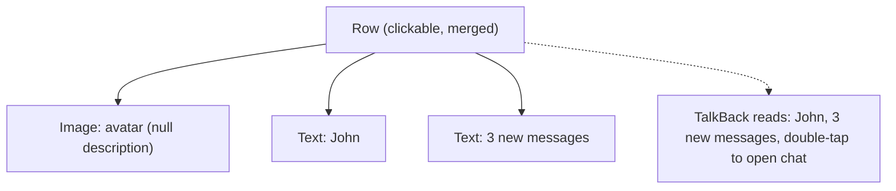
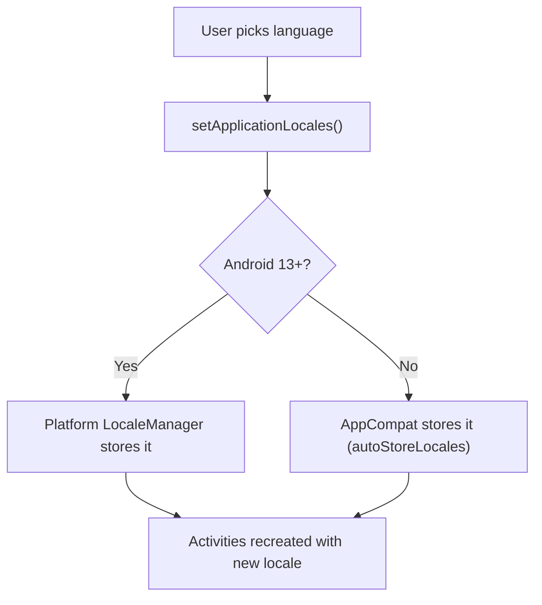

# Accessibility & Localization

[⬅ Back to index](../README.md)

Covers: why accessibility matters, TalkBack, content descriptions, touch targets, font scaling, Compose semantics, testing accessibility; localization, plurals, RTL, per-app language, formatting.

---

## Accessibility

### 1. Why does accessibility matter? What are the main problems to solve?

<details>
<summary>Answer</summary>

**In short:** Over a billion people live with some form of disability, accessibility is increasingly a legal requirement (the European Accessibility Act, in force from June 2025, and the ADA in the US), and accessible design helps everyone. The problems fall into four groups: vision, motor, hearing and cognitive. Each needs specific support such as screen readers, large touch targets, captions and clear navigation.

#### Why it matters

- **Scale:** over a billion people live with some form of disability. If your app ignores them, you lose a large share of potential users.
- **Situational and temporary limits:** accessibility isn't only about permanent disability. Think of a user holding a baby in one arm (one-handed use), reading in bright sunlight (low contrast becomes unreadable), on a noisy train (can't hear audio), or with a broken wrist. Features built for accessibility help all of these people. This is often called the "curb-cut effect": ramps built for wheelchairs also help people with strollers and suitcases.
- **Legal requirement:** the **European Accessibility Act** has been in force since June 2025 and covers many consumer apps (e-commerce, banking, transport, e-books). In the US, the **ADA** has been applied to apps and websites in lawsuits. Most of these laws point to **WCAG** (Web Content Accessibility Guidelines) as the technical standard.
- **Product quality:** accessible apps usually have cleaner structure, better labels and better automated tests, because UI tests often find elements through the same semantics a screen reader uses.

#### The main problems to solve

| Area | Who is affected | What the app needs |
|---|---|---|
| **Vision** | Blind, low vision, colour-blind users | Screen reader support (TalkBack): labels, roles, logical focus order. Sufficient contrast. Scalable text. Never use colour alone to convey meaning. |
| **Motor** | Tremors, limited dexterity, users of Switch Access or a keyboard | Large touch targets (48 dp). Everything reachable by keyboard / Switch Access. Every gesture (swipe, long-press, drag) has a simple alternative. |
| **Hearing** | Deaf and hard-of-hearing users | Captions and transcripts for video and audio. Visual or haptic alternatives for sound cues. |
| **Cognitive** | Learning disabilities, attention issues, older users | Clear, simple language. Predictable navigation. Enough time to act (no aggressive timeouts). Option to reduce motion. Helpful error messages. |

**Pitfalls**
- Treating accessibility as a final QA pass. Retrofitting labels, focus order and touch targets is much more expensive than designing them in.
- Assuming "we have no blind users". You can't know that, because inaccessible apps drive those users away before they show up in analytics.

**Likely follow-ups**
- *What is WCAG?* The W3C's accessibility standard. Level AA is the usual legal and industry target (for example 4.5:1 text contrast).
- *How do you get the team to prioritise it?* Add lint and automated checks to CI, include TalkBack in the definition of done, and point to legal risk and market size.

</details>

### 2. How do you make Views accessible for TalkBack?

<details>
<summary>Answer</summary>

**In short:** Give every meaningful image and icon-only button a `contentDescription` (and mark decorative ones as not important), label inputs, group related views so TalkBack reads them as one item, offer custom actions instead of gesture-only interactions, announce state changes with `stateDescription` and live regions, and mark headings and set a logical traversal order.

#### How TalkBack works

TalkBack is a screen reader. It doesn't look at pixels. It reads the **accessibility node tree** that the framework builds from your views (each node has text, a content description, a role such as "Button", a state such as "Checked", and available actions). The user swipes right and left to move focus between nodes and double-taps to activate the focused one. Your job is to make that tree meaningful.

#### 1. Labels: `contentDescription`

```xml
<!-- Icon-only button: needs a label -->
<ImageButton
    android:id="@+id/play"
    android:src="@drawable/ic_play"
    android:contentDescription="@string/play" />   <!-- "Play", not "Play button" -->

<!-- Decorative image: hide it from TalkBack -->
<ImageView
    android:src="@drawable/divider_flourish"
    android:importantForAccessibility="no" />
```

- Don't include the control type in the label. TalkBack already announces the role, so "Play button" would be read as "Play button, button".
- Put labels in `strings.xml` so they get translated.
- `TextView`s and `Button`s with visible text don't need a `contentDescription`. The text is used.

#### 2. Labels for inputs

An `EditText` on its own announces only its current text. Use a `TextInputLayout` hint (it's exposed as the label), or link a visible label with `android:labelFor`:

```xml
<TextView android:id="@+id/email_label" android:text="@string/email"
    android:labelFor="@+id/email" />
<EditText android:id="@+id/email" android:inputType="textEmailAddress" />
```

#### 3. Grouping related content

A list row with an avatar, a name and "3 new messages" would otherwise take three swipes. Make the container one focusable unit so TalkBack reads "John, 3 new messages" at once:

```xml
<LinearLayout
    android:screenReaderFocusable="true"   <!-- API 28+; ViewCompat.setScreenReaderFocusable on older -->
    android:focusable="true" ...>
```

#### 4. Custom actions instead of gesture-only interactions

Swipe-to-delete and long-press menus are hard or impossible with TalkBack. Expose them as actions that appear in TalkBack's actions menu:

```kotlin
ViewCompat.addAccessibilityAction(rowView, getString(R.string.archive)) { _, _ ->
    viewModel.archive(item.id)
    true
}

// Better spoken hint for the normal click: "Double-tap to open article"
ViewCompat.replaceAccessibilityAction(
    rowView, AccessibilityNodeInfoCompat.AccessibilityActionCompat.ACTION_CLICK,
    getString(R.string.open_article), null
)
```

#### 5. State and dynamic changes

- **`stateDescription`** (`ViewCompat.setStateDescription`) for custom controls: "Expanded", "3 of 5 stars".
- **Live regions** for content that changes without user focus, such as an error or a countdown: `ViewCompat.setAccessibilityLiveRegion(view, ViewCompat.ACCESSIBILITY_LIVE_REGION_POLITE)`. TalkBack reads the new text when it changes.
- **Pane titles** (`ViewCompat.setAccessibilityPaneTitle`) so a new screen section is announced.
- `announceForAccessibility()` works but use it sparingly. It's deprecated in recent API levels in favour of live regions and pane titles, because forced announcements interrupt the user.

#### 6. Structure: headings and order

- `android:accessibilityHeading="true"` (or `ViewCompat.setAccessibilityHeading`) lets users jump between sections using TalkBack's heading navigation.
- Traversal order follows the view hierarchy. If your layout visually differs from its XML order, fix it with `android:accessibilityTraversalBefore` / `accessibilityTraversalAfter`, though restructuring the layout is usually cleaner.

**Pitfalls**
- Labels like "image" or "icon", or file names, are worse than nothing.
- Making both the container and its children focusable, which causes duplicate announcements.
- Custom views that draw everything in `onDraw` expose no nodes. Use `ExploreByTouchHelper` to provide virtual nodes for them.

**Likely follow-ups**
- *`contentDescription = null` vs `importantForAccessibility="no"`?* Both hide a decorative `ImageView`. `importantForAccessibility="no"` is more explicit and also works on containers (`noHideDescendants` hides the whole subtree).
- *How do you handle a custom-drawn chart?* Subclass `ExploreByTouchHelper` and describe each bar or point as a virtual view.

</details>

### 3. How do you make Compose UI accessible?

<details>
<summary>Answer</summary>

**In short:** Compose builds a **semantics tree** alongside the UI tree, and TalkBack and tests read it. Give images and icons a `contentDescription` (`null` for decorative ones), prefer built-in components because they supply roles and states, merge children into one node with `mergeDescendants`, and use `Modifier.semantics` for headings, live regions, custom actions and states. Material components also enforce 48 dp minimum touch targets.

#### The semantics tree

Every composable can add semantics properties (text, role, state, actions). By default each node is separate, so the **merged** tree, which is what TalkBack uses, depends on how you group things.



#### Labels

```kotlin
Icon(Icons.Default.Favorite, contentDescription = stringResource(R.string.add_to_favorites))
Image(painterResource(R.drawable.banner), contentDescription = null) // decorative
```

#### Roles and states: prefer built-in components

`Button`, `Checkbox`, `Switch`, `RadioButton` and `Slider` already expose the right role ("Switch"), state ("On") and actions. For a custom control, use the semantic modifiers rather than plain `clickable`:

```kotlin
// Custom switch-like row
Row(
    Modifier.toggleable(
        value = enabled,
        role = Role.Switch,
        onValueChange = onToggle
    )
) {
    Text("Wi-Fi")
    CustomToggleGraphic(enabled)
}

// Fully custom state text
Box(Modifier.semantics {
    role = Role.Button
    stateDescription = if (expanded) "Expanded" else "Collapsed"
})
```

#### Merging and clearing

```kotlin
// Explicit merge: TalkBack treats the whole card as one item
Column(Modifier.semantics(mergeDescendants = true) {}) {
    Text(title)
    Text(subtitle)
}

// Replace children's semantics completely with one custom description
Row(Modifier.clearAndSetSemantics { contentDescription = "Rating: 4 out of 5" }) {
    repeat(5) { StarIcon(filled = it < 4) }
}
```

`Modifier.clickable` merges its descendants automatically, which is why a clickable row usually reads well without extra work.

#### Other useful semantics

```kotlin
Text("Settings", Modifier.semantics { heading() })                      // heading navigation
Text(errorText, Modifier.semantics { liveRegion = LiveRegionMode.Polite }) // announced on change
Row(Modifier.semantics {
    customActions = listOf(
        CustomAccessibilityAction("Archive") { onArchive(); true }        // replaces swipe gesture
    )
})
Card(Modifier.clickable(onClickLabel = "Open article") { open() })      // "double-tap to open article"
```

#### Touch targets

Material components apply `Modifier.minimumInteractiveComponentSize()`, which reserves at least **48×48 dp** of touchable space even if the visible element is smaller. Add the same modifier to your own small clickable elements.

See [Compose Q39](11-jetpack-compose.md).

**Pitfalls**
- Using `Modifier.clickable` on a `Box` that acts as a checkbox: TalkBack says "button" with no state. Use `toggleable` / `selectable` with a `role`.
- Duplicated text: an `Icon` with a description next to a `Text` saying the same thing. Set the icon's description to `null`.
- Hardcoded English strings in `semantics` blocks. They need `stringResource` too.

**Likely follow-ups**
- *How do you test it?* Compose UI tests query the same semantics tree: `onNodeWithContentDescription("Play").assertHasClickAction()`. Use `printToLog` on `onRoot(useUnmergedTree = true)` to debug it.
- *How do you control traversal order?* `Modifier.semantics { isTraversalGroup = true }` on containers and `traversalIndex` on children.

</details>

### 4. What are touch target, contrast and font scaling guidelines?

<details>
<summary>Answer</summary>

**In short:** Touch targets should be at least **48×48 dp**. Text contrast should be at least **4.5:1** for normal text and **3:1** for large text and essential icons (WCAG AA), and colour must never be the only signal. Text should use **sp** and the layout must still work at the largest font sizes (Android 14 supports up to **200%** with non-linear scaling). Also respect "Remove animations", dark theme and high-contrast settings.

#### Touch targets: 48×48 dp

48 dp is roughly 9 mm on screen, about the size of a fingertip. Smaller targets cause mis-taps, especially for users with tremors. The **visual** element can be smaller (a 24 dp icon); only the **touchable area** must be 48 dp.

```kotlin
// Views: extend the hit area of a small icon with padding (preferred) ...
// android:minWidth="48dp" android:minHeight="48dp" android:padding="12dp"

// ... or with a TouchDelegate when the layout can't grow
parent.post {
    val rect = Rect().also { smallIcon.getHitRect(it) }
    rect.inset(-12.dp, -12.dp)          // expand by 12dp on each side (dp = your px helper)
    parent.touchDelegate = TouchDelegate(rect, smallIcon)
}

// Compose: Material components do this already; for custom ones
Box(Modifier.minimumInteractiveComponentSize().clickable { … })
```

#### Colour contrast

| Content | Minimum contrast (WCAG AA) |
|---|---|
| Normal text | 4.5:1 |
| Large text (≥ 18pt, or ≥ 14pt bold) | 3:1 |
| Essential icons, input borders, focus indicators | 3:1 |

Don't rely on colour alone. A red/green status dot is invisible to many colour-blind users; add an icon or a text label ("Failed", "Paid"). The same applies to form errors: show a message, not just a red border.

#### Font scaling

- Always use **sp** for text so it follows the user's font-size setting. `dp` text ignores it.
- Android 14 supports scaling up to **200%** and uses **non-linear** scaling: large text grows less than small text, so headings don't become huge while body text still becomes readable.
- Layouts must adapt:
  - avoid fixed heights on anything containing text (use `wrap_content` / `minHeight`),
  - allow text to wrap rather than truncate important content,
  - put screens in scrollable containers so content isn't cut off,
  - test with both maximum **font size** and maximum **display size**.
- If you need to convert sp to pixels in code, use `TypedValue.applyDimension(COMPLEX_UNIT_SP, …)` (or Compose's `Density`), not a manual `* fontScale`, so non-linear scaling is applied.

#### Motion and display settings

- **"Remove animations"**: when it's on, `Settings.Global.ANIMATOR_DURATION_SCALE` is `0` and `ValueAnimator.areAnimatorsEnabled()` returns `false`. Skip or simplify non-essential animations (parallax, auto-playing carousels) in that case.
- Support **dark theme** and check contrast in both themes.
- Don't break under **high-contrast text** (a system setting that adds outlines to text).

**Pitfalls**
- Testing only at default font size. Bugs (clipped buttons, overlapping text) show up at 150–200%.
- Disabling font scaling for "design reasons". It makes the app unusable for low-vision users.

**Likely follow-ups**
- *How do you check contrast?* The Accessibility Scanner app, Android Lint, or any WCAG contrast calculator during design.
- *Do icons in a toolbar need 48 dp?* Yes, the touch area does. Material toolbar action buttons already provide it.

</details>

### 5. How do you test accessibility?

<details>
<summary>Answer</summary>

**In short:** Combine **manual** testing (navigate with TalkBack, Switch Access, a keyboard, and maximum font and display size), the **Accessibility Scanner** app, **automated checks** in UI tests (Espresso `AccessibilityChecks.enable()`, Compose semantics assertions and accessibility checks), **Android Lint**, and the Play Console **pre-launch report**. Automated tools catch mechanical issues; only manual testing tells you whether the experience actually makes sense.

#### The layers

| Layer | Tool | Catches | Misses |
|---|---|---|---|
| Static | Android Lint | Missing `contentDescription`, hardcoded text, some touch-target issues | Anything runtime or visual |
| Automated UI tests | Espresso + ATF, Compose UI tests | Missing labels, small touch targets, low contrast, duplicate descriptions, on every test run | Whether labels and order are *meaningful* |
| On-device scan | Accessibility Scanner | Contrast, touch targets, missing labels on the current screen, with suggested fixes | Flows and dynamic behaviour |
| Store | Play Console pre-launch report | Accessibility suggestions from automated crawls on real devices | Same as above |
| Manual | TalkBack, Switch Access, keyboard, large font | Real usability: confusing order, unclear labels, unreachable actions | Nothing, but it's slow |

#### Automated checks in Espresso

The Accessibility Test Framework (ATF) runs checks on the view hierarchy whenever an Espresso `ViewAction` runs:

```kotlin
@RunWith(AndroidJUnit4::class)
class CheckoutTest {
    companion object {
        @BeforeClass @JvmStatic
        fun enableA11yChecks() {
            AccessibilityChecks.enable()
                .setRunChecksFromRootView(true) // check the whole screen, not just the acted-on view
        }
    }

    @Test fun payButton_works() {
        onView(withId(R.id.pay)).perform(click()) // fails if, say, the button is unlabeled or too small
    }
}
```

#### Compose UI tests

Compose tests use the same semantics tree that TalkBack reads, so asserting on it also tests accessibility:

```kotlin
composeTestRule.onNodeWithContentDescription("Play")
    .assertHasClickAction()
composeTestRule.onNodeWithText("Wi-Fi")
    .assert(SemanticsMatcher.expectValue(SemanticsProperties.Role, Role.Switch))
    .assertIsOn()
```

Recent Compose testing versions also support running ATF-style checks (`enableAccessibilityChecks()`), so you get similar automatic checks to Espresso.

#### Manual TalkBack pass (what to check)

1. Swipe through every element: is each one announced with a clear label, role and state?
2. Is the reading order logical (top-to-bottom, matching the visual layout)?
3. Can every action be done, including swipe-only or long-press-only ones (through the actions menu)?
4. Are errors, loading states and new content announced?
5. After closing a dialog or navigating back, does focus land somewhere sensible?

Then repeat key flows with Switch Access or a keyboard, and at maximum font and display size.

**Pitfalls**
- Treating "0 Scanner warnings" as "accessible". A label can pass the check ("Button 1") while being useless.
- Only testing new screens. Regressions creep into old ones; that's why CI checks matter.

**Likely follow-ups**
- *Can you suppress a known ATF issue?* Yes, with `setSuppressingResultMatcher(...)` for a specific check and view, ideally with a tracked ticket.
- *How do you make it part of the process?* Lint and ATF in CI, a TalkBack check in the definition of done, and testing with real users with disabilities where possible.

</details>

### 6. What are common accessibility accommodations you've added to apps?

<details>
<summary>Answer</summary>

**In short:** Give concrete examples with the problem and the fix: labelled icon buttons, grouped list items, custom actions for swipe-to-delete, layouts that scroll at 200% font size, icons and text instead of colour-only status, reduced motion, captions, fixed focus order, live-region error announcements and enlarged touch targets. Interviewers want proof you've done it, not a list of APIs.

#### Examples you can talk about

| Problem found | Fix |
|---|---|
| Toolbar icons read as "unlabeled button" | Added `contentDescription` from `strings.xml` to every icon-only button |
| Each list row took 3–4 swipes in TalkBack | Grouped the row (`screenReaderFocusable` / `mergeDescendants`) so it reads as "John, 3 new messages" |
| Swipe-to-delete impossible with TalkBack | Added a custom accessibility action "Delete" (plus an undo snackbar) |
| Buttons cut off at 200% font size | Removed fixed heights, allowed wrapping, wrapped the screen in a scroll container |
| Order status shown only as a red/green dot | Added an icon and a text label ("Delivered", "Cancelled") |
| Animations caused discomfort | Skipped non-essential animations when "Remove animations" is on |
| Videos had no captions | Added subtitle tracks (ExoPlayer/Media3 supports them) |
| Form focus jumped around | Fixed the layout order and traversal order so focus follows the visual order |
| Validation errors were silent for TalkBack users | Made the error text a polite live region (or used `TextInputLayout.setError`, which is announced) |
| Tiny close (X) icon | Expanded the touch area to 48 dp with padding / `TouchDelegate` |

#### How to frame it in an interview

Use a short story: **what you noticed, how you found it, what you changed, how you verified it**. For example: "During a TalkBack pass on our checkout screen, the payment-method list read each card's logo, number and expiry separately, and the delete action was swipe-only. I merged each row into one node, added a 'Remove card' custom action, and added an ATF check to the Espresso test for that screen so it couldn't regress."

**Pitfalls**
- Listing APIs without context. Explain the user impact.
- Claiming accessibility work you can't discuss in detail. Follow-up questions will expose it.

**Likely follow-ups**
- *How did you find these issues?* TalkBack passes, Accessibility Scanner, ATF in CI, and user or support feedback.
- *What was the hardest one?* Custom-drawn views (charts, canvases), which need `ExploreByTouchHelper` or careful Compose semantics.

</details>

---

## Localization & Internationalization

### 7. How do you localize an Android app?

<details>
<summary>Answer</summary>

**In short:** Put every user-facing string in `res/values/strings.xml` and add translations in locale-qualified folders like `values-es/`; Android picks the best match for the device locale. Use positional placeholders instead of concatenation, `<plurals>` for counts, mark untranslatable text, give translators context, localize images and formats where needed, and test with pseudo-locales.

#### Internationalization vs localization

- **Internationalization (i18n):** engineering the app so it *can* be translated: externalised strings, locale-aware formatting, flexible layouts, RTL support.
- **Localization (l10n):** actually providing translations and locale-specific content for each market.

#### How resource selection works

```
res/
  values/strings.xml            <- default (fallback), must contain every string
  values-es/strings.xml         <- Spanish
  values-hi/strings.xml         <- Hindi
  values-b+zh+Hant/strings.xml  <- Traditional Chinese (BCP 47 form)
  values-pt-rBR/strings.xml     <- Brazilian Portuguese
```

At runtime Android matches the user's locale list against your folders, with fallback: for a `pt-PT` user it can fall back to `pt` resources, and since Android 7 it walks through the user's whole preferred-language list before using the default `values/`. If a string is missing in a translation, the default one is used, so the default folder must be complete.

#### Placeholders, never concatenation

```xml
<!-- Wrong: word order is baked in -->
<string name="hi">Hi </string>   <!-- code: getString(R.string.hi) + name + ... -->

<!-- Right: positional args so translators can reorder -->
<string name="welcome">Hi %1$s, you have %2$d items</string>
```

```kotlin
getString(R.string.welcome, userName, count)
```

In another language the sentence may need the count before the name; with `%2$d ... %1$s` the translator can do that without code changes.

#### Plurals

Languages have different plural categories (`zero`, `one`, `two`, `few`, `many`, `other`). English has two, Polish and Russian have more, Japanese has one.

```xml
<plurals name="items_in_cart">
    <item quantity="one">%d item in cart</item>
    <item quantity="other">%d items in cart</item>
</plurals>
```

```kotlin
resources.getQuantityString(R.plurals.items_in_cart, count, count) // Views
pluralStringResource(R.plurals.items_in_cart, count, count)        // Compose
```

Note that the count is passed twice: once to choose the form, once to fill `%d`. Don't use `quantity="one"` for "exactly 1": in some languages `one` also covers other numbers. For a special zero message in English, check `count == 0` in code with a separate string.

#### Translator support

```xml
<string name="app_name" translatable="false">Acme</string>

<!-- Context comment helps translators pick the right word -->
<!-- Button label: posts the user's comment, not "send by email" -->
<string name="send">Send</string>

<!-- Don't translate the brand name inside a sentence -->
<string name="powered_by">Powered by <xliff:g id="brand">Acme</xliff:g></string>
```

(`xliff:g` needs `xmlns:xliff="urn:oasis:names:tc:xliff:document:1.2"` on the `<resources>` tag.)

#### Other resources and pseudo-locales

- Localize **images with text, layouts and formats** (`drawable-ar/`, locale-specific layout tweaks) where needed.
- **Pseudo-locales** catch problems before real translations exist:
  - `en-XA`: accented, ~30% longer text, so you see truncation and hardcoded strings (they appear unaccented).
  - `ar-XB`: mirrored right-to-left layout, so you see RTL bugs.

```kotlin
android {
    buildTypes {
        debug { isPseudoLocalesEnabled = true }
    }
}
```

**Pitfalls**
- Hardcoded strings in code or layouts (Lint flags `HardcodedText`).
- Reusing one string in two contexts ("Open" as a verb and as an adjective); some languages need different words.
- Assuming text length: German can be much longer than English.

**Likely follow-ups**
- *How do you manage translations at scale?* A translation platform syncing `strings.xml` through CI, with screenshots and comments for context.
- *What if a translation is missing?* The default `values/` string is used, and Lint's `MissingTranslation` check reports it.

</details>

### 8. How do you support RTL (right-to-left) languages?

<details>
<summary>Answer</summary>

**In short:** Enable `android:supportsRtl="true"`, use `start`/`end` instead of `left`/`right` everywhere, auto-mirror directional icons (but not logos or media icons), and use `BidiFormatter` for mixed-direction text. Compose mirrors layouts automatically. Test with the `ar-XB` pseudo-locale or "Force RTL layout direction".

#### What RTL means

Arabic, Hebrew, Persian and Urdu read right to left. For these users the whole layout should mirror: the back arrow points right and sits on the right, navigation drawers open from the right, and text aligns to the right. Things that represent the real world or time (a media play button, a clock, a logo) do not mirror.

#### Views

```xml
<!-- Manifest -->
<application android:supportsRtl="true" ... />

<!-- Wrong: fixed physical sides -->
<TextView android:paddingLeft="16dp" android:layout_alignParentLeft="true" android:gravity="left" />

<!-- Right: logical sides that flip with layout direction -->
<TextView
    android:paddingStart="16dp"
    android:layout_marginEnd="8dp"
    android:gravity="start"
    app:layout_constraintStart_toStartOf="parent" />
```

Android Studio's **Refactor > Add RTL Support Where Possible** converts many `left`/`right` attributes. In code, use `ViewCompat.getLayoutDirection(view)` or `MarginLayoutParamsCompat.setMarginStart` rather than assuming left.

#### Icons

```xml
<!-- Directional icon: flips in RTL -->
<vector android:autoMirrored="true" ...>  <!-- back arrow, "next" chevron, reply -->
```

Don't mirror: play/pause/fast-forward (they represent tape direction), checkmarks, logos, clocks, or anything showing a real object.

#### Compose

Compose reads `LocalLayoutDirection`, so `Row`, `Arrangement.Start`, `padding(start = …)` and `Alignment.Start` flip automatically. Use `Icons.AutoMirrored.Filled.ArrowBack` (the plain `Icons.Filled.ArrowBack` is deprecated for this reason). Only use `absolutePadding` / `Alignment.Left` when something truly must not flip.

```kotlin
// Force LTR for a phone-number input that must not mirror
CompositionLocalProvider(LocalLayoutDirection provides LayoutDirection.Ltr) {
    PhoneNumberField()
}
```

#### Mixed-direction text

An English name or a phone number inside an Arabic sentence can be displayed in the wrong order, because the bidirectional algorithm guesses direction from surrounding characters. Wrap inserted values with `BidiFormatter`:

```kotlin
val bidi = BidiFormatter.getInstance()
val text = getString(R.string.shared_by, bidi.unicodeWrap(userName))
```

`TextDirectionHeuristics` (or `android:textDirection`) controls how a `TextView` decides the direction of its own content.

#### Testing

- `ar-XB` pseudo-locale (mirrored layout, keeps text readable for you).
- Developer options: **Force RTL layout direction**.
- Screenshot tests in an RTL configuration.

**Pitfalls**
- Custom views that draw with absolute `x` coordinates; they must check `layoutDirection` themselves.
- Animations and swipe gestures hardcoded to "slide left" for "next".
- Number fields and code snippets often should stay LTR.

**Likely follow-ups**
- *Does `ViewPager2` handle RTL?* Yes, it follows layout direction, so page order reverses.
- *What about `minSdk` below 17?* `start`/`end` attributes arrived in API 17, which every modern app's `minSdk` is above.

</details>

### 9. What is per-app language preference?

<details>
<summary>Answer</summary>

**In short:** Since **Android 13**, users can choose a different language for each app in system settings (Settings > Apps > App > Language). You declare your supported languages with a `localeConfig` (or let AGP generate it with `generateLocaleConfig = true`), and offer an in-app picker with `AppCompatDelegate.setApplicationLocales(...)`, which is backward compatible through AppCompat and recreates activities automatically. This replaces the old `attachBaseContext` Configuration-override hacks.

#### Why it exists

Many people are multilingual: a user in India may run the phone in English but want a banking app in Hindi. Before Android 13, apps built their own language switchers by overriding the `Configuration` locale in every `attachBaseContext`. That was fragile: it broke after configuration changes, missed WebViews or services, and needed manual persistence.

#### Step 1: declare supported languages

Manual way: `res/xml/locales_config.xml`

```xml
<locale-config xmlns:android="http://schemas.android.com/apk/res/android">
    <locale android:name="en-US"/>
    <locale android:name="hi"/>
    <locale android:name="es"/>
</locale-config>
```

```xml
<application android:localeConfig="@xml/locales_config" ... />
```

Automatic way: let AGP generate it from your `values-*` folders:

```kotlin
android {
    androidResources { generateLocaleConfig = true }
}
```

This also needs a `res/resources.properties` file with your default locale (for example `unqualifiedResLocale=en-US`). The system uses this list to show the language option in Settings.

#### Step 2: change the language from inside the app

```kotlin
// User picked Hindi in your settings screen
AppCompatDelegate.setApplicationLocales(LocaleListCompat.forLanguageTags("hi"))

// Reset to follow the system language
AppCompatDelegate.setApplicationLocales(LocaleListCompat.getEmptyLocaleList())

// Read the current choice
val current = AppCompatDelegate.getApplicationLocales()
```

On Android 13+, AppCompat calls the platform `LocaleManager`, and the system stores the choice. Activities are recreated with the new locale.

#### Backward compatibility (pre-Android 13)

AppCompat can store the choice itself and apply it on startup. Opt in with this manifest entry:

```xml
<service
    android:name="androidx.appcompat.app.AppLocalesMetadataHolderService"
    android:enabled="false"
    android:exported="false">
    <meta-data android:name="autoStoreLocales" android:value="true" />
</service>
```

Your activities must extend `AppCompatActivity` for it to apply.



**Pitfalls**
- Forgetting the locale config: the app won't appear in the system per-app language settings.
- Calling it before `onCreate` or from a non-AppCompat activity on older versions.
- Caching formatted strings or `Locale.getDefault()` results in singletons; refresh them after a locale change.

**Likely follow-ups**
- *Does the server need to know?* Often yes: send the app locale (for example in an `Accept-Language` header) so API-provided text matches.
- *What happens to the app process?* It isn't killed; activities are recreated, like any configuration change.

</details>

### 10. How do you format dates, numbers and currencies correctly for each locale?

<details>
<summary>Answer</summary>

**In short:** Never hardcode patterns like `"MM/dd/yyyy"` or `"$" + price`. Use locale-aware formatters: `java.time`'s `DateTimeFormatter.ofLocalizedDate(...)` or `DateFormat.getBestDateTimePattern(...)` for dates, respect the 12/24-hour setting, and use `NumberFormat` (or ICU `NumberFormatter` on API 30+) for numbers and currency. Store and send timestamps in UTC, and convert to the user's time zone only when displaying.

#### Why it matters

The same value looks different by locale:

| Value | en-US | de-DE | hi-IN |
|---|---|---|---|
| Date (medium) | Mar 5, 2026 | 05.03.2026 | 5 मार्च 2026 |
| Number 1234567.5 | 1,234,567.5 | 1.234.567,5 | 12,34,567.5 |
| Currency | $1,234.50 | 1.234,50 € | ₹1,234.50 |

(Exact output varies by Android/ICU version.) A hardcoded format is wrong for most of the world, and in the date case it can be actively misleading: 05/03 is May 3 in the US and 5 March in Europe.

#### Dates and times

```kotlin
val locale = LocalConfiguration.current.locales[0] // or resources.configuration.locales[0]

// Full localized style
val text = DateTimeFormatter.ofLocalizedDate(FormatStyle.MEDIUM)
    .withLocale(locale)
    .format(localDate)

// "Skeleton": say which fields you want, the locale decides order and punctuation
val pattern = android.text.format.DateFormat.getBestDateTimePattern(locale, "MMMd") // "Mar 5" or "5 Mar"
val short = DateTimeFormatter.ofPattern(pattern, locale).format(localDate)

// Respect the user's 12/24-hour setting
val timeSkeleton = if (DateFormat.is24HourFormat(context)) "Hm" else "hma"

// Relative times: "5 min. ago", "Yesterday"
DateUtils.getRelativeTimeSpanString(timestampMillis, System.currentTimeMillis(), DateUtils.MINUTE_IN_MILLIS)
```

#### Numbers and currency

```kotlin
NumberFormat.getInstance(locale).format(1234567.5)

val priceFormat = NumberFormat.getCurrencyInstance(locale).apply {
    currency = Currency.getInstance("INR") // currency comes from the data, not the device locale
}
priceFormat.format(1234.5)

// API 30+: ICU's modern, fluent API
android.icu.number.NumberFormatter.withLocale(locale)
    .unit(android.icu.util.Currency.getInstance("EUR"))
    .format(1234.5)
    .toString()
```

The currency must come from your data (what the price actually is in), while the **formatting** (symbol position, separators) comes from the user's locale. A US user viewing a price in rupees should see "₹1,234.50", not "$1,234.50".

#### Time zones: store UTC, display local

```kotlin
// Server sends "2026-03-05T14:30:00Z" (ISO-8601, UTC)
val instant = Instant.parse(apiTimestamp)
val local = instant.atZone(ZoneId.systemDefault())  // convert only for display
```

Storing local times loses information (daylight-saving gaps and overlaps, users travelling between zones). Use `Instant` / epoch millis in the database and the API.

#### Units

Use the user's measurement system: `android.icu.util.LocaleData.getMeasurementSystem(ULocale)` tells you metric vs US vs UK, and `android.icu.text.MeasureFormat` formats values with localized unit names ("5 km", "3 mi").

**Pitfalls**
- Using `SimpleDateFormat("dd/MM/yyyy")` for display. Fixed patterns are fine for parsing machine formats, not for UI.
- `String.format("%.2f", x)` without a locale uses the default locale, which can break machine-readable output (a comma decimal separator in JSON). Use `Locale.ROOT` for machine output and the user's locale for display.
- Doing money calculations in `Double`. Use `BigDecimal` or integer minor units (paise, cents).

**Likely follow-ups**
- *`java.time` on old devices?* It's built in from API 26; below that, enable core library desugaring.
- *Why not `Locale.getDefault()` everywhere?* With per-app languages or a configuration change, the context's configuration locale is the reliable source for UI formatting.

</details>

---

[⬅ Previous: Coding & Scenarios](25-coding-scenarios.md) · [⬅ Back to index](../README.md) · [Next: Company-Wise Questions ➡](27-company-wise-questions.md)
