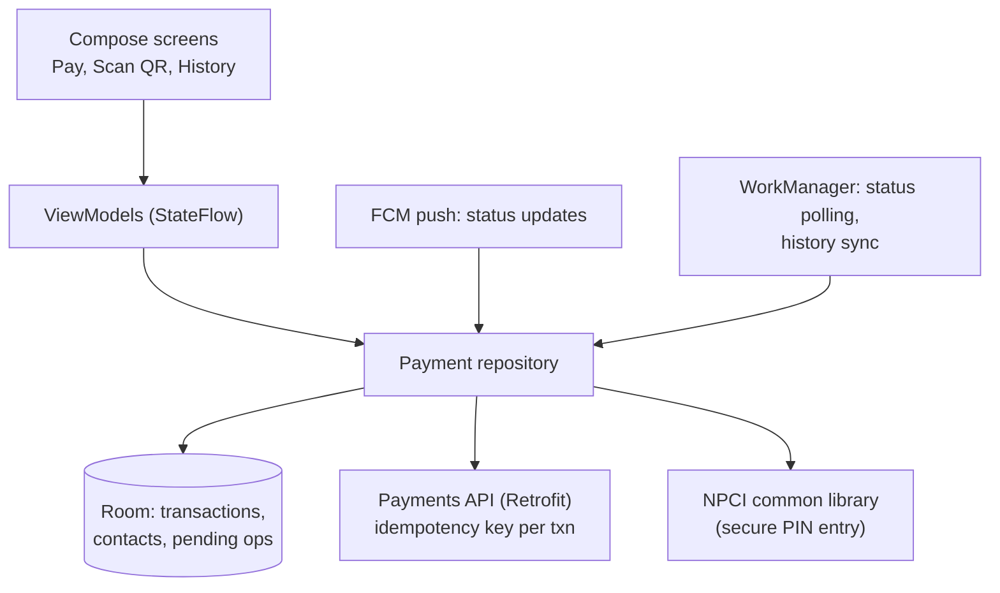
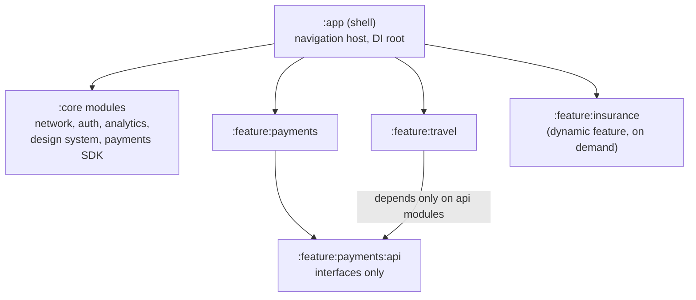

# Company-Wise Questions (Product Companies)

[⬅ Back to index](../README.md)

Covers: how Android interview loops work at Google, Meta, Amazon, Microsoft, Uber, Airbnb, Netflix, LinkedIn, Spotify and Indian product companies (Flipkart, Swiggy, Zomato, PhonePe, Paytm, CRED, Meesho, Zepto, Hotstar, Dream11, Razorpay); the machine-coding round; the most-asked questions; and full answers for company-style mobile design prompts (UPI app, quick commerce, live order tracking, super-app, product listing, short-video feed, server-driven UI, live scores, feature-flag SDK).

> These lists come from commonly reported interview experiences. Companies change their questions and loops often, so use them to practise each company's **style**, not as a guaranteed list. Links point to the full answers in this repo. For backend-heavy design rounds, see the [System Design repo](https://github.com/AkshayAshokCode/System-Design-Interview-Questions-cheat-sheet).

---

## How Product Companies Interview Android Engineers

### 1. What does a typical Android interview loop at a product company look like?

Answer

Most loops combine some of these rounds:
- **DSA / coding** (1–3 rounds) – data structures and algorithms, usually in Kotlin or Java. Heaviest at Google, Meta, Amazon, Microsoft.
- **Android / platform knowledge** – lifecycle, Compose, coroutines and Flow, memory, threading, performance, architecture. Often a deep conversation, sometimes with code.
- **Machine coding** – build a small working app or feature in 60–180 minutes. Very common at Indian product companies and startups.
- **Mobile system design** – design an app's client architecture and its contract with the backend (senior and above). See [System Design](23-system-design.md).
- **Behavioral / hiring manager** – past projects, ownership, conflict, impact. See [Coding, Scenarios & Behavioral](25-coding-scenarios.md).

Ask the recruiter for the exact rounds; they usually tell you, and preparing for the wrong format wastes time.

### 2. What are Android interviews at Google like?

Answer

**Format (commonly reported)** – Google's general coding rounds are mostly language-agnostic DSA (graphs, trees, dynamic programming, intervals), solved in Kotlin or Java with clean code and complexity analysis. Android roles add a **domain round** (Android fundamentals and app design), and senior candidates get **mobile system design** plus a "Googleyness and leadership" behavioral round.

**Android topics that come up**
- Activity/Fragment lifecycle, configuration changes vs process death → [Lifecycle](09-activity-fragment.md)
- Compose recomposition, state, side effects and stability → [Compose](11-jetpack-compose.md)
- Coroutines (structured concurrency, cancellation, exception handling) and Flow → [Coroutines](03-coroutines.md), [Flow](04-flow.md)
- Memory leaks, performance, startup, Baseline Profiles → [Performance](19-performance-memory.md)
- Background work limits and WorkManager → [Background Work](17-threading-background-work.md)
- Designs: image loading library, offline-first app, YouTube-style video app, Google Photos backup client → [System Design](23-system-design.md)

**Tip** – Google cares about fundamentals and reasoning. Explain *why* the framework behaves as it does (e.g. why a ViewModel survives rotation but not process death).

### 3. What are Android interviews at Meta like?

Answer

**Format (commonly reported)** – two **DSA coding** rounds (fast pace: often two problems in 45 minutes, so practise speed), a **mobile system design / product architecture** round, and a **behavioral** round. Meta's Android work is at huge scale, so performance, reliability and large-codebase practices come up.

**Common design prompts** – the Instagram or Facebook feed, Instagram Stories, Messenger/WhatsApp chat, a photo upload flow, News Feed with offline support, a video player screen with prefetching. → [System Design](23-system-design.md), [short-video feed](#20-design-a-short-video-feed-like-instagram-reels--moj--sharechat)

**Topics in the design deep dives** – pagination and caching, image and video prefetching, optimistic updates, offline queues, real-time updates, scroll performance, app size, startup time, and handling poor networks.

**Tip** – drive the conversation from the product: what the user sees, then the data flow, then the edge cases (offline, slow network, process death).

### 4. What are Android interviews at Amazon like?

Answer

**Format (commonly reported)** – DSA rounds, an Android/technical round, often a **low-level or system design** round, and **Leadership Principles** questions in *every* round ("Tell me about a time you disagreed with your manager", "a time you dove deep to find a root cause"). Prepare 6–8 STAR stories mapped to the principles.

**Topics** – Android fundamentals and architecture, threading, memory, testing, and practical design like the Amazon shopping app's product page, cart sync across devices, order tracking notifications, or an offline-capable delivery driver app. → [Architecture](12-architecture.md), [Testing](20-testing.md), [System Design](23-system-design.md)

**Tip** – tie technical decisions to customer impact and operational excellence (crash rates, monitoring, rollback plans).

### 5. What do Microsoft, LinkedIn, Uber, Airbnb, Netflix and Spotify typically ask?

Answer

- **Microsoft / LinkedIn** – team-dependent mix of DSA, Android deep dive and design. LinkedIn has a well-known Android codebase at scale: expect modularization, build speed, feed performance and A/B testing questions. → [Build & Release](22-build-gradle-release.md), [Architecture](12-architecture.md)
- **Uber / Lyft / DoorDash** – architecture at scale (Uber's RIBs, plugins), location tracking, maps, real-time trip state, reliability on bad networks, feature flags. → [Uber-style design](23-system-design.md), [Background Work](17-threading-background-work.md), [feature-flag SDK](#22-design-a-feature-flag--experimentation-sdk-for-android)
- **Airbnb** – server-driven UI, design systems in Compose, search and booking flows, deep links. → [server-driven UI](#19-design-server-driven-ui-like-airbnb--swiggy--flipkart)
- **Netflix / Spotify** – media playback (ExoPlayer/Media3), offline downloads with DRM, background playback, adaptive streaming, performance on low-end devices. → [file downloader](23-system-design.md), [Background Work](17-threading-background-work.md)

### 6. What do Indian product companies ask Android engineers?

Answer

Most run: **machine coding** (build an app in 1–3 hours) → **Android deep dive** → **mobile HLD/LLD** → **hiring manager / culture**. Some add a DSA round (more common at Flipkart, PhonePe, Razorpay).

| Company | Commonly reported focus and prompts |
|---|---|
| **Flipkart / Meesho / Myntra** | Product listing with filters and infinite scroll, flash-sale traffic, image-heavy screens on low-end devices, app size → [product listing](#18-design-a-product-listing-page-with-filters-and-infinite-scroll-flipkart--amazon) |
| **Swiggy / Zomato** | Live order tracking, restaurant listing, server-driven UI, cart → [order tracking](#15-design-a-live-order-tracking-screen-swiggy--zomato--uber-eats), [SDUI](#19-design-server-driven-ui-like-airbnb--swiggy--flipkart) |
| **Zepto / Blinkit / Instamart** | Quick-commerce home and cart with per-store inventory, 10-minute delivery tracking → [quick commerce](#14-design-a-quick-commerce-app-zepto--blinkit--instamart) |
| **PhonePe / Paytm / Google Pay / CRED / Razorpay** | UPI payment flows, security (root detection, Keystore), super-app modularization, payment SDKs → [UPI app](#13-design-a-upi-payments-app-client-phonepe--google-pay--paytm), [super-app](#16-design-a-super-app-architecture-paytm--phonepe--tata-neu) |
| **Hotstar / Dream11 / Cricbuzz** | Live scores and streaming for millions at once, spikes, battery and data use → [live scores](#21-design-a-live-score--fantasy-sports-screen-for-millions-of-concurrent-users) |
| **ShareChat / Moj / Josh / Instagram** | Short-video feed with preloading and smooth playback → [short-video feed](#20-design-a-short-video-feed-like-instagram-reels--moj--sharechat) |

Deep-dive favourites: coroutines and Flow internals, Compose recomposition, ViewModel internals, Hilt scopes, memory leaks, RecyclerView recycling, process death, WorkManager, app startup.

### 7. What is the machine-coding round and how do you do well in it?

Answer

You build a small working app or feature (60–180 minutes), sometimes shared on screen, then walk the interviewer through it. Typical prompts:
- Image gallery / movie list from an API with search, pagination and a detail screen.
- A to-do or notes app with Room persistence.
- A countdown timer or stopwatch that survives rotation and process death.
- A chat screen UI with a fake socket, or a product listing with filters and a cart.

**How to score well**
1. Clarify scope; list must-haves vs nice-to-haves and build the must-haves first.
2. Set up a clean structure quickly: MVVM + repository, Hilt (or manual DI), coroutines + Flow, Compose or RecyclerView.
3. Get something working end to end early, then improve: loading/error/empty states, pagination, caching, rotation handling.
4. Keep code readable (naming, small functions, no god classes) and add a few unit tests for the ViewModel or repository if time allows.
5. Keep a template project ready (dependencies, base architecture) if the company allows it.

See worked examples in [Coding & Scenarios](25-coding-scenarios.md).

### 8. Which Android questions come up most across product companies?

Answer

A checklist to be able to answer confidently:
1. Activity lifecycle, configuration change vs process death, `SavedStateHandle` → [09](09-activity-fragment.md)
2. How a ViewModel survives rotation → [13](13-jetpack-components.md)
3. Coroutines: dispatchers, structured concurrency, cancellation, `SupervisorJob`, exception handling → [03](03-coroutines.md)
4. Flow: cold vs hot, StateFlow vs SharedFlow vs LiveData, `stateIn`, one-time events → [04](04-flow.md)
5. Compose: recomposition, state hoisting, `remember` vs `rememberSaveable`, side effects, stability → [11](11-jetpack-compose.md)
6. MVVM vs MVI, Clean Architecture, single source of truth, offline-first → [12](12-architecture.md)
7. Hilt components and scopes → [14](14-dependency-injection.md)
8. Retrofit/OkHttp interceptors, token refresh, caching → [15](15-networking.md)
9. Room, migrations, DataStore → [16](16-data-storage.md)
10. Handler/Looper, ANRs, WorkManager vs foreground services → [17](17-threading-background-work.md)
11. Memory leaks and how to find them, startup optimisation, jank → [19](19-performance-memory.md)
12. RecyclerView internals and DiffUtil → [10](10-ui-views.md)
13. Kotlin: data/sealed classes, inline/reified, scope functions, generics variance → [01](01-kotlin-basics.md), [02](02-kotlin-advanced.md)
14. Security: Keystore, certificate pinning, Play Integrity → [21](21-security-permissions.md)
15. Mobile system design: feed, chat, image loader, offline sync → [23](23-system-design.md)

### 9. How do expectations differ for senior and staff Android engineers?

Answer

- **SDE 2 / mid** – solid fundamentals, clean code, can build features end to end with modern Jetpack libraries.
- **Senior (L5/E5/SDE 3)** – owns architecture of a feature area; explains trade-offs (Compose vs Views, MVI vs MVVM), designs for offline, performance and testability; drives mobile system design rounds; mentors.
- **Staff (L6/E6/Principal)** – shapes the whole app's architecture and platform: modularization strategy, build times, release process, observability (crash and ANR rates, performance metrics), migrations (Java → Kotlin, Views → Compose) across many teams, and cross-team influence. Expect "how would you roll this out to 50 engineers?" questions.

### 10. Product companies vs service companies – how should your preparation differ?

Answer

Product companies focus more on **depth and reasoning** (why, internals, trade-offs), DSA, design rounds and impact you've had on a product. Service/consulting companies tend to focus on breadth of tools, project experience and practical questions. For product companies: practise DSA regularly, go deep on coroutines/Compose/architecture internals, practise mobile system design out loud, and prepare stories with measurable impact ("reduced cold start by 35%", "cut crash rate from 1.2% to 0.3%").

### 11. How do you answer "Tell me about an app or feature you built" (the project deep dive)?

Answer

Structure it like a mini design review:
1. **Context** – the product, users, scale (DAU, screens), team size.
2. **Architecture** – draw it: layers, modules, data flow, key libraries.
3. **Decisions and trade-offs** – e.g. why Paging 3 + RemoteMediator, why MVI for a complex screen, why you migrated to Compose incrementally.
4. **A hard problem** – a memory leak, an ANR, a sync bug, a slow startup – and how you found and fixed it (tools, data).
5. **Impact** – metrics: crash-free rate, startup time, conversion, ratings.
6. **Hindsight** – what you'd do differently.

Be clear about what **you** did versus the team. Interviewers will go deep into any component you mention, so only mention what you can defend.

### 12. What should you do in the last week before a product-company Android interview?

Answer

- **Days 1–2** – revise the most-asked list (question 8) and the README one-liners.
- **Days 3–4** – one timed DSA session per day in Kotlin (medium problems, talk while coding); one machine-coding practice if the company runs that round.
- **Day 5** – mobile system design mock out loud: one prompt from that company's list above.
- **Day 6** – behavioral: 6–8 STAR stories (impact, conflict, failure, ownership, ambiguity); research the company's app – use it, note how it might be built.
- **Day 7** – light revision and rest.

---

## Company-Style Mobile Design Prompts

### 13. Design a UPI payments app client (PhonePe / Google Pay / Paytm).

Answer

**Requirements** – onboard with phone number and SIM binding, link bank accounts, pay to a UPI ID / QR code / contact, check balance, transaction history, collect requests, notifications; must be **secure**, work on low-end devices and poor networks, and never show a wrong payment status.

**Deep dives**
- **Device binding** – an SMS sent from the device's SIM to the bank/PSP number verifies phone + SIM; rebind if the SIM changes.
- **PIN security** – the UPI PIN is entered in the **NPCI common library** UI and encrypted with NPCI keys; the app never sees it. Also: no screenshots on sensitive screens (`FLAG_SECURE`), root/tamper detection, Play Integrity, Keystore-backed keys.
- **Transaction state** – create a client transaction ID (idempotency) before calling the server; show `Pending` when the result is unknown (timeouts are common), then update via **FCM push** or polling with backoff. Never let the user retry with a new ID while one is pending.
- **History** – Room as source of truth, synced incrementally; Paging 3 for long lists.
- **QR scanning** – CameraX + ML Kit barcode scanning, parse `upi://pay?...` intents; also handle UPI intents from other apps (merchant checkout).
- **Low-end devices** – small APK (R8, dynamic feature modules), fast cold start, minimal memory.
- **Reliability** – show clear states, receipts, and retry only safe operations.

### 14. Design a quick-commerce app (Zepto / Blinkit / Instamart).

Answer

**Requirements** – the catalog and stock depend on the **dark store** serving the user's location; home screen with categories and offers; search; cart; checkout; delivery in ~10 minutes with live tracking.

**Client design**
- **Location → store** – on launch or address change, resolve the serving store (`GET /store?lat=&lng=`); all catalog calls carry the store ID. Cache per store; clear the cart or re-validate when the store changes.
- **Home screen** – largely **server-driven** (widgets/sections defined by the backend) so merchandising can change without releases; skeleton loading; images sized to the device.
- **Inventory freshness** – stock changes fast. Show cached data immediately, refresh in the background, and **re-validate the cart** before checkout (items may have gone out of stock or changed price); show clear diffs to the user.
- **Cart** – local (Room) for instant updates, synced to the server (so it survives reinstall and works across devices); debounce quantity changes; optimistic UI.
- **Checkout** – idempotent order creation; payment SDK; handle payment pending states.
- **Tracking** – see [live order tracking](#15-design-a-live-order-tracking-screen-swiggy--zomato--uber-eats).
- **Performance** – very fast startup and first screen (users open it in a hurry), prefetch the home feed, small app size.

### 15. Design a live order tracking screen (Swiggy / Zomato / Uber Eats).

Answer

**Requirements** – show order status (placed → accepted → preparing → picked up → arriving → delivered), the delivery partner's live location on a map, ETA, and contact options; keep the user informed even when the app is in the background.

**Design**
- **Foreground** – a WebSocket/SSE connection (or polling every few seconds as a fallback) delivering status changes and partner location; reconnect with backoff; on reconnect, fetch the current snapshot first.
- **Map** – smooth marker movement by **interpolating** between location updates (updates arrive every 3–5 s; animate the marker along the route instead of jumping); draw the route polyline; snap to roads.
- **Background** – status changes via **FCM** notifications; on Android 16+, consider **Live Updates** (progress-style notifications for ongoing activities like deliveries) or an ongoing notification with progress.
- **State** – an order state machine in the ViewModel driven by server events; the server is the source of truth; ignore out-of-order events using sequence numbers.
- **Battery and data** – stop the socket when the screen isn't visible (`repeatOnLifecycle`), lower update frequency far from delivery.
- **Edge cases** – partner reassignment, order cancelled, network loss (show "last updated" time), process death (restore from saved order ID).

### 16. Design a super-app architecture (Paytm / PhonePe / Tata Neu).

Answer

A super-app hosts many mini-products (payments, recharges, travel, shopping, insurance) built by many teams in one app.

**Architecture**

**Key points**
- **Modularization** – feature modules with separate `api` (interfaces, navigation contracts) and `impl` modules so teams don't depend on each other's internals; faster builds (Gradle caching, parallelism).
- **Navigation** – a central router with deep links/route contracts; features register their entry points.
- **Shared platform** – one design system (Compose components), one network stack with auth, one analytics/feature-flag SDK, one payments SDK.
- **App size and startup** – **dynamic feature modules** (Play Feature Delivery) for rarely used features; lazy initialisation of each mini-app; startup tracing per team; strict budgets.
- **Server-driven UI** for the home screen and promotions.
- **Some companies** run mini-apps as web/React Native/Flutter modules for faster release cycles; weigh performance vs agility.
- **Governance** – ownership (CODEOWNERS), API review for core modules, per-team performance budgets and crash dashboards.

### 17. How would you reduce cold start time for an app with 100M users?

Answer

1. **Measure** – Play Console Android vitals, Macrobenchmark (`StartupTimingMetric`), Perfetto/system traces; segment by device tier (low-end devices are the long pole).
2. **Find the work on the critical path** – `Application.onCreate` (SDK initialisations), DI graph creation, main-thread disk I/O (SharedPreferences, database), heavy first-screen layouts, synchronous network calls.
3. **Fix**
   - Defer or lazily initialise SDKs (App Startup library, initialise on first use or after first frame).
   - Move I/O off the main thread; use DataStore; avoid reflection-heavy init.
   - **Baseline Profiles** (often 20–30% faster) and R8 full mode.
   - Show the first screen from cache; load the rest progressively.
   - Simplify the first screen's composition/layout.
4. **Prevent regressions** – startup benchmarks in CI, budgets per module/team, alerts on vitals.

See [Performance & Memory](19-performance-memory.md).

### 18. Design a product listing page with filters and infinite scroll (Flipkart / Amazon).

Answer

**Requirements** – a search or category result with thousands of products, sort and filters (brand, price, rating), infinite scroll, fast on low-end devices, add to cart/wishlist from the list.

**Design**
- **API** – `GET /products?query=&filters=&sort=&cursor=&limit=20` returning products and **facets** (filter options with counts); cursor pagination.
- **Paging** – Paging 3 with a `PagingSource` (or `RemoteMediator` + Room if offline support is needed); a new `Pager` when filters change; `cachedIn(viewModelScope)` so rotation doesn't refetch.
- **Filters** – filter state as a single immutable object in the ViewModel (`StateFlow<FilterState>`); `flatMapLatest` to restart paging on change; debounce rapid changes; persist across process death with `SavedStateHandle`.
- **UI** – `LazyVerticalGrid` with stable keys and content types; images downsampled with Coil and prefetched; placeholders; avoid heavy recomposition per item.
- **Cart/wishlist from the list** – optimistic toggle with rollback on failure; observe cart state from a shared repository so all screens agree.
- **Low-end devices** – smaller image sizes, fewer animations, limit concurrent decoding; watch memory.
- **Analytics** – impressions logged in batches (which products were visible).

### 19. Design server-driven UI (like Airbnb / Swiggy / Flipkart).

Answer

**Why** – change screens (home, offers, landing pages) without app releases; consistent across Android, iOS and web; enables experiments.

**Design**
- The server returns a **layout tree of components** with data, e.g. `{type: "carousel", items: [...]}, {type: "banner", ...}, {type: "productGrid", ...}`, plus **actions** (`navigate`, `addToCart`, `openUrl`).
- The client has a **registry of native components** (Compose) keyed by `type`; it renders known types and **ignores or hides unknown types** (old app versions must not crash).
- **Versioning** – the client sends its supported component/schema version; the server only sends compatible components.
- **Actions** – a typed action handler (deep links, analytics events, mutations) rather than arbitrary scripting.
- **Performance** – cache the last layout for instant display; paginate long feeds; stable keys for lazy lists.
- **Trade-offs** – very flexible but harder to debug, less type-safe, and complex interactions still need native screens. Use it for content-driven screens, not for everything.

### 20. Design a short-video feed (like Instagram Reels / Moj / ShareChat).

Answer

**Requirements** – vertical swipe feed of short videos that start **instantly**, autoplay with sound settings, like/comment/share, works on low-end devices and variable networks.

**Design**
- **Feed** – a vertical pager (`VerticalPager` in Compose, or ViewPager2/RecyclerView); feed items fetched in pages with cursors.
- **Player pool** – reuse a small pool of **ExoPlayer/Media3** instances (2–3) instead of creating one per item; attach to the visible page, release on recycle.
- **Preloading** – preload the first seconds of the next 1–3 videos (Media3 preload manager / prefetching into the **cache**), and the thumbnail for instant first frame; adapt how much to preload to the network.
- **Adaptive streaming** – HLS/DASH so quality adapts to bandwidth; start at a lower bitrate for fast start.
- **Caching** – `SimpleCache` with an LRU disk limit so re-watched videos don't redownload.
- **Lifecycle** – pause when the app goes to background or the item isn't fully visible; handle audio focus.
- **Metrics** – time to first frame, rebuffering ratio, watch time; send in batches.
- **Low-end devices** – lower resolutions, limit decoders in use, watch memory.

### 21. Design a live score / fantasy sports screen for millions of concurrent users.

Answer

**Requirements** – ball-by-ball scores and fantasy points update within seconds for millions of users during a match; spikes at toss and key moments; battery- and data-friendly.

**Design**
- **Transport** – a persistent connection (WebSocket/SSE) to edge servers while the screen is visible; fall back to **polling a CDN-cached JSON** endpoint (cheap at huge scale – everyone fetches the same object, and the CDN absorbs it).
- **Payload** – small deltas with a version number; on version gaps, fetch a full snapshot.
- **Client** – a repository exposing `StateFlow<MatchState>`; collect only when visible (`repeatOnLifecycle`); stop updates in background and rely on push notifications for key events (wickets, match result).
- **Spikes** – jittered reconnects and backoff so millions of clients don't reconnect at the same moment after a blip; server-provided polling interval that can be raised under load.
- **Fantasy specifics** – team-lock deadlines enforced by the server (client clock can't be trusted), leaderboards loaded with pagination and cached.
- **Widgets/Live Updates** – a home-screen widget or ongoing notification for the live score (budgeted updates).

### 22. Design a feature-flag / experimentation SDK for Android.

Answer

**Requirements** – teams check flags (`isEnabled("new_checkout")`) and experiment variants anywhere in the app; flags must be available instantly at startup, consistent within a session, updated from the server, and safe if the server is unreachable.

**Design**
- **Storage** – the last fetched config persisted locally (DataStore/file); loaded synchronously and cheaply at startup (or with a tiny in-memory default set), so no flag check waits for the network.
- **Fetch** – refresh in the background on app start and periodically; apply new values on the **next session** (or at safe points) to avoid UI flipping mid-flow; ETag to skip unchanged configs.
- **Defaults** – every flag has a compiled-in default; kill switches default to safe values.
- **Experiments** – variant assignment from the server or deterministic hashing of the user ID; log **exposure events** when a variant is actually used (through the analytics SDK, batched).
- **Targeting** – app version, OS version, country, user segment.
- **Developer experience** – type-safe flag definitions (generated code), a debug menu to override flags in internal builds, and cleanup tooling for stale flags.
- **Safety** – a remote kill switch for crashing features is one of the most valuable tools in mobile, because a fixed release takes days to reach users.

---

[⬅ Previous: Accessibility & Localization](26-accessibility-localization.md) · [⬅ Back to index](../README.md)
