# Company-Wise Questions (Product Companies)

[⬅ Back to index](../README.md)

Covers: how Android interview loops work at Google, Meta, Amazon, Microsoft, Uber, Airbnb, Netflix, LinkedIn, Spotify and Indian product companies (Flipkart, Swiggy, Zomato, PhonePe, Paytm, CRED, Meesho, Zepto, Hotstar, Dream11, Razorpay); the machine-coding round; the most-asked questions; and full answers for company-style mobile design prompts (UPI app, quick commerce, live order tracking, super-app, product listing, short-video feed, server-driven UI, live scores, feature-flag SDK).

> These lists come from commonly reported interview experiences. Companies change their questions and loops often, so use them to practise each company's **style**, not as a guaranteed list. Links point to the full answers in this repo. For backend-heavy design rounds, see the [System Design repo](https://github.com/AkshayAshokCode/System-Design-Interview-Questions-and-Answers).

---

## How Product Companies Interview Android Engineers

### 1. What does a typical Android interview loop at a product company look like?

<details>
<summary>Answer</summary>

**In short:** A loop is usually 4–6 rounds drawn from five types: DSA coding, Android/platform deep dive, machine coding, mobile system design (senior and above) and behavioral/hiring manager. The mix depends on the company: big tech leans on DSA and design, Indian product companies and startups lean on machine coding and Android depth.

#### The five round types

| Round | What you do | Where it's heaviest | What they're judging |
|---|---|---|---|
| **DSA / coding** (1–3 rounds) | Solve algorithm problems (arrays, graphs, trees, DP) in Kotlin or Java on a shared editor | Google, Meta, Amazon, Microsoft | Problem solving, clean code, complexity analysis, communication |
| **Android / platform knowledge** | A conversation on lifecycle, Compose, coroutines and Flow, memory, threading, performance, architecture; sometimes small code exercises | Almost everyone; deepest at Indian product companies | Whether you understand *why* the framework behaves as it does, not just which API to call |
| **Machine coding** | Build a small working app or feature in 60–180 minutes, then walk through it | Indian product companies, startups | Speed, structure, working code, handling of edge states |
| **Mobile system design** | Design an app's client architecture and its contract with the backend | Senior and above, everywhere | Breaking down an ambiguous problem, trade-offs, offline/performance/reliability thinking |
| **Behavioral / hiring manager** | Past projects, ownership, conflict, impact, failure | Everyone; Amazon asks it in every round | Seniority signals, communication, culture fit |

See [System Design](23-system-design.md) for design rounds and [Coding, Scenarios & Behavioral](25-coding-scenarios.md) for behavioral and machine-coding practice.

#### A typical flow

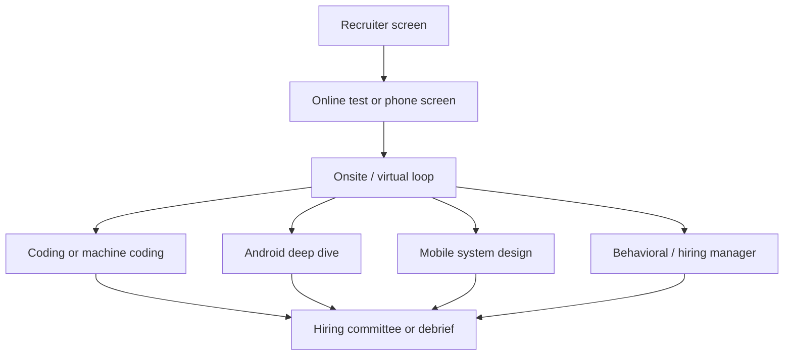

The phone screen is usually one DSA problem or a short Android quiz. Each loop round produces independent written feedback, and a committee or debrief combines it, so one weak round is not always fatal if the others are strong.

#### How to use this

Ask the recruiter for the exact rounds, their order and duration, the language allowed, and whether machine coding allows your own IDE and internet access. Recruiters usually answer these questions, and preparing for the wrong format (grinding hard DP for a company that runs a 3-hour build-an-app round) wastes weeks.

**Likely follow-ups**
- *"Which round do you find hardest?"* – Be honest and say how you prepared for it.
- *"Can you code in Kotlin?"* – Almost every company accepts Kotlin for DSA now; know its collections (`ArrayDeque`, `PriorityQueue`, `HashMap`) well.

</details>

### 2. What are Android interviews at Google like?

<details>
<summary>Answer</summary>

**In short:** Commonly reported: mostly language-agnostic DSA rounds (graphs, trees, DP, intervals) solved in Kotlin or Java with complexity analysis, plus an Android domain round on fundamentals and app design. Senior candidates add mobile system design and a "Googleyness and leadership" behavioral round. Google rewards reasoning from first principles over memorised APIs.

#### Format (commonly reported)

- **Coding rounds** – the same general software-engineering DSA rounds other Google engineers take. Expect medium-to-hard problems, and expect to discuss time and space complexity, edge cases and testing your code by hand. Clean, readable Kotlin counts.
- **Android domain round** – Android fundamentals and app design. This can be a conversation ("what happens when the device rotates?") or a small design ("how would you build an image loader?").
- **Mobile system design** (senior) – design a client end to end with its backend contract.
- **Googleyness and leadership** – collaboration, handling ambiguity, doing the right thing for users.
- Feedback goes to a **hiring committee**, which reads written notes from every interviewer, so your spoken reasoning matters as much as the final answer.

#### Android topics that come up

| Topic | What to be able to explain | Read |
|---|---|---|
| Lifecycle | Configuration changes vs process death, what survives each | [Lifecycle](09-activity-fragment.md) |
| Compose | Recomposition, state, side effects, stability | [Compose](11-jetpack-compose.md) |
| Concurrency | Structured concurrency, cancellation, exception handling, Flow | [Coroutines](03-coroutines.md), [Flow](04-flow.md) |
| Performance | Memory leaks, startup, jank, Baseline Profiles | [Performance](19-performance-memory.md) |
| Background work | Background execution limits, WorkManager | [Background Work](17-threading-background-work.md) |
| Design | Image loading library, offline-first app, YouTube-style video app, Google Photos backup client | [System Design](23-system-design.md) |

#### What "explain why" looks like

A weak answer: "ViewModel survives rotation." A strong answer: "The `ViewModelStore` is retained across the configuration-change recreation via the non-config instance mechanism, so the new Activity gets the same store back. Process death kills the whole process including that store, so for that you need `SavedStateHandle`, which writes to the saved-state Bundle that the system persists." Google interviewers push on that second layer.

**Tips**
- Think out loud and state assumptions before coding.
- After coding, walk through a test case yourself before the interviewer asks.
- Know Android's *reasons*: why background limits exist (battery), why the main thread must not block (16 ms frame budget, ANR after ~5 s of unresponsive input).

</details>

### 3. What are Android interviews at Meta like?

<details>
<summary>Answer</summary>

**In short:** Commonly reported: two fast-paced DSA rounds (often two problems in 45 minutes), a mobile system design / product architecture round, and a behavioral round. Design prompts are Meta's own products (feed, Stories, Messenger, photo upload), and deep dives focus on scale: performance, prefetching, offline and poor networks.

#### Format (commonly reported)

- **Coding (×2)** – speed matters. Two medium problems in one round leaves ~20 minutes each, so you need to recognise patterns quickly and write correct code on the first try. Practise with a timer.
- **Mobile system design / product architecture** – design a Meta-like feature on the client: screens, data flow, caching, API shape, and how it behaves on a bad network.
- **Behavioral** – conflict, ambiguity, impact, growth. Meta values moving fast and measurable impact.

#### Common design prompts

- Instagram or Facebook **feed** (pagination, media prefetching, ranking delivered by server)
- Instagram **Stories** (preloading, progress bars, viewer state)
- **Messenger / WhatsApp** chat (real-time delivery, offline send queue, read receipts)
- **Photo upload** flow (background upload, resumable, compression)
- **News Feed with offline support**
- **Video player screen** with prefetching → [short-video feed](#20-design-a-short-video-feed-like-instagram-reels--moj--sharechat), [System Design](23-system-design.md)

#### Topics in the deep dives

| Topic | What a good answer covers |
|---|---|
| Pagination and caching | Cursor-based paging, Room as cache, what happens on refresh |
| Image and video prefetching | Prefetch the next N items, cancel when scrolled past, budget by network |
| Optimistic updates | Show the like immediately, roll back on failure |
| Offline queues | Persist pending actions, retry with WorkManager, idempotency keys |
| Real-time updates | WebSocket/MQTT vs push, reconnect strategy |
| Scroll performance | Stable keys, avoid work in bind/compose, image downsampling |
| App size and startup | R8, Baseline Profiles, lazy init |
| Poor networks | Timeouts, retries with backoff, smaller payloads, adaptive media quality |

#### How to drive the round

Start from the **product**: what the user sees and does. Then the **data flow**: API, repository, cache, UI state. Then the **edge cases**: offline, slow network, process death, very large lists. A sketch:

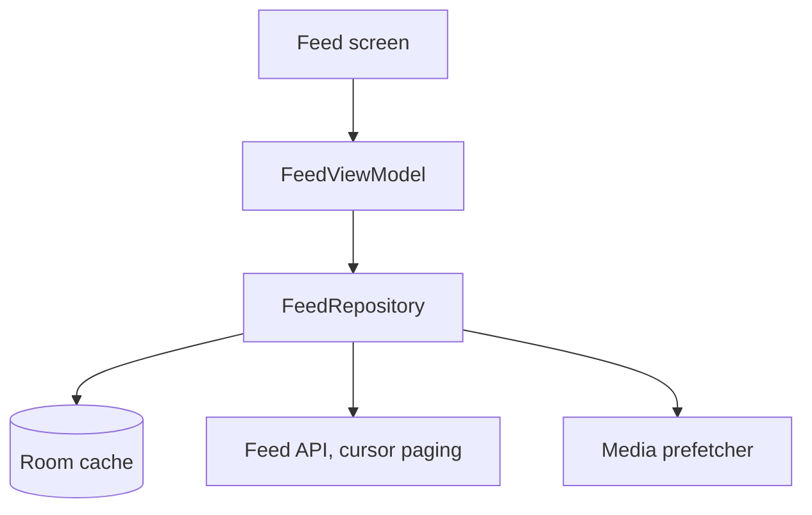

**Tip** – Meta interviewers often ask "how would you know it works?" Mention metrics: scroll jank, time to first post, crash rate, and A/B testing a change before full rollout.

</details>

### 4. What are Android interviews at Amazon like?

<details>
<summary>Answer</summary>

**In short:** Commonly reported: DSA rounds, an Android/technical round, often a low-level or system design round, and **Leadership Principles** questions in every round. Prepare 6–8 STAR stories mapped to the principles, and tie technical choices to customer impact and operational excellence.

#### Format (commonly reported)

- **DSA coding** – medium problems; clean, working code and complexity.
- **Android / technical** – fundamentals, architecture, threading, memory, testing.
- **Low-level or system design** – class design (LLD) for a feature, or a mobile system design.
- **Leadership Principles (LPs) everywhere** – each interviewer is typically assigned a couple of principles to probe, so even a coding round may open with 15 minutes of "Tell me about a time…". One interviewer is commonly reported to be a "Bar Raiser" from outside the team.

#### Leadership Principles questions

Examples: "Tell me about a time you disagreed with your manager", "a time you dove deep to find a root cause", "a time you delivered with incomplete information", "a time you failed".

Use **STAR**: Situation, Task, Action, Result. Keep the Action about what *you* did, and end with a measurable Result.

| Story theme | Principles it can cover |
|---|---|
| Found the root cause of a crash spike | Dive Deep, Ownership |
| Pushed back on a deadline to fix quality | Have Backbone; Disagree and Commit, Insist on the Highest Standards |
| Shipped a scoped-down version quickly | Bias for Action, Deliver Results |
| Built something users asked for | Customer Obsession |
| Simplified a messy module | Invent and Simplify |

Prepare 6–8 stories that each cover several principles, so you can reuse them across rounds without repeating the same one to two interviewers.

#### Technical topics

Android fundamentals and architecture, threading, memory, testing, and practical designs such as the shopping app's product page, cart sync across devices, order-tracking notifications, or an offline-capable delivery driver app. → [Architecture](12-architecture.md), [Testing](20-testing.md), [System Design](23-system-design.md)

**Tip** – Amazon interviewers listen for *customer impact* and *operational excellence*. When you propose a design, add how you'd monitor it (crash rate, ANR rate, latency dashboards), how you'd roll it out (staged rollout, feature flag) and how you'd roll back.

**Likely follow-ups**
- *"What would you do differently?"* – Always have a genuine answer; it's testing self-awareness.
- *"What was your specific contribution?"* – Say "I", and be precise about scope.

</details>

### 5. What do Microsoft, LinkedIn, Uber, Airbnb, Netflix and Spotify typically ask?

<details>
<summary>Answer</summary>

**In short:** Each company's questions mirror its product: Microsoft/LinkedIn ask a team-dependent mix plus large-codebase topics (modularization, build speed, A/B tests); Uber asks about architecture at scale, location and real-time trip state; Airbnb about server-driven UI and design systems; Netflix and Spotify about media playback, offline downloads and background audio.

#### Company by company (commonly reported)

**Microsoft / LinkedIn** – a team-dependent mix of DSA, Android deep dive and design. LinkedIn has a large Android codebase, so expect questions on modularization, build speed, feed performance and A/B testing. → [Build & Release](22-build-gradle-release.md), [Architecture](12-architecture.md)

**Uber / Lyft / DoorDash** – architecture at scale (Uber publicly open-sourced its **RIBs** architecture and has described plugin-based feature registration), location tracking, maps, real-time trip state, reliability on bad networks, feature flags. → [Uber-style design](23-system-design.md), [Background Work](17-threading-background-work.md), [feature-flag SDK](#22-design-a-feature-flag--experimentation-sdk-for-android)

**Airbnb** – Airbnb has publicly described its server-driven UI system, so expect SDUI, design systems in Compose, search and booking flows, and deep links. → [server-driven UI](#19-design-server-driven-ui-like-airbnb--swiggy--flipkart)

**Netflix / Spotify** – media playback (ExoPlayer/Media3), offline downloads with DRM, background playback with a `MediaSessionService`, adaptive streaming, performance on low-end devices. → [file downloader](23-system-design.md), [Background Work](17-threading-background-work.md)

#### What to prepare for each

| Company type | Core topics | A design to practise |
|---|---|---|
| Large codebase (Microsoft, LinkedIn) | Gradle modularization, build caching, `api`/`impl` modules, experimentation | Feed with A/B-tested ranking |
| Mobility (Uber, Lyft, DoorDash) | Fused location, foreground services, WebSockets, state machines | Ride tracking screen |
| Content/design-led (Airbnb) | SDUI, design systems, Compose theming | Server-driven home screen |
| Media (Netflix, Spotify) | Media3, audio focus, `MediaSession`, download manager, DRM | Offline downloads for a streaming app |

**Why it works this way** – interviewers pick problems they solve daily, because they can push deeper and judge your answer against real experience. Use the company's app before the interview and think about how it might be built.

**Likely follow-up** – *"How would you keep music playing when the app is in the background?"* – a `MediaSessionService` (a foreground service with a media notification) owning the player, with the UI as a client via `MediaController`.

</details>

### 6. What do Indian product companies ask Android engineers?

<details>
<summary>Answer</summary>

**In short:** The common pipeline is machine coding (build an app in 1–3 hours) → Android deep dive → mobile HLD/LLD → hiring manager/culture, with a DSA round at some companies (more common at Flipkart, PhonePe, Razorpay). Design prompts mirror each company's product: payments, quick commerce, live tracking, live sports.

#### The typical pipeline

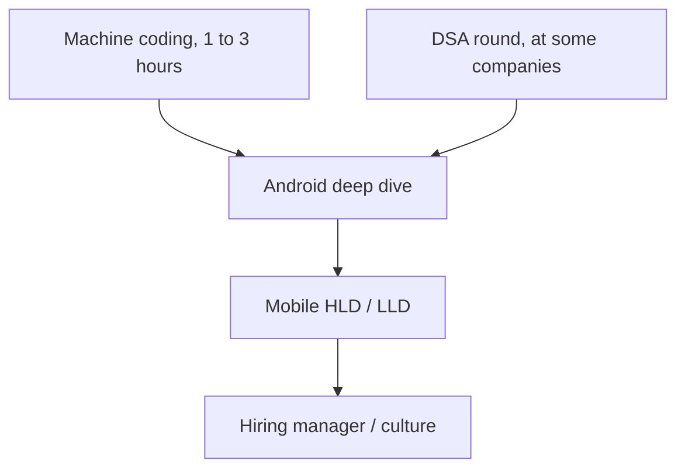

The machine-coding round is usually an elimination round: if the app doesn't run or the code is messy, you rarely move on. The deep dive then often starts from *your* machine-coding code ("why StateFlow here?", "what happens on process death?").

#### Company focus (commonly reported)

| Company | Commonly reported focus and prompts |
|---|---|
| **Flipkart / Meesho / Myntra** | Product listing with filters and infinite scroll, flash-sale traffic, image-heavy screens on low-end devices, app size → [product listing](#18-design-a-product-listing-page-with-filters-and-infinite-scroll-flipkart--amazon) |
| **Swiggy / Zomato** | Live order tracking, restaurant listing, server-driven UI, cart → [order tracking](#15-design-a-live-order-tracking-screen-swiggy--zomato--uber-eats), [SDUI](#19-design-server-driven-ui-like-airbnb--swiggy--flipkart) |
| **Zepto / Blinkit / Instamart** | Quick-commerce home and cart with per-store inventory, 10-minute delivery tracking → [quick commerce](#14-design-a-quick-commerce-app-zepto--blinkit--instamart) |
| **PhonePe / Paytm / Google Pay / CRED / Razorpay** | UPI payment flows, security (root detection, Keystore), super-app modularization, payment SDKs → [UPI app](#13-design-a-upi-payments-app-client-phonepe--google-pay--paytm), [super-app](#16-design-a-super-app-architecture-paytm--phonepe--tata-neu) |
| **Hotstar / Dream11 / Cricbuzz** | Live scores and streaming for millions at once, spikes, battery and data use → [live scores](#21-design-a-live-score--fantasy-sports-screen-for-millions-of-concurrent-users) |
| **ShareChat / Moj / Josh / Instagram** | Short-video feed with preloading and smooth playback → [short-video feed](#20-design-a-short-video-feed-like-instagram-reels--moj--sharechat) |

#### Deep-dive favourites

Coroutines and Flow internals, Compose recomposition, ViewModel internals, Hilt scopes, memory leaks, RecyclerView recycling, process death, WorkManager, app startup.

These come up so often because Indian product apps serve huge numbers of users on **low-end devices and patchy networks**. That makes memory, startup, app size and offline behaviour real business problems, not theory. When you answer, mention the low-end-device angle: "on a 2 GB RAM phone, this list would…".

**Tips**
- Expect the interviewer to ask you to *change* your machine-coding solution live (add a filter, handle offline). Clean structure makes that easy.
- For LLD, practise class diagrams for things like a cart, a parking lot, or a rate limiter in Kotlin.

</details>

### 7. What is the machine-coding round and how do you do well in it?

<details>
<summary>Answer</summary>

**In short:** You build a small working app or feature in 60–180 minutes, often while screen-sharing, then walk the interviewer through it. You score well by clarifying scope, getting a clean MVVM + repository skeleton working end to end early, then adding loading/error/empty states, pagination and rotation handling, and keeping the code readable.

#### Typical prompts

- Image gallery or movie list from an API with search, pagination and a detail screen.
- A to-do or notes app with Room persistence.
- A countdown timer or stopwatch that survives rotation and process death.
- A chat screen UI with a fake socket, or a product listing with filters and a cart.

#### What they're judging

| Signal | What it looks like |
|---|---|
| It works | The app runs, the main flow is complete, no crash on rotation |
| Structure | Clear layers (UI, ViewModel, repository, data source), single source of truth |
| Code quality | Good names, small functions, no god Activity, no hard-coded magic everywhere |
| Edge cases | Loading, error, empty states; retry; config change; process death if relevant |
| Extensibility | Adding a feature during the review is easy |
| Communication | You can explain every choice and its trade-off |

#### How to score well

1. **Clarify scope (5 min)** – list must-haves vs nice-to-haves; ask whether the UI can be simple, which API to use, and whether libraries are allowed. Build must-haves first.
2. **Set up structure quickly** – MVVM + repository, Hilt (or manual DI if setup time matters), coroutines + Flow, Compose or RecyclerView.
3. **Go end to end early** – one screen showing real data within the first third of the time. Then improve: states, pagination, caching, rotation.
4. **Keep it readable** – and add a couple of unit tests for the ViewModel or repository if time allows.
5. **Prepare a template** – a project with your usual dependencies and base architecture, if the company allows it.

A skeleton you should be able to type from memory:

```kotlin
sealed interface MoviesUiState {
    data object Loading : MoviesUiState
    data class Success(val movies: List<Movie>) : MoviesUiState
    data class Error(val message: String) : MoviesUiState
}

class MoviesViewModel(private val repo: MovieRepository) : ViewModel() {
    private val _state = MutableStateFlow<MoviesUiState>(MoviesUiState.Loading)
    val state: StateFlow<MoviesUiState> = _state.asStateFlow()

    init { load() }

    fun load() = viewModelScope.launch {
        _state.value = MoviesUiState.Loading
        _state.value = runCatching { repo.getMovies() }
            .fold(
                onSuccess = { MoviesUiState.Success(it) },
                onFailure = { MoviesUiState.Error(it.message ?: "Something went wrong") }
            )
    }
}
```

(In production code, rethrow `CancellationException` rather than catching it with `runCatching`; mention this if asked.)

**Common pitfalls**
- Spending 40 minutes on Gradle setup or pixel-perfect UI.
- Doing network calls in the Activity or Composable.
- Leaving the app non-runnable at the deadline; commit working states as you go.
- Not handling rotation (state lost, request fired again).

See worked examples in [Coding & Scenarios](25-coding-scenarios.md).

</details>

### 8. Which Android questions come up most across product companies?

<details>
<summary>Answer</summary>

**In short:** The same core shows up almost everywhere: lifecycle and process death, ViewModel, coroutines, Flow, Compose, architecture, Hilt, networking, Room, threading/background work, memory and performance, RecyclerView, Kotlin language features, security, and mobile system design. If you can explain each item below with its "why", you're covered for most Android deep dives.

#### The checklist

| # | Topic | The question behind it | Read |
|---|---|---|---|
| 1 | Activity lifecycle, configuration change vs process death, `SavedStateHandle` | "What survives rotation, and what survives the process being killed?" | [09](09-activity-fragment.md) |
| 2 | How a ViewModel survives rotation | "Where is the ViewModel stored and why isn't it destroyed?" | [13](13-jetpack-components.md) |
| 3 | Coroutines: dispatchers, structured concurrency, cancellation, `SupervisorJob`, exception handling | "What happens to the other children if one child fails?" | [03](03-coroutines.md) |
| 4 | Flow: cold vs hot, StateFlow vs SharedFlow vs LiveData, `stateIn`, one-time events | "How do you show a snackbar exactly once?" | [04](04-flow.md) |
| 5 | Compose: recomposition, state hoisting, `remember` vs `rememberSaveable`, side effects, stability | "Why is this composable recomposing every frame?" | [11](11-jetpack-compose.md) |
| 6 | MVVM vs MVI, Clean Architecture, single source of truth, offline-first | "Where does the data come from when you're offline?" | [12](12-architecture.md) |
| 7 | Hilt components and scopes | "What's the difference between `@Singleton` and `@ActivityRetainedScoped`?" | [14](14-dependency-injection.md) |
| 8 | Retrofit/OkHttp interceptors, token refresh, caching | "How do you refresh an expired token without firing five refreshes at once?" | [15](15-networking.md) |
| 9 | Room, migrations, DataStore | "What happens if you ship a schema change without a migration?" | [16](16-data-storage.md) |
| 10 | Handler/Looper, ANRs, WorkManager vs foreground services | "Which would you use for a guaranteed upload?" | [17](17-threading-background-work.md) |
| 11 | Memory leaks and how to find them, startup optimisation, jank | "How would you find a leak in production?" | [19](19-performance-memory.md) |
| 12 | RecyclerView internals and DiffUtil | "How does recycling work and what does DiffUtil compute?" | [10](10-ui-views.md) |
| 13 | Kotlin: data/sealed classes, inline/reified, scope functions, generics variance | "Why does `reified` need `inline`?" | [01](01-kotlin-basics.md), [02](02-kotlin-advanced.md) |
| 14 | Security: Keystore, certificate pinning, Play Integrity | "How do you store a token securely?" | [21](21-security-permissions.md) |
| 15 | Mobile system design: feed, chat, image loader, offline sync | "Design an image loading library." | [23](23-system-design.md) |

#### How to use the list

- For each row, practise a **30-second answer** out loud, then a **3-minute deep version** with an example or code.
- Interviewers chain questions: lifecycle → ViewModel → `SavedStateHandle` → process death testing ("Don't keep activities" or `adb shell am kill`). Prepare the chain, not isolated facts.
- Rows 1–5 are the most frequent openers; if short on time, start there.

</details>

### 9. How do expectations differ for senior and staff Android engineers?

<details>
<summary>Answer</summary>

**In short:** Mid-level engineers are judged on solid fundamentals and building features end to end. Seniors are judged on owning a feature area's architecture and explaining trade-offs. Staff engineers are judged on shaping the whole app's platform (modularization, build, release, observability, large migrations) and influencing many teams.

#### Level by level

| Level | Scope | What interviewers look for |
|---|---|---|
| **SDE 2 / mid** | A feature | Solid fundamentals, clean code, builds features end to end with modern Jetpack libraries, asks good questions |
| **Senior (L5/E5/SDE 3)** | A feature area | Owns its architecture; explains trade-offs (Compose vs Views, MVI vs MVVM); designs for offline, performance and testability; drives the mobile system design round; mentors |
| **Staff (L6/E6/Principal)** | The app / platform, many teams | Modularization strategy, build times, release process, observability (crash and ANR rates, performance metrics), migrations (Java → Kotlin, Views → Compose) across teams, cross-team influence |

#### How it shows in answers

Take the question "should we migrate to Compose?":
- **Mid** – explains what Compose is and how to write a screen in it.
- **Senior** – compares Compose and Views for this screen, plans interop (`ComposeView`), considers performance and testing.
- **Staff** – proposes a migration strategy for 50 engineers: a shared design system first, lint rules to stop new View code, metrics (screens migrated, jank, APK size), training, and an exit plan if problems arise.

Expect staff-level prompts like "how would you roll this out to 50 engineers?" or "how would you cut build time in half?". Answers should cover **people and process** (RFCs, ownership, documentation, metrics) as well as code.

**Common pitfalls**
- Senior candidates answering only at the code level, with no trade-offs.
- Staff candidates describing only what they built, not what they *enabled others* to build.
- Inflating your level: interviewers calibrate by asking for specifics.

</details>

### 10. Product companies vs service companies – how should your preparation differ?

<details>
<summary>Answer</summary>

**In short:** Product companies test **depth and reasoning** (internals, trade-offs), DSA, design rounds and the measurable impact you've had on a product. Service/consulting companies tend to test breadth of tools, project experience and practical questions. For product companies, practise DSA regularly, go deep on coroutines/Compose/architecture internals, practise mobile system design out loud, and prepare impact stories with numbers.

#### Why they differ

A product company owns one or a few apps for years, so it needs engineers who understand the platform deeply, can keep the app fast and stable at scale, and make good long-term decisions. A service company delivers many projects for clients, so it values engineers who can pick up different stacks quickly and deliver.

| Aspect | Product company | Service company |
|---|---|---|
| Question style | "Why does this work?", "What breaks at 10M users?" | "Have you used X?", "How did you implement Y?" |
| DSA | Usually 1–3 rounds | Often light or none |
| Design | Mobile system design, LLD | Rare, or project-based discussion |
| Behavioral | Impact, ownership, metrics | Client handling, delivery |
| Signal of success | Depth plus measurable results | Breadth plus delivery record |

#### How to prepare for product companies

1. **DSA regularly** – a little every day in Kotlin beats cramming.
2. **Go deep** on coroutines, Flow, Compose, architecture: be able to explain internals, not just usage.
3. **Practise mobile system design out loud** – with a timer, ideally with a friend.
4. **Impact stories with numbers** – "reduced cold start by 35%", "cut crash rate from 1.2% to 0.3%", "increased checkout conversion by 4%". If you don't know the numbers for your work, find them before the interview.

**Pitfall** – listing many libraries on your resume. Product interviewers will pick one and go deep; list what you can defend.

</details>

### 11. How do you answer "Tell me about an app or feature you built" (the project deep dive)?

<details>
<summary>Answer</summary>

**In short:** Treat it like a mini design review: context and scale, architecture (draw it), key decisions and trade-offs, one hard problem and how you solved it, measurable impact, and what you'd do differently. Be precise about what **you** did versus the team, and only mention components you can defend in depth.

#### The structure

1. **Context** – the product, users, scale (DAU, number of screens), team size, your role.
2. **Architecture** – draw it: layers, modules, data flow, key libraries.
3. **Decisions and trade-offs** – e.g. why Paging 3 + RemoteMediator, why MVI for a complex screen, why you migrated to Compose incrementally. Name the alternative you rejected and why.
4. **A hard problem** – a memory leak, an ANR, a sync bug, slow startup – and how you found it (tools, data) and fixed it.
5. **Impact** – metrics: crash-free rate, startup time, conversion, ratings.
6. **Hindsight** – what you'd do differently with what you know now.

A whiteboard-style sketch you might draw:

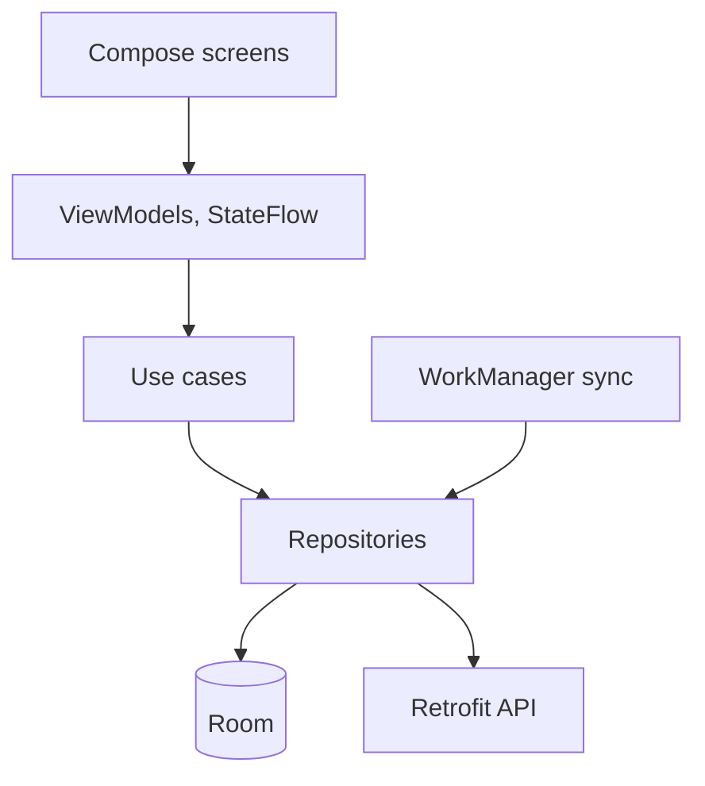

#### Example of a strong "hard problem" segment

"Our ANR rate jumped to 0.8% after a release. Play Console traces showed the main thread blocked in `SharedPreferences.apply()` waits during `onStop`. I moved those writes to DataStore on a background dispatcher and added a StrictMode check in debug builds. ANR rate went back to 0.2% within two weeks."

That shows tools, root cause, fix, prevention and impact in five sentences.

**Common pitfalls**
- Saying "we" for everything, so the interviewer can't tell what you did.
- Mentioning a technology you used lightly; the interviewer will dig into it.
- No numbers. Approximate honestly ("around 30%") rather than giving none.
- Rambling: aim for 3–5 minutes, then let them ask.

**Likely follow-ups**
- *"Why not use X instead?"* – Have the rejected alternative and the reason ready.
- *"How would this scale to 10× users or 5× engineers?"* – Talk about modularization, caching, ownership.

</details>

### 12. What should you do in the last week before a product-company Android interview?

<details>
<summary>Answer</summary>

**In short:** Spend the week rehearsing, not learning new topics: revise the most-asked list, do one timed DSA session a day in Kotlin, one machine-coding practice if that round exists, one mobile system design mock out loud, prepare 6–8 behavioral stories, study the company's app, and rest the day before.

#### A seven-day plan

| Day | Focus | What to do |
|---|---|---|
| 1–2 | Revision | The most-asked list (question 8) and the README one-liners; say answers out loud |
| 3–4 | Coding | One timed DSA session per day in Kotlin (medium problems, talk while coding); one machine-coding practice if the company runs that round |
| 5 | Design | A mobile system design mock out loud: one prompt from that company's list above |
| 6 | Behavioral and company | 6–8 STAR stories (impact, conflict, failure, ownership, ambiguity); use the company's app and note how it might be built |
| 7 | Rest | Light revision only; sleep well |

#### Why this order

Revision first finds weak spots while there's still time to fix them. Coding and design need repetition under a timer, which is where most candidates lose marks: they know the content but run out of time or go silent. Behavioral comes late because stories are freshest when told soon after rehearsal. Rest matters because a tired brain is slower at DSA.

#### Studying the company's app

Install it and use it for a day. Notice how the home screen loads (skeletons? cached content?), what happens offline, how notifications look, and how big the app is. Then think: "This home screen looks server-driven", "tracking probably uses a socket plus push". Mentioning this in the design round shows genuine interest and gives you concrete examples.

**Pitfalls**
- Starting a big new topic two days before.
- Only reading answers rather than saying them out loud.
- Skipping the recruiter's prep material, which often states exactly what each round covers.

</details>

---

## Company-Style Mobile Design Prompts

### 13. Design a UPI payments app client (PhonePe / Google Pay / Paytm).

<details>
<summary>Answer</summary>

**In short:** Layer it as Compose UI → ViewModels → a payment repository backed by Room and a Retrofit payments API, with PIN entry delegated to the NPCI common library so the app never sees the PIN. The hard parts are device binding, security, and **transaction state**: every payment gets a client-generated idempotency ID, unknown outcomes show as `Pending`, and the final status arrives by push or polling, so the app never shows a wrong status or double-charges.

#### Requirements

- **Functional** – onboard with phone number and SIM binding, link bank accounts, pay to a UPI ID / QR code / contact, check balance, transaction history, collect (payment) requests, notifications.
- **Non-functional** – **secure**; works on low-end devices and poor networks; **never shows a wrong payment status**; fast startup (people pay at a shop counter).

#### High-level architecture

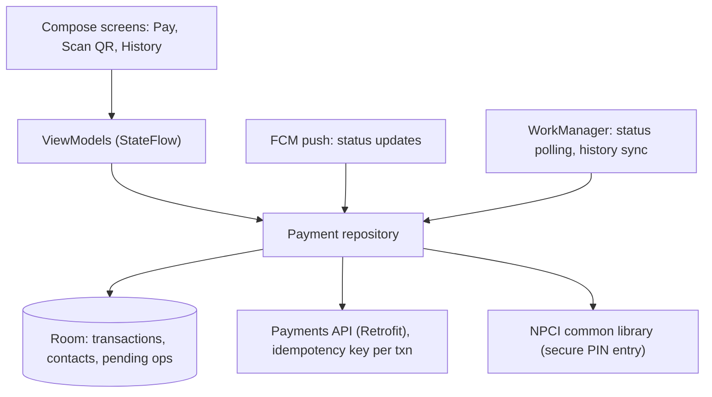

#### Deep dives

**Device binding** – UPI apps bind the account to the device and SIM. A commonly described flow: the app sends an SMS from the device's SIM (with a token) to the bank/PSP's number; the server matches the token with the sender number, proving the phone number is on this device. If the SIM is removed or changed, the app asks the user to rebind. On dual-SIM phones the user picks which SIM, using `SubscriptionManager` (with the needed phone-state permission).

**PIN security** – the UPI PIN is entered in the **NPCI common library** UI and encrypted with NPCI keys; the app never sees it. Other measures:
- `FLAG_SECURE` on sensitive screens so they can't be screenshotted or shown in recents.
- Root/tamper detection and **Play Integrity** verdicts checked on the server.
- Keystore-backed keys for signing requests and encrypting local tokens.
- Certificate pinning on the payments API.

**Transaction state (the most important part)** – a payment goes through several systems (PSP, NPCI, banks) and a timeout does not mean failure.

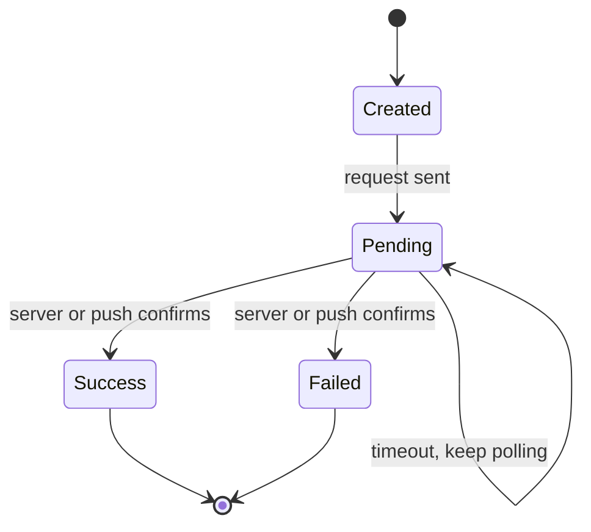

```kotlin
suspend fun pay(request: PayRequest): Flow<TxnStatus> = flow {
    // 1. Generate and persist the ID before any network call
    val txnId = UUID.randomUUID().toString()
    dao.insert(TxnEntity(txnId, request.amount, status = TxnStatus.PENDING))
    emit(TxnStatus.PENDING)

    // 2. The server de-duplicates on txnId, so retries can't double-charge
    val result = runCatching { api.pay(txnId, request) }
    val status = result.getOrNull()?.status ?: TxnStatus.PENDING // timeout = unknown, not failed
    dao.updateStatus(txnId, status)
    emit(status)

    // 3. Still pending -> poll with backoff; FCM may also update the row
    if (status == TxnStatus.PENDING) scheduleStatusPolling(txnId)
}
```

The UI observes the transaction row in Room, so push, polling and the original call all update one source of truth. Never let the user retry with a new ID while one is pending; show "Payment pending, we'll notify you" instead.

**History** – Room as source of truth, synced incrementally (`since=lastSyncTimestamp`); Paging 3 for long lists.

**QR scanning** – CameraX + ML Kit barcode scanning; parse `upi://pay?pa=...&pn=...&am=...` and validate fields before showing the confirm screen. Also handle UPI intents from other apps (merchant checkout) and return the result to the calling app.

**Low-end devices** – small APK (R8, dynamic feature modules for rarely used features), fast cold start, minimal memory; the Pay and Scan entry points must be instant.

**Reliability** – clear states and receipts; retry only safe (idempotent) operations; offline, show cached balance with "last updated" time rather than nothing.

**Common pitfalls**
- Treating a network timeout as a failure and letting the user pay again.
- Logging sensitive data (account numbers, tokens) to analytics or Logcat.
- Trusting client-side root checks alone; the server must verify integrity verdicts.

**Likely follow-ups**
- *"How do you handle a payment when the app is killed mid-flow?"* – The pending row is in Room; on next launch, or via WorkManager, query its status.
- *"How do you stop replay attacks?"* – Signed requests with nonce/timestamp, server-side idempotency, TLS with pinning.

</details>

### 14. Design a quick-commerce app (Zepto / Blinkit / Instamart).

<details>
<summary>Answer</summary>

**In short:** Everything is keyed by the **dark store** that serves the user's location: resolve the store first, then fetch a mostly server-driven home screen and catalog for that store. Keep the cart in Room with optimistic updates synced to the server, **re-validate stock and prices before checkout**, create orders idempotently, and optimise hard for startup speed because users open the app in a hurry.

#### Requirements

- Catalog and stock depend on the dark store serving the user's location.
- Home screen with categories and offers; search; cart; checkout; delivery in ~10 minutes with live tracking.
- Non-functional: very fast first screen, accurate stock, works on mid/low-end devices and flaky networks.

#### Architecture

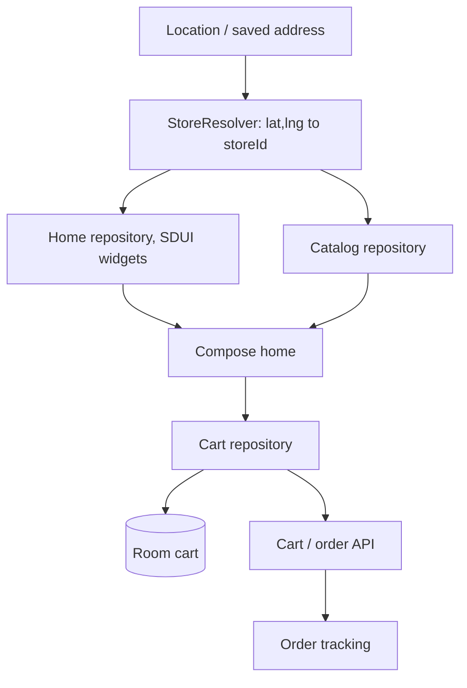

#### Deep dives

**Location → store** – on launch or address change, resolve the serving store (`GET /store?lat=&lng=`); every catalog call carries the store ID. Cache responses per store. When the store changes (user moves or picks another address), re-validate the cart because the new store may not stock the same items; tell the user what changed.

**Home screen** – largely **server-driven**: the backend returns ordered widgets (banner, category grid, product carousel) so merchandising can change daily without releases. Show the cached home instantly with skeletons for missing parts, then refresh. Request images sized to the device (pass width to the image CDN).

**Inventory freshness** – stock changes by the minute. Show cached data immediately, refresh in the background, and re-validate the cart before checkout:

```kotlin
data class CartValidation(
    val unavailable: List<String>,           // product IDs now out of stock
    val priceChanged: Map<String, PriceDiff>, // old vs new price
    val quantityCapped: Map<String, Int>      // stock lower than requested
)

suspend fun proceedToCheckout() {
    val result = cartRepo.validate(storeId, cart.items)
    if (result.hasChanges()) _events.send(ShowCartChanges(result)) // let the user confirm
    else _events.send(OpenCheckout)
}
```

**Cart** – local (Room) for instant updates, synced to the server so it survives reinstall and works across devices. Debounce quantity taps (a user tapping "+" five times should cause one request with quantity 5, not five requests); optimistic UI with rollback if the server rejects (out of stock).

**Checkout** – idempotent order creation (client-generated order key); payment SDK; handle "payment pending" without creating a second order.

**Tracking** – see [live order tracking](#15-design-a-live-order-tracking-screen-swiggy--zomato--uber-eats).

**Performance** – very fast startup and first screen: Baseline Profiles, lazy SDK init, prefetch the home feed (e.g. when the user changes address), small app size.

**Common pitfalls**
- Caching catalog data without the store ID in the key, so the user sees another store's stock.
- Discovering out-of-stock items only after payment.
- One request per "+" tap, causing races and wrong final quantities.

**Likely follow-ups**
- *"What if the user is between two stores?"* – The server decides; the client just sends location and uses the returned store ID.
- *"How do you show delivery time on the home screen?"* – The store response includes an ETA estimate, refreshed with the home feed.

</details>

### 15. Design a live order tracking screen (Swiggy / Zomato / Uber Eats).

<details>
<summary>Answer</summary>

**In short:** While the screen is visible, keep a WebSocket/SSE connection (polling as fallback) that delivers status changes and the partner's location; feed them into a ViewModel state machine with the server as source of truth, and animate the map marker by interpolating between updates. In the background, rely on FCM push and an ongoing notification (Live Updates on Android 16+) instead of keeping a socket open.

#### Requirements

Order status (placed → accepted → preparing → picked up → arriving → delivered), the delivery partner's live location on a map, ETA, and contact options; keep the user informed even when the app is in the background; be kind to battery and data.

#### Order state machine

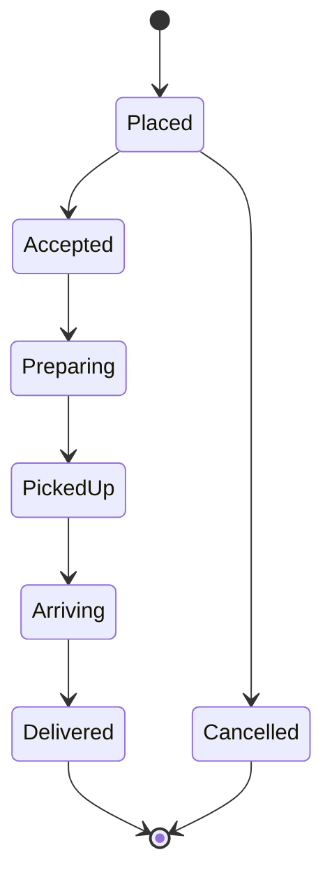

#### Design

**Foreground transport** – a WebSocket/SSE connection (or polling every few seconds as a fallback) delivering status changes and partner location. Reconnect with exponential backoff plus jitter. On every (re)connect, **fetch the current snapshot first**, then apply live events, so nothing missed during a disconnect is lost.

**Map** – location updates arrive every 3–5 s. If you move the marker directly, it jumps. Instead, **interpolate**: animate the marker from the old to the new position over the update interval, ideally along the route polyline, and rotate it to the bearing. Snap to roads (server-side or via the maps SDK) so it doesn't cut through buildings.

**Background** – status changes via **FCM** notifications. On Android 16+, consider **Live Updates** (progress-style notifications for ongoing activities like deliveries); otherwise an ongoing notification with progress.

**State** – the ViewModel holds the order state, driven by server events. The server is the source of truth. Events can arrive out of order (socket plus push plus polling), so each carries a sequence number and old ones are ignored:

```kotlin
data class OrderEvent(val orderId: String, val seq: Long, val status: OrderStatus, val location: LatLng?)

class TrackingViewModel(
    private val repo: TrackingRepository,
    savedState: SavedStateHandle
) : ViewModel() {
    private val orderId: String = checkNotNull(savedState["orderId"]) // survives process death

    val state: StateFlow<TrackingState> = repo.events(orderId)
        .scan(TrackingState.initial(orderId)) { current, event ->
            if (event.seq <= current.lastSeq) current           // stale or duplicate: ignore
            else current.copy(status = event.status, partner = event.location ?: current.partner, lastSeq = event.seq)
        }
        .stateIn(viewModelScope, SharingStarted.WhileSubscribed(5_000), TrackingState.initial(orderId))
}
```

`WhileSubscribed(5_000)` combined with collecting via `repeatOnLifecycle(STARTED)` (or `collectAsStateWithLifecycle`) closes the socket when the screen isn't visible, while surviving a quick rotation.

**Battery and data** – stop the socket when not visible; ask the server for lower update frequency when the partner is far away or the order is still being prepared (location isn't even needed then).

**Edge cases**
- Partner reassignment: a new partner event replaces the marker and contact info.
- Order cancelled: terminal state, stop connection, show refund info.
- Network loss: keep the last state and show "last updated 2 min ago".
- Process death: restore from the saved order ID and fetch a snapshot.

**Likely follow-ups**
- *"WebSocket vs polling?"* – Sockets give low latency and less overhead for frequent updates; polling is simpler and CDN/load-balancer friendly; keep polling as a fallback.
- *"Why not keep the socket alive in the background?"* – Battery, background execution limits, and push already covers the important status changes.

</details>

### 16. Design a super-app architecture (Paytm / PhonePe / Tata Neu).

<details>
<summary>Answer</summary>

**In short:** A super-app is a thin shell hosting many feature modules owned by different teams, on top of shared core modules (network, auth, design system, analytics, payments). Each feature exposes a small `api` module and hides its `impl`, navigation goes through a central router with route contracts, rarely used features ship as dynamic feature modules, and governance (ownership, budgets, API review) keeps it from becoming a monolith.

#### Why it's hard

A super-app hosts many mini-products (payments, recharges, travel, shopping, insurance) built by many teams in **one** APK. Without structure you get slow builds, teams breaking each other, a huge app, and a slow startup as every team adds an SDK to `Application.onCreate`.

#### Architecture

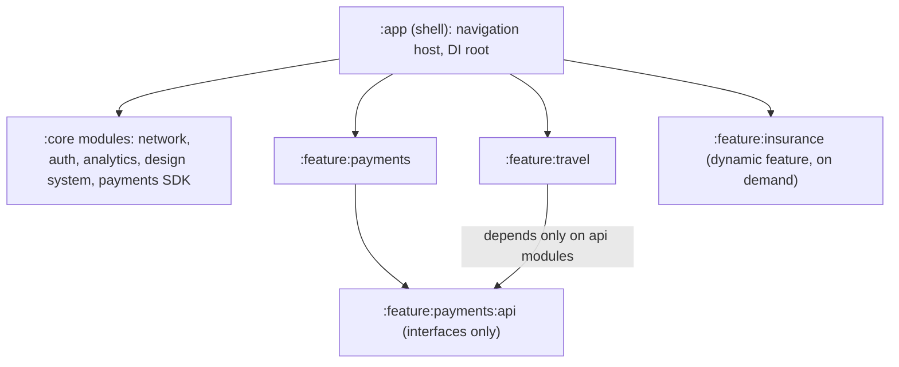

#### Key points

**Modularization** – each feature has an `api` module (interfaces, navigation contracts, models it shares) and an `impl` module. Other features depend only on `api`, so changing `impl` doesn't recompile them, and teams can't reach into each other's internals. This gives faster builds through Gradle caching and parallelism.

```kotlin
// :feature:payments:api
interface PaymentLauncher {
    fun launchCheckout(context: Context, amount: Long, orderId: String)
}

// :feature:payments:impl, bound with Hilt
class PaymentLauncherImpl @Inject constructor() : PaymentLauncher { /* ... */ }

@Module @InstallIn(SingletonComponent::class)
abstract class PaymentsModule {
    @Binds abstract fun bind(impl: PaymentLauncherImpl): PaymentLauncher
}

// :feature:travel only knows the interface
class BookingViewModel @Inject constructor(private val payments: PaymentLauncher)
```

**Navigation** – a central router with deep links / route contracts; features register their entry points (e.g. via Hilt multibinding of `Map<String, FeatureEntry>`), so the shell doesn't hard-code every screen.

**Shared platform** – one design system (Compose components), one network stack with auth and token refresh, one analytics/feature-flag SDK, one payments SDK. Duplicated stacks waste size and memory.

**App size and startup** – **dynamic feature modules** (Play Feature Delivery) for rarely used features; lazy initialisation of each mini-app on first open rather than in `Application`; startup tracing per team; strict size and startup budgets enforced in CI.

**Server-driven UI** for the home screen and promotions, so the home can change which mini-apps it promotes without releases.

**Mixed tech** – some companies run mini-apps as web, React Native or Flutter modules for faster release cycles; weigh performance and consistency against agility.

**Governance** – ownership (CODEOWNERS), API review for core modules, per-team performance budgets and crash dashboards, so one team's regression is visible and attributable.

| Approach | Pros | Cons |
|---|---|---|
| All native modules | Best performance, one toolchain | Every change needs an app release |
| Dynamic feature modules | Smaller install size | Extra complexity, install/download flow on first use |
| Web / cross-platform mini-apps | Ship without app release | Slower, less native feel, bridge complexity |

**Likely follow-ups**
- *"How do you stop one team from slowing startup?"* – Startup benchmarks in CI, App Startup with lazy initializers, per-team budgets.
- *"How do features communicate?"* – Through `api` interfaces, navigation contracts, or a shared event bus for loose signals; never direct `impl` dependencies.

</details>

### 17. How would you reduce cold start time for an app with 100M users?

<details>
<summary>Answer</summary>

**In short:** Measure first (Android vitals, Macrobenchmark, Perfetto traces, segmented by device tier), find the work on the critical path between process start and first frame, then remove or defer it: lazy SDK init, no main-thread I/O, Baseline Profiles, a cached first screen and a lighter first layout. Finally, stop regressions with startup benchmarks in CI and budgets.

#### What cold start is

A cold start is when the process doesn't exist yet: the system forks the process, creates the `Application`, runs `Application.onCreate`, creates the launcher Activity, then inflates/composes and draws the first frame. Everything you add to that path delays the user. At 100M users, the long pole is low-end devices with slow storage and CPUs.

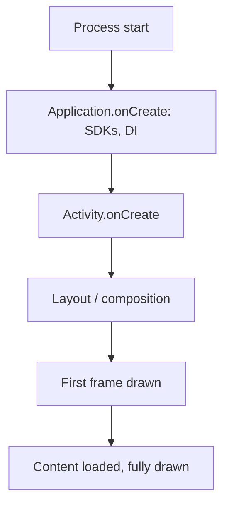

#### 1. Measure

- **Play Console Android vitals** – real-world startup times, the source of truth at scale.
- **Macrobenchmark** with `StartupTimingMetric` – reproducible lab numbers, `timeToInitialDisplay` and `timeToFullDisplay` (call `reportFullyDrawn()` when real content is shown).
- **Perfetto / system traces** – see exactly what blocks the main thread.
- Segment by device tier; a median on flagships hides the problem.

#### 2. Find the work on the critical path

- `Application.onCreate`: SDK initialisations (analytics, crash reporting, ads, maps).
- DI graph creation of objects that aren't needed yet.
- Main-thread disk I/O: SharedPreferences, database, reading files.
- Heavy first-screen layouts or compositions.
- Synchronous network calls before showing anything.

#### 3. Fix

- **Defer or lazily initialise SDKs** – App Startup library, initialise on first use, or after the first frame.
- **Move I/O off the main thread** – use DataStore; avoid reflection-heavy init.
- **Baseline Profiles** (often reported as 20–30% faster startup) and R8 full mode.
- **Show the first screen from cache**, load the rest progressively.
- **Simplify the first screen's** composition/layout.

```kotlin
// Before: everything blocks startup
class App : Application() {
    override fun onCreate() {
        super.onCreate()
        Analytics.init(this)
        AdsSdk.init(this)
        MapsSdk.init(this)
    }
}

// After: only what the first screen needs, the rest later and off the main thread
class App : Application() {
    val appScope = CoroutineScope(SupervisorJob() + Dispatchers.Default)

    override fun onCreate() {
        super.onCreate()
        CrashReporter.init(this) // needed early to catch startup crashes
        appScope.launch {
            Analytics.init(this@App)
            // Ads and maps initialised on first use by their feature modules
        }
    }
}
```

#### 4. Prevent regressions

Startup benchmarks in CI on a real or representative device, budgets per module/team, and alerts on vitals. Without this, startup gets slower one "small" SDK at a time.

**Common pitfalls**
- Optimising on a flagship emulator only.
- Moving work to a background thread that then blocks the main thread through a lock.
- A splash screen that hides slowness rather than fixing it.

**Likely follow-ups**
- *"What does a Baseline Profile do?"* – Lists hot classes and methods so ART compiles them ahead of time at install, avoiding interpretation/JIT during startup.
- *"Cold vs warm vs hot start?"* – Cold: new process; warm: process alive but Activity recreated; hot: Activity brought to front.

See [Performance & Memory](19-performance-memory.md).

</details>

### 18. Design a product listing page with filters and infinite scroll (Flipkart / Amazon).

<details>
<summary>Answer</summary>

**In short:** A cursor-paginated API returns products plus filter **facets**; the ViewModel holds filters as one immutable `StateFlow<FilterState>` and uses `flatMapLatest` to start a new Paging 3 `Pager` whenever filters change, with `cachedIn(viewModelScope)` to survive rotation. The UI is a `LazyVerticalGrid` with stable keys and downsampled images, and add-to-cart is optimistic with rollback.

#### Requirements

A search or category result with thousands of products, sort and filters (brand, price, rating), infinite scroll, fast on low-end devices, add to cart/wishlist from the list.

#### API

`GET /products?query=&filters=&sort=&cursor=&limit=20` returns products, the **next cursor**, and **facets** (filter options with counts, e.g. "Samsung (124)"). Cursor pagination is better than page numbers here because the list can change while the user scrolls; offset pages would then duplicate or skip items.

#### Data flow

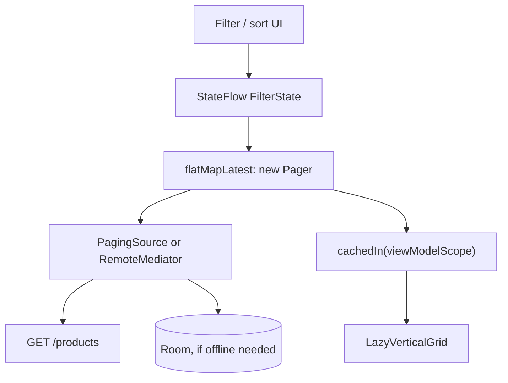

#### ViewModel

```kotlin
@Parcelize
data class FilterState(
    val query: String = "",
    val brands: Set<String> = emptySet(),
    val priceRange: IntRange? = null,
    val minRating: Int? = null,
    val sort: Sort = Sort.RELEVANCE
) : Parcelable

@HiltViewModel
class ListingViewModel @Inject constructor(
    private val repo: ProductRepository,
    private val savedState: SavedStateHandle
) : ViewModel() {

    // Survives process death
    val filters: StateFlow<FilterState> = savedState.getStateFlow("filters", FilterState())

    @OptIn(FlowPreview::class, ExperimentalCoroutinesApi::class)
    val products: Flow<PagingData<Product>> = filters
        .debounce(300)                       // rapid slider/checkbox changes -> one request
        .distinctUntilChanged()
        .flatMapLatest { repo.pager(it).flow } // cancels the old paging stream
        .cachedIn(viewModelScope)              // rotation doesn't refetch

    fun update(transform: (FilterState) -> FilterState) {
        savedState["filters"] = transform(filters.value)
    }
}
```

#### UI and performance

- `LazyVerticalGrid` with `key = { it.id }` and `contentType`, so items aren't recreated or mixed up when the list changes.
- Images downsampled to the cell size with Coil, with placeholders; prefetch upcoming images.
- Keep item composables cheap: pass stable, immutable models; no heavy formatting during composition.

**Cart/wishlist from the list** – optimistic toggle with rollback on failure. Observe cart state from a shared repository (`StateFlow<Set<ProductId>>`) and combine it with the item at render time, so the listing, detail page and cart all agree.

**Low-end devices** – smaller image sizes, fewer animations, limit concurrent image decoding, watch memory (a grid of large bitmaps is the classic OOM).

**Analytics** – log impressions (which products were actually visible, for how long) in batches rather than one request per item.

**Common pitfalls**
- Creating a new `Pager` in the composable, refetching on every recomposition.
- Storing filter state in the UI, losing it on process death.
- Missing `key`, so wishlist hearts appear on the wrong items after a refresh.

**Likely follow-ups**
- *"When would you use `RemoteMediator`?"* – When results must be available offline or Room is the single source of truth.
- *"How do you show facet counts that update?"* – They come with the first page of each new query; keep them in a separate StateFlow.

</details>

### 19. Design server-driven UI (like Airbnb / Swiggy / Flipkart).

<details>
<summary>Answer</summary>

**In short:** The server sends a tree of typed components with their data and actions; the client keeps a registry mapping each component `type` to a native Compose renderer, skips unknown types so old app versions never crash, and handles actions through a typed handler. It lets you change screens and run experiments without app releases, at the cost of debuggability and type safety, so use it for content-driven screens, not everything.

#### Why

Changing a home or offers screen normally needs a release, and on mobile a release takes days to reach most users. With SDUI, the backend decides **what** to show and **in what order**, so you can change screens without releases, keep Android, iOS and web consistent, and run A/B experiments on layouts.

#### How it works

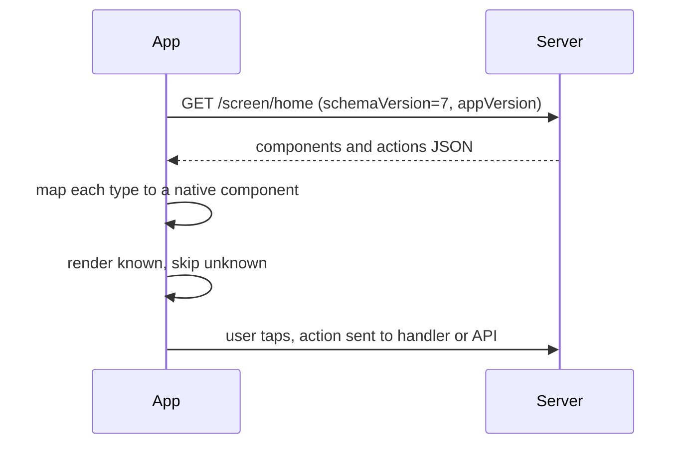

A response looks like:

```json
{
  "components": [
    { "id": "b1", "type": "banner", "data": { "imageUrl": "...", "title": "50% off" },
      "action": { "type": "navigate", "deeplink": "app://offers/123" } },
    { "id": "c1", "type": "carousel", "data": { "title": "Top picks", "items": [] } },
    { "id": "x9", "type": "newFancyWidget", "data": {} }
  ]
}
```

#### Client design

```kotlin
sealed interface Action {
    data class Navigate(val deeplink: String) : Action
    data class AddToCart(val productId: String) : Action
    data class OpenUrl(val url: String) : Action
}

@Composable
fun SduiScreen(components: List<Component>, onAction: (Action) -> Unit) {
    LazyColumn {
        items(components, key = { it.id }, contentType = { it.type }) { c ->
            when (c) {
                is Component.Banner -> BannerView(c, onAction)
                is Component.Carousel -> CarouselView(c, onAction)
                is Component.Unknown -> Unit // old app: skip silently, never crash
            }
        }
    }
}
```

- **Parsing** – the JSON parser maps unknown `type` values to `Unknown` instead of throwing (e.g. a polymorphic deserializer with a default).
- **Versioning** – the client sends its supported schema version; the server only sends compatible components, or a fallback for old clients.
- **Actions** – a typed action handler (deep links, analytics events, mutations), not arbitrary scripting, which would be a security and stability risk.
- **Performance** – cache the last layout for instant display on next launch; paginate long feeds; stable keys for lazy lists.

#### Trade-offs

| Pro | Con |
|---|---|
| Change UI without a release | Harder to debug ("why does my screen look like this?") |
| Consistent across platforms | Less type safety; contract bugs appear at runtime |
| Easy experimentation | Complex interactions and animations still need native code |
| Merchandising teams move fast | Needs good server tooling and a preview tool |

Use it for content-driven screens (home, offers, landing pages), not for complex flows like checkout or a video editor.

**Likely follow-ups**
- *"How do you test it?"* – Snapshot tests per component, contract tests on sample JSON, and an internal preview app.
- *"What about analytics?"* – Each component carries tracking metadata, and impressions are logged by the renderer generically.

</details>

### 20. Design a short-video feed (like Instagram Reels / Moj / ShareChat).

<details>
<summary>Answer</summary>

**In short:** A vertical pager of cursor-paginated videos, played through a small pool of reused Media3 ExoPlayer instances, with the first seconds of the next few videos preloaded into a disk cache so playback starts instantly. Use adaptive streaming (HLS/DASH) starting at a low bitrate, pause on background or partial visibility, and track time to first frame and rebuffering.

#### Requirements

Vertical swipe feed of short videos that start **instantly**, autoplay with sound settings, like/comment/share, works on low-end devices and variable networks.

#### Architecture

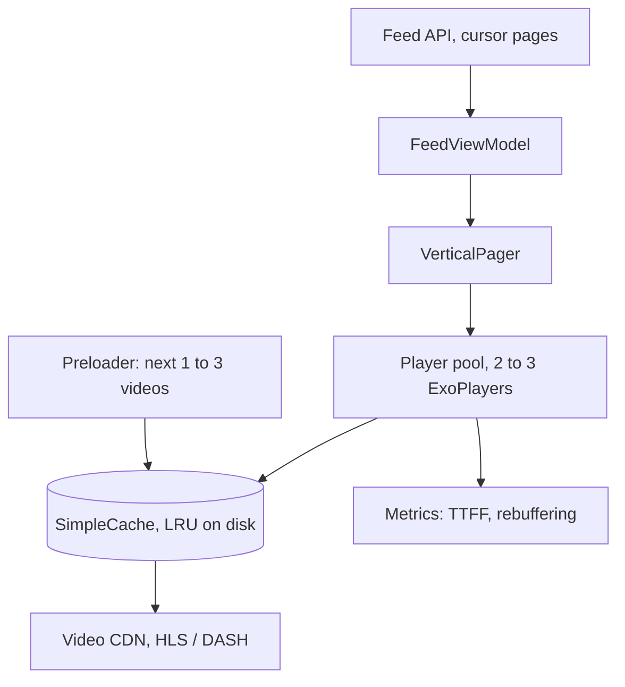

#### Deep dives

**Feed** – a vertical pager (`VerticalPager` in Compose, or ViewPager2/RecyclerView); items fetched in pages with cursors; request the next page a few items before the end.

**Player pool** – creating an ExoPlayer is expensive and each holds a hardware decoder, which low-end devices have few of. Reuse a small pool of **ExoPlayer/Media3** instances (2–3): attach one to the visible page, prepare one for the next, release or recycle when an item leaves.

```kotlin
class PlayerPool(context: Context, cacheFactory: DataSource.Factory, size: Int = 3) {
    private val players = List(size) {
        ExoPlayer.Builder(context)
            .setMediaSourceFactory(DefaultMediaSourceFactory(cacheFactory)) // read through the cache
            .build()
    }
    fun playerFor(page: Int): ExoPlayer = players[page % players.size]
}

// When the settled page changes
LaunchedEffect(pagerState.settledPage) {
    val player = pool.playerFor(pagerState.settledPage)
    player.setMediaItem(MediaItem.fromUri(videos[pagerState.settledPage].url))
    player.prepare()
    player.playWhenReady = true
    // pause the others
}
```

**Preloading** – preload the first seconds of the next 1–3 videos (Media3's preload manager, or prefetching segments into the **cache**), and the thumbnail for an instant first frame. Adapt how much you preload to the network: more on Wi-Fi, less on a metered or slow connection.

**Adaptive streaming** – HLS/DASH so quality adapts to bandwidth; start at a lower bitrate for a fast start, then step up.

**Caching** – `SimpleCache` with an LRU disk limit (`LeastRecentlyUsedCacheEvictor`) so re-watched videos don't download again; wrap the network data source in a `CacheDataSource.Factory`.

**Lifecycle** – pause when the app goes to background or the item isn't fully visible; handle audio focus (another app starts playing music); release players in `onStop` on low-memory devices.

**Metrics** – time to first frame, rebuffering ratio, watch time, startup failures; collect via `AnalyticsListener` and send in batches.

**Low-end devices** – lower resolutions, fewer simultaneous decoders, smaller pool, watch memory.

**Common pitfalls**
- One player per item: decoder exhaustion and OOM.
- Preloading full videos on mobile data, wasting the user's data.
- Forgetting to pause off-screen players, so audio plays from two videos.

**Likely follow-ups**
- *"How do you measure 'instant'?"* – Time from page settle to first rendered frame, as a percentile across device tiers.
- *"How do you handle upload?"* – A separate flow: compress, upload in chunks with WorkManager, resumable.

</details>

### 21. Design a live score / fantasy sports screen for millions of concurrent users.

<details>
<summary>Answer</summary>

**In short:** Use a persistent connection (WebSocket/SSE) to edge servers while the screen is visible, with a fallback of polling a CDN-cached JSON, which scales cheaply because every user fetches the same object. Send small versioned deltas and fetch a full snapshot on a gap, collect only while visible, use push for key events in the background, and add jitter and server-controlled intervals so millions of clients don't stampede after a blip.

#### Requirements

Ball-by-ball scores and fantasy points update within seconds for millions of users during a match; spikes at toss and key moments; battery- and data-friendly.

#### Architecture

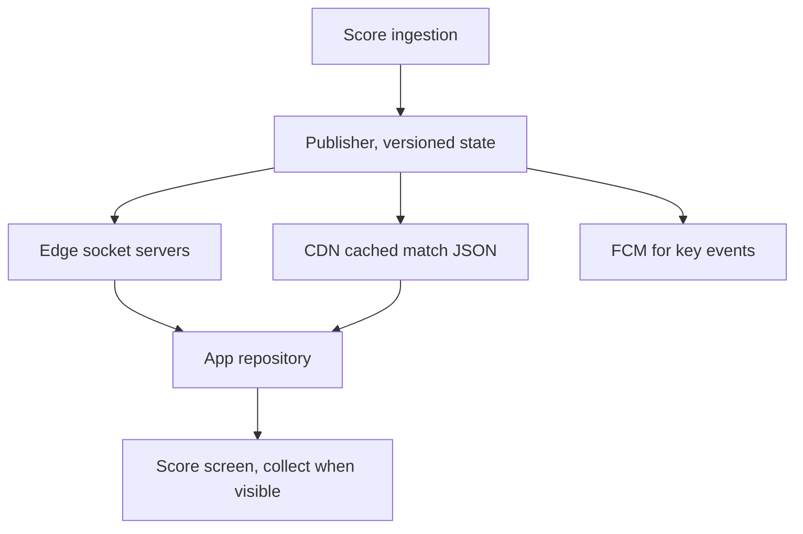

#### Design

**Transport** – a persistent connection (WebSocket/SSE) to edge servers while the screen is visible; fall back to **polling a CDN-cached JSON** endpoint. Polling a CDN is surprisingly good at huge scale: all users request the same URL, so the CDN serves it from cache and the origin sees very little traffic. A few seconds of delay is fine for most viewers.

**Payload** – small deltas with a version number. If the client receives version 105 but last applied 103, it has missed one and fetches a full snapshot.

```kotlin
fun apply(current: MatchState, delta: ScoreDelta): Result {
    return when {
        delta.version <= current.version -> Result.Ignore             // duplicate or old
        delta.version == current.version + 1 -> Result.Updated(current.merge(delta))
        else -> Result.NeedSnapshot                                    // gap: fetch full state
    }
}
```

**Client** – a repository exposes `StateFlow<MatchState>`; the UI collects only when visible (`repeatOnLifecycle`). In the background, stop updates and rely on push notifications for key events (wickets, match result).

**Spikes** – after a network blip or server restart, millions of clients reconnecting at the same instant can take servers down (thundering herd). Use exponential backoff with **random jitter**, and a server-provided polling interval that can be raised under load (e.g. from 5 s to 15 s).

**Fantasy specifics** – team-lock deadlines enforced by the server, because the client clock can't be trusted (users can change it); points computed on the server; leaderboards loaded with pagination and cached, since millions of entries can't be sent to a phone.

**Widgets / Live Updates** – a home-screen widget or ongoing notification for the live score; widget update frequency is budgeted by the system, so push-triggered updates for key moments work better than frequent refreshes.

**Common pitfalls**
- Keeping the socket open in the background, draining battery.
- Applying deltas without versioning, so a missed message corrupts the score.
- Synchronised retry timers across all clients.

**Likely follow-ups**
- *"WebSocket vs CDN polling at this scale?"* – Sockets give lower latency but need many stateful servers; CDN polling is cheap and stateless with seconds of delay. Many apps use both.
- *"How do you show the user that data is stale?"* – Show "last updated" and a reconnecting indicator.

</details>

### 22. Design a feature-flag / experimentation SDK for Android.

<details>
<summary>Answer</summary>

**In short:** Persist the last fetched config locally and load it cheaply at startup so flag checks never wait for the network, give every flag a compiled-in safe default, refresh in the background and apply new values at the next session to avoid mid-flow flips, assign experiment variants deterministically and log exposure when a variant is actually used. A remote kill switch is the most valuable feature, because a fixed release takes days to reach users.

#### Requirements

Teams check flags (`isEnabled("new_checkout")`) and experiment variants anywhere in the app; flags must be available instantly at startup, consistent within a session, updated from the server, and safe if the server is unreachable.

#### Architecture

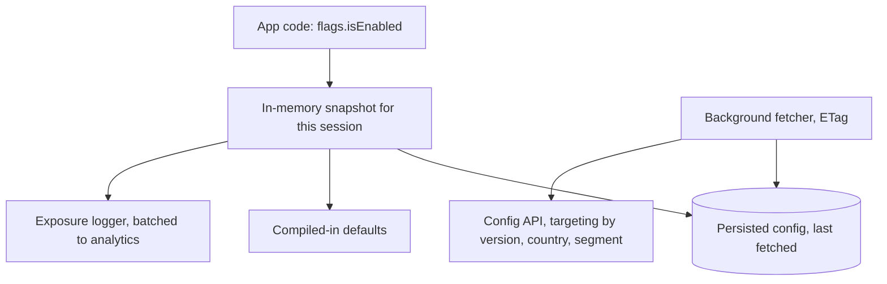

#### Design

**Storage** – the last fetched config persisted locally (DataStore/file); loaded quickly at startup (or with a tiny in-memory default set), so no flag check waits for the network.

**Fetch** – refresh in the background on app start and periodically. Apply new values on the **next session** (or at safe points like returning to home) so the UI doesn't change mid-checkout. Use an ETag so unchanged configs cost almost nothing.

**Defaults** – every flag has a compiled-in default used when there's no cached or fetched value; kill switches default to the safe value.

**Experiments** – variant assignment from the server or by deterministic hashing of the user ID, so the same user always gets the same variant on any device without a network call:

```kotlin
fun variantFor(userId: String, experiment: Experiment): String {
    // Same input always gives the same bucket 0..99
    val bucket = (murmur3("${experiment.key}:$userId") and 0x7fffffff) % 100
    var acc = 0
    for (v in experiment.variants) {          // e.g. control 50, treatment 50
        acc += v.percent
        if (bucket < acc) return v.name
    }
    return experiment.defaultVariant
}
```

Log an **exposure event** when a variant is actually used (the user reaches the screen), not when the config is fetched; otherwise the analysis includes users who never saw the change. Send exposures through the analytics SDK, batched.

**Targeting** – app version, OS version, country, user segment, rollout percentage.

**Developer experience** – type-safe flag definitions (generated code rather than string keys), a debug menu to override flags in internal builds, and cleanup tooling or lint to remove stale flags.

```kotlin
object Flags {
    val NewCheckout = BooleanFlag(key = "new_checkout", default = false)
    val FeedPageSize = IntFlag(key = "feed_page_size", default = 20)
}

if (flags[Flags.NewCheckout]) NewCheckoutScreen() else OldCheckoutScreen()
```

**Safety** – a remote kill switch for crashing features is one of the most valuable tools in mobile, because a fixed release takes days to reach users. Also guard against bad configs: validate types, fall back to defaults on parse errors.

**Common pitfalls**
- Blocking startup on a config fetch.
- Flags changing mid-session, creating inconsistent UI.
- Logging exposure at fetch time, skewing experiment results.
- Never deleting old flags, leaving dead code paths everywhere.

**Likely follow-ups**
- *"How do you roll out a risky feature?"* – Flag defaulted off, enable for internal users, then 1% → 10% → 50% → 100% while watching crash and business metrics.
- *"Server or client assignment?"* – Server is flexible and centrally controlled; client hashing works offline and costs no network. Many SDKs support both.

</details>

---

[⬅ Previous: Accessibility & Localization](26-accessibility-localization.md) · [⬅ Back to index](../README.md)
